# Mark Schemes — Transport of Oxygen & Carbon Dioxide
**8. Transport in Mammals** · Cambridge (CIE) AS biology (9700)

## Multiple Choice Questions (30 questions)

### Q1
**Final answer:** **The correct answer is ****A**** because:**

- **When carbon dioxide is present in the blood around ****respiring tissues****, it diffuses into red blood cells and is reacted with water in a reaction catalysed by ****carbonic anhydrase**** to form ****carbonic acid:**

**Final answer:** **                                                    CO****2 ****        +      H****2****O      ⇌         ****H****2****CO****3**

**Final answer:** **                                             carbon dioxide    +   water    ⇌     ****carbonic acid****  **

- **Carbonic acid ****rapidly dissociates**** into ****hydrogen ions**** and ****hydrogen carbonate ions:**

**Final answer:** **                                                  H****2****CO****3****       ⇌         HCO****3****- ****              +                      ****H****+**

**Final answer:** **                                           carbonic acid     ⇌    hydrogen carbonate     +     ****hydrogen ions**

- **An increase in hydrogen ions ****decreases**** the pH **
- **Hydrogen ions bind with haemoglobin to form ****haemoglobinic acid**** which has a different ****tertiary structure**** to haemoglobin, one which has a ****lower affinity**** for oxygen and therefore requires a higher partial pressure of oxygen to achieve the same % saturation**

### Q2
**Final answer:** **The correct answer is ****A**** because:**

- **The difference between curve 1 and curve 2 is known as ****Bohr shift**
- **This occurs when the concentration of ****carbon dioxide**** is increased, for example when muscle cells are active and therefore undergoing a high rate of ****respiration**** – producing lots of carbon dioxide**
- **Carbon dioxide diffuses into red blood cells where ****carbonic anhydrase**** reacts with water to form carbonic acid:**

**Final answer:** **                              CO****2 ****          +    H****2****O      ⇌         ****H****2****CO****3**

**Final answer:** **                       carbon dioxide    +   water    ⇌     ****carbonic acid****  **

- **Carbonic acid ****rapidly dissociates**** into hydrogen carbonate ions and ****hydrogen ions****:**

**Final answer:** **                    H****2****CO****3****        ⇌         HCO****3****- ****                      +         ****H****+**

**Final answer:** **               carbonic acid     ⇌    hydrogen carbonate           ****hydrogen ions**

- **The more hydrogen ions in a solution the ****lower**** and ****more acidic**** the pH is**
- **Hydrogen ions bind with haemoglobin to form ****haemoglobinic acid**** which has a different ****tertiary structure**** to haemoglobin, one which has a ****lower affinity**** for oxygen**
- **This means that the binding of hydrogen ions causes ****oxygen to dissociate**** from haemoglobin and hence a higher partial pressure of oxygen is required to achieve the same % saturation as in neutral pH conditions**

> *The curve is active, rather than resting muscle because of the big difference between curve 1 and curve 2.*

### Q3
**Final answer:** **The correct answer is ****C**** because:**

- **The saturation of haemoglobin at a partial pressure of oxygen of 6 kPa and partial pressure of carbon dioxide of 1.0 kPa is ****70%**
- **The saturation of haemoglobin at a partial pressure of oxygen of 6 kPa and partial pressure of carbon dioxide of 1.5 kPa is ****50%**
- **70% - 50% = ****20%**
- **This 20% is from 70% down to 50% and is therefore a decrease of 20%. For this reason, the answer is ****-20%**** rather than 20%**

### Q4
**Final answer:** **The correct answer is ****B**** because:**

- **(3)**** When carbon dioxide is present in the blood around respiring tissues, it diffuses into red blood cells and is reacted with water in a reaction catalysed by ****carbonic anhydrase**** to form ****carbonic acid:**

**Final answer:** **                                                   CO****2****         +    H****2****O        ⇌         ****H****2****CO****3**

**Final answer:** **                                            carbon dioxide    +   water    ⇌     ****carbonic acid****  **

- **(2)**** Carbonic acid ****rapidly dissociates**** into ****hydrogen ions**** and ****hydrogen carbonate ions:**

**Final answer:** **                                         H****2****CO****3          ****⇌         HCO****3****- ****                  +               ****H****+**

**Final answer:** **                                   carbonic acid     ⇌    hydrogen carbonate     +       ****hydrogen ions**

- **(1)**** ****Hydrogen carbonate ions**** diffuse out of the ****erythrocyte**** (red blood cell) into the blood plasma where it is dissolved and carried towards the lungs**
- **(4) ****As ****hydrogen ions**** are produced from the dissociation of ****carbonic acid****, and hydrogen carbonate diffuses out of the cells, the ****electrochemical**** environment in the red blood cell must be maintained. ****Chloride ion shift**** is the movement of chloride ions from the plasma into the red blood cell to stop the cell from becoming positively charged due to the increase in hydrogen ion (H****+****) concentration**

### Q5
**Final answer:** **The correct answer is ****A**** because:**

- **Haemoglobin**** requires a higher partial pressure of oxygen to reach the same % saturation as ****myoglobin****. For example: myoglobin is ****~85%**** saturated at 2 kPa whereas haemoglobin is ****~20%**** saturated at 2 kPa**
- **Being less saturated at the same partial pressure of oxygen means that haemoglobin has a ****lower affinity**** for oxygen and is therefore less likely to bind oxygen than myoglobin**

> *B **is incorrect as **myoglobin** only binds **one oxygen molecule** whereas haemoglobin binds four. At 2 kPa the majority of myoglobin proteins have one oxygen molecule bound and at 2 kPa the majority of haemoglobin is at 25% saturation, which is also one molecule of oxygen.*

> *C **is incorrect as myoglobin becomes fully saturated at **~4 kPa**. At 2 kPa oxygen myoglobin is about 80% saturated.*

> *D **is incorrect as at 2 kPa it is more likely for **haemoglobin** to release oxygen than **myoglobin** because the % saturation of haemoglobin is much lower and therefore haemoglobin has a much **lower affinity** for **oxygen**.*

### Q6
**Final answer:** **The correct answer is ****C**** because:**

1. **S**** is the middle graph of haemoglobin and therefore the most likely to be an adult human which does ****not**** live in extreme conditions.**
2. **If there are very low oxygen concentrations the fish haemoglobin needs to fully saturate at a ****lower partial pressure of oxygen**** to enable it to still supply oxygen to the respiring tissues. Therefore, the fish haemoglobin is ****R****.**
3. **A very active mammal will require oxygen to be deposited readily at respiring tissues and will also be producing lots of CO****2****. An increase in CO****2**** decreases the affinity of haemoglobin for oxygen and therefore will require high partial pressure of oxygen to saturate haemoglobin.**

### Q7
**Final answer:** **The correct answer is ****D**** because:**

- **The majority of haemoglobin arriving at the muscle is fully saturated with oxygen (****four oxygen molecules**** are bound)**
- **At respiring tissue, such as muscle, the concentration of ****carbon dioxide**** is high. Carbon dioxide diffuses into red blood cells and through a series of reactions starting with one catalysed by carbonic anhydrase, ****hydrogen ions**** are formed**
- **Hydrogen ions bind with ****oxyhaemoglobin**** (at point W) to form ****haemoglobinic acid**** (at point ****Y****) which has a ****lower affinity**** for oxygen than haemoglobin and therefore ****releases ****oxygen**
- **Oxygen then diffuses out of the red blood cell and into respiring muscle**
- **Therefore, the difference between ****W**** and ****Y**** shows the amount of ****oxygen deposited****.**

### Q8
**Final answer:** **The correct answer is ****D**** because:**

- **In red blood cells, a reaction between carbon dioxide and water is catalysed by ****carbonic anhydrase (1)**** which reacts with water to form ****carbonic acid (2)****:**

**Final answer:** **                                                      CO****2****          +    H****2****O     ⇌         ****H****2****CO****3**

**Final answer:** **                                             carbon dioxide    +   water    ⇌     ****carbonic acid****  **

- **Carbonic acid ****rapidly dissociates**** into ****hydrogen ions (3)**** and ****hydrogen carbonate ions (4):**

**Final answer:** **                                                 H****2****CO****3****     ⇌         HCO****3****-  ****          +                 ****H****+****   **

**Final answer:** **                                        carbonic acid     ⇌    hydrogen carbonate           ****hydrogen ions**

- **Hydrogen ions (3) bind with haemoglobin to form ****haemoglobinic acid**** which has a different ****tertiary structure**** to haemoglobin, one which has a ****lower affinity**** for oxygen**
- **This pathway causes the increased likelihood of ****oxygen dissociation**** from oxyhaemoglobin and represents what occurs in respiring tissues**
- **The majority of carbon dioxide is carried by the plasma as hydrogen carbonate ions and this enables the blood to take it from respiring tissues to the lungs for release into the air**

### Q9
**Final answer:** **The correct answer is ****D**** because:**

- **Active transport**** is the movement of solutes ****against**** their concentration gradient (from low concentration to high concentration) using energy in the form of ATP**
- **Active transport of ****ions**** in this example is used to establish and maintain a ****concentration gradient**** so that sodium ions (Na****+****) can be used in the ****co-transport**** of glucose, a form of ****facilitated diffusion****.**
- **Therefore, sodium ions (Na****+****) are being actively transported ****out**** of the cell from 15 mmol dm****-3**** to 144 mmol dm****-3.**
- **Potassium ions (K****+****) are being actively transported ****into**** the cell from 5 mmol dm****-3**** to 150 mmol dm****-3**
- **This active transport is being done by a ****Na****+****/ K****+**** ATPase pump**

> *Chloride ions** will be **diffusing down** their concentration gradient into the cell.*

### Q10
**Final answer:** **The correct answer is ****C**** because:**

- **A certain partial pressure of oxygen is required to fully saturate haemoglobin, due to the ****affinity**** of haemoglobin for oxygen, and at altitude, this cannot be achieved**
- **As human haemoglobin’s affinity for oxygen cannot be changed, the body responds by producing more ****red blood cells**** so that the same amount of oxygen can be delivered to respiring tissues, by more cells at a lower % saturation.**

> *A **is incorrect as red blood cells do not have a **nucleus** and therefore **cannot **synthesise more proteins.*

> *B **is incorrect as the oxygen dissociation curve shifts to the right due to carbon dioxide and a **low pH** affecting oxygen affinity. At altitude, the affinity for oxygen is the same but the **supply **of oxygen is reduced.*

> *D **is incorrect as haemoglobin does **not** break down more rapidly at low partial pressures of oxygen.*

### Q11
**Final answer:** **The correct answer is ****B**** because:**

- **The ****pulmonary artery**** is the blood vessel that transports deoxygenated blood away from the heart ****to the lungs****, it therefore has the same partial pressure of oxygen as respiring tissues and ****veins**
- **The haemoglobin in the pulmonary artery is not highly saturated with oxygen, however it has also not lost all of its oxygen**
- **Therefore, the partial pressure of oxygen will be in the range of 2 to 6 kPa, a percentage saturation of haemoglobin of 20-80% (1 to 3 molecules of oxygen bound to each haemoglobin) **

> *Key Points: *

- *A**rteries carry blood **a**way from the heart, and ve**in**s carry blood **in**to the heart*
- *Students often read ‘artery’ and immediately think ‘oxygenated blood’ however the **pulmonary **artery is an exception as this carries the deoxygenated blood from the heart to the lungs after it has been around the body*
- *The pulmonary vein carries newly oxygenated blood from the lungs into the heart for it to be pumped around the body*

> *A** is incorrect as 0-2 kPa O**2** is only seen at active muscles that require lots of O**2**.*

> *C **is incorrect as 6-8 kPa of O**2** suggests that little O**2** has been dropped off at the respiring tissues on the way around the rest of the body.*

> *D **is incorrect as 8-12 kPa of oxygen is characteristic of blood that is saturated with oxygen, and is the partial pressure of the pulmonary **vein** and arteries carrying blood **towards** respiring tissues.*

### Q12
**Final answer:** **The correct answer is ****C**** because**

- **The graph of ****vertebrate Y**** shows that a ****higher partial pressure**** of oxygen is required to saturate haemoglobin to the ****same % saturation**** achieved in humans at a lower partial pressure.**
- **For example, for 50% saturation of haemoglobin the partial pressure of oxygen needed in humans is only ****4kPa**** whereas in vertebrate Y a partial pressure of ****8kPa**** is required.**
- **Requiring a larger amount of oxygen to achieve the same saturation means that the haemoglobin in vertebrate Y has a ****lower affinity**** for oxygen than humans**

  - **Having a lower affinity means oxygen is more ****easily released**
  - **This may be because the muscles in vertebrate Y are ****respiring**** at a faster rate, as they are using their muscles more than humans, and therefore benefit from oxygen being more readily released from haemoglobin for use in respiration.**

> *A **is incorrect as the **haemoglobin** of both humans and vertebrate Y reaches 100% saturation.*

> *B **is incorrect as the partial pressure of carbon dioxide is kept **constant **and therefore **neither** the haemoglobin of humans nor vertebrate Y is affected by the **Bohr effect**. The Bohr effect is when an increase in CO**2** causes an increase in **hydrogen ions**, which in turn bind to haemoglobin to form **haemoglobinic acid** which has a **lower affinity** for oxygen and requires a higher partial pressure of oxygen for the same % saturation of haemoglobin. *

> *D **is incorrect as the temperature of 25°C has been chosen as it enables the haemoglobin of humans and vertebrate Y to be compared.*

### Q13
**Final answer:** **The correct answer is ****D**** because:**

- **As ****carbon dioxide**** partial pressure increases, a higher partial pressure of oxygen is required to achieve the same % saturation of haemoglobin**
- **For example, to achieve 50% saturation of haemoglobin with oxygen:**

  - **2**** kPa O****2**** is required at ****3**** kPa of CO****2**
  - **3**** kPa O****2**** is required at ****5**** kPa of CO****2**
  - **4 ****kPa O****2**** is required at ****7**** kPa of CO****2**** **

- **If ****more oxygen**** is needed to saturate haemoglobin it means the ****affinity**** for oxygen ****is reduced****, and therefore haemoglobin is less efficient at taking up oxygen and ****more efficient at releasing it**
- **The graph shows the ****Bohr effect**** which describes how an increase in CO****2**** will decrease haemoglobin’s affinity for oxygen due to the relationship between increasing CO****2**** and decreasing pH (more ****acidity****)**
- **H****+**** ions bind with haemoglobin to form ****haemoglobinic acid**** which has a different ****conformation**** (shape) to haemoglobin, one which does not bind oxygen as well**

### Q14
**Final answer:** **The correct answer is ****C**** because:**

- **To calculate this, you first find the difference in % saturation:**

**Final answer:** **          % saturation at the end of the section ****–**** % saturation at the start of the section**

**Final answer:** **           = 70% – 40% = ****a change of 30%**** **

- **You then find the difference in oxygen unit tension:**

**Final answer:** **          oxygen unit tension at the end of the section ****–**** ****oxygen unit tension at the start of the section**

**          **** = 8.5 kPa – 5.5 kPa = 3 kPa**

- **Then calculate the change of % saturation per oxygen unit tension:**

**Final answer:** **          = 30% ÷ 3 kPa = ****10 % per kPa**

- **This section of the graph shows the greatest change in percentage saturation of haemoglobin per oxygen unit tension **

> *A **is incorrect as 96% – 96% = 0% *

> *                          18 kPa – 12.5 kPa = 5.5 kPa   *

> *                           0% ÷ 5.5 kPa = **0 % per kPa*

> *B is incorrect as  **96% – 70% = 26%*

> *                            12.5 kPa – 8.5 kPa = 4 kPa*

> *                             26% ÷ 4 kPa =** 6.5 % per kPa*

> *D is incorrect as **40% – 0% = 40%*

> *                           5.5 kPa – 0 kPa = 5.5 kPa*

> *                           40% ÷ 5.5 kPa = **7.27 % per kPa*

### Q15
**Final answer:** **The correct answer is ****A**** because:**

- **Water travels across cell membranes via ****osmosis**** (a water specific version of diffusion).**
- **Oxygen**** must be able to ****diffuses**** into and out of red blood cells across the phospholipid bilayer in order for it to bind to haemoglobin in the lungs and then be carried to and deposited at ****respiring tissues**

> *B, C and D are incorrect as sodium ions (Na**+**) do not diffuse through the phospholipid bilayer because they are charged, and the middle of the phospholipid bilayer is hydrophobic. Sodium ions are actively transported by a sodium/potassium pump out of the red blood cell to create a concentration gradient (high concentration outside and low concentration inside). This gradient allows sodium ions to move down a concentration gradient and co-transport glucose into the cell via facilitated diffusion, through a protein channel. *

### Q16
**Final answer:** **The correct answer is ****D**** because:**

- **Active tissues are ****respiring****. They are taking ****oxygen**** from the blood and using it in respiration to produce ****energy**** and the waste product ****carbon dioxide**** (CO****2****)**
- **Reaction ****1**** shows the dissociation of ****oxyhaemoglobin**** into haemoglobin and oxygen which is required to give oxygen to respiring tissues**
- **Reaction ****2**** shows the reaction between oxyhaemoglobin and ****hydrogen ions**** to form ****haemoglobinic acid**** and the dissociation of oxygen**

  - **This occurs when CO****2**** levels are high (in active tissues) as CO****2**** is converted to H****2****CO****3**** which subsequently dissociates to produce hydrogen ions**
  - **Haemoglobinic acid has a different conformation to haemoglobin and does ****not**** bind oxygen well**

- **Reaction ****4**** shows the formation of carbonic acid (H****2****CO****3****) from CO****2**** and H****2****O in red blood cells near active tissues by the enzyme carbonic anhydrase**

> *A, B **&** C **are incorrect as reaction **3 **shows the **reversible** reaction of hydrogen carbonate (HCO**3**-**) and hydrogen ions (H**+**) forming carbonic acid (H**2**CO**3**). At **respiring tissues** when lots of CO**2** is being converted into **lots of H**2**CO**3** by carbonic anhydrase, the reaction would favour the **dissociation direction** – forming HCO**3**-** and H**+**.*

### Q17
**Final answer:** **The correct answer is ****B**** because:**

1. **Hydrogen ions**** bind with haemoglobin to form ****haemoglobinic**** ****acid**** which changes the tertiary structure of the molecule into one with low affinity for oxygen.**

- **Oxygen**** is released from ****haemoglobinic acid****. **

  - **This occurs naturally at ****respiring tissues**** where the concentration of CO****2**** is high (and therefore the concentration of ****H****+**** ions**** is high due to the ****carbonic anhydrase**** enzyme reaction). **
  - **Respiring tissues need oxygen to be released so they can use it for respiration.**

**Final answer:** **      2. ****Carbon monoxide****, like oxygen, binds to the ****haem group**** of haemoglobin.**

- ** Carbon monoxide binds to haemoglobin with a ****higher affinity**** (forms a stronger bond) than oxygen and therefore displaces it**.

> *A **&** C **are incorrect as hydrogen carbonate ions do not affect haemoglobin and its affinity for oxygen.*

> *D **is incorrect as 85% of the carbon dioxide produced is converted to bicarbonate ions and hydrogen ions, carbon dioxide is carried on the haemoglobin but only about 10% is carried this way as carbaminohaemoglobin. Carbon dioxide will not displace oxygen from oxyhaemoglobin.*

### Q18
**Final answer:** **The correct answer is ****A**** because:**

- **The curve with ****A**** and ****B**** labels is in resting muscle (normal levels of CO****2****)**
- **The curve with ****C ****and ****D ****labels represents an increased CO****2****, likely to be exercising muscle. The shift of the curve to the right is due to the ****Bohr effect;**** where the increase in CO****2 ****(from respiring cells) ****reduces the pH**** of red blood cells which causes haemoglobin’s affinity for oxygen to reduce**
- **A ****represents the blood ****leaving**** resting muscle as it shows a ****low saturation**** of haemoglobin with oxygen (25%) after oxygen has ****dissociated**** from oxyhaemoglobin and diffused into ****respiring muscle cells**** **

> *B **is incorrect as it represents the oxygen concentration of the blood at the **beginning of/during** the delivery process at the muscle rather than after (some oxygen has been given to the muscle cells but not the required total).*

> *C **is incorrect as this point represents the oxygen concentration as it leaves exercising muscle as higher CO**2** concentrations present will result in haemoglobin having a lower affinity for oxygen (and therefore releasing more than in resting muscle).*

> *D **is incorrect as with **C** this point represents the oxygen concentration of blood when CO2 concentrations are increased (at exercising muscle rather than resting muscle) in haemoglobin having a lower affinity for oxygen (and therefore releasing more than in resting muscle).*

### Q19
**Final answer:** **The correct answer is**** B**** because:**

- **When the ****oxyhaemoglobin**** dissociation curve shifts to the right it means that a higher partial pressure of O****2**** is required to get the same level of haemoglobin saturation**
- **When CO****2**** concentration increases, the pH decreases (the blood gets more ****acidic****) because:**
- **The cytoplasm of ****red blood cells**** contains the enzyme ****carbonic anhydrase****, which catalyses the following reaction:**

**Final answer:** **                             CO****2****          +    H****2****O     ⇌          ****H****2****CO****3**

**Final answer:** **                    carbon dioxide    +   water    ⇌     ****carbonic acid****  **

- **Carbonic acid ****rapidly dissociates**** into hydrogen carbonate ions and ****hydrogen ions****:**

**Final answer:** **                     H****2****CO****3****         ⇌         HCO****3****- ****                    +         ****H****+**

**Final answer:** **               carbonic acid     ⇌    hydrogen carbonate           ****hydrogen ions**

- **Hydrogen ions bind with haemoglobin to form haemoglobinic acid which has a different tertiary structure to haemoglobin, one which has a lower affinity for oxygen.**
- **This means that the binding of hydrogen ions causes oxygen to dissociate from haemoglobin.**
- **This is important as it causes oxygen to be released where CO****2**** concentrations are high (e.g. at respiring tissues that use O****2**** in respiration and produce CO****2****).**

> *A **is incorrect as the dissociation of oxygen from oxyhaemoglobin does not affect the speed of CO**2** diffusion between the alveoli and blood (or anywhere else).*

> *C **is incorrect as carbon dioxide is more soluble than oxygen, but this does not cause it to displace oxygen in haemoglobin.*

> *D **is incorrect as an increase in CO**2** does increase the ventilation rate however this does not cause oxygen to dissociate from oxyhaemoglobin.*

### Q20
**Final answer:** **The correct answer is ****A**** because:**

- **Respiring tissues**** are producing ****CO****2**** ****and therefore the concentration of carbon dioxide increases.**
- **When CO****2**** concentration increases, the pH decreases (becomes more ****acidic****) because:**

  - **the cytoplasm of ****red blood cells**** contains the enzyme ****carbonic anhydrase****, which catalyses the following reaction:**

**Final answer:** **                            CO****2****           +   H****2****O     ⇌         ****H****2****CO****3**

**Final answer:** **                   carbon dioxide    +   water    ⇌     ****carbonic acid****  **

- **Carbonic acid ****rapidly dissociates**** into hydrogen carbonate ions and ****hydrogen ions****:**

**Final answer:** **                    H****2****CO****3****          ⇌         HCO****3****- ****                     +           ****H****+**

**Final answer:** **               carbonic acid     ⇌    hydrogen carbonate      +     ****hydrogen ions**

- **Hydrogen ions bind with haemoglobin to form ****haemoglobinic acid**** which has a different tertiary structure to haemoglobin, one which has a lower affinity for oxygen.**
- **This means that the binding of hydrogen ions causes oxygen to dissociate from haemoglobin. **

> *B **is incorrect as increased CO**2** concentration causes haemoglobin’s affinity for oxygen (its likelihood of binding oxygen) to decrease. It is also not favourable for the affinity for oxygen to be increased near respiring tissues as this is where oxygen needs to be released in order to diffuse into cells and take part in respiration.  *

> *C **is incorrect as CO**2** is one of the reactants for the carbonic anhydrase enzyme reaction. Increasing the concentration of CO**2** will increase the rate of reaction by carbonic anhydrase.*

> *D **is incorrect as increasing CO**2 **concentration causes an increase in the formation of haemoglobinic acid inside red blood cells.*

### Q21
**Final answer:** **The correct answer is ****B**** because:**

- **Both ****oxygen**** and ****carbon monoxide**** bind to the four haem groups in haemoglobin molecules**
- **This is why carbon monoxide is so dangerous as it binds to the same site as oxygen but with a**** stronger affinity**** (carbon monoxide binding is irreversible) so can cause suffocation due to the lack of oxygen being transported by haemoglobin to cells in the body**
- **Carbon dioxide**** molecules form a molecule called a ****carbamate**** with the four terminal-amine groups of the four protein chains in the deoxy form of haemoglobin:**

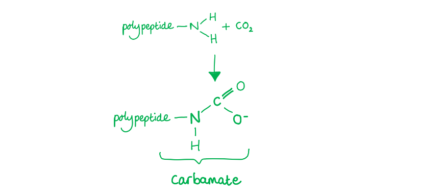

### Q22
**Final answer:** **The correct answer is ****C**** because:**

- **Carbonic anhydrase**** is an enzyme found in high quantities in the cytoplasm of ****red blood cells**** and in lower quantities in blood plasma**
- **Carbonic anhydrase converts molecules of ****carbon dioxide**** (CO****2****) and water (H****2****O) into ****carbonic acid**** (H****2****CO****3****)**
- **Carbonic acid (H****2****CO****3****)**** ****then dissociates to hydrogen carbonate (HCO****3****-****) and ****hydrogen (H****+****) ions**
- **Haemoglobin readily reacts with H****+**** ions to form ****haemoglobinic acid**** (HHb), in doing so ****dissociates**** from oxygen**
- **H****+**** ions cause more ****ionic bonds**** to form in haemoglobin and therefore change its tertiary structure, so oxygen no longer binds**

> *A **is incorrect as **carbonic anhydrase** catalyses the production of carbonic acid from carbon dioxide.*

> *B **is incorrect as the production of H**+** ions from the carbonic anhydrase reaction changes the **tertiary structure** of haemoglobin so oxygen can’t bind as easily.*

> *D **is incorrect as carbaminohaemoglobin is a compound of haemoglobin and carbon dioxide, not oxygen.*

### Q23
**Final answer:** **The correct answer is ****D**** because:**

- **The cell membrane of red blood cells contains ****Na****+****/K****+**** pumps**** which use ****ATP**** (energy) to move 3 Na****+**** ions out of the cell and 2K****+**** ions into the cell.**
- **The movement of ions occurs ****against their concentration gradient****, therefore enforcing a high concentration of Na****+**** outside the red blood cell and a low concentration of Na****+**** inside the red blood cell (and the opposite for K****+****).**
- **Glucose**** is ****co-transported**** with ****Na****+**** ions, using the diffusion of Na+ down its concentration gradient (from a high concentration outside the cell to a low concentration inside the cell) to pull the glucose into the red blood cell.**
- **Bringing glucose into the red blood cell is important for enabling ****anaerobic**** ****respiration**** and the production of ****ATP.**

  - **Red blood cells do not have mitochondria so aerobic respiration cannot take place in red blood cells**

> *A **is incorrect as mature red blood cells do **not** contain a **nucleus** and therefore cannot carry out **protein synthesis.*

> *B** is incorrect as all red blood cells are derived from stem cells called **hemocytoblasts** in red bone marrow. They** cannot** perform cell division as they do **not** contain any DNA.*

> *C** is incorrect as red blood cells **cannot **perform **phagocytosis**. A specific type of white blood cell called a phagocyte performs phagocytosis (engulfing large particles).*

### Q24
**Final answer:** **The correct answer is ****B**** because each haemoglobin molecule has four haem groups, each of which can bind to one oxygen molecule (O****2****). Remember that an ****oxygen molecule**** is made from ****two oxygen atoms****. Therefore, each haemoglobin molecule can carry a maximum of ****eight**** ****oxygen**** ****atoms****, forming ****HbO****8****. **

> *Reaction 1 is the reaction that occurs in the **cytoplasm** of the red blood cells. *

### Q25
**Final answer:** **The correct answer is ****A**** because:**

- **Reduced concentrations of the enzyme ****carbonic anhydrase**** results in the formation of less carbonic acid from carbon dioxide and water, which means less dissociation of carbonic acid:**

**                                                          **** H****2****CO****3****     ⇌     HCO****3****-    ****  +         H +**

- **H****+**** ions are taken in by haemoglobin, which releases the oxygen it’s carrying, allowing ****haemoglobinic acid**** (HHb) to form**
- **With less H****+**** forming from the dissociation of reduced amounts of carbonic acid, less oxygen is released in respiring tissue**

> *B **is incorrect as the pH of the blood would not be lowered if less **carbonic acid** forms and less H+ ions are released by dissociation.*

> *C **is incorrect as **carbaminohaemoglobin **concentrations are not affected by the activity of carbonic anhydrase, as carbaminohaemoglobin forms between the **terminal amine** groups of haemoglobin molecules and carbon dioxide.*

> *D **is incorrect as the rate of dissociation of carbonic acid is not dependent on the activity of carbonic anhydrase.*

### Q26
**Final answer:** **The correct answer is ****C**** because:**

- **Each haemoglobin molecule has four ****haem groups**** containing ****iron****, and an oxygen molecule (O****2****) can bind to ****each ****haem group**
- **The binding of the first O****2**** molecule to a haem group ****distorts the shape**** of the haemoglobin molecule, which makes it ****easier**** for another O****2**** molecule to combine with a second haem group**
- **This causes further distortion, so it is successively easier for two more O****2**** molecules to bind to the third and fourth haem group**
- **In this way, oxyhaemoglobin formation ****increases**** the capacity of red blood cells to transport oxygen around the body**

> *A **is incorrect as **carboxyhaemoglobin** forms when **carbon monoxide** (CO) binds to haemoglobin – this is **almost irreversible** as carboxyhaemoglobin is very stable, so CO does not dissociate readily from haem groups.*

> *B **is incorrect as the binding of the first oxygen molecule **increases **the affinity of haemoglobin for oxygen.*

> *D **is incorrect as each haemoglobin can temporarily bind to **8 oxygen atoms** (or 4 oxygen molecules – O**2**).*

### Q27
**Final answer:** **The correct answer is ****D**** because:**

- **Statements ****2**** and ****3**** are correct.**
- **In the cytoplasm of red blood cells is the enzyme carbonic anhydrase, which catalyses the following reaction:**

**Final answer:** **                                                   CO****2 ****         +    H****2****O     ⇌         H****2****CO****3**

**Final answer:** **                                           carbon dioxide     +     water   ⇌       carbonic acid  **

> *Statement 1 is incorrect as some (~10%) carbon dioxide binds to the terminal **amine group** of some haemoglobin molecules forming **carbaminoglobin**. Carbonic acid (formed by the reaction of carbon dioxide with water) dissociates to form hydrogen ions that combine with haemoglobin to form **haemoglobinic acid** (HHb).*

### Q28
**Final answer:** **The correct answer is ****B**** because:**

- **When ****haemoglobin ****has a lower affinity for oxygen it means that it does not bind to oxygen as well due to haemoglobin being in a different ****conformation ****(shape) than when it has a high affinity for oxygen**
- **When haemoglobin has a lower affinity for oxygen and therefore does not bind to oxygen as well, oxygen molecules are more ****readily dissociated**** (released)**
- **Haemoglobin’s affinity for oxygen decreases as a result of the Bohr effect**

### Q29
**Final answer:** **The correct answer is ****D**** because:**

- **The cytoplasm of ****red blood cells**** contains the enzyme ****carbonic anhydrase****, which catalyses the following reaction:**

**Final answer:** **                                                               CO****2****          +    H****2****O     ⇌         ****H****2****CO****3**

**Final answer:** **                                                       carbon dioxide    +   water    ⇌     ****carbonic acid****  **

- **Carbonic acid ****rapidly dissociates**** into hydrogen carbonate ions and hydrogen ions:**

**Final answer:** **                                                            H****2****CO****3****    ⇌            ****HCO****3****-**** ****              +          H****+**

**Final answer:** **                                                 carbonic acid     ⇌    ****hydrogen carbonate****        hydrogen ions**

> *A **is incorrect as **oxyhaemoglobin** is formed from **haemoglobin** and **oxygen** in red blood cells in the lungs and does **not** rely on carbonic anhydrase for its formation*

> *B **is incorrect as **carbaminohaemoglobin** is formed from **haemoglobin** and **carbon dioxide** in red blood cells around respiring tissues and does **not** rely on carbonic anhydrase for its formation*

> *C **is incorrect as **haemoglobinic acid** is formed from **haemoglobin** and **hydrogen ions** and does **not directly rely** on carbonic anhydrase for its formation.*

### Q30
**Final answer:** **The correct answer is ****A**** because:**

- **At ****high partial pressures**** there are ****more molecules**** of the gas than at low partial pressure.**
- **As more ****oxygen**** molecules bind to haemoglobin the ****affinity**** for oxygen increases, therefore at low oxygen partial pressure the affinity for oxygen is low.**
- **At high partial pressure of carbon dioxide, the pH decreases (gets more ****acidic****) because one of the end products of the reaction by ****carbonic anhydrase**** with carbon dioxide and water is ****hydrogen ions**** (H****+****).**
- **Higher concentration of hydrogen ions means a lower, more acidic pH.**
- **This relationship is called the ****Bohr effect**** and can be shown by this graph:**

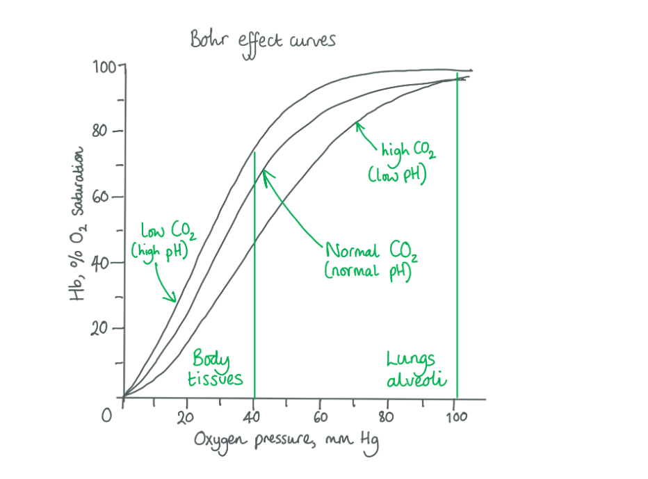

## Structured Questions (14 questions)

### Q1
The property of haemoglobin that causes a sigmoid curve is...

- Positive cooperativity / cooperative binding; **[1 mark]**
- It is difficult for the first oxygen molecule to bind **OR** haemoglobin has a low affinity for oxygen before / until the first oxygen molecule binds **OR **affinity of haemoglobin for oxygen increases after the first oxygen molecule binds;** [1 mark]  **
- Binding of the final oxygen molecule is difficult due to three of four binding sites being occupied; **[1 mark]**

***Accept**** alternative wording for marking point 2 and 3*

**[Total: 3 marks]**

> *The shallow gradient at the start and end of the sigmoid curve show that association of oxygen molecules is more difficult, hence an increase in partial pressure results in a relatively small increase in saturation. The steep region in the middle represents the binding of the 2nd and 3rd oxygen molecules, at this point, binding sites are readily available and affinity is higher (due to a shape change in the haem groups after the binding of the first oxygen molecule).*
The percentage saturation of haemoglobin with oxygen at the lungs and in metabolically active tissue is...

- 94 % (lungs) and 52 % (metabolically active tissue);** [1 mark]**

> *You are given two curves here but they are not labelled. The curve on the left is at lower carbon dioxide concentrations, so therefore represents oxygen binding in the lungs. The curve on the right represents a higher carbon dioxide concentration, so this would be at respiring cells. You need to select your values for each curve based on this information, which is essentially the Bohr Effect. *

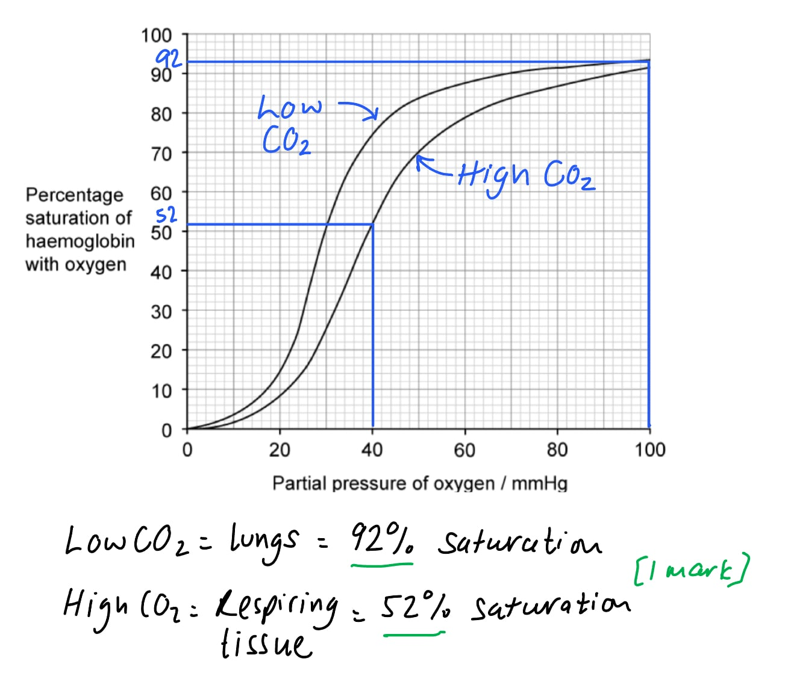
(i) The percentage change in ml of oxygen in blood from arterial to venous blood in a human body is...

- (20-15 / 15) x100 = 33.3 %; **[2 marks]**

(ii) The volume of oxygen is carried in venous blood in a human body is...

- 15 g x 1.34 ml x 0.77 = 15.477; **[1 mark]**
- 15.477 x 50 = 733.85 ml in 5 litres; **[1 mark]**

**[Total: 4 marks]**

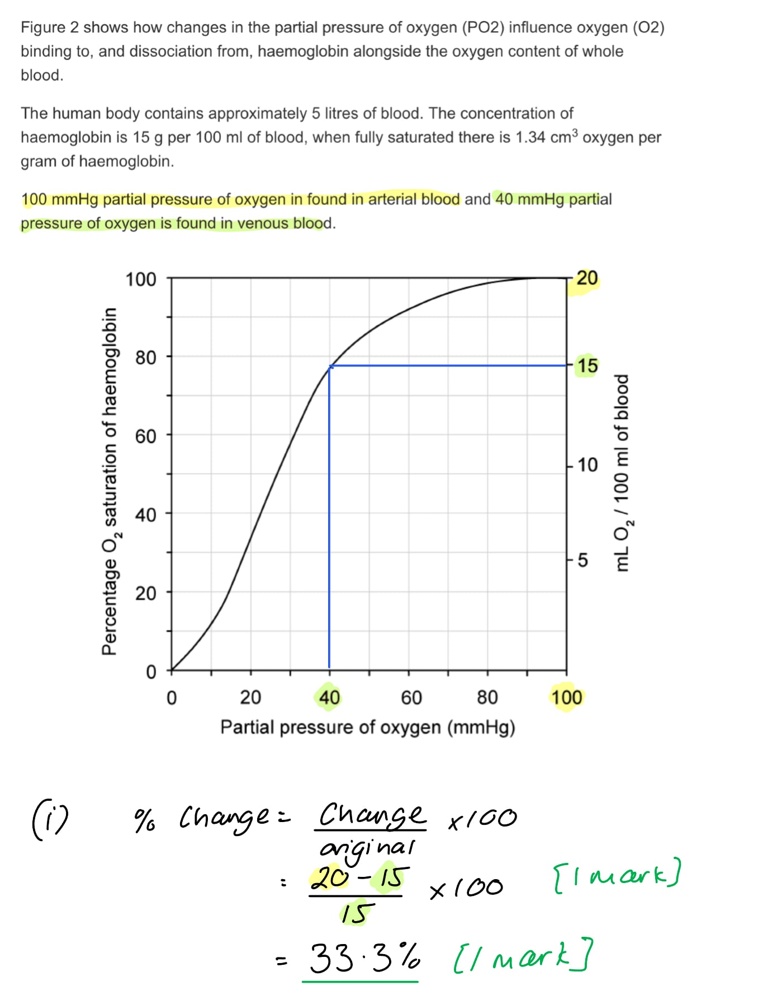

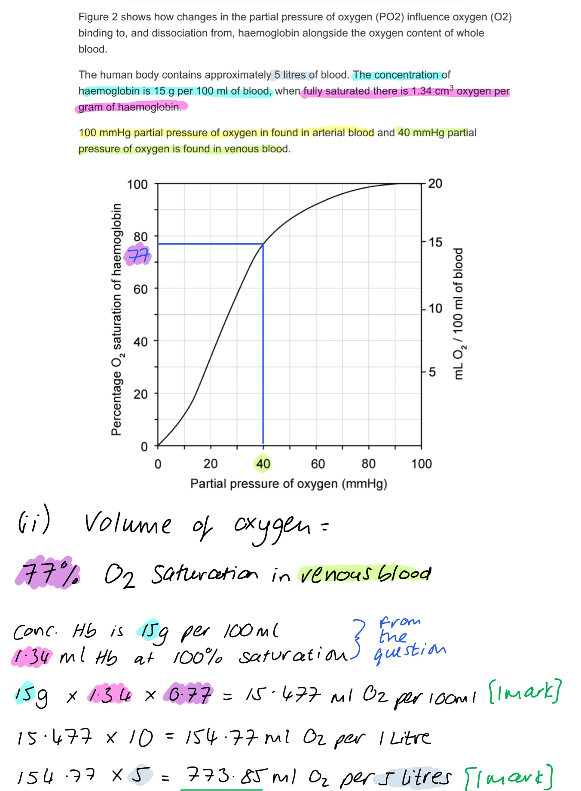
Venous blood can be said not to be deoxygenated because...

- Venous blood contains 15 ml of oxygen per 100 ml of blood; **[1 mark]**
- Venous blood contains 75% of oxygen of that of arterial blood; **[1 mark]**
- The veins in a human contain 750ml of oxygen (per 5 litres of blood); **[1 mark]**

**[Total: 3 marks]**

### Q2
Haemoglobin description:

**Final answer:** **Any ****three**** of the following:**

- Haemoglobin is a protein with a quaternary structure; **[1 mark]**
- Haemoglobin is made up of 4 polypeptides; **[1 mark]**
- Haemoglobin contains 4 Haem groups; **[1 mark]**
- Each haem groups contain iron ions / Fe2+; **[1 mark]**

**AND**

Explanation of how haemoglobin transports oxygen around the body:

**Final answer:** **Any ****three**** of the following:**

- Oxygen binds to haemoglobin in areas of high ppO2/high oxygen concentration; **[1 mark]**
- Cooperative binding occurs **OR** haemoglobin changes shape after the first oxygen molecule binds; **[1 mark]**
- Oxygen unloads/is released from haemoglobin in areas of low ppO2 / low oxygen concentration / high carbon dioxide concentration; **[1 mark]**
- Unloading takes place in the tissues because they have lower ppO2  due to aerobic respiration; **[1 mark]**

**[Total: 6 marks]**

> *Make sure that you add enough detail about both the structure of haemoglobin and its mechanism of oxygen transport. If you neglect to speak about one of them then you can only get 3 marks at a maximum.*

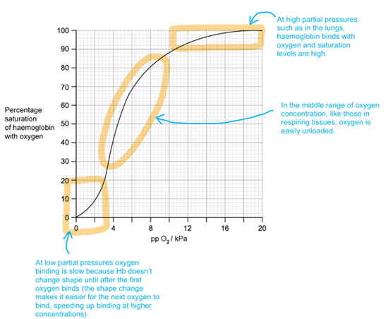
(i) The percentage saturation of myoglobin and haemoglobin are at 1 kPa partial pressure of oxygen is...

- Haemoglobin = 10% saturation, myoglobin = 73% saturation; **[1 mark]**

***Accept ****answer in the range of 72-73 for myoglobin. *

(ii) The significance of the difference in percentage saturation is...

**Final answer:** **Any ****three ****from the following:**

- Haemoglobin unloads/releases oxygen / dissociates easily/readily/at higher ppO2 (in tissues/cells); **[1 mark]**
- (Whilst) myoglobin holds on to oxygen / is very stable / does not dissociate easily / has a higher affinity for oxygen; **[1 mark]**
- (So) providing a store/reservoir/reserve of oxygen; **[1 mark]**
- (So will not) release oxygen until the pp/concentration/tension of oxygen is <u>low</u>/during strenuous exercise; **[1 mark]**
- So delaying respiration; **[1 mark]**

**[Total: 4 marks]**

> *You're not expected to know anything about myoglobin but this is an application question where you can take your knowledge of oxygen dissociation curves and apply them to a new example. *
(i) A comparison of the structures of myoglobin and haemoglobin is...

- Haemoglobin has four protein chains/polypeptides/subunits **whereas **myoglobin has one; **[1 mark]**
- Haemoglobin has four haem groups **whereas **myoglobin has one; **[1 mark]**

(ii) An explanation of the shape of the oxygen dissociation curve is...

**Final answer:** **Any ****two ****from the following:**

- The myoglobin is only carrying one oxygen (molecule); **[1 mark]**
- Myoglobin can become fully saturated much more quickly as a result; **[1 mark]**
- The myoglobin oxygen dissociation curve is steeper than haemoglobin / not a sigmoidal curve; **[1 mark]**

**[Total: 4 marks]**

### Q3
**Final answer:** **Any ****five**** of the following:**

A description of the shape of the curve for HbA is...

- The curve is relatively shallow / saturation increases relatively slowly between 0 and 4 kPa; **[1 mark]**
- The curve becomes steeper / saturation increases more quickly between 4 and 6 kPa; **[1 mark]**
- The curve levels off  / the rate of saturation slows down between 6 and 14 kPa / above 6 kPa; **[1 mark]**

The reasons for this are that...

- It is difficult for the first oxygen molecule to bind to haemoglobin / the first oxygen molecule binds to haemoglobin slowly **OR** the affinity of haemoglobin for oxygen is low at low pO2; **[1 mark]**
- Haemoglobin changes shape after the first oxygen molecule binds, making it easier for the remaining oxygen to bind / allowing the remaining oxygen molecules to bind more quickly / cooperative binding occurs **OR** the affinity of haemoglobin for oxygen increases as the pO2 increases; **[1 mark]**
- As the oxygen binding sites become saturated it takes longer for the final oxygen molecule to bind to haemoglobin; **[1 mark]**

**[Total: 5 marks]**

> *The shape of the oxygen dissociation curve is the result of **cooperative binding**; the process by which haemoglobin changes shape to make it easier for each subsequent oxygen molecule to bind.*

> *Marks can also be awarded here for the idea that oxygen binds more slowly when the affinity of haemoglobin for oxygen is low and more quickly when the affinity is higher.*
(i) The percentage saturation of HbA with oxygen at a pO2 of 4kPa is...

- 40 (%)

(ii) The percentage saturation of HbF with oxygen at a pO2 of 4kPa is...

- 72 (%)

**[Total: 1 mark]**

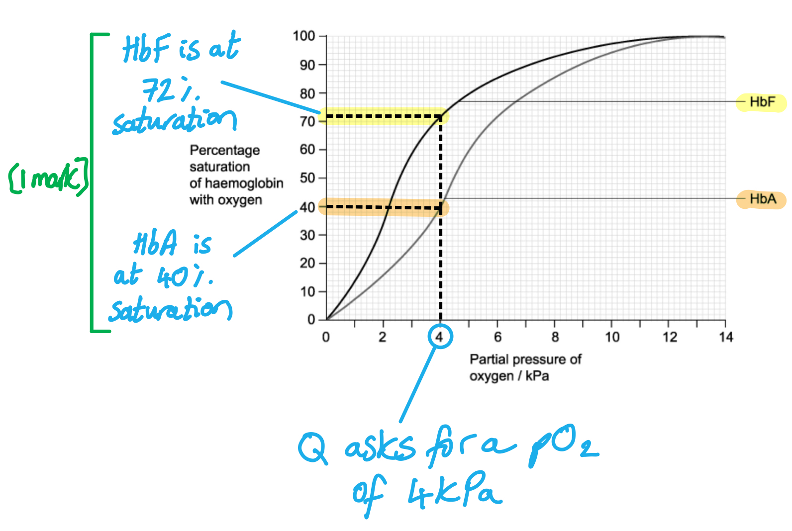
(i) Increased HbF expression helps to treat sickle cell disease because...

- It replaces the altered/mutated form of HbA (in transporting oxygen to the cells); **[1 mark]**

**OR**

- It enables red blood cells to keep their (flexible) shape / it prevents sickling in red blood cells (allowing them to pass easily through the capillaries; **[1 mark]**

(ii) HbF is not a perfect replacement for HbA because...

- It has a higher affinity for oxygen than HbA; **[1 mark]**
- It will release oxygen less readily / more slowly to the respiring cells/tissues; **[1 mark]**

**OR**

- A large amount/concentration of HbF is needed to prevent sickling in red blood cells; **[1 mark]**
- HbF does not prevent sickling in all red blood cells / some symptoms of sickle cell disease may still be present; **[1 mark]**

**[Total: 3 marks]**

> *This is a 'suggest' question, meaning that it is possible to answer it with no prior knowledge of sickle cell disease or foetal haemoglobin; the first answer in each part of the mark scheme should be achievable with no prior knowledge. *

> *The second answer to each part of the question in the mark scheme is closer to the reality of treating sickle cell disease with HbF, though students would not be expected to come up with these answers. The presence of HbF in the blood of sickle cell patients raises the level of oxygenation in the blood and reduces the level of red blood cell sickling, allowing blood to flow normally through the capillaries. For this to be an effective treatment there needs to be a certain level of HbF present in the blood, and even when this level is reached, it is still possible for red blood cell sickling to occur.*
The oxygen dissociation curve for myoglobin should have the following features...

- Positioned to the left of HbA and HbF throughout the entire curve; **[1 mark]**
- Starts and ends at the same points as HbA and HbF; **[1 mark]**

**[Total: 2 marks]**

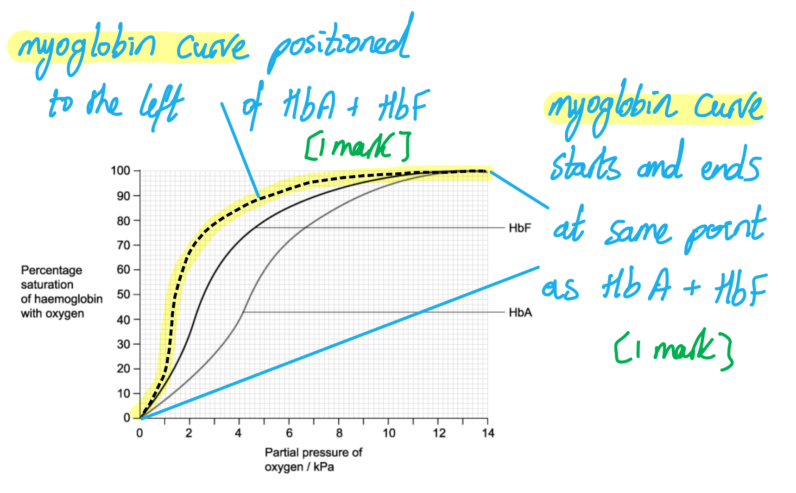

### Q4
One feature of red blood cells that contributes to their short-lived nature is...

- They have no nucleus / genetic material / DNA / transcription / mRNA / translation; **[1 mark]**
- They are unable to build new proteins to repair cell damage / replace damaged proteins (so they cannot restore cell function); **[1 mark]**

**OR**

- They contain large amounts of haemoglobin (for the transport of oxygen); **[1 mark]**
- The loss of internal protein structure would lead to non-functional haemoglobin (and therefore non-functioning red blood cells); **[1 mark]**

**OR**

- They are highly flexible / have cell surface membranes that can easily flex/deform; **[1 mark]**
- The loss of membrane protein structure could lead to inflexible membranes / membranes that cannot deform (preventing the cells from squeezing through capillaries); **[1 mark]**

**[Total: 2 marks]**
(i) The process taking place at **P** can be represented by the word equation...

- Oxyhaemoglobin$\rightarrow$Oxygen + Haemoglobin; **[1 mark]**

***Accept**** the same word equation with a reversible arrow symbol*

(ii) The following events are taking place at **Q** and **S**...

- **Q** = Haemoglobin combines with carbon dioxide to form carbaminohaemoglobin; **[1 mark]**
- **S **= Chloride ions are diffusing into the red blood cell / the chloride shift is taking place to balance the loss of negative charge (that occurs when hydrogen carbonate ions diffuse out of the cell); **[1 mark]**

**[Total: 3 marks]**
The connection between process **R** and the Bohr shift is...

- H+/hydrogen ions (produced from the dissociation of carbonic acid) bind with haemoglobin, causing oxygen to be released; **[1 mark]**
- The affinity of haemoglobin for oxygen is reduced; **[1 mark]**

**[Total: 2 marks]**
The Bohr shift is important to metabolically active tissues because...

**Final answer:** **Any ****three**** of the following:**

- (Metabolically active tissues) produce carbon dioxide during respiration; **[1 mark]**
- Haemoglobin releases more oxygen / releases oxygen more readily at increased carbon dioxide levels; **[1 mark]**
- (The increased release of oxygen) occurs without the need for an increase in pO2; **[1 mark]**
- This supplies the oxygen needs of the tissues / allows aerobic respiration to continue; **[1 mark]**

**[Total: 3 marks]**

### Q5
The oxygen dissociation curves for an elephant and a mouse would be...

- Correct points plotted (+- 1mm); **[1 mark]**
- Partial pressure of oxygen in mmHg on X axis **and** % saturation of haemoglobin with oxygen on Y axis; **[1 mark]**
- Sigmoid-shaped curves drawn using points for each animal; **[1 mark]**

**[Total:  3 marks]**

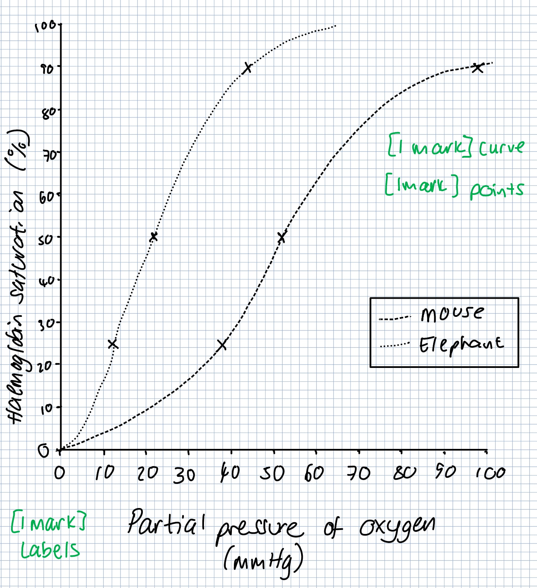
The dissociation curve for the mouse is different to the dissociation curve for the elephant because...

**Final answer:** **Any ****three**** of the following:**

- Mouse haemoglobin releases more oxygen at the same partial pressure as the elephant; **[1 mark]**
- Mice cells needs more oxygen (for respiration); **[1 mark]**
- Because mice have a larger surface area to volume ratio **OR **mice have a greater activity level **OR** mice have higher (cellular) metabolic rates; **[1 mark]**

***Accept ****converse statements relating to the elephant*

**[Total: 3 marks]**

> *The mouse oxygen dissociation curve sits to the right of the elephant curve. Remember that** **a small decrease in pO**2** causes a large decrease in the percentage saturation of haemoglobin, leading to the easy release of plenty of oxygen to the cells for respiration. *

> *Due to their large surface area to volume ratio and higher levels of activity, mice tend to have higher metabolic rates to provide the energy required for the maintenance of body temperature and movement.*
Haemoglobin in the respiring tissues has a lower affinity for oxygen because...

- Cells are producing carbon dioxide / greater concentration of carbon dioxide (in respiring tissues); **[1 mark]**
- Carbon dioxide combines with water to form carbonic acid; **[1 mark]**
- Carbonic acid dissociates into hydrogen carbonate ions and hydrogen ions; **[1 mark]**
- Hydrogen ions bind to haemoglobin which causes the release of oxygen / lower affinity of oxygen (by haemoglobin); **[1 mark]**

**[Total: 4 marks]**

### Q6
(i) The structure of a haemoglobin molecule makes it able to transport oxygen efficiently because...

**Final answer:** **Any ****three ****of the following:**

- Haem group containing iron (atom); **[1 mark]**
- Four haem groups (per molecule of haemoglobin); **[1 mark]**
- Each iron (atom)/haem/prosthetic group binds one oxygen molecule **OR **four oxygen molecules per haemoglobin molecule; **[1 mark]**
- Cooperative binding described, e.g. once the first oxygen atom binds to haemoglobin it becomes easier for the next atoms to bind; **[1 mark]**

(ii) The structure of a haemoglobin molecule allows it to be soluble in water because...

**Final answer:** **Any ****two ****of the following:**

- Folding of polypeptide chains (give a globular structure); **[1 mark]**
- Hydrophilic R groups/amino acids are on the outside of the molecule / hydrophobic R groups/amino acids are on the inside of the molecule; **[1 mark]**
- Hydrogen bonds form with water (molecules); **[1 mark]**

**[Total: 5 marks]**
(i) The percentage saturation of haemoglobin of llamas and humans at an oxygen partial pressure of 6.4 kPa are...

- Llamas = 90.5 % **AND **humans = 78.5 %; **[1 mark]**

(ii) The advantage to llamas of having an oxygen dissociation curve positioned to the left of the curve for humans are...

**Final answer:** **Any ****two ****of the following:**

- (Llamas have) a lower <u>partial pressure</u> of oxygen at high altitude; **[1 mark]**
- At the same partial pressure the percentage saturation is (much) higher than for humans; **[1 mark]**
- Haemoglobin has a higher <u>affinity</u> for oxygen; **[1 mark]**
- There is sufficient oxygen delivered to tissues to satisfy demand; **[1 mark]**

**[Total: 3 marks]**

> *It is important to make use of key terms such as **partial pressure of oxygen**, and** affinity**, rather than simplifying. For example, stating **oxygen concentration** in this question would not get you the mark.*

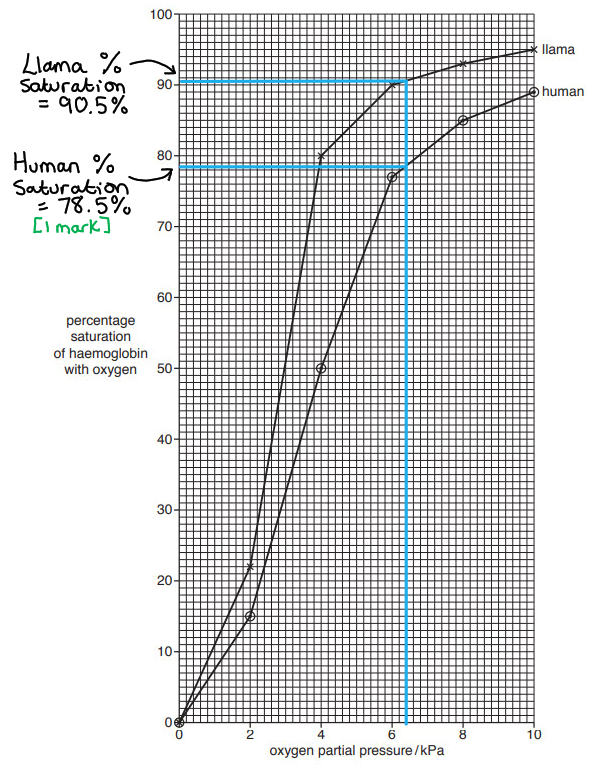
The percentage saturation of haemoglobin for fetal llama haemoglobin at an oxygen partial pressure of 4 kPa might be...

- Answer in the range of 85 - 100 % saturation; **[1 mark]**

**[Total: 1 mark]**

> *If the curve shifts to the left for fetal haemoglobin then we would expect the haemoglobin to have an increase in % saturation compared to the adult llama at the same partial pressure. This means that the fetal haemoglobin would have a greater affinity for oxygen so that it binds more readily and dissociates slowly; this is an advantage for the developing foetus. *

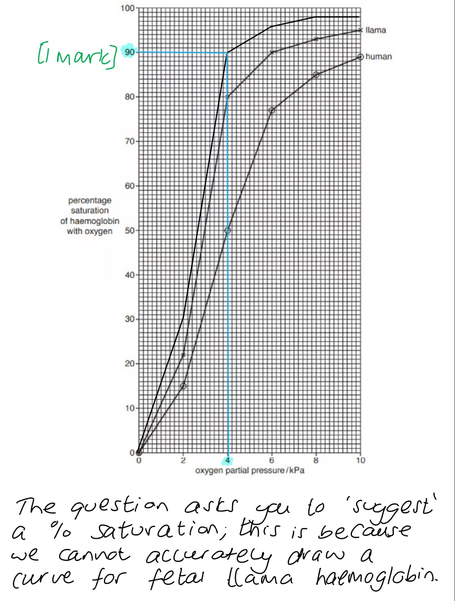

### Q7
The mechanism of red blood cells to prevent electrical imbalance is as follows...

**Final answer:** **Any ****three**** of the following:**

- Chloride shift; **[1 mark]**
- Chloride ions/Cl- are transported into the red blood cells; **[1 mark]**
- To replace hydrogen carbonate ions/ HCO3- (formed from the dissociation of carbonic acid) which are transported out of red blood cells; **[1 mark]**
- This prevents red blood cells from becoming positively charged; **[1 mark]**

**[Total: 3 marks]**
Labels A - C are...

- A = hydrogen carbonate ions/HCO3-
- B = Hydrogen ions/H+
- C = Chloride ions/Cl-

***Reject ****chlorine ions*

**[Total: 3 marks]**
The percentage change in chloride ions is...

- Percentage change = 101.2-104.8 = - 3.6; **[1 mark]**
- 3.6 / 101.2 x100 =  -3.56 % **OR** 3.56 % <u>decrease</u>; **[1 mark]**

***Award**** 1 mark for answers not given to 3 significant figures*

The reason that arterial blood has greater mmol of chloride ions is because...

- Arterial blood has not reached respiring cells/tissues; **[1 mark]**
- (Therefore) chloride ions/Cl- have not been needed to replace hydrogen carbonate ions **OR **chloride shift has not occurred yet; **[1 mark]**

**[Total: 4 marks]**

> *The explanation here requires you to recall that chloride ions are used to replace hydrogen carbonate ions at respiring tissues. Hydrogen carbonate ions are present due to the reaction of carbon dioxide (from respiring cells) and water within the red blood cells. This produces carbonic acid which breaks down to form hydrogen carbonate ions (and hydrogen ions) that diffuse out of the red blood cells into plasma. So these negative ions have to be replaced with the chloride ions. This would happen in the capillaries and so venous blood would contain less chloride ions than arterial blood. *
The method of transport that this is an example of is...

- Facilitated transport; **[1 mark]**

**[Total: 1 mark]**

### Q8
The structure of haemoglobin relates to its function in the following ways...

**Final answer:** **Any ****three**** of the following:**

- It is a globular protein **SO **hydrophobic regions are in the centre / hydrophilic regions are on the outside / it is soluble; **[1 mark]**
- It has four subunits/haem groups/polypeptides **SO** can bind to four molecules of oxygen / eight oxygen atoms; **[1 mark]**
- It has prosthetic groups / iron ions/atoms / Fe2+ / haem groups **SO** can bind to oxygen; **[1 mark]**
- The shape changes when the first oxygen molecule binds **SO** allowing other oxygen molecules to bind more easily / cooperative binding; **[1 mark]**

**[Total: 3 marks]**

> *Be sure to link structure to function for each mark.*
Fig. 2 shows the following about the relationship between pO2 and the affinity of haemoglobin for oxygen...

**Final answer:** **Any ****three**** of the following:**

- At low pO2 the affinity of haemoglobin for oxygen is low; **[1 mark]**
- Haemoglobin binds slowly to oxygen at low pO2 / oxygen saturation is low at low pO2; **[1 mark]**
- At high pO2 the affinity of haemoglobin for oxygen is high; **[1 mark]**
- Saturation of haemoglobin with oxygen is high at high pO2; **[1 mark]**

**[Total: 3 marks]**
The difference in percentage saturation of haemoglobin with oxygen between a pO2 of 2 kPa and a pO2 of 8 kPa is...

- 93 - 16; **[1 mark]**
- 77 (%); **[1 mark]**

**OR**

- 93 - 15; **[1 mark]**
- 78 (%); **[1 mark]**

**OR**

- 93 - 15.5; **[1 mark]**
- 77.5 (%); **[1 mark]**

*Full marks can be awarded for the correct answer of 77 % in the absence of other calculations*

**[Total: 2 marks]**

> *Don't get distracted by the appearance of the word 'percentage' in this question; you are not being asked to calculate a percentage difference, just the difference in percentage which is the unit already shown on the y axis of the graph.*

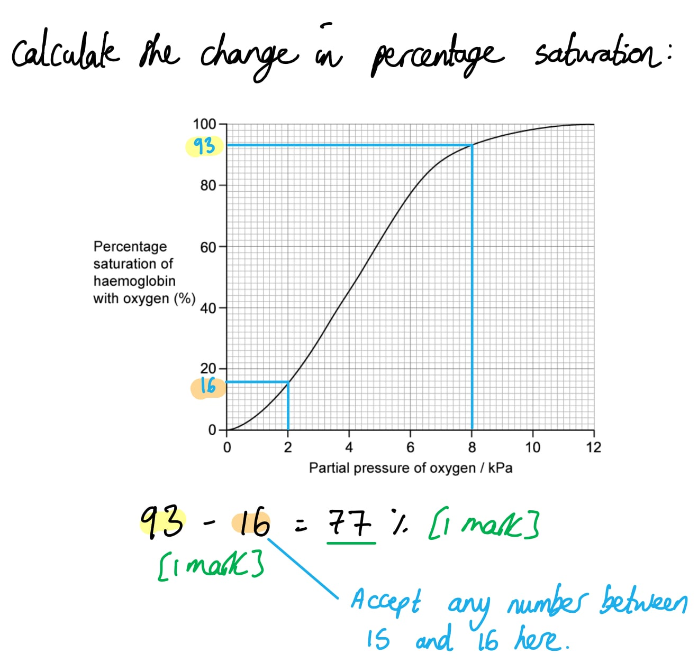
The advantage to an anaemic individual of producing chemicals that have the effect shown in Fig. 3 is that...

- The curve (for the anaemic person producing chemicals in the blood) has shifted to the right **SO** their haemoglobin has a lower affinity for oxygen; **[1 mark]**
- The anaemic haemoglobin releases <u>more</u> oxygen **OR** oxygen is released <u>more</u> quickly by the anaemic haemoglobin **OR** oxygen dissociates/unloads <u>more</u> readily from anaemic haemoglobin; **[1 mark]**
- This oxygen is then available for use in aerobic respiration;** [1 mark]**

**[Total: 3 marks]**

> *The anaemic individual has less haemoglobin, so it is useful to be able to release oxygen more easily from the haemoglobin that they do have; this is achieved by lowering the affinity of existing haemoglobin for oxygen.*

### Q9
The completed table should be as follows...

**Final answer:** **One mark to be awarded ****per correct row**** as follows:**

| Location | Partial pressure of oxygen / kPa | Percentage saturation of haemoglobin / % | Rate of oxyhaemoglobin dissociation ( slow / fast) |   |
|---|---|---|---|---|
| Capillaries branching from pulmonary artery | 0.6 | **2** | **slow** | ; **[1 mark]** |
| Capillaries in respiring tissue | **4** | 45 | **fast** | ; **[1 mark]** |
| Capillaries leading to pulmonary vein | **10** | 98 | **slow** | ; **[1 mark]** |

**[Total: 3 marks]**

> *The **rate** of oxyhaemoglobin dissociation can be determined by looking at the gradient of the curve; when the curve has a shallow gradient the rate will be slow and when the curve has a steep gradient it will be fast.*

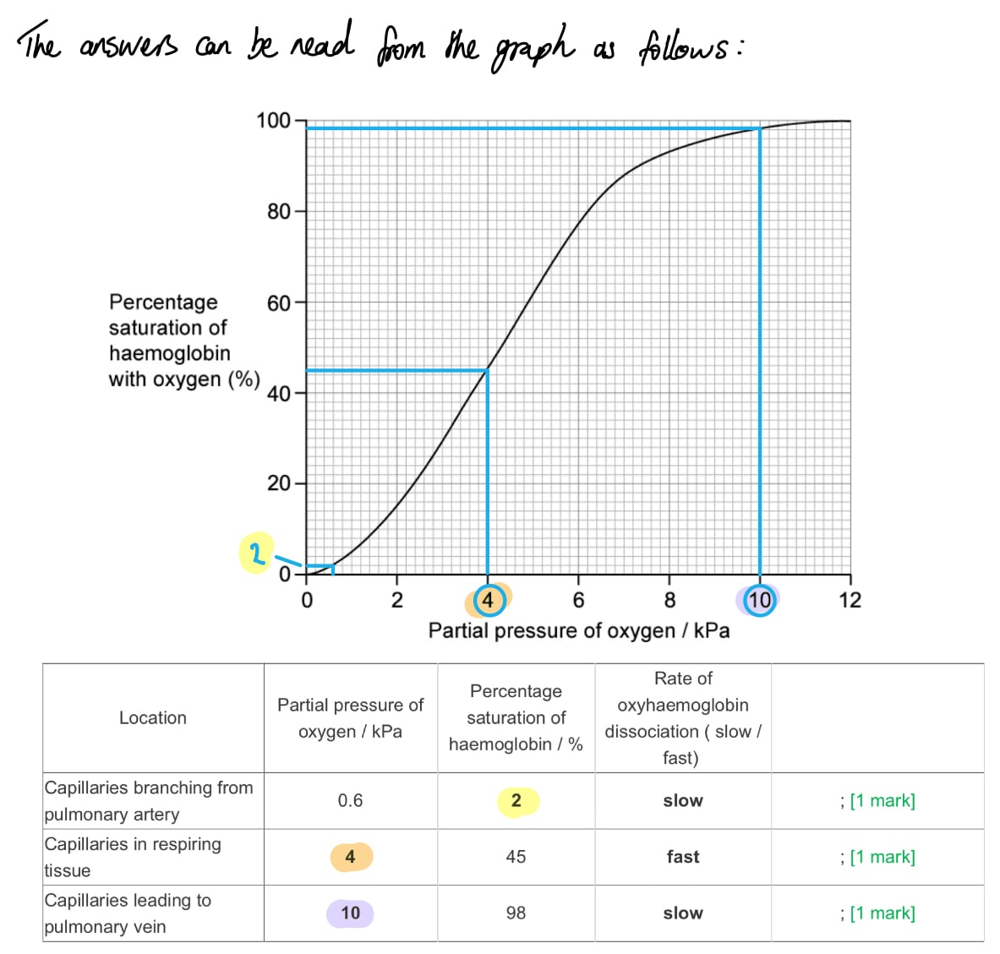
Oxygen is released more readily from haemoglobin during exercise because...

**Final answer:** **Any ****four**** of the following:**

- During exercise the rate of respiration in the tissues increases **SO** releasing more carbon dioxide; **[1 mark]**
- Carbon dioxide combines with water to produce carbonic acid; **[1 mark]**
- (The formation of carbonic acid is catalysed by) carbonic anhydrase; **[1 mark]**
- Carbonic acid dissociates to form hydrogen ions/H+ and hydrogen carbonate ions/HCO3-; **[1 mark]**
- Hydrogen ions bind with haemoglobin; **[1 mark]**
- (The binding of hydrogen ions to haemoglobin forms) haemoglobinic acid; **[1 mark]**
- (When hydrogen ions bind) haemoglobin releases oxygen; **[1 mark]**

***Accept**** equivalent points in the form of word or symbol equations*

**[Total: 4 marks]**
The haemoglobin of species **X** allows it to live at high altitudes because...

**Final answer:** **Any ****two**** of the following:**

- The haemoglobin (of species **X**) has a higher affinity for oxygen; **[1 mark]**
- This enables (the haemoglobin of species **X**) to pick up / associate with / bind to oxygen more easily/readily at lower partial pressures of oxygen; **[1 mark]**
- (At high altitudes) the atmospheric concentration / partial pressure of oxygen is lower) so species **X** can supply enough oxygen to its tissues / achieve a higher percentage saturation of oxygen at low pO2; **[1 mark]**

**[Total: 2 marks]**

> *The partial pressure of oxygen is lower at high altitudes, meaning that the haemoglobin of organisms adapted to live at sea level will have a lowered affinity for oxygen, dissociating with it when it needs to pick it up. Species that are adapted to live at high altitudes often have haemoglobin with a higher affinity for oxygen (seen here by the shift of the curve to the left), meaning that their haemoglobin can pick up oxygen at low pO**2** rather than dissociate with it. This allows them to achieve a higher percentage saturation in their lungs and supply enough oxygen to their tissues.*
The haemoglobin of species **Y** enables it to be more metabolically active because...

**Any ****two**** of the following:**

- It has a lower affinity for oxygen; **[1 mark]**
- It dissociates/releases oxygen more easily/readily; **[1 mark]**
- It supplies more oxygen to the respiring cells (of the active species **Y**); **[1 mark]**

**[Total: 2 marks]**

> *This scenario is similar to the Bohr shift that you will be familiar with; an increase in carbon dioxide causes the dissociation curve to shift to the right, indicating a reduced affinity of haemoglobin for oxygen and an easier release of oxygen to the respiring cells. In this case, it is a permanent adaptation for the active species **Y** rather than a temporary situation brought about by raised carbon dioxide levels, but the principle is the same; a shift of the curve to the right indicates reduced affinity for oxygen, meaning an easier release of oxygen to respiring tissues.*

### Q10
Haemoglobin supplies oxygen to different areas of the body by...

- Haemoglobin is loaded/associates/takes up/binds with oxygen in an area that has a <u>high </u><u>*pp*</u><u>O</u><u>2</u>; **[1 mark]**
- There is a higher *pp*O2 in lungs/gas exchange surface; **[1 mark]**
- There is a lower *pp*O2 in the capillaries/tissues/muscles; **[1 mark]**

**[Total: 3 marks]**

> *Haemoglobin molecules combine with oxygen when there are large amounts of it nearby (high concentration or high partial pressure) but crucially haemoglobin releases its oxygen molecules when there are low amounts of oxygen nearby (low concentration or low partial pressure). For humans, this means that oxygen will be taken up by the haemoglobin in the oxygen-rich lungs and released in tissues that have lower concentrations of oxygen due to respiration.*
The steep gradient in the curve seen for HbA in Fig. 1 is due to...

**Final answer:** **Any ****two**** of the following:**

- The first oxygen that binds haemoglobin causes a change in shape / conformational change; **[1 mark]**
- The change in the shape of haemoglobin allows more O2 to bind / O2 to bind more easily / an increase in the rate of O2 binding; **[1 mark]**

**[Total: 2 marks]**

> *For this question it is important to realise that they are not asking you to compare the two curves; they are asking you to **explain **the shape of one. Its shape can be explained by the shape change that takes place in haemoglobin after the first oxygen molecule binds.*
The difference between HbF and HbA is that...

**Final answer:** **Any ****one**** of the following:**

- HbF has a <u>higher affinity</u> for oxygen than HbA; **[1 mark]**
- HbF binds <u>more readily/easily</u> with oxygen (than HbA) at lower ppO2; **[1 mark]**

**[Total: 1 mark]**

> *When you are answering questions about differences or comparisons between things you must be sure to use comparative statements such as high**er** or **more**.*
Haemoglobin will be broken down into...

**Final answer:** **Any ****two**** of the following:**

- <u>Amino acids</u>; **[1 mark]**
- Possible uses: protein synthesis / building polypeptides / building named proteins **OR **deaminated for use in respiration; **[1 mark]**

**[Total: 2 marks]**

> *A common misconception is that amino acids are used to form urea; in reality this only applies to **excess **amino acids and is more of a way of dealing with waste rather than a ‘use’ so won’t get you a mark.*

### Q11
The chloride shift is...

- The movement of chloride ions into red blood cells; **[1 mark]**
- This occurs when hydrogen carbonate ions are formed; **[1 mark]**

**[Total: 2 marks]**

> *The chloride shift is not the same as the Bohr shift, so be sure to understand the difference. The Bohr shift occurs when a high partial pressure of carbon dioxide causes haemoglobin to release oxygen into respiring tissues, while the chloride shift refers to the movement of chloride ions into red blood cells.*
(i) The equations that represent the formation of hydrogen carbonate ions are...

- Step 1:** **CO2 + H2O ⇌ H2CO3; **[1 mark]**
- Step 2:** **H2CO3 ⇌ HCO3- + H+; **[1 mark]**

***Accept**** word equations*

(ii) The enzyme involved in these reactions is...

- Carbonic anhydrase; **[1 mark]**

**[Total: 3 marks]**

> *As it was not stated in the question, you will be awarded marks for either the symbol equations (as shown above) or the word equations, for part (b) (i). *
The importance of the chloride shift for red blood cells...

- To ensure that there is no build-up of electric charge taking place during gas exchange **OR **to exchange chloride <u>ions</u> with hydrogen carbonate <u>ions</u> **OR **to maintain a neutral charge inside the red blood cells; **[1 mark]**

**[Total: 1 mark]**

> *This is a really important process that takes place in the red blood cells. Hydrogen carbonate ions are very soluble so they are transported out of the red blood cells easily. To replace the negative charge, of the hydrogen carbonate ions, chloride ions (which are also negative) move into the red blood cell. This maintains the electrochemical neutrality of the red blood cell. *
The statements matched correctly are..

**[1 mark] **for each correct row

|   | Bohr Shift | Chloride Shift |
|---|---|---|
| Transport of oxygen out of red blood cells | **Final answer:** **✓** | **Final answer:** **X** |
| Transport of hydrogen carbonate ions out of red blood cells | **Final answer:** **X** | **Final answer:** **✓** |
| Transport of chloride ions into red blood cells | **Final answer:** **X** | **Final answer:** **✓** |

**[Total: 3 marks]**

### Q12
The importance of the oxygen dissociation curve at the lungs is...

- The lungs have a high partial pressure/concentration of oxygen; **[1 mark]**
- At high partial pressure of oxygen, oxygen can bind easily to haemoglobin; **[1 mark]**
- This means that haemoglobin can associate/combine with oxygen and become saturated; **[1 mark]**

**[Total: 3 marks]**
The effect of 20 mmHg partial pressure on oxygen saturation is...

- Oxygen dissociates readily from haemoglobin as shown by the steep region of the curve; **[1 mark]**
- There is easy/ready release of oxygen / oxygen dissociates easily from haemoglobin; **[1 mark]**
- So that it (oxygen) is available for cellular respiration; **[1 mark]**

**[Total: 3 marks]**

> *The steep region of the oxygen dissociation curve shows that, for a small increase in partial pressure of oxygen, there is a comparatively big increase in saturation of haemoglobin. This is the same in reverse, so at the respiring tissues, for every decrease in partial pressure, the saturation of haemoglobin drops significantly as oxygen dissociates and is used in respiration.*
A partial pressure of 20 mmHg might be found in...

- The respiring tissues; **[1 mark] **

**[Total: 1 mark]**

> *Partial pressures of oxygen are low in the respiring tissues as oxygen is used in respiring cells. Comparatively, partial pressures in the lungs are high due to ventillation.*
The % saturation of haemoglobin at 50 mmHg is...

- 87 % saturation; **[1 mark]**

**[Total: 1 mark] **

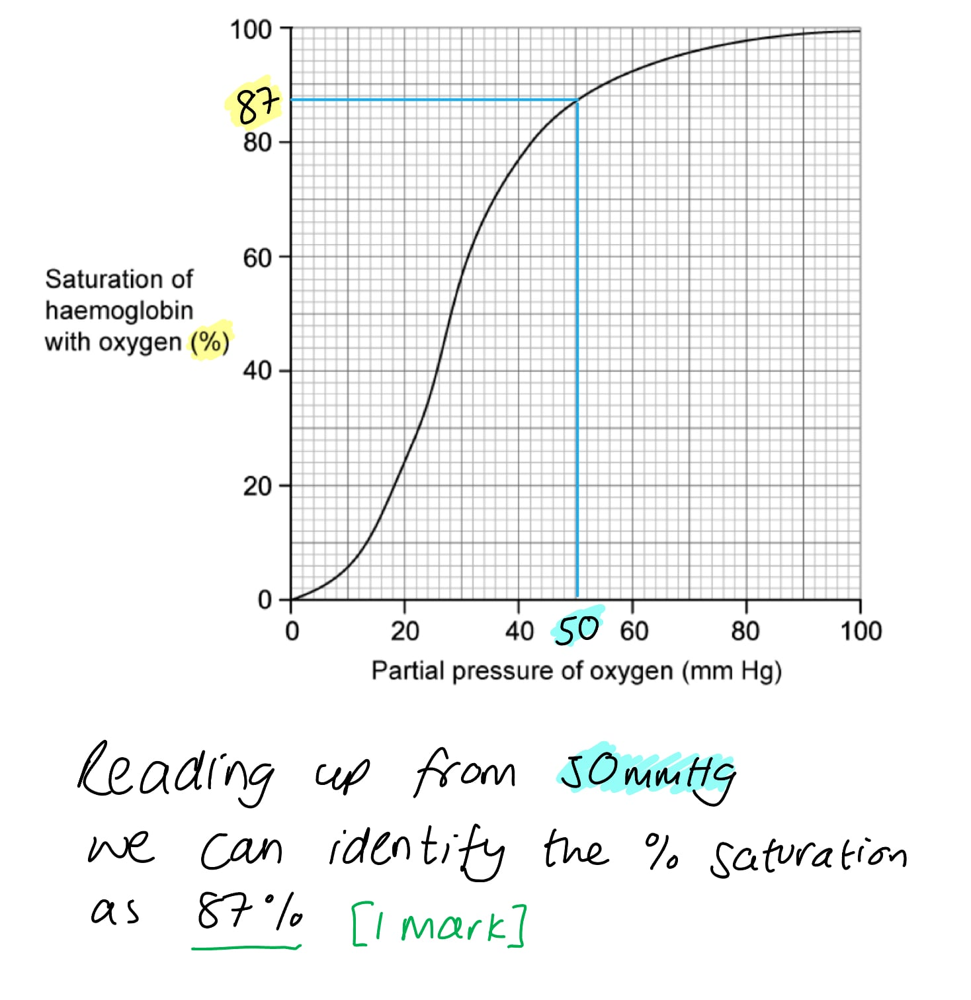

### Q13
The role of plasma and red blood cells in the transport of carbon dioxide is...

**Final answer:** **Any ****four**** of the following:**

- Carbon dioxide diffuses into the cytoplasm of red blood cells; **[1 mark]**
- Carbon dioxide combines with water; **[1 mark]**
- to form carbonic acid/H2CO3; **[1 mark]**
- Carbonic acid dissociates into hydrogen ions/H+ **AND** hydrogen carbonate ions/HCO3-; **[1 mark]**
- Hydrogen carbonate ions/HCO3- diffuse out of red blood cells into the plasma (to be transported in solution); **[1 mark]**

***Accept**** word or symbol equations for marking points 2 and 3*

**[Total: 4 marks]**

> *Ensure you are answering the question and not just recalling everything you know about carbon dioxide transport. You are not required to mention the enzyme involved here, or the fate of the hydrogen ions. Be specific in your responses to ensure you are answering the question asked. *
(i) The name of the enzyme which catalyses the reaction with carbon dioxide is...

- Carbonic anhydrase; **[1 mark]**

(ii) The role of the enzyme is...

- Catalyses the reaction between carbon dioxide <u>and water</u>; **[1 mark]**

**[Total: 2 mark]**
Haemoglobinic acid is formed by...

- Hydrogen ions; **[1 mark]**
- Reacting with/combining with haemoglobin; **[1 mark]**

**[Total: 2 marks]**

> *Hydrogen ions are formed when carbon dioxide is transformed into carbonic acid inside the red blood cells. This dissociates into hydrogen ions (and hydrogen carbonate ions). The hydrogen ions would** lower the pH** of red blood cells and possibly denature associated enzymes, so hydrogen ions combine with haemoglobin to form the product haemogobinic acid, which acts as a pH buffer in this situation. *
The importance of haemoglobinic acid is...

- Prevents the lowering of pH of blood/red blood cells **OR** maintains neutral pH of the blood;** [1 mark]**
- So that enzymes/proteins are not denatured;** [1 mark]**

**[Total: 2 marks]**

> *Haemoglobinic acid is a very weak acid so does not disrupt the pH of the red blood cells or blood fluid. *

### Q14
Red blood cells are adapted for oxygen transport by...

- Red blood cells lack nuclei; **[1 mark]**
- **Therefore** this allows more space for haemoglobin; **[1 mark]**
- Biconcave shape provides a high surface area to volume ratio; **[1 mark]**
- **Therefore** haemoglobin is relatively near the surface OR there is a short diffusion distance for oxygen; **[1 mark]**

**[Total: 4 marks]**

> *Make sure to justify the adaptation with an explanation otherwise, you will lose marks!  For example, you can’t just say that red blood cells lack nuclei, you need to also say that the lack of nuclei means there is more space for haemoglobin for oxygen transport. Using terms like "therefore", "so" and "because" is a really useful way to explain your answers. *
The calculations are as follows:

- The difference in no. of amino acids is (146 - 141 =) 5; **[1 mark]**
- The difference in no. of DNA bases is: (5 x 3 =) 15; **[1 mark]**

**[Total: 2 marks]**

> *This question has asked for two answers. Make sure you don’t forget to follow through and convert the difference in amino acids into the difference in DNA bases (by multiplying by 3) to get the two marks!*

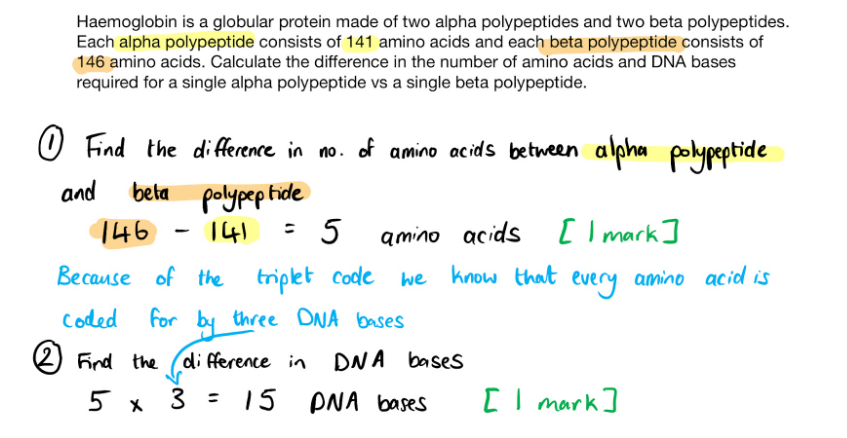
The magnification used was...

- 5cm = 50mm = 50,000µm; **[1 mark]**
- 50000 ÷ 7 = 7143;
- Magnification = x 7100; **[1 mark]**

**[Total: 2 marks]**

> *It is really important to be sure that you are working in the same units for every part of your calculation, so the best thing to do is to convert your cm measurement into µm. Remember that 1 cm = 10,000µm.*

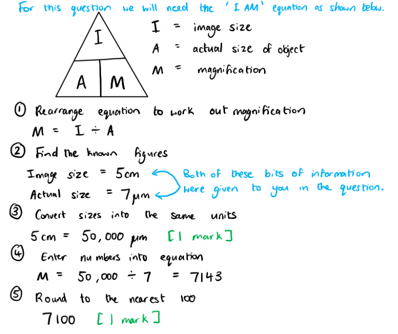
A mammal living at high altitude might have the following haemoglobin adaptation...

**Final answer:** **Any ****one**** of the following:**

- The haemoglobin of mammals living at a higher altitude will have a higher affinity for oxygen; **[1 mark]**
- Haemoglobin with an oxyhaemoglobin dissociation curve further to the left; **[1 mark]**
- Haemoglobin can be saturated with oxygen at lower partial pressures / concentrations of oxygen; **[1 mark]**

**[Total: 1 mark]**

> *At higher altitudes the partial pressure of oxygen is much lower. Be aware that you can’t just say the haemoglobin has a **high** affinity, you need to say **higher** to indicate the difference between the two types of haemoglobin.*
