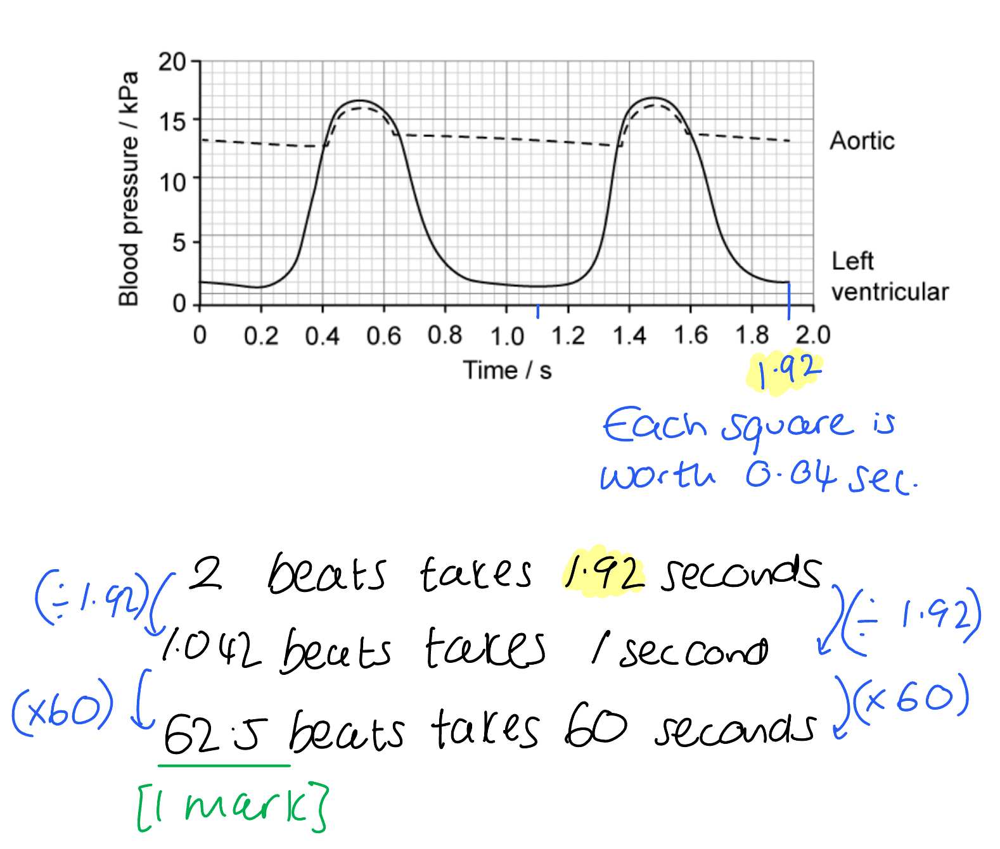
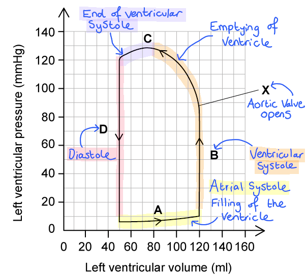
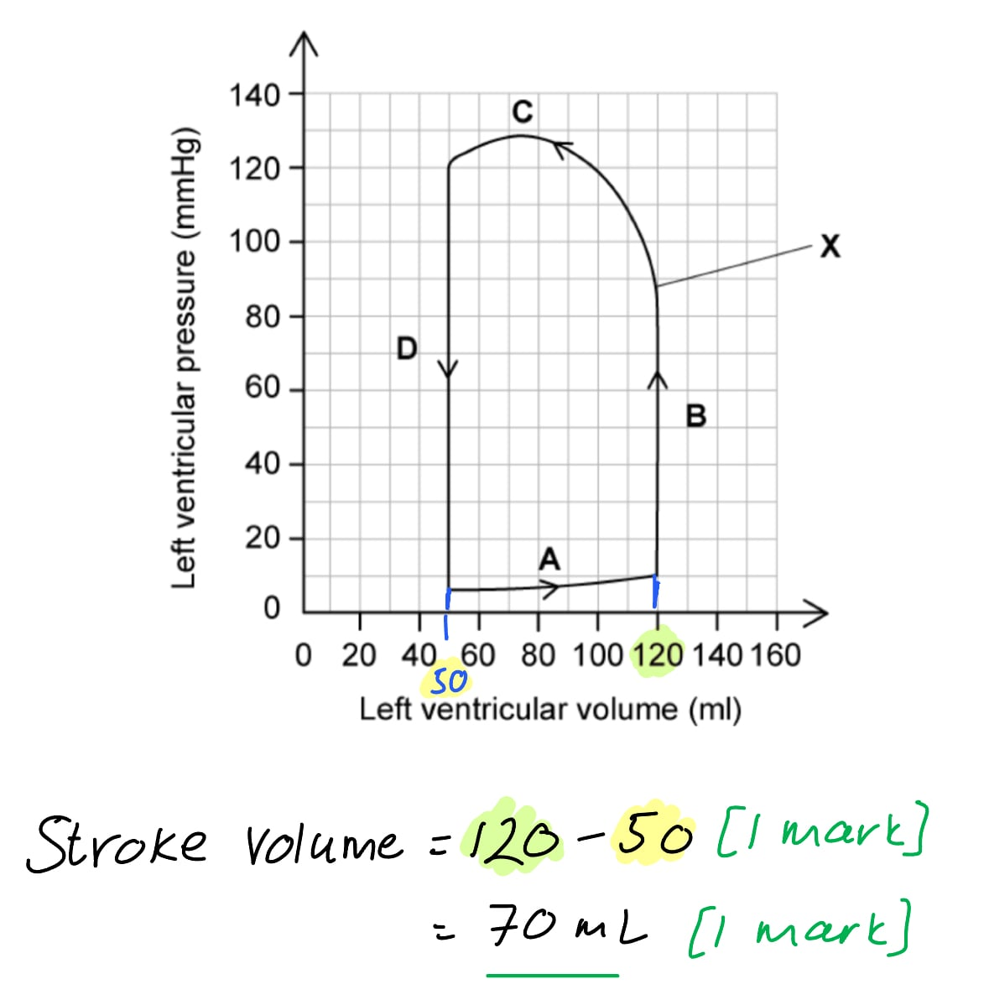
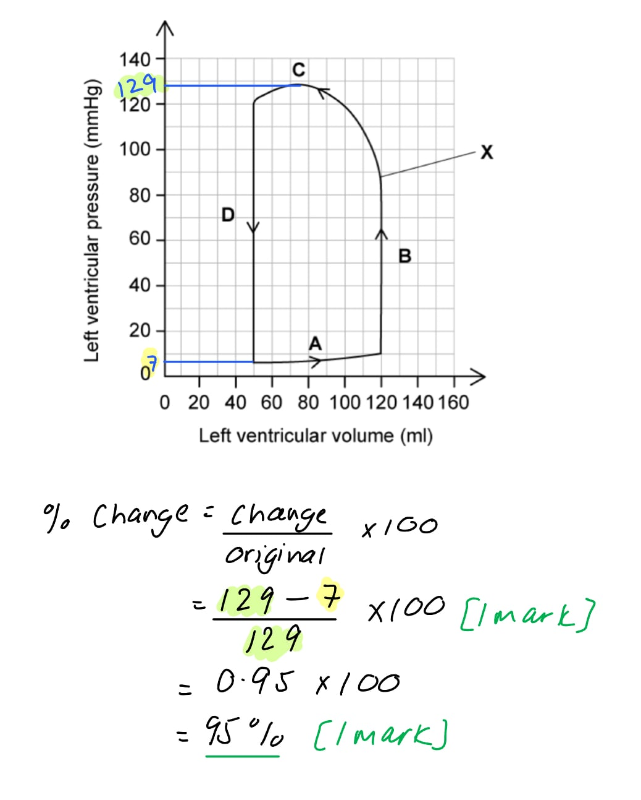
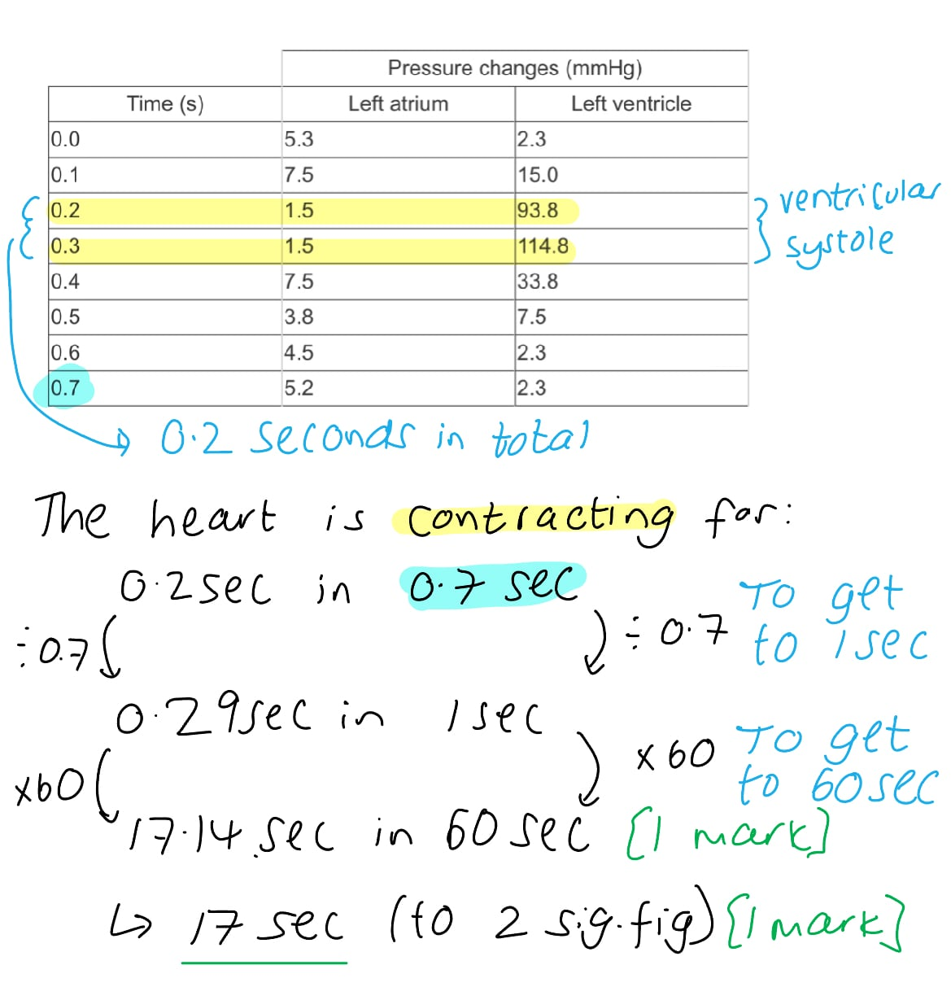
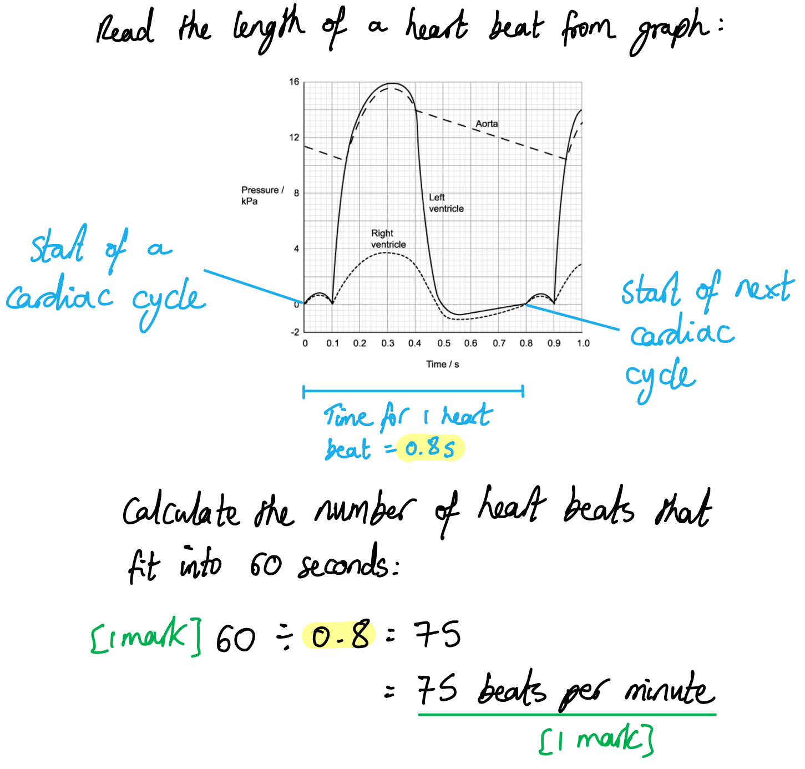

# Mark Schemes — The Heart
**8. Transport in Mammals** · Cambridge (CIE) AS biology (9700)

## Multiple Choice Questions (30 questions)

### Q1
**Final answer:** **The correct answer is ****B**** because:**

- **B**** is the ****bicuspid valve**** that is between the left atrium and the left ventricle, the left-hand side of the heart transports oxygenated blood**
- **The ****bicuspid**** valve is identifiable by ****the**** two valve flaps**

> *A **is incorrect as this is the tricuspid valve in the right-hand side of the heart, the right-hand side of the heart transports deoxygenated blood*

> *C **&** D **are incorrect as these are both semilunar valves and will only open when blood is leaving a ventricle*

> *Exam Tip**: If you are not sure about the bicuspid and tricuspid valve position you could use the thickness of the ventricle wall to identify the left side of the heart. Remember the left side has a thicker ventricle wall than the right. The left-hand side of the heart carries oxygenated blood; it is **usually** shown on the right-hand side of an image.*

### Q2
**Final answer:** **The correct answer is ****D**** because:**

- **At point ****Q ****on the graph, the atrioventricular valves close**
- **At point ****R ****on the graph, the semilunar valves open**
- **At point ****S**** on the graph, the semilunar valves close**
- **At point ****T ****on the graph, the atrioventricular valves open**

### Q3
**Final answer:** **The correct answer is ****C**** because:**

- **The nerve impulse from the atrioventricular node (AVN) travels to the Purkyne tissue (PT) through the bundle of His**
- **The nerve impulses from the Purkyne tissue (PT) travel to the ventricles**
- **The nerve impulses from the sinoatrial node (SAN) in the right atrium travel to the atrioventricular node (AVN)**

### Q4
**Final answer:** **The correct answer is ****A**** because:**

- **As the stroke volume (****SV****) increases so does the ventricular end-diastolic volume (****VEDV****)**
- **The ****VEDV**** is the amount of blood that the veins return to the heart before systole**
- **The stroke volume can be calculated from the ****VEDV****:**

  - **Stroke volume = end-diastolic volume – end-systolic volume**
- **This is ****not a directly proportional relationship ****(in such a relationship the two variables change at the same rate) as some blood will remain in the heart after systole**

> *B is incorrect as **this graph describes a directly proportional relationship.*

> *C **is incorrect as this graph describes a decrease in stroke volume as ventricular-end-diastolic volume increases.*

> *D **is incorrect as this graph describes that increasing VEDV does not affect stroke volume.*

### Q5
**Final answer:** **The correct answer is ****B**** because:**

- **Atrial contraction is controlled by the ****sinoatrial node ****(SAN) in the wall of the right atrium; the SAN sends out a wave of excitation which spreads across the atria**
- **A band of nonconductive collagen tissue prevents the wave from being passed from the atria to the ventricles**
- **The waves are transferred to the ****atrioventricular**** ****node**** (AVN) and pass through the bundle of His in the septum**
- **The bundle of His then conducts the wave of excitation to the ****Purkyne tissue**** in the ventricles**
- **If the impulse was not reaching the ventricles, but still reaching the atria, then the two faulty areas of the heart would be the ****atrioventricular node**** and the ****Purkyne tissue**

### Q6
**Final answer:** **The correct answer is ****B**** because:**

- **The first structure in the heart that the red blood cell (RBC) will pass by is the ****sinoatrial node****, which is located in the wall of the right atrium**
- **The second structure the RBC will pass through is the ****right**** ****atrium**
- **From the ****right**** ****atrium****, the RBC will go through the tricuspid valve. The t****ri****cuspid valve is located in the ****ri****ght side of the heart between the right atrium and right ventricle (it is an atrioventricular valve)**
- **After the tricuspid valve, the blood enters the right ventricle**
- **It will then pass through the semilunar valve into the pulmonary artery**

### Q7
**Final answer:** **The correct answer is ****A ****because:**

**Final answer:** **Two complete cycles takes 1.92 seconds, meaning that a single cycle takes (1.92 ÷ 2 =) 0.96 seconds. We need to calculate how many times 0.96 fits into 60 seconds:**

**Final answer:** **60 ÷ 0.96 = 62.5 beats per min**

> *Alternative Method:*

### Q8
**Final answer:** **The correct answer is ****B**** because:**

- **Vessel**** 1**** will be the ****vena cava**** bringing deoxygenated blood from the body to the right atrium**
- **Vessel**** 2 ****will be the ****aorta ****taking oxygenated blood from the heart to the body**
- **Vessel**** 3**** will be the ****pulmonary artery**** taking deoxygenated blood from the heart to the lungs**
- **Vessel**** 4 ****will be the ****pulmonary vein**** bringing oxygenated blood back to the heart**
- **The correct option would be ****B**** as vessels ****4**** and**** 1**** bring blood ****to ****the heart and ****2**** and ****3 ****take blood ****away**** from the heart**

### Q9
**Final answer:** **The correct answer is ****D**** because:**

- **At point ****1**** on the graph, the semilunar valves open**
- **At point ****2**** on the graph, the semilunar valves close**
- **At point ****3**** on the graph, the atrioventricular valves close**
- **At point ****4**** on the graph, the atrioventricular valves open**
- **This makes option ****D**** the correct row in the table**

### Q10
**Final answer:** **The correct answer is ****B**** because there are two regions of the graph where the AV valves and semilunar valves are both closed:**

- **At point ****1**** on the graph, the semilunar valves ****open**
- **At point**** 2**** on the graph, the semilunar valves ****close**
- **At point ****3**** on the graph, the atrioventricular valves ****close**
- **At point ****4**** on the graph, the atrioventricular valves ****open**
- **The time that ****both ****valves are closed between ****1**** and ****3**** is:**

  - **Time at point 1 = 0.16 s**
  - **Time at point 3 = 0.12 s**
  - **Time closed = ****(0.16 - 0.12) = ****0.04 s**

- **The time that ****both ****valves are closed at the same time between 2 and 4 from the graph is:**

  - **Time at point 4 = 0.40 s**
  - **Time at point 2 = 0.36 s**
  - **Time closed =**** (0.40 - 0.36) =**** 0.04 s**

- **Total time both valves are closed = 0.04 + 0.04 = 0.08 s**

### Q11
**Final answer:** **The correct answer is ****C**** because:**

- **The left-hand side delivers blood to the body (****3****) through the aorta and systemic arteries; to reach all tissue in the body the blood in the left side of the heart needs to be at higher pressure, and this is generated by the thicker muscle (****1****).**
- **The right ventricle delivers blood to the lungs, which are next to the heart, and where the alveoli could be damaged by high blood pressure, so a thinner muscle wall generates less pressure on this side of the heart (****4****).**

> *Statement 2 is incorrect; the blood from the right-hand side of the heart travels to the lungs, which are next to the heart, so this is less distance than is travelled by blood leaving the left side of the heart.*

### Q12
**Final answer:** **The correct answer is ****D**** because:**

- **The ****hole**** in the ****septum**** shown in the diagram would allow the mixing of blood from the ****left**** atrium and the ****right**** atrium**
- **The left atrium would contain oxygenated blood**
- **The right atrium would contain deoxygenated blood**
- **The mixing of the blood would reduce the overall oxygen saturation of haemoglobin as deoxygenated blood would be pumped around the body and not just to the lungs**

> *A **is incorrect as irregular heartbeats are generally caused by problems with the SAN and AVN. *

> *B **is incorrect as  a delay in ventricular systole would be caused by issues with the conductivity of the atrioventricular node, the bundle of His or the **Purkyne tissue.*

> *C is incorrect as the pulmonary artery takes blood from the right ventricle to the lungs. A hole in the septum in the atria would not cause an increase in pressure in this vessel.*

> * *

### Q13
**Final answer:** **The correct answer is ****B**** because:**

- **The part of the heart labelled ****3**** on the diagram is the ****right**** ****atrium****; deoxygenated blood comes into the right atrium from the body via the vena cava**
- **The part of the heart labelled ****4 ****on the diagram is the ****pulmonary artery****; this artery carries deoxygenated blood from the right ventricle to the lungs to be oxygenated**
- **The part labelled ****2**** in the diagram is the l****eft atrium****; this receives blood from the pulmonary vein from the lungs**
- **The part labelled ****1 ****in the diagram is the ****aorta**** this is the vessel leaving the left ventricle and transporting oxygenated blood to the body tissues**

> *Exam Tips**: *

- *Remember that **arteries** always go **away** from the heart ‘**A** – **a**way’ *
- *You may think that option **C** is correct, and technically blood does go through the heart in this sequence in one complete circulation of the body, however, the question refers to blood from the body*
- *We often discuss the flow of blood through the heart starting from when deoxygenated blood enters the heart from the vena cava into the right atrium *

### Q14
**Final answer:** **The correct answer is ****C**** because:**

- **Cardiac output is the ****volume of blood**** pumped in one minute**
- **If the aortic pressure decreases, the cardiac output would increase to increase the pressure**
- **There would be no change to the pressure in the vena cava as this is the pressure in the vessels after the blood has passed through the body**
- **An ****increase**** in ****carbon**** ****dioxide**** levels (e.g. durin**g **exercise) would increase the volume of blood pumped by the heart to increase ****oxygenation**** of the tissues and remove excess carbon dioxide as quickly as possible**
- **The Vagus nerve controls the heartbeat through excitation of the sinoatrial node (SAN). Specifically, it acts to lower the heart rate. This will remain unchanged when the cardiac output is** **increased**

### Q15
**Final answer:** **The correct answer is ****A**** because:**

- **The ****aortic**** ****semilunar**** ****valve**** is at the base of the aorta where it joins the left ventricle; its role is to prevent the backflow of blood into the ventricles**
- **If this valve narrows, then not as much blood will be able to pass through to the aorta**
- **This will mean, for the same cardiac flow, the left ****ventricle**** will need to ****pump**** ****more****, which will lead to a thickening of the wall over time**
- **The thicker the wall, the larger the heart, but the smaller the left ventricle becomes**
- **The heart cannot relax fully during diastole and this can lead to heart failure**

> *B **is incorrect as the left ventricle will increase in size, not decrease. When the heart has **less** heart muscle and is generally weaker, this is known as **cardiomyopathy.*

> *C** is incorrect as the blood will not be leaking out of the left ventricle, this condition could be caused by a hole in the** septum.*

> *D **is incorrect as the bicuspid valve is there to prevent the backflow of blood. The condition that causes this is **bicuspid or mitral valve prolapse.*

### Q16
**Final answer:** **The correct answer is ****A**** because:**

- **Atrial contraction is controlled by the ****sinoatrial node (SAN)**** in the wall of the right atrium; the SAN sends out a wave of excitation which spreads across the atria**
- **A band of nonconductive collagen tissue prevents the wave from being passed from the atria to the ventricles**
- **The waves are transferred to the ****atrioventricular node (AVN)**** and passed through the bundle of His in the septum**
- **The bundle of His then conduct the wave of excitation to the ****Purkyne tissue**** in the ventricles**

### Q17
**Final answer:** **The correct answer is ****D**** because:**

- **The semilunar valves are at the base of the arteries leaving the heart (the aorta and the pulmonary artery)**
- **These valves will close after ventricular contraction to prevent backflow of blood from the artery into the ventricle**
- **The point that is after ventricular contraction shown on the graph is point ****D**

> *A is incorrect as at this point in the graph, the semilunar valves are opening at the start of ventricular systole.*

> *B is incorrect as at this point in the graph, the atria have finished atrial systole and the atrioventricular valves are shut to prevent backflow into the atria.*

> *C is incorrect as this point in the graph shows the atrioventricular valves opening for passive filling during diastole.*

### Q18
**Final answer:** **The correct answer is ****A**** because:**

- **The section labelled ****A**** on the graph describes the end of ****atrial**** ****systole**
- **Atrial systole is the ****contraction**** of the ****atria**** caused by the excitation from the sinoatrial node (SAN) in the right atrium**
- **At the end of atrial systole, blood is pushed into the ventricles so that they become full of blood**

> *B **is incorrect as this section of the graph describes **ventricular systole** where the pressure in the ventricles is increasing – blood is being pushed into the arteries.*

> *C **is incorrect as this part of the graph describes the middle and end of **ventricular systole** – when the pressure in the ventricles drops as blood enters the pulmonary artery and aorta.*

> *D **is incorrect as this part of the graph describes **diastole**; both the atria and the ventricles are relaxing at this point. *

### Q19
**Final answer:** **The correct answer is ****B**** because:**

**Final answer:** **There is 1 heartbeat per 0.75 seconds, and 60 seconds in a minute, so we can calculate the number of times that 0.75 fits into 60 seconds:**

**Final answer:** **60 ÷ 0.75 = 80**

**Final answer:** **OR**

**Final answer:** **There are two complete heartbeats in 1.5 seconds, and 60 seconds in a minute, so:**

**Final answer:** **(60 ÷ 1.5) x 2**** = ****80**

**Final answer:** **OR**

### Q20
**Final answer:** **The correct answer is ****D**** because:**

- **The question states that fish oils are thought to improve the electrical excitation of the ventricles**
- **The part of the heart that carries electrical excitation to the ventricles is the Purkyne tissue (in the inner wall of the ventricles)**

> *A is incorrect as he vagus nerve is one of the cranial nerves that connect the brain to the body. The heart is one of the connections of the vagus nerve.*

> *B is incorrect as the sinoatrial node (SAN) is the pacemaker of the heart, situated in the wall of the right atrium. The SAN initiates and controls the heart rhythm for all other cardiac muscle cells in the heart.*

> *C is incorrect as the atrioventricular node (AVN) is situated at the junction between the atria and ventricles. It causes a slight delay in the transmission of the wave of excitation before stimulating the bundle of His.*

### Q21
**Final answer:** **The correct answer is ****D**** because:**

- **The arrow labelled ****D**** is the left ventricle**
- **The graph shows at 0.2s that the left ventricle is increasing in pressure, this means that ventricular systole has started, and the pressure is building in the left ventricle due to ventricular muscle contraction**

> *A **is incorrect as the area of the heart labelled **A** is the septum, this separates the left and right-hand sides of the heart. *

> *B **is incorrect as the area of the heart labelled **B** is the aorta, this transports the oxygenated blood under pressure to the tissues of the body. The pressure in the aorta starts to increase after 0.2s in the graph.*

> *C **is incorrect as the area of the heart labelled **C** is the left atrium. Atrial systole can be seen in the graph between 0 and 0.2s.*

### Q22
**Final answer:** **The correct answer is ****D**** because:**

- **During systole the atria contract, closely followed by the ventricles**
- **Blood pressure is measured as the ****pressure**** inside the arteries generated by the blood**
- **Systolic ****blood pressure would be measured at the ****end of systole in the heart ****when the pressure in the arteries is at a maximum.**

> *A **is incorrect as the blood pressure in the arteries when the heart is relaxed (in diastole) is called **diastolic blood pressure.*

> *B **is incorrect as the right ventricle pumps blood to the **lungs**; this occurs at a much lower pressure than that generated by the left ventricle pumping blood to the **body**.*

> *C **is incorrect as after contraction (systole), the pressure in the left ventricle is reduced as blood pressure is now generated in the **arteries.*

### Q23
**Final answer:** **The correct answer is ****C**** because:**

- **The aorta is the largest artery in the body****, ****leaving the left side of the heart via the left ventricle**
- **Once the blood has left the heart through the ****aortic**** valve, it travels through the ****aorta****, which makes a cane-shaped curve and is connected with other major arteries to deliver oxygen-rich blood to tissues in the body**

> *A is incorrect as the vessel labelled A is the pulmonary artery, taking deoxygenated blood from the right side of the heart to the lungs.*

> *B is incorrect as the vessel labelled B is the vena cava, this is the vein that brings deoxygenated blood from the tissues to the right atrium.*

> *D is incorrect as the vessel labelled D is the pulmonary vein, bringing oxygenated blood from the lungs to the left atrium.*

### Q24
**Final answer:** **The correct answer is ****A**** because:**

- **Ventricular systole**** is the contraction of the ventricles.**
- **The contraction of the muscles will cause an increase in ventricle pressure.**
- **The ****atrioventricular valves**** will be closed to prevent backflow into the atria. This means that the pressure within the atria will not change**

> *B, C & D are incorrect as all these options include statement 3 (“the aortic pressure will increase”). This will only happen once the pressure in the ventricles has increased enough to force open the semilunar valves. *

### Q25
**Final answer:** **The correct answer is ****C**** because:**

- **The ****Purkyne tissue ****is found in the walls of the inner ventricles of the heart**
- **At the start of the heartbeat, the ****sinoatrial**** ****node**** (SAN) in the wall of the right atrium sends out a wave of excitation to the atria**
- **A band of nonconductive collagen tissue prevents the wave from being passed from the atria to the ventricles**
- **The waves are transferred to the atrioventricular node and passed through the bundle of His in the septum**
- **The bundle of His then conduct the wave of excitation to the Purkyne tissue in the ventricles**

> *A **is incorrect as the role of the septum is to separate the two sides of the heart and prevent the mixing of oxygenated and deoxygenated blood.*

> *B **is incorrect as the role of the **sinoatrial node** is to control the heartbeat. This is known as the pacemaker of the heart.*

> *D **is incorrect as the muscle fibres in the atria conduct the wave of excitation started by the sinoatrial node. Purkyne tissue is not found in atrial walls.*

### Q26
**Final answer:** **The correct answer is ****D**** because:**

- **After ****atrial**** ****systole****, there is a fraction of a second pause as the wave of contraction is transmitted through the Purkyne tissue through the septum**
- **The blood has been pushed from the atria to the ventricles**
- **The ventricles start to contract, it is at this point the ****atrioventricular valves ****(****bicuspid**** on the left and the ****tricuspid**** on the right) close to prevent backflow into the atria as the pressure in the ventricles increases**
- **It is the closing of these valves that causes the characteristic ****‘lub’**** sound in the heartbeat**

> *A, B **&** C **are incorrect as they all include **option 1** (closing of the semilunar valves). During atrial systole, the semilunar valves at the base of the arteries leaving the heart are closed. The closing of the semilunar valves produces the **‘dub’** sound.*

### Q27
**Final answer:** **The correct answer is ****C**** because:**

- **Ventricular**** ****diastole**** is the relaxation of the muscles in the ventricles of the heart**
- **During ventricular diastole, the ****atrioventricular**** ****valves**** are ****open**** to allow passive filling of the atria and ventricles (as a result of the force of gravity pulling blood down)**

> *A **is incorrect as the pressure in the two atria is different; the left side of the heart having a pressure up to 8 mm Hg, the right side less than 5 mm Hg. During ventricular diastole the pressure in the atria doesn’t change. *

> *B **is incorrect as the pressure in the atria is not higher than the ventricles during ventricular diastole' this only happens during atrial systole.*

> *D **is incorrect as the semilunar valves are at the base of the arteries leaving the heart, during diastole these valves would be closed to prevent backflow of blood into the heart.*

### Q28
**Final answer:** **The correct answer is ****A**** because:**

- **During ****ventricular**** ****systole****, both ventricles are ****contracting****. The pressure in the left ventricle will increase due to the contraction of the muscles**
- **The ****high**** ****pressure**** in the ventricles ****opens**** the ****semilunar**** ****valves****, it is at this point that the pressure in the aorta will increase **

> *B **is incorrect as the bicuspid valve is an **atrioventricular valve **(AV valve) between the left atrium and left ventricle, this will close during ventricular systole (contraction) to prevent backflow into the heart. The **semilunar valves** would need to open not close as the pressure in the ventricles increases.*

> *C **is incorrect as the bicuspid valve is an **atrioventricular valve** (AV valve) between the left atrium and left ventricle, this will need to close during ventricular systole (contraction) to prevent backflow into the heart. The **semilunar valves** would open as the pressure in the ventricles increases.*

> *D **is incorrect as it is not possible for the pressure in the left atrium to become higher than that of the left ventricle; the wall of the atria is much thinner than the wall of the ventricle and most blood fills ventricles from the atria as a result of the force of gravity acting on it. *

### Q29
**Final answer:** **The correct answer is ****B**** because:**

- **The ****semilunar valves**** are found at the base of the arteries leaving the heart, they would need to be open during ****ventricular systole**** to allow the blood to leave the heart and fill the pulmonary artery and aorta**
- **The ****atrioventricular valves**** are the valves that separate the atria and ventricles, they**** ****would need to ****close**** to prevent the backflow of blood into the atria**

> *A **is incorrect as the **atrioventricular valves** would need to be **closed** to prevent backflow of blood. *

> *C **is incorrect as the **semilunar valves** would need to be **open **to allow the blood to leave the heart.*

> *D **is incorrect as if both sets of valves were closed then the blood would have no route out of the heart and high pressure would build up.*

> * *

### Q30
**Final answer:** **The correct answer is ****D**** because:**

- **The ****aorta**** is the main artery leaving the heart, transporting oxygenated blood from the heart to the blood tissues; its average wall thickness is about 2 mm**
- **Arteries have three layers; the endothelial layer lining the lumen is called the ****tunica intima, ****a middle thicker layer called the ****tunica media****, and an outer layer called the ****tunica external**
- **The tunica ****media**** and tunica ****externa**** both contain ****elastic**** fibres (called elastin) and ****collagen**

  - **The elastin fibres allow the arteries to ****stretch**** and ****recoil**** which allows the blood to flow at high pressure**
  - **The collagen fibres provide ****strength**** to the artery wall**

> *A **is incorrect as the tunica media contains **smooth** **muscle** and arteries do have a relatively small lumen, but neither of these features will enable the artery to withstand the high pressures in the aorta.*

> *B **is incorrect as while the artery does contain large quantities of elastin fibres they do not have a large lumen*

> *C **is incorrect as while the artery does contain large quantities of collagen, they do not contain endometrial tissue. The **endometrium** is the innermost lining of the uterus.*

## Structured Questions (15 questions)

### Q1
The term used to describe a plant, such as *N. oleander*, that has adaptations to allow it to grow in conditions where water is in short supply is...

- Xerophyte / xerophytic; **[1 mark]**

**[Total: 1 mark]**

> *Avoid the temptation to give an example of a xerophyte plant here, e.g. a cactus, because that is not what the question is asking. Xerophytes are a large group of plant species that live in arid conditions, and they have a range of adaptations to survive. The term cactus just comprises a few species.*

> *Watch your spelling and handwriting here; if you were to write 'xenophyte' that wouldn't get the mark because it has a completely different meaning in biology (it means a plant that has been introduced from another geographical area). *
(i) The name of the vascular tissue from which the aphids feed is...

**Final answer:** **Any ****one ****of the following:**

- Phloem; **[1 mark]**
- Sieve tubes / sieve tube elements; **[1 mark]**

*Ignore inaccurate statements such as phloem sieve, phloem tube, phloem companion cell.*

> *Because the question asks for the name of a tissue, there is no need to name specific cell types; the best and most succinct answer is therefore 'phloem'.*

(ii) Cardiac glycosides were present in the sap from the vascular tissue because...

**Final answer:** **Any ****two ****of the following:**

- For transport/translocation **OR** movement (from source to sink); **[1 mark]**
- The phloem is the source / place where cardiac glycosides are synthesised **OR **the phloem is the sink / place where cardiac glycosides are not manufactured/stored/where they are used;** [1 mark]**
- As a defence mechanism (against sap feeders like aphids); **[1 mark]**

**[Total: 3 marks]**
(i) Hydrolysis of ATP means...

- Using water/H2O; **[1 mark]**
- To break a bond (between phosphate groups / ADP and P); **[1 mark]**

> *If you state incorrectly that the bond being broken is a glycosidic bond or hydrogen bond, for example, you would not gain the second mark here.*

(ii) The type of transport mechanism involved in the transport of Na+ and K+ across the cell surface membrane of cardiac muscle cells is...

- <u>Active transport</u>; **[1 mark]**

(iii) The mode of action of oleandrin is...

**Final answer:** **Any ****four**** of the following:**

- (Oleandrin reversibly) binds to an allosteric site / to a site other than active site; **[1 mark]**
- (Which) changes the shape / tertiary structure / 3D structure of the active site / the active site becomes distorted; **[1 mark]**
- Such that the substrate/ATP cannot enter/bind/fit the active site **OR** the active site is no longer complementary to the substrate **OR** that enzyme-substrate / ES <u>complexes</u> cannot form; **[1 mark]**
- (There is) no/less hydrolysis/breakdown of ATP **OR **no/less energy is released; **[1 mark]**
- Na+ is not moved out, <u>and</u> K+ not moved in; **[1 mark]**

> *Remember to indicate that the active site itself changes its 3D shape; it is not enough to state that the protein changes shape or structure. When referring to energy release from the hydrolysis of ATP, it is important to be clear that energy is released or generated. Energy cannot be created, synthesised or produced. The final mark scheme point required a detailed description of which ions move where, it is too vague to state simply that active transport slows or stops. *

**[Total: 7 marks]**
(i) The sequence of events occurring in the left side of the heart during one normal cardiac cycle, including reference to blood pressure changes is...

Opening sentence is given: The left atrium fills with blood during relaxation of the left atrium and left ventricle.

**Final answer:** **Then any ****four ****of the following:**

- Atrioventricular valve opens following atrial contraction **OR** blood trickles into the ventricle / some blood enters the ventricle; **[1 mark]**
- Atrial contraction, blood flows into the ventricles / ventricles fill (with blood) **OR **atrial contraction occurs, then ventricular contraction;**[1 mark]**
- Bicuspid valve closes <u>and</u> the semi-lunar valve opens; **[1 mark]**
- Blood flows into the aorta; **[1 mark]**
- The atrium relaxes during ventricular contraction;  **[1 mark]**
- Pressure changes: contraction of atrium / ventricle, increases pressure (of that chamber) **OR **(blood) pressure differences cause the opening or closing of valves e.g. if the pressure in the atrium is greater than in the ventricle, the atrioventricular valve opens **OR** if the pressure in the ventricle is greater than in the aorta, the semilunar valves open **OR** if the pressure in the ventricle is greater than in the atrium, the bicuspid valve closes; **[1 mark]**

***Allow**** systole for contraction and diastole for relaxation.*

***Allow**** bicuspid valve or mitral valve for (left) atrioventricular valve.*

***Allow ****aortic valve for semi-lunar valves.*

***Allow**** a maximum of 3 marks if the whole response is based on the right side of the heart / before atrial contraction / during relaxation of the left atrium and left ventricle*

(ii) The health of a person with heart failure can be improved by treatment with the drug digoxin as follows...

**Final answer:** **Any ****three**** of the following:**

- (The drug causes) more powerful contraction of (cardiac) muscle / increased ability for (cardiac) muscle/cells to contract **OR** stronger contraction / increased contractility; **[1 mark]**
- (Therefore) blood (pumped) at high<u>er</u> pressure; **[1 mark]**
- And has more force to overcome resistance (in blood vessels); **[1 mark]**
- (Therefore) more blood reaches lungs to obtain oxygen (per unit time) / more oxygen reaches (rest of) body/tissues (per unit time) **OR **there is more efficient delivery of oxygen **OR** more oxygenated blood can be delivered to heart muscle/tissue; **[1 mark]**
- (The patient has) less fatigue / increased energy / increased mobility; **[1 mark]**

> *For the first mark scheme point, avoid vague sentences like 'contracts more' or 'increased contraction'. For the second mark scheme point, stating 'high pressure' is not a comparative statement - you need to state high**er** pressure (than before) to earn this mark. *

**[Total: 7 marks]**

### Q2
The roles of the sinoatrial node (SAN) and the atrioventricular node (AVN) in the initiation and control of the cardiac cycle are...

**Final answer:** **Any ****four**** of the following:**

*SAN*

- Acts as a pacemaker **OR** initiates heartbeat / cardiac cycle; **[1 mark]**
- Releases waves of excitation / (electrical) impulses; **[1 mark]**
- Which spread across the atria/atrial walls **OR** leads to atrial systole/contraction(s); **[1 mark]**

*AVN*

- Passes the wave of excitation to the Purkyne fibres / down the septum / Bundle of His; **[1 mark]**
- Allows a (short) delay / ~0.1 s; **[1 mark]**
- So that the atria contract before ventricles, allowing ventricles to fill before ventricular contraction; **[1 mark]**

**[Total: 4 marks]**

> *A common mistake here is to state that the AVN generates a new impulse rather than relaying the same impulse generated by the SAN. Also, it is incorrect to say that nerve impulses originate in the SAN - a nerve impulse arrives at the SAN which causes it to send out a wave excitation.*
It is important that the Purkyne fibres extend to the base of the heart so that...

**Final answer:** **Any ****two**** of the following:**

- The ventricular systole begins at the base of the <u>ventricles</u>; **[1 mark]**
- Meaning both ventricles contract at the same time; **[1 mark]**
- And blood is forced upwards into arteries; **[1 mark]**
- So ventricles empty; **[1 mark]**

**[Total: 2 marks]**

> *A good way you can visualise this process is if you imagine a tube of toothpaste. The most efficient way to remove the toothpaste from the tube is the squeeze it from the bottom. If you squeeze from the middle you won't get all the toothpaste out. This is the same as what happens in the heart. The cardiac muscles contract from the bottom up to make the pushing of the blood out of the ventricles fully efficient. *
The process of cell signalling involves...

**Final answer:** **Any ****four**** of the following:**

- Noradrenaline is the signalling molecule/compound; **[1 mark]**
- SAN cell is the <u>target cell</u>; **[1 mark]**
- Noradrenaline binds to cell surface receptors of target cell; **[1 mark]**
- The receptors are specific/complementary to noradrenaline; **[1 mark]**
- Formation of cAMP / second messenger; **[1 mark]**
- The response is the opening of channel proteins (so calcium ions enter); **[1 mark]**

**[Total: 4 marks]**

> *Details of the events of exocytosis leading to the release of noradrenaline are not required to gain marks in this question.*

### Q3
(i) The stages of the cardiac cycle marked by the letters A - D are...

- A = atrial systole; **[1 mark]**
- B = ventricular systole; **[1 mark]**
- C = ventricular systole; **[1 mark]**
- D = (ventricular) diastole; **[1 mark]**

> *In section **A** you can see the ventricle volume increasing but very little increase in pressure. This is due to the atria contracting (atrial systole) and blood filling the ventricle. At **B** the pressure increases in the left ventricle indicating contraction (ventricular systole); the volume does not increase as the ventricles are not receiving any more blood at this point. In **C **the pressure is still increased so ventricular systole is still taking place, the volume now is decreasing as blood leaves the heart (through the aorta). Finally, in **D **the pressure reduces, there is no increase in volume and the heart is relaxed in diastole. *

(ii) The changes that are taking place at state C are explained by...

- The pressure is increasing **because **the left ventricle is contracting/ventricular systole; **[1 mark]**
- The volume is decreasing **because **blood is pumped/forced out of the left ventricle (into the aorta); **[1 mark]**

(iii) The valve identified by the letter X is...

- The left semilunar valve/aortic valve; **[1 mark]**
- The valve is open; **[1 mark]**

**[Total: 8 marks]**

The stroke volume is...

- 120 - 50 ml; **[1 mark]**
- 70 ml; **[1 mark]**

**[Total: 2 marks]**

> *The width of the loop shown in Figure 1 is the stroke volume. You are given a definition of stroke volume in the question stem which indicates that it is the volume of blood pumped out by the left ventricle. This can be seen on the graph using the X-axis scale. The heart does not pump out every single last drop of blood during systole, this would put too much pressure on the cardiac muscle and damage the tissue. So there is always a residual volume of blood left, which is approximately 50ml. This is why you need to subtract the first 50 mL to give the total volume pumped out during ventricular systole. *

The percentage change of left ventricular pressure is...

- (129 -7) / 129 = 0.95; **[1 mark]**
- 0.95 x 100 = 95 % ; **[1 mark]**

***Accept**** readings in the range of 6 - 8 for minimum value*

**[Total: 2 marks]**

### Q4
The heart muscle is described as myogenic because...

- It initiates its own contractions **OR** no outside stimulation / stimulation from the nervous system is required for contraction; **[1 mark]**

**[Total: 1 mark]**
The electrical activity taking place in the heart involves...

**Final answer:** **Any ****three**** of the following:**

- The electrical activity is initiated by the SAN/sinoatrial node; **[1 mark]**
- The electrical activity / wave of excitation passes from the atria to the ventricles via the AVN/atrioventricular node; **[1 mark]**
- The electrical activity / wave of excitation pauses at the AVN (for 0.1 s); **[1 mark]**
- The electrical activity / wave of excitation passes to the base of the ventricles via the Purkyne tissue/fibres; **[1 mark]**

**AND**

This relates to the **P** wave and **QRS** complex in the following ways...

- The electrical activity / wave of excitation spreads across the atria, causing the **P** wave; **[1 mark]**
- The electrical activity / wave of excitation spreads upwards across the ventricles, causing the **QRS** complex; **[1 mark]**

**[Total: 5 marks]**

> *You are not expected to know about ECG traces, but you are expected to know how the electrical activity of the heart causes the cardiac cycle. This question mainly asks for a description of the electrical activity of the heart but specifically asks for this to be linked to parts of the ECG trace provided.*

> *Atrial systole is caused by the wave of electrical activity spreading across the atria and ventricular systole is caused by the wave spreading upwards from the base of the ventricles. Because the stages of the cardiac cycle are marked in Fig.1, it is possible to work out that the P wave corresponds to the spreading out of the wave across the atria, and that the QRS complex corresponds to the upward spread of the wave across the ventricles.*
The abnormalities present in the ECG traces of individuals **B** and **C** are...

- **B** = irregular heart beat / different length spaces between each heart beat / arrhythmia; **[1 mark]**
- **C** = atria are repeatedly contracting / atria are contracting more often than the ventricles / lack of coordination in contraction of the atria / atrial fibrillation; **[1 mark]**

**[Total: 2 marks]**
One other symptom that individual **C** might be experiencing includes...

- Dizziness / fatigue / light headed / breathless / difficulty exercising / muscle weakness; **[1 mark]**

The reason for this would be...

**Final answer:** **Any ****two**** of the following:**

- Decreased volume of blood pumped round body with each contraction of the ventricles / decreased efficiency of heart; **[1 mark]**
- (Heart pumps less blood because) the atria are not filling / do not have time to fill with blood before they pump blood to the ventricles; **[1 mark]**
- Reduction in oxygen/glucose supply to cells reduces rate of respiration / ATP production / energy release; **[1 mark]**

***Reject**** any references to energy production*

**[Total: 3 marks]**

> *A lack of coordination between the contraction of the atria and that of the ventricles means that the ventricles are not properly filled with blood when the atria contract. In this case, the atria are contracting so quickly that they do not have time to fill before they contract, sending only small amounts of blood to the ventricles. This means that when the ventricles contract a reduced volume of blood is sent around the body, reducing the supply of reactants needed for respiration, reducing ATP production, and leading to symptoms of fatigue and weakness. *

### Q5
Structures **W** to **Z** in Fig.1 are...

- **W** = tricuspid valve; **[1 mark] **
- **X** = (inferior) vena cava; **[1 mark]**
- **Y** = aorta; **[1 mark]**
- **Z** = left ventricle; **[1 mark]**

**[Total: 4 marks]**
The heart defects visible in Fig.1 and suggested explanations of their possible impacts on heart function are...

- Thickened right ventricle wall; **[1 mark]**
- Damage to capillaries in lungs **AS** increased blood pressure is generated by extra muscle; **[1 mark]**

**OR**

Reduced blood flow to lungs **AS **there is reduced flexibility/pumping action of the right ventricle; **[1 mark]**

**AND**

- A hole in the septum between the left and right ventricles; **[1 mark]**
- Reduction in oxygen pumped around the body / reduced efficiency in pumping oxygen around the body **AS **there is mixing of (oxygenated and deoxygenated) blood from the (right and left) ventricles; **[1 mark]**

**AND**

- Thickening of the (semilunar) valve that leads to the pulmonary artery / the pulmonary valve; **[1 mark]**
- Reduced blood flow to (and therefore also from) the lungs / reduced oxygenation of blood in the lungs **AS** less blood is able to leave the heart (for the lungs) in the pulmonary artery; **[1 mark]**

**OR**

Increased blood flow into the left ventricle **AS** reduction in blood into the artery causes blood to be pushed sideways into the left ventricle; **[1 mark]**

**[Total: 6 marks]**

> *This is a good example of an application question; you need to spot the structural abnormalities and then use what you know about heart structure and function to suggest explanations for the impacts of the defects.*

> *The thickening of the right ventricle wall is the trickiest impact to identify and explain; note that it doesn't matter if the suggested impact is correct or not (the mark scheme gives two opposing suggestions) as long as your explanation makes sense.*

> *The mixing of blood in the two ventricles causes problems as it means that the blood pumped around the body by the left ventricle will contain a quantity of deoxygenated blood from the right ventricle; this reduces its overall oxygen saturation and means that there is less oxygen available to the cells as the blood travels around the body.*

> *The thickened valve in the pulmonary artery reduces blood flow to the lungs, further reducing the oxygenation of the blood; this results both from a reduction in the volume of oxygenated blood returning from the lungs and from increased mixing of blood between the ventricles.*
Possible symptoms of tetralogy of Fallot and their explanations include...

- Skin/lips/lining of mouth/nose turns purple/blue; **[1 mark]**
- Due to decreased blood oxygenation; **[1 mark]**

**OR**

- Reduced rate of growth; **[1 mark]**
- Cells receive less oxygen so rate of respiration is reduced (and growth is slowed); **[1 mark]**

**OR**

- Fatigue/breathlessness; **[1 mark]**
- Blood cannot deliver oxygen to the cells quickly enough to fuel respiration; **[1 mark]**

**[Total: 2 marks]**

> *Note that deoxygenated blood is not actually blue, but more of a dark red/purple colour; the overall effect of this will be that an individual's skin will change colour, often to what we would describe as 'blue' but in reality it is more of a purple colour.*

### Q6
(i) The time window which indicates that the valve between the atrium and ventricle is closed is...

- 0.1 - 0.5 s; **[1 mark]**
- Because the pressure in the (left) ventricle is greater/higher than the pressure in the (left) atrium; **[1 mark]**

(ii) Between time values 0.2 and 0.3 seconds the following can be concluded...

- Ventricular systole / the ventricles are contracting; **[1 mark]**
- The pressure in the left ventricle increases/peaks ; **[1 mark]**
- Atrial diastole / the atria are relaxed/not contracting; **[1 mark]**
- The pressure in the left atrium is constant/remains unchanged; **[1 mark]**

**[Total: 6 marks]**
The total time the ventricles are contracted in one minute is...

- (2 / 7) x 60 = 17.14; **[1 mark]**
- 17 seconds (to 2 sig. fig.); **[1 mark]**

**[Total: 2 marks]**

> *Alternative method shown here:*

The SAN and the AVN control the cardiac cycle by...

- The SAN initiates the heartbeat / acts as a pacemaker / is myogenic; **[1 mark]**
- The SAN sends a wave of depolarisation/electrical impulse through the walls of the atria; **[1 mark]**
- The atria contract / atrial systole; **[1 mark]**
- Wave of depolarisation/electrical impulse is delayed by the AVN; **[1 mark]**
- The atria have time to empty / ventricles have time to fill up; **[1 mark]**
- AVN sends the wave of depolarisation/electrical impulse through the bundle of His/Purkyne tissue; **[1 mark]**
- The ventricles contract / ventricular systole; **[1 mark]**

**[Total: 5 marks]**

> *It is important to be specific with your terminology and include key structures such as the bundle of His or Purkyne tissues, rather than just the septum or ventricle walls. Also note that the AVN sends the **same** wave, generated by the SAN, rather than the AVN initiating a new wave. *

### Q7
(i) Structure **X** is a...

- Coronary artery; **[1 mark]**

(ii) One possible symptom resulting from a blockage to structure **X** could be...

- Pain (in chest, arm, jaw, neck); **[1 mark]**

The reason for this is that...

**Final answer:** **Any ****two**** of the following:**

- Reduction in blood flow to the heart cuts off/reduces the supply of oxygen/glucose to the heart muscle; **[1 mark]**
- (Reduction in blood flow) reduces respiration in the heart (muscle) cells; **[1 mark]**
- Reduction in energy release / ATP production means that heart cells/tissues die (causing sensations of pain); **[1 mark]**

**OR**

One possible symptom resulting from a blockage to structure **X** could be...

- Fatigue / breathlessness / dizziness / nausea; **[1 mark]**

The reason for this is that...

**Final answer:** **Any ****two**** of the following:**

- Reduction in blood flow to the heart cuts off/reduces the supply of oxygen/glucose to the heart muscle; **[1 mark]**
- (Reduction in blood flow) reduces respiration in the heart (muscle) cells; **[1 mark]**
- Reduction in energy release / ATP production means that the heart function is reduced / less oxygen is supplied to the cells of the body; **[1 mark]**

**[Total: 4 marks]**

> *In this question the explanation should match the symptom suggested. E.g. if the symptom given is chest pain then the explanation for this is the death of cells or tissues in the heart, whereas if the symptom given is breathlessness, fatigue, or nausea then the explanation should focus on reduction in heart function or reduction of blood supply to cells of the body. It would be incorrect to give an explanation of reduction in heart function or reduced supply of oxygen to the body in reference to chest pain.*
The heart rate of the individual in Fig. 2 is...

- 60$\div$0.8; **[1 mark]**
- 75 beats per minutes; **[1 mark]**

***Accept**** the correct answer of 75 beats per minutes for full marks in the absence of other calculations*

**[Total: 2 marks]**

(i) The reason for the difference in the two curves is that...

- The left ventricle has <u>more</u>/thick<u>er</u> muscle / a thick<u>er</u> muscle wall; **[1 mark]**

(ii) The benefit of this difference is that...

- The blood can be pumped to the body/systemic circulation at higher pressure / with more force **SO** reaching every part of the body / travelling all around the body / travelling further; **[1 mark]**
- The blood is pumped to the lungs/pulmonary circulation at lower pressure / with less force **SO** travelling a shorter distance / avoiding damage to the lung capillaries; **[1 mark]**

**[Total: 3 marks]**
(i) The first ventricular systole begins at...

- 0.1 (s); **[1 mark]**

(ii) The semilunar valves close at...

- 0.4 (s); **[1 mark]**

(iii) Diastole begins at...

- 0.3 (s) **OR **0.32 (s); **[1 mark]**

**[Total: 3 marks]**

> *Ventricular systole is the contraction of the walls of the ventricles and can be seen by a sudden increase in ventricular pressure.*

> *The semilunar valves close at the point at which ventricular pressure drops below the pressure in the aorta.*

> *Diastole is the relaxation of the heart muscle, so begins at the point at which the pressure in the heart begins to decrease; the timing of this is slightly different for the right and left ventricles in Fig. 2.*

### Q8
The mammalian circulatory system is called a *closed ***and ***double *circulation because...

- (Closed =) blood flows through (blood) <u>vessels</u>; **[1 mark]**
- (Double =) Blood flows through the heart twice for every complete circuit (of the body) / through systemic and pulmonary circuits / to the lungs and then to the rest of the body; **[1 mark]**

*In the absence of the term ****vessel****, marking point 1 can be awarded for use of ****three ****of the following terms:*

- *Heart*
- *Arteries*
- *Veins*
- *Capillaries*

**[Total: 2 marks]**

> *When describing double circulation it is essential to state that "blood passes through the heart twice **for every one circuit** of the body"; it is not enough to just state that "blood passes through the heart twice", as blood passes through the heart thousands of times every day!*
(i) Structures **1**, **2** and **3,** as shown in Fig. 2, are...

- 1 = pulmonary vein; **[1 mark]**
- 2 = semilunar / pulmonary / aortic valve; **[1 mark]**
- 3 = right atrium; **[1 mark]**

***Accept**** auricle for atrium in marking point 3.*

(ii) The wall of chamber **Y** is thicker than the wall of chamber **X**, as shown in Fig. 3, because...

**Final answer:** **Any ****three**** of the following:**

- The left ventricle/chamber Y pumps blood into the systemic circulation / around the body **OR** the right ventricle/chamber X pumps blood into the pulmonary circulation / around the lungs **OR** the distance travelled by blood in the systemic circulation is greater than that in the pulmonary circulation; **[1 mark]**
- Blood in systemic circulation needs to overcome greater resistance to flow; **[1 mark]**
- Blood needs to travel around the systemic circulation at high pressure; **[1 mark]**
- High pressure is generated by increased muscular force; **[1 mark]**
- Pulmonary capillaries can be damaged/ruptured by high pressure (so less muscular force is needed in pulmonary circulation); **[1 mark]**

***Accept**** reverse statements for marking points 2 and 4, e.g. "Blood in pulmonary circulation needs to overcome less resistance to flow" *

**[Total: 6 marks]**

> *Be careful not to confuse ideas about the thickness of the walls of blood vessels with those relating to the thickness of the heart muscle. Arteries need to withstand high blood pressure, but the heart muscle itself needs to **generate that high pressure**; your answer must relate to the **heart **(generating pressure) and not to arteries (withstanding pressure).*

> *Note that the question tells you that Fig. 3 is a cross-section taken through **the ventricles of the heart**; any answers that refer to X and Y as arteries and veins will not be credited.*
The contractions of the chambers of the heart are coordinated during one cardiac cycle as follows...

**Final answer:** **Any ****four**** of the following:**

- An impulse / wave of excitation/depolarisation passes from the SAN to the atria; **[1 mark]**
- The atria contract at the same time / atrial systole occurs; **[1 mark]**
- Atria contract before the ventricles; **[1 mark]**
- Fibrous/non-conducting/insulating tissue prevents impulse from travelling between atria and ventricles; **[1 mark]**
- The impulse is delayed at the AVN; **[1 mark]**
- The AVN passes the impulse to the bundle of His / Purkyne fibres; **[1 mark]**
- The Purkyne fibres conduct impulses to the <u>muscle</u> in the ventricle walls; **[1 mark]**
- The ventricles contract together; **[1 mark]**
- Ventricles contract from the bottom/base/apex upwards; **[1 mark]**

***Reject ****marking point 2 if any statement implies that one atrium contracts before the other.*

*Only award marking point 8 in the absence of marking point 2, as the points essentially assess the same idea.*

***Reject ****marking point 8 if any statement implies that one ventricle contracts before the other.*

**[Total: 4 marks]**

> *Be sure to focus your answer on the **coordination** of the cardiac cycle events rather than just describing the events themselves.*

> *It is essential to realise that during the cardiac cycle the left and right sides of the heart **contract simultaneously**. First the left and right atria contract (together), followed by the left and right ventricles (also together).*

### Q9
The role of the SAN **and** the role of the AVN in the cardiac cycle are...

*SAN:*

**Final answer:** **Up to ****two ****of the following:**

- (The SAN is the) pacemaker / sets the rate of the heartbeat / is responsible for <u>rhythmic</u> contraction; **[1 mark]**
- Sends out impulses / waves of excitation / waves of depolarisation; **[1 mark]**
- Initiates/brings about / heartbeat / contraction of the heart / atrial contraction/systole; **[1 mark]**

*AVN:*

- Acts to relay/conduct waves of excitation/impulses to ventricles/Purkyne fibres/bundle of His; **[1 mark]**
- Introduces delay to ventricular systole/contraction(s) / prevents simultaneous contraction of atria and ventricles / allows time for atria to empty / ventricles to fill (before the ventricles contract); **[1 mark]**

**[Total: 3 marks]**

> *Remember to read the questions like this carefully so that you know where to focus your efforts. Here you need to focus specifically on the **SAN** and **AVN** as specified in the question; don't get bogged down with describing the whole cardiac cycle as points not related to the SAN and AVN will not be credited.*
(i) The type of blood vessel indicated by **D**, **E** and **F **are...

- D = vein/veins / venule / venules **AND **E = artery/arteries **AND **F = capillary/capillaries; **[1 mark]**

(ii) Two structural features of endothelial tissue are...

**Final answer:** **Any ****two ****of the following:**

- Single layer / one cell thick; **[1 mark]**
- Flattened/thin/squamous/pavement cells/epithelia; **[1 mark]**
- Smooth surface (facing lumen); **[1 mark]**

**[Total: 3 marks]**

### Q10
The blood vessels can be identified as follows...

- (i) **J** = pulmonary artery; **[1 mark]**
- (ii) **K** = pulmonary vein; **[1 mark]**
- (iii) **L** = (inferior) vena cava; **[1 mark]**
- (iv) **M** = Aorta; **[1 mark]**

**[Total: 4 marks]**
A structural difference between the heart chambers connecting to blood vessels **J** and **M** is...

- The left ventricle / chamber connecting to **M **has (a) thicker muscle (wall); **[1 mark]**

The reason for this is that...

- It can generate higher pressure / more force **OR** it pumps blood further / around the systemic circulation; **[1 mark]**

**[Total: 2 marks]**
Differences in pressure between the heart chamber and blood vessel **M** include...

**Final answer:** **A maximum of ****two**** of the following:**

- Fluctuations in the heart chamber are greater than in the blood vessel; **[1 mark]**
- Fluctuations in the heart chamber are consistent in size while fluctuations in blood vessel **M** increase in size; **[1 mark]**
- Correct numbers to support either of the above points; **[1 mark]**

The reasons for this include...

**Final answer:** **A maximum of ****two**** of the following:**

- The pressure fluctuates in response to heart muscle contraction/systole; **[1 mark]**
- The heart chamber empties when it contracts (allowing pressure to drop to zero); **[1 mark]**
- Elastic fibres in the blood vessel walls allow them to stretch and recoil / reduce the pressure fluctuations (in blood vessel **M**); **[1 mark]**
- Blood vessel **M** gradually decreases in diameter (causing an increase in pressure); **[1 mark]**
- The walls of blood vessel **M** contain fewer elastic fibres further from the heart (causing an increase in pressure as the walls stretch less to accommodate blood);** [1 mark]**

**[Total: 3 marks]**

> *This is a tricky question, but there are several ways of achieving full marks and describing data well requires no specialist knowledge. Be sure to include plenty of detail in your description; describe all relevant events and include numbers where possible.*
Blood pressure continues to decrease in blood vessel **O** and the capillaries because...

**Final answer:** **Any ****two**** of the following:**

- Increased distance from the heart; **[1 mark]**
- Increased (wall) surface area of blood vessels in relation to their volume (as blood vessel diameter decreases); **[1 mark]**
- Increased contact/friction between blood and blood vessel walls **OR** increased resistance to blood flow (due to reduced diameter of blood vessels); **[1 mark]**

**[Total: 2 marks]**

> *As distance from the heart increases the blood pressure in the blood vessels decreases. This is due to the slowing of the blood flow as it encounters resistance, or friction, from the walls of the blood vessels. The more blood comes into contact with the walls of the vessels the greater the resistance, meaning that as the blood vessels narrow, resistance increases, blood flow slows, and pressure drops.*

### Q11
The correct sequence of events is...

| **Event of the Cardiac Cycle** | **Order** |
|---|---|
| SAN sends out a wave of excitation | 1 |
| Wave of excitation passes through the AVN | 3 |
| Ventricles contract | 5 |
| Atria contract | 2 |
| Wave of excitation passes through the Purkyne tissue | 4 |

- All 4 correct; **[4 marks]**
- 3 correct (e.g. if one answer is missing or if the same number has been used twice); **[3 marks] **
- 2 correct; **[2 marks]**
- 1 correct; **[1 mark]**

**[Total: 4 marks]**
The delay is necessary because...

- (The delay) allows time for the blood to move from the atria to the ventricles / for the ventricles to finish filling before the atria contract; **[1 mark]**

**[Total: 1 mark]**

> *If there were no delay then the ventricles would contract before all the blood had moved out of the atria; this would be inefficient as less blood would be pumped with each heart beat than if the ventricles were filled. *
(i) The pressure on the left and right sides of the heart are different because...

**Final answer:** **Any ****two ****of the following:**

- The left side of the heart has much high<u>er</u> pressure / right side has much low<u>er</u> pressure; **[1 mark]**
- The muscle/wall of the left ventricle is thick<u>er</u>; **[1 mark]**
- The left ventricle has to push blood much furth<u>er</u> than the right ventricle / left sends blood to the entire body **WHILE** the right sends blood to the lungs only; **[1 mark]**

> *Remember that whenever you are dealing with a** difference** between two things, you must use **comparative** language. Here this can be seen in the use of terms such as high**er**, thick**er**, furth**er**, and WHILE.*

(ii) The location of the heart with the highest pressure is the...

- Left ventricle; **[1 mark]**

> *The left ventricle has the thickest muscle, and must pump the blood over the greatest distance, so it generates the highest pressure.*

**[Total: 3 marks]**
The flow of blood through the left side of the heart can be described as follows...

**Final answer:** **Any ****four**** of the following:**

- (Oxygenated) blood returns to the heart through the pulmonary vein; **[1 mark]**
- It flows into the (left) atrium; **[1 mark]**
- The blood flows through the atrioventricular/AV/bicuspid valve; **[1 mark]**
- Into the (left) ventricle;** [1 mark]**
- Blood flows through the semilunar/aortic valve; **[1 mark]**
- Into the aorta; **[1 mark]**

**[Total: 4 marks]**

> *It is important to be able to describe the flow of blood through the heart. Take note of the blood vessels, the heart chambers and the valves that the blood will flow through along the way, as mentioning each of these will gain a mark.*

### Q12
The role of the coronary arteries is...

- To deliver/transport blood to the heart cells/tissues; **[1 mark]**
- Blood is required (by the heart cells/tissues) for respiration / blood transport oxygen and glucose for respiration (in the heart cells/tissues); **[1 mark]**

**[Total: 2 marks]**
The consequence of a septal defect to the blood flowing through the heart is...

- Oxygenated and deoxygenated blood would mix / oxygenated and deoxygenated blood would not be kept separate; **[1 mark]**

**[Total: 1 mark]**

> *Note that the question refers to "blood flowing through the heart" so you are not expected to describe any consequences on the person with the condition or related symptoms. *

> *There are two types of septal defects: an atrial septal defect where there is a hole in the septum between the upper chambers of the heart, or a ventricular septal defect, where the hole in the septum is within the lower chambers. Depending on the size of the hole, the condition may present mild to severe, even life-threatening, symptoms. *
Valves have a role in controlling blood pressure changes within the heart because...

- When the valves open the pressure in front of them decreases so blood flows through the (open) valve; **[1 mark]**
- When the valves close the pressure in front of them increases, preventing backflow; **[1 mark]**

**[Total: 2 marks]**
One structure of veins and how it relates to the function is...

**Final answer:** **Any ****pair ****of the following:**

- Large/wide lumen; **[1 mark]**
- Reduces blood pressure; **[1 mark]**

**OR**

- Less smooth muscle; **[1 mark]**
- Veins carry out less vasoconstriction/vasodilation; **[1 mark]**

**OR**

- Less elastic/elastin; **[1 mark]**
- Veins are not required to stretch and recoil; **[1 mark]**

**OR**

- Lots of collagen; **[1 mark]**
- Increased strength; **[1 mark]**

**[Total: 2 marks]**

> *This question assesses knowledge from section 8.1; you can expect examiners to assess similar topics synoptically within one question. *

### Q13
(i) Chambers A and C are...

- A = <u>right</u> atrium; **[1 mark]**
- C = <u>left</u> ventricle; **[1 mark]**

(ii) A difference in the function of A and C is.....

**Final answer:** **Any ****one**** of the following:**

- Chamber** **A/right atrium receives blood from veins/vena cava **WHILE **chamber C/left ventricle receives blood from (left) atrium; **[1 mark]**
- Chamber A/right atrium pumps blood to the (right) ventricle **WHILE **chamber C/left ventricle pumps blood out into the artery/aorta; **[1 mark]**
- Chamber A/right atrium receives deoxygenated blood from the body **WHILE **chamber C/left ventricle receives oxygenated blood from the lungs (via the left atrium); **[1 mark]**

**[Total: 3 marks]**

> *It is important to state the left or right side when labelling heart structures, such as the atria or ventricles. Don't be tempted to just state "ventricle" for example as this will not gain you marks. *
A difference between the blood found on the right and left sides of the heart is....

- Blood on the left side is oxygenated / has a higher oxygen content **WHILE** blood on the right side is deoxygenated / has a lower oxygen content; **[1 mark]**

**[Total: 1 mark]**

> *The blood that is received by the chambers on the right side of the heart has a low oxygen content because it comes from the body cells which use the oxygen for aerobic respiration. The blood is pumped to the lungs to become oxygenated before returning to the left side of the heart and being pumped to the body cells again.*
Structure D is...

- The septum; **[1 mark]**

The purpose of structure **D** is to....

- Prevents blood from the left side/oxygenated blood from mixing with blood from the right side/deoxygenated blood; **[1 mark]**

**[Total: 2 marks]**

> *If deoxygenated blood from the right side of the heart is mixed with oxygenated blood from the left side of the heart, then it would decrease the overall oxygen content of the blood reaching the cells. This would lead to a lower rate of aerobic respiration and less ATP being produced which would result in the person suffering from constant fatigue.*
** The point at which valve B opens is.**...

- Z; **[1 mark]**

**[Total: 1 mark]**

> *Valve B is the bicuspid valve, one of the **atrioventricular valves**. It opens when the **pressure in the left atrium rises above the pressure in the left ventricle**, as can be seen at point Z. After it opens the pressure in the left atrium decreases as the blood moves into the ventricle during diastole. *

> *The other points are:*

- *W is when the pressure in the atrium drops below the pressure in the ventricle and the bicuspid valve **closes**. *
- *X is when the pressure in the ventricle rises above that in the aorta and the **semilunar valve opens**. *
- *Y is when the pressure in the ventricle drops below that in the aorta and the **semilunar valve closes**. *

### Q14
The correct order of letters, from atrial systole is...

- Z, W, Y, X; **[1 mark]**

**[Total: 1 mark]**
The events shown in image W are...

**Final answer:** **Any ****four ****of the following:**

- Ventricular systole / contraction of ventricles; **[1 mark]**
- Ventricular muscle/walls contract; **[1 mark]**
- Ventricular pressure increases as volume decreases; **[1 mark]**
- AV/tricuspid and bicuspid valves close **and** semilunar valves open; **[1 mark]**
- Blood is forced/pumped/moved into the aorta **and** pulmonary arteries; **[1 mark]**
- Atria are relaxed / atrial diastole; **[1 mark]**

**[Total: 4 marks]**
The letters that show atrial systole are...

- B - C / B and C; **[ 1 mark]**

**[Total: 1 mark]**

> *During atrial systole the walls of the atria contract, on both sides. This causes pressure to increase in the atria (and volume to decrease) which corresponds to the small hump shown between letters B and C for left atrium pressure. There is also a small increase in ventricular pressure, as shown in the graph, due to the blood from the atria being pumped into the ventricles. This decreases the volume of the ventricles and so increases the pressure. Although the graph specifically shows pressure changes on the left side of the heart, the same pattern will be seen in the right side, however, pressure changes will be less here due to the thinner muscular walls on the right side of the heart. *

### Q15
The route taken by the blood as it travels from point **W** to point **X** involves...

**Final answer:** **Any ****four**** of the following:**

- Into the right atrium **and** the right ventricle; **[1 mark]**
- Through the tricuspid valve/right atrioventricular valve (between the right atrium and right ventricle); **[1 mark]**
- Through the semilunar/pulmonary valve; **[1 mark]**
- Through the pulmonary artery to the lungs; **[1 mark]**
- Through the pulmonary vein into **X** (the left atrium); **[1 mark]**

**[Total: 4 marks]**
(i) Structure **Y** is

- (The) bicuspid valve; **[1 mark]**

(ii) Its function is to...

- Prevent backflow of blood / blood from flowing backwards / ensure one-way flow of blood between the left atrium and the left ventricle; **[1 mark]**

**[Total: 2 marks]**
(i) The stage of the cardiac cycle shown in Fig. 3.1 is...

- Ventricular systole; **[1 mark]**

(ii) The reason for this is that...

**Final answer:** **Any ****three**** of the following:**

- The semilunar/pulmonary and aortic valves are open; **[1 mark]**
- (The open semilunar valves show that) the pressure in the ventricles is greater than the pressure in the arteries; **[1 mark]**
- The atrioventricular/tricuspid and bicuspid valves are closed; **[1 mark]**
- (The closed atrioventricular valves show that) the pressure in the ventricles is greater than the pressure in the atria; **[1 mark]**

**[Total: 4 marks]**

> *It is possible to use your knowledge of the pressure changes in the heart during the cardiac cycle to determine which valves will be open and closed at any particular point. If the semilunar valves are open but the atrioventricular valves are closed this indicates that the pressure in the ventricles is higher than the pressure in the arteries or the atria; the heart must be in ventricular systole.*
