# Exam Questions — The Heart
**8. Transport in Mammals** · Cambridge (CIE) AS biology (9700)
> Source: [https://www.savemyexams.com/as/biology/cie/25/topic-questions/](https://www.savemyexams.com/as/biology/cie/25/topic-questions/) · 45 questions across 2 sets

## Multiple Choice Questions (30 questions)

### Q1 — hard — 1 marks

**Q1** [1 mark]

The diagram shows a horizontal cross section of a human heart. The atria have been removed so the valves can be seen.

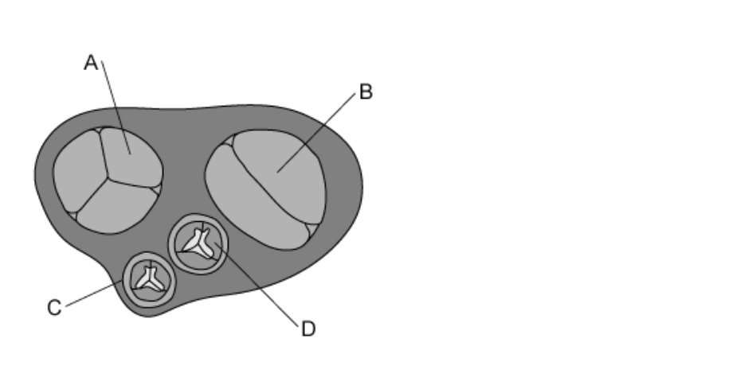

Which of the labels shows the valve that is pushed open when oxygenated blood is entering a ventricle?

### Q2 — hard — 1 marks

**Q2** [1 mark]

The graph shows the pressure changes during a cardiac cycle

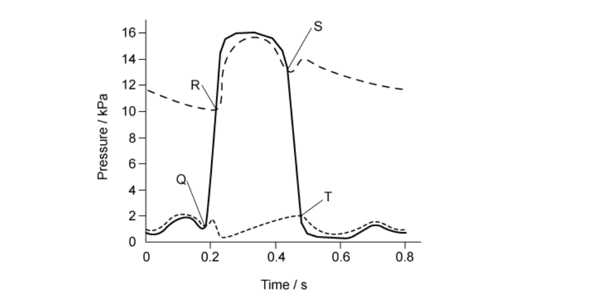

Which row correctly identifies Q, R, S and T?

|   | Q | R | S | T |
|---|---|---|---|---|
| **A** | semilunar valves close | atrioventricular valves open | atrioventricular valves close | semilunar valves open |
| **B** | semilunar valves open | atrioventricular valves close | atrioventricular valves open | semilunar valves close |
| **C** | atrioventricular valves close | semilunar valves close | semilunar valves open | atrioventricular valves open |
| **D** | atrioventricular valves close | semilunar valves open | semilunar valves close | atrioventricular valves open |

### Q3 — hard — 1 marks

**Q3** [1 mark]

The table below describes events during the cardiac cycle.

Which row is correct?

|   | nerve impulses from atrioventricular node (AVN) to | nerve impulses from Purkyne tissue (PT) to | nerve impulses from the sinoatrial node (SAN) to |
|---|---|---|---|
| **A** | PT | the atria | AVN |
| **B** | SAN | the atria | PT |
| **C** | PT | the ventricles | AVN |
| **D** | SAN | the ventricles | PT |

### Q4 — hard — 1 marks

**Q4** [1 mark]

The volume of blood pumped by each contraction of the ventricle is called the stroke volume. The volume of blood in the ventricle before systole is called the ventricular end-diastolic volume.

The following graphs show the relationship between stroke volume and ventricular end-diastolic volume.

Which one is correct?

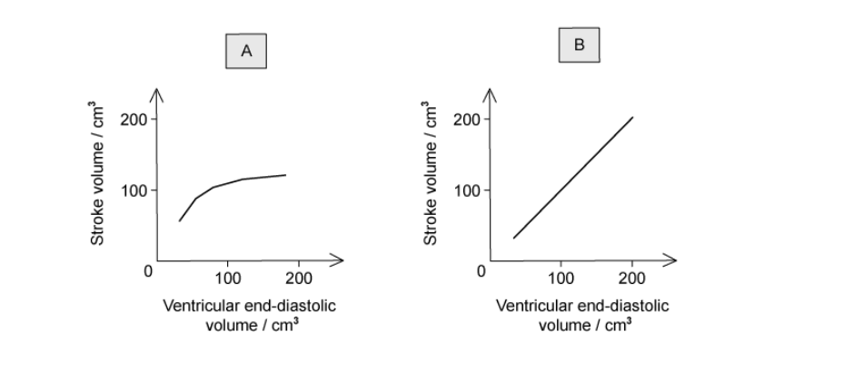

### Q5 — hard — 1 marks

**Q5** [1 mark]

A disease that causes a lower than normal heart rate is called ‘heart block’. When a doctor was treating a patient with this condition, he found that they had normal electrical impulses but these were not correctly conducted to the ventricles.

Which of the following could be faulty in the patient?

| **1** | atrioventricular node (AVN) |
|---|---|
| **2** | sinoatrial node (SAN) |
| **3** | Purkyne tissue |

### Q6 — hard — 1 marks

**Q6** [1 mark]

After entering the right side of the heart, a red blood cell will pass through or pass by the following structures:

| **1** | tricuspid valve |
|---|---|
| **2** | semilunar valve |
| **3** | right atrium |
| **4** | right ventricle |
| **5** | sinoatrial node |

Which option shows the correct order that red blood cells will pass through?

### Q7 — hard — 1 marks

**Q7** [1 mark]

The graph below shows the blood pressure changes in the aorta and left ventricle during two complete cardiac cycles.

**Fig. 1**

What is this person's heart rate?

### Q8 — hard — 1 marks

**Q8** [1 mark]

The diagram is of the external heart structure and blood vessels.

Which row of the table below shows the combination of blood vessels that supply blood to the heart and carry blood away from the heart?

|   | To the heart | Away from the heart |
|---|---|---|
| **A** | 2 and 3 | 1 and 4 |
| **B** | 4 and 1 | 2 and 3 |
| **C** | 3 and 4 | 1 and 2 |
| **D** | 1 and 2 | 3 and 4 |

### Q9 — hard — 1 marks

**Q9** [1 mark]

The graph shows the pressure changes in the left side of the heart over time.

Which row of the table below shows what is happening at points **1**, **2**,** 3** and **4 **to the semilunar valves and the atrioventricular valves?

|   | Semilunar valve | Atrioventricular valve |   |   |
|---|---|---|---|---|
|   | Opens | Closes | Opens | Closes |
| **A** | 2 | 3 | 1 | 4 |
| **B** | 2 | 3 | 4 | 1 |
| **C** | 1 | 2 | 3 | 4 |
| **D** | 1 | 2 | 4 | 3 |

### Q10 — hard — 1 marks

**Q10** [1 mark]

The graph shows the pressure changes in the left side of the heart over time. The cardiac cycle shown lasts 0.6 seconds (s).

The points on the graph **1**, **2**, **3** and **4** show when the atrioventricular and semilunar valves are open or closed.

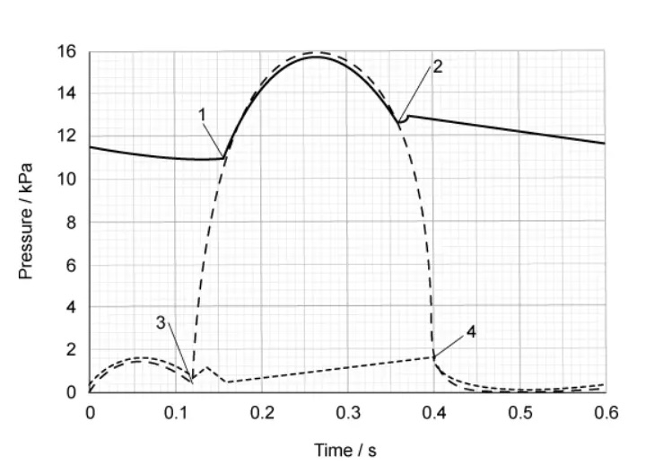

What is the total time in one cardiac cycle when the atrioventricular valves and the semilunar valves are both closed at the same time?

### Q11 — medium — 1 marks

**Q11** [1 mark]

The muscle of the left-hand side of the heart is thicker than the right-hand side.

Which of the following are consequences of this difference in muscle thickness?

1. The left side of the heart generates higher blood pressure
2. Blood leaving the right ventricle travels a greater distance than blood leaving the left ventricle
3. The left ventricle delivers blood to the body
4. The right ventricle generates lower pressure than the left-hand side

### Q12 — medium — 1 marks

**Q12** [1 mark]

The diagram shows a fault in the wall of the atria.

Which of the following would describe the effect of this fault?

### Q13 — medium — 1 marks

**Q13** [1 mark]

The diagram below shows the heart and associated blood vessels.

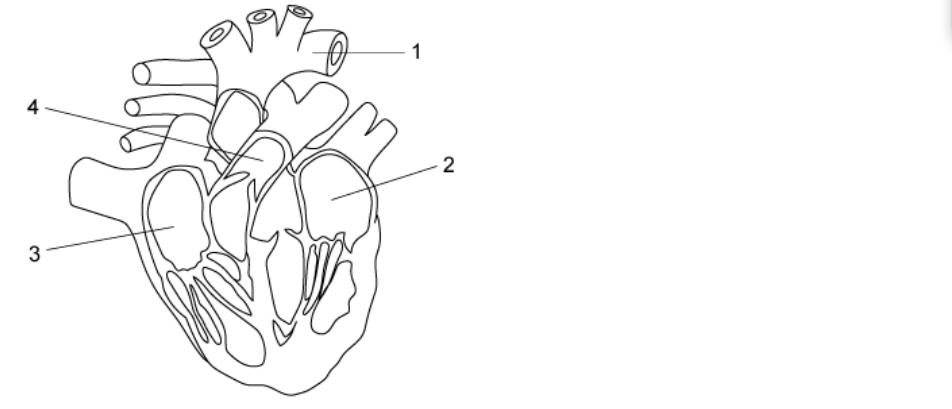

Which of the following would be correct for the flow of blood through the heart from the body?

### Q14 — medium — 1 marks

**Q14** [1 mark]

The table shows some changing conditions in the body.

Which row would cause the largest rise in cardiac output?

|   | aortic blood pressure | blood pressure in the vena cava | carbon dioxide concentration of the blood | frequency of impulses in the Vagus nerve |
|---|---|---|---|---|
| **A**  **B**  **C**  **D** | no change  no change  decrease  decrease | decrease  decrease  no change  no change | ncrease  no change  increase  no change | no change  increase  no change  increase |

### Q15 — medium — 1 marks

**Q15** [1 mark]

The narrowing of the aortic semilunar valve is a heart disorder called aortic stenosis.

Which of the following would describe the effect of aortic stenosis on the heart structure and function?

### Q16 — medium — 1 marks

**Q16** [1 mark]

The following parts of the heart all control the heartbeat.

| **1** | Purkyne tissue |
|---|---|
| **2** | atrioventricular node (AVN) |
| **3** | sinoatrial node (SAN) |

Which row in the table below is correct for ventricular contraction and atrial contraction?

|   | Ventricular contraction | Atrial contraction |
|---|---|---|
| **A** | Purkyne tissue carries a wave of excitation | SAN produces a wave of excitation |
| **B** | Purkyne tissue carries a wave of excitation | SAN and AVN produce a wave of excitation |
| **C** | AVN produces a wave of excitation | Purkyne tissue carries a wave of excitation |
| **D** | SAN produces a wave of excitation | AVN produces a wave of excitation |

### Q17 — medium — 1 marks

**Q17** [1 mark]

The graph shows the pressure in different parts of the heart during one cardiac cycle

At which point does the semilunar valve of the aorta close?

### Q18 — medium — 1 marks

**Q18** [1 mark]

The graph below shows the pressure in different parts of the left side of the heart during one cardiac cycle.

At the end of which section in the graph (**A, B, C **or **D) **would the ventricle be full of blood?

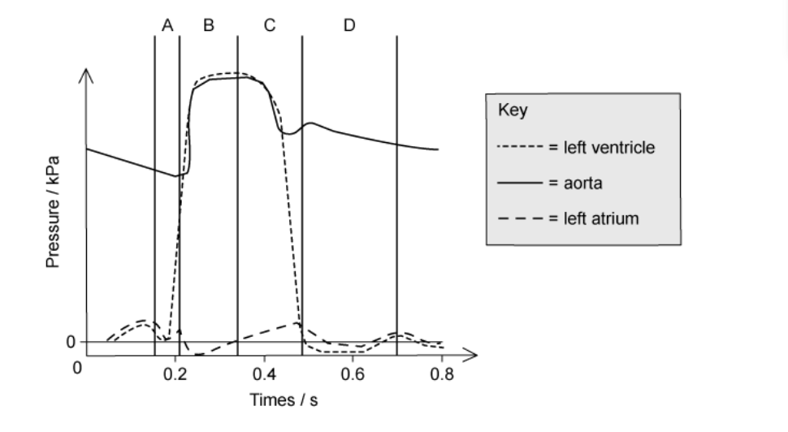

### Q19 — medium — 1 marks

**Q19** [1 mark]

The diagram below shows two cardiac cycles of a patient. The events of the cycle are placed next to a timescale.

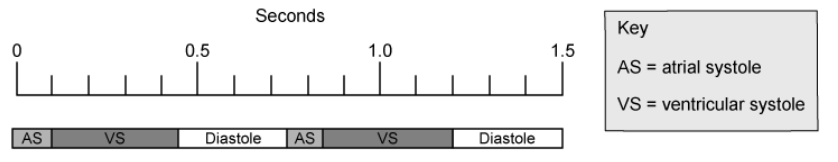

How fast is the patient’s heart beating?

### Q20 — medium — 1 marks

**Q20** [1 mark]

The electrical excitation of the ventricles of the heart are thought to be improved by taking fish oils.

What part of the heart could the fish oils help?

### Q21 — easy — 1 marks

**Q21** [1 mark]

The graph shows the pressure in different parts of the heart during one cardiac cycle

At 0.2 seconds which part of the heart is responding to the excitatory stimulus?

### Q22 — easy — 1 marks

**Q22** [1 mark]

What is systolic blood pressure?

### Q23 — easy — 1 marks

**Q23** [1 mark]

Which structure is correctly labelled on the diagram below?

### Q24 — easy — 1 marks

**Q24** [1 mark]

Which of the following statements happens during ventricular systole in a human heartbeat?

| **1** | ventricular pressure increases |
|---|---|
| **2** | atrial pressure does not change |
| **3** | aortic pressure increases |

### Q25 — easy — 1 marks

**Q25** [1 mark]

Purkyne (Purkinje) tissue is found in the mammalian heart. What is its function?

### Q26 — easy — 1 marks

**Q26** [1 mark]

The characteristic ‘lub-dub’ sound of the heartbeat is caused by the movement of valves in the heart.

What causes the first sound after atrial systole in the cardiac cycle?

| 1 | closing of the semilunar valves |
|---|---|
| 2 | opening of the semilunar valves |
| 3 | closing of the atrioventricular valves |

### Q27 — easy — 1 marks

**Q27** [1 mark]

During ventricular diastole what happens in the heart?

### Q28 — easy — 1 marks

**Q28** [1 mark]

What happens in the left ventricle during a contraction?

### Q29 — easy — 1 marks

**Q29** [1 mark]

When the pressure in the ventricles in the heart is at its maximum what is the state of the valves?

|   | **semilunar valves** | **atrioventricular valves** |
|---|---|---|
| **A** | open | open |
| **B** | open | closed |
| **C** | closed | open |
| **D** | closed | closed |

### Q30 — easy — 1 marks

**Q30** [1 mark]

The following are some features of blood vessels.

Which feature enables the aorta to withstand the high pressure at ventricular systole?

## Structured Questions (15 questions)

### Q1 — hard — 18 marks

**Q1** [1 mark]

*Note: This past paper question assesses knowledge from other topics alongside the knowledge of the heart assessed in 8.3*

Woolly foxglove, *Digitalis lanata*, shown in Fig. 1**A**, and common oleander, *Nerium oleander*, shown in Fig. 1**B**, are plants grown for the attractive flowers that they produce.

Both plants are poisonous, as their leaves produce toxic organic compounds known as cardiac glycosides. Cardiac glycosides have a powerful effect on the action of cardiac muscle.

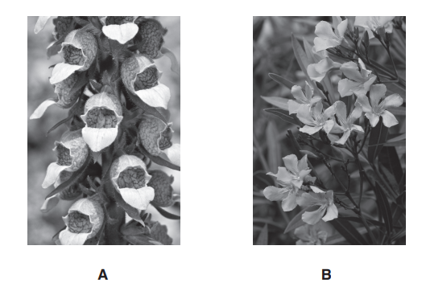

**Fig. 1**

*N. oleander* is able to grow in very dry conditions. The leaves have adaptations to reduce water loss by transpiration.

State the term used to describe a plant, such as *N. oleander,* that has adaptations to allow it to grow in conditions where water is in short supply.

*Source: Oct/Nov 2018  9700/22 Q2A*

**Q1** [3 marks]

Aphids are small insects that feed on plant fluids using piercing and sucking mouthparts. When aphids feed on the sap present in vascular tissue of leaves and stems, a sugary liquid called honeydew is passed out of the gut. The honeydew can be analysed to find out what is present in the sap.

(i) State the name of the vascular tissue from which the aphids feed.

[1]

(ii) An investigation found that aphids feeding on *D. lanata *produced honeydew containing cardiac glycosides.

Suggest why cardiac glycosides were present in the sap from the vascular tissue.

[2]

*Source: Oct/Nov 2018  9700/22 Q2B*

**Q1** [7 marks]

Cardiac glycosides have an effect on the movement of ions into and out of cardiac muscle cells. The outcome is an increased ability for the cells to contract.

Investigations into the action of the cardiac glycoside oleandrin, extracted from* N. oleander*, have shown that it acts to prevent the correct functioning of Na/K‐ATPase, a membrane transport protein.

Na/K‐ATPase has a role as an enzyme **and** as a transport molecule.

- ATPase is an enzyme that catalyses the hydrolysis of ATP to ADP and inorganic phosphate.
- Energy released from this hydrolysis is used to transport sodium ions (Na+) out of cardiac muscle cells and potassium ions (K+) into the cells.

(i) Explain what is meant by the *hydrolysis* of ATP.

[2]

(ii) Name the type of transport mechanism involved in the transport of Na+ and K+ across the cell surface membrane of cardiac muscle cells.

[1]

(iii) Oleandrin is a non‐competitive reversible inhibitor of ATPase. Describe the mode of action of oleandrin **and **explain how this will affect ion movement through Na/K‐ATPase transport proteins of the cell surface membranes of cardiac muscle cells.

[4]

*Source: Oct/Nov 2018  9700/22 Q2C*

**Q1** [7 marks]

**Extract:**

Cardiac glycosides have an effect on the movement of ions into and out of cardiac muscle cells. The outcome is an increased ability for the cells to contract.

Digoxin, a cardiac glycoside extracted from *D. lanata* leaves, can be purified and used as a drug to treat some heart disorders.

Examples of these heart disorders are:

- atrial fibrillation, where the normal rhythmic cardiac cycle is disrupted
- heart failure, where cardiac muscle is contracting weakly.

(i) Describe the **sequence** of events occurring in the left side of the heart during one **normal** cardiac cycle. Include reference to blood pressure changes.

The first event in the sequence is described for you.

The left atrium fills with blood during relaxation of the left atrium and left ventricle.

[4]

(ii) Suggest how the health of a person with heart failure can be improved by treatment with the drug digoxin.

[3]

*Source: Oct/Nov 2018  9700/22 Q2D*

### Q2 — hard — 10 marks

**Q2** [4 marks]

Describe the roles of the sinoatrial node (SAN) and the atrioventricular node (AVN) in the initiation and control of the cardiac cycle.

*Source: Oct/Nov 2018 Series 3 9700/23 Q4A*

**Q2** [2 marks]

The Purkyne fibres pass down the septum and extend to the cardiac muscle at the base (apex) of the heart.

Explain why it is important that the Purkyne fibres extend to the base of the heart.

*Source: Oct/Nov 2018 Series 3 9700/23 Q4B*

**Q2** [4 marks]

The activity of the SAN is controlled by the nervous system. Noradrenaline is released by nerve cells in the SAN.

Fig. 1 shows the role of noradrenaline in causing calcium ions (Ca2+) to enter a cell in the SAN.

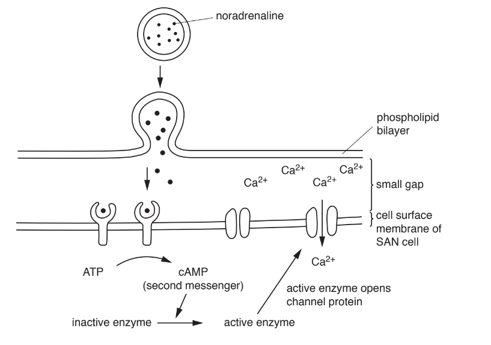

**Fig. 1**

With reference to Fig.1, outline the process of cell signalling.

*Source: Oct/Nov 2018 Series 3 9700/23 Q4C*

### Q3 — hard — 12 marks

**Q3** [8 marks]

The graph shown in Fig. 1 shows the relationship between the left ventricular volume and left ventricular pressure.

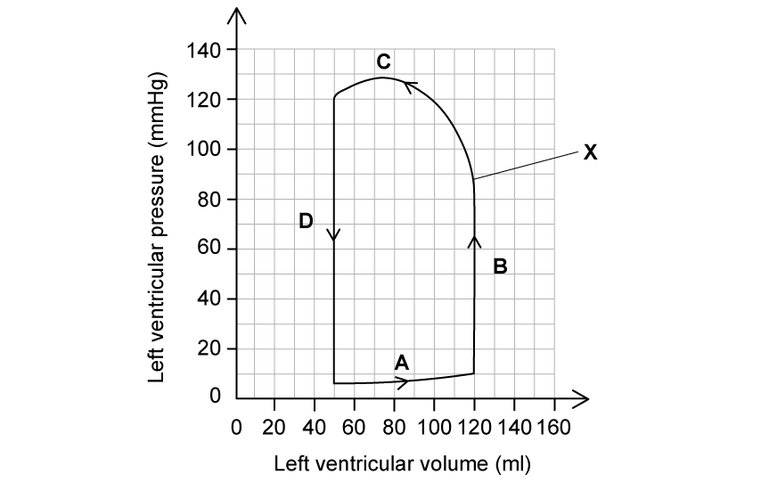

**Fig. 1**

(i) Identify the stages of the cardiac cycle shown by the letters **A **- **D**.** **

[4]

(ii) Explain the changes in the left ventricle shown at stage **C**.

[2]

(iii) Determine the valve identified by the letter **X** on Fig. 1 **and** state if the valve is open or closed.

[2]

**Q3** [2 marks]

**Extract:**

The graph shown in Fig. 1 shows the relationship between the left ventricular volume and left ventricular pressure.

Stroke volume is the volume of blood pumped out of the left ventricle of the heart during each cardiac cycle.

Use Fig. 1 to determine the stroke volume of this left ventricle.

**Q3** [2 marks]

**Extract:**

The graph shown in Fig. 1 shows the relationship between the left ventricular volume and left ventricular pressure.

Calculate the percentage change between the maximum and minimum left ventricular pressure using the data shown in Fig. 1.

### Q4 — hard — 11 marks

**Q4** [1 mark]

State why the heart muscle is described as **myogenic**.

**Q4** [5 marks]

Fig. 1 shows a graph that results from the monitoring of the electrical activity of the heart, along with the stages of the cardiac cycle to which the electrical activity corresponds. The T wave corresponds to diastole, during which the electrical charge across the cells of the heart returns to normal as the wave of excitation ends.

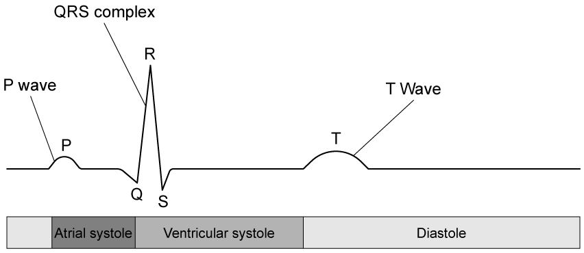

**                                                              Fig.1**

Describe the electrical activity taking place in the heart, relating it to the **P** wave and the **QRS** complex shown in Fig.1

**Q4** [2 marks]

**Extract:**

Fig. 1 shows a graph that results from the monitoring of the electrical activity of the heart, along with the stages of the cardiac cycle to which the electrical activity corresponds. The T wave corresponds to diastole, during which the electrical charge across the cells of the heart returns to normal as the wave of excitation ends.

Fig.1

The electrical activity taking place in the heart involves:
- The electrical activity is initiated by the SAN/sinoatrial node
- The electrical activity / wave of excitation passes from the atria to the ventricles via the AVN/atrioventricular node
- The electrical activity / wave of excitation pauses at the AVN (for 0.1 s)
- The electrical activity / wave of excitation passes to the base of the ventricles via the Purkyne tissue/fibres

This relates to the P wave and QRS complex in the following ways:
- The electrical activity / wave of excitation spreads across the atria, causing the P wave
- The electrical activity / wave of excitation spreads upwards across the ventricles, causing the QRS complex

Fig. 2 shows ECG traces from three individuals. Individual **A** has healthy heart function while individuals **B** and **C** have been diagnosed with heart problems.

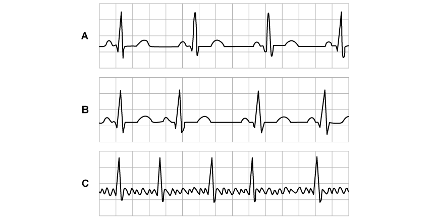

**                                                                Fig. 2**

State the abnormalities in electrical activity that seem to be present in the ECG traces of individuals **B** and **C** shown in Fig. 2

**Q4** [3 marks]

**Extract:**

Fig. 2 shows ECG traces from three individuals. Individual A has healthy heart function while individuals B and C have been diagnosed with heart problems.

The abnormalities present in the ECG traces of individuals B and C are:
- C = atria are repeatedly contracting / atria are contracting more often than the ventricles / lack of coordination in contraction of the atria / atrial fibrillation

Individual **C** experienced symptoms such as the feeling of a fluttering heart and chest pain.

Suggest **and** explain **one other** physical symptom that individual **C** in Fig. 2 might be experiencing.

### Q5 — hard — 12 marks

**Q5** [4 marks]

Fig. 1 shows a diagram of a human heart that has some defects.

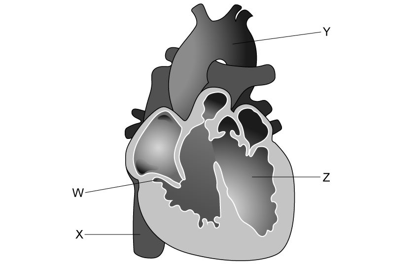

**                                                           Fig.1**

Identify structures **W **to **Z** in Fig. 1.

**Q5** [6 marks]

The heart shown in Fig.1 shows a combination of heart defects known as tetralogy of Fallot.

Identify **three** heart defects visible in Fig.1 **and** suggest explanations for the possible impacts of the defects on heart function.

**Q5** [2 marks]

**Extract:**

The heart shown in Fig.1 shows a combination of heart defects known as tetralogy of Fallot.

The heart defects visible in Fig.1 and suggested explanations of their possible impacts on heart function are...

- Thickened right ventricle wall;
- Damage to capillaries in lungs AS increased blood pressure is generated by extra muscle;
OR
Reduced blood flow to lungs AS there is reduced flexibility/pumping action of the right ventricle;

AND

- A hole in the septum between the left and right ventricles;
- Reduction in oxygen pumped around the body / reduced efficiency in pumping oxygen around the body AS there is mixing of (oxygenated and deoxygenated) blood from the (right and left) ventricles;

AND

- Thickening of the (semilunar) valve that leads to the pulmonary artery / the pulmonary valve;
- Reduced blood flow to (and therefore also from) the lungs / reduced oxygenation of blood in the lungs AS less blood is able to leave the heart (for the lungs) in the pulmonary artery;
OR
Increased blood flow into the left ventricle AS reduction in blood into the artery causes blood to be pushed sideways into the left ventricle;

The mixing of blood in the two ventricles causes problems as it means that the blood pumped around the body by the left ventricle will contain a quantity of deoxygenated blood from the right ventricle; this reduces its overall oxygen saturation and means that there is less oxygen available to the cells as the blood travels around the body.

The thickened valve in the pulmonary artery reduces blood flow to the lungs, further reducing the oxygenation of the blood; this results both from a reduction in the volume of oxygenated blood returning from the lungs and from increased mixing of blood between the ventricles.

Suggest **and** explain **one** possible symptom in sufferers of tetralogy of Fallot.

### Q6 — medium — 13 marks

**Q6** [6 marks]

Table 1 shows the pressure changes in the left side of the heart during one complete cardiac cycle.

**Table 1**

|   | Pressure changes (mmHg) |   |
|---|---|---|
| Time (s) | Left atrium | Left ventricle |
| 0.0 | 5.3 | 2.3 |
| 0.1 | 7.5 | 15.0 |
| 0.2 | 1.5 | 93.8 |
| 0.3 | 1.5 | 114.8 |
| 0.4 | 7.5 | 33.8 |
| 0.5 | 3.8 | 7.5 |
| 0.6 | 4.5 | 2.3 |
| 0.7 | 5.2 | 2.3 |

(i) State the time window that the bicuspid valve, between the atrium and ventricle, is closed. Explain your answer.

[2]

(ii) Explain what can be concluded about the cardiac cycle between 0.2 and 0.3 seconds.

[4]

**Q6** [2 marks]

**Extract:**

Table 1 shows the pressure changes in the left side of the heart during one complete cardiac cycle.

**Table 1**

|   | Pressure changes (mmHg) |
| Time (s) | Left atrium | Left ventricle |
| 0.0 | 5.3 | 2.3 |
| 0.1 | 7.5 | 15.0 |
| 0.2 | 1.5 | 93.8 |
| 0.3 | 1.5 | 114.8 |
| 0.4 | 7.5 | 33.8 |
| 0.5 | 3.8 | 7.5 |
| 0.6 | 4.5 | 2.3 |
| 0.7 | 5.2 | 2.3 |

The heart beats for one minute at the rate shown in the table.

Calculate the total time the ventricles are contracted during one minute. Give your answer to two significant figures.

**Q6** [5 marks]

Two structures, the sinoatrial node (SAN) and the atrioventricular node (AVN) are involved in the cardiac cycle.

Describe how these structures control the cardiac cycle.

### Q7 — medium — 12 marks

**Q7** [4 marks]

Fig. 1 shows the external view of the mammalian heart.

**                                                               Fig. 1**

(i) Identify the structure marked **X**.

[1]

(ii) Suggest **and** explain **one** possible symptom that might result from a blockage inside structure **X**

[3]

**Q7** [2 marks]

Fig. 2 shows the pressure changes in various parts of the heart during the cardiac cycle.

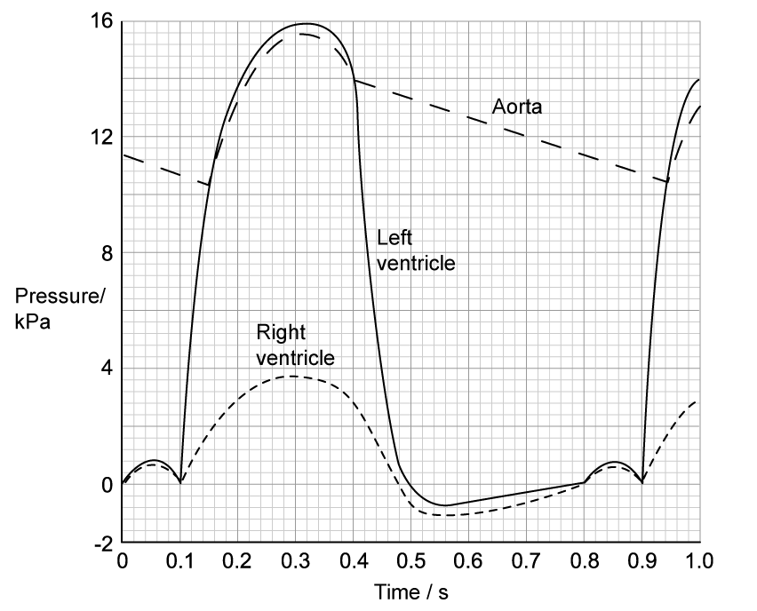

**                                                             Fig. 2**

Calculate the heart rate of the individual in Fig. 2

**Q7** [3 marks]

**Extract:**

Fig. 2 shows the pressure changes in various parts of the heart during the cardiac cycle.

Fig. 2 shows separate lines for the left and right ventricles.

(i) State the reason for this difference

[1]

(ii) Explain the benefits of this difference to the function of the circulatory system

[2]

**Q7** [3 marks]

**Extract:**

Fig. 2 shows the pressure changes in various parts of the heart during the cardiac cycle.

Identify the times on Fig. 2 at which the following events take place:

(i) The first ventricular systole begins.

[1]

(ii) The semilunar valves close.

[1]

(iii) Diastole begins.

[1]

### Q8 — medium — 12 marks

**Q8** [2 marks]

The mammalian circulatory system is described as a closed double circulation.

Explain why it is called a *closed ***and ***double *circulation.

*Source: May/June 2019 9700/21 Q5A*

**Q8** [6 marks]

Fig.1 shows a drawing of an external view of a mammalian heart.

Two cross-sections were made of the heart:

- Section 1 was made across the line** A–B**.
- Section 2 was made across the line** C–D**.

Drawings of the two sections were viewed from above as shown by the arrow on Fig. 1. Fig. 2 is a drawing of section **A–B**. Fig. 3 is a drawing of section **C–D**.

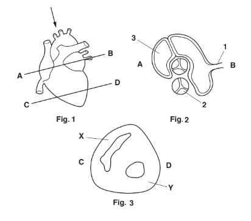

(i)Name structures **1**, **2** and **3,** as shown in Fig. 2.

[3]

(ii) Explain why the wall of chamber **Y** is thicker than the wall of chamber **X**, as shown in Fig. 3.

[3]

*Source: May/June 2019 9700/21 Q5B*

**Q8** [4 marks]

Explain how the contractions of the chambers of the heart are coordinated during one cardiac cycle.

*Source: May/June 2019 9700/21 Q5C*

### Q9 — medium — 6 marks

**Q9** [3 marks]

The sinoatrial node (SAN) and the atrioventricular node (AVN) are two regions of the heart.

Explain the role of the SAN **and** the role of the AVN in the cardiac cycle.

*Source: Specimen 2022 9700/02 Q5A*

**Q9** [3 marks]

Fig. 1 shows features that are observed in transverse sections of three types of blood vessel.

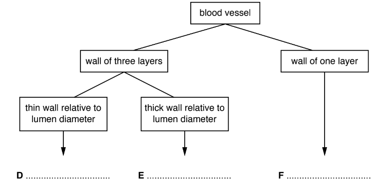

**Fig.1**

(i) Complete Fig.1 by stating the type of blood vessel indicated by **D**, **E** and **F**.

[1]

(ii) The inner layer of the walls of **D** and **E** is composed of endothelial tissue.

List **two** structural features of endothelial tissue.

[2]

*Source: Specimen 2022 9700/02 Q5B(I,II)*

### Q10 — medium — 11 marks

**Q10** [4 marks]

Fig. 1 shows a representation of parts of the circulatory system.

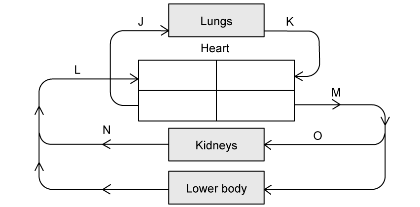

**                                                                Fig. 1**

Identify the following blood vessels:

(i) **J**

(ii) **K**

(iii) **L**

(iv) **M**

**Q10** [2 marks]

**Extract:**

Fig. 1 shows a representation of parts of the circulatory system.

Identify the following blood vessels:
(i) **J**
(ii) **K**
(iii) **L**
(iv) **M**

The blood vessels can be identified as follows...
- (i) **J** = pulmonary artery;
- (ii) **K** = pulmonary vein;
- (iii) **L** = (inferior) vena cava;
- (iv) **M** = Aorta;

The heart chambers connecting to blood vessels **J** and **M** are similar in structure but not identical.

Describe **and** explain **one** structural difference between the two heart chambers.

**Q10** [3 marks]

**Extract:**

Fig. 1 shows a representation of parts of the circulatory system.

Identify the following blood vessels:
(iv) M

M = Aorta

The heart chambers connecting to blood vessels J and M are similar in structure but not identical.

The left ventricle / chamber connecting to M has (a) thicker muscle (wall).

Fig. 2 shows the changes in pressure in the heart and some of the blood vessels.

**                                                         Fig. 2**

Describe **and** explain the differences in pressure between the heart chamber and blood vessel **M**.

**Q10** [2 marks]

**Extract:**

Fig. 2 shows the changes in pressure in the heart and some of the blood vessels.

Explain why blood pressure in Fig. 2 continues to drop in blood vessel **O** and in the capillaries.

### Q11 — easy — 12 marks

**Q11** [4 marks]

Table 1 shows some events that occur during the cardiac cycle.

**Table 1**

| **Event of the Cardiac Cycle** | **Order** |
|---|---|
| SAN sends out a wave of excitation | 1 |
| Wave of excitation passes through the AVN |   |
| Ventricles contract |   |
| Atria contract |   |
| Wave of excitation passes through the Purkyne tissue |   |

Number the events in Table 1 to show the correct order of the events in the cardiac cycle.

The first one has been done for you.

**Q11** [1 mark]

**Extract:**

Table 1 shows some events that occur during the cardiac cycle.

**Table 1**

| **Event of the Cardiac Cycle** | **Order** |
| SAN sends out a wave of excitation | 1 |
| Wave of excitation passes through the AVN |   |
| Ventricles contract |   |
| Atria contract |   |
| Wave of excitation passes through the Purkyne tissue |   |

When the wave of depolarisation passes through the AVN there is a slight delay before any other events occur.

State why this delay is necessary.

**Q11** [3 marks]

During the cardiac cycle the changes in the heart occur simultaneously on the left and right sides.

While the same events are taking place on the left and right sides of the heart, the pressure in the corresponding chambers on the left and the right is not the same.

(i) Explain the pressure difference between the left and right sides of the heart.

[2]

(ii) State the location of the highest pressure generated in the heart during the cardiac cycle.

[1]

**Q11** [4 marks]

Describe the flow of oxygenated blood through the left side of the heart as it returns from the lungs.

### Q12 — easy — 7 marks

**Q12** [2 marks]

The coronary arteries are part of the external structure of the heart.

Explain the role of the coronary arteries.

**Q12** [1 mark]

The septum is an internal structure of the heart. A heart condition called a septal defect results in a hole in the septum of the heart.

Describe the consequence of this condition to the blood flowing through the heart.

**Q12** [2 marks]

The valves of the heart are another important internal structure. Valves prevent the backflow of blood into the atria or ventricles. Valves also have a role in controlling pressure changes within the heart during the cardiac cycle.

Explain how the valves achieve this.

**Q12** [2 marks]

Valves are also found within blood vessels called veins.

Other than valves, explain how one other structure of veins relates to its function.

### Q13 — easy — 7 marks

**Q13** [3 marks]

Fig. 1 shows the internal structure of the heart.

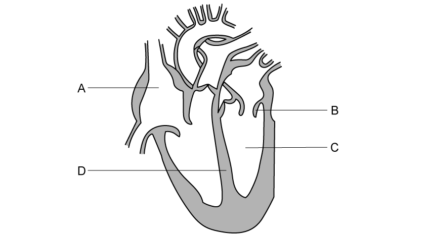

**Fig. 1**

**A** and **C** represent two heart chambers.

(i) Label chambers **A** and **C**.

[2]

(ii) State **one** difference in the function of **A** and **C**.

[1]

**Q13** [1 mark]

The blood on the left and right-hand sides of the heart are kept separate.

State one difference between the blood found on the left and right sides of the heart.

**Q13** [2 marks]

**Extract:**

Fig. 1 shows the internal structure of the heart.

**Fig. 1**

The blood on the left and right-hand sides of the heart are kept separate.

A difference between the blood found on the right and left sides of the heart is....

Blood on the left side is oxygenated / has a higher oxygen content **WHILE** blood on the right side is deoxygenated / has a lower oxygen content.

Structure **D** is a wall of muscular tissue.

Name structure **D** and state the purpose of this structure in the heart.

**Q13** [1 mark]

**Extract:**

Fig. 1 shows the internal structure of the heart.

**Fig. 1**

Fig. 2 shows changes in pressure in parts of a human heart during 0.8 seconds.

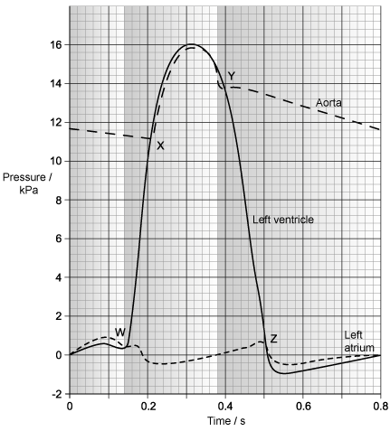

**Fig. 2**

**Identify the letter in **Fig. 2 that** represents the point at which valve B in Fig. 1 opens.**

### Q14 — easy — 6 marks

**Q14** [1 mark]

Fig. 1 shows the flow of blood in one cardiac cycle.

**Fig. 1**

Identify the correct order of letters, starting at atrial systole.

**Q14** [4 marks]

**Extract:**

Fig. 1 shows the flow of blood in one cardiac cycle.

With reference to Fig. 1, describe the events of the cardiac cycle shown in **W**.

**Q14** [1 mark]

Fig. 2 represents the pressure changes taking place during the cardiac cycle.

**Fig. 2**

Using Fig. 2, identify the letter(s) that show atrial systole.

### Q15 — easy — 10 marks

**Q15** [4 marks]

Fig. 1 shows the structure of the mammalian heart.

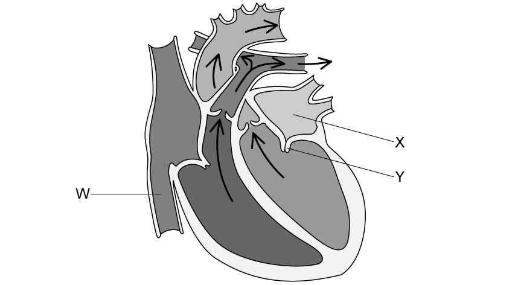

**                                                             Fig. 1**

Starting at the point marked **W**, describe the route taken by the blood as it travels to the point marked **X**.

**Q15** [2 marks]

For structure **Y **in Fig. 1:

(i) Name the structure.

[1]

(ii) State its function.

[1]

**Q15** [4 marks]

**Extract:**

Fig. 1 shows the structure of the mammalian heart.

For Fig. 1:

(i) Identify the stage of the cardiac cycle shown.

[1]

(ii) Explain your answer to part (i).

[3]
