# Mark Schemes — The Gas Exchange System
**9. Gas Exchange** · Cambridge (CIE) AS biology (9700)

## Multiple Choice Questions (30 questions)

### Q1
**Final answer:** **The correct answer is ****B ****as: **

- **Increased ****exocytosis**** causes a faster rate of mucus production  **
- **Contraction of the smooth muscle is responsible for the narrowing of the airways  **
- **During an asthma attack the rate of respiration in the smooth muscle will be higher as ****energy is needed for muscle contraction**
- **Despite the increased mucus production, there is no change in the activity of the ciliated epithelial cells (hence ****2**** not being a response)**
- **The build-up of mucus further contributes to the difficulty of breathing caused by the narrowing of the airways **

### Q2
**Final answer:** **The correct answer is ****C ****as:**

- **Goblet cells need large numbers of ****secretory vesicles**** for transporting synthesised mucus out of the cell (****exocytosis****)**
- **Mucus is a type of ****glycoprotein**** and lots of ****rough endoplasmic reticulum**** is needed to create the ****protein**** part of this glycoprotein **
- **Both exocytosis and protein synthesis are active processes requiring large amounts of ****ATP****, therefore there is an abundance of ****mitochondria**** (to synthesise ATP)**

> *Lysosomes are membrane-bound organelles that contain digestive enzymes to break down cellular contents such as proteins, nucleic acids and lipids. Although they are present in goblet cells this is not in large numbers. *

### Q3
**Final answer:** **The correct answer is ****C ****as: **

- **The question is asking about the sequence of events in ****exocytosis**** (i.e. the process of moving materials from within a cell to the exterior of the cell)**
- **The main role of goblet cells is to secrete mucus in order to protect the mucous membranes where they are found**
- **The mucus the goblet cells secrete is comprised of large glycoproteins**

  - **The first step to create these ****glycoproteins**** is by attaching carbohydrate to a protein (****2****)**
  - **The next step is to create the vesicle, and this is done in the ****Golgi apparatus**** (****3****)**
  - **The vesicles (containing the newly synthesised mucus) are then transported from the Golgi to the cell membrane.**
  - **The vesicle membrane attaches to the cell membrane (****4****)**
  - **Fusion of the vesicle membrane with the cell membrane releases the vesicle contents (glycoprotein) outside the cell (****1****)**

### Q4
**Final answer:** **The correct answer is ****B ****as during the course of the four minutes they inhaled and exhaled ****36 dm****3**** of air.  **

**Final answer:** **To calculate the total amount of air breathed in four minutes first times the tidal volume by the breathing rate (to get the ****breathing rate for one minute****) **

**Final answer:** **0.6 x 15 = 9 dm****3**** min****-1**

**Final answer:** **Then multiply by 4 (to get the ****rate for four minutes****)**

**Final answer:** **9 x 4 = 36 dm****3**

### Q5
**Final answer:** **The correct answer is ****A. **

**Final answer:** **Macrophages (a type of ****phagocyte****) invade the walls of the ****alveoli**** and release ****elastase****, which breaks down the elastic fibres in the alveoli.  Without elastic fibres there is no ****elastic recoil**** (hence why the alveoli are unable to return to their original shape after inhalation.**

> *You are not required to know about emphysema to answer this question. This is a synoptic question where you are applying your knowledge of the immune system to that of the gas exchange system. You do not need to know about or have heard of the enzyme elastase. Its role can be assumed by knowledge of the other enzyme mentioned, ligase, which you do need to know about. You are also offered information in the question stem about the effects of emphysema on alveolar tissue which suggests a lost of elastic and recoil. *

### Q6
**Final answer:** **The correct answer is ****B ****as:**

- **HCO****3- ****ions (also known as bicarbonate) are transported in the blood plasma **
- **Carbonic anhydrase is an enzyme found in erythrocytes (red blood cells)**
- **Lysosomes are found in the cytoplasm of macrophages (phagocytotic white blood cells)**

**Final answer:** **1 = Alveolar wall (a squamous epithelial cell - the small circle is the nucleus) **

**Final answer:** **2 = Capillary wall (a squamous epithelial cell)    **

**Final answer:** **3 = Erythrocyte (red blood cell)   **

**Final answer:** **4 = Lumen of an alveoli**

**Final answer:** **5 = The lumen of a capillary   **

**Final answer:** **6 = The cytoplasm of a macrophage (phagocytotic white blood cell)**

### Q7
**Final answer:** **The correct answer is ****C**** as:**

- **The additional ****mucus production**** leads to ****mucus buildup****.  If this mucus is not cleared it can harbour pathogens, therefore, leading to an increased risk of a lung infection – so ****2**** is correct **
- **The ****diffusion gradient**** is also ****decreased**** as the airflow into and out of the lungs is restricted (both by the narrowing of the lumen and the buildup of mucus).  This decrease in airflow results in the air spending longer than usual in the alveoli, leading to a buildup of carbon dioxide and a reduction in oxygen concentration of the air in the alveoli.  The concentrations of these gases in the alveoli are now more similar to the concentrations found in the blood, therefore diffusion of gases between the blood and alveoli will be slower (due to the ****reduced concentration gradient****) - so ****3**** is correct**

> *There is no change to the diffusion distance as the structure of the alveolar and capillary walls are unchanged - so **1** is incorrect*

> *Allergy-induced asthma is triggered by airborne substances, such as pollen, mould spores, dust mites or particles of skin and fur shed by pets. *

### Q8
**Final answer:** **The correct answer is ****A ****as there is no evidence to suggest lung cancer takes 20 years to develop.  The deaths per 100,000 of age group does rise for a 20-year period (from 1950 – 1970), however, this does not imply that cancer takes 20 years to develop.  We would require more information (such as the cause of death and the years the individual had or hasn’t smoked) to be able to ascertain whether this statement is indeed true.**

> *B **is incorrect as deaths per 100,000 in men 35-59 have fallen from ~50 to ~25** **throughout the study, so the statement is true*

> *C **is incorrect as the number of men aged 35-59 who were smokers has gone from around 82% to 36%   *

- *(36 / 82) - 1 = -0.56 *
- *this is a 56% decrease (approximately 60%) and therefore the statement is true*

> *D **is incorrect as as the number of deaths rose continually between 1950 and 1970 so the statement is true*

### Q9
**Final answer:** **The correct answer is ****B ****as the overall volume of the lungs is not affected, however the damage to the walls would lead to a ****reduced**** surface area. One such disease that could damage the lungs in this way is emphysema. **

> *Emphysema** is a lung condition that causes shortness of breath. In people with emphysema the alveoli are damaged. Over time, the inner walls of the alveoli weaken and rupture, creating larger air spaces instead of many small ones. This reduces the **surface area** of the lungs and, in turn, the amount of **oxygen** that reaches the **bloodstream**.*

### Q10
**Final answer:** **The correct answer is ****C ****as tissue ****X**** is ****cartilage****. The ****bronchus ****is a wide flexible tube, the lumen of which is kept open by ****plates of cartilage.  ****The cartilage prevents the collapse of the bronchus during ****inhalation**** (when there is low pressure).**

> *A + B **would be referring to smooth muscle and **D **would be referring to goblet cells. *

### Q11
**The correct answer is ****B**** as ****oxygen**** and ****carbon monoxide**** both bind to the same area on ****haemoglobin****, whereas ****carbon dioxide**** ****binds to a different location. **

> *Haemoglobin** contains four **haem groups** each capable of binding one **oxygen** molecule.  **Carbon monoxide **binds to **haemoglobin** at the same sites as **oxygen**, however, it does so around 200 times more tightly.  This means when **carbon monoxide** is present, it binds to **haemoglobin** preferentially over **oxygen**, therefore fewer **haemoglobin** particles are available to bind and deliver **oxygen**.  This causes the gradual suffocation associated with **carbon monoxide poisoning.*

### Q12
**Final answer:** **The correct answer is ****A ****as:**

- **trachea**** have ****cartilage**** (to prevent collapse from low pressure during inhalation)**
- **trachea**** have ****goblet cells**** (to produce mucus to trap dirt and pathogens)**
- **trachea**** have ****smooth muscle**** (to provide strength and flexibility to the trachea)**

**Alveoli**** have none of these features as they are too small - their walls are only one cell thick so there is no space for ****cartilage****, ****goblet cells**** or ****smooth muscle****.  **

> *The **trachea** is a wide flexible tube, the lumen of which is kept open by **C-shaped rings** of **cartilage**. The gaps between the rings of **cartilage** are filled by a bundle of **smooth muscle** and **elastic tissue**. Together these hold the lumen of the **trachea** open while still allowing flexibility during **inhalation** and **exhalation**.*

### Q13
**Final answer:** **The correct answer is ****C ****the ****folded inner lining**** allows the ****bronchiole**** to ****expand**** and ****contract**** during ****ventilation****. The folding also permits the contraction and relaxation of smooth muscles around the bronchioles (leading to constriction and dilation of the lumen) which is important in directing airflow to chosen sections of the lung.**

> *A **is incorrect as this would be a negative attribute.  Trapping foreign particles in the bronchioles would lead to a build-up of dirt and pathogens and an increased risk of pulmonary infection. This is why bronchioles have **ciliated epithelium** cells to move trapped foreign particles out of the lungs.*

> *B **is incorrect as while the folding does result in a larger surface area, this is more of a by-product than a causal effect and is not a property required for bronchiole function.*

> *D **is incorrect as gas exchange only occurs in the alveoli.  The walls of the other vessels are too thick for gas exchange to occur.*

### Q14
**Final answer:** **The correct answer is**** C**** as ****carboxyhaemoglobin**** is haemoglobin with carbon ****monoxide**** bound to it, not carbon ****dioxide****.  Haemoglobin with carbon ****dioxide**** bound to it is called ****carbaminohaemoglobin ****(this is a common mistake so be careful!).  Also, carbon monoxide is binds to haemoglobin almost irreversibly, 200 times tighter than oxygen binding, so dissociation of carboxyhaemoglobin is very unlikely. This is what leads to carbon monoxide poisoning.**

> *A **and** D **are both referring to the same effect. It is easier to bind a second and third oxygen molecule to **haemoglobin** than the first molecule. This is because the **haemoglobin** molecule changes its shape (or conformation) as **oxygen** binds, however, the fourth **oxygen** is the most difficult to bind.   *

> *B **is correct as up to **four** oxygen molecules** **are bound to each** haemoglobin** and as oxygen molecules come in pairs (i.e. O**2**) this equals 8 atoms**.  *

### Q15
**Final answer:** **The correct answer is ****A**** because:**

- **Bronchioles**** have no ****glands**** or ****cartilage**** but do have ****smooth muscle**** in the walls and the larger sections have ****ciliated epithelial cells**
- **The ****trachea**** and the ****bronchus**** are very similar in structure.  The main difference is in the shape of the ****cartilage****.  The trachea has ****C-shaped cartilage rings****, whereas the bronchi have crescent-shaped ****plates of cartilage****.  The lumen of the trachea is also wider than the lumen of the bronchus**
- **Alveoli**** don’t have any of the features present in the other three airways, instead they are composed entirely of ****squamous epithelial cells**** **

> *The reason the trachea has **C-shaped** cartilaginous rings is because the **oesophagus** lies behind the **trachea**. The rings allow the trachea to collapse slightly so food can pass down the oesophagus after swallowing.*

> *Squamous epithelial cells** are flattened cells. They are present in the walls of the **alveoli** and **capillaries** in the lungs where they are vital in reducing the diffusion distance for gas exchange.  *

### Q16
**Final answer:** **The correct answer is ****D ****as the wall contains all three features:**

- **Exocytotic vesicles**** are present in ****goblet cells**** (where they release ****mucus****)**
- **Cartilage**** prevents collapse from low pressure during inhalation**
- **Ciliated cells**** waft mucus (containing dirt and trapped pathogens) out of the respiratory system.**

### Q17
**Final answer:** **The correct answer is ****C ****as bronchioles have ****collagen, elastic fibres**** and ****cilia**** but are not involved in**** gas exchange**** (gas exchange only occurs in the alveoli).  Knowing that narrows the choice down to ****C**** or ****D ****and (while**** ****you are not expected to know the specific diameters of the different airways), given the overall size of the lungs, it would not be possible for the bronchioles to be 20mm in diameter (20mm would be more like the approximate diameter of the trachea), therefore the answer must be ****C.**

> *Gas exchange** in the **alveoli** is possible due to their thin, **squamous epithelial cell** walls (which create a **short diffusion distance**).  They also have a **large surface area **and **extensive blood supply**.*

### Q18
**Final answer:** **The correct answer is ****C ****as ****X**** are ****ciliated epithelial cells**** and ****Y**** are ****smooth muscle cells****.  Ciliated epithelial cells waft dirt and pathogens (trapped in mucus produced by goblet cells) up and out of the respiratory system.  The smooth muscle controls the width of the diameter by constriction and dilation, therefore allowing a degree of control over airflow. **

### Q19
**Final answer:** **The correct answer is ****B**** as the diagram shows ****goblet cells**** and ****ciliated epithelial cells****.  ****Goblet cells**** are only found in the ****trachea**** and the ****bronchi****.  ****Ciliated epithelial cells ****are found in the ****trachea****, ****bronchi**** and in the larger ****bronchioles****. **

> *Goblet cells** and **ciliated epithelial cells** work together to keep the respiratory tract free of dirt and pathogens. The **goblet cells** secrete **mucus** (shown on the diagram as circles within the goblet cell) and this mucus traps inhaled particulate matter. The **ciliated epithelial cells** have tiny, hair-like projections (called cilia) that beat rhythmically and sweep the mucus (and trapped dirt) up and out of the respiratory tract.*

### Q20
**Final answer:** **The correct answer is ****D ****as ****carbon monoxide**** has a ****greater**** affinity for haemoglobin than oxygen and ****carbon dioxide**** has a ****lower**** affinity for haemoglobin than oxygen. **

> *Haemoglobin** contains four **haem groups** each capable of binding one **oxygen** molecule.  **Carbon monoxide **binds to **haemoglobin** at the same sites as **oxygen**, however, it does so around 200 times more tightly.  This means when **carbon monoxide** is present, it binds to **haemoglobin** preferentially over **oxygen**, therefore fewer **haemoglobin** particles are available to bind and deliver **oxygen**.  This causes the gradual suffocation associated with **carbon monoxide poisoning.*

> *Carbon dioxide concentration can change the affinity of haemoglobin to oxygen.  Increased **carbon dioxide** lowers the oxygen affinity of **haemoglobin** - this is known as the **Bohr Effect.**  **Carbon dioxide** lowers the pH of the blood (by forming carbonic acid) and this causes **haemoglobin** to release its **oxygen**.  The **Bohr Effect** is beneficial as cells with increased metabolism (i.e. respiring tissues) release more **carbon dioxide** and therefore promote the release of **oxygen** from **haemoglobin** at the areas of greatest need.*

### Q21
**Final answer:** **The correct answer is ****C.  Elastic**** ****recoil**** refers to the lung's intrinsic tendency to deflate following inflation and is an important part of ensuring**** ****a full exhalation. Some of this elasticity is lost as part of ageing, hence why lung capacity is typically decreased in older people. **

> *A **is incorrect as the enzyme **elastase** breaks down elastic fibres and would therefore lead to a decrease in elastic fibre abundance *

> *B **is incorrect as elastic fibres allow the walls to **expand** as air is breathed in *

> *D **is incorrect as the destruction of elastic fibres **reduces** the lung capacity of emphysema sufferers*

### Q22
**Final answer:** **The correct answer is ****C ****because ****goblet**** and ****ciliated**** ****cells**** are found throughout the ****trachea****, ****bronchi**** and ****bronchioles****.  ****Squamous**** ****epithelial**** ****cells**** are flattened cells that make up the walls of the ****alveoli**** (and also the walls of ****capillaries****).**

> *Goblet **and **ciliated cells** work together to keep the breathing tract free of dirt and pathogens. The goblet cells secrete mucus which traps inhaled particulate matter. The ciliated cells have tiny, hair-like projections (called cilia) that beat rhythmically and sweep the mucus (and trapped dirt) up and out of the breathing tract.*

> *The flattened shape of **squamous epithelial cells** ensures that the diffusion distance is small, allowing for more efficient gas exchange.  *

### Q23
**Final answer:** **The correct answer is ****A;**** while ****goblet**** ****cells**** produce mucus which traps bacteria (as well as other breathing system pathogens and dirt), this mucus does not contain hydrolytic enzymes to break bacteria down. Instead, the mucus (containing the trapped substances) is wafted up and out of the breathing system by the ****ciliated epithelial cells****.  **

> *The mucus (and trapped dirt and pathogens) produced by the **goblet cells** is eventually swallowed when it reaches the top of the breathing system. The acid in the stomach will normally destroy any pathogens, so there is little chance of the pathogens infecting the digestive system.  *

### Q24
**Final answer:** **The correct answer is ****C ****because: **

- **Smooth muscle**** allows changes in the ****diameter**** of bronchioles (similar to how smooth muscle in the arteries allows for changes in arterial lumen diameter)**
- **Cartilage**** ****rings**** provide a ****structural support**** that helps to keep the airways open (without these the airways could collapse from the low pressure caused by inhalation).**
- **Ciliated epithelial cells**** use hair-like structures (called cilia) to ****waft mucus**** out of airways.**
- **Elastic fibres**** allow the alveoli to expand during inhalation which, in turn, allows for ****elastic recoil****.  Elastic recoil refers to the lung's intrinsic tendency to deflate following inflation and is an important part of ensuring a full exhalation.**

### Q25
**The correct answer is ****C**** as the pulmonary artery carries ****deoxygenated**** blood ****away**** from the heart.  Like all arteries, the pulmonary artery has a ****small ****lumen and ****thick**** ****muscular wall.  **

> *The pulmonary artery is unusual in the fact that it carries **deoxygenated** blood.  In all other aspects, this blood vessel resembles a typical artery:*

- *The **lumen** is **narrow** to ensure high blood pressure is maintained*
- *There is elastic tissue to allow **elastic recoil **(which also helps ensure high blood pressure is maintained between heartbeats)*
- *The blood flow direction is **away** from the heart *
- *The **walls** are **thick** to prevent rupture from the high pressure*

> *Students frequently get the pulmonary artery and pulmonary vein mixed up - just remember that:  **A**rteries **A**lways (go) **A**way (from the heart)*

> *and ve**IN**s always go **IN**to (the heart)*

### Q26
**Final answer:** **The correct answer is ****B ****as the order of the airways from large to small (and from mouth/nose to blood stream) is ****trachea****, ****bronchus****, ****bronchiole**** and, finally, ****alveoli****.  **

> *You are not expected to memorise the diameters.  You just need to be able to deduce the answer by being aware that the diameter of the **trachea** is greater than that of the **bronchus**, which, in turn, is wider than the **bronchioles**, and the **alveoli** have the smallest diameter.*

### Q27
**The correct answer is A as only the alveoli have surfactant present. **

> *Additionally, the surfactant does not lead to increased efficiency of gaseous exchange; instead, its role is to lower surface tension. The surface of the alveoli is moist (which does improve gas exchange) and this is why surfactant is needed. By reducing surface tension, it prevents the walls of the alveoli from sticking together during exhalation. *

### Q28
**Final answer:** **The correct answer is ****B****. **

**Final answer:** **Labels ****3**** and ****4**** are the easiest to recognise, so starting from there and working back is a logical way to get to the answer.  The cell in label ****3**** is producing ****mucus**** (therefore must be a ****goblet**** ****cell****) and the cell in label ****4**** has ****cilia**** (therefore must be a ****ciliated**** ****epithelial cell****).**

> *Just identifying these two would be enough to get the correct answer, however, the **cartilage** in label** 1** and **smooth muscle** in label **2** are also recognisable. Multiple smooth muscle cells join together to make fibres and therefore there are multiple nuclei in one fibre. *

### Q29
**Final answer:** **The correct answer is ****D**

> *The order of the airways from large to small (also from mouth/nose to bloodstream) is **trachea**, **bronchus**, **bronchiole** and, finally, **alveoli**.*

### Q30
**Final answer:** **The correct answer is ****D ****because goblet cells and ciliated cells are only present in the larger airways (namely the bronchi and trachea). **

> *There are some ciliated cells present in the larger bronchioles, however, there are no goblet cells in any bronchioles (so **A** and **B** are wrong).  While there are no goblet cells in bronchioles, there are other cells present that release **pulmonary surfactant.**  Pulmonary surfactant helps to lower **surface tension** and thus prevents the walls of the breathing system from sticking together.*

## Structured Questions (15 questions)

### Q1
The lungs are adapted to maximise gas exchange efficiency in mammals as follows...

- Alveoli have a large surface area **SO** this increases the rate of diffusion; **[1 mark]**
- Alveoli have thin walls / are lined with squamous cells **SO** this reduces the diffusion distance; **[1 mark]**
- The alveoli have a good blood supply / are surrounded by capillaries that carry oxygen away / carbon dioxide to the alveoli **SO** this maintains a concentration gradient; **[1 mark]**

***Accept**** references to the diaphragm / intercostal muscles causing inhalation / exhalation ****SO**** maintaining a diffusion gradient*

**[Total: 3 marks]**

> *A large surface area, short diffusion distance, and steep concentration gradient are all crucial features of exchange surfaces; the lungs demonstrate all of these features in the structure of the alveoli.*
The person has the following number of alveoli in each lung...

- 5.2 x 107 ÷ 0.104 = 500 000 000 / 500 million / 5 x 108 total alveoli; **[1 mark]**
- (Divided by 2 =) 250 000 000 / 250 million (alveoli); **[1 mark]**

*Full marks can be awarded for the correct answer of 250 million in the absence of other calculations.*

**[Total: 2 marks]**

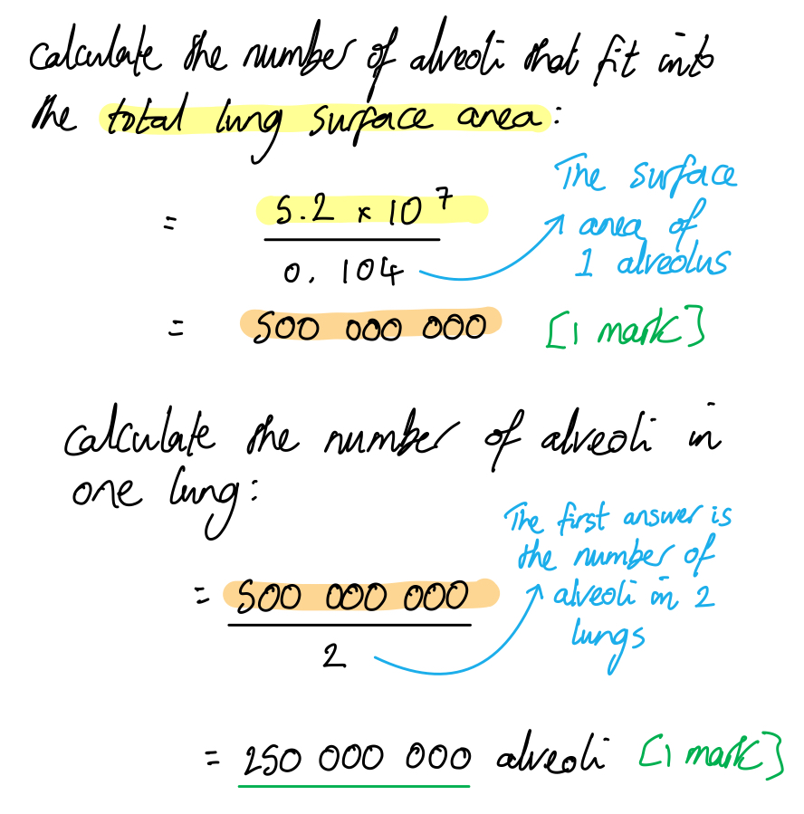
Events that could occur in the gas exchange system in response to an allergen that might make breathing more difficult could include...

**Final answer:** **Any ****three**** of the following: **

- Muscle fibres in the lining of the trachea/bronchi/bronchioles contract; **[1 mark]**
- Goblet cells in the lining of the trachea/bronchi secrete mucus; **[1 mark]**
- Fluid leaks out of the capillaries into the alveoli; **[1 mark]**
- The diameter of the lumen of the airways decreases / the airways narrow; **[1 mark]**

***Accept**** bronchus instead of bronchi*

**Reject** references to goblet cells in the bronchioles

**[Total: 3 marks]**

> *You are not expected to know about the events of an allergic reaction, but your knowledge of the tissue types found in the airways should enable you to answer this question; the airways can be made narrower by the contraction of muscle fibres and the secretion of mucus.*
Evaluation of the data on the effectiveness of albuterol on the treatment of patients with asthma could include...

*In ****support**** of albuterol as a treatment*

**Final answer:** **A maximum of ****three**** of the following:**

- The albuterol group has a greater increase in mean FEV than groups **B** or **C**; **[1 mark]**
- Increased FEV is an indication of improved lung function / increased airway diameter; **[1 mark]**
- The inclusion of an inhaler without an active drug shows that the results are not due to the placebo effect / are the result of the drug itself (and not just inhaler use / medical intervention); **[1 mark]**
- The standard deviation for group **A** does not overlap with the standard deviations of groups **B** or **C** / the difference in FEV increase between group **A** and groups **B** and **C** is (statistically) significant); **[1 mark]**

***Against ****albuterol as a treatment*

- The study was only done over 30 days / a short time period so we don’t know the long-term effects; **[1 mark]**
- The results are from just one study and would need to be replicated to be certain of the conclusion; **[1 mark]**

**[Total: 4 marks]**

> *Note that descriptive statistics and statistical tests are not covered until papers 4 and 5 so students at the end of their first year of study would not necessarily be expected to come up with the mark point on standard deviation and significance.*

### Q2
(i) The type of airway shown in Fig. 1 is a..

- Bronchiole/bronchioles; **[1 mark]**

***Reject**** answers naming the bronchus/bronchi*

(ii) The evidence from Fig.1 that supports the answer to part (i) is...

**Final answer:** **Any ****two**** of the following:**

- No (ring or region of) cartilage is present; **[1 mark]**
- The airway is directly surrounded by / adjacent to alveoli; **[1 mark]**
- The airway is surrounded by smooth muscle; **[1 mark]**

*Accept 'the airway is a similar diameter to (some of) the alveoli' for 1 mark.*

**[Total: 3 marks]**
(i) The impacts of COPD on the airways are...

- Reduced diameter of (bronchiole) lumen; **[1 mark]**
- Thickened / inflamed (bronchiole) wall; **[1 mark]**

(ii) COPD would affect lung function as follows...

- A reduced volume of air enters the alveoli **AS **there is reduced airflow; **[1 mark]**
- Less oxygen diffuses into the blood **AS** there is a reduced concentration gradient (between the alveoli and the blood); **[1 mark]**

> *Be sure to keep your answer focused on the impacts on **lung function**; the abnormalities shown in the image will have other impacts on the body, such as blood oxygen and pH changes, and also symptoms like wheezing or fatigue, but your answer should focus on ventilation and gas exchange, which occur in the lungs.*

**[Total: 4 marks]**
A person suffering from COPD may present with symptoms such as fatigue because...

**Final answer:** **Any ****three**** of the following:**

- Blood pO2 is lower / haemoglobin has a lower percentage saturation / haemoglobin has a lower affinity for oxygen **SO** less oxygen is transported to respiring tissues; **[1 mark]**
- The rate of aerobic respiration decreases **SO **less energy is released / less ATP is produced; **[1 mark]**
- Blood carbon dioxide concentration increases / less carbon dioxide is removed from the blood at the alveoli **SO** blood pH decreases / the blood becomes more acidic / H+ ions accumulate in the blood **[1 mark]**
- Altered blood pH (due to increased blood CO2) causes a reduction in enzyme activity / a reduction in the rate of enzyme-catalysed reactions (so leading to a reduced metabolism); **[1 mark]**

**[Total: 3 marks]**

> *This may seem like a straightforward question but the answer is complex as there are many factors contributing to the symptom of fatigue. For full marks you need to consider the effect of reduced blood oxygen **and** increased blood carbon dioxide, so you will need to cover ideas relating to haemoglobin, respiration, carbon dioxide transport, and enzyme pH.*

### Q3
The pathway taken by a molecule of oxygen from the outside air to the blood of a human includes...

**Final answer:** **Any ****three**** of the following:**

- The trachea **AND** the bronchus/bronchi; **[1 mark]**
- Bronchioles **AND** alveoli; **[1 mark]**
- Dissolving in fluid/liquid/solution (that lines alveoli); **[1 mark]**
- Across alveolar epithelium **AND** capillary walls; **[1 mark]**
- Diffusion / down a concentration gradient **AND **into capillaries;** [1 mark]**

**[Total: 3 marks]**

> *This is not an especially difficult set of ideas so it is essential that you give plenty of detail to gain all the available marks. Note that the fluid that lines the alveoli **contains** surfactant but is not entirely made of surfactant, so it should be referred to here as a liquid or a solution, not as a surfactant. *
(i) Healthy lung tissue is...

- The image on the right correctly identified as healthy lung tissue; **[1 mark]**

(ii) The effect of RDS on lung tissue is...

- The alveoli/sacs stick together / collapse **OR** alveolar surface area is reduced; **[1 mark]**
- Less gas exchange can occur / diffusion (of oxygen / carbon dioxide) will occur more slowly; **[1 mark]**

**[Total: 3 marks]**

> *Pulmonary surfactant contains lipid molecules with hydrophilic heads and hydrophobic tails. In water these molecules form a monolayer, reducing the surface tension of the liquid. In the alveoli this reduction in surface tension prevents the air sacs from sticking together and collapsing which, if it occurs, will reduce the surface area of the lungs and lead to breathing problems. This can be seen to have occurred in the image of the RDS lung tissue as all of the alveoli have narrowed to slits rather than providing open space for the movement of gases.*
(i) The statement 'pulmonary surfactant is essential for lung expansion' is incorrect because...

- The lungs do expand (slightly) as pressure increases with (rabbits that receive) no treatment; **[1 mark]**

(ii) The statement 'phospholipids are the active component of pulmonary surfactant' is incorrect because...

- (While phospholipids allow more expansion than the control) lung volume increases further after treatment with SP-B and SP-C proteins (than with phospholipids); **[1 mark]**

(iii) The statement 'pulmonary surfactant from sheep is the most effective treatment for RDS in premature babies' is incorrect because...

- At some pressures lung volume is higher after treatment with SP-B protein than with pulmonary surfactant from sheep; **[1 mark]**
- The study was carried out in rabbits so cannot be applied directly to human babies; **[1 mark]**

**[Total: 4 marks]**

> *The image in Fig. 2, together with your knowledge of the gas exchange system, should mean that you are aware that in the absence of pulmonary surfactant the alveoli stick together and collapse, which will lead to a decrease in lung volume and gas exchange. This means that **any **treatment that allows an increase in lung volume above the control (no treatment) is at least partially effective.*

> *The control variable does show that lungs can expand in the absence of surfactant, though not by much; this shows that pulmonary surfactant is not **essential** for lung expansion, though it may be essential for expansion that allows **effective breathing.*

> *Studies carried out in animals cannot be directly applied to humans, especially not to newborn babies; many more human trials would be needed before this stage. In addition to this, the graph shows that sheep surfactant and synthetic surfactant containing SP-B are almost equally effective. It is worth noting that in other questions of this kind, you might be able to refer to other concerns such as the ease and cost of drug production or ethical issues around the use of animals in medicine; here the question specifies that your **answers must come from the information provided** so no marks are available for these points.*
A symptom that would result from a deficiency of SP-A and SP-D proteins is...

- Increased lung infections / named lung infection; **[1 mark]**

The reason for this is that...

- Phagocytes would not engulf/digest pathogens/microorganisms / named pathogens that reach the lungs; **[1 mark]**

**[Total: 2 marks]**

### Q4
The structures **A** and **B** are...

Cell **A** identity:

- Alveolar epithelial cell; **[1 mark]**

Cell **A** function:

- The surface for gas exchange **OR **secretes surfactant; **[1 mark]**

Cell **B** identity:

- Ciliated epithelial cell; **[1 mark]**

Cell **B** function:

- Sweep mucus/bacteria/dust up and out of the gas exchange system; **[1 mark] **

**[Total: 4 marks]**

> *You should recognise that the main structure shown in Fig. 1 is a **bronchiole**. You can then use this information to work out each of the labelled cells. *
One feature of cell **A** that makes it well adapted for gas exchange is...

- Flattened/squamous;** [1 mark]**
- Reduces diffusion distance/pathway; **[1 mark]**

**[Total: 2 marks]**
(i) The rates and units are...

- Rates calculated correctly by dividing each mass by 60 (minutes): 1.0, 1.3, 2.0. 2.7, 3.5, 4.2; **[1 mark]**
- Units µg min-1 x1000 / ug hr-1 x1000 / ug min-1 x10,000; **[1 mark]**

***Accept**** rates given to 1 decimal place*

***Accept ****per minute / minute**-1*

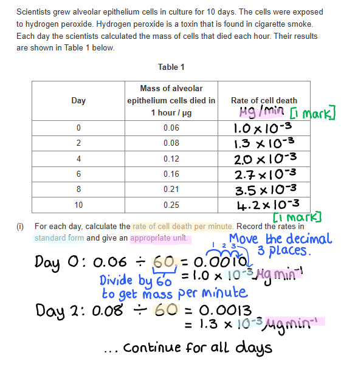

(ii) The graph is as follows...

- Both axes labelled: days/time in days on x-axis, **and **rate (with units) on y-axis; **[1 mark]**
- Points plotted correctly ± 1 small square; **[1 mark]**
- Line of best fit with no extrapolation; **[1 mark]**

***Accept ****error carried forward for units from part (i) for marking point 1*

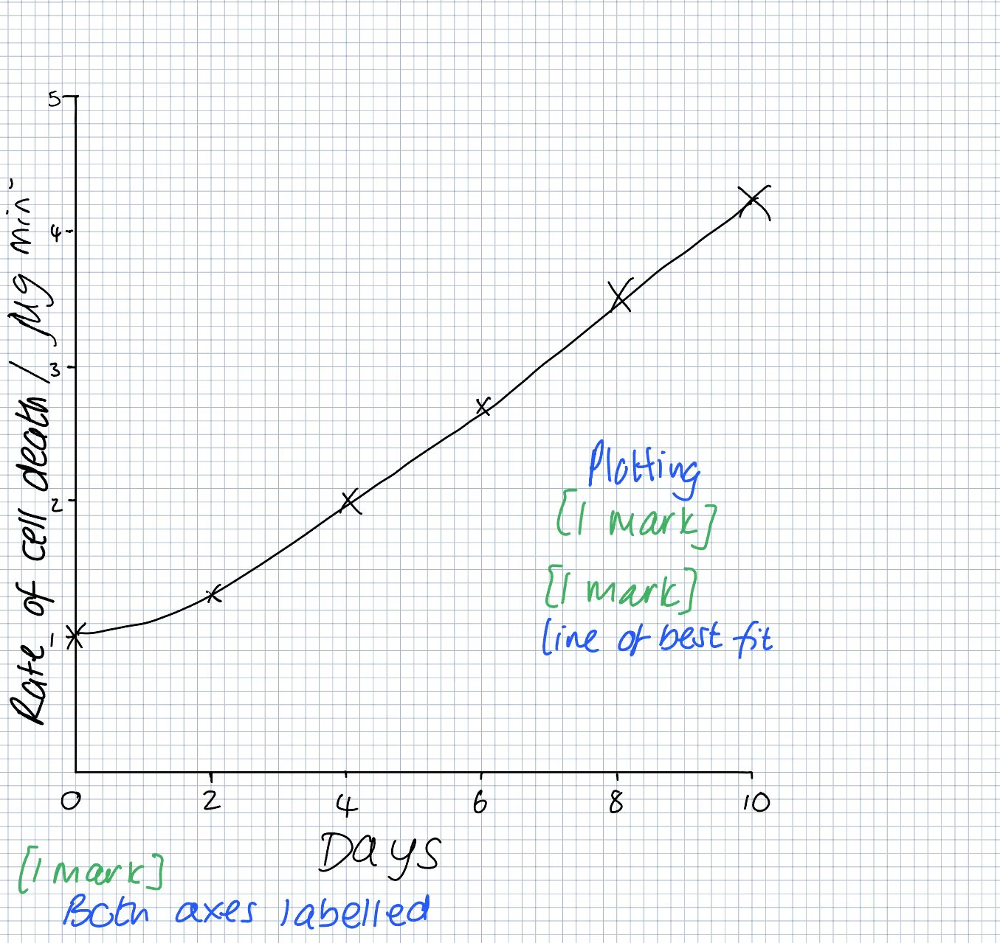

**[Total: 5 marks]**
Long-term smokers suffer from shortness of breath because...

- Smokers inhale high levels of hydrogen peroxide; **[1 mark]**
- Therefore the activity of enzymes that damage lung tissue is higher; **[1 mark]**
- This reduces the gas exchange surface; **[1 mark]**

**[Total: 3 marks]**

> *You need to apply the information given throughout the question, including the graph, to form your answer. In part (c) of the question you were given information about hydrogen peroxide and the effect it has on the lung tissue. Here you are applying that information and using the trend in the graph to answer the question. *

### Q5
The effect of alveolar epithelium cells being replaced by non-specialised, thickened tissue on gas exchange is...

- Reduced rate of gas exchange; **[1 mark]**
- There is an increased distance for diffusion / larger diffusion pathway; **[1 mark]**

**[Total: 2 marks]**
The percentage change in the particulate matter concentration in South-East Asia is...

- (57 - 43 / 43) x 100 **OR** 32.558 (%); **[1 mark]**
- 32.6 (% to 3 sig. fig.); **[1 mark]**

**[Total: 2 marks]**

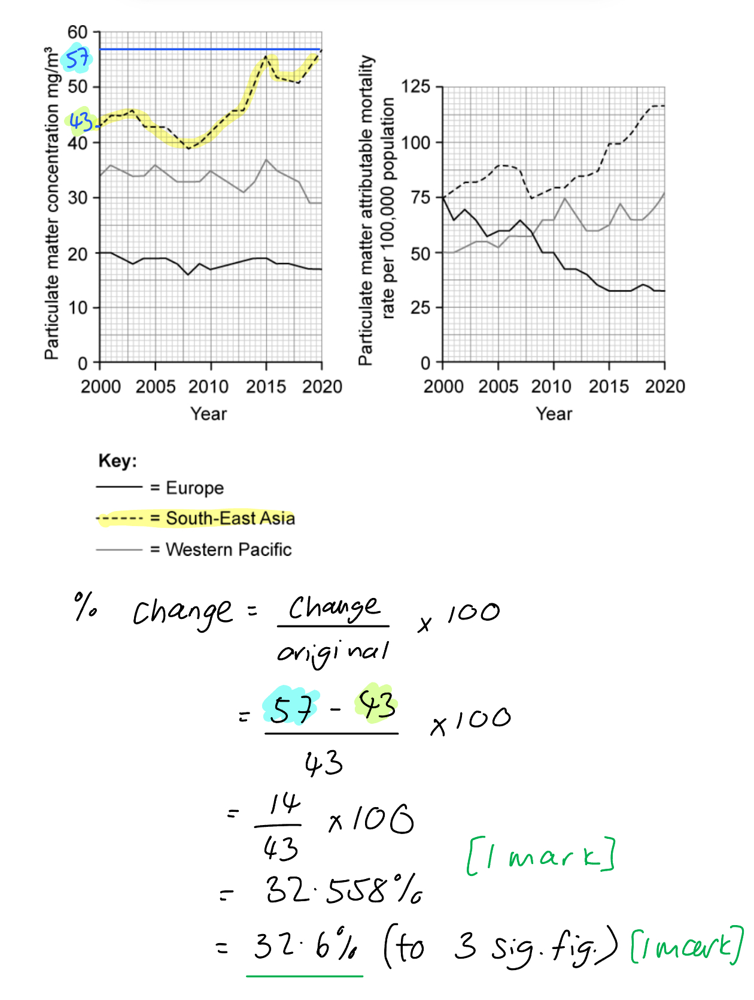
An assessment of the student's conclusion could include...

*In**** ****support**** ****of the student's conclusion:*

- South East Asia shows an overall increase in both particulate matter concentration and mortality rate **AND **Europe shows an overall decrease in both particulate matter concentration and mortality rate; **[1 mark]**
- Correctly quoted data to support the above point, e.g. in South-East Asia particulate matter concentration increases from 43 to 57 mg/m3 while attributable deaths increase from 75 per 100 000 to 16 per 100 000; **[1 mark]**

**Against the**** ****student's conclusion:**

**Final answer:** **A ****maximum of**** ****two ****of the following:**

- Europe's particulate matter concentration has remained stable / has only decreased very slightly **BUT** death rate has decreased steeply; **[1 mark]**
- Western Pacific has shown an overall decrease in particulate matter concentration **BUT** death rate has increased overall; **[1 mark]**
- Correctly quoted date to support either of the above points, e.g. in Europe particulate matter concentration has decreased by 3 mg/m3 while attributable deaths have decreased by 42.5/43 per 100 000; **[1 mark]**

**[Total: 4 marks]**

> *You are required to use both sets of graphs here to assess the student's conclusion. When asked to **assess** a statement in an exam question you should give a balanced answer that considers both sides of the argument.*

> *Note that the scale on the right-hand graph is a bit awkward (each small square = 2.5); you would be expected to notice this and to quote numbers correctly from the graph.*

### Q6
The structure labelled H in Fig. 1**A** is...

- <u>Bronchiole</u>; **[1 mark]**

*Ignore 'terminal' or 'respiratory' before the word 'bronchiole'*

**[Total: 1 mark]**

> *Because Fig. 1 **A** shows a healthy specimen of lung tissue, the structures show more or less as you would have seen them depicted in textbooks.*

> *A useful hint here is to study the image before you attempt this subpart. This is because the image indicates an alveolus at X-Y, and you should notice that H is larger than the alveolus. The next largest structure after an alveolus is the bronchiole, which is the narrow tube supplying air into and out of the alveoli. *
The formula used to make the calculation is...

**Final answer:** **Any ****one**** of the following:**

- $\mathrm{Actual} \mathrm{diameter}=\frac{\mathrm{Image} \mathrm{Diameter}}{\mathrm{Magnification}}$; **[1 mark]**

- The magnification triangle; **[1 mark]**

The actual diameter of the alveolus is calculated as follows...

- 300 µm; **[1 mark]**

*Allow anywhere in the range 275 - 325 µm inclusive, to account for differences in reading the ruler scale.*

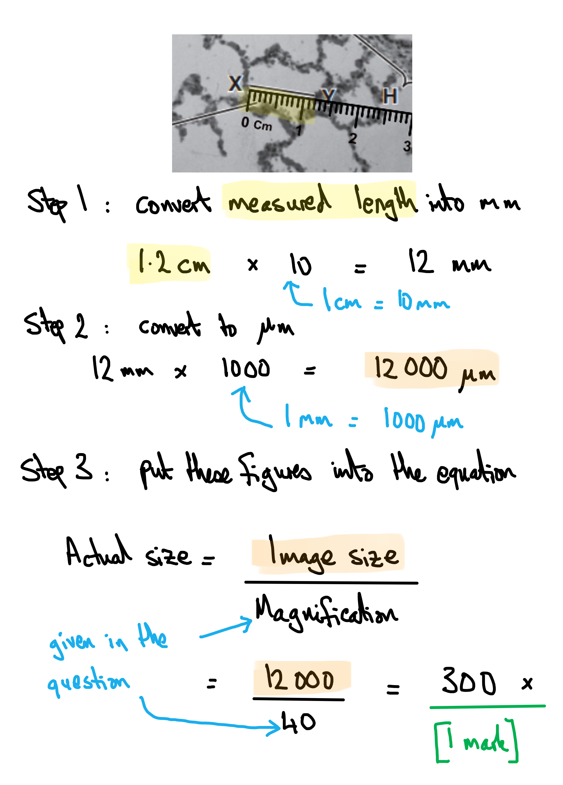

> *When making magnification calculations, always get rid of the units centimetres first, as shown in Step 1 above. Once cm have been converted to mm by multiplying by 10, then further conversions to micrometres (µm) or nanometres (nm) only then involve factors of 1000. *
The process of gas exchange in healthy lungs, with suggestions of how this compares with gas exchange in the diseased lung shown in Fig. 1 **B** are as follows...

**Final answer:** **Any ****four ****of the following:**

- (In healthy lungs) oxygen moves from the alveolus towards the blood AND carbon dioxide moves from the blood to the alveolus **OR** oxygen enters the blood system and carbon dioxide leaves; **[1 mark]**
- Diffusion (of oxygen/carbon dioxide) **OR** movement down a concentration gradient **OR** from high(er) to low(er) concentration **OR** oxygen enters the blood from a higher concentration; **[1 mark]**
- Across the alveolar wall AND** **the (squamous epithelial) cells of the endothelium/capillary wall **OR** gases cross two layers of cells (the alveolar wall and the capillary wall); **[1 mark]**
- (In comparison to diseased lungs) there is a high<u>er</u> rate of gas exchange / an <u>increased</u> rate of diffusion / <u>more</u> oxygen enters the blood per unit time / <u>more</u> carbon dioxide enters the alveoli per unit time; **[1 mark]**
- (In comparison to diseased lungs) there is a larg<u>er</u> surface area (for gas exchange/diffusion) **OR** a short<u>er</u> diffusion distance **OR** a great<u>er</u> ability to stretch and recoil /great<u>er</u> elasticity; **[1 mark]**

**[Total: 4 marks]**

> *Be careful that you never state that alveoli **relax** or **contract**; they are not made of muscle tissue, so the correct terms here are **stretch** and **recoil**.*

> *When answering extended questions like this you must consider:*

- *Whether or not you are being specific enough with the level of detail, e.g.*

  - *Don't just refer to 'diffusion of gases' but name the gases and state their direction of diffusion*
  - *Don't describe 'more efficient' or 'better' gas exchange in a healthy lung without specifying **why **gas exchange is better or more efficient*
- *The use of comparative language:*

  - *Stating that the alveoli in healthy lungs give a 'large surface area' without a comparison to the small**er** surface area of a lung with emphysema will not gain marks*
- *The precise biological process that is covered by the question, e.g.*

  - *Going into a lengthy description of the path taken by air into and out of the lungs will not gain credit here as the question is specifically about gas exchange between alveoli and the blood*

### Q7
The role of mucus in the airways is...

- Trap pathogens/bacteria/microorganisms; **[1 mark]**
- Ciliated epithelial cells (then) move/waft mucus out of the airways/trachea/bronchi; **[1 mark]**

**[Total: 2 marks]**
The movement of chloride ions, as shown in Fig. 1, can alter the viscosity of mucus as follows...

- Chloride ions reduce the water potential of mucus / create a water potential gradient between the cells and the mucus; **[1 mark]**
- Water moves out of the cells / water will move into the mucus by <u>osmosis</u>; **[1 mark]**
- Mucus is less viscous/sticky/more watery / has a lower viscosity; **[1 mark]**

**[Total: 3 marks]**

> *While you do not need to know about the movement of chloride ions in the airways, the answer here can be determined using information in the diagram and your own knowledge of osmosis and water potential.*
(i) The structure shown in Fig. 2 is the...

- Trachea; **[1 mark]**

(ii) We know that this is the trachea because...

- The structure contains C-shaped <u>cartilage</u>; **[1 mark]**

***Reject ****references to ciliated epithelium as this is not visible in the image*

**[Total: 2 marks]**

### Q8
The actual length of the structure measured by line **Z** is...

- 31 000$\div$5000; **[1 mark]**
- 6.2 µm; **[1 mark]**

*Full marks can be awarded for the correct answer of 6.2 µm in the absence of other calculations.*

**[Total: 2 marks]**

> *With questions like this it can often be worth mentally checking your answer once you have completed the calculation just to be sure that you have converted your units correctly. E.g. given that most animal cells are between 10-30 µm in size, it would be unlikely that an answer of 0.00062 µm or 0.0062 µm would be correct (these answers would result from forgetting to convert the units or converting the units incorrectly).*

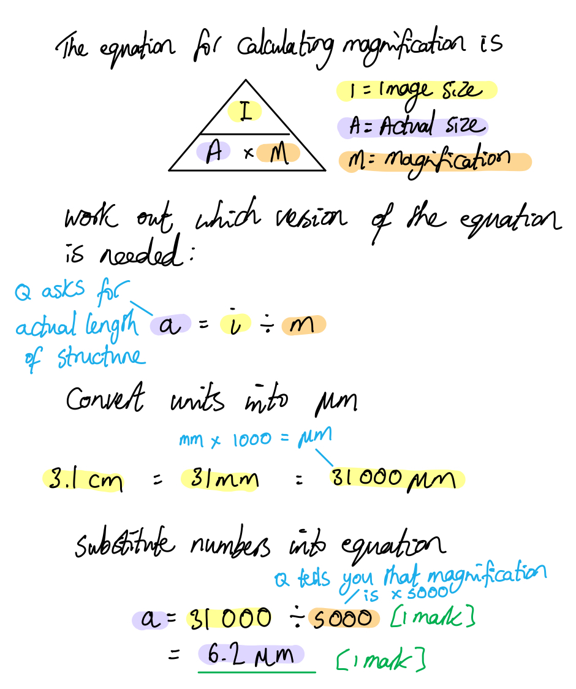
(i) The type of tissue shown is...

- Ciliated epithelium; **[1 mark]**

(ii) Structures **X** and **Y** are...

- **X** = ciliated epithelial cell; **[1 mark]**
- **Y** = goblet cell; **[1 mark]**

(iii) One location where structures **X** **and Y** would be found is...

- Trachea **OR** bronchus/bronchi; **[1 mark]**

***Reject**** bronchioles.*

**[Total: 4 marks]**

> *Ciliated epithelial tissue can be found within the trachea, bronchi and bronchioles, although the quantity of this reduces the further into the airway system you go. However, goblet cells are generally not found within the bronchioles so this structure cannot form part of your answer. Be sure to read the question carefully so as not to miss important details such as this. *
The function of structures **X** and **Y** are...

- Structure **Y** produces mucus; **[1 mark]**
- Mucus traps dust/sand/allergens/pollen/pathogens/bacteria/viruses; **[1 mark]**
- Structure **X** wafts mucus upwards / towards the top of the airways / towards the throat; **[1 mark]**
- Mucus can be swallowed and trapped pathogens destroyed by stomach acid; **[1 mark]**

**[Total: 4 marks]**
Three symptoms that may result from metaplasia of structure **Y** from Fig.1 are...

**Final answer:** **Any ****three**** of the following:**

- Increased number of lung infections; **[1 mark]**
- Coughing / coughing up mucus; **[1 mark]**
- Shortness of breath / breathlessness; **[1 mark]**
- Fatigue / difficulty exercising / weakness; **[1 mark]**

***Accept ****other accurate suggestions of symptoms that would result from a build-up of mucus in the airways.*

**[Total: 3 marks]**

> *Overproduction of goblet cells (structure Y) in the airways will lead to increased mucus production, which in turn will impact the effectiveness of cilia and lead to a build-up of mucus in the lungs. This means that pathogens will be trapped in the lungs (rather than being swallowed) so infections are more likely, and airways will be blocked leading to symptoms such as coughing, shortness of breath, and fatigue.*

### Q9
The tissues or structures marked **A** to **C** in Fig.1 are...

- **A** = cartilage; **[1 mark]**
- **B** = alveolus/alveoli; **[1 mark]**
- **C** = ciliated epithelium; **[1 mark]**

**[Total: 3 marks]**

> *A** is identifiable as cartilage due to its c-shaped structure in the central image (indicating that this is the trachea) and its irregular structure in the image to the left (this must be a bronchus). *

> *B** is identifiable as an alveolus due to its thin walls.*

> *C** lines all three of the structures, so must therefore be ciliated epithelium.*
One difference between the composition of **C** between the trachea and bronchi and the bronchioles is that...

- **C** in the trachea and bronchi contains goblet cells **while C** in the bronchioles does not; **[1 mark]**

**[Total: 1 mark]**

> *It is important when making comparisons you address both points in your answer, so here describing the trachea and bronchi **and **also describing the bronchioles in contrast. Using terms such as "while" or "whereas" is a useful way to do this.*
The actual diameter of the structure measured by line **X** is...

- 8 500$\div$40; **[1 mark]**
- 212.5 µm; **[1 mark]**

*Full marks can be awarded for the correct answer of 212.5 µm in the absence of other calculations.*

**[Total: 2 marks]**

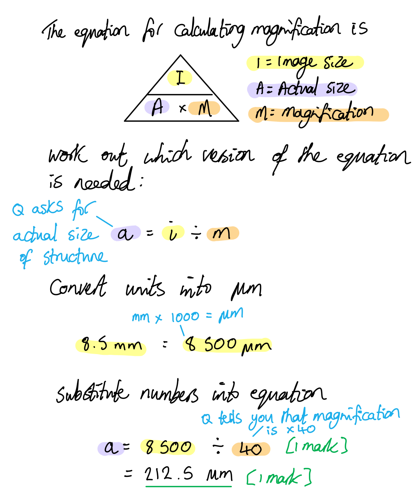
Individuals with emphysema might experience cyanosis because...

- The surface area of structure **B**/alveoli is reduced (in emphysema sufferers); **[1 mark]**
- The thickness of the walls of structure **B**/alveoli is increased (in emphysema sufferers); **[1 mark]**
- Therefore the rate of diffusion of oxygen into the blood (at structure **B**/alveoli) is reduced; **[1 mark]**
- So the oxygenation levels of the blood are reduced / the blood contains less oxygen / haemoglobin is less saturated with oxygen (deoxygenated blood is a darker shade of red/purple than oxygenated blood); **[1 mark]**

**[Total: 4 marks]**

> *You are not expected to know about emphysema, but this question allows you to apply your knowledge of alveolus structure and function to the scenario in the question. Alveoli are adapted to increase gas exchange by having a large surface area and thin walls. Fig. 2 shows that emphysema reduces the surface area and thickens the walls of the alveoli; this will reduce the rate at which oxygen can diffuse into the blood and will therefore reduce the saturation of the blood with oxygen. Deoxygenated blood is a darker shade of red than oxygenated blood, leading to a blue discolouration of the skin.*

### Q10
The effect of damaged ciliated epithelial tissue on the gas exchange system is:

- Increased respiratory diseases/illnesses/infections / more pathogens will enter the gas exchange system; **[1 mark]**
- Cilia are unable to waft/sweep **SO **mucus that contains trapped pathogens/bacteria/microorganisms remains in the trachea/bronchi / is not swallowed; **[1 mark]**

**[Total: 2 marks]**
(i) A comparison of lung cancer death rates of men and women includes...

- The death rate in men is always high<u>er</u> than in women; **[1 mark]    **
- There is an overall decrease in death rate in men **WHILE** there is an overall increase in death rate in women; **[1 mark] **
- The death rate for men is highest in 1986 **WHILE **the death rate for women is highest in (any year between) 2005-2009; **[1 mark] **
- The decrease in death rate for men is steep<u>er</u> than it is in women; **[1 mark]**
- The decrease in death rate in women levels off / death rates in women may be starting to increase again in 2021-22 **WHILE** death rates in men continue to decrease; **[1 mark] **

***Accept**** converse statements throughout*

> *The command word 'compare' requires you to note similarities and/or differences. There are no visible similarities here, so you can focus your answer on differences between the two data sets.*

> *When discussing differences it is important to show a direct comparison between the two subjects, in this case between the deaths from lung cancer in men and in women. The use of terms such as "while" or "high**er**" allows you to do this easily and shows the examiner you have made and understood the command word requirements.*

(ii) The advantage of calculating the death rate per 100000 of the population is...

- Allows for a valid comparison; **[1 mark] **
- Takes into account differences in the numbers of men and women (in the population); **[1 mark] **

**[Total: 6 marks]**
The percentage change in death rates in men between the maximum number of deaths and the minimum number of deaths is...

- (Maximum =) 186 AND** **(minimum =) 73 **OR** (difference =) 113; **[1 mark]**
- (113 ÷ 186) x 100 **OR** 60.75 **OR** 60.8 (%); **[1 mark]**
- 61 %; **[1 mark]**

**[Total: 3 marks]**

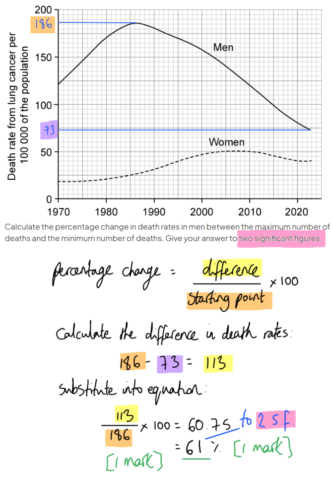
(i) The tissue shown in Fig. 2 is...

- Alveoli; **[1 mark]**

***Accept ****alveolus*

(ii) Changes in the lungs might contribute to a reduction in the overall health of individuals who smoke cigarettes as follows...

- The alveoli of smokers have a smaller/reduced surface area for gas exchange **SO** oxygen diffuses into the blood more slowly / smokers have lower blood oxygen levels; **[1 mark]**
- The cells of smokers have less oxygen for aerobic respiration **SO** produce less ATP / release less energy (for cellular processes); **[1 mark]**
- The alveoli of smokers contain macrophages **SO** are likely to contain more pathogens / be fighting an infection; **[1 mark]**

**[Total: 4 marks]**

> *The walls of the alveoli in B have partially broken down, resulting in a smaller surface area; this will reduces the rate at which gases are exchanged in the lungs.*

### Q11
The organs that are passed through by a molecule of carbon dioxide, in sequence, during exhalation are...

| **Structure/organ** | **Sequence (1st, 2nd, 3rd, 4th or 5th)** |
|---|---|
| Trachea | 4th |
| Alveolus | 1st |
| Bronchus | 3rd |
| Facial airways | 5th |
| Bronchioles | 2nd |

- All 5** **correct; **[2 marks]**
- 2 or 3** **correct; **[1 mark]**
- 0 or 1** **correct; **[0 marks]**

*Accept 1-5 instead of 1st-5th.*

**[Total: 2 marks]**

> *Reading the question right to the end is always important, but it’s super-important here, because only at the end of the question are you asked to consider **exhalation** only. Of course, inhalation would mean that CO**2** would pass through the various organs in the opposite order. Take care not to use the same number twice, as this is a sequence.*
The organ that drives inhalation and exhalation in the breathing system is the...

- Diaphragm; **[1 mark]**

**[Total: 1 mark]**

> *The obvious wrong answer here is ‘lungs’, so be careful not to fall into that trap. The diaphragm (a muscle) contracts and causes a pressure drop in the thorax. The lungs fill with air as a result, but only passively as the pressure difference forces air into the lungs.*
(i) The process by which oxygen passes from alveolar air into red blood cells is...

- (Simple) diffusion; **[1 mark]**

***Do not accept**** facilitated diffusion*

> *Oxygen and carbon dioxide are small, non-polar molecules that can pass directly through the phospholipid bilayer of cell membranes. As such they do not require a channel protein as some solutes do. Oxygen can pass directly through the bilayer, by **diffusion**, to an area of lower oxygen concentration / down its concentration gradient*

(ii) One feature of alveoli that increases the efficiency of gas exchange...

**Final answer:** **Any ****one**** of the following:**

- Alveolar wall/epithelium is one cell thick **OR **only one layer of epithelial cells (for oxygen to diffuse through); **[1 mark]**
- Alveolar epithelium cells are flattened/squamous; **[1 mark]**
- Large surface area (due to there being many alveoli); **[1 mark]**
- Large blood supply **OR **many capillaries; **[1 mark]**

> *Note that this is a **state** question, so no explanation of the features is required for credit to be gained here.*

(iii) The gas dissolved in blood that oxygen is exchanged with is...

- carbon dioxide / CO2; **[1 mark]**

**[Total: 3 marks]**
The tissue of the gas exchange system shown in Fig. 1 is...

- Squamous epithelium (of the alveoli); **[1 mark]**

**[Total: 1 mark]**

> *This is recognisable as the squamous epithelium of the alveoli by the large air spaces and the single layer of epithelial cells. Note that this is one of several tissues that you are expected to be able to identify, according to the specification.*

### Q12
The completed table would be as follows...

**Award ****[1 mark]**** for each correct ****row****:**

| **Structure** | **Structural feature present** |   |   |   |   |
|---|---|---|---|---|---|
| **Cartilage** | **Elastic fibres** | **Goblet cells** | **Ciliated Epithelium** | **Smooth muscle** |   |
| Trachea | **✓** | **✓** | **✓** | **✓** | **✓** |
| Bronchi | **✓** | **✓** | **✓** | **✓** | **✓** |
| Bronchioles | ** *****x *** | **✓** | ***x*** | **✓** | ***x / ✓*** |
| Alveoli | ***x*** | **✓** | ***x*** | ***x*** | ***x / *****✓** |

**[Total: 3 marks]**

> *The bronchioles contain **some** smooth muscle, but only up to the terminal bronchioles, hence the x/✓ option on the table.*

> *The tiny ducts at the entrance to each alveolus contain smooth muscle to help control the movement of air into and out of each alveolus but the **alveolus itself** does not, so you are allowed either answer here too. *

> *It is worth noting that while the table above conforms to the general rules around tissue distribution in the airways, in reality the distribution can sometimes vary, and this can be reflected in exam questions, which may present you with some unusual examples, e.g. the bronchioles containing goblet cells or cartilage. If this happens you should always be able to work out the correct answer by a process of elimination (e.g. in multiple choice questions on this topic).*

> *Be aware that this is a popular type of question, especially in the multiple choice section of the paper, so make sure that you know the tissue distributions well.*
The completed sentences are as follows...

- *Ciliated epithelial cells have projections called ****cilia***; **[1 mark]**
- *The role of these projections is to sweep ****bacteria****, dust and mucus out of the ****airways****; ***[1 mark]**
- *The dust and mucus are swept towards the ****throat**** where they can be ****swallowed**** and destroyed by stomach acid;* **[1 mark]**

**[Total 3 marks]**

> *Note that the bronchioles do not always contain ciliated epithelial cells, so the general term 'airways' is the correct answer for the end of the second sentence.*
The tissues or structures labelled B in Fig. 1 are...

- Alveolus/alveoli; **[1 mark]**

The process that takes place here is...

- Gas exchange / diffusion of gases; **[1 mark]**

**[Total: 3 marks]**

> *B is identifiable as an alveolus due to its thin walls.*

> *Applying knowledge that you may have gained from neat diagrams and descriptions to the reality of imperfect microscope images can be tricky, but you are expected to be able to deal with questions like this; practice is a great way to build confidence when it comes to applied questions of this type.*
The function of structure A (cartilage)** **is...

- Strong / provides strength; **[1 mark]**
- To keep the airways open / support the airways as pressure changes within the airways; **[1 mark]**

**OR**

- Flexible / provides flexibility; **[1 mark]**
- So that it doesn't break during movement/bending; **[1 mark]**

**[Total: 2 marks]**

> *The command word here is **explain **so you need to give some detail to your answer rather than just stating the function. *

### Q13
Structures **V**, **W**, and **X** in Fig. 1 are...

- **V** = trachea; **[1 mark]**
- **W** = bronchus/bronchi; **[1 mark]**
- **X** = bronchiole(s); **[1 mark]**

*Allow cartilage (ring) for V*

**[Total: 3 marks]**
(i) One tissue type that is present in structures** V**, **W**, and **X** but not in structure **Y** is...

- Smooth muscle **OR** ciliated epithelium/epithelial cells; **[1 mark]**

(ii) The role of this tissue is to...

The relevant pair of points to match part (i) from:

- (Smooth muscle) allows the diameter of the structure/airways to be controlled; **[1 mark]**
- (Control of airway diameter) allows airflow to be increased/decreased / foreign objects/allergens to be kept out of the lungs; **[1 mark]**

**OR**

- (Ciliated epithelium) wafts mucus upwards / towards the throat; **[1 mark]**
- (The wafting of mucus enables) trapped pathogens to be swallowed/removed from the airways/breathing tract; **[1 mark]**

***Reject**** references to mucus production as this is carried out by goblet cells which are not found in the bronchioles.*

**[Total: 3 marks]**

> *This question requires a good knowledge of the distribution of the different tissue types in the airways; cartilage and goblet cells are only found in **V** and **W**, while elastic tissue is found in all four structures.*
One structural adaptation visible in Fig. 1.2 is...

- Structure **Y **is surrounded by / contains squamous epithelium; **[1 mark]**
- This provides a short diffusion distance/pathway for oxygen/carbon dioxide; **[1 mark]**

**[Total: 2 marks]**
One other feature of structure **Y** that assists its function is...

- Walls contain elastic fibres **OR **walls contain collagen **OR** structure **Y** has a good blood supply / is surrounded by capillaries;** [1 mark]**

This feature assists function because...

**Final answer:** **Any ****one**** relevant explanation from:**

- (Elastic fibres) enable structure to stretch and recoil; **[1 mark]**
- (Collagen) provides strength to prevent bursting/damage (during stretching); **[1 mark]**
- (Good blood supply) maintains concentration gradient of oxygen/carbon dioxide between structure **Y** and the blood; **[1 mark]**

**[Total: 2 marks]**

### Q14
The completed table should be...

|   | A | B | C | ** ** |
|---|---|---|---|---|
| Oxygen | **low** | **medium** | **high** | **[1 mark]** |
| Haemoglobin/oxyhaemoglobin | **medium** | **medium** | **medium** | **[1 mark]** |
| Carbon dioxide | **high** | **medium** | **low** | **[1 mark]** |

***Allow**** 3 statements the same in the oxyhaemoglobin row - to show that the concentration does not vary*

**[Total: 3 marks]**

> *The idea of gas exchange is that oxygen is diffused into the red blood cells, via the alveoli, **at the same time** that carbon dioxide is removed. Breathing performs the task of bringing in fresh oxygen and excreting excess carbon dioxide, so the blood concentrations vary as the blood completes its journey through the capillaries that surround each alveolus. Haemoglobin remains in the red blood cells so its concentration does not vary during this time, although it becomes oxyhaemoglobin, reversibly, as the oxygen binds to it and is released to respiring tissues. *
The flow rate of blood through the lungs of this person is calculated as follows:

- 2 lungs = 2 × 450 million = 900 million / 9 × 108 alveoli; **[1 mark]**
- Overall flow per minute = 5 400 000 (mm3min-1); **[1 mark]**
- Standard form = 5.4 × 106 (mm3min-1); **[1 mark]**

**[Total: 3 marks]**

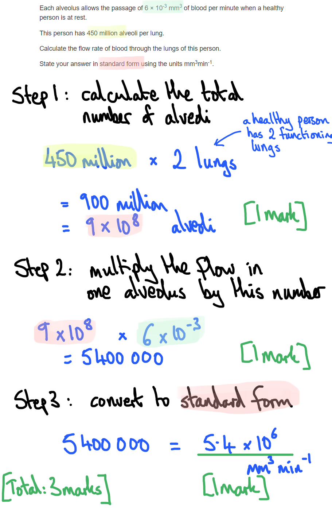

> *Remember that a healthy person has **two** functioning lungs - it may seem obvious but many students would overlook this fact before launching into calculations. *

> *As a reality check of your answer, 5 400 000 mm**3** of blood per minute sounds about right, because that equates to 5.4 litres (there are 1 million mm**3** per litre). An adult human possesses about 4-6 litres of blood, which completes a full circuit of the circulation system every 1-2 minutes, so 5.4 litres in a minute is in the right order of magnitude. *
Starting with the innermost layer and travelling outwards, the tissues/structures are found in a human trachea are...

1. Lumen
2. Ciliated epithelium with glands
3. Tracheal wall
4. Cartilage
5. Connective tissue

All correct: **[2 marks]** 
2-4 correct;** [1 mark]** 
0-1 correct;** [0 marks]**

**[Total: 2 marks]**

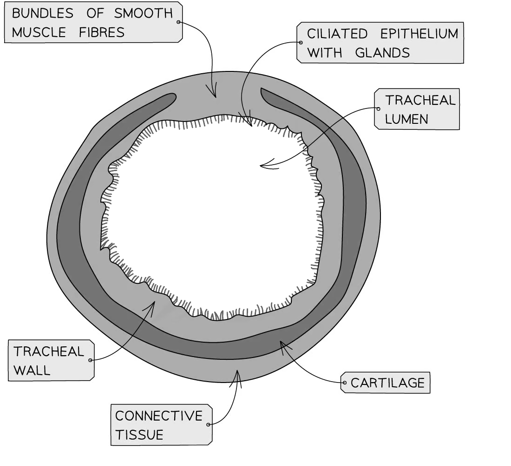
The trachea has to become narrower on occasion because:

- Swallowing sends a bolus/bulge of food down the oesophagus, (so the trachea has to narrow) to accommodate the temporary widening of the oesophagus; **[1 mark]**

**[Total: 1 mark]**

### Q15
The tissue that the lungs exchange gases with is:

- Blood / blood cells / plasma; **[1 mark]**

***Allow**** capillary, blood vessel Do not allow: artery, vein*

**[Total: 1 mark]**

> *The blood is classed as connective tissue and although you may not automatically consider blood to be a tissue it is important you recognise its role as one. *
The correctly drawn lines are as follows:

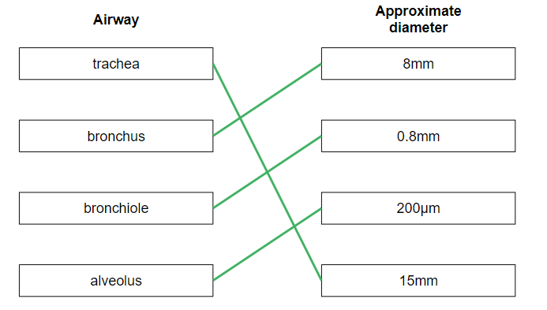

All correct:** [2 marks]** 
2 or 3 correct; **[1 mark]** 
0 or 1 correct; **[0 marks]**

**[Total: 2 marks]**

> *You are not required to memorise the dimensions of the various airways, although you would be expected to know the rank order and to be able to put the given diameters into that rank order.*

> *The descending order of internal diameters is:*

> *trachea → bronchus → bronchiole → alveolus*
A reason for the pattern of percentage coverage of cilia in different airways is...

- (The decreasing trend is due to) A greater chance of dust/pathogen/particulate matter higher up the airways **OR** fewer particles make it further down so fewer cilia are required in bronchioles; **[1 mark]**
- The trachea has more cilia because it catches/removes more dust/pathogen/particulate matter; **[1 mark]**

**[Total: 2 marks]**
A feature of cartilage that explains why it has a limited ability to repair itself in case of disease or injury is...

**Final answer:** **One**** from the following:**

- Cartilage has no blood supply; **[1 mark]**
- Cartilage has no nerves to/from it; **[1 mark]**
- Cartilage cannot divide quickly during repair because of limited nutrient supply; **[1 mark]**

**[Total: 1 mark]**
