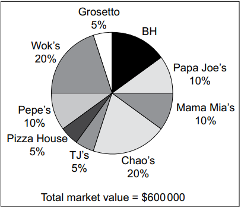

# Exam Questions — Business Structure
**1. Business and Its Environment** · Cambridge (CIE) AS business (9609)
> Source: [https://www.savemyexams.com/as/business/cie/23/topic-questions/](https://www.savemyexams.com/as/business/cie/23/topic-questions/) · 22 questions across 1 sets

## Exam Questions (22 questions)

### Q1 — hard — 1 marks

**Q1** [1 mark]

> **[case-study]**
> **Post Scent (PS)**
> 
> PS is a private limited company operating in country H. It sells perfume for men and women using its own website. PS purchases the perfume in large quantities from various manufacturers and then sells it in smaller quantities to its customers. Most of the perfumes are sold in glass bottles.
> 
> PS has two main ways in which it sells perfume:
> 
> - A website where customers can purchase a range of perfumes. The perfumes are priced to be lower than high street competitors.
> - A subscription service where customers pay a monthly fee for a mystery perfume to be delivered each month.
> 
> All of PS's products are delivered to customers' homes using the postal service. The packages can be left in a mailbox or in a safe place outside of the home. PS has an aim to improve the sustainability of its operations.
> 
> PS uses incremental budgeting. Table 1.1 shows the budgeted and actual cost and revenue data for 2023.
> 
> **Table 1.1 Budgeted and actual cost and revenue data for 2023 (\$000)**
> 
> | Item | Budgeted | Actual | Variance |
> |---|---|---|---|
> | Revenue | 500 | 600 | **x** |
> | Direct costs | 300 | 350 | **y** |
> | Indirect costs | 150 | 125 | **z** |
> 
> The directors of PS have decided that the business needs a Marketing Manager. The role of the Marketing Manager will be:
> 
> - to plan the recruitment and training of a new sales team
> - to organise the production of digital promotions
> - to advise the Board of Directors on changes to the PS product portfolio.
> 
> The directors have shortlisted five suitable applicants and plan to invite them all to an assessment centre as part of the recruitment process.

Identify **one** feature of a private limited company.

*Source: May/June 2024 22 Q1A*

### Q2 — medium — 1 marks

**Q2** [1 mark]

> **[case-study]**
> **Braid Runner (BR) **
> 
> Lewis is a hairdresser. He rents a small shop which he uses as a hairdressers called Braid Runner (BR). Lewis is a sole trader and he set up BR 25 years ago.
> 
> BR is the smallest of all the hairdressers in city Y. Lewis works on his own. He has repeat customers who have been using BR for many years. However, there are many large franchises in city Y which offer a much cheaper haircut than BR.
> 
> Lewis is considering increasing the price of a haircut and he has outlined the costs and revenue of the business in Table 2.1.
> 
> **Table 2.1: Costs and revenue of BR**
> 
> | Variable costs per customer | \$3.50 |
> |---|---|
> | Fixed costs per week | \$675 |
> | Price | \$8 |
> 
> Lewis would like to employ another hairdresser so that he can work fewer hours in BR. The new employee would have to be able to work in BR on their own. They would be responsible for taking bookings, dealing with customers and some financial transactions. Lewis has drawn up a person specification (see Fig. 2.1) that will be placed on a job website.
> 
> | **Characteristic** | **Essential** | **Desirable** |
> |---|---|---|
> | Qualifications | - Hairdressing qualification | - A-Levels or high school standards in Mathematics and Business |
> | Physical | - Must be between 18 and 30 years old | - Female |
> | Experience | - None required | - Experience of dealing with customers/consumers - Experience of working alone |
> | Personal qualities | - Able to work in a team - Good communication | - Friendly |
> 
> **Fig. 2.1: Person specification created by Lewis**

Explain the term ‘franchises’ (line 5).

*Source: November 2020 Paper 23 Q2AII*

### Q3 — medium — 5 marks

**Q3** [5 marks]

Explain why a business might remain a private limited company rather than change to a public limited company.

*Source: November 2020 Paper 12 Q3*

### Q4 — medium — 2 marks

**Q4** [2 marks]

> **[case-study]**
> **Flight Food (FF) **
> 
> FF is a large secondary sector business that supplies airlines with in-flight meals. Meals are manufactured using batch production. A different variety of meal is made each hour with a five minute changeover time between batches. FF makes use of Just in Time (JIT) to manage inventory wherever possible. Trucks arrive each hour and deliver the materials needed for production.
> 
> The market for airline meals is very competitive. FF uses market segmentation when deciding which meals are most likely to appeal to different airlines. FF must adapt to changes in tastes and the demands of each airline.
> 
> FF is a labour intensive business. The workers are employed with short-term (six month) employment contracts. They are only offered new contracts if they meet their production targets. Table 2.1 shows some production data for FF’s two work teams.
> 
> **Table 2.1: Worker data for FF**
> 
> |   | **Team A** | **Team B** |
> |---|---|---|
> | Number of workers | 100 | 50 |
> | Productivity (per worker per day) | 300 meals | 240 meals |
> 
> The Board of Directors of FF is considering changing the manufacturing process to flow production. This would require purchasing Computer Aided Manufacturing (CAM) equipment and using a capital intensive production process. Production targets would no longer be used for employees because the machinery would be set at a specific production rate.
> 
> Sabrina, the Operations Director, has put forward the following advantages for moving to flow production:
> 
> - more products made each hour
> - lower employment costs
> - improved quality.
> 
> Ben, the Human Resource Director, is worried about the change from a labour intensive process to a capital intensive process.

Define the term ‘secondary sector’ (line 1).

*Source: June 2020 Paper 23 Q2AI*

### Q5 — medium — 2 marks

**Q5** [2 marks]

> **[case-study]**
> **Aashna’s Pies (AP) **
> 
> AP produces and sells high quality pies. Aashna set up AP five years ago when she spotted a gap in the market. AP is a private limited company and Aashna is the majority shareholder. All of the pies use the AP branding which is growing in popularity.
> 
> AP owns a factory where all the pies are produced. Pies are packaged and sold individually. The range of pies produced by AP is shown in Table 1.1.
> 
> **Table 1.1: AP’s product portfolio**
> 
> | **Name of pie** | **Filling** | **Price per pie** | **Annual change in sales quantity (2018 to 2019)** | **Stage on the product life cycle** |
> |---|---|---|---|---|
> | Meaty Marvel | Chicken and lamb | \$2.80 | +3% | Maturity |
> | Vegetarian Victory | Broccoli, cheese and carrot | \$2.50 | –10% | Decline |
> | Fishy Fortunes | Cod, prawns and cheese | \$3.00 | +20% | Growth |
> 
> The pastry case of each pie is exactly the same no matter what filling is used. All of AP’s pastry is made using flow production. However each filling is made by specialist workers who use batch production.
> 
> Aashna is concerned about the sales of Vegetarian Victory pies and she is considering stopping production of this pie. However, the Operations Director has pointed out that AP might lose its economies of scale if the business reduces the total number of pies produced.
> 
> The Marketing Director would like Aashna to read his report about developing products in the future. He has done some market research (see Fig. 1.1).
> 
> | - The price elasticity of demand for AP’s pies is price inelastic - Some consumers are worried about possible health risks of eating too much meat - The average family eats three pies per meal and chooses pies for a meal once every two weeks - The pies have a short ‘best before’ date – they must be eaten within two days of purchase - The average family has one member who does not eat meat. |
> |---|
> 
> **Fig. 1.1: Market research to aid developing products in the future**

Define the term ‘shareholder’ (line 3).

*Source: November 2020 Paper 23 Q1AI*

### Q6 — medium — 2 marks

**Q6** [2 marks]

> **[case-study]**
> **Super Heroes (SH) **
> 
> SH is a leisure (theme) park aimed at 10–18 year olds. It is owned by two companies, X and Y, which started SH as a joint venture. Company X owns many leisure centres and swimming pools. Company Y owns many brands based on superheroes.
> 
> SH employs 200 full-time workers and an extra 50 seasonal workers during the busiest times of the year. The park has 10 large rides which take up 2km2 of land. There are also many smaller rides, restaurants, toilets and shops. The price of an entrance ticket is \$11 per customer. Table 1.1 shows the costs for SH in 2019.
> 
> **Table 1.1: SH costs for 2019**
> 
> | Total fixed costs (per year) | \$12m |
> |---|---|
> | Variable costs (per customer) | \$3 |
> | Total costs | \$42m |
> 
> One of the larger rides at SH is the Iron Blaster. The number of customers who use this ride has decreased each year for the last three years. This has led the management of SH to consider its options for internal growth.
> 
> *Option 1 – A new virtual reality (VR) ride* 
> This option would involve developing the Iron Blaster into a VR ride. Most of the structure of the Iron Blaster could be used but customers would be given a VR headset to wear during the ride. The cost of developing the VR ride would be \$2m. The Iron Blaster ride would be closed for a three month period during the off-peak season for the development to be carried out. No employees would be made redundant or dismissed.
> 
> *Option 2 – A new hotel* 
> SH does not currently have a hotel. It could demolish the Iron Blaster to provide the space to build one. Many of the competitors of SH have a hotel near or within their leisure parks. Hotel customers would pay a high price for a room but have free access to the leisure park’s facilities. Market research suggests that the average hotel customer would spend twice as long in the leisure park than a non-hotel customer. The cost of developing the hotel would be \$15m and take a year to build. All of the employees currently working on the Iron Blaster ride would face redundancy or dismissal.

Define the term ‘joint venture’ (line 2).

*Source: June 2020 Paper 23 Q1AI*

### Q7 — medium — 5 marks

**Q7** [2 marks]

Define the term ‘limited liability’.

*Source: June 2020 Paper 13 Q2A*

**Q7** [3 marks]

Explain **two **disadvantages to a private limited company of changing to a public limited company.

*Source: June 2020 Paper 13 Q2B*

### Q8 — medium — 2 marks

**Q8** [2 marks]

> **[case-study]**
> **Market Solution (MS) **
> 
> MS is a public limited company in the tertiary sector. MS advises businesses on elements of the marketing mix. Most of its customers are small businesses who cannot afford their own marketing department. MS designs marketing materials for these businesses to use.
> 
> Although MS uses computer aided design (CAD), the business is labour intensive. MS employs specialist marketing workers as well as administrative support workers. Table 2.1 shows some data about employees of MS.
> 
> **Table 2.1: MS employee data**
> 
> |   | **Specialist marketing workers** | **Administrative support workers** |
> |---|---|---|
> | Average number of workers in 2019 | 40 | 88 |
> | Payment method | Salary plus bonus | Performance related pay plus bonus |
> | Number of workers who left in 2019 | 2 | 11 |
> | Average pay (compared to national average) | High | Low |
> | Main need of the workers | Achievement | Affiliation |
> | Main hygiene factors | - Pay - Flexible hours of work | - Staff restaurant - Holidays |
> | Is a bonus expected in 2020? | Yes | No |
> 
> MS has recently employed Hetti as the new Human Resources Manager. Hetti thinks that the ideas of the motivational theorists are important when managing employees. She is particularly worried about the labour turnover of the administrative support workers.
> 
> MS has recently taken on a new customer, named Books Outlet (BO). BO has an objective to increase its revenue by targeting a younger market segment. BO has provided MS with the following information about its current marketing mix (see Table 2.2).
> 
> **Table 2.2: Current marketing mix for BO**
> 
> | **Product **  - Books aimed at customers who are 30 years and older - Specialist books on many topics – BO is often the only seller in the area | **Price **  - Price skimming |
> |---|---|
> | **Promotion **  - Window display - Local newspaper advertising | **Place **  - A retail shop on the main street - Postal sales from a brochure |

Define the term ‘tertiary sector’ (line 1).

*Source: June 2020 Paper 22 Q2AI*

### Q9 — medium — 5 marks

**Q9** [2 marks]

Define the term ‘private sector’.

*Source: June 2020 Paper 12 Q2A*

**Q9** [3 marks]

Explain **two **advantages that a business in the public sector may have that a business in the private sector may not.

*Source: June 2020 Paper 12 Q2B*

### Q10 — medium — 2 marks

**Q10** [2 marks]

> **[case-study]**
> **Van Man (VM) **
> 
> Obi is a sole trader who operates a van service. He used to be employed by a similar business but realised that he likes to be in control. Obi used all of his savings to start his business so that he did not have to go into debt.
> 
> He owns three vans which can carry furniture, packages and other large items. He has eight full-time employees who drive the vans and move items. Customers can hire a van with two employees to move these items from one place to another. The cost per day of providing a van with two employees is \$170. The prices of the service are shown in Table 1.1.
> 
> **Table 1.1: Price of hiring one van (including two employees)**
> 
> | **Price for the first day’s hire** | **Price for each additional day** |
> |---|---|
> | \$250 | 10% discount on the price for the first day’s hire |
> 
> Demand for Obi’s service is growing fast. To supply this demand he needs a new van and he is investigating sources of finance. He has a choice of two vans. The details of the vans are in Table 1.2.
> 
> **Table 1.2: Van details**
> 
> |   | **Van A** | **Van B** |
> |---|---|---|
> | Capital cost | \$30000 | \$40000 |
> | Estimated maintenance costs per year | \$600 | \$450 |
> | Insurance cost per year | \$500 | \$550 |
> | Expected life | 7 years | 9 years |
> | Van owner reviews | - Easy to drive but not very fast - Boring but fuel efficient - Engine is very noisy, but reliable | - Fast and great fun to drive - Looks great and the range of colours is fantastic - It broke down a few times, but the manufacturer repaired it quickly |

Define the term ‘sole trader’ (line 1).

*Source: November 2021 Paper 23 Q1AI*

### Q11 — medium — 2 marks

**Q11** [2 marks]

> **[case-study]**
> **Tin Mines (TM) **
> 
> TM is a private limited company in the primary sector. Tin is found underground and is extracted by mining. TM operates seven mines in country C. There are several job roles at each mine including skilled engineers, managers and miners.
> 
> TM has recently discovered a new source of tin in a remote area of country C. TM has permission to develop a tin mine but will have to construct transport links. It will need new buildings such as offices, warehouses and employee housing. The Human Resources Director is developing a workforce plan to recruit miners and managers for the new mine.
> 
> TM’s Financial Director has produced a cash flow forecast for the new mine for the next five years. This is shown in Table 2.1.
> 
> **Table 2.1: Cash flow forecast for the new mine (\$m)**
> 
> | **Year** | **2022** | **2023** | **2024** | **2025** | **2026** |
> |---|---|---|---|---|---|
> | Opening balance | **X** | -80 | -95 | -85 | 5 |
> | Sales | 0 | 0 | 25 | 105 | **Y** |
> | Development costs | 60 | 15 | 0 | 0 | 0 |
> | Operating costs | 0 | 0 | 15 | 15 | 15 |
> | Closing balance | -80 | -95 | -85 | 5 | 240 |
> 
> The remote area of country C where the new tin mine will be located has a high level of unemployment and average incomes are low. TM intends to recruit employees from the local area and buy resources from local suppliers, if they are available. The market for tin is likely to be affected by increased demand for electric vehicles. The batteries in electric vehicles contain tin. The government of country C believes that the tin mine will be of great benefit to both the local community and national economy. However, tin mining can result in pollution of local water supplies.

Define the term ‘primary sector’ (line 1).

*Source: November 2021 Paper 21 Q2AI*

### Q12 — medium — 3 marks

**Q12** [3 marks]

> **[case-study]**
> **Auto Bike (AB) **
> 
> AB is a private limited company that repairs and maintains motorbikes. AB has nine garages in country J and employs eight highly qualified mechanics in each garage.
> 
> Two of the most popular motorbike services that AB sells are the standard service and the advanced service. Table 2.1 contains price and cost information for these services.
> 
> **Table 2.1: Price and cost information**
> 
> |   | **Price** | **Direct costs per service** | **Allocated indirect costs per service** |
> |---|---|---|---|
> | Standard service | \$250 | \$50 | \$60 |
> | Advanced service | \$400 | \$60 | \$100 |
> 
> In April, AB sold 1000 standard services and 200 advanced services. The profit margin for an advanced service is higher than the standard service. The directors have decided to promote the advanced service to try and increase sales. Each garage has been given a budget to use for below the line promotion methods with an objective of increasing sales of advanced services in the next six months.
> 
> The level of motivation of the mechanics is low. Many mechanics believe that they are not paid well and the conditions of work are dirty and noisy. AB uses a time-based payment method which rewards each mechanic at the same hourly rate. In a recent survey, many mechanics complained that the payment method was unfair. They believe it rewards ‘lazy workers’ as much as those who work hard. It also does not take into account the difficulties involved in some jobs and the simplicity of others. The Human Resources Director has been asked to investigate a new payment method.

Explain the term ‘private limited company’ (line 1).

*Source: November 2021 Paper 22 Q2AII*

### Q13 — medium — 5 marks

**Q13** [2 marks]

Define the term ‘partnership’.

*Source: November 2021 Paper 11 Q1A*

**Q13** [3 marks]

Explain **two **limitations of partnership as a business structure.

*Source: November 2021 Paper 11 Q1B*

### Q14 — medium — 5 marks

**Q14** [5 marks]

Explain the problems a sole trader might have if they change the legal structure to a partnership.

*Source: March 2022 Paper 12 Q3*

### Q15 — medium — 11 marks

**Q15** [3 marks]

> **[case-study]**
> **Barbecue House (BH) **
> 
> BH is a fast food restaurant and takeaway business, which sells a range of burgers, kebabs, pizzas and side orders. BH also has a delivery service to the local area.
> 
> BH is owned by Amir who mortgaged his home to finance the start-up of the business. Amir operates BH as a sole trader. His son also works within the business as a chef. Amir has been advised to change the legal structure of BH and to become a private limited company to protect the business and himself.
> 
> BH is located on a busy high street. There are many other similar businesses on the high street and in the surrounding area. Amir knows that the continued success of the business requires him to identify a gap in the market and develop a unique selling point (USP). Amir has carried out some market research (see Table 1.1 and Fig. 1.1).
> 
> **Table 1.1: Market research data about competitors within 2 km of BH**
> 
> | Total number of competitors | 8 |
> |---|---|
> | Number of competitors who offer delivery services | 4 |
> | Number of competitors who do not sell Asian food | 6 |
> 
> 
> 
> **Fig. 1.1: Market share data for competitors within 2 km of BH**
> 
> The two market leaders are Wok’s and Chao’s. Both businesses specialise in Asian food but neither has a delivery service. Amir would like to increase BH’s market share. He is considering starting to sell Asian food. None of his employees have any experience cooking or selling Asian food but Amir believes that the possible increase in income would be worth any extra costs.

Explain the term ‘sole trader’ (line 4).

*Source: Specimen 2023 Paper 2 Q1AII*

**Q15** [8 marks]

Analyse **one **advantage and **one **disadvantage, to Amir, of BH becoming a private limited company.

*Source: Specimen 2023 Paper 2 Q1C*

### Q16 — medium — 5 marks

**Q16** [2 marks]

Define the term ‘social enterprise’.

*Source: June 2022 Paper 11 Q1A*

**Q16** [3 marks]

Explain **two **advantages to a business of being a social enterprise.

*Source: June 2022 Paper 11 Q1B*

### Q17 — medium — 5 marks

**Q17** [2 marks]

Define the term ‘franchise’.

*Source: June 2022 Paper 12 Q2A*

**Q17** [3 marks]

Explain **two **advantages to a business of buying a franchise.

*Source: June 2022 Paper 12 Q2B*

### Q18 — medium — 3 marks

**Q18** [3 marks]

> **[case-study]**
> **Seaside Hotel (SH) **
> 
> SH is a large hotel located in a tourist area of country H. SH has 120 rooms and employs 42 workers during the peak (busiest) season which is from April to September.
> 
> **Table 2.1 shows employee data for SH’s peak season.**
> 
> | **Type** | **Number** | **Main tasks** |
> |---|---|---|
> | Manager | 3 | - decision making - supervising other employees |
> | Cleaner | 12 | - cleaning rooms, corridors and reception area to required standard - maintaining a clean and safe working environment |
> | Customer service | 16 | - greeting guests upon arrival - making sure guests are satisfied |
> | Marketing | 7 | - designing promotional materials - promoting hotel to increase number of guests |
> | Other | 4 | - various |
> 
> SH makes half of the cleaners and customer service employees redundant at the end of the peak season.
> 
> To break even, the hotel must sell 72 rooms per night. The hotel offers good views of the sea and it is very busy in the peak season when the weather is hot. Table 2.2 shows SH’s sales of rooms.
> 
> **Table 2.2: SH’s sales of rooms 2021–2022**
> 
> | **Time period** | **Average percentage of rooms sold per night** |
> |---|---|
> | April 2021 – September 2021 | 95% |
> | October 2021 – March 2022 | 45% |
> 
> SH does not have a restaurant. It has a joint venture with a restaurant close to the hotel where SH’s customers receive a discount on their food and drink. The hotel advertises the restaurant on social media and the restaurant advertises the hotel on its menu.
> 
> Tia is one of the managers of SH. She has an autocratic leadership style and is responsible for the cleaners and marketing employees.
> 
> The directors of SH aim to increase the value added to the service that SH provides.

Explain the term ‘joint venture’ (line 25).

*Source: June 2022 Paper 22 Q2AII*

### Q19 — medium — 3 marks

**Q19** [3 marks]

> **[case-study]**
> **Farm Produce (FP) **
> 
> FP is a primary sector co-operative made up of six farms in country G. Each farm grows a range of fruit and vegetables. FP employs 26 workers across the farms and distribution centre. Each farm transports its fruit and vegetables to the distribution centre where they are packaged and sent to customers’ homes. Table 1.1 contains data about the farming industry in country G.
> 
> **Table 1.1: Data about the farming industry in country G**
> 
> | - Farms producing fruit and vegetables are given an annual government grant. - Most farms are labour intensive. - The government promotes the importance of eating fresh fruit and vegetables. - Most farms are small family businesses. - Minimum wage for farm workers will increase by 10% next year. |
> |---|
> 
> FP’s customers pay for a box of seasonal fruit and vegetables that is delivered each week. Data about the different box sizes sold by FP is shown in Table 1.2.
> 
> **Table 1.2: FP’s cost and price data**
> 
> | **Box size** | **Variable cost per box ** **(\$)** | **Allocated monthly fixed costs ** **(\$)** | **Price per box ** **(\$)** | **Sales in April 2022** |
> |---|---|---|---|---|
> | Small | 8 | 2000 | 10 | 400 |
> | Medium | 10 | 2000 | 20 | 300 |
> | Large | 15 | 2000 | 35 | 150 |
> 
> FP is concerned about the profitability of the small box size. It believes it should stop selling this product.

Explain the term ‘co-operative’ (line 1).

*Source: June 2022 Paper 22 Q1AII*

### Q20 — medium — 3 marks

**Q20** [3 marks]

> **[case-study]**
> **Great Resources (GR) **
> 
> GR is a business partnership that creates educational resources. It sells direct to schools and teachers via its own website.
> 
> Sanjay, Rukmal and Boris are entrepreneurial teachers who formed the GR partnership. One year ago, they identified a gap in the market to supply interactive, digital resources. GR’s website is subscription only. An online marketing campaign, which used penetration pricing, attracted 250 subscribers in the first six months of operation. The start-up costs were financed with a \$5000 bank overdraft, which is GR’s only debt.
> 
> Reviews for GR’s products in teaching journals are positive but cash flow is poor. Many customers have taken advantage of a recent sales promotion for one month’s free membership and posted positive reviews. Unfortunately, few have then taken out a regular subscription.
> 
> As revenue has not increased as much as the entrepreneurs had hoped, they must now consider alternative promotion methods. They have researched possible promotion methods and decided to advertise in an educational newspaper. The newspaper has a readership of half a million people.
> 
> Expert Materials (EM) is a large national company that also advertises in the newspaper. EM is GR’s closest competitor. The EM brand is well-known and trusted in the educational resources market. Table 1.1 shows some marketing data.
> 
> **Table 1.1 Marketing data**
> 
> |   | GR | EM | Total market |
> |---|---|---|---|
> | Revenue (\$000) | 15 | 300 | 500 |
> | Number of customers | 300 | 5000 | 700 |
> | Annual advertising spend (\$000) | 7.5 | 45 | 60 |
> 
> Explain the term *partnership.*

*Source: June 2023 Paper 21 Q1AII*

### Q21 — medium — 2 marks

**Q21** [2 marks]

> **[case-study]**
> **Charlie’s Chocolates (CC) **
> 
> CC is a large public limited company that manufactures a wide range of chocolate bars. Production takes place in low wage countries so that costs can be kept low. CC has suffered recently from poor publicity due to the high levels of sugar used in the production of its chocolate. A national newspaper has recently published an article about how CC exploits employees in low wage countries. The Marketing Director, Alan, is aware of recent trends showing that consumers are becoming more ethical in their buying decisions. He thinks this might explain why sales decreased by 10% last year.
> 
> He has asked to meet with the Managing Director, Ikram, to discuss a major change towards more ethical production methods. This could mean re-locating production back to the home country. This will increase costs and involve the recruitment of additional employees. In response to recent Government guidelines to improve health, Alan wants to decrease the amount of sugar used in the chocolate bars.
> 
> Alan is also thinking about the financial accounts for this year that he received this morning from Ikram (see Table 1 and Table 2).
> 
> **Table 1 – Extract from Income Statement**
> 
> |   | \$000s |
> |---|---|
> | Revenue | 7000 |
> | Cost of sales | 4150 |
> | Gross profit | 2850 |
> | Profit for the year | 1350 |
> | Retained earnings | 565 |
> 
> **Table 2 – Extract from Statement of Financial Position**
> 
> |   | \$000s |
> |---|---|
> | Non-current assets | 3000 |
> | Current assets | 900 |
> | Current liabilities | 400 |
> | Working capital | 500 |
> | Net assets | 3500 |
> 
> With sales declining from last year, Alan has to think carefully about the next steps for marketing. He knows that the product range is of good quality – the problem is the poor image of the company. For example, he is aware that a local consumer group is trying to organise a demonstration outside one of CC’s factories in the next few weeks.

Defi ne the term ‘public limited company’ (line 1).

*Source: Specimen 2016 Paper 2 Q1AI*

### Q22 — medium — 20 marks

**Q22** [8 marks]

Analyse the disadvantages to a sole trader of changing to a partnership.

*Source: June 2022 Paper 13 Q5A*

**Q22** [12 marks]

Discuss whether entering into a franchise agreement is the best way for a new entrepreneur to start a business.

*Source: June 2022 Paper 13 Q5B*

