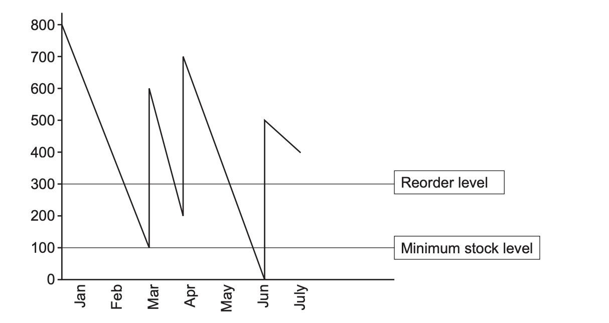

# Exam Questions — Sources of Finance
**5. Finance & Accounting** · Cambridge (CIE) AS business (9609)
> Source: [https://www.savemyexams.com/as/business/cie/23/topic-questions/](https://www.savemyexams.com/as/business/cie/23/topic-questions/) · 21 questions across 1 sets

## Exam Questions (21 questions)

### Q1 — hard — 8 marks

**Q1** [8 marks]

> **[case-study]**
> **Festival Wear (FW)**
> 
> FW is a partnership started by two friends, Maz and Jane. FW manufactures and sells high quality T-shirts at \$40 each. The business can manufacture 35 000 T-shirts per month using mass customisation. The T-shirts are only sold at music festivals and concerts and are customised to each event. FW has never advertised the T-shirts, relying on a sales team to attend a festival or concert and personally sell the T-shirts.
> 
> **Current costs:**
> 
> - variable: \$10 per T-shirt
> - fixed: \$200 000 per month
> 
> Sales average 27 000 T-shirts per month. Currently the sales team is paid a monthly salary, but Maz is proposing a new payment method in order to increase sales volume. This will mean a lower monthly salary but a commission of \$2 per T-shirt will be paid. Maz estimates that sales volume would increase to 30 000 per month.
> 
> **Costs if the new payment method is introduced:**
> 
> - variable: \$12 per T-shirt
> - fixed: \$182 000 per month
> 
> This proposal has been discussed with the sales team. Some members of the team are enthusiastic about the proposal, but others are not happy with what they see as a reduction in their pay.
> 
> The business is expanding and considering moving to a bigger factory. This would require a \$4 million investment in new machinery and staff training.
> 
> Jane would also like to consider methods to increase sales volume. She has suggested that FW should expand its product portfolio to manufacture other items such as baseball caps.

Analyse **two** external sources of finance that FW could use to invest in new machinery.

*Source: May/June 2024 23 Q2C*

### Q2 — hard — 12 marks

**Q2** [12 marks]

> **[case-study]**
> **Samira's Whiteboards (SW)**
> 
> Samira left school at the age of 18 in country H. She had a small amount of savings and an idea to create a flexible, removable and reusable whiteboard. Samira created a prototype and received small orders from local retailers.
> 
> A local manufacturer batch produces stock when required. There is a two-week lead time for a minimum order of 500 units. Samira started to sell her whiteboards on her website and at trade shows. She has been trading for seven months. She has good cashflow but little working capital as production costs are high.
> 
> Samira has heard that OS, a large business that sells office equipment, is planning to sell their own version of Samira's whiteboard. She is keen to increase production quickly to take advantage of being first to market. However, Samira's manufacturer cannot supply enough product to meet the growth in potential demand for whiteboards.
> 
> Fig. 1.1 shows an inventory control chart for the first seven months of trade.
> 
> 
> 
> *Fig. 1.1 SW Inventory control chart 2023*
> 
> Fig. 1.1 is an inventory control chart showing SW's stock level (in units) over the first seven months of trade, January to July. The reorder level is 300 units and the minimum stock level is 100 units. Stock falls steadily as whiteboards are sold, then rises by 500 units (the minimum order quantity) each time a delivery is received. The stock level at each turning point of the chart is:
> 
> | Point on the chart | Stock level (units) |
> |---|---|
> | Opening stock (January) | 800 |
> | First low point, before delivery | 100 |
> | After first delivery | 600 |
> | Second low point, before delivery | 200 |
> | After second delivery | 700 |
> | Third low point, before delivery | 0 |
> | After third delivery | 500 |
> | Closing stock (July) | 400 |
> 
> Lara, a venture capitalist with experience of manufacturing, has approached Samira about making an investment. She would invest \$100 000 to build a local mass production facility for SW. The facility would have a maximum output of 50 000 units per month. Lara wants to own 40% of the business.

Evaluate whether Samira should accept Lara's offer to invest venture capital.

*Source: May/June 2024 21 Q1D*

### Q3 — hard — 12 marks

**Q3** [12 marks]

Evaluate whether working capital is the most important source of finance for a start-up furniture manufacturer.

*Source: May/June 2024 12 Q5B*

### Q4 — hard — 8 marks

**Q4** [8 marks]

Analyse **two** factors which may influence a business's choice of sources of finance.

*Source: May/June 2024 11 Q6A*

### Q5 — medium — 8 marks

**Q5** [8 marks]

> **[case-study]**
> Energy Solutions (ES) ES is a public limited company in country X. The business was set up in 1980. For 25 years most of ES’s revenue came from coal mining. Although ES still owns many coal mines, the business now specialises in hydraulic fracturing, known as fracking. This is a process used to extract gas from underneath the ground.
> 
> The government of country X encourages firms like ES to grow. The growth of ES has led to economies of scale and lower unit costs.
> 
> ES considers the effects of fracking on all the stakeholders of the business. Fig. 1.1 is an extract from a recent newspaper article about fracking.
> 
> | Fracking is not liked by everyone. On the positive side it could produce enough gas to mean that country X can produce its own energy for the next 100 years. This is also likely to mean lower energy prices for both businesses and consumers.  Competing companies in the market have taken full advantage of fracking and are expecting to increase their revenue and profit substantially in the future.  However, people who live near the fracking sites have reported many minor earthquakes. These have not damaged any buildings but the price of houses in those areas has decreased significantly.  There has also been a concern that fracking could lead to pollution and a loss of wildlife. |
> |---|
> 
> **Fig. 1.1: Extract from a recent newspaper article about fracking**
> 
> Despite the complaints from some external stakeholders, ES plans to increase the number of fracking sites in country X. This will require ES to buy licences from the government of country X. Each licence costs \$50m and ES will require both internal and external sources of finance to fund this purchase.
> 
> ES employs over 1000 people. Every worker benefits from a profit-sharing scheme (see Table 1.1) as well as their basic pay
> 
> **Table 1.1: Profit-sharing scheme at ES**
> 
> | Profit in 2019 | \$12m |
> |---|---|
> | Each director’s share of profit | 0.25% |
> | Each manager’s share of profit | 0.1% |
> | Each of other employees’ share of profit | 0.002% |

Analyse one internal source of finance and one external source of finance that ES could use to purchase a fracking licence.

*Source: Nov 2020 Paper 22 Q1C*

### Q6 — medium — 3 marks

**Q6** [3 marks]

> **[case-study]**
> **UPlane Components (UC) **
> 
> UC is a private limited company providing engine parts for commercial aircraft. It uses batch production in factory A and flow production in factory B. As part of UC’s commitment to corporate social responsibility (CSR), it provides a training scheme for the long-term unemployed, based in factory A.
> 
> UC’s products are sold to aircraft engine manufacturers. Demand for aircraft engines has increased by 45% over recent years. The aircraft engine manufacturers want inventory just when needed and are demanding a reduction in prices.
> 
> In 2017, UC opened factory B which is 5km away from factory A. Factory B has a high level of automation, resulting in low unit costs for the parts produced there. Production is capital intensive. UC has a plan to automate factory A. The production workers are not happy about this proposal and have asked for more details. The workers’ representatives have asked for a meeting with the human resource manager.
> 
> In December 2019 a fault was discovered in one of the engine components supplied by UC and produced in factory A. UC had to recall 2000 parts at a cost of \$200000. This has had an impact on part of its triple bottom line and UC is unlikely to meet its targets. Table 1.1 shows some financial data for UC.
> 
> **Table 1.1: Financial data for UC**
> 
> |   | **Year ending 30 November 2019 (\$m)** | **Year ending 30 November 2020 (\$m forecast)** |
> |---|---|---|
> | Revenue | 5.8 | 6.4 |
> | Cost of sales | 2.3 | 3.4 |
> | Expenses | 1.3 | 1.6 |
> | Cost of recall | - | 0.2 |
> 
> Amjit, the human resource manager, believes that the fault was caused by the negligence of Jack, one of the production supervisors. Jack claims that he was made to work overtime to try and meet production targets. This caused him to become tired and make a mistake in one batch of parts. Amjit wants to dismiss Jack.

Explain **one** likely effect on UC of a decrease in profit.

*Source: Nov 2020 Paper 21 Q1BII*

### Q7 — medium — 5 marks

**Q7** [2 marks]

Define the term ‘venture capital’

*Source: Nov 2020 Paper 11 Q2A*

**Q7** [3 marks]

Explain **two **ways that venture capitalists might help a business.

*Source: Nov 2020 Paper 11 Q2B*

### Q8 — medium — 3 marks

**Q8** [3 marks]

> **[case-study]**
> **UFilters (UF) **
> 
> UF is a public limited company selling to an industrial market. It manufactures air conditioning units. UF produces two sizes of air conditioning units, medium and large. Most of its air conditioning units are sold for use in warehouses and computer server rooms. The units are expensive compared to competitors but UF believes its units are of a higher quality. Market research suggests that there is a growing demand for small air conditioning units to be placed in offices. To produce a new size of unit would require spending \$180000 to purchase new machinery.
> 
> UF relies on customer recommendations for new orders. However, some customers have been dissatisfied with the service received. UF has received several complaints, including:
> 
> - engineers turning up late or not at all
> - poor communication from UF
> - little choice in the size of units supplied
> - appointment times are not always convenient and can be difficult to change.
> 
> Sylvie, the Marketing Director of UF, is concerned about the sales data (Table 1.1) as sales have fallen 10% on the previous year.
> 
> **Table 1.1: Selected sales data for UF, 201**
> 
> | **Unit size** | **Price (\$)** | **Unit sales** |
> |---|---|---|
> | Medium | 900 | 3500 |
> | Large | 2000 | 800 |
> 
> Sylvie is considering two options to increase sales (see Table 1.2).
> 
> **Table 1.2: Options to increase sales**
> 
> | *Option 1 *  Reduce the price of the units by 10% | - Competitors’ prices are 8% lower on average. - The estimated price elasticity of demand is –0.8. |
> |---|---|
> | *Option 2 *  Implement a performance related pay scheme (PRP) | - Sales staff are currently paid a monthly salary. - To introduce a PRP scheme the monthly salary would be reduced by 10%. - Targets would be set and if sales staff met the targets then they would receive PRP increasing their monthly salary by 15%. |

Explain **one** source of finance available to UF for purchasing new machinery.

*Source: June 2020 Paper 21 Q1BII*

### Q9 — medium — 8 marks

**Q9** [8 marks]

Analyse the possible problems that a new business might experience when trying to raise finance.

*Source: June 2020 Paper 13 Q5A*

### Q10 — medium — 8 marks

**Q10** [8 marks]

Analyse the disadvantages to a business of using debt factoring to improve its cash flow

*Source: June 2020 Paper 12 Q5A*

### Q11 — medium — 5 marks

**Q11** [5 marks]

Explain the difficulties that a small business start-up might have when trying to obtain finance from an external source.

*Source: June 2020 Paper 12 Q3*

### Q12 — medium — 8 marks

**Q12** [8 marks]

> **[case-study]**
> **Van Man (VM)**
> 
> Obi is a sole trader who operates a van service. He used to be employed by a similar business but realised that he likes to be in control. Obi used all of his savings to start his business so that he did not have to go into debt.
> 
> He owns three vans which can carry furniture, packages and other large items. He has eight full-time employees who drive the vans and move items. Customers can hire a van with two employees to move these items from one place to another. The cost per day of providing a van with two employees is \$170. The prices of the service are shown in Table 1.1.
> 
> **Table 1.1: Price of hiring one van (including two employees)**
> 
> | **Price for the first day’s hire** | **Price for each additional day** |
> |---|---|
> | \$250 | 10% discount on the price for the first day’s hire |
> 
> Demand for Obi’s service is growing fast. To supply this demand he needs a new van and he is investigating sources of finance. He has a choice of two vans. The details of the vans are in Table 1.2.
> 
> **Table 1.2: Van details**
> 
> |   | **Van A** | **Van B** |
> |---|---|---|
> | Capital cost | \$30000 | \$40000 |
> | Estimated maintenance costs per year | \$600 | \$450 |
> | Insurance cost per year | \$500 | \$550 |
> | Expected life | 7 years | 9 years |
> | Van owner reviews | - Easy to drive but not very fast - Boring but fuel efficient - Engine is very noisy, but reliable | - Fast and great fun to drive - Looks great and the range of colours is fantastic - It broke down a few times, but the manufacturer repaired it quickly |

Analyse** two** factors which may influence the source of finance that Obi chooses for the new van.

*Source: Nov 2021 23 Q1D*

### Q13 — medium — 11 marks

**Q13** [11 marks]

> **[case-study]**
> **Snappy Box (SB) **
> 
> SB is owned by Ralph who is a sole trader. The business prints photographs. Ralph has one shop on the main street of city D. Customers bring their saved digital photographs into the shop and these are printed on high-quality paper.
> 
> SB uses a large printing machine that can print on almost any size of paper to produce different sized photograph prints. The process is very capital-intensive and most customers request a batch of photographs to be printed.
> 
> SB is the only shop in city D that prints photographs. However, recently a number of online competitors have started to offer low-priced photograph prints to customers. Ralph has noticed that his sales have decreased significantly because of this competition. Ralph estimates the demand for his photograph prints has a price elasticity of demand of –4.
> 
> SB already has a low profit margin and Ralph is struggling to compete with the online retailers. However, Ralph has an idea to introduce job production into his shop. He could stop printing photographs and instead focus on framing individual photographs for customers. These frames will be made for any sized photograph or picture and can be made from a variety of materials chosen by the customer.
> 
> Ralph will need specialised equipment to allow him to make the frames. The equipment would cost \$10000. He has identified two possible sources of finance for this equipment.
> 
> The first possible source of finance is for Ralph to lease the equipment from the company that produces it. The lease would be for five years at a fixed cost of \$400 per month.
> 
> The second possible source of finance is for Ralph to sell the photograph printing machine for at least \$10000, to purchase the equipment to make frames.

Recommend whether Ralph should use leasing or should sell his photograph printing machine as a source of finance for the equipment to make frames. Justify your recommendation.

*Source: Nov 2021 Paper 22 Q1D*

### Q14 — medium — 20 marks

**Q14** [8 marks]

Analyse the advantages for a business of debt factoring

*Source: Nov 2021 Paper 12 Q7A*

**Q14** [12 marks]

Discuss the most important factors for a venture capitalist to consider when deciding whether to provide growth capital for a computer games retailer.

*Source: Nov 2021 Paper 12 Q7B*

### Q15 — medium — 5 marks

**Q15** [2 marks]

Define the term ‘overdraft’

*Source: Nov 2021 Paper 12 Q2A*

**Q15** [3 marks]

Explain** two** reasons why a business might use an overdraft.

*Source: Nov 2021 Paper 12 Q2B*

### Q16 — medium — 8 marks

**Q16** [8 marks]

Analyse the benefits for a business of an overdraft as a source of finance.

*Source: Nov 2021 Paper 11 Q5A*

### Q17 — medium — 8 marks

**Q17** [8 marks]

Analyse the benefits of using internal sources of finance for business growth.

*Source: March 2022 Paper 12 Q5A*

### Q18 — medium — 8 marks

**Q18** [8 marks]

> **[case-study]**
> **Child Play (CP) **
> 
> Su is a sole trader who started a business called CP which operates a play area for children. The play area is inside a building and includes toys and other play equipment. Customers book on CP’s website for each hour that they would like to use the play area. CP is two kilometres away from the nearest city which has a large population.
> 
> Su does not pay for any promotion and she relies on recommendations and reviews from previous customers. Su currently charges a price of \$10 an hour for a group of up to 5 children. Only one group can book CP for each hour. Demand is greater than supply so Su may increase the price to \$15 per hour. She has completed some market research to see if this is a good idea. Her findings are in Table 1.1.
> 
> **Table 1.1: Market research about prices for CP**
> 
> | **Price** | **Quantity (hours) demanded per day** |
> |---|---|
> | \$10 | 10 |
> | \$15 | 6 |
> 
> Su is also thinking about expanding the business by opening a café targeted at parents with children.
> 
> The café would be located at the entrance to CP’s play area. There are many other cafés in the city centre two kilometres away. Su believes that product differentiation is essential for the profitability of the café.
> 
> Su plans to use CP’s working capital as the source of finance to open the new café. The café will need to earn revenue quickly, so she plans to open it in four weeks. She will need quick and low‑cost promotion methods if the café is to succeed.

Analyse **one **advantage and **one **disadvantage to Su of using working capital as a source of finance for the new café.

*Source: June 2022 Paper 23 Q1C*

### Q19 — medium — 12 marks

**Q19** [12 marks]

Discuss the most appropriate source of finance for a private limited company to purchase an additional factory.

*Source: June 2022 Paper 11 Q7B*

### Q20 — medium — 8 marks

**Q20** [8 marks]

> **[case-study]**
> **Great Resources (GR) **
> 
> GR is a business partnership that creates educational resources. It sells direct to schools and teachers via its own website.
> 
> Sanjay, Rukmal and Boris are entrepreneurial teachers who formed the GR partnership. One year ago, they identified a gap in the market to supply interactive, digital resources. GR’s website is subscription only. An online marketing campaign, which used penetration pricing, attracted 250 subscribers in the first six months of operation. The start-up costs were financed with a \$5000 bank overdraft, which is GR’s only debt.
> 
> Reviews for GR’s products in teaching journals are positive but cash flow is poor. Many customers have taken advantage of a recent sales promotion for one month’s free membership and posted positive reviews. Unfortunately, few have then taken out a regular subscription.
> 
> As revenue has not increased as much as the entrepreneurs had hoped, they must now consider alternative promotion methods. They have researched possible promotion methods and decided to advertise in an educational newspaper. The newspaper has a readership of half a million people.
> 
> Expert Materials (EM) is a large national company that also advertises in the newspaper. EM is GR’s closest competitor. The EM brand is well-known and trusted in the educational resources market. Table 1.1 shows some marketing data.
> 
> **Table 1.1 Marketing data**
> 
> |   | GR | EM | Total market |
> |---|---|---|---|
> | Revenue (\$000) | 15 | 300 | 500 |
> | Number of customers | 300 | 5000 | 7000 |
> | Annual advertising spend (\$000) | 7.5 | 45 | 60 |

Analyse one advantage and one disadvantage to GR of using a bank overdraft.

*Source: June 2023 Paper 21 Q1C*

### Q21 — medium — 11 marks

**Q21** [11 marks]

> **[case-study]**
> **George’s Gym (GG) **
> 
> George identified a potential niche market for a new gym in his local area. He set up GG as a sole trader business three years ago. GG is a modern gym with the latest equipment.
> 
> George has recently gained planning permission to build a new swimming pool. George wants to open the swimming pool because a national competitor is planning to open a new gym close by and he wants GG to remain competitive. The swimming pool will cost \$400 000 and George has yet to decide on the best source of fi nance. He has \$50 000 in savings that he could use and he does not have any mortgage or loans. George is thinking about seeking a private investor but is unsure of the risks involved.
> 
> The local population is wealthy. Last year (2012), GG had 300 members who each paid a membership fee of \$60 per month. George is thinking about new ways of increasing revenue such as offering additional ‘keep fit’ classes. He also plans to increase the monthly fee he charges members to \$66. His accountant has told him he needs to think about the price elasticity of demand before making a pricing decision.
> 
> **Table 3 – Annual revenue and profit for the year for the previous 3 years (\$000)**
> 
> |   | 2010 | 2011 | 2012 |
> |---|---|---|---|
> | Annual revenue | 120 | 160 | X |
> | Profit for the year | 20 | 50 | 80 |
> 
> George hopes that the information in Table 3 will help show any potential lender how attractive the gym is as an investment.
> 
> GG has a problem of a high labour turnover of personal trainers. Three of them have left in the last six months. He has just employed a new personal trainer, Sally. George needs to issue her contract of employment. George thinks that the reasons for the high labour turnover include:
> 
> - George is always busy and so he can never offer an effective induction training programme for his employees
> - GG salaries are below average for the industry.

Discuss sources of finance that GG might use to pay for the new swimming pool.

*Source: Specimen 2016 Paper 2 Q2D*

