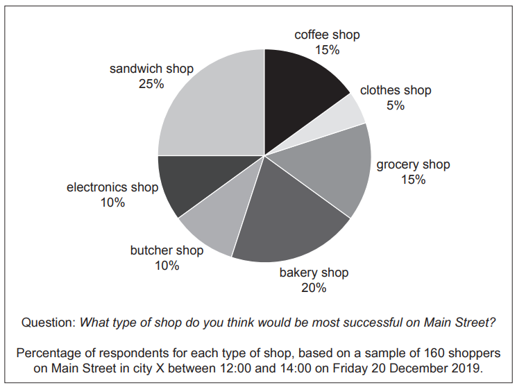

# Exam Questions — Human Resource Management
**2. Human Resource Management** · Cambridge (CIE) AS business (9609)
> Source: [https://www.savemyexams.com/as/business/cie/23/topic-questions/](https://www.savemyexams.com/as/business/cie/23/topic-questions/) · 26 questions across 1 sets

## Exam Questions (26 questions)

### Q1 — hard — 23 marks

**Q1** [3 marks]

> **[case-study]**
> **Recruitment Process (RP)**
> 
> RP is a private limited company based in country Z. RP is an employment agency that operates in a dynamic business environment. To survive in the market RP must be efficient and maintain a good reputation. RP uses social media to attract customers and relies on word-of-mouth recommendations. RP has recently won an award for its diversity and equality practices.
> 
> RP's customers provide details of the roles and number of employees required. RP quotes a price to its customer and then agrees a contract to provide its services at the price quoted.
> 
> Ray, Managing Director, has asked Adjil, Finance Director, to provide a budget breakdown of a recent customer contract. RP's staff are specialist recruiters who find the appropriate employees for each job role.
> 
> **Table 1.1 RP's budget for a recent customer contract, March 2024**
> 
> | Job role | Number of employees required | Specialist recruiters required | Cost per specialist recruiter (\$000) | Total cost (\$000) |
> |---|---|---|---|---|
> | Warehouse | 70 | 1 | 100 | 100 |
> | Sales | 225 | 3 | 120 | 360 |
> | Technology | 145 | 3 | 140 | 420 |
> | Management | 10 | 2 | 190 | 380 |
> | **Total** | **450** |   |   | **1260** |
> 
> Adjil noted that the actual cost per employee recruited showed an adverse variance of \$500.
> 
> Ray is concerned that the budget does not accurately show the costs to RP. Ray thinks this is because of inefficient practices in the recruitment process.

Explain the term *employment agency*.

*Source: May/June 2024 23 Q1A*

**Q1** [8 marks]

> **[case-study]**
> **Recruitment Process (RP)**
> 
> RP is a private limited company based in country Z. RP is an employment agency that operates in a dynamic business environment. To survive in the market RP must be efficient and maintain a good reputation. RP uses social media to attract customers and relies on word-of-mouth recommendations. RP has recently won an award for its diversity and equality practices.
> 
> RP's customers provide details of the roles and number of employees required. RP quotes a price to its customer and then agrees a contract to provide its services at the price quoted.
> 
> Ray, Managing Director, has asked Adjil, Finance Director, to provide a budget breakdown of a recent customer contract. RP's staff are specialist recruiters who find the appropriate employees for each job role.
> 
> **Table 1.1 RP's budget for a recent customer contract, March 2024**
> 
> | Job role | Number of employees required | Specialist recruiters required | Cost per specialist recruiter (\$000) | Total cost (\$000) |
> |---|---|---|---|---|
> | Warehouse | 70 | 1 | 100 | 100 |
> | Sales | 225 | 3 | 120 | 360 |
> | Technology | 145 | 3 | 140 | 420 |
> | Management | 10 | 2 | 190 | 380 |
> | **Total** | **450** |   |   | **1260** |
> 
> Adjil noted that the actual cost per employee recruited showed an adverse variance of \$500.
> 
> Ray is concerned that the budget does not accurately show the costs to RP. Ray thinks this is because of inefficient practices in the recruitment process.

Analyse **two** methods RP could use to select sales employees.

*Source: May/June 2024 23 Q1C*

**Q1** [12 marks]

> **[case-study]**
> **Recruitment Process (RP)**
> 
> RP is a private limited company based in country Z. RP is an employment agency that operates in a dynamic business environment. To survive in the market RP must be efficient and maintain a good reputation. RP uses social media to attract customers and relies on word-of-mouth recommendations. RP has recently won an award for its diversity and equality practices.
> 
> RP's customers provide details of the roles and number of employees required. RP quotes a price to its customer and then agrees a contract to provide its services at the price quoted.
> 
> Ray, Managing Director, has asked Adjil, Finance Director, to provide a budget breakdown of a recent customer contract. RP's staff are specialist recruiters who find the appropriate employees for each job role.
> 
> **Table 1.1 RP's budget for a recent customer contract, March 2024**
> 
> | Job role | Number of employees required | Specialist recruiters required | Cost per specialist recruiter (\$000) | Total cost (\$000) |
> |---|---|---|---|---|
> | Warehouse | 70 | 1 | 100 | 100 |
> | Sales | 225 | 3 | 120 | 360 |
> | Technology | 145 | 3 | 140 | 420 |
> | Management | 10 | 2 | 190 | 380 |
> | **Total** | **450** |   |   | **1260** |
> 
> Adjil noted that the actual cost per employee recruited showed an adverse variance of \$500.
> 
> Ray is concerned that the budget does not accurately show the costs to RP. Ray thinks this is because of inefficient practices in the recruitment process.

Evaluate the impact on RP of diversity and equality in the workplace.

*Source: May/June 2024 23 Q1D*

### Q2 — hard — 1 marks

**Q2** [1 mark]

> **[case-study]**
> **Cobblestone Shoes (CS)**
> 
> Yazeem is a highly skilled shoemaker. He opened CS in 1975, as a sole trader, to design and repair shoes. When Yazeem set up CS the main target market was professional people who wanted shoes to wear to work or to dress smartly. He produced the shoes using batch production and sold them in his own shop. Each design of shoe was made in a range of sizes and colours.
> 
> Recently there has been an increase in low-priced shoes produced for the mass market, which has reduced Yazeem's sales of new shoes. It has also reduced the demand for shoe repairs.
> 
> Yazeem's daughter, Abir, is keen to take over the running of CS. She has been fully trained in making shoes and feels that it is time for Yazeem to retire.
> 
> Abir thinks that the business should be targeting niche markets. She would like to design and produce unique shoes and use price skimming to increase the profitability of the business.
> 
> Abir is also concerned about the contribution made on each batch of shoes. Table 2.1 shows some break-even data for a recent batch of shoes.
> 
> **Table 2.1 Break-even data about a recent batch of shoes**
> 
> | Item | Value |
> |---|---|
> | Break-even level of output | 400 units |
> | Margin of safety | 100 units |
> | Total variable costs | \$18 750 |
> | Total costs | \$23 750 |
> | Total revenue | \$25 000 |
> 
> Abir has suggested that CS should adopt a just in time (JIT) approach to inventory management. By using JIT, she argues, CS would be able to increase its working capital and avoid having money tied up in inventory that might not be used or sold. CS currently has a large number of shoes on display in the shop. There is also a large amount of their main raw material, which is leather and must be kept in a climate-controlled storage area.
> 
> Abir has already found a new local supplier which is happy to deliver inventory as required.

Identify **one** type of training.

*Source: May/June 2024 22 Q2A*

### Q3 — hard — 8 marks

**Q3** [8 marks]

> **[case-study]**
> **Post Scent (PS)**
> 
> PS is a private limited company operating in country H. It sells perfume for men and women using its own website. PS purchases the perfume in large quantities from various manufacturers and then sells it in smaller quantities to its customers. Most of the perfumes are sold in glass bottles.
> 
> PS has two main ways in which it sells perfume:
> 
> - A website where customers can purchase a range of perfumes. The perfumes are priced to be lower than high street competitors.
> - A subscription service where customers pay a monthly fee for a mystery perfume to be delivered each month.
> 
> All of PS's products are delivered to customers' homes using the postal service. The packages can be left in a mailbox or in a safe place outside of the home. PS has an aim to improve the sustainability of its operations.
> 
> PS uses incremental budgeting. Table 1.1 shows the budgeted and actual cost and revenue data for 2023.
> 
> **Table 1.1 Budgeted and actual cost and revenue data for 2023 (\$000)**
> 
> | Item | Budgeted | Actual | Variance |
> |---|---|---|---|
> | Revenue | 500 | 600 | **x** |
> | Direct costs | 300 | 350 | **y** |
> | Indirect costs | 150 | 125 | **z** |
> 
> The directors of PS have decided that the business needs a Marketing Manager. The role of the Marketing Manager will be:
> 
> - to plan the recruitment and training of a new sales team
> - to organise the production of digital promotions
> - to advise the Board of Directors on changes to the PS product portfolio.
> 
> The directors have shortlisted five suitable applicants and plan to invite them all to an assessment centre as part of the recruitment process.

Analyse **one** advantage and **one** disadvantage to PS of using an assessment centre when selecting a Marketing Manager.

*Source: May/June 2024 22 Q1C*

### Q4 — hard — 12 marks

**Q4** [12 marks]

Evaluate whether cooperation between management and the workforce is the most important factor in the success of a car manufacturer.

*Source: May/June 2024 13 Q5B*

### Q5 — hard — 20 marks

**Q5** [8 marks]

Analyse **two** benefits to a business of low labour turnover.

*Source: May/June 2024 12 Q6A*

**Q5** [12 marks]

'Work-life balance is the most important human resource management (HRM) factor for employee welfare in a local bus service.'

Evaluate this view.

*Source: May/June 2024 12 Q6B*

### Q6 — easy — 5 marks

**Q6** [2 marks]

Define the term *job description*.

*Source: May/June 2024 12 Q2A*

**Q6** [3 marks]

Explain **one** benefit to a business of internal recruitment.

*Source: May/June 2024 12 Q2B*

### Q7 — easy — 3 marks

**Q7** [3 marks]

Explain **one** impact on a business of training its employees.

*Source: May/June 2024 11 Q2B*

### Q8 — medium — 11 marks

**Q8** [11 marks]

> **[case-study]**
> **Braid Runner (BR) **
> 
> Lewis is a hairdresser. He rents a small shop which he uses as a hairdressers called Braid Runner (BR). Lewis is a sole trader and he set up BR 25 years ago.
> 
> BR is the smallest of all the hairdressers in city Y. Lewis works on his own. He has repeat customers who have been using BR for many years. However, there are many large franchises in city Y which offer a much cheaper haircut than BR.
> 
> Lewis is considering increasing the price of a haircut and he has outlined the costs and revenue of the business in Table 2.1.
> 
> **Table 2.1: Costs and revenue of BR**
> 
> | Variable costs per customer | \$3.50 |
> |---|---|
> | Fixed costs per week | \$675 |
> | Price | \$8 |
> 
> Lewis would like to employ another hairdresser so that he can work fewer hours in BR. The new employee would have to be able to work in BR on their own. They would be responsible for taking bookings, dealing with customers and some financial transactions. Lewis has drawn up a person specification (see Fig. 2.1) that will be placed on a job website.
> 
> | **Characteristic** | **Essential** | **Desirable** |
> |---|---|---|
> | Qualifications | - Hairdressing qualification | - A-Levels or high school standards in Mathematics and Business |
> | Physical | - Must be between 18 and 30 years old | - Female |
> | Experience | - None required | - Experience of dealing with customers/consumers - Experience of working alone |
> | Personal qualities | - Able to work in a team - Good communication | - Friendly |
> 
> **Fig. 2.1: Person specification created by Lewis**

Refer to Fig 2.1 and any other relevant information. Evaluate the usefulness of the person specification when recruiting another hairdresser.

*Source: November 2020 Paper 23 Q2D*

### Q9 — medium — 11 marks

**Q9** [11 marks]

> **[case-study]**
> **Gemini Theatre (GT) **
> 
> GT is a private limited company fully owned by the Gemini family. It owns a small theatre. This building is used to show live stage performances. Some of the performances are created by GT and some are created by visiting groups who rent the theatre. Table 2.1 shows the planned performances for January 2021.
> 
> **Table 2.1: Planned performances for January 2021**
> 
> | **Name of performance** | **Created by** | **Number of performances** | **Ticket price** | **Percentage of tickets sold** |
> |---|---|---|---|---|
> | A Summer Dream | Visiting group | 9 | \$40 | 100% |
> | Wise Owl | GT | 14 | \$15 | 60% |
> | La Poeme Ballet | GT | 5 | \$20 | 40% |
> 
> GT gains all the revenue from performances created by GT. Visiting groups must pay 50% of their total ticket revenue to GT. The theatre has a maximum of 250 tickets that can be sold for each performance.
> 
> GT uses cost-based pricing to set each ticket price for its own performances. Each performance makes a profit but the company often experiences cash flow problems.
> 
> GT needs to recruit a new Theatre Manager. The person hired will have many duties, including the responsibility for all of GT’s administration as well as some accounting. The Directors are considering two people who were both recently interviewed. Table 2.2 contains information gained from the interview process.
> 
> **Table 2.2: Information gained from the interview process**
> 
> | Nick | Portia |
> |---|---|
> | - Three years working for a similar theatre business - A Levels in Business, Art and Chinese - Very organised and efficient - No management experience - Wants to move overseas in the future | - Eight years working as a manager for a bank - No formal qualifications - Late for the interview - Good sense of humour - Looking for a long-term career |

Recommend whether GT should employ Nick or Portia for the position of Theatre Manager. Justify your recommendation.

*Source: November 2020 Paper 22 Q2D*

### Q10 — medium — 8 marks

**Q10** [8 marks]

> **[case-study]**
> **UPlane Components (UC) **
> 
> UC is a private limited company providing engine parts for commercial aircraft. It uses batch production in factory A and flow production in factory B. As part of UC’s commitment to corporate social responsibility (CSR), it provides a training scheme for the long-term unemployed, based in factory A.
> 
> UC’s products are sold to aircraft engine manufacturers. Demand for aircraft engines has increased by 45% over recent years. The aircraft engine manufacturers want inventory just when needed and are demanding a reduction in prices.
> 
> In 2017, UC opened factory B which is 5km away from factory A. Factory B has a high level of automation, resulting in low unit costs for the parts produced there. Production is capital intensive. UC has a plan to automate factory A. The production workers are not happy about this proposal and have asked for more details. The workers’ representatives have asked for a meeting with the human resource manager.
> 
> In December 2019 a fault was discovered in one of the engine components supplied by UC and produced in factory A. UC had to recall 2000 parts at a cost of \$200000. This has had an impact on part of its triple bottom line and UC is unlikely to meet its targets. Table 1.1 shows some financial data for UC.
> 
> **Table 1.1: Financial data for UC**
> 
> |   | **Year ending 30 November 2019 ** **(\$m)** | **Year ending 30 November 2020 ** **(\$m forecast)** |
> |---|---|---|
> | Revenue | 5.8 | 6.4 |
> | Cost of sales | 2.3 | 3.4 |
> | Expenses | 1.3 | 1.6 |
> | Cost of recall | - | 0.2 |
> 
> Amjit, the human resource manager, believes that the fault was caused by the negligence of Jack, one of the production supervisors. Jack claims that he was made to work overtime to try and meet production targets. This caused him to become tired and make a mistake in one batch of parts. Amjit wants to dismiss Jack.

Analyse **two **likely effects on the other employees if Jack is dismissed.

*Source: November 2020 Paper 21 Q1C*

### Q11 — medium — 3 marks

**Q11** [3 marks]

> **[case-study]**
> **Super Heroes (SH) **
> 
> SH is a leisure (theme) park aimed at 10–18 year olds. It is owned by two companies, X and Y, which started SH as a joint venture. Company X owns many leisure centres and swimming pools. Company Y owns many brands based on superheroes.
> 
> SH employs 200 full-time workers and an extra 50 seasonal workers during the busiest times of the year. The park has 10 large rides which take up 2km2 of land. There are also many smaller rides, restaurants, toilets and shops. The price of an entrance ticket is \$11 per customer. Table 1.1 shows the costs for SH in 2019.
> 
> **Table 1.1: SH costs for 2019**
> 
> | Total fixed costs (per year) | \$12m |
> |---|---|
> | Variable costs (per customer) | \$3 |
> | Total costs | \$42m |
> 
> One of the larger rides at SH is the Iron Blaster. The number of customers who use this ride has decreased each year for the last three years. This has led the management of SH to consider its options for internal growth.
> 
> *Option 1 – A new virtual reality (VR) ride *
> This option would involve developing the Iron Blaster into a VR ride. Most of the structure of the Iron Blaster could be used but customers would be given a VR headset to wear during the ride. The cost of developing the VR ride would be \$2m. The Iron Blaster ride would be closed for a three month period during the off-peak season for the development to be carried out. No employees would be made redundant or dismissed.
> 
> *Option 2 – A new hotel *
> SH does not currently have a hotel. It could demolish the Iron Blaster to provide the space to build one. Many of the competitors of SH have a hotel near or within their leisure parks. Hotel customers would pay a high price for a room but have free access to the leisure park’s facilities. Market research suggests that the average hotel customer would spend twice as long in the leisure park than a non-hotel customer. The cost of developing the hotel would be \$15m and take a year to build. All of the employees currently working on the Iron Blaster ride would face redundancy or dismissal.

Explain the difference between ‘redundancy’ and ‘dismissal’ (line 28).

*Source: June 2020 Paper 23 Q1AII*

### Q12 — medium — 20 marks

**Q12** [20 marks]

‘Limited investment in employee training and development in a primary sector business will lead to poor business performance.’

Discuss the extent to which you agree with this view.

*Source: November 2020 Paper 13 Q6*

### Q13 — medium — 2 marks

**Q13** [2 marks]

> **[case-study]**
> **The Shop (TS) **
> 
> Thomas worked for 30 years as a manager of a factory. Although he was very good at his job he was recently made redundant.
> 
> Thomas always wanted to open a shop. He thinks he has the qualities an entrepreneur is likely to need for success. He has undertaken some primary market research to identify possible opportunities in city X where he lives (see Fig. 1.1).
> 
> 
> 
> **Fig. 1.1: Market research**
> 
> Thomas now needs to make a decision about which type of shop to open. He has used the data in Fig. 1.1 and some secondary market research to identify two options.
> 
> *Option 1: Coffee shop *
> The coffee shop would provide hot drinks that customers could take away and drink elsewhere. It would also sell some bakery items, such as biscuits and doughnuts. There are four other shops selling takeaway hot drinks and bakery items in the city, as well as five cafés. Thomas thinks that the profit margin would be 6% to 8%.
> 
> *Option 2: Sandwich shop *
> The sandwich shop would make sandwiches using job production. Customers can choose from a range of sandwich fillings, as well as cold drinks and snacks. There is only one competitor in the city. It is a well-known international franchise that spends a lot of money on promotion. Thomas thinks that the profit margin would be 10% to 15%.

Define the term ‘redundant’ (line 2).

*Source: June 2020 Paper 22 Q1AI*

### Q14 — medium — 4 marks

**Q14** [4 marks]

> **[case-study]**
> **Market Solution (MS) **
> 
> MS is a public limited company in the tertiary sector. MS advises businesses on elements of the marketing mix. Most of its customers are small businesses who cannot afford their own marketing department. MS designs marketing materials for these businesses to use.
> 
> Although MS uses computer aided design (CAD), the business is labour intensive. MS employs specialist marketing workers as well as administrative support workers.
> 
> **Table 2.1 shows some data about employees of MS.**
> 
> |   | **Specialist marketing workers** | **Administrative support workers** |
> |---|---|---|
> | Average number of workers in 2019 | 40 | 88 |
> | Payment method | Salary plus bonus | Performance related pay plus bonus |
> | Number of workers who left in 2019 | 2 | 11 |
> | Average pay (compared to national average) | High | Low |
> | Main need of the workers | Achievement | Affiliation |
> | Main hygiene factors | - Pay - Flexible hours of work | - Staff restaurant - Holidays |
> | Is a bonus expected in 2020? | Yes | No |
> 
> MS has recently employed Hetti as the new Human Resources Manager. Hetti thinks that the ideas of the motivational theorists are important when managing employees. She is particularly worried about the labour turnover of the administrative support workers.
> 
> MS has recently taken on a new customer, named Books Outlet (BO). BO has an objective to increase its revenue by targeting a younger market segment. BO has provided MS with the following information about its current marketing mix (see Table 2.2).
> 
> **Table 2.2: Current marketing mix for BO**
> 
> | **Product **  - Books aimed at customers who are 30 years and older - Specialist books on many topics – BO is often the only seller in the area | **Price **  - Price skimming |
> |---|---|
> | **Promotion **  - Window display - Local newspaper advertising | **Place **  - A retail shop on the main street - Postal sales from a brochure |

Refer to Table 2.1. Calculate the **difference **between the labour turnover of the specialist marketing workers and the labour turnover of the administrative support workers.

*Source: June 2020 Paper 22 Q2BI*

### Q15 — medium — 20 marks

**Q15** [20 marks]

‘Human Resource Management is the most important department in any large manufacturing business.’

Discuss the extent to which you agree with this view.

*Source: June 2020 Paper 13 Q6*

### Q16 — medium — 8 marks

**Q16** [8 marks]

> **[case-study]**
> **Tin Mines (TM) **
> 
> TM is a private limited company in the primary sector. Tin is found underground and is extracted by mining. TM operates seven mines in country C. There are several job roles at each mine including skilled engineers, managers and miners.
> 
> TM has recently discovered a new source of tin in a remote area of country C. TM has permission to develop a tin mine but will have to construct transport links. It will need new buildings such as offices, warehouses and employee housing. The Human Resources Director is developing a workforce plan to recruit miners and managers for the new mine.
> 
> TM’s Financial Director has produced a cash flow forecast for the new mine for the next five years. This is shown in Table 2.1.
> 
> **Table 2.1: Cash flow forecast for the new mine (\$m)**
> 
> | **Year** | **2022** | **2023** | **2024** | **2025** | **2026** |
> |---|---|---|---|---|---|
> | Opening balance | **X** | -80 | -95 | -85 | 5 |
> | Sales | 0 | 0 | 25 | 105 | **Y** |
> | Development costs | 60 | 15 | 0 | 0 | 0 |
> | Operating costs | 0 | 0 | 15 | 15 | 15 |
> | Closing balance | -80 | -95 | -85 | 5 | 240 |
> 
> The remote area of country C where the new tin mine will be located has a high level of unemployment and average incomes are low. TM intends to recruit employees from the local area and buy resources from local suppliers, if they are available. The market for tin is likely to be affected by increased demand for electric vehicles. The batteries in electric vehicles contain tin. The government of country C believes that the tin mine will be of great benefit to both the local community and national economy. However, tin mining can result in pollution of local water supplies.

Analyse **two **methods of recruitment that TM’s Human Resources Director can use to recruit employees for the new mine.

*Source: November 2021 Paper 21 Q2D*

### Q17 — medium — 5 marks

**Q17** [2 marks]

Define the term ‘job description’.

*Source: June 2020 Paper 12 Q1A*

**Q17** [3 marks]

Explain **two **advantages to an employer of using a person specification.

*Source: June 2020 Paper 12 Q1B*

### Q18 — medium — 11 marks

**Q18** [11 marks]

> **[case-study]**
> **Quality Furniture (QF) **
> 
> QF is a public limited company in country S. It manufactures furniture for cafés. The number of cafés in country S has increased by more than 50% over the last 5 years. This has meant that QF has been able to expand and achieve internal economies of scale. However, the growth of the café market has attracted new firms supplying café furniture and increased competition for QF.
> 
> An extract from QF’s income statement is shown in Table 1.1.
> 
> **Table 1.1: Extract from QF’s income statement for 2020**
> 
> |   | \$m |
> |---|---|
> | Revenue | 300 |
> | Cost of sales | 120 |
> | Gross profit | 180 |
> | Expenses | 150 |
> 
> Although QF has been successful so far, Javid, the Managing Director, has identified two problem areas: inventory and human resources.
> 
> **Inventory **
> 
> QF’s inventory includes raw materials, work in progress and finished tables and chairs. QF buys 80% of its materials from country T and there is a long delivery lead time. This means that QF holds a high level of buffer inventory which has a high value.
> 
> **Human resources **
> 
> QF’s production employees are unhappy that they have not received any benefit from the company’s expansion. Profit has doubled over the past three years but employees have not received any pay increases or bonuses. The employees have all been trained by QF and have specialist skills which had ensured that customer expectations were met. However, customers are starting to complain about a fall in the quality of the furniture, which could be the result of the low morale of the employees. Some highly trained employees have left QF to work for competitor firms.

Recommend how QF’s management could improve the morale of its production employees. Justify your recommendation.

*Source: November 2021 Paper 21 Q1D*

### Q19 — medium — 5 marks

**Q19** [5 marks]

Explain why it is important for a business to have effective human resource management (HRM).

*Source: November 2021 Paper 13 Q3*

### Q20 — medium — 5 marks

**Q20** [5 marks]

Explain why businesses invest in the training and development of employees.

*Source: November 2021 Paper 12 Q3*

### Q21 — medium — 8 marks

**Q21** [8 marks]

> **[case-study]**
> **Benjamin’s Beds (BB) **
> 
> Benjamin’s Beds (BB) is a large manufacturer of beds and has a strong brand image for quality. Its main channel of distribution is through the producer market (B2B) to national hotel chains. Recently, BB has also entered the consumer market (B2C) by selling online direct to customers.
> 
> BB uses flow production. BB’s existing machinery is old and cannot satisfy the increased demand. The directors of BB have decided its existing machinery needs replacing. Table 2.1 shows data for existing and proposed new machinery.
> 
> **Table 2.1 Data for existing and proposed new machinery**
> 
> |   | Variable cost per unit  (\$) | Output per year |
> |---|---|---|
> | Existing machinery | 50 | 5000 |
> | New machinery | 40 | 7500 |
> 
> Fixed costs are \$500000 per year. Using new machinery would reduce this by 10%.
> 
> BB sales data suggests that its market share is growing rapidly. The consumer market (B2C) is becoming more important to BB because online orders are increasing. However, online demand is for a wide range of bed styles. The consumer market requires a substantial marketing budget and some retraining of employees.
> 
> Orders from national hotel chains in the producer market (B2B) are for a more limited range of bed styles. These orders remain constant with low marketing costs. However, BB is increasingly under pressure to reduce prices to hotels.
> 
> BB uses non-financial motivators and until recently had a motivated workforce. Efficiency is falling due to employees having to work longer hours because of increased demand. This is decreasing staff morale and welfare.

Analyse **two **possible disadvantages to BB of decreased staff morale and welfare.

*Source: March 2022 Paper 22 Q2C*

### Q22 — medium — 2 marks

**Q22** [2 marks]

> **[case-study]**
> **Seaside Hotel (SH) **
> 
> SH is a large hotel located in a tourist area of country H. SH has 120 rooms and employs 42 workers during the peak (busiest) season which is from April to September. Table 2.1 shows employee data for SH’s peak season.
> 
> **Table 2.1: Employee data for SH’s peak season**
> 
> | **Type** | **Number** | **Main tasks** |
> |---|---|---|
> | Manager | 3 | - decision making - supervising other employees |
> | Cleaner | 12 | - cleaning rooms, corridors and reception area to required standard - maintaining a clean and safe working environment |
> | Customer service | 16 | - greeting guests upon arrival - making sure guests are satisfied |
> | Marketing | 7 | - designing promotional materials - promoting hotel to increase number of guests |
> | Other | 4 | • various |
> 
> SH makes half of the cleaners and customer service employees redundant at the end of the peak season.
> 
> To break even, the hotel must sell 72 rooms per night. The hotel offers good views of the sea and it is very busy in the peak season when the weather is hot. Table 2.2 shows SH’s sales of rooms.
> 
> **Table 2.2: SH’s sales of rooms 2021–2022**
> 
> | **Time period** | **Average percentage of rooms sold per night** |
> |---|---|
> | April 2021 – September 2021 | 95% |
> | October 2021 – March 2022 | 45% |
> 
> SH does not have a restaurant. It has a joint venture with a restaurant close to the hotel where SH’s customers receive a discount on their food and drink. The hotel advertises the restaurant on social media and the restaurant advertises the hotel on its menu.
> 
> Tia is one of the managers of SH. She has an autocratic leadership style and is responsible for the cleaners and marketing employees.
> 
> The directors of SH aim to increase the value added to the service that SH provides.

Define the term ‘redundant’ (line 16).

*Source: June 2022 Paper 22 Q2AI*

### Q23 — medium — 5 marks

**Q23** [2 marks]

Define the term ‘workforce planning’.

*Source: June 2022 Paper 13 Q1A*

**Q23** [3 marks]

Explain two advantages to a business of using induction training.

*Source: June 2022 Paper 13 Q1B*

### Q24 — medium — 3 marks

**Q24** [3 marks]

Explain one type of training that a business may use.

*Source: June 2023 Paper 11 Q3B*

### Q25 — medium — 11 marks

**Q25** [3 marks]

> **[case-study]**
> **George’s Gym (GG) **
> 
> George identified a potential niche market for a new gym in his local area. He set up GG as a sole trader business three years ago. GG is a modern gym with the latest equipment.
> 
> George has recently gained planning permission to build a new swimming pool. George wants to open the swimming pool because a national competitor is planning to open a new gym close by and he wants GG to remain competitive. The swimming pool will cost \$400 000 and George has yet to decide on the best source of finance. He has \$50 000 in savings that he could use and he does not have any mortgage or loans. George is thinking about seeking a private investor but is unsure of the risks involved.
> 
> The local population is wealthy. Last year (2012), GG had 300 members who each paid a membership fee of \$60 per month. George is thinking about new ways of increasing revenue such as offering additional ‘keep fi t’ classes. He also plans to increase the monthly fee he charges members to \$66. His accountant has told him he needs to think about the price elasticity of demand before making a pricing decision.
> 
> **Table 3 – Annual revenue and profit for the year for the previous 3 years (\$000)**
> 
> |   | 2010 | 2011 | 2012 |
> |---|---|---|---|
> | Annual revenue | 120 | 160 | X |
> | Profit for the year | 20 | 50 | 80 |
> 
> George hopes that the information in Table 3 will help show any potential lender how attractive the gym is as an investment.
> 
> GG has a problem of a high labour turnover of personal trainers. Three of them have left in the last six months. He has just employed a new personal trainer, Sally. George needs to issue her contract of employment. George thinks that the reasons for the high labour turnover include:
> 
> - George is always busy and so he can never offer an effective induction training programme for his employees
> - GG salaries are below average for the industry.

Briefly explain the term ‘contract of employment’ (line 22).

*Source: Specimen 2016 Paper 2 Q2AII*

**Q25** [8 marks]

Analyse the disadvantages to GG of a high labour turnover of personal trainers.

*Source: Specimen 2016 Paper 2 Q2C*

### Q26 — medium — 12 marks

**Q26** [12 marks]

‘The most important role of human resource management (HRM) in a fast food restaurant is to maintain a high level of employee morale and welfare.’

Evaluate this view.

*Source: Specimen 2023 Paper 1 Q6B*

