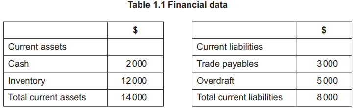

# Exam Questions — Management
**2. Human Resource Management** · Cambridge (CIE) AS business (9609)
> Source: [https://www.savemyexams.com/as/business/cie/23/topic-questions/](https://www.savemyexams.com/as/business/cie/23/topic-questions/) · 8 questions across 1 sets

## Exam Questions (8 questions)

### Q1 — hard — 1 marks

**Q1** [1 mark]

> **[case-study]**
> **Samira's Whiteboards (SW)**
> 
> Samira left school at the age of 18 in country H. She had a small amount of savings and an idea to create a flexible, removable and reusable whiteboard. Samira created a prototype and received small orders from local retailers.
> 
> A local manufacturer batch produces stock when required. There is a two-week lead time for a minimum order of 500 units. Samira started to sell her whiteboards on her website and at trade shows. She has been trading for seven months. She has good cashflow but little working capital as production costs are high.
> 
> Samira has heard that OS, a large business that sells office equipment, is planning to sell their own version of Samira's whiteboard. She is keen to increase production quickly to take advantage of being first to market. However, Samira's manufacturer cannot supply enough product to meet the growth in potential demand for whiteboards.
> 
> Fig. 1.1 shows an inventory control chart for the first seven months of trade.
> 
> 
> 
> *Fig. 1.1 SW Inventory control chart 2023*
> 
> Fig. 1.1 is an inventory control chart showing SW's stock level (in units) over the first seven months of trade, January to July. The reorder level is 300 units and the minimum stock level is 100 units. Stock falls steadily as whiteboards are sold, then rises by 500 units (the minimum order quantity) each time a delivery is received. The stock level at each turning point of the chart is:
> 
> | Point on the chart | Stock level (units) |
> |---|---|
> | Opening stock (January) | 800 |
> | First low point, before delivery | 100 |
> | After first delivery | 600 |
> | Second low point, before delivery | 200 |
> | After second delivery | 700 |
> | Third low point, before delivery | 0 |
> | After third delivery | 500 |
> | Closing stock (July) | 400 |
> 
> Lara, a venture capitalist with experience of manufacturing, has approached Samira about making an investment. She would invest \$100 000 to build a local mass production facility for SW. The facility would have a maximum output of 50 000 units per month. Lara wants to own 40% of the business.

Identify **one** traditional function of a manager.

*Source: May/June 2024 21 Q1A*

### Q2 — hard — 8 marks

**Q2** [8 marks]

Analyse **two** benefits to the workforce of McGregor's Theory X management.

*Source: May/June 2024 13 Q5A*

### Q3 — medium — 12 marks

**Q3** [12 marks]

Discuss the significance of McGregor’s leadership styles for managers in a hospital.

*Source: November 2020 Paper 12 Q5B*

### Q4 — medium — 20 marks

**Q4** [8 marks]

Analyse the potential benefits for a business of a laissez-faire leadership style.

*Source: November 2020 Paper 11 Q5A*

**Q4** [12 marks]

Discuss the view that a democratic leadership style could cause some businesses to underperform.

*Source: November 2020 Paper 11 Q5B*

### Q5 — medium — 20 marks

**Q5** [20 marks]

‘In a hospital, managers using a democratic style are more likely to be successful than managers using an autocratic style.’

Discuss the extent to which you agree with this view.

*Source: November 2021 Paper 12 Q6*

### Q6 — medium — 3 marks

**Q6** [3 marks]

> **[case-study]**
> **Rehana Recycles (RR)**
> 
> Rehana is very environmentally aware. One year ago, Rehana identified a business opportunity to reuse waste products and set up Rehana Recycles (RR) as a sole trader.
> 
> A local company sells bottled drinks and reuses the empty glass bottles that are returned by customers. It cannot reuse any damaged bottles, so they are dumped as waste. Rehana asked this company if she could have the damaged glass bottles. The company agreed she could have them at no cost.
> 
> RR melts down the glass and makes unique vases and other glassware products. RR’s mission statement is ‘Make waste beautiful’. Rehana markets her products as ‘Lovely for the planet, lovely for you’. The business has a strong local brand image. Rehana has recently invested in marketing which focuses on her unique selling point of recycling waste.
> 
> To help satisfy demand, Rehana recently employed two local artists who are also very environmentally aware. They are skilled in making handmade glass jewellery. RR currently makes handmade products using job production. Rehana has a democratic leadership style.
> 
> Rehana has produced some financial data shown in Table 1.1.
> 
> 
> 
> As demand has grown, Rehana needs to increase her output. Rehana has identified two ways of increasing output. She could either:
> 
> - keep using job production and employ more artists to create unique glassware products using the RR brand, or
> - change to batch production and make a larger number of standardised glassware using the RR brand.

Explain the term ‘democratic leadership style’ (line 13).

*Source: March 2022 Paper 22 Q1AII*

### Q7 — medium — 3 marks

**Q7** [3 marks]

Explain **two **benefits to a business of autocratic leadership.

*Source: June 2022 Paper 11 Q2B*

### Q8 — medium — 8 marks

**Q8** [8 marks]

> **[case-study]**
> **Seaside Hotel (SH) **
> 
> SH is a large hotel located in a tourist area of country H. SH has 120 rooms and employs 42 workers during the peak (busiest) season which is from April to September. Table 2.1 shows employee data for SH’s peak season.
> 
> **Table 2.1: Employee data for SH’s peak season**
> 
> | **Type** | **Number** | **Main tasks** |
> |---|---|---|
> | Manager | 3 | - decision making - supervising other employees |
> | Cleaner | 12 | - cleaning rooms, corridors and reception area to required standard - maintaining a clean and safe working environment |
> | Customer service | 16 | - greeting guests upon arrival - making sure guests are satisfied |
> | Marketing | 7 | - designing promotional materials - promoting hotel to increase number of guests |
> | Other | 4 | • various |
> 
> SH makes half of the cleaners and customer service employees redundant at the end of the peak season.
> 
> To break even, the hotel must sell 72 rooms per night. The hotel offers good views of the sea and it is very busy in the peak season when the weather is hot. Table 2.2 shows SH’s sales of rooms.
> 
> **Table 2.2: SH’s sales of rooms 2021–2022**
> 
> | **Time period** | **Average percentage of rooms sold per night** |
> |---|---|
> | April 2021 – September 2021 | 95% |
> | October 2021 – March 2022 | 45% |
> 
> SH does not have a restaurant. It has a joint venture with a restaurant close to the hotel where SH’s customers receive a discount on their food and drink. The hotel advertises the restaurant on social media and the restaurant advertises the hotel on its menu.
> 
> Tia is one of the managers of SH. She has an autocratic leadership style and is responsible for the cleaners and marketing employees.
> 
> The directors of SH aim to increase the value added to the service that SH provides.

Analyse **one **possible advantage and **one **possible disadvantage to SH of Tia’s autocratic leadership style.

*Source: June 2022 Paper 22 Q2C*

