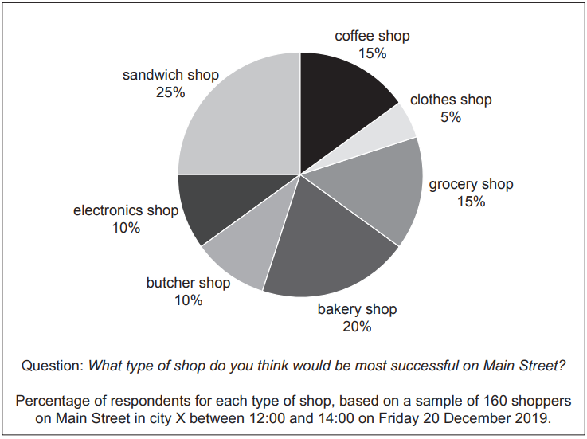
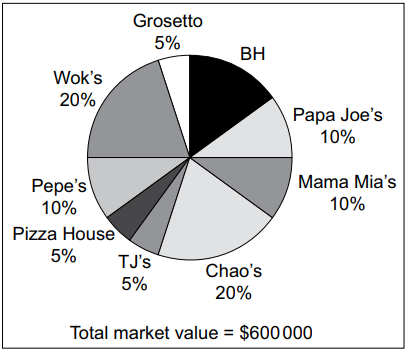

# Exam Questions — Market Research
**3. Marketing** · Cambridge (CIE) AS business (9609)
> Source: [https://www.savemyexams.com/as/business/cie/23/topic-questions/](https://www.savemyexams.com/as/business/cie/23/topic-questions/) · 10 questions across 1 sets

## Exam Questions (10 questions)

### Q1 — hard — 12 marks

**Q1** [12 marks]

> **[case-study]**
> **Fizzy Drinks (FD)**
> 
> FD is a private sector business that manufactures an international brand of carbonated drinks. Its slogan was 'A premium drink for premium customers'. The market for FD's drinks is very competitive, with 7 national and 12 international brands all competing in the same market. Recently FD lost the title of market leader to TR, one of its largest competitors. TR is a multinational public limited company.
> 
> Two years ago, FD produced primary market research on customer preferences in the carbonated drink market. The report identified that FD still had a great brand name, high brand awareness and customer loyalty.
> 
> The cost of raw materials has increased in recent years. To keep profit margins stable, FD reduced the quality of ingredients instead of raising the selling price, and reduced its marketing budget. Ted, Finance Director, used the evidence of high customer loyalty to justify the decision.
> 
> The change in ingredients led to FD's products tasting similar to their competitors. Customers left feedback highlighting a 'flavourless drink', and demand fell rapidly. FD's good brand name and customer loyalty was lost. Currently FD is operating at 60% of maximum capacity.
> 
> **Table 2.1 FD financial data 2023**
> 
> | Item | Value |
> |---|---|
> | Total fixed costs (\$m) | 15 |
> | Average variable cost per unit (\$) | 1 |
> | Average selling price per unit (\$) | 4 |
> | Maximum capacity (m) | 100 |
> 
> Employee morale has dropped as a result of the negative feedback. Key employees have left to work for FD's competitors. The lack of experienced employees has led to a drop in the productivity of the production process.

Evaluate the usefulness to FD of market research methods to inform future marketing decisions.

*Source: May/June 2024 21 Q2D*

### Q2 — easy — 5 marks

**Q2** [2 marks]

Define the term *primary research*.

*Source: May/June 2024 13 Q3A*

**Q2** [3 marks]

Explain **one** limitation to a business of using sampling.

*Source: May/June 2024 13 Q3B*

### Q3 — medium — 5 marks

**Q3** [2 marks]

Define the term ‘market research’.

*Source: November 2020 Paper 13 Q1A*

**Q3** [3 marks]

Explain **two **advantages to a business of using primary (field) market research data.

*Source: November 2020 Paper 13 Q1B*

### Q4 — medium — 9 marks

**Q4** [3 marks]

> **[case-study]**
> **The Shop (TS) **
> 
> Thomas worked for 30 years as a manager of a factory. Although he was very good at his job he was recently made redundant.
> 
> Thomas always wanted to open a shop. He thinks he has the qualities an entrepreneur is likely to need for success. He has undertaken some primary market research to identify possible opportunities in city X where he lives (see Fig. 1.1).
> 
> 
> 
> **Fig. 1.1: Market research**
> 
> Thomas now needs to make a decision about which type of shop to open. He has used the data in Fig. 1.1 and some secondary market research to identify two options.
> 
> *Option 1: Coffee shop *
> The coffee shop would provide hot drinks that customers could take away and drink elsewhere. It would also sell some bakery items, such as biscuits and doughnuts. There are four other shops selling takeaway hot drinks and bakery items in the city, as well as five cafés. Thomas thinks that the profit margin would be 6% to 8%.
> 
> *Option 2: Sandwich shop* 
> The sandwich shop would make sandwiches using job production. Customers can choose from a range of sandwich fillings, as well as cold drinks and snacks. There is only one competitor in the city. It is a well-known international franchise that spends a lot of money on promotion. Thomas thinks that the profit margin would be 10% to 15%.

Explain the term ‘primary market research’ (line 4).

*Source: June 2020 Paper 22 Q1AII*

**Q4** [6 marks]

(i) Refer to Fig. 1.1. Calculate the number of respondents who think a coffee shop would be most successful on Main Street.

[2]

(ii) Explain **two **limitations of the sampling used by Thomas.

[4]

*Source: June 2020 Paper 22 Q1BI,BII*

### Q5 — medium — 11 marks

**Q5** [3 marks]

> **[case-study]**
> **Super Candy (SC) **
> 
> SC is a large public limited company that sells low-sugar candy (sweets) with natural flavourings. The candy is made using flow production in SC’s four large factories in country T.
> 
> SC uses psychographic market segmentation when planning its marketing mix.
> 
> SC has completed some secondary market research using published accounts. The data is about one of SC’s main competitors, Organic Kandy (OK) and compares the results with data about SC (see Table 2.1). OK is in the same market as SC.
> 
> **Table 2.1: Secondary market research about OK and SC for 2020**
> 
> |   | **OK** | **SC** |
> |---|---|---|
> | Revenue | \$60m | **X** |
> | Market share by revenue | 40% | 34% |
> | Different varieties of candy | 12 | 18 |
> | Main channels of distribution | Wholesalers  Large supermarkets  Health food shops | Wholesalers  Small retailers  E-commerce |
> | Target market(s) | Mass market | People with interests in:  - Nature - Sports - Travel - Health |
> 
> There have been a number of media reports in country T about the increasing importance of corporate social responsibility (CSR). A large food manufacturing business in country T recently lost many customers due to reports about its use of plastic packaging.
> 
> The directors of SC are particularly concerned about this trend because of SC’s use of plastic in its packaging. The marketing department has been told to conduct some primary market research on this issue. The directors are planning to discuss making CSR a new business objective for SC.

Explain **one **possible disadvantage to SC of using secondary market research.

*Source: November 2021 Paper 23 Q2BII*

**Q5** [8 marks]

Analyse **two** primary market research methods that SC could use.

*Source: November 2021 Paper 23 Q2C*

### Q6 — medium — 12 marks

**Q6** [12 marks]

Discuss whether a successful soft drinks business needs to continue to carry out market research.

*Source: June 2022 Paper 13 Q7B*

### Q7 — medium — 12 marks

**Q7** [12 marks]

Discuss the usefulness to a furniture retailer of using secondary market research when planning to enter a new market.

*Source: June 2022 Paper 12 Q7B*

### Q8 — medium — 3 marks

**Q8** [3 marks]

> **[case-study]**
> **Barbecue House (BH) **
> 
> BH is a fast food restaurant and takeaway business, which sells a range of burgers, kebabs, pizzas and side orders. BH also has a delivery service to the local area.
> 
> BH is owned by Amir who mortgaged his home to finance the start-up of the business. Amir operates BH as a sole trader. His son also works within the business as a chef. Amir has been advised to change the legal structure of BH and to become a private limited company to protect the business and himself.
> 
> BH is located on a busy high street. There are many other similar businesses on the high street and in the surrounding area. Amir knows that the continued success of the business requires him to identify a gap in the market and develop a unique selling point (USP). Amir has carried out some market research (see Table 1.1 and Fig. 1.1).
> 
> **Table 1.1: Market research data about competitors within 2 km of BH**
> 
> | Total number of competitors | 8 |
> |---|---|
> | Number of competitors who offer delivery services | 4 |
> | Number of competitors who do not sell Asian food | 6 |
> 
> 
> 
> **Fig. 1.1: Market share data for competitors within 2 km of BH**
> 
> The two market leaders are Wok’s and Chao’s. Both businesses specialise in Asian food but neither has a delivery service. Amir would like to increase BH’s market share. He is considering starting to sell Asian food. None of his employees have any experience cooking or selling Asian food but Amir believes that the possible increase in income would be worth any extra costs.

Explain **one **reason why Amir carried out market research.

*Source: Specimen 2023 Paper 2 Q1BII*

### Q9 — medium — 12 marks

**Q9** [12 marks]

Discuss the usefulness of secondary market research to a business planning to launch a new luxury perfume.

*Source: June 2022 Paper 11 Q5B*

### Q10 — medium — 5 marks

**Q10** [2 marks]

Define the term ‘secondary research’.

*Source: Specimen 2023 Paper 1 Q1A*

**Q10** [3 marks]

Explain **one **advantage to a business of data collected using primary research methods.

*Source: Specimen 2023 Paper 1 Q1B*

