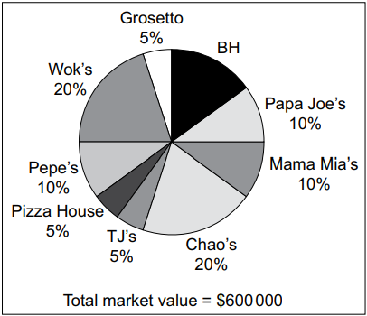

# Exam Questions — The Nature of Marketing
**3. Marketing** · Cambridge (CIE) AS business (9609)
> Source: [https://www.savemyexams.com/as/business/cie/23/topic-questions/](https://www.savemyexams.com/as/business/cie/23/topic-questions/) · 28 questions across 1 sets

## Exam Questions (28 questions)

### Q1 — hard — 3 marks

**Q1** [3 marks]

> **[case-study]**
> **Cobblestone Shoes (CS)**
> 
> Yazeem is a highly skilled shoemaker. He opened CS in 1975, as a sole trader, to design and repair shoes. When Yazeem set up CS the main target market was professional people who wanted shoes to wear to work or to dress smartly. He produced the shoes using batch production and sold them in his own shop. Each design of shoe was made in a range of sizes and colours.
> 
> Recently there has been an increase in low-priced shoes produced for the mass market, which has reduced Yazeem's sales of new shoes. It has also reduced the demand for shoe repairs.
> 
> Yazeem's daughter, Abir, is keen to take over the running of CS. She has been fully trained in making shoes and feels that it is time for Yazeem to retire.
> 
> Abir thinks that the business should be targeting niche markets. She would like to design and produce unique shoes and use price skimming to increase the profitability of the business.
> 
> Abir is also concerned about the contribution made on each batch of shoes. Table 2.1 shows some break-even data for a recent batch of shoes.
> 
> **Table 2.1 Break-even data about a recent batch of shoes**
> 
> | Item | Value |
> |---|---|
> | Break-even level of output | 400 units |
> | Margin of safety | 100 units |
> | Total variable costs | \$18 750 |
> | Total costs | \$23 750 |
> | Total revenue | \$25 000 |
> 
> Abir has suggested that CS should adopt a just in time (JIT) approach to inventory management. By using JIT, she argues, CS would be able to increase its working capital and avoid having money tied up in inventory that might not be used or sold. CS currently has a large number of shoes on display in the shop. There is also a large amount of their main raw material, which is leather and must be kept in a climate-controlled storage area.
> 
> Abir has already found a new local supplier which is happy to deliver inventory as required.

Explain the term *mass market*.

*Source: May/June 2024 22 Q2A*

### Q2 — hard — 3 marks

**Q2** [3 marks]

> **[case-study]**
> **Fizzy Drinks (FD)**
> 
> FD is a private sector business that manufactures an international brand of carbonated drinks. Its slogan was 'A premium drink for premium customers'. The market for FD's drinks is very competitive, with 7 national and 12 international brands all competing in the same market. Recently FD lost the title of market leader to TR, one of its largest competitors. TR is a multinational public limited company.
> 
> Two years ago, FD produced primary market research on customer preferences in the carbonated drink market. The report identified that FD still had a great brand name, high brand awareness and customer loyalty.
> 
> The cost of raw materials has increased in recent years. To keep profit margins stable, FD reduced the quality of ingredients instead of raising the selling price, and reduced its marketing budget. Ted, Finance Director, used the evidence of high customer loyalty to justify the decision.
> 
> The change in ingredients led to FD's products tasting similar to their competitors. Customers left feedback highlighting a 'flavourless drink', and demand fell rapidly. FD's good brand name and customer loyalty was lost. Currently FD is operating at 60% of maximum capacity.
> 
> **Table 2.1 FD financial data 2023**
> 
> | Item | Value |
> |---|---|
> | Total fixed costs (\$m) | 15 |
> | Average variable cost per unit (\$) | 1 |
> | Average selling price per unit (\$) | 4 |
> | Maximum capacity (m) | 100 |
> 
> Employee morale has dropped as a result of the negative feedback. Key employees have left to work for FD's competitors. The lack of experienced employees has led to a drop in the productivity of the production process.

Explain the term *demand*.

*Source: May/June 2024 21 Q2A*

### Q3 — easy — 5 marks

**Q3** [2 marks]

Define the term *industrial marketing*.

*Source: May/June 2024 11 Q3A*

**Q3** [3 marks]

Explain **one** implication to a business of market growth.

*Source: May/June 2024 11 Q3B*

### Q4 — medium — 6 marks

**Q4** [6 marks]

> **[case-study]**
> **Clever Televisions (CTV) **
> 
> CTV is a public limited company that produces and sells televisions. It has been operating in country A for 30 years. CTV owns 3 factories and has over 100 employees. CTV’s factories use a combination of capital and skilled labour to produce the televisions. The leadership style in all the factories is autocratic. Employees’ pay is based on time worked each week.
> 
> The CTV brand is known for high‑quality and reliability. It targets high‑income customers. CTV uses price skimming when it launches a new product.
> 
> In total, 6 million televisions were sold in country A in 2019. Table 2.1 shows market growth data.
> 
> **Table 2.1: Television sales in country A**
> 
> | **Year** | **Market growth** |
> |---|---|
> | 2020 | +2% |
> | 2021 | +1% |
> | 2022 | –3% (forecast) |
> 
> The market for televisions in country A is very competitive and the business environment is dynamic. CTV plans to introduce a lower priced television brand to appeal to the mass market. This brand will be known as STV.
> 
> CTV has decided to introduce automation into one of its factories to produce the STV televisions. This will lead to redundancies in that factory.
> 
> The employees in the other two factories are concerned they might also face redundancy and so motivation is currently low. The Human Resources Director recommends that CTV should find ways in which employees can participate in the management and control of the business.

(i) Refer to Table 2.1 and other information. Calculate the total number of televisions sold in country A in 2021.

[3]

(ii) Explain **one **implication for CTV of the forecast change in market growth for 2022.

[3]

*Source: June 2022 Paper 23 Q2BI,BII*

### Q5 — medium — 5 marks

**Q5** [2 marks]

Define the term ‘market share’.

*Source: November 2020 Paper 11 Q1A*

**Q5** [3 marks]

Explain **two **ways a retailer could increase its market share.

*Source: November 2020 Paper 11 Q1B*

### Q6 — medium — 3 marks

**Q6** [3 marks]

> **[case-study]**
> **Flight Food (FF) **
> 
> FF is a large secondary sector business that supplies airlines with in-flight meals. Meals are manufactured using batch production. A different variety of meal is made each hour with a five minute changeover time between batches. FF makes use of Just in Time (JIT) to manage inventory wherever possible. Trucks arrive each hour and deliver the materials needed for production.
> 
> The market for airline meals is very competitive. FF uses market segmentation when deciding which meals are most likely to appeal to different airlines. FF must adapt to changes in tastes and the demands of each airline.
> 
> FF is a labour intensive business. The workers are employed with short-term (six month) employment contracts. They are only offered new contracts if they meet their production targets. Table 2.1 shows some production data for FF’s two work teams.
> 
> **Table 2.1: Worker data for FF**
> 
> |   | **Team A** | **Team B** |
> |---|---|---|
> | Number of workers | 100 | 50 |
> | Productivity (per worker per day) | 300 meals | 240 meals |
> 
> The Board of Directors of FF is considering changing the manufacturing process to flow production. This would require purchasing Computer Aided Manufacturing (CAM) equipment and using a capital intensive production process. Production targets would no longer be used for employees because the machinery would be set at a specific production rate.
> 
> Sabrina, the Operations Director, has put forward the following advantages for moving to flow production:
> 
> - more products made each hour
> - lower employment costs
> - improved quality.
> 
> Ben, the Human Resource Director, is worried about the change from a labour intensive process to a capital intensive process.

Explain the term ‘market segmentation’ (line 6).

*Source: June 2020 Paper 23 Q2AII*

### Q7 — medium — 8 marks

**Q7** [8 marks]

> **[case-study]**
> **Gemini Theatre (GT) **
> 
> GT is a private limited company fully owned by the Gemini family. It owns a small theatre. This building is used to show live stage performances. Some of the performances are created by GT and some are created by visiting groups who rent the theatre. Table 2.1 shows the planned performances for January 2021.
> 
> **Table 2.1: Planned performances for January 2021**
> 
> | **Name of performance** | **Created by** | **Number of performances** | **Ticket price** | **Percentage of tickets sold** |
> |---|---|---|---|---|
> | A Summer Dream | Visiting group | 9 | \$40 | 100% |
> | Wise Owl | GT | 14 | \$15 | 60% |
> | La Poeme Ballet | GT | 5 | \$20 | 40% |
> 
> GT gains all the revenue from performances created by GT. Visiting groups must pay 50% of their total ticket revenue to GT. The theatre has a maximum of 250 tickets that can be sold for each performance.
> 
> GT uses cost-based pricing to set each ticket price for its own performances. Each performance makes a profit but the company often experiences cash flow problems.
> 
> GT needs to recruit a new Theatre Manager. The person hired will have many duties, including the responsibility for all of GT’s administration as well as some accounting. The Directors are considering two people who were both recently interviewed. Table 2.2 contains information gained from the interview process.
> 
> **Table 2.2: Information gained from the interview process**
> 
> | **Nick** | **Portia** |
> |---|---|
> | - Three years working for a similar theatre business - A Levels in Business, Art and Chinese - Very organised and efficient - No management experience - Wants to move overseas in the future | - Eight years working as a manager for a bank - No formal qualifications - Late for the interview - Good sense of humour - Looking for a long-term career |

Analyse **two **factors which might affect the demand for the performances at GT’s theatre.

*Source: November 2020 Paper 22 Q2C*

### Q8 — medium — 12 marks

**Q8** [12 marks]

Discuss the importance of market share to a business operating in a competitive market.

*Source: June 2020 Paper 13 Q7B*

### Q9 — medium — 10 marks

**Q9** [2 marks]

> **[case-study]**
> **UFilters (UF) **
> 
> UF is a public limited company selling to an industrial market. It manufactures air conditioning units. UF produces two sizes of air conditioning units, medium and large. Most of its air conditioning units are sold for use in warehouses and computer server rooms. The units are expensive compared to competitors but UF believes its units are of a higher quality. Market research suggests that there is a growing demand for small air conditioning units to be placed in offices. To produce a new size of unit would require spending \$180000 to purchase new machinery.
> 
> UF relies on customer recommendations for new orders. However, some customers have been dissatisfied with the service received. UF has received several complaints, including:
> 
> - engineers turning up late or not at all
> - poor communication from UF
> - little choice in the size of units supplied
> - appointment times are not always convenient and can be difficult to change.
> 
> Sylvie, the Marketing Director of UF, is concerned about the sales data (Table 1.1) as sales have fallen 10% on the previous year.
> 
> **Table 1.1: Selected sales data for UF, 2019**
> 
> | **Unit size** | **Price (\$)** | **Unit sales** |
> |---|---|---|
> | Medium | 900 | 3500 |
> | Large | 2000 | 800 |
> 
> Sylvie is considering two options to increase sales (see Table 1.2).
> 
> **Table 1.2: Options to increase sales**
> 
> | *Option 1 * Reduce the price of the units by 10% | - Competitors’ prices are 8% lower on average. - The estimated price elasticity of demand is –0.8. |
> |---|---|
> | *Option 2 * Implement a performance related pay scheme (PRP) | - Sales staff are currently paid a monthly salary. - To introduce a PRP scheme the monthly salary would be reduced by 10%. - Targets would be set and if sales staff met the targets then they would receive PRP increasing their monthly salary by 15%. |

Define the term ‘industrial market’ (line 1).

*Source: June 2020 Paper 21 Q1AI*

**Q9** [8 marks]

Analyse **two **ways, other than the two options in Table 1.2, UF can improve customer relations.

*Source: June 2020 Paper 21 Q1D*

### Q10 — medium — 5 marks

**Q10** [2 marks]

Define the term ‘customer (market) orientation’.

*Source: June 2020 Paper 13 Q4A*

**Q10** [3 marks]

Explain **two **limitations of niche marketing.

*Source: June 2020 Paper 13 Q4B*

### Q11 — medium — 5 marks

**Q11** [2 marks]

Define the term ‘national market’.

*Source: June 2020 Paper 12 Q4A*

**Q11** [3 marks]

Explain **two **advantages to a business of selling in international markets.

*Source: June 2020 Paper 12 Q4B*

### Q12 — medium — 20 marks

**Q12** [8 marks]

Analyse the possible benefits to a business of increasing its market share.

*Source: June 2020 Paper 11 Q5A*

**Q12** [12 marks]

Discuss whether a change in consumer income is the most important factor influencing the demand for restaurant meals.

*Source: June 2020 Paper 11 Q5B*

### Q13 — medium — 6 marks

**Q13** [3 marks]

> **[case-study]**
> **Super Candy (SC) **
> 
> SC is a large public limited company that sells low-sugar candy (sweets) with natural flavourings. The candy is made using flow production in SC’s four large factories in country T.
> 
> SC uses psychographic market segmentation when planning its marketing mix.
> 
> SC has completed some secondary market research using published accounts. The data is about one of SC’s main competitors, Organic Kandy (OK) and compares the results with data about SC (see Table 2.1). OK is in the same market as SC.
> 
> **Table 2.1: Secondary market research about OK and SC for 2020**
> 
> |   | **OK** | **SC** |
> |---|---|---|
> | Revenue | \$60m | **X** |
> | Market share by revenue | 40% | 34% |
> | Different varieties of candy | 12 | 18 |
> | Main channels of distribution | Wholesalers  Large supermarkets  Health food shops | Wholesalers  Small retailers  E-commerce |
> | Target market(s) | Mass market | People with interests in:  - Nature - Sports - Travel - Health |
> 
> There have been a number of media reports in country T about the increasing importance of corporate social responsibility (CSR). A large food manufacturing business in country T recently lost many customers due to reports about its use of plastic packaging. The directors of SC are particularly concerned about this trend because of SC’s use of plastic in its packaging. The marketing department has been told to conduct some primary market research on this issue.
> 
> The directors are planning to discuss making CSR a new business objective for SC.

Explain the term ‘psychographic market segmentation’ (line 3).

*Source: November 2021 Paper 23 Q2AII*

**Q13** [3 marks]

Refer to Table 2.1. Calculate SC’s revenue (**X**) for 2020.

*Source: November 2021 Paper 23 Q2BI*

### Q14 — medium — 6 marks

**Q14** [3 marks]

> **[case-study]**
> **Van Man (VM) **
> 
> Obi is a sole trader who operates a van service. He used to be employed by a similar business but realised that he likes to be in control. Obi used all of his savings to start his business so that he did not have to go into debt.
> 
> He owns three vans which can carry furniture, packages and other large items. He has eight full-time employees who drive the vans and move items. Customers can hire a van with two employees to move these items from one place to another. The cost per day of providing a van with two employees is \$170. The prices of the service are shown in Table 1.1.
> 
> **Table 1.1: Price of hiring one van (including two employees)**
> 
> | **Price for the first day’s hire** | **Price for each additional day** |
> |---|---|
> | \$250 | 10% discount on the price for the first day’s hire |
> 
> Demand for Obi’s service is growing fast. To supply this demand he needs a new van and he is investigating sources of finance. He has a choice of two vans. The details of the vans are in Table 1.2.
> 
> **Table 1.2: Van details**
> 
> |   | **Van A** | **Van B** |
> |---|---|---|
> | Capital cost | \$30 000 | \$40 000 |
> | Estimated maintenance costs per year | \$600 | \$450 |
> | Insurance cost per year | \$500 | \$550 |
> | Expected life | 7 years | 9 years |
> | Van owner reviews | - Easy to drive but not very fast - Boring but fuel efficient - Engine is very noisy, but reliable | - Fast and great fun to drive - Looks great and the range of colours is fantastic - It broke down a few times, but the manufacturer repaired it quickly |

Explain the difference, for a business, between price and cost.

*Source: November 2021 Paper 23 Q1AII*

**Q14** [3 marks]

Explain **one **factor which may affect the demand for Obi’s services.

*Source: November 2021 Paper 23 Q1BII*

### Q15 — medium — 3 marks

**Q15** [3 marks]

> **[case-study]**
> **Tin Mines (TM) **
> 
> TM is a private limited company in the primary sector. Tin is found underground and is extracted by mining. TM operates seven mines in country C. There are several job roles at each mine including skilled engineers, managers and miners.
> 
> TM has recently discovered a new source of tin in a remote area of country C. TM has permission to develop a tin mine but will have to construct transport links. It will need new buildings such as offices, warehouses and employee housing. The Human Resources Director is developing a workforce plan to recruit miners and managers for the new mine.
> 
> TM’s Financial Director has produced a cash flow forecast for the new mine for the next five years. This is shown in Table 2.1.
> 
> **Table 2.1: Cash flow forecast for the new mine (\$m)**
> 
> | **Year** | **2022** | **2023** | **2024** | **2025** | **2026** |
> |---|---|---|---|---|---|
> | Opening balance | **X** | -80 | -95 | -85 | 5 |
> | Sales | 0 | 0 | 25 | 105 | **Y** |
> | Development costs | 60 | 15 | 0 | 0 | 0 |
> | Operating costs | 0 | 0 | 15 | 15 | 15 |
> | Closing balance | -80 | -95 | -85 | 5 | 240 |
> 
> The remote area of country C where the new tin mine will be located has a high level of unemployment and average incomes are low. TM intends to recruit employees from the local area and buy resources from local suppliers, if they are available. The market for tin is likely to be affected by increased demand for electric vehicles. The batteries in electric vehicles contain tin. The government of country C believes that the tin mine will be of great benefit to both the local community and national economy. However, tin mining can result in pollution of local water supplies.

Explain the term ‘market’ (line 19).

*Source: November 2021 Paper 21 Q2AII*

### Q16 — medium — 12 marks

**Q16** [12 marks]

Discuss the view that the setting of effective marketing objectives is the most important factor for the successful launch of a new women’s football (soccer) team.

*Source: November 2021 Paper 12 Q5B*

### Q17 — medium — 5 marks

**Q17** [5 marks]

Explain the link between corporate objectives and marketing objectives of a business.

*Source: November 2021 Paper 11 Q3*

### Q18 — medium — 13 marks

**Q18** [2 marks]

> **[case-study]**
> **Benjamin’s Beds (BB) **
> 
> Benjamin’s Beds (BB) is a large manufacturer of beds and has a strong brand image for quality. Its main channel of distribution is through the producer market (B2B) to national hotel chains. Recently, BB has also entered the consumer market (B2C) by selling online direct to customers.
> 
> BB uses flow production. BB’s existing machinery is old and cannot satisfy the increased demand. The directors of BB have decided its existing machinery needs replacing. Table 2.1 shows data for existing and proposed new machinery.
> 
> **Table 2.1 Data for existing and proposed new machinery**
> 
> |   | Variable cost per unit  (\$) | Output per year |
> |---|---|---|
> | Existing machinery | 50 | 5000 |
> | New machinery | 40 | 7500 |
> 
> Fixed costs are \$500 000 per year. Using new machinery would reduce this by 10%.
> 
> BB sales data suggests that its market share is growing rapidly. The consumer market (B2C) is becoming more important to BB because online orders are increasing. However, online demand is for a wide range of bed styles. The consumer market requires a substantial marketing budget and some retraining of employees.
> 
> Orders from national hotel chains in the producer market (B2B) are for a more limited range of bed styles. These orders remain constant with low marketing costs. However, BB is increasingly under pressure to reduce prices to hotels.
> 
> BB uses non-financial motivators and until recently had a motivated workforce. Efficiency is falling due to employees having to work longer hours because of increased demand. This is decreasing staff morale and welfare.

Define the term ‘market share’ (line 14).

*Source: March 2022 Paper 22 Q2AI*

**Q18** [11 marks]

Recommend whether BB should focus on the producer market (B2B) or the consumer market (B2C). Justify your recommendation.

*Source: March 2022 Paper 22 Q2D*

### Q19 — medium — 5 marks

**Q19** [2 marks]

Define the term ‘customer (market) orientation’.

*Source: March 2022 Paper 12 Q4A*

**Q19** [3 marks]

Explain **two **limitations to a business of using market segmentation.

*Source: March 2022 Paper 12 Q4B*

### Q20 — medium — 2 marks

**Q20** [2 marks]

> **[case-study]**
> **Child Play (CP) **
> 
> Su is a sole trader who started a business called CP which operates a play area for children. The play area is inside a building and includes toys and other play equipment. Customers book on CP’s website for each hour that they would like to use the play area. CP is two kilometres away from the nearest city which has a large population. Su does not pay for any promotion and she relies on recommendations and reviews from previous customers.
> 
> Su currently charges a price of \$10 an hour for a group of up to 5 children. Only one group can book CP for each hour. Demand is greater than supply so Su may increase the price to \$15 per hour. She has completed some market research to see if this is a good idea. Her findings are in Table 1.1.
> 
> **Table 1.1: Market research about prices for CP**
> 
> | **Price** | **Quantity (hours) demanded per day** |
> |---|---|
> | \$10 | 10 |
> | \$15 | 6 |
> 
> Su is also thinking about expanding the business by opening a café targeted at parents with children.
> 
> The café would be located at the entrance to CP’s play area. There are many other cafés in the city centre two kilometres away. Su believes that product differentiation is essential for the profitability of the café.
> 
> Su plans to use CP’s working capital as the source of finance to open the new café. The café will need to earn revenue quickly, so she plans to open it in four weeks. She will need quick and low‑cost promotion methods if the café is to succeed.

Define the term ‘supply’ (line 7).

*Source: June 2022 Paper 23 Q1AI*

### Q21 — medium — 11 marks

**Q21** [11 marks]

> **[case-study]**
> **Farm Produce (FP) **
> 
> FP is a primary sector co-operative made up of six farms in country G. Each farm grows a range of fruit and vegetables. FP employs 26 workers across the farms and distribution centre. Each farm transports its fruit and vegetables to the distribution centre where they are packaged and sent to customers’ homes. Table 1.1 contains data about the farming industry in country G.
> 
> **Table 1.1: Data about the farming industry in country G**
> 
> | - Farms producing fruit and vegetables are given an annual government grant. - Most farms are labour intensive. - The government promotes the importance of eating fresh fruit and vegetables. - Most farms are small family businesses. - Minimum wage for farm workers will increase by 10% next year. |
> |---|
> 
> FP’s customers pay for a box of seasonal fruit and vegetables that is delivered each week. Data about the different box sizes sold by FP is shown in Table 1.2.
> 
> **Table 1.2: FP’s cost and price data**
> 
> | **Box size** | **Variable cost per box ** **(\$)** | **Allocated monthly fixed costs ** **(\$)** | **Price per box ** **(\$)** | **Sales in April 2022** |
> |---|---|---|---|---|
> | Small | 8 | 2000 | 10 | 400 |
> | Medium | 10 | 2000 | 20 | 300 |
> | Large | 15 | 2000 | 35 | 150 |
> 
> FP is concerned about the profitability of the small box size. It believes it should stop selling this product.

Evaluate the most important factor affecting the supply of FP’s boxes of fruit and vegetables to customers.

*Source: June 2022 Paper 22 Q1D*

### Q22 — medium — 2 marks

**Q22** [2 marks]

> **[case-study]**
> **Priya’s Bookshop (PB) **
> 
> Priya lives in town R which is situated in beautiful countryside with nice walks nearby. Many tourists visit town R.
> 
> The town’s council would like town R to become branded as a ‘booktown’, a town with many bookshops selling new and used books. The council announced a new financial scheme offering grants to attract entrepreneurs willing to open a bookshop.
> 
> Priya applied for a grant to start up Priya’s Bookshop (PB). Part of her grant application included a cash flow forecast, shown in Table 1.1.
> 
> **Table 1.1: Cash flow forecast, first three months of trading (\$000)**
> 
> |   | Month 1 | Month 2 | Month 3 |
> |---|---|---|---|
> | Cash in: |   |   |   |
> | Owner’s capital | 15 | 0 | 0 |
> | Grant | 20 | 0 | 0 |
> | Revenue | 4 | 6 | 11 |
> | Cash out: |   |   |   |
> | Initial set up costs | 20 | 0 | 0 |
> | Utilities (power, water etc) | 0 | 0 | 2 |
> | Employee costs | 1 | 1 | 3 |
> | Purchases | 6 | 3 | 4 |
> | Marketing | 10 | 5 | 4 |
> | Opening balance | 0 | 2 | -1 |
> | Closing balance | 2 | -1 | **X** |
> 
> Priya’s grant application was successful and she opened PB well aware of the need for both cash and profit.
> 
> Priya now wants to raise awareness of PB in town R. Priya did some market research and decided to use market segmentation. This will help her to decide on the promotional methods she could use for her bookshop. See Table 1.2.
> 
> **Table 1.2: Age and gender of residents in town R**
> 
> | Age group (years) | Percentage of residents in age group | Percentage of age group who are female |
> |---|---|---|
> | 0-15 | 19% | 50% |
> | 16-64 | 63% | 55% |
> | 65+ | 18% | 60% |

Define the term ‘market segmentation’ (line 25).

*Source: June 2022 Paper 21 Q1AI*

### Q23 — medium — 1 marks

**Q23** [1 mark]

Analyse the benefits to a business of niche marketing.

### Q24 — medium — 8 marks

**Q24** [8 marks]

Analyse the benefits to a business of focusing on the 4Cs when planning to increase its market share.

*Source: June 2022 Paper 11 Q5A*

### Q25 — medium — 6 marks

**Q25** [6 marks]

> **[case-study]**
> **Great Resources (GR) **
> 
> GR is a business partnership that creates educational resources. It sells direct to schools and teachers via its own website.
> 
> Sanjay, Rukmal and Boris are entrepreneurial teachers who formed the GR partnership. One year ago, they identified a gap in the market to supply interactive, digital resources. GR’s website is subscription only. An online marketing campaign, which used penetration pricing, attracted 250 subscribers in the first six months of operation. The start-up costs were financed with a \$5000 bank overdraft, which is GR’s only debt.
> 
> Reviews for GR’s products in teaching journals are positive but cash flow is poor. Many customers have taken advantage of a recent sales promotion for one month’s free membership and posted positive reviews. Unfortunately, few have then taken out a regular subscription.
> 
> As revenue has not increased as much as the entrepreneurs had hoped, they must now consider alternative promotion methods. They have researched possible promotion methods and decided to advertise in an educational newspaper. The newspaper has a readership of half a million people.
> 
> Expert Materials (EM) is a large national company that also advertises in the newspaper. EM is GR’s closest competitor. The EM brand is well-known and trusted in the educational resources market. Table 1.1 shows some marketing data.
> 
> **Table 1.1 Marketing data**
> 
> |   | GR | EM | Total market |
> |---|---|---|---|
> | Revenue (\$000) | 15 | 300 | 500 |
> | Number of customers | 300 | 5000 | 7000 |
> | Annual advertising spend (\$000) | 7.5 | 45 | 60 |

(i) Refer to Table 1.1. Calculate GR’s market share by revenue.

[3]

(ii) Explain **one **factor which may influence the supply of GR’s products.

[3]

*Source: June 2023 Paper 21 Q1BI,BII*

### Q26 — medium — 3 marks

**Q26** [3 marks]

> **[case-study]**
> **Barbecue House (BH) **
> 
> BH is a fast food restaurant and takeaway business, which sells a range of burgers, kebabs, pizzas and side orders. BH also has a delivery service to the local area.
> 
> BH is owned by Amir who mortgaged his home to finance the start-up of the business. Amir operates BH as a sole trader. His son also works within the business as a chef. Amir has been advised to change the legal structure of BH and to become a private limited company to protect the business and himself.
> 
> BH is located on a busy high street. There are many other similar businesses on the high street and in the surrounding area. Amir knows that the continued success of the business requires him to identify a gap in the market and develop a unique selling point (USP). Amir has carried out some market research (see Table 1.1 and Fig. 1.1).
> 
> **Table 1.1: Market research data about competitors within 2 km of BH**
> 
> | Total number of competitors | 8 |
> |---|---|
> | Number of competitors who offer delivery services | 4 |
> | Number of competitors who do not sell Asian food | 6 |
> 
> 
> 
> **Fig. 1.1: Market share data for competitors within 2 km of BH**
> 
> The two market leaders are Wok’s and Chao’s. Both businesses specialise in Asian food but neither has a delivery service. Amir would like to increase BH’s market share. He is considering starting to sell Asian food. None of his employees have any experience cooking or selling Asian food but Amir believes that the possible increase in income would be worth any extra costs.

Refer to Fig. 1.1. Calculate the value in dollars (\$) of BH’s share of the market.

*Source: Specimen 2023 Paper 2 Q1BI*

### Q27 — medium — 2 marks

**Q27** [2 marks]

> **[case-study]**
> **George’s Gym (GG) **
> 
> George identified a potential niche market for a new gym in his local area. He set up GG as a sole trader business three years ago. GG is a modern gym with the latest equipment.
> 
> George has recently gained planning permission to build a new swimming pool. George wants to open the swimming pool because a national competitor is planning to open a new gym close by and he wants GG to remain competitive. The swimming pool will cost \$400 000 and George has yet to decide on the best source of fi nance. He has \$50 000 in savings that he could use and he does not have any mortgage or loans. George is thinking about seeking a private investor but is unsure of the risks involved.
> 
> The local population is wealthy. Last year (2012), GG had 300 members who each paid a membership fee of \$60 per month. George is thinking about new ways of increasing revenue such as offering additional ‘keep fit’ classes. He also plans to increase the monthly fee he charges members to \$66. His accountant has told him he needs to think about the price elasticity of demand before making a pricing decision.
> 
> **Table 3 – Annual revenue and profit for the year for the previous 3 years (\$000)**
> 
> |   | 2010 | 2011 | 2012 |
> |---|---|---|---|
> | Annual revenue | 120 | 160 | X |
> | Profit for the year | 20 | 50 | 80 |
> 
> George hopes that the information in Table 3 will help show any potential lender how attractive the gym is as an investment.
> 
> GG has a problem of a high labour turnover of personal trainers. Three of them have left in the last six months. He has just employed a new personal trainer, Sally. George needs to issue her contract of employment. George thinks that the reasons for the high labour turnover include:
> 
> - George is always busy and so he can never offer an effective induction training programme for his employees
> - GG salaries are below average for the industry.

Define the term ‘niche market’ (line 1).

*Source: Specimen 2016 Paper 2 Q2AI*

### Q28 — medium — 3 marks

**Q28** [3 marks]

> **[case-study]**
> **Charlie’s Chocolates (CC) **
> 
> CC is a large public limited company that manufactures a wide range of chocolate bars. Production takes place in low wage countries so that costs can be kept low. CC has suffered recently from poor publicity due to the high levels of sugar used in the production of its chocolate. A national newspaper has recently published an article about how CC exploits employees in low wage countries. The Marketing Director, Alan, is aware of recent trends showing that consumers are becoming more ethical in their buying decisions. He thinks this might explain why sales decreased by 10% last year.
> 
> He has asked to meet with the Managing Director, Ikram, to discuss a major change towards more ethical production methods. This could mean re-locating production back to the home country. This will increase costs and involve the recruitment of additional employees. In response to recent Government guidelines to improve health, Alan wants to decrease the amount of sugar used in the chocolate bars.
> 
> Alan is also thinking about the financial accounts for this year that he received this morning from Ikram (see Table 1 and Table 2).
> 
> **Table 1 – Extract from Income Statement**
> 
> |   | \$000s |
> |---|---|
> | Revenue | 7000 |
> | Cost of sales | 4150 |
> | Gross profit | 2850 |
> | Profit for the year | 1350 |
> | Retained earnings | 565 |
> 
> **Table 2 – Extract from Statement of Financial Position**
> 
> |   | \$000s |
> |---|---|
> | Non-current assets | 3000 |
> | Current assets | 900 |
> | Current liabilities | 400 |
> | Working capital | 500 |
> | Net assets | 3500 |
> 
> With sales declining from last year, Alan has to think carefully about the next steps for marketing. He knows that the product range is of good quality – the problem is the poor image of the company. For example, he is aware that a local consumer group is trying to organise a demonstration outside one of CC’s factories in the next few weeks.

Briefly explain the term ‘marketing’ (line 26).

*Source: Specimen 2016 Paper 2 Q1AII*

