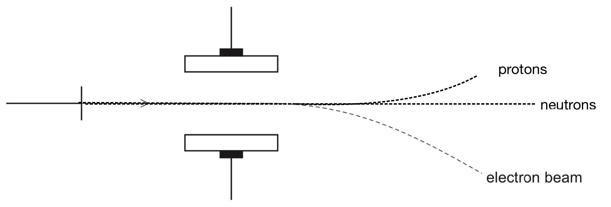

# Exam Questions — Particles in the Atom & Atomic Radius
**1. Atomic Structure** · Cambridge (CIE) AS chemistry (9701)
> Source: [https://www.savemyexams.com/as/chemistry/cie/25/topic-questions/](https://www.savemyexams.com/as/chemistry/cie/25/topic-questions/) · 22 questions across 2 sets

## Multiple Choice Questions (16 questions)

### Q1 — medium — 1 marks

**Q1** [1 mark]

The table below shows the number of protons, neutrons, and electrons in four different particles.

Which row represents the 31P3− ion?

| particle | protons | neutrons | electrons |
|---|---|---|---|
| **A** | 15 | 16 | 15 |
| **B** | 15 | 16 | 18 |
| **C** | 16 | 16 | 18 |
| **D** | 16 | 17 | 16 |

### Q2 — medium — 1 marks

**Q2** [1 mark]

Which row gives the correct number of subatomic particles in 26Mg2+?

| **             ** | **     protons        ** | **     neutrons      ** | **     electrons       ** |
|---|---|---|---|
| **A** | 10 | 14 | 12 |
| **B** | 12 | 14 | 10 |
| **C** | 12 | 26 | 10 |
| **D** | 14 | 12 | 12 |

### Q3 — easy — 1 marks

**Q3** [1 mark]

The reaction shown occurs in gas clouds throughout the Universe.

H2 (g) + H2+ (g) → H (g) + H3+ (g)

Which row gives the atomic structure of the H3+ ion?

|   | **protons** | **neutrons** | **electrons** |
|---|---|---|---|
| **A** | 3 | 0 | 1 |
| **B** | 3 | 0 | 2 |
| **C** | 2 | 1 | 1 |
| **D** | 2 | 1 | 2 |

### Q4 — hard — 1 marks

**Q4** [1 mark]

The species Cl−, K+ and Ar are isoelectronic. This means that they have the same number of electrons.

Which row gives the correct order of ionic radii from largest to smallest?

|   | **1st** | **2nd** | **3rd** |
|---|---|---|---|
| **A** | K+ | Cl− | Ar |
| **B** | Cl− | Ar | K+ |
| **C** | K+ | Ar | Cl− |
| **D** | Ar | K+ | Cl− |

### Q5 — hard — 1 marks

**Q5** [1 mark]

The trajectories of subatomic particles shot through an electric field produced in a vacuum are shown in the diagram.

Which statement is **not** correct?

### Q6 — medium — 1 marks

**Q6** [1 mark]

Which statement about atomic radius in Group I elements Na to Rb is **not** correct?

### Q7 — medium — 1 marks

**Q7** [1 mark]

Which row gives the correct number of protons, neutrons and electrons in the $\mathrm{P} pre_{15} pre^{31^{3} -}$ ion?

|   | **Protons** | **Neutrons** | **Electrons** |
|---|---|---|---|
| **A** | 15 | 16 | 18 |
| **B** | 16 | 15 | 16 |
| **C** | 16 | 15 | 18 |
| **D** | 15 | 15 | 15 |

### Q8 — easy — 1 marks

**Q8** [1 mark]

**X** is a particle with 19 electrons and 20 neutrons.

Which species is **X**?

### Q9 — hard — 1 marks

**Q9** [1 mark]

Which statement about the trend in atomic radius across Period 3 is **not** correct?

### Q10 — hard — 1 marks

**Q10** [1 mark]

What is the total number of protons and electrons in 2 moles of lithium ions, Li+?

### Q11 — easy — 1 marks

**Q11** [1 mark]

Which row gives the correct description of atomic number, proton number and mass number?

|   | **the atomic number is the number of** | **the proton number is the number of** | **the mass number is the number of** |
|---|---|---|---|
| **A** | atoms | protons | protons |
| **B** | electrons | neutrons | nucleons |
| **C** | electrons | neutrons | protons |
| **D** | protons | protons | nucleons |

### Q12 — easy — 1 marks

**Q12** [1 mark]

Which row gives the characteristics of the nucleus and surrounding space?

|   | **Nucleus** | **Surrounding space** |
|---|---|---|
| **A** | Small, dense and neutral | Mainly empty space |
| **B** | Large, dense and positive | Densely populated with electrons |
| **C** | Large, dense and neutral | Densely populated with electrons |
| **D** | Small, dense and positive | Mainly empty space |

### Q13 — easy — 1 marks

**Q13** [1 mark]

The phosphide ion, $P pre_{15} pre^{32^{3} - sign}$, is used in medicine as a radioactive treatment for some forms of cancer.

Which row gives the composition of the phosphide ion?

|   | **protons** | **neutrons** | **electrons** |
|---|---|---|---|
| **A** | 15 | 17 | 32 |
| **B** | 15 | 17 | 18 |
| **C** | 17 | 15 | 15 |
| **D** | 17 | 15 | 32 |

### Q14 — medium — 1 marks

**Q14** [1 mark]

Which statement explains why atoms are neutral?

### Q15 — easy — 1 marks

**Q15** [1 mark]

Which row gives the relative charges and masses of the subatomic particles?

|   | **proton** | **neutron** | **electron** | **the relative mass of an electron** |
|---|---|---|---|---|
| **A** | +1 | 0 | −1 | 1 |
| **B** | 0 | +1 | +1 | $\frac{1}{1836}$ |
| **C** | +1 | 0 | −1 | $\frac{1}{1836}$ |
| **D** | 0 | +1 | −1 | 1 |

### Q16 — medium — 1 marks

**Q16** [1 mark]

Which species contains different numbers of protons, neutrons and electrons?

## Structured Questions (6 questions)

### Q1 — medium — 7 marks

**Q1** [2 marks]

Complete Table 3.1 to show the composition of the given species.

**Table 3.1**

| **atomic number** | **nucleon number** | **number of electrons** | **number of protons** | **number of neutrons** | **species** |
|---|---|---|---|---|---|
| 15 | 31 | 18 |   |   |   |
|   |   | 18 | 17 | 19 |   |

**Q1** [3 marks]

Beams of protons, neutrons and electrons behave differently in an electric field.

Fig. 3.1 shows the path of a beam of protons in an electric field.

On Fig. 3.1, draw and label the paths of a beam of electrons and a beam of neutrons.

**Fig. 3.1**

**Q1** [2 marks]

Chlorine and sulfur are elements in Period 3.

Explain why the atomic radius of a chlorine atom is smaller than that of a sulfur atom.

### Q2 — easy — 11 marks

**Q2** [4 marks]

Complete Table 1.1 to show the relative charge and relative mass of the subatomic particles.

**Table 1.1**

| **Subatomic particle** | **Relative charge** | **Relative mass** |
|---|---|---|
| Proton |   | 1 |
| Neutron |   |   |
| Electron |   | $\frac{1}{1836}$ |

**Q2** [3 marks]

Complete Table 1.2 to show the number of protons, neutrons and electrons in each of the given species.

**Table 1.2**

| **Species** | **Number of protons** | **Number of neutrons** | **Number of electrons** |
|---|---|---|---|
| 31P |   |   |   |
| 24Na+ |   |   |   |
| 37Cl– |   |   |   |

**Q2** [2 marks]

Explain why isotopes of the same element have different physical properties.

**Q2** [2 marks]

Explain why the chemical properties of 35Cl and 37Cl are identical.

### Q3 — easy — 5 marks

**Q3** [1 mark]

Fig. 5.1 shows how protons, neutrons and electrons behave differently when they move at the same velocity in an electric field.

Label the positive and negative plates in Fig. 5.1.

**Fig. 5.1**

**Q3** [3 marks]

Complete Table 5.1 to show the number of protons, neutrons and electrons in each of the given species.

**Table 5.1**

| **Species** | **number of protons** | **number of neutrons** | **number of electrons** |
|---|---|---|---|
| 23Na |   |   |   |
| 32S2– |   |   |   |
| 86Sr2+ |   |   |   |

**Q3** [1 mark]

State the full electronic configuration of the 32S2– ion.

### Q4 — hard — 10 marks

**Q4** [6 marks]

Table 4.1 below shows the atomic radii for the elements of Period 2, Li to F.

**Table 4.1**

| **Element** | **Li** | **Be** | **B** | **C** | **N** | **O** | **F** |
|---|---|---|---|---|---|---|---|
| **Atomic radius / pm** | 152 | 112 | 88 | 77 | 70 | 66 | 64 |

i) State and explain the trend in atomic radius across Period 2.

[3]

ii) Suggest why the atomic radius of neon cannot be determined in the same way as the other Period 2 elements.

[2]

**Q4** [1 mark]

Complete Fig. 4.1 to show the full electronic configuration of a boron atom in the ground state.

**Fig. 4.1**

**Q4** [2 marks]

Explain why the first ionisation energy of boron is lower than the first ionisation energy of beryllium.

**Q4** [1 mark]

The successive ionisation energies for another element, **J**, are shown in Table 4.2.

**Table 4.2**

| **Energy number** | 1st | 2nd | 3rd | 4th | 5th |
|---|---|---|---|---|---|
| **Ionisation energy / kJ mol****-1** | 738 | 1450 | 7733 | 10543 | 13630 |

Deduce the formula of the compound formed when element **J** reacts with chlorine.

### Q5 — medium — 7 marks

**Q5** [3 marks]

Complete Table 1.1 to show the relative charge and relative mass of the subatomic particles.

**Table 1.1**

| **Particle** | **Relative charge** | **Relative mass** |
|---|---|---|
| Proton |   |   |
| Neutron |   |   |
| Electron |   |   |

**Q5** [2 marks]

State the block in the Periodic Table in which silicon is placed. Explain your answer.

**Q5** [2 marks]

A mass spectrometer can be used to determine the isotopic abundances of an element. The mass spectrum of a sample of silicon shows that it contains three isotopes, 28Si, 29Si and 30Si.

i) Define the term *isotope*.

[1]

ii) The isotopic abundances of the sample are shown in Table 1.2.

**Table 1.2**

| **Isotope** | **Percentage abundance / %** |
|---|---|
| 28Si | 92.23 |
| 29Si | 4.68 |
| 30Si | 3.09 |

Calculate the relative atomic mass, *A*r, of this sample of silicon. Give your answer to two decimal places.

*A*r = ......

[1]

### Q6 — medium — 8 marks

**Q6** [2 marks]

Using your Periodic Table, complete Table 1.1

**Table 1.1**

| **Symbol** | **Protons** | **Neutrons** | **Electrons** |
|---|---|---|---|
| 23Na |   |   |   |
| 32S2- |   |   |   |
| 86Sr2+ |   |   |   |

**Q6** [3 marks]

Sodium is an element in Period 3. State and explain the trend in atomic radius across Period 3.

**Q6** [3 marks]

Chlorine is an element in Period 3 which has an atomic radius of 0.099 nm. The chloride ion has an ionic radius of 0.181 nm.

Explain the difference between the two radii.
