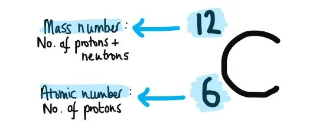

# Mark Schemes — Isotopes
**1. Atomic Structure** · Cambridge (CIE) AS chemistry (9701)

## Multiple Choice Questions (10 questions)

### Q1
**Final answer:** **The correct answer is B**

- Relative atomic mass, *A*r, is the weighted average mass of atoms of an element on a scale where one atom of carbon-12 has a mass of exactly 12 units.
- The definition requires both a weighted average (accounting for isotopic abundances) and the carbon-12 reference standard.

**A** is incorrect as it uses hydrogen-1 as the reference standard. The modern standard is carbon-12.

**C** is incorrect as it describes a comparison involving the mass of one mole, which is the definition of relative molar mass, *M*r, not relative atomic mass, *A*r.

**D** is incorrect as it describes a simple mean of isotope masses without weighting by relative abundance. *A*r requires a weighted average.

### Q2
**Final answer:** **The correct answer is C**

- The proton number of phosphorus is 15 (from the Data Booklet), not 16.
- An atom of 31P contains 15 protons and 31 − 15 = 16 neutrons.
- Option **C** confuses the number of neutrons with the proton number.

**A** is not the answer as 14C has 14 − 6 = 8 neutrons and 12C has 12 − 6 = 6 neutrons, a difference of 2. Statement **A** is correct.

**B** is not the answer as the proton number of silicon is 14, so 30Si does contain 14 protons. Statement **B** is correct.

**D** is not the answer as 26Mg has 26 − 12 = 14 neutrons. Statement **D** is correct.

### Q3
**Final answer:** **The correct answer is A**

- Isotopes of the same element contain the same number of protons (proton number) but a different number of neutrons.
- The nucleon number therefore differs between isotopes, but the proton number remains the same.

**B** is incorrect as having the same number of protons and the same number of neutrons describes two identical atoms, not isotopes.

**C** is incorrect as a different number of protons defines a different element, not an isotope of the same element.

**D** is incorrect as a different number of protons again defines a different element, not an isotope.

### Q4
**Final answer:** **The correct answer is A**

- From the Data Booklet, the proton number of manganese is 25.
- Number of neutrons in 53Mn = 53 − 25 = 28.
- Isotope **X** has 23 protons and 28 neutrons, so its nucleon number = 23 + 28 = 51.
- The element with proton number 23 is vanadium (V).

**B** is incorrect as it uses 28 (the number of neutrons) as the proton number, identifying nickel (Z = 28) rather than vanadium (Z = 23).

**C** is incorrect as it uses 28 (the number of neutrons) as the nucleon number, rather than 51.

**D** is incorrect as it inverts the proton number and nucleon number, placing 23 as the nucleon number and identifying antimony (Z = 51) rather than vanadium.

### Q5
**Final answer:** **The correct answer is C**

- By definition, isotopes of the same element have different numbers of neutrons.
- 60Co contains 60 − 27 = 33 neutrons.
- Other isotopes of cobalt have a different number of neutrons.

**A** is not the answer as the proton number of cobalt is 27 (from the Data Booklet), so the nucleus contains 27 protons, giving it a charge of +27. Statement **A** is correct.

**B** is not the answer as nucleon number (60) − proton number (27) = 33 neutrons. Statement **B** is correct.

**D** is not the answer as isotopes of the same element have the same proton number and hence the same number of electrons, giving identical chemical properties. Statement **D** is correct.

### Q6
**Final answer:** **The correct answer is B**

- Chemical properties are determined by the arrangement of electrons (electronic configuration).
- Isotopes of the same element have the same proton number and therefore the same number of electrons, giving an identical electronic configuration.

**A** is incorrect as, while isotopes do contain the same number of protons, it is the resulting electronic configuration (not the protons themselves) that directly determines chemical properties.

**C** is incorrect as different nucleon numbers are a consequence of different numbers of neutrons, which affects physical properties (such as density and boiling point) but not chemical properties.

**D** is incorrect as neutrons do not participate in chemical bonding. Different numbers of neutrons affect physical properties only.

### Q7
**Final answer:** **The correct answer is A**

- The relative atomic mass is the weighted average of all isotope masses, taking their abundances into account.
- The most abundant isotope at m/e = 71 anchors the average close to 71.
- The peak at m/e = 70 is taller than the peak at m/e = 72, so the weighted average is pulled below 71.0, giving a value between 70.0 and 71.0.

**B** is incorrect as the relative atomic mass would only be exactly 71.0 if the peaks at m/e = 70 and m/e = 72 were of equal height. Since the m/e = 70 peak is taller, the average is pulled below 71.0.

**C** is incorrect as 71 is the nucleon number of that isotope (protons + neutrons), not the number of neutrons alone. The number of neutrons would be 71 minus the proton number of X.

**D** is incorrect as 70 is the nucleon number of that isotope, not the proton number. The proton number of X cannot be determined from the m/e values alone.

### Q8
**Final answer:** **The correct answer is B**

- The proton number of bromine is 35 (from the Data Booklet).
- For an atom to be an isotope of bromine, the difference between its nucleon number and number of neutrons must equal 35.
- **A**:

72 − 37 = 35

- **B**:

73 − 39 = 34 (selenium)

- **C**:

76 − 41 = 35

- **D**:

78 − 43 = 35

**A** is not the answer as 72 − 37 = 35, matching the proton number of bromine. Row **A** does represent an isotope of bromine.

**C** is not the answer as 76 − 41 = 35. Row **C** does represent an isotope of bromine.

**D** is not the answer as 78 − 43 = 35. Row **D** does represent an isotope of bromine.

### Q9
**Final answer:** **The correct answer is C**

- Isotopes of the same element have a different number of neutrons, which changes the nucleon number (protons + neutrons).
- The proton number, electronic configuration, and chemical properties are all identical for isotopes of the same element.

**A** is incorrect as isotopes of the same element have the same number of electrons and therefore the same electronic configuration, giving identical chemical properties.

**B** is incorrect as isotopes have the same proton number, which means they have the same number of electrons and an identical electronic configuration.

**D** is incorrect as the proton number defines the element and is the same for all isotopes of that element.

### Q10
**Final answer:** **The correct answer is C**

- Both species in option C are atoms of lead, with proton number 82. They differ only in their nucleon number (206 and 208), due to a different number of neutrons.
- 206Pb has 206 − 82 = 124 neutrons; 208Pb has 208 − 82 = 126 neutrons. 206Pb has two fewer neutrons than 208Pb.

**A** is incorrect as I2 (diiodine) and I3- (triiodide ion) are different chemical species, not atoms of the same element.

**B** is incorrect as 130Ba (proton number 56) and 130Cs (proton number 55) have the same nucleon number but different proton numbers. These are not isotopes.

**D** is incorrect as 14C (proton number 6) and 14N (proton number 7) have the same nucleon number but different proton numbers. These are also not isotopes.

## Structured Questions (3 questions)

### Q1
> **[mark-scheme]**
> Isotopes are atoms of the same element that have:
> 
> - The same proton number / atomic number / number of protons **[1 mark]**
> - A different mass number / nucleon number / number of neutrons **[1 mark]**

> **[exam-tip]**
> This is a definition you must know for the exam. Both parts are needed for full marks: same proton number **AND **different mass number (or number of neutrons). Giving only one part scores 1 mark at most.
The completed table is:

| **Isotope** | **number of protons** | **number of neutrons** | **number of electrons** |
|---|---|---|---|
| 213Po | **Final answer:** **84** | **Final answer:** **129** | **Final answer:** **84** |
| 232Th | **Final answer:** **90** | **Final answer:** **142** | **Final answer:** **90** |

**[2 marks]**

> **[mark-scheme]**
> 1 mark for correct protons and electrons for both isotopes
> 
> 1 mark for correct neutrons for both isotopes

> **[exam-tip]**
> The proton number is given in the question for both elements: 84 for polonium, 90 for thorium. In a neutral atom, the number of electrons equals the number of protons.
> 
> The number of neutrons = mass number − proton number.
> 
> For 213Po:
> 
> neutrons = 213 − 84 = 129
> 
> For 232Th:
> 
> neutrons = 232 − 90 = 142
> **[mark-scheme]**
> The isotopes of polonium have the same chemical properties because:
> 
> - They have the same number of electrons / the same electronic configuration **[1 mark]**
> 
> Their boiling points differ slightly because:
> 
> - They have different numbers of neutrons / different mass numbers / different masses **[1 mark]**

> **[exam-tip]**
> Chemical properties are determined by the arrangement of electrons. All isotopes of the same element have the same proton number and therefore the same number of electrons and electronic configuration, so they react identically.
> 
> Physical properties such as boiling point depend on the mass of the atom. Since isotopes have different numbers of neutrons, they have different masses and slightly different physical properties.

### Q2
> **[mark-scheme]**
> Isotopes are atoms of the same element that have:
> 
> - The same proton number / atomic number / number of protons **[1 mark]**
> - A different mass number / nucleon number / number of neutrons **[1 mark]**

> **[exam-tip]**
> This is a definition you must know for the exam. Both parts are needed for full marks: same proton number AND different mass number (or number of neutrons). Giving only one part scores 1 mark at most.
> **[mark-scheme]**
> These two isotopes of antimony have identical chemical properties because:
> 
> - They have the same number of electrons / the same electronic configuration **[1 mark]**

> **[exam-tip]**
> Chemical properties are determined by the arrangement of electrons. Both isotopes have atomic number 51 (shown in the symbols), so they both have 51 electrons and the same electronic configuration, giving identical chemical behaviour.
> **[mark-scheme]**
> The number of electrons present in one Sb2+ ion is:
> 
> - 49 **[1 mark]**

> **[exam-tip]**
> The proton number of antimony is 51 (shown in the isotope symbols in part (a)), so a neutral Sb atom has 51 electrons. To form a 2+ ion, antimony loses 2 electrons: 51 − 2 = 49 electrons.

### Q3
To calculate the mass of one atom of carbon-12 (12C):

- Identify the subatomic particles in 12C:

6 protons, 6 neutrons and 6 electrons **[1 mark]**

- Calculate the total mass:

mass = (6 x 1.673 × 10−27) + (6 x 1.675 × 10−27) + (6 x 9.000 × 10−31)

mass = **2.009 × 10****−26**** kg ****[1 mark]**

> **[mark-scheme]**
> 1 mark for identifying 6 protons, 6 neutrons and 6 electrons in 12C
> 
> 1 mark for correct total mass: 2.009 × 10−26 kg
> 
> Allow 2.010 × 10−26 kg if intermediate values are rounded to 4 s.f.
> 
> 2.009 × 10−23 kg is not accepted; an answer in grams must be converted to kg.

> **[exam-tip]**
> In a neutral atom, the number of electrons equals the number of protons. The carbon-12 isotope has proton number 6, so it contains 6 protons, 6 electrons, and 12 − 6 = 6 neutrons.
> 
> Give your final answer to 4 significant figures, matching the least precise value in the data table.
> **[mark-scheme]**
> One similarity in the properties of the isotopes of carbon:
> 
> - (The carbon isotopes have) the same chemical properties
> **AND**
> The same electronic configuration / the same number of electrons **[1 mark]**
> 
> One difference in the properties of the isotopes of carbon:
> 
> - (The carbon isotopes have) different physical properties
> **AND**
> A different number of neutrons / different mass numbers **[1 mark]**

> **[exam-tip]**
> Chemical properties depend on the arrangement of electrons. All three isotopes of carbon have proton number 6 and therefore the same number of electrons and electronic configuration, so they react identically.
> 
> Physical properties such as density and boiling point depend on mass. 12C has 6 neutrons, 13C has 7 neutrons and 14C has 8 neutrons, so each has a slightly different mass and therefore slightly different physical properties.
i) The percentage abundance of 49E is:

100 − (8.02 + 7.31 + 73.81 + 5.32)

100 − 94.46

**5.54% ****[1 mark]**

> **[mark-scheme]**
> i)
> 
> 1 mark for the correct percentage abundance of 49E: 5.54%

ii) To calculate the *A*r of element E:

- State the formula:

*A*r = `\frac{\sum(\text{relative isotopic mass} \times \% \text{ abundance})}{100}`

- Substitute values:

*A*r = $\frac{(8.02\times46)+(7.31\times47)+(73.81\times48)+(5.54\times49)+(5.32\times50)}{100}$ **[1 mark]**

*A*r = **47.9 ****[1 mark]**

> **[mark-scheme]**
> ii)
> 
> 1 mark for correct substitution using the value from part (i)
> 
> 1 mark for *A*r = 47.9 (to 1 d.p.)
> 
> Allow error carried forward from part (i) if the method is correct.
> 
> (0.0802 x 46) + (0.0731 x 47) + (0.7381 x 48) + (0.0554 x 49) + (0.0532 x 50) is also accepted
> 
> iii) Element **E** is:
> 
> - Titanium / Ti **[1 mark]**

> **[exam-tip]**
> For part (i), the percentage abundances of all five isotopes must sum to 100%:
> 
> - percentage abundance of 49E = 100 − (8.02 + 7.31 + 73.81 + 5.32) = 5.54%
> 
> For part (ii), you can use fractional abundances instead. Divide each percentage by 100 and sum (relative isotopic mass x fractional abundance) without dividing by 100 at the end. Both methods give the same answer.
> 
> For part (iii), find the element with *A*r closest to 47.9 on the Periodic Table. This is titanium (Ti, proton number 22).
