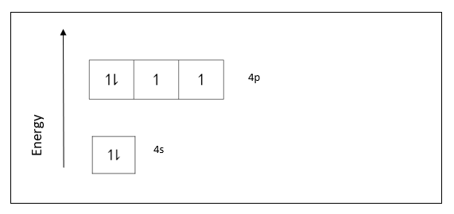
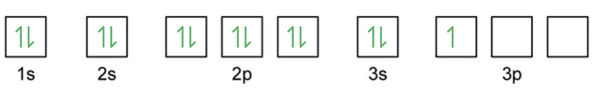
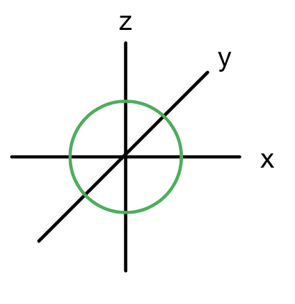
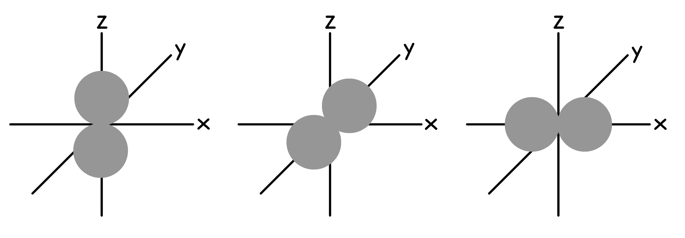
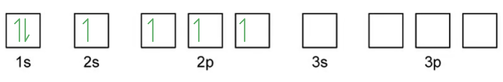
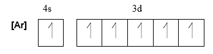

# Mark Schemes — Electrons, Energy Levels & Atomic Orbitals
**1. Atomic Structure** · Cambridge (CIE) AS chemistry (9701)

## Multiple Choice Questions (12 questions)

### Q1
**Final answer:** **The correct answer is C**

- A neutral chromium atom has the anomalous configuration [Ar]3d5 4s1.
- When transition metals form ions, they lose the 4s electrons before the 3d electrons.
- To form Cr3+, the atom loses its one 4s electron and two 3d electrons:

[Ar]3d5 4s1 − 3e- → [Ar]3d3

- The number of d electrons in Cr3+ is **3**.
- Phosphorus has the configuration [Ne]3s2 3p3.

  - Its outermost occupied subshell is 3p, which contains **3 electrons.**
  - This matches the 3 d electrons in Cr3+.

**A** is incorrect as aluminium has the configuration [Ne]3s2 3p1. Its outermost subshell (3p) contains only 1 electron.

**B** is incorrect as gallium has the configuration [Ar]3d10 4s2 4p1. Its outermost subshell (4p) contains only 1 electron.

**D** is incorrect as vanadium has the configuration [Ar]3d3 4s2. Its outermost occupied subshell is 4s, which contains 2 electrons.

### Q2
**Final answer:** **The correct answer is C**

- The electronic configuration of V is [Ar]3d3 4s2.

- The electronic configuration of V2+ is [Ar]3d3.

- The 4s subshell fills first and empties first, so forming a 2+ ion removes both 4s electrons, leaving 3d3 intact.

**A** is incorrect as Cr has the anomalous configuration [Ar]3d5 4s1. Removing the 4s electron gives Cr+ = [Ar]3d5, not 3d3.

**B** is incorrect as Ti has the configuration [Ar]3d2 4s2. Removing both 4s electrons gives Ti2+ = [Ar]3d2.

**D** is incorrect as the electronic configuration of V3+ is [Ar]3d2 (two 4s and one 3d electron removed).

### Q3
**Final answer:** **The correct answer is D**

- The electronic configuration of vanadium is 1s2 2s2 2p6 3s2 3p6 3d3 4s2.

- According to the Aufbau principle, electrons fill subshells in order of increasing energy. For the relevant subshells: 3s, 3p, 4s, 3d.

- Note that 4s fills before 3d because 4s has lower energy than 3d.

- In order of **decreasing** energy (reversed): 3d, 4s, 3p, 3s.

**A** is incorrect as 3s, 3p, 4s, 3d is the **increasing** energy order (Aufbau filling order), not decreasing.

**B** is incorrect as it places 4s above 3d (4s has lower energy than 3d) and 3s above 3p (3p has higher energy than 3s).

**C** is incorrect as it places 4s above 3d. The 3d subshell has higher energy than 4s, so 3d must appear first in a decreasing sequence.

### Q4
**Final answer:** **The correct answer is B**

- The electronic configuration of chromium is 1s2 2s2 2p6 3s2 3p6 3d5 4s1.
- There are 5 unpaired 3d electrons and 1 unpaired 4s electron, giving a total of 6 unpaired electrons as shown in the electron box notation below.

**A** is incorrect as carbon has 2 unpaired electrons in the 2p subshell: 1s2 2s2 2p2.

**C** is incorrect as iron has 4 unpaired electrons in the 3d subshell: 1s2 2s2 2p6 3s2 3p6 3d6 4s2.

**D** is incorrect as sulfur has 2 unpaired electrons in the 3p subshell: 1s2 2s2 2p6 3s2 3p4.

### Q5
**Final answer:** **The correct answer is D**

- N- has the electronic configuration 1s2 2s2 2p4.
- Removing one electron gives N with the configuration 1s2 2s2 2p3.
- The 2p subshell can hold 6 electrons, so 3 electrons represent a half-filled p subshell.

**A** is incorrect as F+ would have the electronic configuration 1s2 2s2 2p4. The 2p subshell is not half-filled.

**B** is incorrect as Li+ has the electronic configuration 1s2. Removing one electron gives Li2+ = 1s1, which has no p electrons.

**C** is incorrect as N+ would have the electronic configuration 1s2 2s2 2p2. The 2p subshell is not half-filled.

### Q6
**Final answer:** **The correct answer is C**

- With a **proton number** of 17, the element is chlorine (Cl).
- In atoms, the number of protons equals the number of electrons; a neutral Cl atom has 17 electrons.
- A single negative charge means one extra electron has been gained: the chloride ion, Cl-, has **18 electrons**.
- Its electronic configuration is:

1s2 2s2 2p6 3s2 3p6

- This is isoelectronic with argon (Ar).

**A** is incorrect as this configuration has only 16 electrons. It represents Cl with one electron removed (Cl+), not Cl-.

**B** is incorrect as this is the configuration of neutral Cl (17 electrons). A negative charge means one electron must be added.

**D** is incorrect as this configuration has 19 electrons. The charge is 1-, so only one extra electron is added, not two.

### Q7
**Final answer:** **The correct answer is D**

- The s orbital is **spherical** in shape; the p orbitals are **dumbbell-shaped**.
- The px orbital lies along the x-axis and the py orbital lies along the y-axis.
- Orbital 1 is spherical, so it is s. Orbital 2 is dumbbell-shaped along the x-axis, so it is px. Orbital 3 is dumbbell-shaped along the y-axis, so it is py.

**A** is incorrect as not all three orbitals shown are p-type. Orbital 1 is spherical, so it must be s.

**B** is incorrect as the dumbbell orbital aligned along the x-axis is px, not pz.

**C** is incorrect as orbital 3 is aligned along the y-axis, making it py, not pz.

### Q8
**Final answer:** **The correct answer is C**

- With a **proton number** of 35, the element is bromine (Br).
- In atoms, the number of protons equals the number of electrons; a neutral Br atom has 35 electrons.
- A single negative charge means one extra electron has been gained: the bromide ion, Br-, has **36 electrons**.
- Its electronic configuration is:

1s2 2s2 2p6 3s2 3p6 3d10 4s2 4p6

- This is isoelectronic with krypton (Kr).

**A** is incorrect as this configuration has only 34 electrons. It represents Br with one electron removed (Br+), not Br-.

**B** is incorrect as this is the configuration of neutral Br (35 electrons). A negative charge means one electron must be added.

**D** is incorrect as this configuration has 37 electrons. The charge is 1-, so only one extra electron is added, not two.

### Q9
**Final answer:** **The correct answer is B**

- When two electrons occupy the same orbital, they experience **spin-pair repulsion** due to their opposing spins.

- However, the energy required to overcome this spin-pair repulsion is **less** than the energy difference between adjacent orbitals.

- It is therefore energetically more favourable for electrons to pair up in a lower energy orbital than to occupy a higher energy orbital.

**A** is incorrect as the energy required to overcome spin-pair repulsion is less than (not greater than) the energy difference between the orbitals. Electrons pair up precisely because pairing costs less energy.

**C** is incorrect as electrons in the same orbital must have opposing spins (Pauli exclusion principle) and always experience spin-pair repulsion.

**D** is incorrect as electrons in the same orbital experience greater repulsion than electrons in separate orbitals, which is the basis of Hund's rule.

### Q10
**Final answer:** **The correct answer is C**

- The electron configuration of Mg is 1s2 2s2 2p6 3s2.

- The outermost occupied subshell is 3s, which has a maximum capacity of 2 electrons and contains 2 electrons. It is completely filled.

**A** is incorrect as the electronic configuration of Al is 1s2 2s2 2p6 3s2 3p1. The outermost subshell (3p) is incomplete.

**B** is incorrect as the electronic configuration of Cl is 1s2 2s2 2p6 3s2 3p5. The outermost subshell (3p) is incomplete.

**D** is incorrect as the electronic configuration of Si is 1s2 2s2 2p6 3s2 3p2. The outermost subshell (3p) is incomplete.

### Q11
**Final answer:** **The correct answer is C**

- **Isoelectronic** means the species have the same electron configuration:

  - 1s2 2s2 2p6.
- Two electrons are **added** to the oxygen 2p subshell to form O2-.
- Two electrons are **removed** from the magnesium 3s subshell to form Mg2+.
- Since all three species have the same electron configuration, ionic radius depends on the **number of protons** as more protons means greater nuclear attraction and a smaller radius.

  - O2- has 8 protons.
  - Ne has 10 protons.
  - Mg2+ has 12 protons.
- Therefore the order of increasing radius is:

Mg2+ < Ne < O2-

### Q12
**Final answer:** **The correct answer is C**

- Free radicals are atoms or groups of atoms that have one or more **unpaired electrons.**
- They are **highly reactive** due to the presence of the unpaired electron(s).

- An example is the **homolytic fission** of halogens by UV light:

Cl2 → 2Cl•

- The dot after the Cl indicates the presence of an unpaired electron.

**A** is incorrect as a species with a lone pair of electrons describes a nucleophile.

**B** is incorrect as heterolytic bond fission produces ions (a cation and an anion), not free radicals. Free radicals are formed by **homolytic** fission.

**D** is incorrect as a species that acts as an electron pair acceptor describes an electrophile.

## Structured Questions (5 questions)

### Q1
The completed table is:

| particle | relative mass | relative charge | location within atom | total number in 197Au |
|---|---|---|---|---|
| electron | 5 x 10-4 | −1 | **Final answer:** **shells / orbitals** | 79 |
| neutron | **Final answer:** **1 / 1.001** | **Final answer:** **0** | nucleus | **Final answer:** **118** |

**[2 marks]**

> **[mark-scheme]**
> 1 mark for electron location (shells / orbitals) **AND** neutron number (118)
> 
> 1 mark for neutron relative mass (1 / 1.001) **AND** neutron relative charge (0)

> **[exam-tip]**
> The relative mass of a neutron is 1.001, but 1 is also accepted. Note that protons are not being assessed in this table.
> 
> To find the number of neutrons in an atom, subtract the atomic number from the mass number. For 197Au: 197 − 79 = 118 neutrons.
> **[mark-scheme]**
> i) The definition of the term *isotope* is:
> 
> - Same proton number / atomic number **[1 mark]**
> - Different neutron number / mass number **[1 mark]**
> 
> ii) Isotopes of gold have identical chemical properties because:
> 
> - Same electronic configuration / same number of outer electrons **[1 mark]**

> **[exam-tip]**
> For the definition of an isotope, both marking points are needed for full marks. The key distinction is the same proton number (which defines the element) but a different mass number or neutron number.
> 
> Isotopes have the same number of electrons and the same electronic configuration. Since chemical properties depend on the number and arrangement of electrons, isotopes have identical chemical properties. Physical properties such as density and boiling point differ slightly because isotopes have different masses.
The completed electronic configuration for Cl- is:

**[1 mark]**

> **[mark-scheme]**
> 1 mark for all occupied subshell boxes correctly filled with pairs of arrows pointing in opposite directions (paired spins)
> 
> Single-headed or double-headed arrows are accepted.

> **[exam-tip]**
> The chloride ion Cl- has gained one electron compared to a chlorine atom, giving it 18 electrons. Its electronic configuration is 1s2 2s2 2p6 3s2 3p6, so all subshell boxes in the diagram are filled.
> 
> In the boxes notation, each box represents one orbital. Paired electrons must be shown as two arrows pointing in opposite directions to represent opposite spin. Both up-down and down-up arrow arrangements are accepted.
The sketched orbitals are:

**[3 marks]**

> **[mark-scheme]**
> 1 mark for a spherical s orbital
> 
> 1 mark for a double-lobed (dumbbell-shaped) p orbital, drawn along any axis
> 
> 1 mark for both orbitals correctly labelled

> **[exam-tip]**
> Period 3 elements occupy s and p type orbitals. The s orbital is spherical; the p orbital has two lobes (dumbbell shaped).
> 
> You can draw the p orbital along any of the three axes (px, py, or pz) as they are all the same shape. Make sure both lobes are equal in size and symmetric about the origin.
> 
> A common error is drawing the p orbital as a teardrop shape with only one lobe, rather than symmetric lobes on both sides of the nucleus.

### Q2
> **[mark-scheme]**
> i) The full electronic configuration of Rb+:
> 
> - 1s2 2s2 2p6 3s2 3p6 3d10 4s2 4p6
> **OR**
> 1s2 2s2 2p6 3s2 3p6 4s2 3d10 4p6 **[1 mark]**
> 
> ii) The ionic radius of Rb+ is smaller than the atomic radius of Kr **[1 mark]**
> 
> - Rb+ has a higher nuclear charge / more protons than Kr
> **AND**
> The greater nuclear charge pulls the electrons closer to the nucleus **[1 mark]**

> **[exam-tip]**
> For part (i), Rb+ has lost one electron from neutral Rb (37 electrons), leaving 36 electrons, the same as Kr.
> 
> For part (ii), Rb+ and Kr are isoelectronic, both with 36 electrons. The difference is nuclear charge: Rb+ has 37 protons, Kr has 36. The higher nuclear charge in Rb+ attracts the electrons more strongly, resulting in a smaller ionic radius compared to Kr's atomic radius.
> **[mark-scheme]**
> i) The total number of orbitals in the third shell is:
> 
> - Nine / 9 **[1 mark]**
> 
> ii) The 3d, 4s and 4p sub-shells in order of increasing energy are:
> 
> - 4s, 3d, 4p **[1 mark]**

> **[exam-tip]**
> For part (i), each sub-shell contains a fixed number of orbitals: s has 1, p has 3, d has 5. The third shell contains 3s, 3p and 3d, giving 1 + 3 + 5 = 9 orbitals in total.
> 
> For part (ii), the Aufbau filling order shows that 4s fills before 3d, so 4s is at lower energy than 3d. The 4p sub-shell is higher in energy than both. The correct order of increasing energy is: 4s, 3d, 4p.
The completed electronic configuration of selenium's valence electrons is:

**[1 mark]**

> **[mark-scheme]**
> 1 mark for the correct valence shell configuration: 4s2 4p4, with Hund's rule applied correctly to the 4p sub-shell (one 4p orbital with a pair of electrons, two 4p orbitals with single electrons)
> 
> Single-headed or double-headed arrows are accepted.

> **[exam-tip]**
> Selenium is in Group 16, Period 4, so it has 6 valence electrons: 4s2 4p4.
> 
> For the 4p4 configuration, apply Hund's rule: place one electron in each 4p orbital before pairing. The first three electrons occupy separate 4p orbitals, and the fourth electron pairs with one of them. This gives one 4p orbital with a pair and two with single electrons.

### Q3
The completed electronic configuration for an aluminium atom is:

**[1 mark]**

> **[mark-scheme]**
> 1 mark for the correct electronic configuration: 1s2 2s2 2p6 3s2 3p1, with half-headed arrows in opposite directions in each occupied box

> **[exam-tip]**
> Aluminium is in Group 13, Period 3, with electronic configuration 1s2 2s2 2p6 3s2 3p1.
> 
> Draw half-headed arrows pointing in opposite directions to represent two electrons with opposite spins. The single 3p electron goes in any one of the three 3p boxes.
The 2s orbital is:

**[1 mark]**

> **[mark-scheme]**
> 1 mark for a spherical shape centred on the origin of the axes

> **[exam-tip]**
> All s orbitals are spherical in shape. The 2s orbital is larger than the 1s orbital. As the principal quantum number increases, the orbital grows in size.
The completed table is:

| **Element** | **First ionisation energy / kJ mol****-1** |
|---|---|
| **Final answer:** **Na** | 494 |
| Li | 519 |
| **Final answer:** **Mg** | 736 |

**[1 mark]**

> **[mark-scheme]**
> 1 mark for both Na and Mg in the correct positions

> **[exam-tip]**
> First ionisation energy generally increases across a period and decreases down a group.
> 
> Na (Period 3, Group 1) has a lower first ionisation energy than Mg (Period 3, Group 2) because Mg has a higher nuclear charge.
> 
> Li (Period 2, Group 1) has a higher first ionisation energy than Na (Period 3, Group 1) because Na has an additional electron shell, increasing shielding.
> **[mark-scheme]**
> The first ionisation energy of aluminium is lower than that of magnesium because:
> 
> - The outer electron in aluminium is in a 3p sub-shell / orbital, whereas in magnesium it is in a 3s sub-shell / orbital **[1 mark]**
> - The 3p sub-shell / orbital is higher in energy / further from the nucleus / more shielded than the 3s sub-shell / orbital, so less energy is required to remove the electron **[1 mark]**

> **[exam-tip]**
> This tests a classic anomaly in the first ionisation energy trend across Period 3.
> 
> The first mark requires you to name the specific sub-shell for each element: aluminium's outer electron is in 3p, magnesium's is in 3s.
> 
> The second mark follows from this: the 3p sub-shell is at higher energy than 3s, so less energy is needed to remove aluminium's outer electron.
> 
> The same reasoning explains the Period 2 anomaly: boron has a lower first ionisation energy than beryllium because boron's outer electron is in a 2p orbital, whereas beryllium's is in 2s.

### Q4
> **[mark-scheme]**
> The equation for this reaction is:
> 
> - 2C (s) + O2 (g) → 2CO (g) **[1 mark]**
> 
> State symbols are not required.

> **[exam-tip]**
> This reaction is the incomplete combustion of carbon. With a limited supply of oxygen, carbon reacts to form carbon monoxide rather than carbon dioxide. The complete combustion of carbon produces CO2 only.
> 
> State symbols are not required, but including them is good practice. Carbon is a solid and both oxygen and carbon monoxide are gases under these conditions.
> **[mark-scheme]**
> i) The highest energy sub-shell occupied by electrons in an oxygen atom is:
> 
> - 2p **[1 mark]**

ii) The shape of an orbital from the highest energy sub-shell of oxygen is:

**[1 mark]**

> **[mark-scheme]**
> 1 mark for a double-lobed (dumbbell-shaped) p orbital, drawn along any axis

> **[exam-tip]**
> The electronic configuration of oxygen is 1s2 2s2 2p4. The outermost electrons are in the 2p sub-shell, which is therefore the highest energy sub-shell occupied.
> 
> p orbitals have a dumbbell shape with two lobes of equal size on opposite sides of the nucleus. You can draw the orbital along any of the three axes (px, py, or pz) as they all have the same shape.
i) The completed electronic configuration for carbon in the ground state is:

**[1 mark]**

> **[mark-scheme]**
> 1 mark for ground state carbon: 1s2 2s2 2p2 with two electrons in separate 2p orbitals with parallel spins (Hund's rule)
> 
> ii) The hybridisation of the carbon atom in carbon monoxide is:
> 
> - sp **[1 mark]**
> 
> iii) The σ and π bonds in carbon monoxide form as follows:
> 
> - sp hybrid orbitals on C and O overlap end-on to form the σ bond **[1 mark]**
> - Unhybridised 2p orbitals on C and O overlap sideways / laterally to form each π bond **[1 mark]**
> - Two π bonds are formed as C and O each have two unhybridised 2p orbitals **[1 mark]**

> **[exam-tip]**
> For part (i):
> 
> - In the ground state, the two 2p electrons in carbon occupy separate orbitals with parallel spins (Hund's rule).
> - The excited state (1s2 2s1 2p3) has one electron promoted from 2s to 2p, but the syllabus only requires the ground state configuration.
> 
> For part (ii):
> 
> - sp hybridisation involves the mixing of one 2s orbital and one 2p orbital to form two sp hybrid orbitals.
> - The remaining two 2p orbitals stay unhybridised.
> - The triple bond in CO consists of one σ bond and two π bonds.
> 
> For part (iii):
> 
> - The σ bond forms by end-on (head-on) overlap of sp orbitals, giving electron density along the internuclear axis.
> - Each π bond forms by sideways (lateral) overlap of parallel unhybridised p orbitals, giving electron density above and below the internuclear axis.

### Q5
> **[mark-scheme]**
> The full electronic configuration of a chromium atom is:
> 
> - 1s2 2s2 2p6 3s2 3p6 3d5 4s1 **[1 mark]**
> 
> The configuration 1s2 2s2 2p6 3s2 3p6 3d4 4s2 is not accepted.

> **[exam-tip]**
> Chromium is one of two elements you need to know that are exceptions to the Aufbau principle. The expected configuration would be [Ar] 3d4 4s2, but one electron is promoted from 4s into 3d to achieve a half-filled 3d subshell (3d5), which is energetically more stable.
> 
> The other exception is copper. Its expected configuration is [Ar] 3d9 4s2, but the actual configuration is [Ar] 3d10 4s1, because a completely filled 3d subshell is also energetically favourable.
> **[mark-scheme]**
> i) [Ar] represents:
> 
> - The electronic configuration of argon / 1s2 2s2 2p6 3s2 3p6 **[1 mark]**.

ii) The completed diagram for chromium is:

**[1 mark]**

> **[mark-scheme]**
> 1 mark for correct electron arrangement: one electron in 4s and one electron in each of the five 3d orbitals with parallel spins (half-filled 3d subshell)

> **[exam-tip]**
> The filling of orbitals follows Hund's rule: where more than one orbital in a subshell is available, electrons occupy separate orbitals with the same spin before pairing up.
> 
> The electronic configuration of chromium is an exception to the Aufbau principle. One electron is promoted from 4s to 3d to achieve a half-filled 3d subshell, which is energetically more stable than a partially filled 3d with a full 4s.
> 
> Both single-headed and double-headed arrows are accepted to represent electrons, but where two electrons share an orbital they must point in opposite directions to show opposite spin.
> **[mark-scheme]**
> i) The number of protons, neutrons, and electrons in a 52Cr3+ ion:
> 
> - 24 protons
> **AND**
> 28 neutrons
> **AND **
> 21 electrons **[1 mark]**
> 
> ii) The full electronic configuration of a chromium(III) ion is:
> 
> - 1s2 2s2 2p6 3s2 3p6 3d3
> **OR**
> [Ar] 3d3 **[1 mark]**

> **[exam-tip]**
> For part (i):
> 
> Protons equal the atomic number (24).
> 
> Neutrons = mass number − atomic number = 52 − 24 = 28.
> 
> The 3+ charge means three electrons have been lost, so electrons = 24 − 3 = 21.
> 
> For part (ii):
> 
> When transition metal atoms form positive ions, electrons are always removed from 4s before 3d.
> 
> Once 3d begins to fill, repulsion raises the energy of 4s above 3d, making it the outermost subshell.
> 
> Chromium starts as [Ar] 3d5 4s1, so Cr3+ loses the 4s electron first, then two 3d electrons, giving [Ar] 3d3.
