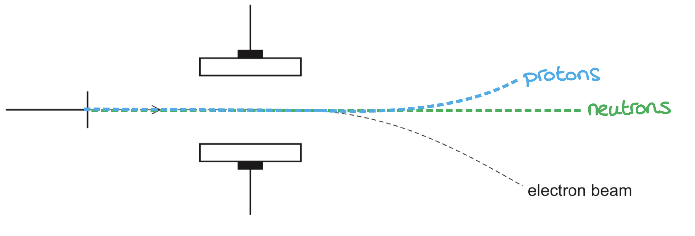
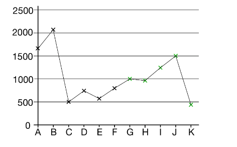

# Mark Schemes — Ionisation Energy
**1. Atomic Structure** · Cambridge (CIE) AS chemistry (9701)

## Multiple Choice Questions (16 questions)

### Q1
**Final answer:** **The correct answer is C**

- Melting points increase from sodium to aluminium because metallic bonding becomes stronger as the charge density of the metal cations increases.
- Silicon has a giant covalent structure, so many strong covalent bonds must be broken to melt it, giving a very high melting point that peaks at silicon.
- Phosphorus, sulfur, chlorine, and argon are simple molecular or monatomic substances with weak intermolecular forces, so their melting points drop sharply after silicon.

A is **not** correct as atomic radius decreases steadily across Period 3 as nuclear charge increases; it does not peak at silicon.

B is **not** correct as electrical conductivity is high for the metals (Na, Mg, Al), drops at silicon (a semiconductor), and is negligible for the non-metals; it does not show a single peak at silicon.

D is **not** correct as first ionisation energy generally increases across Period 3 and does not drop sharply after silicon as shown in the graph.

### Q2
**Final answer:** **The correct answer is C**

- The largest jump in successive ionisation energies is between the 5th and 6th (6000 to 12300 kJ mol-1).
- The 6th electron is being removed from a shell closer to the nucleus, so element **R** has 5 electrons in its outer shell and belongs to Group 15.
- Group 15 elements commonly form trichlorides (**R**Cl3), in which **R** has an oxidation state of +3.

A is **not** correct as an oxidation state of +1 would indicate 1 outer electron (Group 1), with a large jump between the 1st and 2nd ionisation energies.

B is **not** correct as an oxidation state of +2 would indicate 2 outer electrons (Group 2), with a large jump between the 2nd and 3rd ionisation energies.

D is **not** correct as an oxidation state of +4 would indicate 4 outer electrons (Group 14), with a large jump between the 4th and 5th ionisation energies.

### Q3
**Final answer:** **The correct answer is C**

- Beryllium has the electronic configuration 1s2 2s2; its outermost electrons are in the 2s subshell.
- Boron has the electronic configuration 1s2 2s2 2p1; its outermost electron is in the 2p subshell.
- The 2p subshell is at a higher energy and further from the nucleus than the 2s subshell, so the outer electron in boron is easier to remove.
- Therefore beryllium has a greater first ionisation energy than boron.

A is **not** correct as boron does not have a full outer shell. Its 2p subshell contains only one electron.

B is **not** correct as atomic radius decreases moving across a period, so boron has a smaller atomic radius than beryllium.

D is **not** correct as boron has a greater proton number than beryllium (Z = 5 vs Z = 4), not a smaller one.

### Q4
**Final answer:** **The correct answer is D**

- There is a large jump between the 6th and 7th ionisation energies (13327 to 71337 kJ mol-1).
- The 7th electron is much harder to remove, indicating it is in a shell closer to the nucleus.
- Element X therefore has 6 electrons in its outer shell and belongs to Group 16.

A is **not** correct as Group 13 elements have 3 outer electrons, so the large jump would occur between the 3rd and 4th ionisation energies.

B is **not** correct as Group 14 elements have 4 outer electrons, so the large jump would occur between the 4th and 5th ionisation energies.

C is **not** correct as Group 15 elements have 5 outer electrons, so the large jump would occur between the 5th and 6th ionisation energies.

### Q5
**Final answer:** **The correct answer is A**

- First ionisation energy generally increases across Period 3 due to increasing nuclear charge with approximately constant shielding.
- However, there is a slight decrease between Groups 15 and 16: phosphorus has all three 3p orbitals singly occupied, while sulfur has one paired 3p electron that experiences extra inter-electron repulsion, making it easier to remove. Phosphorus therefore has a higher first ionisation energy than sulfur.
- Of silicon, phosphorus, and sulfur, phosphorus (Y) has the highest first ionisation energy.
- Silicon has a giant covalent structure and a very high melting point. Phosphorus (P4) and sulfur (S8) are both simple molecular substances, but sulfur has stronger London dispersion forces and a higher melting point.
- Phosphorus (Y) therefore has the highest first ionisation energy and the lowest melting point of the three.

B is **not** correct as for sodium, magnesium, aluminium, first ionisation energy increases steadily with no dip, and the melting points increase across the series.

C is **not** correct as for aluminium, silicon, phosphorus, there is no Group 15/16 dip; silicon has the highest melting point (giant covalent structure), not the lowest.

D is **not** correct as for magnesium, aluminium, silicon, silicon would have both the highest first ionisation energy and the highest melting point, not the lowest melting point.

### Q6
**Final answer:** **The correct answer is B**

- The largest jump in successive ionisation energies is between the 2nd and 3rd (1450 to 7740 kJ mol-1).
- The 3rd electron is being removed from a shell closer to the nucleus, so element Y has 2 electrons in its outer shell.
- Element Y will lose 2 electrons to form the Y2+ ion.

A is **not** correct as this would correspond to the largest jump being between the 1st and 2nd ionisation energies.

C is **not** correct as this would correspond to the largest jump being between the 3rd and 4th ionisation energies.

D is **not** correct as this would correspond to the largest jump being between the 4th and 5th ionisation energies.

### Q7
**Final answer:** **The correct answer is C**

- Oxygen has the electronic configuration 1s2 2s2 2p4, giving 6 electrons in the n = 2 shell and 2 electrons in the n = 1 shell.
- The first six ionisation energies correspond to removing the six n = 2 electrons.
- The seventh ionisation energy corresponds to removing the first electron from the n = 1 shell, which is much closer to the nucleus and has no inner shells to shield it.
- There is therefore a very large jump between the sixth and seventh ionisation energies.

A is **not** correct as both the first and second electrons are removed from the n = 2 shell, so the increase between them is relatively small.

B is **not** correct as both the fifth and sixth electrons are removed from the n = 2 shell, so the increase between them is relatively small.

D is **not** correct as both the seventh and eighth electrons are removed from the n = 1 shell (1s2), so the increase between them is relatively small compared to the sixth-to-seventh jump.

### Q8
**Final answer:** **The correct answer is A**

- The largest jump in successive ionisation energies is between the 1st and 2nd (420 to 3600 kJ mol-1).
- The 2nd electron is being removed from a shell closer to the nucleus, so the element has 1 electron in its outer shell.
- This is consistent with a Group 1 element.

B is **not** correct as Group 2 elements have 2 outer electrons, so the largest jump would occur between the 2nd and 3rd ionisation energies.

C is **not** correct as Group 13 elements have 3 outer electrons, so the largest jump would occur between the 3rd and 4th ionisation energies.

D is **not** correct as Group 14 elements have 4 outer electrons, so the largest jump would occur between the 4th and 5th ionisation energies.

### Q9
**Final answer:** **The correct answer is C**

- The configuration 1s2 2s2 2p4 corresponds to oxygen, which has 6 electrons in the n = 2 shell and 2 electrons in the n = 1 shell.
- The first six ionisation energies remove electrons from the n = 2 shell; the seventh removes the first electron from the n = 1 shell.
- There is a very large jump between the 6th and 7th ionisation energies (13 320 to 71 200 kJ mol-1), confirming that the 7th electron is in a shell much closer to the nucleus.

A is **not** correct as 1s2 2s2 2p2 has only 4 electrons in n = 2, so the large jump would occur between the 4th and 5th ionisation energies.

B is **not** correct as 1s2 2s2 2p3 has 5 electrons in n = 2, so the large jump would occur between the 5th and 6th ionisation energies.

D is **not** correct as 1s2 2s2 2p6 has 8 electrons in n = 2, so only seven ionisation energies would be needed before reaching the n = 1 shell, and the large jump would occur between the 8th and 9th.

### Q10
**Final answer:** **The correct answer is D**

- After the first ionisation, the 12 protons in the magnesium nucleus attract only 11 remaining electrons.
- The same nuclear charge now acts on fewer electrons, increasing the effective nuclear charge per electron.
- There is greater attraction between the nucleus and the remaining outer electrons, so more energy is required to remove the second electron.

A is **not** correct as shielding is not reduced after the first ionisation. The inner shells are unchanged, so the shielding experienced by the remaining 3s electron is the same.

B is **not** correct as the ionic radius decreases after the first ionisation, as the remaining electrons are pulled closer to the nucleus.

C is **not** correct as the nuclear charge does not change between successive ionisation energies. The number of protons remains 12.

### Q11
**Final answer:** **The correct answer is B**

- The second ionisation energy removes one electron from the Mg+ ion, producing Mg2+ (g).

  - Both Mg+ and Mg2+ must be shown in the gaseous state.
- The sign of Δ*H* is positive:

  - Ionisation is endothermic as energy must be supplied to remove an electron against the attraction of the nucleus.

A is **not** correct as this shows the first ionisation energy, where an electron is removed from neutral Mg (g), not from Mg+ (g).

C is **not** correct as two electrons are removed from neutral Mg (g), so this represents the sum of the first and second ionisation energies combined, not the second alone.

D is **not** correct as this also shows the first ionisation energy, and the sign of Δ*H* is incorrect. Ionisation is always endothermic so Δ*H* must be positive.

### Q12
**Final answer:** **The correct answer is A**

- The graph shows a large jump after the third ionisation energy.
- This indicates that the fourth electron is being removed from a shell closer to the nucleus, so the element has three electrons in its outer shell and belongs to Group 13.
- Al is the only Group 13 element in the list.

B is **not** correct as nitrogen is in Group 15 and would show a large jump after the fifth ionisation energy.

C is **not** correct as sodium is in Group 1 and would show a large jump after the first ionisation energy.

D is **not** correct as phosphorus is in Group 15 and would show a large jump after the fifth ionisation energy.

### Q13
**Final answer:** **The correct answer is D**

- Statements A, B and C all correctly explain why first ionisation energy increases across a period.
- Across a period, nuclear charge increases while shielding from inner shell electrons remains approximately constant.
- This increases the effective nuclear charge, pulling the outer shell closer to the nucleus and decreasing atomic radius.
- It therefore becomes harder to remove an outer electron as you move across a period.
- The number of electrons increasing across a period does not explain why first ionisation energy increases.

A is **not** the answer as increasing nuclear charge increases the attraction on outer electrons, raising the first ionisation energy.

B is **not** the answer as decreasing atomic radius means the outer electron is closer to the nucleus and harder to remove.

C is **not** the answer as approximately constant shielding means that increasing nuclear charge is not offset, increasing the effective nuclear charge.

### Q14
**Final answer:** **The correct answer is C**

- Ionisation energy is the energy required to remove one mole of electrons from one mole of gaseous atoms.
- State symbols must be included in the equation to represent first ionisation energy.

A is **not** correct as state symbols are not included in this equation.

B is **not** correct as this equation represents the second ionisation energy of magnesium, which shows an electron being removed from the Mg+ ion.

D is **not** correct as state symbols are not included and the equation represents the second ionisation energy of magnesium.

### Q15
**Final answer:** **The correct answer is C**

- C is correct: the first ionisation energy is defined as the energy required to remove one mole of electrons from one mole of gaseous atoms to form one mole of gaseous 1+ ions.

A is **not** correct as the definition must specify one mole of atoms, not a single atom.

B is **not** correct as the atoms must be in the gaseous state, not the solid state.

D is **not** correct as removing an electron from a 1+ ion gives the second ionisation energy, not the first.

### Q16
**Final answer:** **The correct answer is C**

- Of the four configurations, 1s2 2s2 2p6 corresponds to neon (Z = 10), which has the highest proton number of the four.
- All four configurations share the same 1s2 inner shell, so shielding from inner electrons is approximately equal.
- Neon therefore has the greatest effective nuclear charge acting on its outer electrons, making them the hardest to remove.

A is **not** correct as 1s2 2s2 2p6 3s2 is magnesium (Z = 12). Although magnesium has a higher nuclear charge, its outer electrons are in the n = 3 shell, further from the nucleus and with additional shielding from the n = 2 shell, giving a lower first ionisation energy than neon.

B is **not** correct as 1s2 2s2 2p4 corresponds to oxygen (Z = 8), which has a lower proton number and lower effective nuclear charge than neon.

D is **not** correct as 1s2 2s2 2p2 corresponds to carbon (Z = 6), which has the lowest proton number and lowest effective nuclear charge of the four.

## Structured Questions (8 questions)

### Q1
> **[mark-scheme]**
> i) First ionisation energy is:
> 
> - The energy required to remove one electron from each atom (in one mole of gaseous atoms) **[1 mark]**
> - From one mole of gaseous atoms **[1 mark]**
> 
> Marks cannot be awarded if energy is released
> 
> The ionic equation, including state symbols, X (g) → X (g) + e− scores **[2 marks]**
> 
> ii) The equation for the second ionisation energy of magnesium is:
> 
> - Mg+ (g) → Mg2+ (g) + e- **[1 mark]**
> 
> iii) The trend in first ionisation energies across Period 3 is:
> 
> - The nuclear charge / number of protons increases across the period **[1 mark]**
> - The shielding by inner shells remains approximately constant
> **OR**
> There is the same number of inner shells **[1 mark]**
> - This means that the attraction between nucleus and outer electron increases, so more energy is needed to remove the electron
> **OR**
> The effective nuclear charge increases, so more energy is needed to remove the electron **[1 mark]**

> **[exam-tip]**
> For ionisation energy definitions, precision matters. A very common slip is writing that energy is “released” or forgetting the word “gaseous”. Ionisation is endothermic, so energy is required, and the definition is for gaseous atoms.
> 
> For the second ionisation energy equation, start from the 1+ ion, not the neutral atom. The first electron has already been removed, and state symbols (g) should be included.
> 
> For the trend across a period, avoid only stating what happens. Make the key comparison the marks are looking for: nuclear charge increases across the period, while shielding stays about the same because electrons are added to the same shell. This increases attraction to the outer electron, so more energy is needed to remove it.
> **[mark-scheme]**
> i) The structure and bonding of silicon(IV) oxide is:
> 
> - Structure: giant molecular
> **OR**
> Giant covalent
> **OR**
> Macromolecular **[1 mark]**
> - Bonding: each Si is bonded to 4 O atoms and each O atom is bonded to 2 Si atoms **[1 mark]**
> 
> Describing the structure as simple molecular, ionic lattice or metallic does not score the first mark.
> 
> ii) The shape and bond angle of a molecule of phosphorus(III) chloride are:
> 
> - Shape: trigonal pyramidal **[1 mark]**
> - Bond angle: 107°
> **OR**
> 107.5° **[1 mark]**
> 
> iii) The difference in melting points between silicon(IV) oxide and phosphorus(III) chloride is because:
> 
> - SiO2 has many strong covalent bonds that must be broken **[1 mark]**
> - PCl3 has weak intermolecular forces (London / van der Waals') between molecules which must be overcome **[1 mark]**
> - More energy is needed to melt SiO2 than PCl3, so SiO2 has a much higher melting point **[1 mark]**
> 
> Breaking covalent bonds in PCl3 means the second and third marks cannot be awarded.

> **[exam-tip]**
> For shapes and bond angles, start by counting bonding pairs and lone pairs on the central atom.
> 
> In PCl3, phosphorus forms three bonds and keeps one lone pair. Lone pairs repel bonding pairs more strongly than bonding pairs repel each other, which reduces the bond angle from 109.5° to about 107°.
> 
> A common bonding mistake is mixing up what breaks when a substance melts.
> 
> - In giant covalent structures (for example SiO2), you must break strong covalent bonds within the lattice.
> - In simple molecular substances (for example PCl3), the covalent bonds stay intact and you only overcome weak intermolecular forces.
The dot-and-cross diagram to show the bonding in the ammonium ion, NH4+, is:

**[2 marks]**

> **[mark-scheme]**
> 1 mark for Four N–H shared pairs shown (outer electrons only)
> 
> 1 mark for One bond shown as dative (both electrons from N)  **AND**
> overall + charge shown for the ion (for example bracket with + or NH4+ clearly indicated)

> **[exam-tip]**
> For dot-and-cross diagrams, clarity is essential. The examiner must be able to see where each electron comes from.
> 
> In the ammonium ion, one N–H bond is formed by donation of a lone pair from nitrogen to H+. Make sure this bond is clearly shown as a dative bond, with both electrons coming from nitrogen (for example using the same symbol on both electrons).
> 
> Also remember to show the overall positive charge on the ion, usually with square brackets and a + outside, or by clearly labelling the species as NH4+. Missing the charge or making the dative bond unclear is a very common way to lose this mark.

### Q2
The completed table is:

| atomic number | nucleon number | number of electrons | number of protons | number of neutrons | species |
|---|---|---|---|---|---|
| 9 | **Final answer:** **19** | 10 | **Final answer:** **9** | **Final answer:** **10** | 19F- |
| **Final answer:** **26** | **Final answer:** **58** | 23 | 26 | 32 | **Final answer:** **58****Fe****3+** |

**[2 marks]**

> **[mark-scheme]**
> 1 mark for all three answers in row 1 correct: nucleon number 19, protons 9, neutrons 10
> 
> 1 mark for all three answers in row 2 correct: atomic number 26, nucleon number 58, species 58Fe3+

> **[exam-tip]**
> Atomic number = number of protons. Nucleon number = protons + neutrons. For ions, the number of electrons differs from the number of protons: negative ions have gained electrons and positive ions have lost them.
> 
> For row 1 (19F-): atomic number 9 gives protons = 9. The - charge means one electron gained, so electrons = 10. Neutrons = nucleon number - protons = 19 - 9 = 10.
> 
> For row 2 (Fe3+): atomic number = protons = 26 (iron). Nucleon number = protons + neutrons = 26 + 32 = 58. The 3+ charge means three electrons lost, confirming electrons = 26 - 3 = 23. Species: 58Fe3+.
> **[mark-scheme]**
> The isotopic symbol and full electronic configuration for K+ (nucleon number 39) are:
> 
> - Symbol: 39K+ **[1 mark]**
> - Electronic configuration: 1s2 2s2 2p6 3s2 3p6 **[1 mark]**

> **[exam-tip]**
> The isotopic symbol includes the mass number (nucleon number) as a superscript before the element symbol and the charge as a superscript after: 39K+.
> 
> K has 19 electrons; K+ has lost one electron, leaving 18 electrons in the configuration 1s2 2s2 2p6 3s2 3p6. This is the same configuration as argon.
The completed diagram is:

**[3 marks]**

> **[mark-scheme]**
> 1 mark for a straight undeflected path labelled neutrons
> 
> 1 mark for a path curving towards the negative plate labelled protons
> 
> 1 mark for the proton path showing clearly less deflection than the electron path

> **[exam-tip]**
> Neutrons have no charge, so they are not deflected by the electric field and travel straight through.
> 
> Protons have a positive charge, so they are deflected towards the negative plate (opposite direction to electrons). Protons are approximately 1840 times heavier than electrons, so they are deflected much less for the same field strength.
> 
> Electrons have a negative charge and are deflected towards the positive plate. Their small mass means they curve more sharply than protons.
> **[mark-scheme]**
> i) Element **Y** belongs to:
> 
> - Group 16 / Group 6 **[1 mark]**
> - Large increase between the 6th and 7th ionisation energies **[1 mark]**
> 
> ii) The general trend in first ionisation energies across Period 3:
> 
> - First ionisation energy generally increases across Period 3 / increases from Na to Ar **[1 mark]**
> - Nuclear charge / number of protons increases; shielding remains approximately constant / electrons are added to the same shell **[1 mark]**
> 
> iii) The first ionisation energy of **Y** is less than that of **X** because:
> 
> - **Y** has a paired electron in a 3p orbital (3p4 configuration) / one 3p orbital in **Y** is doubly occupied **[1 mark]**
> - Electron pair repulsion makes the paired electron easier to remove / reduces the ionisation energy of **Y** **[1 mark]**
> 
> iv) The full electronic configuration of an atom of element **Z** is:
> 
> - (1s2) 2s2 2p6 3s2 3p5 **[1 mark]**

> **[exam-tip]**
> For part (i): to deduce the group number from successive ionisation energy data, look for the large jump. For Y, the jump is between the 6th and 7th values (8496 to 27107), meaning the 7th electron is in an inner shell. Y therefore has 6 outer electrons and belongs to Group 16.
> 
> For part (ii): note there are two slight downward steps in Period 3 (Na to Mg to Al, and P to S) but the overall trend is an increase. These exceptions involve subshell changes and spin-pair repulsion.
> 
> For part (iii): X is in Group 15 (3p3, half-filled with one electron in each 3p orbital). Y is in Group 16 (3p4, with one 3p orbital doubly occupied). The paired electrons in Y repel each other, making the first electron easier to remove than expected from nuclear charge alone.
> 
> For part (iv): the large jump for Z is between the 7th and 8th values (11018 to 33606), so Z has 7 outer electrons and belongs to Group 17 (chlorine). Its electronic configuration is 1s2 2s2 2p6 3s2 3p5.

### Q3
> **[mark-scheme]**
> The elements are:
> 
> i) Oxygen / O **[1 mark]**
> 
> ii) Silicon / Si **[1 mark]**
> 
> iii) Sodium / Na **[1 mark]**
> 
> iv) Helium / He **[1 mark]**
> 
> v) Magnesium / Mg **[1 mark]**

> **[exam-tip]**
> i) Oxygen has the electronic configuration 1s2 2s2 2p4. Gaining 2 electrons forms O2- with configuration 1s2 2s2 2p6, which is the same as neon.
> 
> ii) Silicon has a giant covalent structure. Much more energy is needed to break the strong covalent bonds throughout the lattice compared to the metallic bonding in Na to Al, or the weak van der Waals forces between molecules in P to Ar.
> 
> iii) Sodium has the largest atomic radius of the first three periods. It has 3 electron shells (more than any element in Periods 1 or 2) and the lowest nuclear charge of the Period 3 elements, so its outer electrons are held least tightly.
> 
> iv) Helium has the highest first ionisation energy from H to Ar. It has only one shell of electrons very close to the nucleus, and two protons providing a strong nuclear attraction. Although neon has more protons, helium's outer electrons are in shell 1 (not shell 2), so they are held more strongly.
> 
> v) The large jump occurs between the 2nd and 3rd ionisation energies, indicating that the 3rd electron is in an inner shell. The element has 2 outer electrons and is therefore in Group 2. The Period 3 Group 2 element is magnesium.
The completed graph is:

**[3 marks]**

> **[mark-scheme]**
> 1 mark for G plotted above F **AND** H plotted between F and G
> 
> 1 mark for I plotted above H and below A **AND** J plotted above I and below B
> 
> 1 mark for K plotted below C

> **[exam-tip]**
> Element B is the noble gas in the sequence, because there is a large drop after B to C. The outer electron of C is in a new, higher energy shell at the start of a new period, so C is a Group 1 element.
> 
> From C onwards, the pattern repeats across the next period. G starts at a similar level to C (both are Group 1), then the IE generally increases toward J (noble gas), with two characteristic dips: one from D to E (outer electron moves from s to p subshell, higher energy and further from nucleus) and one from G to H (spin-pair repulsion in a doubly occupied p orbital lowers the IE of H below G).
> 
> K starts the following period and will have a lower IE than C or G, because it has one more shell of electrons further from the nucleus.
> **[mark-scheme]**
> The first ionisation energy of **D** is greater than that of **C** because:
> 
> - **D** has one more proton / higher nuclear charge **OR** the outer electron in **D** is closer to the nucleus **[1 mark]**
> - The electrons being removed from **D** and **C** are in the same (s) subshell **[1 mark]**

> **[exam-tip]**
> In this sequence, B is the noble gas (it has the highest IE before a large drop to C), so C is a Group 1 element starting a new period and D is the Group 2 element that follows. D has one more proton than C but the same number of inner shells, so its outer electron experiences a stronger nuclear attraction.
> 
> The key point to include is that both C and D have their outer electrons in the same s subshell, so shielding is the same for both. The only difference is nuclear charge, which makes D's outer electron harder to remove.

### Q4
i) The equation for the third ionisation energy of oxygen is:

O2+ (g) → O3+ (g) + e-

**[2 marks]**

> **[mark-scheme]**
> 1 mark for correct formulae: O2+ (g) → O3+ (g) + e-
> 
> 1 mark for correct state symbols: (g) on all three species
> 
> ii) The data shows evidence of two energy shells because:
> 
> - There is a very large jump / increase in ionisation energy between the 6th and 7th ionisation energies **[1 mark]**
> - This indicates the 7th electron is removed from a different / inner shell / energy level, closer to the nucleus **[1 mark]**

> **[exam-tip]**
> For the third ionisation energy equation, start from the 2+ ion as two electrons have already been removed. The equation shows one mole of electrons removed from one mole of gaseous O2+ ions to form O3+ ions. State symbols on all three species are required.
> 
> To interpret successive IE data for evidence of shells, look for the largest jump. Here the values increase gradually from the 1st to the 6th IE (all within the outer shell), then there is a dramatic rise from the 6th (13 327 kJ mol-1) to the 7th (71 337 kJ mol-1). This jump indicates the 7th electron is being removed from a shell much closer to the nucleus. Since there are 6 electrons in the outer shell and 2 in the inner shell, this is consistent with oxygen having two energy shells.
> **[mark-scheme]**
> i) The full electronic configuration of Te is:
> 
> - 1s2 2s2 2p6 3s2 3p6 3d10 4s2 4p6 4d10 5s2 5p4 **[1 mark]**
> 
> ii) The full electronic configuration of Zn2+ is:
> 
> - 1s2 2s2 2p6 3s2 3p6 3d10 **[1 mark]**
> 
> iii) The full electronic configuration of Cu2+ is:
> 
> - 1s2 2s2 2p6 3s2 3p6 3d9 **[1 mark]**

> **[exam-tip]**
> Always write full electronic configurations in order of principal quantum number (n = 1, 2, 3, 4...), placing 3d before 4s and 4d before 5s in the written form, even though the s subshells fill first.
> 
> For ions, the s subshell empties before the d subshell. Zinc is [Ar] 3d10 4s2 as a neutral atom; forming Zn2+ removes both 4s electrons, leaving [Ar] 3d10.
> 
> Copper has an anomalous configuration: [Ar] 3d10 4s1 rather than [Ar] 3d9 4s2, because a completely full 3d subshell provides extra stability. When forming Cu2+, the 4s1 electron is removed first, then one 3d electron, giving [Ar] 3d9. The other anomalous first-row transition metal is chromium, which has a half-filled 3d subshell: [Ar] 3d5 4s1.
> **[mark-scheme]**
> i) The electronic configuration of Zr2+, starting with [Kr], is:
> 
> - [Kr] 4d2 **[1 mark]**
> 
> ii) The equation for the third ionisation energy of zirconium is:
> 
> - Zr2+ (g) → Zr3+ (g) + e- **[1 mark]**
> 
> State symbols are required for this mark.

> **[exam-tip]**
> Zirconium (Z = 40) is in Period 5 and has the configuration [Kr] 4d2 5s2 as a neutral atom. When forming Zr2+, the 5s electrons are removed first (the s subshell empties before the d subshell), leaving [Kr] 4d2.
> 
> For the third ionisation energy equation, start from the 2+ ion: Zr2+ (g) → Zr3+ (g) + e-. Each ionisation energy equation removes exactly one mole of electrons and must include state symbols on all three species.

### Q5
> **[mark-scheme]**
> i) The first ionisation energy of an element is:
> 
> - The enthalpy / energy needed to remove one mole of electrons from one mole of gaseous atoms **[1 mark]**
> - To form one mole of gaseous 1+ ions / ions with +1 charge **[1 mark]**
> 
> ii) The equation for the first ionisation energy of aluminium is:
> 
> - Al (g) → Al+ (g) + e- **[1 mark]**
> 
> Equations without state symbols do not gain the mark.

> **[exam-tip]**
> When writing an ionisation energy equation, always start with the neutral gaseous atom, not a positive ion. For the 1st ionisation energy, you remove the 1st mole of electrons from neutral Al (g) atoms to form Al+ (g) ions. A common mistake is to write Al+ on the left-hand side, which would represent the second ionisation energy.
> 
> The number of the ionisation energy tells you which mole of electrons is being removed: the 1st IE removes the 1st mole of electrons to form 1+ ions; the 2nd IE removes the 2nd mole of electrons to form 2+ ions, and so on.
> 
> State symbols are essential in ionisation energy equations. The definition specifically requires gaseous atoms and gaseous ions, so (g) on all species is part of the correct answer.
> **[mark-scheme]**
> The identity of element **A** and the evidence for it are:
> 
> - Phosphorus / P **[1 mark]**
> - There is a large jump in ionisation energy between the 5th and 6th ionisation energies / after the 5th ionisation energy **[1 mark]**

> **[exam-tip]**
> To deduce the identity of an element from successive ionisation energy data, look for the large jump, the point where the ionisation energy increases significantly compared to the previous steps.
> 
> Here, the values from the 1st to the 5th IE increase by roughly 1000 to 2000 kJ mol-1 each time. The jump from the 5th to the 6th is nearly 15 000 kJ mol-1, far larger than any previous step. This means the 6th electron is much harder to remove because it is in an inner shell, closer to the nucleus.
> 
> A common mistake is to identify the element as being in Group 6 because the large jump occurs between the 5th and 6th IEs. But if the jump comes after the 5th IE, there are 5 outer electrons, placing the element in Group 15 / Group V. The electronic configuration of phosphorus is 1s2 2s2 2p6 3s2 3p3, confirming it has 5 electrons in its outer shell.
> **[mark-scheme]**
> i) The general trend and reasons for it are:
> 
> - There is a general increase in first ionisation energy across Period 3 **[1 mark]**
> - Nuclear charge increases / a proton is added to the nucleus **AND** shielding stays the same / electrons are added to the same shell **[1 mark]**
> - Atomic radius decreases **OR** outermost / outer / highest energy / valence electrons are closer to the nucleus **[1 mark]**
> 
> ii) The deviations from the trend are:
> 
> - Aluminium deviates because its outermost / highest energy / valence electron is in a 3p orbital **[1 mark]**
> - The 3p orbital is further from the nucleus **OR** the 3p orbital has a slightly higher energy than the 3s orbital **[1 mark]**
> - Sulfur deviates because its outermost / outer / highest energy / valence electron is paired / shares an orbital with another electron **AND** there is repulsion between the electrons in the orbital **[1 mark]**

> **[exam-tip]**
> For the general trend across Period 3, your answer needs three elements:
> 
> 1. State that IE generally increases
> 2. Explain it using nuclear charge and shielding
> 3. Bring in the consequence (smaller atomic radius or outer electrons closer to the nucleus). Make sure you give both the increased nuclear charge and the unchanged shielding together, as both are needed for that one mark.
> 
> Aluminium (Group 13) and sulfur (Group 16) are the two anomalies in this trend, and they arise for different reasons.
> 
> - For Al, the outer electron is in a 3p orbital, which is at higher energy than the 3s orbital of Mg, so it is easier to remove.
> - For S, one 3p orbital holds a paired electron; the repulsion between those two electrons makes it easier to remove one compared to the half-filled 3p orbitals in P.
> 
> The same reasoning applies in Period 2: boron has a lower 1st IE than beryllium, and oxygen has a lower 1st IE than nitrogen, for the same reasons.
> **[mark-scheme]**
> The second ionisation energy of aluminium is greater because:
> 
> Any **one** from:
> 
> - Electrons are removed from a positive ion rather than a neutral atom
> - The electron being removed is closer to the nucleus
> - The Al+ ion is smaller than the Al atom
> - The electron is being removed from a 3s orbital rather than a 3p orbital
> 
> **[1 mark]**

> **[exam-tip]**
> Successive ionisation energies always increase because once an electron has been removed, the remaining electrons experience a stronger effective nuclear charge. There are the same number of protons but fewer electrons, so each remaining electron is held more tightly.
> 
> For aluminium specifically, there is a second factor: the 2nd electron is removed from a 3s orbital rather than a 3p orbital. The 3s orbital is at a lower energy and sits closer to the nucleus than the 3p orbital, so removing an electron from it requires more energy. This is why the 2nd IE of Al is noticeably higher than the 1st.

### Q6
> **[mark-scheme]**
> The full electronic configurations are:
> 
> - Mg: 1s2 2s2 2p6 3s2 **[1 mark]**
> - Mg2+: 1s2 2s2 2p6 **[1 mark]**

> **[exam-tip]**
> Mg is in Period 3, Group 2, with 12 electrons. The configuration 1s2 2s2 2p6 3s2 fills all subshells up to and including 3s.
> 
> Mg2+ has lost two electrons from the 3s subshell, leaving 10 electrons. Its configuration (1s2 2s2 2p6) is the same as neon.
> **[mark-scheme]**
> The equation for the first ionisation energy of magnesium is:
> 
> - Mg (g) → Mg+ (g) + e- **[1 mark]**
> 
> Equations without state symbols are not accepted.

> **[exam-tip]**
> The first ionisation energy removes one mole of electrons from one mole of gaseous atoms. All species must be in the gaseous state, which means that the (g) state symbols are required. Only one electron is removed per equation.
> **[mark-scheme]**
> The second ionisation energy of magnesium is higher than the first because:
> 
> - The electron is removed from a positive ion (Mg+) rather than a neutral atom (Mg) **[1 mark]**
> - There is greater electrostatic attraction between the nucleus and the outer electron in Mg+, so more energy is required to remove it **[1 mark]**

> **[exam-tip]**
> After the first ionisation, the nucleus still has a charge of 12+ but there are only 11 electrons remaining. Each remaining electron therefore experiences a stronger effective nuclear attraction than in the neutral atom.
> 
> This pattern applies generally: each successive ionisation energy is higher than the previous one because each electron is removed from a more positively charged ion with stronger nuclear attraction.

### Q7
> **[mark-scheme]**
> Element **X** is:
> 
> - Scandium / Sc / 45Sc **[1 mark]**

> **[exam-tip]**
> Potassium (K) has atomic number 19 and mass number 41. Adding two more protons gives atomic number 21, which is scandium (Sc). Adding two more neutrons gives mass number 45, so the specific isotope is 45Sc.
> 
> The element name (Scandium) or symbol (Sc) is sufficient to identify element X. The isotope notation 45Sc is also accepted.
> **[mark-scheme]**
> The full electronic configurations are:
> 
> - K+: 1s2 2s2 2p6 3s2 3p6 **[1 mark]**
> - Ti: 1s2 2s2 2p6 3s2 3p6 3d2 4s2 **[1 mark]**
> - Co: 1s2 2s2 2p6 3s2 3p6 3d7 4s2 **[1 mark]**

> **[exam-tip]**
> K+ has lost one electron from K (19 electrons), giving it 18 electrons, which is the same configuration as argon.
> 
> For transition metals (Ti and Co), the 4s subshell fills before 3d when building up the configuration. In the written notation, the 3d is written after 3p (principal quantum number order). Ti (Z = 22) has 22 electrons; Co (Z = 27) has 27 electrons.
> **[mark-scheme]**
> i) The equations for the ionisation energies are:
> 
> - First ionisation energy of K: K (g) → K+ (g) + e- **[1 mark]**
> - Second ionisation energy of Sc: Sc+ (g) → Sc2+ (g) + e- **[1 mark]**
> 
> Equations without state symbols are not accepted.
> 
> ii) The full electronic configuration of an Sc2+ ion is:
> 
> - 1s2 2s2 2p6 3s2 3p6 3d1 **[1 mark]**

> **[exam-tip]**
> Each ionisation energy equation removes exactly one mole of electrons from one mole of gaseous species. The second ionisation energy of Sc starts from Sc+ (g), not Sc (g) as the first electron has already been removed.
> 
> Sc has the full electronic configuration 1s2 2s2 2p6 3s2 3p6 3d1 4s2. The Sc2+ ion loses both 4s electrons first (4s empties before 3d when forming transition metal ions), leaving 1s2 2s2 2p6 3s2 3p6 3d1.
i) Ionisation energies generally increase from left to right across the Periodic Table because:

- The nuclear charge / number of protons / atomic number increases;** [1 mark]**
- But the shielding / number of shells stays the same; **[1 mark]**

ii) Element **Z** belongs to:

- Group 4 / Group 14;** [1 mark]**
- (Because,) there is a significant jump from 4th to 5th ionisation energy; **[1 mark]**
- Moving in an orbit / energy level so electrons are closer to the positive nucleus; **[1 mark] **

**[Total: 5 marks]**

- *When using successive ionisation data look for a significant jump in ionisation energy *
- *This is the change from one energy level or orbit closer to the nucleus*
- *From here you can count backwards to the correct element*
- *In Table 2.1, the significant change is between the 4th and 5th ionisation energies therefore the element is in Group 4*

### Q8
The equation for the second ionisation energy of element **X** is:

X+ (g) → X2+ (g) + e-

**[2 marks]**

> **[mark-scheme]**
> 1 mark for correct equation: X+ (g) → X2+ (g) + e-
> 
> 1 mark for correct state symbols: (g) on all three species

> **[exam-tip]**
> For the second ionisation energy, the equation starts with the 1+ ion, not the neutral atom. You are removing the second mole of electrons, so you start from X+ (g) and form X2+ (g). Starting with neutral X (g) would represent the first ionisation energy.
> 
> State symbols are essential. All three species (X+, X2+, and e-) must carry (g) to gain the state symbols mark.
> **[mark-scheme]**
> The group and evidence for element **X** are:
> 
> - Group 5 / 15 **[1 mark]**
> - There is a sharp rise in ionisation energy between the 5th and 6th ionisation energies **[1 mark]**
> - This indicates a change to a different / inner shell **OR** the outer shell of element **X** contains 5 electrons **[1 mark]**

> **[exam-tip]**
> To deduce the group of an element from successive ionisation energy data, look for the position of the largest jump. Here the jump occurs after the 5th ionisation energy, which means 5 electrons are in the outer shell, placing element **X** in Group 5 / 15.
> 
> Note that Group 5 and Group 15 are both acceptable: older CIE notation uses Group 5 for the nitrogen group, while modern IUPAC notation uses Group 15.
> **[mark-scheme]**
> The general decrease in first ionisation energy down Group 14 is due to:
> 
> - Atomic radius increases (down the group) / outer electrons are increasingly further from the nucleus **[1 mark]**
> - Electrons are added to new / additional shells **[1 mark]**
> - More / increased shielding (from inner shell electrons) **[1 mark]**
> - Nuclear charge increases (down the group) **[1 mark]**

> **[exam-tip]**
> When explaining why ionisation energy decreases down a group, address both why the outer electrons are easier to remove (greater distance and shielding) and acknowledge that nuclear charge is also increasing. All four points are needed for full credit.
> 
> Make sure you write "nuclear charge", not "nucleus charge" — using imprecise terminology will not gain the mark.
> 
> Note that the value for Pb (716 kJ mol-1) is slightly higher than Sn (707 kJ mol-1), which breaks the general trend. This anomaly is not explained at A Level, so focus your answer on the overall decrease from C to Sn.
> **[mark-scheme]**
> The full electronic configuration of germanium is:
> 
> - 1s2 2s2 2p6 3s2 3p6 3d10 4s2 4p2 **[1 mark]**

> **[exam-tip]**
> Write the configuration in order of principal quantum number (n = 1, 2, 3, 4), placing 3d before 4s. Germanium has 32 electrons, with the last electrons filling the 4p subshell: 1s2 2s2 2p6 3s2 3p6 3d10 4s2 4p2.
> 
> The question asks for the full electronic configuration, so include all 32 electrons. Do not use the [Ar] shorthand notation here.
