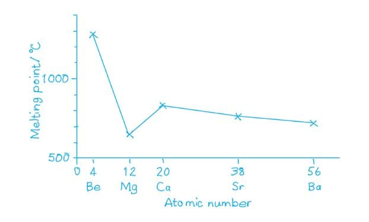

# Mark Schemes — Similarities & Trends in the Properties of the Group 2 Metals, Magnesium to Barium, & Their Compounds
**10. Group 2** · Cambridge (CIE) AS chemistry (9701)

## Multiple Choice Questions (30 questions)

### Q1
**Final answer:** **The correct answer is A**

- As you descend Group 2, the solubility of the hydroxides increases.
- The larger Group 2 cations have a lower charge density, so the lattice enthalpy decreases more rapidly than the hydration enthalpy.

  - The net result is that the hydroxides become more soluble down the group.
- As you descend Group 2, the solubility of the sulfates decreases.
- The sulfate ion is large, so the hydration enthalpy of the cation decreases more than the lattice enthalpy as the cation size increases.

  - The net result is that the sulfates become less soluble down the group.

**B** is incorrect as it reverses both trends; the hydroxides become more soluble (not less) and the sulfates become less soluble (not more) going down Group 2.

**C** is incorrect as the sulfates do not become more soluble going down Group 2. Their solubility decreases because the decrease in hydration enthalpy of the cation outweighs the decrease in lattice enthalpy.

**D** is incorrect as the hydroxides do not become less soluble going down Group 2. Their solubility increases because the lattice enthalpy decreases more steeply than the hydration enthalpy.

### Q2
**Final answer:** **The correct answer is C**

- Compound **Q** is the Group 2 oxide with the highest melting point, making it suitable as a refractory kiln lining.
- Magnesium oxide, MgO, has the highest melting point of the Group 2 oxides.

  - So, **Q** = MgO.
- Compound **R** is calcium carbonate, CaCO3 (limestone), widely used as a building material.
- It undergoes thermal decomposition in a kiln to form compound **S**:

CaCO3 (s) → CaO (s) + CO2 (g)

- Therefore **S** = CaO (quicklime).
- When **S** is hydrated, it produces compound **T**, calcium hydroxide, Ca(OH)2 (slaked lime), used to neutralise acidic soils:

CaO (s) + H2O (l) → Ca(OH)2 (s)

**A** is incorrect as CaCO3 is compound **R** (the building material that is heated to form S), not compound **Q**.

**B** is incorrect as CaO is compound **S** (not Q), and Ca(OH)2 is compound **T** (not S).

**D** is incorrect as Ca(OH)2 is compound **T** (produced when S is hydrated), not compound **S** itself.

### Q3
**Final answer:** **The correct answer is A**

- The equations for these reactions are:

Ba (s) + 2H2O (l) → Ba(OH)2 (aq) + H2 (g)

Ba(OH)2 (aq) + H2SO4 (aq) → BaSO4 (s) + 2H2O (l)

- Barium reacts with water to produce barium hydroxide, which is sufficiently soluble to give a colourless solution.
- When the Ba(OH)2 solution is mixed with H2SO4, an insoluble white precipitate of BaSO4 forms.

**B** is incorrect as magnesium reacts very slowly with cold water and gives a slightly cloudy suspension of Mg(OH)2. The sulfate salt MgSO4 formed with H2SO4 is soluble and no precipitate would form.

**C** is incorrect as potassium reacts vigorously with water and gives a colourless solution of potassium hydroxide, but the salt K2SO4 formed with H2SO4 is soluble.

**D** is incorrect as sodium reacts with water to give a colourless solution of sodium hydroxide, but Na2SO4 formed with H2SO4 is soluble.

### Q4
**Final answer:** **The correct answer is C**

- Barytocalcite (BaCO3.CaCO3) is a mixed carbonate containing both calcium and barium.
- When heated to constant mass in a Bunsen burner, the CaCO3 component decomposes readily, releasing CO2 gas:

CaCO3 (s) → CaO (s) + CO2 (g)

- The CO2 turns limewater cloudy.
- BaCO3 requires a much higher temperature to decompose (above 1000°C).
- It does not decompose in a Bunsen burner and remains in the solid residue as BaCO3.
- When hydrochloric acid is added, the remaining BaCO3 effervesces vigorously:

BaCO3 (s) + 2HCl (aq) → BaCl2 (aq) + CO2 (g) + H2O (l)

**A** is incorrect as aragonite (CaCO3) decomposes completely on heating to give CaO. The CaO residue reacts with HCl to form a salt and water, not CO2, so there would be no effervescence.

**B** is incorrect as artinite (MgCO3.Mg(OH)2.3H2O) decomposes fully on heating to leave MgO. This reacts with HCl to give salt and water without effervescence.

**D** is incorrect as both carbonate components in dolomite (CaCO3.MgCO3) decompose on heating to leave a residue of CaO and MgO. Neither oxide effervesces with hydrochloric acid.

### Q5
**Final answer:** **The correct answer is B**

- In metallic bonding, bond strength depends on the charge of the cation, the size of the cation, and the number of delocalised electrons per atom.
- Group 2 metal atoms have smaller radii than Group 1 metal atoms in the same period, because the greater nuclear charge pulls the outer electrons closer to the nucleus.
- Smaller radii result in shorter interatomic distances and stronger electrostatic attraction between cations and the delocalised electron cloud.
- Group 2 metals also contribute two delocalised electrons per atom compared to one for Group 1 metals, further increasing the strength of the metallic bond.
- Both factors combine to give Group 2 metals higher melting points.

**A** is incorrect as first ionisation energy is the energy required to remove an electron from a gaseous atom; it does not directly determine the strength of metallic bonding in the solid lattice.

**C** is incorrect as metallic bonding involves a sea of delocalised electrons, not ionic bonds between discrete ions.

**D** is incorrect as the mass of atoms does not directly determine melting point; it is the strength of the metallic bond that governs this property.

### Q6
**Final answer:** **The correct answer is A**

- When calcium nitrate is strongly heated, it undergoes thermal decomposition to produce calcium oxide, nitrogen dioxide and oxygen:

2Ca(NO3)2 (s) → 2CaO (s) + 4NO2 (g) + O2 (g)

- Calcium oxide also reacts with cold water:

CaO (s) + H₂O (l) → Ca(OH)₂ (aq)

**B** is incorrect as calcium is more reactive than magnesium; magnesium cannot reduce calcium oxide to calcium.

**C** is incorrect as calcium oxide is a basic oxide. It reacts with acids and dissolves in water to produce an alkaline solution.

**D** is incorrect as calcium oxide reacts readily with water to produce calcium hydroxide.

### Q7
**Final answer:** **The correct answer is A**

The equation for the thermal decomposition of magnesium nitrate is:

Mg(NO3)2 (s) → MgO (s) + 2NO2 (g) + ½O2 (g)

The molar ratio Mg(NO3)2 : O2 = 2 : 1

- Calculate the moles of Mg(NO3)2 (*M*r = 148.3):

moles = $\frac{mass}{M_{r}}$

moles = $\frac{32.3}{148.3}$

moles = 0.2178 mol

- Calculate the moles of O2 produced:

moles of O2 produced = 0.2178 ÷ 2 = 0.1089 mol

- Calculate the mass of O2 (Mr = 32.0):

mass = moles × *M*r

mass = 0.1089 × 32.0

**Final answer:** **mass = 3.48 g**

**B** is incorrect as 8.32 g arises from using an incorrect molar mass for Mg(NO3)2, for example omitting the magnesium atom.

**C** is incorrect as 12.48 g arises from errors in both the molar mass used and the stoichiometric ratio applied.

**D** is incorrect as 19.2 g arises from using an incorrect stoichiometric ratio, treating the molar ratio Mg(NO3)2 : O2 as 1 : 1 rather than 2 : 1.

### Q8
**Final answer:** **The correct answer is C**

- Compound T is used as a refractory kiln lining, requiring a very high melting point.
- Magnesium oxide has an extremely high melting point (~2852°C), making it suitable for this purpose, so T = MgO.
- Since T is MgO, compound S must be the carbonate that decomposes to produce it:

MgCO3 (s) → MgO (s) + CO2 (g)

- MgCO3 releases CO2 on decomposition, consistent with the limewater observation.
- Both MgCO3 (S) and MgO (T) are insoluble in water.

**A** is incorrect as the thermal decomposition of CaCO3 produces CaO. Although CaO is a white solid, it reacts with water to form Ca(OH)2. So, T would not be insoluble in water as stated in the question.

**B** is incorrect as CaO is an oxide, not a carbonate. It does not undergo thermal decomposition to release CO2.

**D** is incorrect as MgO is an oxide and does not thermally decompose to release CO2.

### Q9
**Final answer:** **The correct answer is D**

The equation for the thermal decomposition of calcium nitrate is:

Ca(NO3)2 (s) → CaO (s) + 2NO2 (g) + ½O2 (g)

- Calculate the moles of Ca(NO3)2 (*M*r = 164.1):

moles = $\frac{\mathrm{mass}}{M_{r}}$

moles = $\frac{5.10}{164.1}$

moles = 0.03107 mol

- The 1 : 1 molar ratio means moles of CaO produced = 0.03107 mol

- Calculate the mass of CaO (*M*r = 56.1):

mass = moles × *M*r

mass = 0.03107 × 56.1

**Final answer:** **mass = 1.74 g**

**A** is incorrect as 0.70 g arises from an error in the moles calculation, using an incorrect value for *M*r(Ca(NO3)2).

**B** is incorrect as 0.87 g arises from using a 2 : 1 molar ratio of Ca(NO3)2 to CaO, giving half the correct number of moles of CaO.

**C** is incorrect as 1.40 g arises from using an incorrect molar mass for CaO in the final step.

### Q10
**Final answer:** **The correct answer is C**

- The solubility of Group 2 hydroxides increases down the group.
- Calcium hydroxide, Ca(OH)2, has limited solubility in water, so when calcium reacts with cold water a white suspension forms.
- Barium hydroxide, Ba(OH)2, is more soluble than calcium hydroxide, so no white suspension is observed when barium reacts with water.

**A** is incorrect as both calcium and barium react with cold water, releasing hydrogen gas as a product.

**B** is incorrect as barium is more reactive than calcium (reactivity increases down Group 2), so a more vigorous effervescence is observed with barium, not calcium.

**D** is incorrect as both calcium and barium form alkaline hydroxide solutions, turning litmus blue.

### Q11
**Final answer:** **The correct answer is D**

- The solubility of Group 2 hydroxides increases down the group:

Mg(OH)2 < Ca(OH)2 < Sr(OH)2 < Ba(OH)2.

- The solubility of Group 2 sulfates decreases down the group:

MgSO4 > CaSO4 > SrSO4 > BaSO4.

- Only strontium satisfies both conditions:

  - Sr(OH)2 is more soluble than Ca(OH)2
  - SrSO4 is more soluble than BaSO4.

**A** is incorrect as barium sulfate is barium's own sulfate. It cannot be more soluble than itself.

**B** is incorrect as calcium hydroxide is no more soluble than itself.

**C** is incorrect as magnesium hydroxide is less soluble than calcium hydroxide, not more soluble.

### Q12
**Final answer:** **The correct answer is C**

- The effectiveness of a compound as a fire retardant depends on the volume of CO2 produced under the same conditions.
- Thermal stability of Group 2 carbonates increases down the group, so more energy is required to decompose carbonates containing heavier metals.
- The order of the Group 2 metals in the minerals (from most to least thermally stable) is:

Ba > Ca > Mg

- Huntite, Mg3Ca(CO3)4, has the highest proportion of magnesium and decomposes most readily.

  - It is the best fire retardant.
- Dolomite, CaMg(CO3)2, has equal proportions of calcium and magnesium.

  - Intermediate effectiveness.
- Barytocalcite, BaCa(CO3)2, contains barium (lowest thermal stability).

  - It is the least effective fire retardant.

**A** is incorrect as dolomite is not the most effective. Huntite contains more magnesium and decomposes at a lower temperature.

**B** is incorrect as barytocalcite, which contains the most thermally stable cation (Ba2+), would be the worst retardant, not Huntite.

**D** is incorrect as barytocalcite should be the worst (not middle) retardant due to the presence of barium.

### Q13
**Final answer:** **The correct answer is B**

- Lime is calcium hydroxide, Ca(OH)2.
- In the presence of moisture, it reacts with ammonium sulfate:

(NH4)2SO4 (aq) + Ca(OH)2 (s) → CaSO4 (s) + 2NH3 (g) + 2H2O (l)

- The products are calcium sulfate and ammonia gas.

**A** is incorrect as calcium carbonate is not formed in this reaction. The calcium-containing product is calcium sulfate, not calcium carbonate.

**C** is incorrect as ammonium hydroxide is only a transient intermediate. The warm, moist conditions favour decomposition of NH4OH to release ammonia gas as the final product.

**D** is incorrect as nitrogen gas is not produced; the nitrogenous product is ammonia (NH3), not N2.

### Q14
**Final answer:** **The correct answer is D**

- The equation for thermal decomposition of anhydrous Group 2 nitrates is:

2X(NO3)2 (s) → 2XO (s) + 4NO2 (g) + O2 (g)

- Gas **R** is nitrogen dioxide, NO2.
- Gas **S** is oxygen, O2.
- From the equation: 4 mol of NO2 is produced per 1 mol of O2.
- Mass of 4 mol NO2 = 4 x 46 = 184 g
- Mass of 1 mol O2 = 32 g

$\frac{\text{mass of}R}{\text{mass of}S} = \frac{184}{32} = 5 . 75$

**A** is incorrect as 0.17 is the inverse ratio (mass of S / mass of R).

**B** is incorrect as 1.44 would result from incorrectly assuming 1 mol of NO2 is produced per mol of O2.

**C** is incorrect as 2.88 would result from incorrectly assuming 2 mol of NO2 is produced per mol of O2.

### Q15
**Final answer:** **The correct answer is C**

- Barium nitrate acts as the oxidising agent, decomposing to release oxygen that oxidises the magnesium:

Ba(NO3)2 (s) + 5Mg (s) → BaO (s) + 5MgO (s) + N2 (g)

- Barium is oxidised to barium oxide, BaO (solid).
- Magnesium is oxidised to magnesium oxide, MgO (solid).
- Nitrogen gas is the only gaseous product.

**A** is incorrect as barium nitrite is not a product. The nitrogen from barium nitrate is fully reduced to N2 gas.

**B** is incorrect as magnesium is oxidised to MgO, not reduced to a nitrate compound.

**D** is incorrect as barium peroxide is not formed; barium oxide, BaO, is the product.

### Q16
**Final answer:** **The correct answer is A**

- Barium is at the bottom of Group 2 and Ba2+ has the largest ionic radius of the options given.
- The larger Ba2+ ions have a lower charge density and polarise the NO3- ions less than the smaller Group 2 cations higher up in the group.
- The less polarised the nitrate ions are, the more thermally stable they are, requiring a higher temperature to bring about decomposition.
- Therefore, barium nitrate requires the highest temperature to decompose.

**B** is incorrect as Ca2+ is smaller than Ba2+ and has a higher charge density, so calcium nitrate is less thermally stable than barium nitrate and decomposes at a lower temperature.

**C** is incorrect as Mg2+ is the smallest ion in this set and has the highest charge density, so magnesium nitrate is the least thermally stable and decomposes at the lowest temperature.

**D** is incorrect as Sr2+ is smaller than Ba2+, so strontium nitrate is less thermally stable than barium nitrate and decomposes at a lower temperature.

### Q17
**Final answer:** **The correct answer is A**

- The solubility properties of the barium compounds in water and dilute acid are shown in the table below.

| **Compound** | **Soluble in water** | **Soluble in stomach acid** |
|---|---|---|
| Barium carbonate | No | Yes |
| Barium chloride | Yes | No |
| Barium hydroxide | Yes | Yes |
| Barium sulfate | No | No |

- Only barium carbonate satisfies both conditions:

  - Insoluble in water (so not washed away by rainwater)
  - Soluble in stomach acid (so absorbed from the stomach)

**B** is incorrect as barium chloride is soluble in water and would dissolve in rainwater, making it an ineffective environmental poison.

**C** is incorrect as barium hydroxide is also soluble in water, so it would not remain in the environment as a persistent poison.

**D** is incorrect as barium sulfate is insoluble in both water and stomach acid, so it would not be absorbed through the stomach wall and is therefore safe to use as a contrast agent in medical imaging.

### Q18
**Final answer:** **The correct answer is D**

- Mixture **Y** consists of two compounds.
- One of the gaseous products relights a glowing splint, so oxygen must be one of the two gases produced.
- Only Group 2 nitrates release oxygen on thermal decomposition:

2X(NO3)2 (s) → 2XO (s) + 4NO2 (g) + O2 (g)

- Both Mg(NO3)2 and Ca(NO3)2 are nitrates, so their combined decomposition produces exactly two gases: NO2 and O2.

**A** is incorrect as MgCl2 does not thermally decompose to release oxygen, and CaCO3 would release CO2, not O2.

**B** is incorrect as MgCO3 releases CO2 on decomposition, producing three gaseous products (CO2, NO2 and O2), not two.

**C** is incorrect as MgO is thermally stable (used as fireproofing material) and CaSO4 does not release oxygen at Bunsen burner temperatures.

### Q19
**Final answer:** **The correct answer is C**

- Magnesium oxide has a very high melting point.

  - This makes it suitable as a kiln lining (link 5 only).
- Calcium carbonate (limestone) is used in:

  - Building materials (link 1)
  - To neutralise excess acidity in soil
  - In manufacturing processes such as glass-making (link 3).

**A** is incorrect as it includes link 4 for magnesium oxide; magnesium oxide is only used as a kiln lining (link 5), not link 4.

**B** is incorrect as it includes links 4 and 6 for magnesium oxide; only link 5 (kiln lining) is a correct application.

**D** is incorrect as it assigns link 6 rather than link 5 to magnesium oxide; the correct application is link 5 (kiln lining due to its high melting point).

### Q20
**Final answer:** **The correct answer is A**

- Group 2 elements get more reactive as you go down the group.
- Strontium reacts readily with cold water, forming strontium hydroxide and hydrogen gas, producing rapid effervescence.

**B** is incorrect as strontium produces vigorous, not slow, bubbles due to its high reactivity.

**C** is incorrect as the density of strontium is too high for it to float on the surface of the water.

**D** is incorrect as strontium does not glow when placed in cold water, and strontium hydroxide is soluble so no white solid is produced.

### Q21
**Final answer:** **The correct answer is D**

- The equation for thermal decomposition of anhydrous Group 2 nitrates is:

2X(NO3)2 (s) → 2XO (s) + 4NO2 (g) + O2 (g)

- Two gases are produced, so their individual moles cannot be found from the total gas mass alone.
- Mass of solid metal oxide = 6.00 – 3.06 = 2.94 g
- From the equation, 2 mol of nitrate produces 2 mol of oxide (1:1 mole ratio).
- The correct nitrate is the one where moles of nitrate equals moles of oxide for the given masses.

- Moles of strontium nitrate, Sr(NO3)2 (*M*r = 211.6):

moles = $\frac{6.00}{211.6}$ = 0.0284 mol

- Moles of strontium oxide, SrO (Mr = 103.6):

moles = $\frac{2.94}{103.6}$ = 0.0284 mol

- The moles are equal, confirming strontium nitrate is correct.

**A** is incorrect as the moles of beryllium nitrate (*M*r = 133) and beryllium oxide (*M*r = 25) are not equal for these masses.

**B** is incorrect as the moles of calcium nitrate (*M*r = 164) and calcium oxide (*M*r = 56) are not equal for these masses.

**C** is incorrect as the moles of magnesium nitrate (*M*r = 148.3) and magnesium oxide (*M*r = 40.3) are not equal for these masses.

### Q22
**Final answer:** **The correct answer is B**

- The equation for thermal decomposition of anhydrous Group 2 nitrates is:

2X(NO3)2 (s) → 2XO (s) + 4NO2 (g) + O2 (g)

- Two gases are produced, so their moles cannot be determined individually from the total gas mass.
- Mass of solid metal oxide = 4.00 – 2.64 = 1.36 g
- From the equation: 1:1 mole ratio of nitrate to oxide.
- The correct nitrate is the one where moles of nitrate equals moles of oxide for the given masses.

- Moles of calcium nitrate, Ca(NO3)2 (*M*r = 164):

moles = $\frac{4.00}{164}$ = 0.0244 mol

- Moles of calcium oxide, CaO (*M*r = 56):

moles = $\frac{1.36}{56}$ = 0.0243 mol

- The moles are equal, confirming calcium nitrate.

**A** is incorrect as the moles of beryllium nitrate (*M*r = 133) and beryllium oxide (*M*r = 25) are not equal for these masses.

**C** is incorrect as the moles of magnesium nitrate (*M*r = 148.3) and magnesium oxide (*M*r = 40.3) are not equal for these masses.

**D** is incorrect as the moles of strontium nitrate (*M*r = 211.6) and strontium oxide (*M*r = 103.6) are not equal for these masses.

### Q23
**Final answer:** **The correct answer is D**

- As the atomic number increases down Group 2, so does the mass number.

| **Group 2 element** | **Atomic number** | **Atomic mass** |
|---|---|---|
| Beryllium (Be) | 4 | 9 |
| Magnesium (Mg) | 12 | 24.3 |
| Calcium (Ca) | 20 | 40.1 |
| Strontium (Sr) | 38 | 87.6 |
| Barium (Ba) | 56 | 137.3 |

- This is the same pattern as shown in the graph.

**A** and **B** are incorrect as the first ionisation energy would be on the y-axis when plotted against atomic number or atomic radius.

**C** is incorrect as a graph showing melting points for Group 2 would not show a simple linear increase with atomic number:

### Q24
**Final answer:** **The correct answer is A**

- Group 2 elements get more reactive as you go down the group.
- As you go down Group 2, the solubility of the metal oxides increases, producing more concentrated hydroxide solutions with a higher pH.
- Barium oxide is the lowest Group 2 oxide in this list.

  - So, it produces a saturated Ba(OH)2 solution with the highest pH.

**B** is incorrect as CaO is above BaO in Group 2; the saturated Ca(OH)2 solution has a lower pH than the saturated Ba(OH)2 solution.

**C** is incorrect as MgO is at the top of this group range; magnesium oxide has the lowest solubility and produces a saturated solution with the lowest pH of the four oxides.

**D** is incorrect as SrO lies between CaO and BaO in Group 2; strontium oxide produces a solution with a lower pH than barium oxide.

### Q25
**Final answer:** **The correct answer is A**

- The flame test for barium produces an apple-green flame.

**B** is incorrect as magnesium burns with a bright white flame.

**C** is incorrect as calcium gives a brick-red flame and strontium gives a scarlet/crimson flame.

**D** is incorrect as sodium burns with a yellow flame.

### Q26
**Final answer:** **The correct answer is C**

- The solubility of Group 2 hydroxides increases down the group.

  - So, barium hydroxide is more soluble than calcium hydroxide.
- When the two saturated solutions are mixed, the combined concentration of Ca2+ and OH- ions exceeds the solubility product of Ca(OH)2

  - So, calcium hydroxide precipitates as a white solid.
- The precipitate is removed by filtration, leaving a clear Ba(OH)2 (aq) filtrate.
- Bubbling CO2 through the filtrate produces barium carbonate as a white precipitate:

Ba(OH)2 (aq) + CO2 (g) → BaCO3 (s) + H2O (l)

**A** is incorrect as barium hydroxide is more soluble than calcium hydroxide, so it remains dissolved when the solutions are mixed.

**B** is incorrect as Z is BaCO3, not CaCO3. Calcium hydroxide has already been removed as the precipitate Y, leaving barium hydroxide in the filtrate.

**D** is incorrect as bubbling CO2 through the Ba(OH)2 filtrate produces BaCO3 as a precipitate, not Ba(OH)2.

### Q27
**Final answer:** **The correct answer is B**

- Fresh lime mortar contains calcium hydroxide, Ca(OH)2.
- Over time, it reacts with carbon dioxide in the air:

Ca(OH)2 (aq) + CO2 (g) → CaCO3 (s) + H2O (l)

- The calcium carbonate formed is a hard solid, explaining why old lime mortar is harder than fresh mortar.
- Old lime mortar contains CaCO3 (s), which effervesces when treated with hydrochloric acid:

CaCO3 (s) + 2HCl (aq) → CaCl2 (aq) + CO2 (g) + H2O (l)

**A** is incorrect as CaO is the starting material (quicklime) before water is added. Once water is mixed in, CaO reacts with H2O to form Ca(OH)2, so fresh lime mortar already contains Ca(OH)2, not CaO.

**C** is incorrect as this is the reverse of the formation of calcium hydroxide from quicklime. This endothermic decomposition requires temperatures of around 512°C and does not occur spontaneously at room temperature.

**D** is incorrect as this equation describes the initial mixing of quicklime with water to produce fresh lime mortar, not the subsequent hardening process.

### Q28
**Final answer:** **The correct answer is D**

- As you go down Group 2, the first ionisation energy decreases:
- More filled electron shells increase shielding between the nucleus and outer electrons.
- Increased atomic radius reduces the nuclear attraction on outer electrons, requiring less energy to remove an outer electron.
- Magnesium has a **higher** first ionisation energy than barium; barium has a **lower** first ionisation energy than magnesium.

- As you go down Group 2, reactivity with oxygen increases:
- Magnesium burns with a bright white flame, but reacts relatively slowly compared to barium.
- Barium is so reactive it is stored under oil to prevent contact with air, reacting faster with oxygen.

**A** is incorrect as both the ionisation energy comparison and the reaction speeds with oxygen are reversed.

**B** is incorrect as the ionisation energy values are reversed. Magnesium has a higher first ionisation energy than barium, not lower.

**C** is incorrect as the reaction speeds with oxygen are reversed. Barium reacts faster with oxygen than magnesium, not slower.

### Q29
**Final answer:** **The correct answer is A**

- Group 2 metal hydroxides become more soluble as you go down the group.

  - Barium hydroxide dissolves readily in water (observation 1).
- Group 2 metal sulfates become less soluble as you go down the group.

  - Barium sulfate is insoluble and forms a white precipitate (observation 2).
- More heat is required to thermally decompose Group 2 nitrates as you go down the group.

  - Barium nitrate requires a higher temperature than strontium nitrate (observation 3).
- Reactivity with oxygen increases down Group 2.

  - Barium reacts readily with oxygen and is stored under oil to prevent contact with air (observation 4).

**B**, **C** and **D** are incorrect as beryllium, calcium and magnesium are all above barium in Group 2. Their hydroxides are less soluble than barium hydroxide, their sulfates are more soluble than barium sulfate, and their nitrates all require less heat to decompose than strontium nitrate, which fails observation 3.

### Q30
**Final answer:** **The correct answer is D**

- Going down Group 2, the decomposition temperature of Group 2 carbonates increases.
- The larger positive ions at the bottom of Group 2 have a lower charge density and polarise the CO32- ions less.
- The less polarised the carbonate ions are, the more thermally stable they are, requiring a higher temperature to decompose.
- Going down Group 2, the first ionisation energy decreases.
- There are more filled electron shells between the nucleus and the outer electrons, increasing shielding.
- The atomic radius also increases, so the outer electrons are further from the nucleus.
- Both effects reduce the nuclear attraction on the outer electrons, so less energy is needed to remove them.

**A** is incorrect as the decomposition temperature of Group 2 carbonates increases down the group; larger ions polarise the carbonate less, making it more thermally stable.

**B** is incorrect as both trends are wrong; the decomposition temperature increases (not decreases) and the first ionisation energy decreases (not increases) going down Group 2.

**C** is incorrect as the first ionisation energy decreases going down Group 2 due to increased electron shielding and greater atomic radius, not increases.

## Structured Questions (13 questions)

### Q1
> **[mark-scheme]**
> The trend in expected mass of precipitate:
> 
> - Calcium hydroxide will have the greatest mass of precipitate **AND **barium hydroxide will have the least mass of precipitate
> **OR**
> The mass of precipitate decreases down the group / increases up the group **[1 mark]**
> - The solubility of Group 2 hydroxides increases going down the group **[1 mark]**

> **[exam-tip]**
> The question refers to filtering to collect precipitates. The more soluble the hydroxide, the less precipitate remains after filtering.
> 
> Calcium hydroxide is sparingly soluble, so a large mass of precipitate is collected. Barium hydroxide is very soluble, so very little (if any) precipitate remains.
To identify the metal hydroxide in the unknown sample:

- Convert the mass from mg to g:

802 ÷ 1000 = 0.802 g

- Scale the mass to per dm3 (multiply by 1000 ÷ 50):

0.802 x 20 = 16.04 g dm-3

**[1 mark]**

The value 16.04 g dm-3 is closest to strontium hydroxide (17.70 g dm-3) in Table 2.1.

The unknown metal hydroxide is **strontium hydroxide** **[1 mark]**

> **[mark-scheme]**
> 1 mark for correctly converting 802 mg in 50 cm3 to g dm-3 (accept 16.0 g dm-3 or any value rounded consistently)
> 
> 1 mark for correctly identifying strontium hydroxide, supported by working
> 
> Strontium hydroxide is not accepted without supporting working.
> 
> Allow error carried forward: if the calculated g dm-3 value is incorrect, award 1 mark for identifying the hydroxide with the closest solubility value in Table 2.1 to the candidate’s calculated value.

> **[exam-tip]**
> The table gives solubility in g dm-3, but the data is given in mg and cm3. Two conversions are needed:
> 
> 1 g = 1000 mg, so divide by 1000 to convert mass to grams.
> 
> 1 dm3 = 1000 cm3, so multiply by (1000 ÷ 50) = 20 to scale the mass from 50 cm3 to 1 dm3.
> 
> The calculated value will not exactly match a table value, so you should select the closest entry.
i) The equation for the reaction between magnesium hydroxide and sulfuric acid is:

Mg(OH)2 (s) + H2SO4 (aq) → MgSO4 (aq) + 2H2O (l)

**[2 marks]**

> **[mark-scheme]**
> 1 mark for correct formulae and balancing: Mg(OH)2, H2SO4, MgSO4, 2H2O
> 
> 1 mark for all correct state symbols: (s), (aq), (aq), (l)

> **[mark-scheme]**
> ii) Differences in observations between the two reactions:
> 
> - With magnesium hydroxide, a colourless solution is produced **[1 mark]**
> - With barium hydroxide, a white precipitate is produced **[1 mark]**
> - Barium sulfate is insoluble
> **AND**
> Magnesium sulfate is soluble **[1 mark]**

> **[exam-tip]**
> Group 2 hydroxides are bases:
> 
> metal hydroxide + sulfuric acid → metal sulfate + water.
> 
> The solubility of Group 2 sulfates decreases down the group. Magnesium sulfate is soluble (so MgSO4 carries the state symbol (aq) in the equation), while barium sulfate is insoluble and forms a white precipitate.
> 
> The formation of a white precipitate with barium ions is also the test for sulfate ions in solution.

### Q2
> **[mark-scheme]**
> i) The equation for the reaction of barium carbonate with sulfuric acid:
> 
> - BaCO3 + H2SO4 → BaSO4 + H2O + CO2 **[1 mark]**
> 
> State symbols are not required
> 
> ii) A reason why the preparation will not have a 100% yield:
> 
> - (Insoluble) barium sulfate forms a layer / coating on the surface of the barium carbonate **[1 mark]**
> - This prevents the acid from reaching the barium carbonate / the reaction going to completion **[1 mark]**

> **[exam-tip]**
> The general equation for a metal carbonate reacting with an acid is:
> 
> metal carbonate + acid → metal salt + water + carbon dioxide
> 
> Sulfuric acid forms sulfates, so barium sulfate is the expected product.
> 
> Barium sulfate is insoluble. As it forms, it coats the surface of unreacted barium carbonate and prevents the acid from reaching it, so the reaction cannot go to completion and yield is reduced.
> **[mark-scheme]**
> i) The type of reaction that occurs in step 1:
> 
> - Thermal decomposition **[1 mark]**
> 
> ii) The equation for the reaction in step 2:
> 
> - BaO + H2SO4 → BaSO4 + H2O **[1 mark]**
> 
> State symbols are not required

> **[exam-tip]**
> In step 1, barium carbonate is heated and decomposes into barium oxide and carbon dioxide:
> 
> BaCO3 → BaO + CO2
> 
> Using heat to break a compound down is called thermal decomposition.
> 
> In step 2, the general equation for a metal oxide reacting with an acid is:
> 
> metal oxide + acid → metal salt + water
> **[mark-scheme]**
> The solubility in water of each compound:
> 
> - Barium hydroxide: soluble **[1 mark]**
> - Barium sulfate: insoluble **[1 mark]**

> **[exam-tip]**
> The Group 2 hydroxides become more soluble down the group, and the Group 2 sulfates become less soluble down the group.
> 
> Barium is near the bottom of Group 2, so barium hydroxide is soluble and barium sulfate is insoluble.
The ionic equation for the reaction in step 3 is:

Ba2+ (aq) + SO42– (aq) → BaSO4 (s)

**[2 marks]**

> **[mark-scheme]**
> 1 mark for correct formulae: Ba2+, SO42–, BaSO4
> 
> 1 mark for all correct state symbols: (aq), (aq), (s)

> **[exam-tip]**
> The full molecular equation for step 3 is:
> 
> Ba(OH)2 (aq) + H2SO4 (aq) → BaSO4 (s) + 2H2O (l)
> 
> To write the ionic equation, remove the spectator ions. The OH- ions and H+ ions cancel to form water, leaving only the ions that form the precipitate:
> 
> Ba2+ (aq) + SO42– (aq) → BaSO4 (s)

### Q3
> **[mark-scheme]**
> The equation for the reaction of barium with cold water:
> 
> - Ba + 2H2O → Ba(OH)2 + H2 **[1 mark]**

> **[exam-tip]**
> Barium reacts with cold water to form barium hydroxide (an alkaline solution) and hydrogen gas.
> 
> To balance, start with:
> 
> Ba + H2O → Ba(OH)2 + H2
> 
> There is 1 O atom on the left and 2 on the right. Adding a second H2O on the left gives:
> 
> Ba + 2H2O → Ba(OH)2 + H2
> 
> The equation is now balanced.
> **[mark-scheme]**
> A saturated solution of barium hydroxide is more alkaline than magnesium hydroxide because:
> 
> - Barium hydroxide is more soluble than magnesium hydroxide
> **OR**
> The solubility of Group 2 hydroxides increases going down the group **[1 mark]**
> - The concentration of hydroxide / OH- ions is greater in barium hydroxide solution
> **OR**
> There are more hydroxide / OH- ions in barium hydroxide solution **[1 mark]**

> **[exam-tip]**
> Group 2 metal hydroxides dissolve to produce M2+ and 2OH- ions. The greater the solubility, the higher the concentration of OH- ions, and the higher the pH.
> 
> Barium hydroxide is more soluble than magnesium hydroxide, so a saturated Ba(OH)2 solution has a higher [OH-] and is more alkaline.
> **[mark-scheme]**
> i) The ionic equation for the formation of the gas:
> 
> - CO32– + 2H+ → CO2 + H2O **[1 mark]**

ii) The equation for the formation of the precipitate is:

CO2 (g) + Ca(OH)2 (aq) → CaCO3 (s) + H2O (l)

**[2 marks]**

> **[mark-scheme]**
> 1 mark for correct formulae and balancing: CO2, Ca(OH)2, CaCO3, H2O
> 
> 1 mark for all correct state symbols: (g), (aq), (s), (l)

> **[exam-tip]**
> For part i): the carbonate ion reacts with hydrogen ions (from the acid) to produce CO2 gas. To write the ionic equation, remove the spectator ions:
> 
> CO32– + 2H+ → CO2 + H2O.
> 
> For part ii): the CO2 gas is bubbled through limewater, which is calcium hydroxide solution, Ca(OH)2 (aq). This is a neutralisation reaction:
> 
> CO2 + Ca(OH)2 → CaCO3 + H2O.
To calculate the minimum mass of magnesium hydroxide needed:

- The molar ratio Mg(OH)2 : HCl = 1 : 2 from the equation

- Calculate the moles of Mg(OH)2:

moles of Mg(OH)2 = $\frac{0.210}{2}$

moles of Mg(OH)2 = 0.105 mol **[1 mark]**

- Calculate *M*r(Mg(OH)2):

*M*r = 24.3 + 2(16.0 + 1.0) = 58.3 g mol-1 **[1 mark]**

- Calculate the mass:

mass = moles x *M*r

mass = 0.105 x 58.3 = 6.1215 g

mass = **6.12 g** (3 sf)

**[1 mark]**

> **[mark-scheme]**
> Accept 6.1 g (2 sf) for the final answer.
> 
> Allow error carried forward: if incorrect moles are used consistently, award the mass mark if the method is correct.

> **[exam-tip]**
> The stoichiometric ratio Mg(OH)2 : HCl = 1 : 2, so divide the moles of HCl by 2 to find moles of Mg(OH)2.
> 
> *M*r(Mg(OH)2) = 24.3 + 2 x (16.0 + 1.0) = 58.3 g mol-1.
> 
> The question asks for an appropriate number of significant figures; since the data is given to 3 sf, 3 sf (6.12 g) is most appropriate, but 2 sf (6.1 g) is also accepted.

### Q4
> **[mark-scheme]**
> Calcium has a greater first ionisation energy than strontium because:
> 
> - Calcium's outer electrons are closer to the nucleus
> **OR**
> Calcium has a smaller atomic radius
> **OR**
> Calcium has fewer electron shells **[1 mark]**
> - Calcium has less shielding
> **AND**
> More energy is required to overcome the stronger force of attraction between the outer electron and the nucleus **[1 mark]**

> **[exam-tip]**
> When explaining trends in ionisation energy, you should cover:
> 
> - The distance of the outer electrons from the nucleus
> - The amount of shielding
> - The resulting force of attraction between the outer electron and the nucleus.
> 
> A smaller atom (calcium) has electrons closer to the nucleus with less shielding, so more energy is required to remove an outer electron.
i) The equation for the formation of strontium chloride is:

Sr (s) + 2HCl (aq) → SrCl2 (aq) + H2 (g)

**[2 marks]**

> **[mark-scheme]**
> 1 mark for correct formulae and balancing: Sr, 2HCl, SrCl2, H2
> 
> 1 mark for all correct state symbols: (s), (aq), (aq), (g)

> **[mark-scheme]**
> ii) A reason why this reaction is not used on an industrial scale:
> 
> - The reaction is vigorous / violent
> **OR**
> There is a risk of explosion **[1 mark]**

> **[exam-tip]**
> Strontium reacts with acids following the general pattern:
> 
> metal + acid → salt + hydrogen.
> 
> Group 2 metals become more reactive down the group. The reaction of strontium with hydrochloric acid is more vigorous than magnesium, making it unsafe on an industrial scale.
> **[mark-scheme]**
> Magnesium sulfate is an effective treatment for barium poisoning because:
> 
> - Insoluble barium sulfate is formed
> **OR**
> Barium ions are removed from solution (as a precipitate) **[1 mark]**
> - Ba2+ + SO42– → BaSO4 **[1 mark]**

> **[exam-tip]**
> The solubility of Group 2 sulfates decreases down the group. Magnesium sulfate is soluble, but barium sulfate is insoluble.
> 
> When magnesium sulfate solution is consumed, Ba2+ ions react with SO42– ions to form insoluble BaSO4, which passes through the body without causing harm.
The reactions for comparison are:

Mg(OH)2 (s) + 2HCl (aq) → MgCl2 (aq) + 2H2O (l)

CaCO3 (s) + 2HCl (aq) → CaCl2 (aq) + H2O (l) + CO2 (g)

> **[mark-scheme]**
> The remedy that might cause the person taking it to have wind is:
> 
> - Calcium carbonate
> **AND**
> The reaction with hydrochloric acid produces carbon dioxide gas **[1 mark]**
> - Both reactions produce a metal chloride and water **[1 mark]**

> **[exam-tip]**
> Comparing both equations: the only difference is that CaCO3 produces CO2 gas. Carbon dioxide could cause wind in the person taking it.
> 
> Both reactions are neutralisation reactions:
> 
> metal hydroxide + acid → salt + water
> 
> metal carbonate + acid → salt + water + CO2

### Q5
> **[mark-scheme]**
> i) The equation for the thermal decomposition of calcium nitrate:
> 
> - 2Ca(NO3)2 → 2CaO + 4NO2 + O2 **[1 mark]**
> 
> State symbols are not required
> 
> ii) The variation in thermal stability of Group 2 nitrates down the group:
> 
> - Down the group, the nitrates become more thermally stable / are more difficult to decompose / require a higher temperature to decompose **[1 mark]**
> - The ionic radius of the cation / M2+ increases
> **OR**
> The charge density of the cation decreases **[1 mark]**
> - This causes less polarisation / distortion of the NO3- / nitrate ion **[1 mark]**
> 
> iii) The observation when lithium nitrate is heated:
> 
> - Brown / orange fumes are produced
> **OR**
> A glowing splint relights **[1 mark]**

> **[exam-tip]**
> When Group 2 nitrates decompose they produce a Group 2 oxide, nitrogen dioxide (NO2) and oxygen (O2).
> 
> The explanation for the trend in thermal stability (larger cation radius → lower charge density → less polarisation of NO3- → more thermally stable) applies equally to Group 2 carbonates.
> 
> Lithium is anomalous within Group 1. Due to its small ionic radius and high charge density, it behaves more like a Group 2 metal (diagonal relationship with Mg). Lithium nitrate therefore decomposes like a Group 2 nitrate, producing Li2O, NO2 and O2, rather than forming a nitrite like Na or K.
> 
> NO2 is a brown / orange gas. O2 relights a glowing splint.
To calculate the volume of gas produced when 10.0 g of the mixture decomposes:

- List the known values:

  - *M*r(Sr(NO3)2) = 211.6
  - *M*r(C) = 12.0
  - Molar volume = 24.0 dm3 mol-1
- Calculate the *M*r of the mixture (1 mol Sr(NO3)2 + 3 mol C):

*M*r = 211.6 + (3 x 12.0) = 247.6 **[1 mark]**

- Calculate the moles of mixture in 10.0 g:

moles = $\frac{10.0}{247.6}$

moles = 0.04039 mol **[1 mark]**

- From the equation, 1 mol of mixture produces 4 mol of gas (1 mol N2 + 2 mol CO2 + 1 mol CO)

- Calculate the moles of gas and the volume:

moles of gas = 0.04039 x 4 = 0.1616 mol

volume = 0.1616 x 24.0 = **3.88 dm****3**

**[1 mark]**

> **[mark-scheme]**
> Carbon must be included in the *M*r of the mixture. Omitting carbon gives *M*r = 211.6 and a final volume of 4.54 dm3; this answer scores a maximum of 2 marks.
> 
> Allow 3.9 dm3 (2 sf) for the final volume.
> 
> Allow error carried forward: if an incorrect moles value is used consistently, award the volume mark if the method is correct.

> **[exam-tip]**
> The mixture consists of 1 mol Sr(NO3)2 and 3 mol C, so the *M*r of the mixture is the sum of their molar masses: 211.6 + (3 x 12.0) = 247.6 g mol-1.
> 
> From the equation, 1 mol of the mixture produces 1 mol N2 + 2 mol CO2 + 1 mol CO = 4 mol of gas in total. Note that SrO is a solid and does not contribute to the gas volume.
> 
> The molar volume at room temperature and pressure is 24.0 dm3 mol-1.
To calculate the percentage loss in mass when dolomite is heated:

- Construct the equation for the thermal decomposition:

CaMg(CO3)2 → CaO + MgO + 2CO2

- Calculate *M*r(CaMg(CO3)2):

*M*r = 40.1 + 24.3 + 2(12.0 + 3 x 16.0) = 40.1 + 24.3 + 120 = 184.4 **[1 mark]**

- The mass lost per mole = mass of 2CO2 produced:

*M*r(2CO2) = 2 x 44.0 = 88.0 g mol-1 **[1 mark]**

- Calculate the percentage mass loss:

% loss = $\frac{88.0}{184.4}$ x 100

% loss = **47.7%** **[1 mark]**

> **[mark-scheme]**
> Allow 48% (2 sf) for the final answer.
> 
> Allow error carried forward: if an incorrect *M*r(dolomite) or incorrect mass lost is used consistently, award the percentage mark if the method is correct.

> **[exam-tip]**
> When Group 2 carbonates thermally decompose they produce a Group 2 oxide and carbon dioxide. For dolomite, both calcium oxide and magnesium oxide are produced:
> 
> CaMg(CO3)2 → CaO + MgO + 2CO2
> 
> The mass that is lost comes from the CO2 produced (gases escape). Since 2 mol of CO2 are produced per mole of dolomite, the mass lost = *M*r(2CO2) = 88.0 g per 184.4 g of dolomite.

### Q6
> **[mark-scheme]**
> i) The Group 2 element that burns in air with a bright white flame is:
> 
> - Magnesium / Mg **[1 mark]**
> 
> ii) The equation for the combustion of magnesium with oxygen is:
> 
> - 2Mg + O2 → 2MgO **[1 mark]**

> **[exam-tip]**
> Of the Group 2 metals from magnesium to barium, only magnesium burns with a characteristic bright white flame. The other Group 2 metals produce coloured flames when burned in air.
> 
> The combustion equation 2Mg + O2 → 2MgO must be balanced so that the number of atoms of each element is equal on both sides.
> **[mark-scheme]**
> i) The reagent and conditions required for magnesium to react to form magnesium hydroxide are:
> 
> - Reagent: water **[1 mark]**
> - Condition: cold / the water must be cold **[1 mark]**

ii) The equation for the reaction of magnesium with cold water is:

Mg (s) + 2H2O (l) → Mg(OH)2 (s) + H2 (g)

**[2 marks]**

> **[mark-scheme]**
> 1 mark for correct equation: Mg + 2H2O → Mg(OH)2 + H2
> 
> 1 mark for all four state symbols correct: (s), (l), (s), (g)

> **[exam-tip]**
> The reaction of magnesium with cold water is slow. Magnesium hydroxide is almost insoluble, forming a solid precipitate (s) on the surface of the magnesium, which slows the reaction further.
> 
> Note that magnesium reacts with steam to form magnesium oxide (MgO), not magnesium hydroxide. The conditions (cold water versus steam) determine which product forms.
> **[mark-scheme]**
> i) One observation for the reaction of calcium with dilute hydrochloric acid:
> 
> Any **one** from:
> 
> - Effervescence / fizzing / bubbles (of hydrogen gas)
> - The solid calcium dissolves / decreases in size
> - The solution warms up / (the reaction is exothermic)
> 
> **[1 mark]**

ii) The equation for the reaction of calcium with dilute hydrochloric acid is:

Ca (s) + 2HCl (aq) → CaCl2 (aq) + H2 (g)

**[2 marks]**

> **[mark-scheme]**
> 1 mark for correct equation: Ca + 2HCl → CaCl2 + H2
> 
> 1 mark for all four state symbols correct: (s), (aq), (aq), (g)

> **[exam-tip]**
> Calcium reacts vigorously with dilute hydrochloric acid. The product calcium chloride (CaCl2) is soluble in water, so the aqueous solution remains clear.
> 
> When assigning state symbols:
> 
> - Calcium is a solid (s)
> - Hydrochloric acid is aqueous (aq)
> - Calcium chloride is soluble so remains aqueous (aq)
> - Hydrogen is a gas (g)
i) The equation for the reaction of barium with dilute hydrochloric acid is:

Ba (s) + 2HCl (aq) → BaCl2 (aq) + H2 (g)

**[2 marks]**

> **[mark-scheme]**
> 1 mark for correct equation: Ba + 2HCl → BaCl2 + H2
> 
> 1 mark for all four state symbols correct: (s), (aq), (aq), (g)

ii) The equation for the reaction of barium with dilute sulfuric acid is:

Ba (s) + H2SO4 (aq) → BaSO4 (s) + H2 (g)

**[2 marks]**

> **[mark-scheme]**
> 1 mark for correct equation: Ba + H2SO4 → BaSO4 + H2
> 
> 1 mark for all four state symbols correct: (s), (aq), (s), (g)

> **[mark-scheme]**
> iii) The reaction of barium with dilute sulfuric acid slows down and stops because:
> 
> - Barium sulfate (BaSO4) is insoluble / forms an insoluble solid layer on the surface of the barium **[1 mark]**

> **[exam-tip]**
> The key difference between the two reactions is the solubility of the product salt. Barium chloride (BaCl2) is soluble (aq), so the reaction with hydrochloric acid continues until the barium dissolves. Barium sulfate (BaSO4) is insoluble (s), so it forms a solid coating on the barium surface that prevents further reaction.
> 
> Both reactions produce hydrogen gas, so both show initial effervescence. The reaction with sulfuric acid stops quickly, while the reaction with hydrochloric acid continues to completion.

### Q7
> **[mark-scheme]**
> The type of reaction is:
> 
> - Thermal decomposition **[1 mark]**
> 
> Both 'thermal' and 'decomposition' are required for the mark.

> **[exam-tip]**
> The word 'thermal' indicates that heat is required to drive the reaction.
> 
> The word 'decomposition' indicates that a compound breaks down into simpler substances.
> 
> Together, thermal decomposition describes a reaction where a compound breaks down due to heating.
The completed equation is:

2Sr(NO3)2 (s) → 2SrO (s) + 4NO2 (g) + O2 (g)

**[2 marks]**

> **[mark-scheme]**
> 1 mark for correct formulae of all products **AND** all three state symbols correct: (s), (g), (g)
> 
> 1 mark for correct balancing: 2SrO, 4NO2, O2

> **[exam-tip]**
> Strontium nitrate decomposes in a similar way to other Group 2 nitrates. The products are the metal oxide, nitrogen dioxide and oxygen.
> 
> To balance, start with strontium:
> 
> - 2 Sr on the left means two SrO on the right
> - Then count nitrogen:
> 
>   - 4N (from two Sr(NO3)2) gives 4NO2.
> - Finally, count oxygen:
> 
>   - 12O on the left (4 x 3) versus 5O in 2SrO and 4NO2 (2 + 4), leaving one O2 to balance.
To calculate the percentage yield of magnesium oxide:

- Determine the moles of magnesium carbonate, MgCO3:

*M*r of MgCO3 = 24.3 + 12.0 + 3(16.0) = 84.3 g mol-1

moles of MgCO3 = $\frac{5.00}{84.3}$ = 0.0593 mol

**[1 mark]**

- Calculate the theoretical mass of magnesium oxide, MgO:

*M*r of MgO = 24.3 + 16.0 = 40.3 g mol-1

moles of MgO = 0.0593 mol (1:1 molar ratio with MgCO3)

theoretical mass of MgO = 0.0593 x 40.3 = 2.39 g

**[1 mark]**

- Calculate the percentage yield:

% yield = $\frac{\text{actual yield}}{\text{theoretical yield}}$ x 100

% yield = $\frac{1.75}{2.39}$ x 100 = **73.2%**

**[1 mark]**

> **[mark-scheme]**
> 1 mark for *M*r (MgCO3) = 84.3 **AND** moles = 0.0593 mol
> 
> 1 mark for *M*r (MgO) = 40.3 **AND** theoretical mass = 2.38–2.39 g
> 
> 1 mark for % yield = 73.2% (allow 73.2–73.3%)

> **[exam-tip]**
> Percentage yield compares the actual mass of product obtained with the maximum theoretical mass assuming complete conversion of the limiting reagent. It is always ≤100%.
> 
> In this reaction the molar ratio of MgCO3 to MgO is 1:1, so the moles of MgO that could theoretically form equals the moles of MgCO3 that decomposes.
> 
> A percentage yield below 100% indicates that not all the MgCO3 decomposed, or that some product was lost during collection.
> **[mark-scheme]**
> The trend in thermal stability of the Group 2 carbonates and nitrates as you move down Group 2 is:
> 
> - The thermal stability increases (as you move down Group 2) **[1 mark]**

> **[exam-tip]**
> Moving down Group 2 from magnesium to barium, the carbonates and nitrates become increasingly difficult to decompose by heat, meaning higher temperatures are required to break them down.
> 
> For example, magnesium carbonate decomposes at a much lower temperature than barium carbonate. This trend also applies to the Group 2 nitrates.

### Q8
The equations for the two reactions are:

2Ba (s) + O2 (g) → 2BaO (s)

3Ba (s) + N2 (g) → Ba3N2 (s)

**[4 marks]**

> **[mark-scheme]**
> 1 mark for correct formulae in the barium and oxygen equation: 2Ba, O2, 2BaO
> 
> 1 mark for all correct state symbols in the barium and oxygen equation: (s), (g), (s)
> 
> 1 mark for correct formulae in the barium and nitrogen equation: 3Ba, N2, Ba3N2
> 
> 1 mark for all correct state symbols in the barium and nitrogen equation: (s), (g), (s)

> **[exam-tip]**
> When barium is exposed to air, it reacts with both oxygen (forming barium oxide, BaO) and nitrogen (forming barium nitride, Ba3N2).
> 
> For BaO:
> 
> - Barium forms Ba2+ and oxygen forms O2-, giving the formula BaO.
> - Balance by placing a coefficient of 2 in front of both Ba and BaO:
> 
> 2Ba + O2 → 2BaO.
> 
> For Ba3N2:
> 
> - Barium forms Ba2+ and nitrogen forms N3-.
> - Three barium ions (3 x 2+ = 6+) balance two nitride ions (2 x 3- = 6-), giving Ba3N2.
> - The equation balances with 3 Ba atoms and 1 N2 molecule.
i) To calculate the volume of hydrogen gas produced:

- List the known values:

- mass of Ba = 0.20 g; Mr(Ba) = 137.3; molar volume at room conditions = 24 000 cm3 mol-1

- Construct the equation for the reaction of barium with water:

Ba (s) + 2H2O (l) → Ba(OH)2 (aq) + H2 (g) **[1 mark]**

- Calculate the moles of barium:

moles = $\frac{mass}{M_{r}}$

moles of Ba = $\frac{0.20}{137.3}$

moles of Ba = 0.001457 mol **[1 mark]**

- The molar ratio of Ba : H2 = 1 : 1, so moles of H2 = 0.001457 mol

- Calculate the volume of H2:

volume = moles x molar volume

volume = 0.001457 x 24 000

volume = **35.0 cm****3** **[1 mark]**

> **[mark-scheme]**
> State symbols are not required for the equation.
> 
> Allow 0.00146 mol for moles of barium (3 sf).
> 
> Allow 35.0 cm3 for volume of H2 (accept 34.97 cm3 before rounding).

ii) To calculate the concentration of barium hydroxide:

- The molar ratio of Ba : Ba(OH)2 = 1 : 1, so moles of Ba(OH)2 = 0.001457 mol

- Convert volume: 250 cm3 ÷ 1000 = 0.250 dm3

- Calculate the concentration:

concentration = $\frac{n}{V}$

concentration = $\frac{0.001457}{0.250}$

concentration = **0.00583 mol dm****-3** **[1 mark]**

> **[mark-scheme]**
> Allow error carried forward from the moles value into the volume and concentration calculations.

> **[exam-tip]**
> The equation for barium reacting with water is one you are expected to recall. State symbols are not required for this mark.
> 
> The molar volume of a gas at room conditions is 24 000 cm3 mol-1 (or 24.0 dm3 mol-1). Since the question asks for volume in cm3, use 24 000 cm3 mol-1.
> 
> The molar ratios Ba : H2 and Ba : Ba(OH)2 are both 1 : 1 from the balanced equation.
> 
> Remember to convert the volume from cm3 to dm3 (divide by 1000) before calculating the concentration.
> **[mark-scheme]**
> The trend in reactivity of Group 2 elements with water:
> 
> - Reactivity increases down the group **[1 mark]**
> - Atomic radius increases
> **OR**
> There are more electron shells **[1 mark]**
> - There is more shielding / screening of the outer electrons (by inner electron shells) **[1 mark]**
> - The nuclear attraction for the outer electrons decreases
> **OR**
> The outer electrons are more easily removed / ionisation energy decreases **[1 mark]**

> **[exam-tip]**
> This is a common exam question. Make sure you can apply the same chain of reasoning in either direction (up or down the group).
> 
> The key chain of reasoning going down the group is:
> 
> - Larger atomic radius
> - → more electron shells
> - → increased shielding
> - → decreased nuclear attraction for outer electrons
> - → lower ionisation energy
> - → greater reactivity.
> **[mark-scheme]**
> The reaction of calcium with water is a redox reaction because:
> 
> - Calcium has been oxidised
> **AND**
> Its oxidation number increases from 0 (in Ca) to +2 (in Ca(OH)2) **[1 mark]**
> - Hydrogen has been reduced
> **AND**
> Its oxidation number decreases from +1 (in H2O) to 0 (in H2) **[1 mark]**

> **[exam-tip]**
> The oxidation number of an element in its standard state is always 0. In H2O, the oxidation number of oxygen is -2 and hydrogen is +1.
> 
> A substance is oxidised if its oxidation number increases, and reduced if its oxidation number decreases.
> 
> Note that the oxidation number of oxygen remains -2 throughout this reaction (in both H2O and Ca(OH)2), so oxygen is neither oxidised nor reduced.
> **[mark-scheme]**
> The link between the trend in solubility and the trend in base strength:
> 
> - The solubility of the Group 2 hydroxides increases down the group
> **AND**
> The strength as a base increases down the group **[1 mark]**
> - Increasing solubility means more hydroxide / OH- ions are present in solution
> **OR**
> Increasing solubility increases the concentration of hydroxide / OH- ions in solution **[1 mark]**
> - The hydroxide / OH- ion is responsible for base behaviour
> **OR**
> Base strength is determined by the concentration of hydroxide / OH- ions in solution **[1 mark]**

> **[exam-tip]**
> The Group 2 hydroxides increase in solubility down the group. Magnesium hydroxide is almost insoluble and exists as a suspension in water. Barium hydroxide is the most soluble of the Group 2 hydroxides and dissolves to produce a strongly alkaline solution.
> 
> Base strength is measured by the concentration of OH- ions in solution: a more soluble hydroxide produces more OH- ions and is therefore a stronger base.

### Q9
> **[mark-scheme]**
> The general trends in solubility and pH of the Group 2 hydroxides as you move down Group 2 are:
> 
> - The solubility increases
> **OR**
> The hydroxides become more soluble / the Group 2 hydroxides become more soluble **[1 mark]**
> - The pH increases
> **OR**
> The solutions become more alkaline **[1 mark]**

> **[exam-tip]**
> Moving down Group 2, the hydroxides become more soluble in water, so more OH- ions are present in solution. This raises the pH of the solution.
> 
> Be precise about the direction of both trends, as you move from magnesium to barium:
> 
> 1. Solubility increases
> 2. pH increases
i) The equation for the reaction of calcium hydroxide with hydrochloric acid is:

Ca(OH)2 + 2HCl → CaCl2 + 2H2O

**[2 marks]**

> **[mark-scheme]**
> 1 mark for correct formulae: Ca(OH)2, HCl, CaCl2, H2O
> 
> 1 mark for correct balancing: Ca(OH)2 + 2HCl → CaCl2 + 2H2O

ii) To calculate the mass of calcium chloride produced:

- Determine the moles of calcium hydroxide, Ca(OH)2:

*M*r of Ca(OH)2 = 40.1 + 2(16.0 + 1.0) = 74.1 g mol-1

moles of Ca(OH)2 = $\frac{3.71}{74.1}$ = 0.0501 mol

**[1 mark]**

- Calculate the mass of calcium chloride, CaCl2:

*M*r of CaCl2 = 40.1 + 2(35.5) = 111.1 g mol-1

moles of CaCl2 = 0.0501 mol (1:1 molar ratio with Ca(OH)2)

mass of CaCl2 = 0.0501 x 111.1 = **5.56 g**

**[1 mark]**

> **[mark-scheme]**
> 1 mark for *M*r (Ca(OH)2) = 74.1 **AND** moles = 0.0500–0.0501 mol
> 
> 1 mark for *M*r (CaCl2) = 111.1 **AND** mass = 5.55–5.56 g

> **[exam-tip]**
> The reaction follows the general pattern:
> 
> metal hydroxide + acid → metal salt + water.
> 
> The coefficient of HCl must be 2 to balance the two OH groups in Ca(OH)2.
> 
> For the calculation:
> 
> - *M*r (Ca(OH)2) = 40.1 + 2(17.0) = 74.1 and *M*r (CaCl2) = 40.1 + 2(35.5) = 111.1
> - The 1:1 molar ratio means the moles of CaCl2 equals the moles of Ca(OH)2 used.
> **[mark-scheme]**
> i) To test that the gas produced is carbon dioxide:
> 
> - Pass / bubble the gas through limewater (calcium hydroxide solution) **[1 mark]**
> - The limewater turns cloudy / milky
> **OR**
> A white precipitate forms **[1 mark]**
> 
> ii) The reason the reaction stops even though the reactants have not been used up:
> 
> - Insoluble strontium sulfate (SrSO4) is formed **[1 mark]**
> - (Which) coats the surface of the strontium carbonate / forms a barrier between the acid and the strontium carbonate **[1 mark]**

> **[exam-tip]**
> The test for carbon dioxide uses limewater (calcium hydroxide solution). Carbon dioxide reacts with calcium hydroxide to form insoluble calcium carbonate, which turns the solution cloudy or milky.
> 
> The same principle applies whenever a Group 2 carbonate reacts with sulfuric acid. The Group 2 sulfate salts are insoluble, so the sulfate product coats the carbonate surface and prevents further reaction.

### Q10
> **[mark-scheme]**
> The rate of this reaction decreases when the water temperature falls because:
> 
> - A decrease in temperature decreases the energy of the particles / ions / H+ (in the lake) **[1 mark]**
> - Which decreases the number of particles / ions / H+ (in the lake) with *E* $\geq$ *E*a
> **OR**
> Which decreases the number of particles / ions / H+ (in the lake) with sufficient energy to react **[1 mark]**
> - So there are less frequent successful / effective / productive collisions **[1 mark]**

> **[exam-tip]**
> Decreasing temperature results in the particles having less kinetic energy
> 
> This means that more particles don't have the required energy to react, i.e. *E* $\geq$ *E*a
> 
> Therefore, there are less frequent successful collisions / less successful collisions per unit time, which results in a slower rate of reaction
> **[mark-scheme]**
> The **two** other products of the reaction of calcium carbonate with lactic acid are:
> 
> - Carbon dioxide / CO2
> **AND**
> Water / H2O **[1 mark]**

> **[exam-tip]**
> The displayed formula of lactic acid shows that it is a carboxylic acid
> 
> This means that the question is asking for the products of a neutralisation reaction between a metal carbonate and a carboxylic acid
> 
> metal carbonate + carboxylic acid → metal salt + carbon dioxide + water
i) The equation to show how magnesium is used as the reducing agent in the reaction of magnesium with titanium(IV) chloride is:

2Mg + TiCl4 → 2MgCl2 + Ti

**[2 marks]**

> **[mark-scheme]**
> 1 mark for correct chemical species
> 
> 1 mark for correct balancing

> **[mark-scheme]**
> ii) In terms of oxidation states, magnesium is the reducing agent because:
> 
> - Mg changes its oxidation number from 0 to +2, so electrons are lost
> **OR**
> Ti changes its oxidation number from +4 to 0, so electrons are gained **[1 mark]**
> 
> iii) The magnesium sulfate formed is easy to separate from the titanium because:
> 
> - Magnesium sulfate / it is soluble in water
> **AND**
> So, the titanium can be filtered from the solution **[1 mark]**

> **[exam-tip]**
> For part i)
> 
> - You are told that the magnesium reacts with titanium(IV) chloride to produce titanium
> 
> Mg + TiCl4 → Ti
> 
> - The other product must be magnesium chloride
> 
> Mg + TiCl4 → MgCl2 + Ti
> 
> - There are four chlorine atoms on the left-hand side and two on the right, so you need 2MgCl2
> 
> Mg + TiCl4 → 2MgCl2 + Ti
> 
> - There are now two magnesium atoms on the right-hand side and one on the left, so you need 2Mg
> 
> 2Mg + TiCl4 → 2MgCl2 + Ti
> 
> For part ii)
> 
> - Remember: Reducing agents cause reduction in other chemicals and are themselves oxidised
> - The oxidation number of the magnesium starts at 0 in Mg and becomes +2 in MgCl2
> - This increase in the oxidation number is oxidation, which means that magnesium is the reducing agent
> 
> For part iii)
> 
> - Magnesium sulfate is soluble in water
> - Titanium metal is solid and does not dissolve in / react with water
> - This means that the titanium can be filtered from the mixture
> **[mark-scheme]**
> Strontium has a higher melting point than barium because:
> 
> - The delocalised electrons (in strontium) are closer to the positive ions / cations / atom / nuclei
> **OR**
> The positive ions / cations / atoms (in strontium) are smaller
> **OR**
> The positive ions / cations / atoms have fewer (electron) shells / levels **[1 mark]**
> - So, strontium has a stronger attraction between the positive ions / cations / atoms / nuclei and the delocalised electrons
> **OR**
> So, strontium has stronger metallic bonding **[1 mark]**

> **[exam-tip]**
> As you move down Group 2:
> 
> - The elements have the same equivalent nuclear charge of +2
> - The elements have increased shielding
> - This results in a weaker force of attraction between the nuclei and the outermost electrons
> 
> For the metallic bonding present in Group 2 metals, this means that the force of attraction / metallic bond gets weaker as you move down the group

### Q11
> **[mark-scheme]**
> The trend in the atomic radius of Group 2 elements from magnesium to barium is:
> 
> - The atomic radius increases / atoms get bigger (as you descend Group 2) **[1 mark]**
> - (Because) there are more shells / energy levels
> **OR**
> The number of shells / energy levels increases **[1 mark]**

> **[exam-tip]**
> This is a Group 2 trend that you need to learn and be able to explain
> 
> As you descend the group:
> 
> - Each atom has the same effective nuclear charge of +2
> - Each atom gains an additional shell of electrons
> - This means that the force of attraction between the nucleus and the outermost electrons becomes weaker resulting in the atomic radius increasing
> **[mark-scheme]**
> When magnesium burns in oxygen:
> 
> - 2Mg + O2 → 2MgO **[1 mark]**
> - Magnesium burns with a bright white light **[1 mark]**

> **[exam-tip]**
> Burning magnesium in oxygen is a common demonstration; you need to be able to state the observation which would be made
> 
> The bright white light is dangerous if looked at directly as it can cause temporary loss of sight. Therefore, a blue screen / blue glass must be used
> 
> The burning of magnesium also generates intense heat which can cause burns or could initiate combustion of any flammable materials which are too close
> **[mark-scheme]**
> i) Equations for the formation of magnesium hydroxide and calcium hydroxide from their metals are:
> 
> - Mg + 2H2O → Mg(OH)2 + H2 **[1 mark]**
> - Ca + 2H2O → Ca(OH)2 + H2 **[1 mark]**
> 
> ii) The pH values and uses of calcium hydroxide and magnesium hydroxide are:
> 
> - pH value of both hydroxides must be between 8 and 14
> **AND**
> The pH value of calcium hydroxide must be higher than the pH value stated for magnesium hydroxide **[1 mark]**
> - Magnesium hydroxide is used as a cure / remedy for indigestion
> **OR**
> Magnesium hydroxide is milk of magnesia **[1 mark]**
> - Calcium hydroxide is used in agriculture
> **OR**
> Calcium hydroxide is used to neutralise / raise the pH of acidic soil **[1 mark]**

> **[exam-tip]**
> As well as the trends of Group 2, you need to know the reactions which the Group 2 elements undergo and the uses of the Group 2 compounds
> 
> You should be able to provide approximate pH values for the hydroxides of Group 2
> **[mark-scheme]**
> Comparing the reaction of calcium with water and barium with water:
> 
> Observations:
> 
> - The student would see effervescence / bubbles / fizzing in both boiling tubes
> **OR**
> The student would see effervescence / bubbles / fizzing with calcium **AND** barium **[1 mark]**
> - The solid would dissolve / disappear in both boiling tubes **[1 mark]**
> 
> Difference:
> 
> - The reaction would be more vigorous / violent with barium
> **OR**
> The solid would dissolve / disappear faster with barium
> **OR**
> A colourless solution would form with barium **[1 mark]**

> **[exam-tip]**
> The reactions of Group 2 elements with water are asked about very often in exam questions
> 
> You must be able to describe the reactions of different Group 2 metals with water, comparing them to each other and must be able to provide reaction equations
> 
> The reactivity of Group 2 elements increases down the group, so the reaction of barium with water is more vigorous than of calcium with water
> 
> The atoms get bigger and the outermost electrons become further from the nucleus
> 
> The attraction between the nucleus and the outermost electrons is weaker as you descend the group, meaning the outermost electrons are lost more easily
> 
> This makes the elements lower down the group more reactive

### Q12
The **three** equations for the Lime cycle are:

Ca(OH)2 (aq) + CO2 (g) → CaCO3 (s) + H2O (l)

CaCO3 (s) → CaO (s) + CO2 (g)

CaO (s) + H2O (l) → Ca(OH)2 (aq)

**[4 marks]**

> **[mark-scheme]**
> 1 mark for Ca(OH)2 (aq) + CO2 (g) → CaCO3 (s) + H2O (l)
> 
> 1 mark for CaCO3 (s) → CaO (s) + CO2 (g)
> 
> 1 mark for CaO (s) + H2O (l) → Ca(OH)2 (aq)
> 
> 1 mark for all state symbols correct: Ca(OH)2 (aq), CO2 (g), CaCO3 (s), H2O (l), CaO (s)

> **[exam-tip]**
> You are expected to know the formulae of calcium hydroxide, calcium carbonate and calcium oxide
> 
> From Fig. 4.1, you have sufficient information to build the unbalanced reaction equations and deduce the balanced chemical equations
> 
> Calcium hydroxide
> 
> Ca(OH)2 → CaCO3
> 
> Calcium hydroxide is also known as limewater, which tests for the presence of CO2:
> 
> Ca(OH)2 + CO2 → CaCO3
> 
> The unbalanced equation is missing one oxygen and two hydrogen atoms on the right-hand side, which is a water molecule:
> 
> Ca(OH)2 + CO2 → CaCO3 + H2O
> 
> Calcium carbonate
> 
> CaCO3 → CaO
> 
> This unbalanced equation is missing one carbon and two oxygen atoms on the right-hand side, which is a carbon dioxide molecule:
> 
> CaCO3 → CaO + CO2
> 
> Calcium oxide
> 
> CaO → Ca(OH)2
> 
> This unbalanced equation is missing one oxygen and two hydrogen atoms on the right-hand side, which is a water molecule:
> 
> CaO + H2O → Ca(OH)2
> 
> Remember: The question asks for state symbols so you need to add state symbols to all of the equations
> 
> It is more common to be asked to include state symbols for one of the specific equations but you should be adding state symbols as part of your good practice
> **[mark-scheme]**
> i) How solid calcium hydroxide increases the pH of acidic soil:
> 
> - The solid calcium hydroxide dissolves (in rainwater / the moisture of the soil) **[1 mark]**
> - This releases hydroxide ions / OH– into the soil **[1 mark]**
> - The hydroxide ions / OH– react with / remove / neutralise the (acidic) hydrogen ions / H+ **[1 mark]**
> 
> ii) The **ionic** equation to show the reaction that causes the pH of the soil to increase is:
> 
> - H+ + OH– → H2O **[1 mark]**

> **[exam-tip]**
> Questions like this often see extra, unnecessary and incorrect answers
> 
> This is because part i) of the question asks specifically about calcium hydroxide but the introductory sentence talks about calcium carbonate, calcium hydroxide and calcium oxide
> 
> Careful: The calcium hydroxide is being added as a solid to a field
> 
> - This means that you need to explain how the solid calcium hydroxide releases the hydroxide ions
> - The hydroxide ions will then react with the hydrogen ions in the soil
> - As more hydrogen ions are removed:
> 
>   - The soil becomes less acidic
>   - The soil becomes more alkaline
>   - This means that the pH of the soil increases
> 
> The increase in the pH is a result of a neutralisation reaction, so you should write the ionic equation for neutralisation as your answer to part ii)
> 
> H+ + OH– → H2O
> **[mark-scheme]**
> i) The chemical reaction of calcination is:
> 
> - Thermal decomposition **[1 mark]**
> 
> ii) Strontium carbonate has greater thermal stability than calcium carbonate because:
> 
> - Strontium ion has a larger / greater ionic radius
> **OR**
> The strontium ion / cation has a lower / decreased charge density **[1 mark]**
> - So, the polarising / distorting power of the strontium ion / cation decreases **[1 mark]**
> - Which means that there is less polarisation / distortion of (the electron cloud) of the carbonate ion / anion **[1 mark]**

> **[exam-tip]**
> You should be aware that heating calcium carbonate results in its decomposition to calcium oxide and carbon dioxide
> 
> The thermal stability of the Group 2 carbonates increases as you move down the group
> 
> The smaller positive metal ions at the top of the group polarise the anions more than the larger ions at the bottom of the group
> 
> These small positive metal ions attract the delocalised electrons in the carbonate ion towards themselves
> 
> The higher the charge and the smaller the ion, the higher the polarising power
> 
> The more polarised the carbonate ions are, the more likely they are to thermally decompose as the covalent bonds within them are weaker
> **[mark-scheme]**
> i) The coloured gas and its colour are:
> 
> - Nitrogen dioxide / nitrogen(IV) oxide / NO2 **OR **dinitrogen tetroxide / N2O4
> **AND**
> Brown **[1 mark]**
> 
> ii) The identity and test, including the result, for the colourless gas are:
> 
> - Oxygen / O2
> **AND**
> Relights a glowing splint **[1 mark]**

> **[exam-tip]**
> The hydrated calcium nitrate is gently heated to remove the water of crystallisation
> 
> Further heating then causes the calcium nitrate to decompose into calcium oxide, nitrogen dioxide and oxygen
> 
> 2Ca(NO3)2 (s) → 2CaO (s) + 4NO2 (g) + O2 (g)
> 
> Nitrogen dioxide is a dark brown gas
> 
> Some mark schemes may allow the use of red-brown or reddish-brown as the colour, but most mark schemes will not allow red as the colour
> 
> Oxygen is the colourless gas
> 
> You should know the gas test for oxygen as well as carbon dioxide, hydrogen, ammonia and chlorine

### Q13
The completed table is:

| **Property** | **Trend** |
|---|---|
| Melting point | **Final answer:** **Decreases** |
| Atomic radius | **Final answer:** **Increases** |
| First ionisation energy | **Final answer:** **Decreases** |

**[3 marks]**

> **[mark-scheme]**
> 1 mark for melting point: decreases / generally decreases
> 
> 1 mark for atomic radius: increases
> 
> 1 mark for first ionisation energy: decreases

> **[exam-tip]**
> As you move down Group 2:
> 
> - Melting point generally decreases (magnesium has a lower melting point than expected for its position in the group and is an anomaly)
> - Atomic radius increases because each successive element has an additional electron shell
> - First ionisation energy decreases because the outer electrons are further from the nucleus and experience greater shielding
> 
> These three trends are commonly tested together in Group 2 questions.
> **[mark-scheme]**
> The Group 2 element that does not follow the general trend in melting point is:
> 
> - Magnesium / Mg **[1 mark]**

> **[exam-tip]**
> The melting points of the Group 2 elements do not follow a perfectly smooth decreasing trend. Magnesium has a lower melting point than might be expected given the general trend from calcium to barium, making it an anomaly.
> 
> You are not expected to explain the reason for this anomaly at A Level.
> **[mark-scheme]**
> The equations for the ionisation energies are:
> 
> - Ba (g) → Ba+ (g) + e- **[1 mark]**
> - Ca+ (g) → Ca2+ (g) + e- **[1 mark]**
> 
> State symbols are required for each mark

> **[exam-tip]**
> Ionisation energy equations always involve gaseous species.
> 
> The first ionisation energy removes an electron from a neutral gaseous atom.
> 
> The second ionisation energy removes an electron from a 1+ gaseous ion.
The completed table is:

| **Factor affecting ionisation energy** | **Increase / decrease** |
|---|---|
| Distance between the nucleus and outer electron | **Final answer:** **Increases** |
| Shielding | **Final answer:** **Increases** |
| Nuclear attraction | **Final answer:** **Decreases** |

**[3 marks]**

> **[mark-scheme]**
> 1 mark for distance between nucleus and outer electron: increases
> 
> 1 mark for shielding: increases
> 
> 1 mark for nuclear attraction: decreases

> **[exam-tip]**
> As you move down Group 2, each element has an additional electron shell:
> 
> - The outer electrons are further from the nucleus, so the distance between the nucleus and the outer electron increases
> - More inner electron shells provide greater shielding of the outer electrons from the nuclear charge
> - Both factors reduce the effective nuclear attraction experienced by the outer electron
> 
> These three factors together explain why first ionisation energy decreases down Group 2. A larger distance and greater shielding both weaken the nuclear attraction, making it easier to remove the outer electron.
