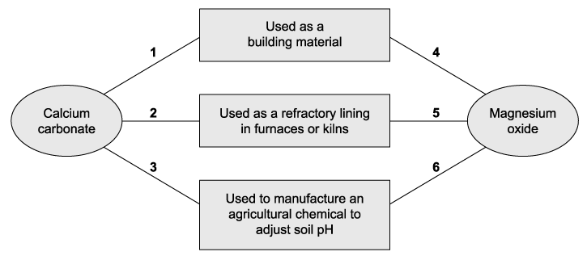
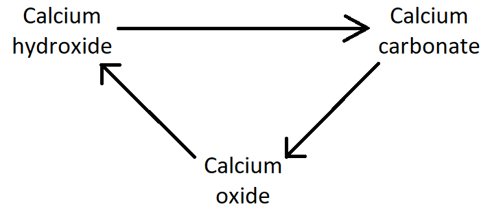

# Exam Questions — Similarities & Trends in the Properties of the Group 2 Metals, Magnesium to Barium, & Their Compounds
**10. Group 2** · Cambridge (CIE) AS chemistry (9701)
> Source: [https://www.savemyexams.com/as/chemistry/cie/25/topic-questions/](https://www.savemyexams.com/as/chemistry/cie/25/topic-questions/) · 43 questions across 2 sets

## Multiple Choice Questions (30 questions)

### Q1 — medium — 1 marks

**Q1** [1 mark]

The elements in Group 2, from magnesium to barium, show specific trends in the solubility of their hydroxides and sulfates.

Which row correctly describes the variation in the solubility of these compounds as the group is descended?

|   | solubility of Group 2 hydroxides | solubility of Group 2 sulfates |
|---|---|---|
| **A** | increases | decreases |
| **B** | decreases | increases |
| **C** | increases | increases |
| **D** | decreases | decreases |

### Q2 — hard — 1 marks

**Q2** [1 mark]

Compound **Q** is used as a refractory lining material in kilns.

Compound **R** is used as a building material. It can be heated in a kiln to form compound **S**. When **S** is hydrated it forms compound **T**, which is used in agriculture to treat soils.

Which row correctly identifies compounds **Q** and **S**?

|   | **Q** | **S** |
|---|---|---|
| **A** | CaCO3 | CaO |
| **B** | CaO | Ca(OH)2 |
| **C** | MgO | CaO |
| **D** | MgO | Ca(OH)2 |

### Q3 — hard — 1 marks

**Q3** [1 mark]

A colourless solution was formed when metal **Y** was reacted with water. This solution then gave a white precipitate when mixed with aqueous sulfuric acid.

What is metal **Y**?

### Q4 — medium — 1 marks

**Q4** [1 mark]

A compound was thermally decomposed to a constant mass; this gave off a colourless gas that reacted with limewater. The limewater went cloudy. The solid that was left was allowed to cool, and aqueous hydrochloric acid was added, a vigorous effervescence was seen.

What was the mineral compound?

### Q5 — easy — 1 marks

**Q5** [1 mark]

The Group 1 metals have lower melting points than the Group 2 metals in the same period.

Which explanation correctly accounts for this difference?

### Q6 — easy — 1 marks

**Q6** [1 mark]

Which statement about calcium oxide is **correct**?

### Q7 — medium — 1 marks

**Q7** [1 mark]

Thermal decomposition of magnesium nitrate, Mg(NO3)2, produces a white solid and a mixture of gases. One of the gases released is oxygen.

32.3 g of anhydrous magnesium nitrate is heated until no further reaction takes place.

What is the mass of oxygen produced?

### Q8 — medium — 1 marks

**Q8** [1 mark]

Thermal decomposition of compound **S** releases carbon dioxide gas and forms a white solid, **T**. **S** and **T** are not soluble in water. Compound **T** is used as a refractory kiln lining.

What is compound **S**?

### Q9 — medium — 1 marks

**Q9** [1 mark]

Which mass of solid residue will be obtained from the thermal decomposition of 5.10 g of anhydrous calcium nitrate?

### Q10 — easy — 1 marks

**Q10** [1 mark]

Samples of barium and calcium are added separately to beakers of cold water containing a few drops of litmus solution.

Which observation is made with calcium but **not** with barium?

### Q11 — easy — 1 marks

**Q11** [1 mark]

**X** is a Group 2 metal. Its hydroxide is more soluble than calcium hydroxide and its sulfate is more soluble than barium sulfate.

Which element is **X**?

### Q12 — hard — 1 marks

**Q12** [1 mark]

Group 2 metal carbonates can be used as fire retardants as they thermally decompose producing CO2. The CO2 removes the oxygen from the fire. Three minerals, each containing a mixture of two Group 2 metal carbonates, could be used as fire retardants.

Barytocalcite     BaCa(CO3)2

Dolomite        CaMg(CO3)2

Huntite                 Mg3Ca(CO3)4

What is the order of effectiveness as a fire retardant, from best to worst?

|   | **Best** |   | **Worst** |
|---|---|---|---|
| **A** | Dolomite | Barytocalcite | Huntite |
| **B** | Dolomite | Huntite | Barytocalcite |
| **C** | Huntite | Dolomite | Barytocalcite |
| **D** | Huntite | Barytocalcite | Dolomite |

### Q13 — medium — 1 marks

**Q13** [1 mark]

In agriculture, lime is added to damp soil followed by the nitrogenous fertiliser ammonium sulfate. The lime reacts with ammonium sulfate in the damp soil.

Which substances are formed in this reaction?

### Q14 — hard — 1 marks

**Q14** [1 mark]

Thermal decomposition of anhydrous magnesium nitrate, Mg(NO3)2, gives a white solid and a mixture of two gases **R** and **S**.

**S** is oxygen.

What is the ratio $\frac{\text{mass of}R\text{released}}{\text{mass of}S\text{released}}$?

### Q15 — medium — 1 marks

**Q15** [1 mark]

In a firework, magnesium is the fuel and barium nitrate is the oxidising agent.

Which substances are the solid products of this reaction?

### Q16 — medium — 1 marks

**Q16** [1 mark]

Group 2 nitrates undergo thermal decomposition according to the following equation.

X(NO3)2 $\rightarrow$ XO + 2NO2 + $\frac{1}{2}$ O2

Which Group 2 nitrate requires the highest temperature to bring about its thermal decomposition?

### Q17 — easy — 1 marks

**Q17** [1 mark]

Rat poison needs to be insoluble in rainwater but soluble at the low pH of stomach contents.

What is a suitable barium compound to use for rat poison?

### Q18 — hard — 1 marks

**Q18** [1 mark]

A mixture of two Group 2 compounds, **Y**, were thermally decomposed.

This reaction produced a white solid and only two gaseous products. One of the gaseous products relights a glowing splint.

What could be the components of mixture **Y**?

### Q19 — medium — 1 marks

**Q19** [1 mark]

The diagram shows some applications of compounds of Group 2 elements.

Which row represents the correct links?

|   | **Magnesium oxide** | **Calcium carbonate** |
|---|---|---|
| **A** | 4 and 5 only | 1, 2 and 3 |
| **B** | 4 and 6 only | 1, 2 and 3 |
| **C** | 5 only | 1 and 3 only |
| **D** | 6 only | 1 and 3 only |

### Q20 — easy — 1 marks

**Q20** [1 mark]

Which observation is made when a piece of strontium is placed in cold water?

### Q21 — hard — 1 marks

**Q21** [1 mark]

An anhydrous nitrate of a Group 2 metal was thermally decomposed. 6.00 g was used, and 3.06 g of gas was produced.

What is the nitrate compound?

### Q22 — hard — 1 marks

**Q22** [1 mark]

Thermal decomposition of the nitrates of beryllium, calcium, magnesium, and strontium produces the same products. When 4.00 g of one of these anhydrous nitrates is decomposed, 2.64 g of gas is produced.

What is the nitrate?

### Q23 — easy — 1 marks

**Q23** [1 mark]

The sketch graph shows the variation of one physical or chemical property with another for the Group 2 elements.

Which row gives the correct labels for the axes?

|   | ***X*****-axis** | ***Y*****-axis** |
|---|---|---|
| **A** | First ionisation energy | Atomic number |
| **B** | First ionisation energy | Atomic radius |
| **C** | Atomic number | Melting point |
| **D** | Atomic number | Mass number |

### Q24 — easy — 1 marks

**Q24** [1 mark]

The oxides BaO, CaO, MgO and SrO all produce alkaline solutions when added to water.

Which oxide produces a saturated solution with the highest pH?

### Q25 — easy — 1 marks

**Q25** [1 mark]

When barium is burnt in oxygen, what colour is the flame?

### Q26 — hard — 1 marks

**Q26** [1 mark]

When equal volumes of saturated solutions of barium hydroxide and calcium hydroxide are mixed, a white precipitate, **Y**, forms. The mixture is filtered, and carbon dioxide is bubbled through the filtrate, producing a second white precipitate, **Z**.

Which row correctly identifies **Y** and **Z**?

|   | **Y** | **Z** |
|---|---|---|
| **A** | Ba(OH)2 | Ca(OH)2 |
| **B** | Ba(OH)2 | CaCO3 |
| **C** | Ca(OH)2 | BaCO3 |
| **D** | Ca(OH)2 | Ba(OH)2 |

### Q27 — medium — 1 marks

**Q27** [1 mark]

When quicklime, water and sand are mixed, it makes lime mortar. Lime mortar hardens over time. Aqueous hydrochloric acid reacts with fresh and old lime mortar, but only the old lime mortar effervesces during the reaction.

Which equation describes the change from fresh to old lime mortar?

### Q28 — hard — 1 marks

**Q28** [1 mark]

Which row correctly compares magnesium and barium?

|   | **First ionisation energy of magnesium** | **First ionisation energy of barium** | **Reaction of magnesium with oxygen** | **Reaction of barium with oxygen** |
|---|---|---|---|---|
| **A** | lower | higher | faster | slower |
| **B** | lower | higher | slower | faster |
| **C** | higher | lower | faster | slower |
| **D** | higher | lower | slower | faster |

### Q29 — hard — 1 marks

**Q29** [1 mark]

A student performs several experiments on element **Y**, an alkaline earth metal, to determine its identity and the following observations are made:

1. When added to water, **Y**-hydroxide dissolves in water.
2. When added to water, **Y**-sulfate produces a white precipitate.
3. In order to thermally decompose **Y**-nitrate, more heat is required than to thermally decompose strontium nitrate.
4. When burned in oxygen **Y** will readily become **Y**O.

What is the identity of element **Y**?

### Q30 — medium — 1 marks

**Q30** [1 mark]

Which row describes the trends in the properties of the elements down Group 2?

|   | **Decomposition temperature of the carbonate** | **First ionisation energy** |
|---|---|---|
| **A** | Decreases | Decreases |
| **B** | Decreases | Increases |
| **C** | Increases | Increases |
| **D** | Increases | Decreases |

## Structured Questions (13 questions)

### Q1 — hard — 9 marks

**Q1** [2 marks]

Samples of calcium, strontium and barium are reacted with water to form their hydroxides. The resulting solutions are then filtered to collect the precipitates.

Explain the trend in the expected mass of the precipitates.

**Q1** [2 marks]

Table 2.1 shows the solubility data for the Group 2 metal hydroxides.

**Table 2.1**

| **Group 2 metal hydroxide** | **Solubility / g dm**-3** at 20 °C** |
|---|---|
| Magnesium hydroxide | 0.140 |
| Calcium hydroxide | 1.730 |
| Strontium hydroxide | 17.70 |
| Barium hydroxide | 38.90 |

A student determined that a 50 cm3 solution of an unknown Group 2 metal hydroxide contained 802 mg of the metal hydroxide.

Identify the metal hydroxide in the unknown sample. Show your working.

**Q1** [5 marks]

Magnesium hydroxide reacts with sulfuric acid.

i) Construct an equation for the reaction between magnesium hydroxide and sulfuric acid. Include state symbols.

[2]

ii) Barium hydroxide also reacts with sulfuric acid. State and explain any differences in the observations between the two reactions.

[3]

### Q2 — easy — 9 marks

**Q2** [3 marks]

A group of students are asked to prepare a sample of barium sulfate using barium carbonate.

Student **A** suggests adding sulfuric acid to the barium carbonate.

i) Construct an equation for the reaction of barium carbonate with sulfuric acid.

[1]

ii) Suggest a reason why this preparation of barium sulfate will not have a 100% yield.

[2]

**Q2** [2 marks]

Student **B** suggests that barium carbonate can be converted into barium sulfate in a two-step process.

barium carbonate `-> from heat to step 1 of` barium oxide $\overset{\mathrm{step}2}{\rightarrow}$ barium sulfate

i) Name the type of reaction that occurs in step 1.

[1]

ii) In step 2, barium oxide is reacted with sulfuric acid. Construct an equation for the reaction in step 2.

[1]

**Q2** [2 marks]

**Extract:**

Student **B** suggests that barium carbonate can be converted into barium sulfate in a two-step process.

barium carbonate →(heat, step 1) barium oxide →(step 2) barium sulfate

Student **C** makes an adaptation to student **B**'s suggestion.

barium carbonate `-> from heat to step 1 of` barium oxide `-> from water to step 2 of` barium hydroxide `-> from sulfuric acid to step 3 of` barium sulfate

State the solubility in water of barium hydroxide and barium sulfate.

**Q2** [2 marks]

**Extract:**

Student **C** makes an adaptation to student **B**'s suggestion.

barium carbonate →(heat, step 1) barium oxide →(water, step 2) barium hydroxide →(sulfuric acid, step 3) barium sulfate

Construct the ionic equation for the reaction in step 3 between barium hydroxide and sulfuric acid to form barium sulfate. Include state symbols.

### Q3 — medium — 9 marks

**Q3** [1 mark]

Group 2 hydroxides, M(OH)2, can be used to neutralise acids.

Construct an equation for the reaction of barium with cold water. State symbols are **not** required.

**Q3** [2 marks]

Explain why a saturated solution of barium hydroxide is more alkaline than a saturated solution of magnesium hydroxide.

**Q3** [3 marks]

An unknown solution of a group 2 metal salt was tested for the presence of carbonate ions.

Dilute hydrochloric acid was added to the solution and the gas given off was bubbled through limewater. A white precipitate formed.

i) Construct the **ionic** equation for the formation of the gas. State symbols are **not** required.

[1]

ii) Construct an equation for the formation of the precipitate. Include state symbols.

[2]

**Q3** [3 marks]

Magnesium hydroxide can be used as an indigestion remedy to neutralise hydrochloric acid in the stomach.

Mg(OH)2 + 2HCl → MgCl2 + 2H2O

Calculate the minimum mass of magnesium hydroxide needed to neutralise 0.210 mol of hydrochloric acid. Give your answer to an appropriate number of significant figures. Show your working.

### Q4 — medium — 9 marks

**Q4** [2 marks]

This question is about Group 2 elements and their compounds.

Explain why the first ionisation energy of calcium (590 kJ mol−1) is greater than that of strontium (550 kJ mol−1).

**Q4** [3 marks]

Strontium chloride is used in toothpaste for sensitive teeth.

i) Construct an equation for the formation of strontium chloride from strontium and hydrochloric acid. Include state symbols.

[2]

ii) Suggest why this reaction is not used to produce strontium chloride on an industrial scale.

[1]

**Q4** [2 marks]

Magnesium sulfate solution can be given as first aid to someone who has accidentally swallowed barium chloride.

Explain, with the help of an ionic equation, why drinking magnesium sulfate solution is an effective treatment for barium poisoning. State symbols are **not** required.

**Q4** [2 marks]

Milk of magnesia, Mg(OH)2, and calcium carbonate can both be used in the effective relief of acid indigestion.

By comparing the chemical equations for their reactions with hydrochloric acid, justify which remedy might cause the person taking it to have wind.

### Q5 — hard — 11 marks

**Q5** [5 marks]

i) Construct an equation for the thermal decomposition of calcium nitrate, Ca(NO3)2.

[1]

ii) State and explain how the thermal stabilities of the nitrates vary down Group 2.

[3]

iii) Predict what you would observe if a sample of lithium nitrate was heated.

[1]

**Q5** [3 marks]

The nitrates of calcium, strontium or barium are often added to firework mixtures to produce red or green flames. The equation for the decomposition of one such mixture is as follows.

Sr(NO3)2 (s) + 3C (s) → SrO (s) + N2 (g) + 2CO2 (g) + CO (g)

Calculate the volume of gas given off (measured at room temperature and pressure) when a 10.0 g sample of this mixture decomposes. Show your working.

[*M*r: Sr(NO3)2 = 211.6]

**Q5** [3 marks]

One of the major ores of magnesium is the mixed carbonate called dolomite, CaMg(CO3)2.

Calculate the percentage loss in mass that would be observed when a sample of dolomite is heated at a high temperature until the reaction is complete. Show your working.

### Q6 — easy — 14 marks

**Q6** [2 marks]

i) State the name of a Group 2 element that burns in air to give a bright white flame.

[1]

ii) Construct an equation for the reaction of this element with oxygen.

[1]

**Q6** [4 marks]

**Extract:**

The Group 2 element that burns in air with a bright white flame is:

- Magnesium / Mg

i) State the reagent and conditions required for magnesium to react to form magnesium hydroxide.

[2]

ii) Construct an equation for this reaction. Include state symbols.

[2]

**Q6** [3 marks]

Calcium is added to dilute hydrochloric acid.

i) State one observation for this reaction.

[1]

ii) Construct an equation for this reaction. Include state symbols.

[2]

**Q6** [5 marks]

i) Barium reacts with dilute hydrochloric acid. Construct an equation for this reaction. Include state symbols.

[2]

ii) Barium reacts with dilute sulfuric acid. Construct an equation for this reaction. Include state symbols.

[2]

iii) Explain why the reaction of barium with dilute sulfuric acid soon slows down and stops.

[1]

### Q7 — easy — 7 marks

**Q7** [1 mark]

State the type of reaction that occurs when strontium carbonate is heated to form strontium oxide and carbon dioxide.

SrCO3 (s) → SrO (s) + CO2 (g)

**Q7** [2 marks]

When heated, strontium nitrate breaks down to form strontium oxide, nitrogen dioxide and oxygen.

Complete the balanced chemical equation for this reaction.

2Sr(NO3)2 (s) → .......... (.....) + .......... (.....) + .......... (.....)

**Q7** [3 marks]

5.00 g of magnesium carbonate breaks down to form 1.75 g of magnesium oxide and carbon dioxide when heated.

MgCO3 (s) → MgO (s) + CO2 (g)

Calculate the percentage yield of magnesium oxide. Show your working.

**Q7** [1 mark]

Describe the trend in the thermal stability of the Group 2 carbonates and nitrates as you move down Group 2.

### Q8 — hard — 17 marks

**Q8** [4 marks]

Barium is silvery white but blackens when exposed to air.

This is due to the formation of barium nitride and one other compound.

Construct equations for the two separate reactions that occur. Include state symbols.

**Q8** [4 marks]

Barium can also react with water.

A student reacted 0.20 g of barium with 250 cm3 of water.

i) Calculate the volume of gas, in cm3, produced in this reaction at room conditions. Show your working.

[3]

ii) Calculate the concentration, in mol dm-3, of the barium hydroxide solution produced.

[1]

**Q8** [4 marks]

Describe and explain the trend in the reactivity of Group 2 elements with water.

**Q8** [2 marks]

Explain why the reaction of calcium with water is a redox reaction.

Use oxidation numbers in your answer.

**Q8** [3 marks]

The trend in solubility and strength as a base can also be observed going down Group 2.

Explain how these two trends are connected.

### Q9 — easy — 10 marks

**Q9** [2 marks]

Group 2 oxides react with water to form Group 2 hydroxides.

Describe the general trends in solubility and pH of the Group 2 hydroxides as you move down Group 2.

**Q9** [4 marks]

3.71 g of calcium hydroxide, Ca(OH)2, is added to hydrochloric acid.

i) Construct an equation for this reaction.

[2]

ii) Calculate the mass of calcium chloride produced in this reaction. Show your working.

[2]

**Q9** [4 marks]

Strontium carbonate reacts with hydrochloric acid to form strontium chloride, water and carbon dioxide.

i) Describe a test to identify the gas produced as carbon dioxide.

[2]

ii) Carbon dioxide is also produced when strontium carbonate reacts with sulfuric acid. The effervescence observed in this reaction stops after a short period of time.

Suggest why the reaction stops even though the reactants have not been used up.

[2]

### Q10 — medium — 10 marks

**Q10** [3 marks]

Group 2 metals and their compounds are used commercially in a variety of processes and applications.

Calcium carbonate is an insoluble solid that can be used to lower the acidity of lake water.

Explain why the rate of this reaction decreases when the water temperature falls.

**Q10** [1 mark]

Calcium carbonate reacts with lactic acid (Figure 3.1) to form calcium lactate, which is used to treat or prevent low blood calcium levels (hypocalcemia).

**Figure 3.1**

State the **two** other products of the reaction of calcium carbonate with lactic acid.

*Source: Feb 2018 9701/22 Q3D*

**Q10** [4 marks]

Magnesium can be used to extract titanium.

i) Construct an equation to show how magnesium is used as the reducing agent in the reaction of magnesium with titanium(IV) chloride. State symbols are **not** required.

[2]

ii) Explain, in terms of oxidation numbers, why magnesium is the reducing agent.

[1]

iii) The excess magnesium used in this extraction is removed by reacting it with dilute sulfuric acid to form magnesium sulfate.

Explain why the magnesium sulfate formed is easy to separate from the titanium.

[1]

**Q10** [2 marks]

Strontium metal is used in the manufacture of alloys.

Explain why strontium has a higher melting point than barium.

### Q11 — medium — 12 marks

**Q11** [2 marks]

Magnesium, calcium and barium are some of the Group 2 elements of the Periodic Table.

State and explain the trend in the atomic radius of the Group 2 elements from magnesium to barium.

**Q11** [2 marks]

Magnesium is frequently used in fireworks. It burns rapidly in oxygen, and it adds sparks which generally improves the appearance and brilliance of the firework.

Construct an equation to represent the reaction which takes place when a strip of magnesium is burned in oxygen and state an observation which would be made.

State symbols are **not** required.

**Q11** [5 marks]

Group 2 compounds, such as the hydroxides of magnesium and calcium, have a number of other uses.

i) Construct equations to show the formation of magnesium hydroxide and calcium hydroxide from their metals.

[2]

ii) Give an approximate pH value and a use for each of the hydroxides.

[3]

**Q11** [3 marks]

Group 2 elements will react with water.

A student added 20 cm3 of water to two boiling tubes. A small piece of calcium was added to one of the boiling tubes and a small piece of barium was added to the other.

State **two** observations that the student would make and how the observations would differ between the two boiling tubes.

### Q12 — medium — 14 marks

**Q12** [4 marks]

Calcium salts have a number of industrial, agricultural and medicinal uses.

Calcium carbonate is used as an antacid to relieve heartburn, acid indigestion, and upset stomach. Calcium oxide is used to make porcelain, glass, mortars and cement. Calcium hydroxide is used in agriculture when a rapid change in the pH of soil is required.

These three calcium salts are connected by the Lime cycle shown in Fig. 4.1.

**Fig. 4.1**

Construct **three** equations to demonstrate the reactions that occur in the Lime cycle. Include state symbols.

**Q12** [4 marks]

In agriculture, bulk lime spreaders are used to cover fields with solid calcium salts, including calcium carbonate, calcium oxide and calcium hydroxide.

i) Explain how solid calcium hydroxide increases the pH of acidic soil.

[3]

ii) Construct an **ionic** equation to show the reaction that causes the pH of the soil to increase. State symbols are **not** required.

[1]

**Q12** [4 marks]

When calcium carbonate is heated strongly it undergoes a process called calcination.

i) What is the chemical reaction that is described by calcination?

[1]

ii) Explain why strontium carbonate has greater thermal stability than calcium carbonate.

[3]

**Q12** [2 marks]

A sample of hydrated calcium nitrate crystals was gently heated in a test tube. With further heating, a mixture of two gases was evolved. One of the gases was coloured and the other was colourless.

i) Identify the coloured gas and give its colour.

[1]

ii) Identify and describe a test, including the result, for the colourless gas.

[1]

### Q13 — easy — 9 marks

**Q13** [3 marks]

Complete Table 4.1 to describe the general trends as you move down Group 2.

**Table 4.1**

| **Property** | **Trend** |
|---|---|
| Melting point |   |
| Atomic radius |   |
| First ionisation energy |   |

**Q13** [1 mark]

**Extract:**

Complete Table 4.1 to describe the general trends as you move down Group 2.

**Table 4.1**

| **Property** | **Trend** |
| --- | --- |
| Melting point |   |
| Atomic radius |   |
| First ionisation energy |   |

The completed table is:

| **Property** | **Trend** |
| --- | --- |
| Melting point | Decreases |
| Atomic radius | Increases |
| First ionisation energy | Decreases |

Name the Group 2 element that does not follow the general trend in melting point.

**Q13** [2 marks]

Construct equations for the first ionisation energy of barium and the second ionisation energy of calcium. Include state symbols.

**Q13** [3 marks]

The trend in ionisation energy down Group 2 can be explained by the factors shown in Table 4.2.

Complete Table 4.2 to show how each factor changes as you move down Group 2.

**Table 4.2**

| **Factor affecting ionisation energy** | **Increase / decrease** |
|---|---|
| Distance between the nucleus and outer electron |   |
| Shielding |   |
| Nuclear attraction |   |
