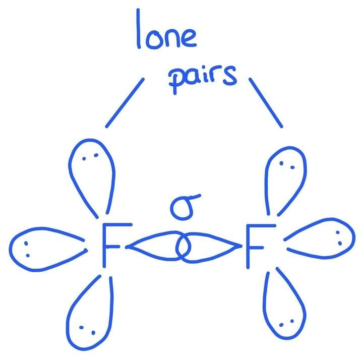

# Mark Schemes — Physical Properties of the Group 17 Elements
**11. Group 17** · Cambridge (CIE) AS chemistry (9701)

## Multiple Choice Questions (11 questions)

### Q1
**Final answer:** **The correct answer is C**

- Room temperature and pressure (r.t.p.) is approximately 293 K.
- The boiling point of bromine (332 K) is above r.t.p., so bromine has not yet boiled.

  - Therefore **Y** = liquid
- The boiling point of iodine (457 K) is well above r.t.p., so iodine is a solid, consistent with the given data.
- Halogen colours at r.t.p.:

  - Chlorine is pale green
  - Bromine is red-brown
  - Iodine is grey-black as a solid
- Therefore **X** = red-brown and **Z** = grey-black.

**A** is incorrect as bromine is a liquid at r.t.p. (boiling point 332 K > 293 K), not a gas. Iodine is not purple as a solid.

**B** is incorrect as pale yellow describes fluorine, not bromine. Iodine is not purple as a solid.

**D** is incorrect as bromine is a liquid at r.t.p., not a solid.

### Q2
**Final answer:** **The correct answer is D**

- The bond dissociation energy of the hydrogen halides decreases from HCl to HI.

  - So, the statement that it increases is incorrect.
- Down Group 17, the atomic radius of the halogen increases.

  - This makes the H–X bond longer and reduces the effective orbital overlap between the hydrogen 1s orbital and the halogen p orbital.
  - A longer bond with less effective orbital overlap has a lower bond dissociation energy, so HI has a lower bond dissociation energy than HCl.

**A** is incorrect as the statement is true. Down Group 17, atomic radius increases and there is greater electron shielding, so the outermost electrons are less strongly attracted to the nucleus. Less energy is needed to remove an electron from astatine than from iodine, giving astatine a lower first ionisation energy.

**B** is incorrect as the statement is true. When haloalkanes are warmed with aqueous silver nitrate in ethanol, the rate of hydrolysis depends on the C–X bond enthalpy. The C–I bond is longer and weaker than C–Cl or C–Br, so CH3I undergoes hydrolysis and produces a precipitate the fastest.

**C** is incorrect as the statement is true. Fluorine has the smallest atomic radius and least electron shielding in Group 17, giving it the greatest nuclear attraction for incoming electrons. This makes it the strongest oxidising agent and therefore the weakest reducing agent.

### Q3
**Final answer:** **The correct answer is C**

- X2 diatomic halogen molecules are non-polar, so only instantaneous dipole-induced dipole forces act between them.
- Down Group 17, the number of electrons per molecule increases, making the electron cloud more polarisable.
- This increases the strength of the van der Waals' forces, so iodine has stronger forces between its molecules than chlorine.

**A** is incorrect as the oxidising ability of the halogens decreases down Group 17. Iodine has a larger atomic radius and more electron shielding, so its nucleus exerts a weaker attraction for incoming electrons.

**B** is incorrect as the solubility of silver halides in aqueous ammonia decreases down the group. Silver chloride dissolves in dilute aqueous ammonia; silver iodide is insoluble even in concentrated aqueous ammonia.

**D** is incorrect as the thermal stability of hydrogen halides decreases down Group 17. The H–I bond is longer and weaker than H–Cl, so HI decomposes more readily.

### Q4
**Final answer:** **The correct answer is D**

- Down Group 17, the atomic radius of the halogen increases as more principal quantum shells are added.

- Bond length:

  - The larger atomic radius of the halogen means the H–X bond is longer from HCl to HI, so bond length increases.

- Ease of oxidation:

  - The larger the halide ion, the further the outer electrons are from the nucleus and the more shielded they are.
  - It is therefore easier for the halide ion to lose an electron, so ease of oxidation increases from HCl to HI.

- Thermal stability:

  - The longer H–X bond has a lower bond enthalpy.
  - Less energy is needed to break the bond, so the hydrogen halide decomposes more easily.
  - Thermal stability decreases from HCl to HI.

**A**, **B**, and **C** are incorrect as the bond length increases (not decreases) down Group 17 from HCl to HI.

### Q5
**Final answer:** **The correct answer is A**

- First ionisation energy generally increases across a period as nuclear charge increases.
- A sharp drop occurs at the start of a new period because the outermost electron enters a new principal quantum shell that is further from the nucleus and more shielded by inner electrons.
- The peak before the drop (B) is therefore a Group 18 noble gas, and the trough (C) is a Group 1 alkali metal.
- The sequence for the four consecutive elements is:

Group 17 (A) → Group 18 (B) → Group 1 (C) → Group 2 (D).

- An element that forms a covalent compound with hydrogen with formula HX must have 7 electrons in its outermost principal quantum shell, so that it can share one electron with hydrogen to complete its outer shell.
- This describes a Group 17 halogen.

  - Therefore element X is **A**.

**B** is incorrect as this is a Group 18 noble gas with a full outer shell. Noble gases are chemically inert and do not form covalent compounds with hydrogen.

**C** is incorrect as this is a Group 1 alkali metal. It forms ionic hydrides (e.g. NaH), not covalent compounds with formula HX.

**D** is incorrect as this is a Group 2 alkaline earth metal. It forms ionic hydrides with formula XH2 (e.g. CaH2), not HX.

### Q6
**Final answer:** **The correct answer is A**

- Halogen molecules (X2) are non-polar and interact via weak instantaneous dipole-induced dipole forces.
- Down Group 17, the number of electrons per molecule increases, making the electron cloud more polarisable.
- This leads to stronger instantaneous dipole-induced dipole forces and a steadily increasing boiling point from fluorine to iodine.

**B** is incorrect as bond length increases down Group 17. The atomic radius increases with each additional principal quantum shell, making the X–X bond longer from F2 to I2.

**C** is incorrect as bond energy does not increase steadily down Group 17. The F–F bond is anomalously weak due to lone-pair repulsion between the very small fluorine atoms. Bond energy peaks at Cl2 and then decreases to Br2 and I2.

**D** is incorrect as boiling point increases, not decreases, down Group 17.

### Q7
**Final answer:** **The correct answer is D**

- For an acid to be strong, it must fully dissociate in aqueous solution to release H+ ions.
- The degree of dissociation depends on how easily the H–X bond breaks.
- Fluorine has a smaller atomic radius than bromine, so the H–F bond is shorter and has a higher bond dissociation energy than H–Br.
- Since the H–F bond is stronger, it does not break as easily. HF (aq) only partially dissociates, making it a weak acid.
- HBr (aq) fully dissociates and releases more H+ ions, so it is a stronger acid.

**A** is incorrect as the stronger acid, HBr (aq), dissociates more readily than HF (aq), not the other way around.

**B** is incorrect as HBr (aq) releases more H+ ions than HF (aq), since HBr is the stronger acid that fully dissociates.

**C** is incorrect as the H–F bond has a higher bond dissociation energy than H–Br. Fluorine’s smaller atomic radius makes the H–F bond shorter and stronger.

### Q8
**Final answer:** **The correct answer is C**

- The report states that gaseous bromine was purple.

  - This is chemically incorrect.
  - Bromine vapour is orange/red-brown in colour.
  - Purple is the colour of iodine vapour, not bromine.
- The colours of Group 17 elements:

  - Fluorine is pale yellow
  - Chlorine is yellow-green
  - Bromine is orange/red-brown
  - Iodine is a grey-black solid that produces purple vapour.

**A** is incorrect as the statement is chemically true. Bromine gas (*M*r ≈ 160) is significantly denser than air (average *M*r ≈ 29) and sinks to drift along the ground.

**B** is incorrect as the statement is chemically true. Bromine is moderately soluble in water, dissolving to form bromine water.

**D** is incorrect as the statement is chemically true. Bromine is a volatile liquid at r.t.p. due to weak instantaneous dipole-induced dipole forces between its molecules and vaporises readily.

### Q9
**Final answer:** **The correct answer is D**

- X2 diatomic halogen molecules are non-polar, so only weak instantaneous dipole-induced dipole forces act between them.
- The strength of these forces increases down Group 17 as the number of electrons per molecule increases.
- A greater number of electrons gives a larger, more polarisable electron cloud, increasing the likelihood of instantaneous dipoles forming.
- Stronger intermolecular forces require more energy to overcome, so boiling point increases.

**A** is incorrect as X2 molecules are non-polar and have no permanent dipole.

**B** is incorrect as the X–X covalent bond strength decreases down Group 17.

**C** is incorrect as electronegativity decreases down Group 17, but this property does not explain the trend in boiling points.

### Q10
**Final answer:** **The correct answer is C**

- Halogen molecules (X2) interact only via instantaneous dipole-induced dipole forces.
- Down Group 17 from chlorine to iodine, the number of electrons per molecule increases, making the electron cloud more polarisable.
- This leads to stronger instantaneous dipole-induced dipole forces, so the strength of van der Waals' forces increases.
- The X–X covalent bond strength decreases down the group because the atomic radius of the halogen increases, making the bond longer and reducing the effective orbital overlap between the bonding pairs and the nuclei.

**A** and **B** are incorrect as van der Waals' forces increase, not decrease, down Group 17 from chlorine to iodine.

**D** is incorrect as the covalent bond strength decreases, not increases, down the group.

### Q11
**Final answer:** **The correct answer is A**

- Chlorine has two stable isotopes: 35Cl and 37Cl.
- A Cl2 molecule with a relative molecular mass of 72 must contain one atom of each isotope:

35Cl + 37Cl = 72

35Cl + 35Cl = 70

37Cl + 37Cl = 74

- Isotopes of the same element have the same number of protons and the same electron configuration.
- Because both atoms have the same nuclear charge and the same number of electrons, they have the same atomic radius.

**B** is incorrect as the nucleon number (protons + neutrons) differs. 35Cl has nucleon number 35 and 37Cl has nucleon number 37.

**C** is incorrect as the number of neutrons differs. 35Cl has 18 neutrons and 37Cl has 20 neutrons.

**D** is incorrect as the relative isotopic mass differs. 35Cl has relative isotopic mass 35 and 37Cl has relative isotopic mass 37.

## Structured Questions (3 questions)

### Q1
i) The completed Table 2.1 is:

| **Halogen** | **Boiling point / °C** | **Colour** |
|---|---|---|
| Chlorine | −36 | **Final answer:** **green / yellow-green** |
| Bromine | 59 | **Final answer:** **brown / red-brown** |
| Iodine | 184 | **Final answer:** **(dark) grey / black** |

**[1 mark]**

> **[mark-scheme]**
> i) 1 mark for all three colours correct.
> 
> Purple is not accepted for any halogen as it is the colour of iodine vapour or iodine dissolved in non-polar solvents, not the colour of solid iodine at room temperature.
> 
> ii) The boiling points increase from chlorine to iodine because:
> 
> - There are more electrons in the molecules going down the group; **[1 mark]**
> - The instantaneous dipole-induced dipole (id-id) forces of attraction between the molecules are stronger; **[1 mark]**

> **[exam-tip]**
> The colours of the halogens get darker going down the group. Learn these:
> 
> - Chlorine is a green/yellow-green gas
> - Bromine is a brown liquid
> - Iodine is a dark grey solid.
> 
> When explaining why boiling points increase down Group 17, you must name the specific type of intermolecular force. Writing "van der Waals' forces" alone is not sufficient. You must state "instantaneous dipole-induced dipole (id-id) forces" to secure the mark.
> **[mark-scheme]**
> The full electronic configuration of bromine is:
> 
> - 1s2 2s2 2p6 3s2 3p6 3d10 4s2 4p5
> **OR**
> 1s2 2s2 2p6 3s2 3p6 4s2 3d10 4p5 **[1 mark]**

> **[exam-tip]**
> You have been asked for the full electronic configuration, so you must write it out using 1s2 2s2 2p6... notation. Using [Ar] as a shortcut is not accepted.
> 
> Bromine is in Period 4 and is the fifth element in the p block, so its configuration ends in 4p5.
> 
> Remember: the 3d subshell in Period 4 elements is written as 3d, not 4d. Either ordering of 4s2 and 3d10 is accepted.
> **[mark-scheme]**
> Bromine is a liquid at room temperature while fluorine and chlorine are gases because:
> 
> - Bromine has a higher boiling point than fluorine and chlorine **[1 mark]**
> - Bromine molecules have more electrons than fluorine or chlorine molecules **[1 mark]**
> - The instantaneous dipole-induced dipole (id-id) forces between Br2 molecules are stronger, so more energy is required to separate the molecules **[1 mark]**
> 
> The reverse argument (fluorine and chlorine have fewer electrons, weaker id-id forces, lower boiling points, so exist as gases) is also accepted.

> **[exam-tip]**
> You must be able to state and explain the trend in boiling points down Group 17.
> 
> The key reasoning chain:
> 
> - More electrons per molecule
> - → stronger instantaneous dipole-induced dipole (id-id) forces
> - → more energy needed to overcome these forces
> - → higher boiling point
> - → liquid or solid state at room temperature.
> 
> Going down Group 17, fluorine and chlorine are gases, bromine is a liquid, and iodine is a solid. This reflects the increasing strength of id-id forces as the molecules get larger.
> **[mark-scheme]**
> The bond enthalpy of F2 is lower than that of Cl2 because:
> 
> - The fluorine atom is very small / the F–F bond is very short, so the lone pairs on adjacent fluorine atoms are very close together **[1 mark]**
> - This causes strong repulsion between the lone pairs, which weakens the bond **[1 mark]**

> **[exam-tip]**
> Bond enthalpy is the energy needed to break one mole of a given covalent bond. The higher the bond enthalpy, the stronger the bond.
> 
> The general trend down Group 17 is for bond enthalpy to decrease as the atoms get larger and bonds get longer. However, fluorine is an exception because its bond enthalpy is lower than chlorine's despite being at the top of the group.
> 
> This is because fluorine atoms are so small that the lone pairs on the two F atoms in F2 are unusually close together. The lone pair repulsion partially counteracts the bonding attraction and makes the F–F bond weaker than expected.

### Q2
> **[mark-scheme]**
> The trend in volatility of the halogens is:
> 
> - Volatility decreases (down the group / from Cl2 to I2) **[1 mark]**
> - (The number of) electrons in the molecules increases **[1 mark]**
> - Resulting in stronger id-id forces between molecules **[1 mark]**

> **[exam-tip]**
> - Volatility refers to how easily a substance is converted into a gas
> - Cl2 has the fewest electrons, the weakest id-id forces, and the highest volatility. So, it is a gas at room temperature
> - Br2 has more electrons, stronger id-id forces, and lower volatility. So, it is a liquid at room temperature
> - I2 has the most electrons, the strongest id-id forces, and the lowest volatility. So, it is a solid at room temperature
> **[mark-scheme]**
> Cl2 reacts more vigorously with I− than Br2 does because:
> 
> - Cl2 is a stronger oxidising agent than Br2 / Cl2 has a greater ability to attract electrons than Br2 **[1 mark]**
> - Chlorine atoms are smaller / the outer electrons of Cl are closer to the nucleus, so the nuclear attraction for electrons is greater in Cl than in Br **[1 mark]**

> **[exam-tip]**
> - Both Cl2 and Br2 can displace iodide ions from solution, but Cl2 does so more vigorously
> - Going down Group 17, oxidising ability decreases
> 
>   - Cl2 is a stronger oxidising agent than Br2 because its outer electrons are in a shell closer to the nucleus
> **[mark-scheme]**
> The predicted properties of astatine at room temperature are:
> 
> - Physical state: solid **[1 mark]**
> - Colour: black / very dark (purple) **[1 mark]**

> **[exam-tip]**
> - Following the trend down Group 17: Cl2 is a gas, Br2 is a liquid, I2 is a solid. So, astatine should be a solid at room temperature
> - The colour trend (Cl2 pale yellow-green, Br2 orange-red, I2 dark grey/purple) suggests astatine should be very dark in colour, likely black

### Q3
> **[mark-scheme]**
> The trend in boiling points of the halogens from fluorine to iodine is:
> 
> Trend:
> 
> - Boiling point increases (down the group) **[1 mark]**
> 
> Explanation:
> 
> - (Due to) id-id forces between molecules **[1 mark]**
> - More electrons in the molecules (as Mr increases) / larger electron cloud **[1 mark]**

> **[exam-tip]**
> - Id-id (induced dipole–induced dipole) forces are a type of intermolecular force that increases in strength as the number of electrons in the molecule increases
> - The greater the number of electrons, the more polarisable the electron cloud, resulting in stronger id-id forces and higher boiling points
> **[mark-scheme]**
> The deviation in this trend is:
> 
> - The F–F bond enthalpy is lower than expected / the F–F bond is weaker than the Cl–Cl bond **[1 mark]**
> 
> Explanation:
> 
> - Fluorine atoms are small, so the lone pairs on adjacent F atoms are in close proximity, causing repulsion (which weakens the F–F bond) **[1 mark]**

> **[exam-tip]**
> The diagram below shows the lone pair repulsion in F2:
> 
> 
> 
> - A sigma bond is formed between two fluorine atoms, and there are three lone pairs on each F atom
> - The lone pairs get so close to each other in F2 that they cause repulsion, which decreases the bond enthalpy
> **[mark-scheme]**
> The simplest ionic equation and observation are:
> 
> - Cl2 + 2I− → 2Cl− + I2 **[1 mark]**
> - The solution turns brown / yellow-brown / orange-brown **[1 mark]**

> **[exam-tip]**
> - The question asks for the simplest ionic equation, which means that including spectator ions (Na+) will lose the mark
> - Make sure you know the observations for iodine in different solvents:
> 
>   - Aqueous iodine: brown solution
>   - Iodine in organic solvent: purple solution
