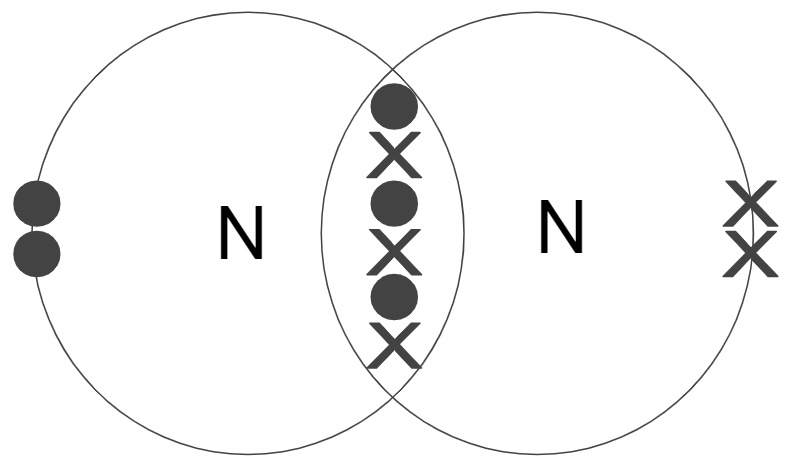
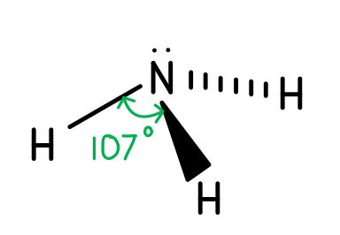
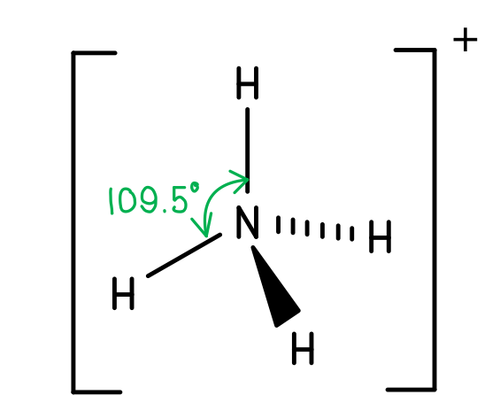
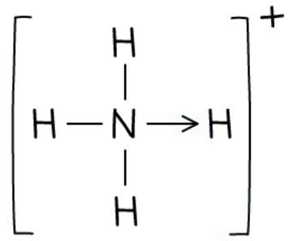
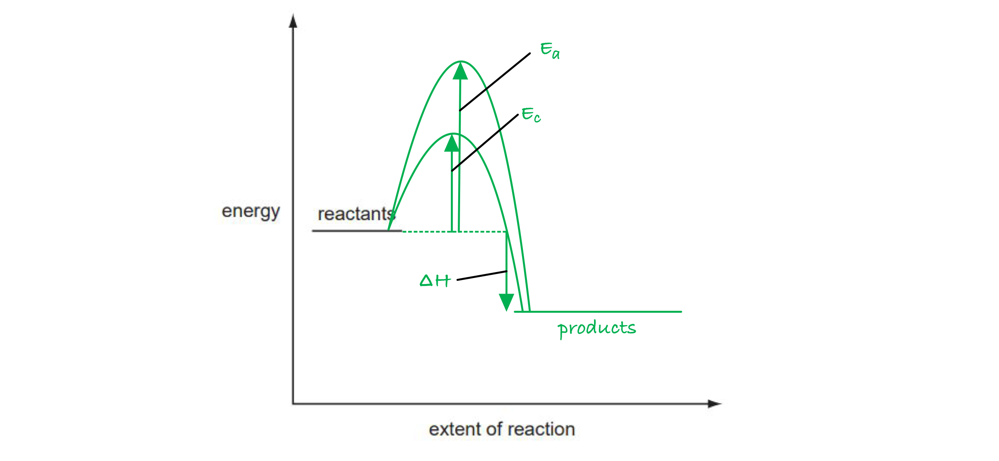

# Mark Schemes — Nitrogen & Sulfur
**12. Nitrogen & Sulfur** · Cambridge (CIE) AS chemistry (9701)

## Multiple Choice Questions (17 questions)

### Q1
**Final answer:** **The correct answer is C**

- Sunlight (UV radiation) provides the energy to initiate reactions between oxides of nitrogen (such as NO and NO2, released from car exhausts) and unburnt hydrocarbons in the atmosphere.

- These reactions produce ozone (O3) and peroxyacetyl nitrate (PAN), which are the main components of photochemical smog.

**A **is incorrect as heat does not drive photochemical smog formation; UV radiation from sunlight is required. Hydrocarbons are a reactant but do not supply the energy.

**B **is incorrect as nitrogen (N2) is not a pollutant and does not contribute to photochemical smog. The relevant species are oxides of nitrogen (NO, NO2).

**D **is incorrect as sulfur oxides (SO2, SO3) contribute to acid rain, not photochemical smog. The third reactant in smog formation is unburnt hydrocarbons.

### Q2
**Final answer:** **The correct answer is D**

- Write the unbalanced equation:

(NH4)2SO4 (s) + O2 (g) → H2SO4 (aq) + HNO3 (aq) + H2O (l)

- Balance N:

  - 2 N atoms in (NH4)2SO4 → 2HNO3 on the right

- Balance H:

  - (NH4)2SO4 has 8 H; H2SO4 accounts for 2 H
  - 2HNO3 accounts for 2 H
  - Remaining 4 H → 2H2O

- Count O:

  - Products contain 4 + 6 + 2 = 12 O; SO42- contributes 4 O to the left
  - Therefore 8 O must come from O2 → 4 mol O2

(NH4)2SO4 (s) + 4O2 (g) → H2SO4 (aq) + 2HNO3 (aq) + 2H2O (l)

**A **is incorrect as 1 mol O2 provides only 6 O atoms in total (4 from SO42- + 2 from O2), far fewer than the 12 required by the products.

**B **is incorrect as 2 mol O2 provides only 8 O atoms in total (4 + 4), which is still 4 short of the 12 required.

**C **is incorrect as 3 mol O2 provides only 10 O atoms in total (4 + 6), which is 2 short of the 12 required.

### Q3
**Final answer:** **The correct answer is A**

- Sulfur dioxide dissolves in water to form sulfurous acid, H2SO3:

SO2 (g) + H2O (l) → H2SO3 (aq)

- Ammonia acts as a Brønsted-Lowry base, accepting protons from H2SO3 in a neutralisation reaction:

2NH3 (aq) + H2SO3 (aq) → (NH4)2SO3 (aq)

- Adding ammonia ‘until just alkaline’ indicates excess base, meaning both acidic protons of H2SO3 are removed to give the full sulfite salt (NH4)2SO3.

**B **is incorrect as (NH4)2SO4 contains the sulfate ion SO42-, which would require NH3 to react with sulfuric acid H2SO4, not sulfurous acid.

**C **is incorrect as NH4HSO3 is ammonium bisulfite, formed in a 1:1 ratio (NH3:H2SO3). A 1:1 reaction produces an acidic solution, not an alkaline one.

**D **is incorrect as NH4HSO4 contains the bisulfate ion HSO4-, which would require NH3 to react with the stronger acid H2SO4.

### Q4
**Final answer:** **The correct answer is C**

- Air is taken into the engine to provide oxygen for fuel combustion.
- Nitrogen makes up approximately 79% of air and is largely unreactive during combustion.

  - So, it passes through the engine and constitutes the largest proportion of exhaust fumes.
- Although small amounts of nitrogen react with oxygen at high temperatures to produce oxides of nitrogen, these are removed by the catalytic converter.

**A** is incorrect as carbon dioxide is a combustion product of fuel; although present in exhaust fumes, its proportion is much lower than that of nitrogen.

**B** is incorrect as carbon monoxide is a product of incomplete combustion and is present only in trace proportions in exhaust fumes.

**D** is incorrect as water vapour is also a combustion product of fuel but is present in a smaller proportion than nitrogen.

### Q5
**Final answer:** **The correct answer is C**

- The Brønsted-Lowry theory defines acids as proton donors and bases as proton acceptors.

- Ammonia accepts a proton (H+) from water to form an ammonium ion (NH4+), acting as a Brønsted-Lowry base:

NH3 + H2O ⇌ NH4+ + OH-

- The nitrogen atom donates its lone pair to a hydrogen ion to form a dative covalent bond, producing NH4+.

**A **is incorrect as ammonia cannot donate a proton under these conditions and so does not act as a Brønsted-Lowry acid.

**B **is incorrect as ammonia acts only as a base. It accepts protons but does not donate them, so it is not amphoteric.

**D **is incorrect as ammonia undergoes acid-base reactions due to its lone pair, so it is not neutral.

### Q6
**Final answer:** **The correct answer is D**

- In this reaction, ammonia acts as a Brønsted-Lowry acid: sodium removes an H atom from NH3, breaking the N–H bond and forming sodium amide (NaNH2) and H2.

- The lone pair on nitrogen is not involved, so it remains on nitrogen throughout the reaction.

**A **is incorrect as nitrogen's lone pair donates into an empty orbital on Ag+ to form a dative (coordinate) bond in the diamminesilver(I) complex. The lone pair is directly involved.

**B **is incorrect as nitrogen's lone pair attacks the electrophilic carbon of CH3I in a nucleophilic substitution, displacing I-. The lone pair is directly involved.

**C **is incorrect as nitrogen's lone pair accepts a proton (H+) from HCl, acting as a Brønsted-Lowry base to form NH4Cl. The lone pair is directly involved.

### Q7
**Final answer:** **The correct answer is ****A**

- List the number of each atom on either side of the unbalanced reaction:

| **Element** | **Number of reactant atoms** | **Number of product atoms** |
|---|---|---|
| **N** | 1 | 1 |
| **H** | 3 | 2 |
| **O** | 2 | 2 |

- Look for differences in the equation, start with elements like metals and carbons, then oxygens and then hydrogens.

- There are **equal** numbers of O and N but **unequal **numbers of H on either side.

- Change the numbers to match by adjusting the coefficients.

  - **5**O2 (g) + **4**NH3 (g) $\rightarrow$ **4**NO (g) + **6**H2O (g)

| **Element** | **Number of reactant atoms** | **Number of product atoms** |
|---|---|---|
| **N** | 4 | 4 |
| **H** | 12 | 12 |
| **O** | 10 | 10 |

**B **is incorrect as this gives 10 reacting oxygen but 9 product oxygen and 12 reacting hydrogen but 10 product hydrogen.

**C** is incorrect as this gives 12 reacting oxygen but 9 product oxygen and 15 reacting hydrogen but 8 product hydrogen.

**D** is incorrect as this gives 18 reacting hydrogen but 8 product hydrogen.

### Q8
**Final answer:** **The correct answer is C**

- Nitrogen dioxide acts as a homogeneous catalyst for the oxidation of SO2 to SO3 in the atmosphere:

NO2 (g) + SO2 (g) → NO (g) + SO3 (g)

- In this reaction, nitrogen is reduced (+4 → +2) and sulfur is oxidised (+4 → +6).

- SO3 reacts with water to form sulfuric acid, which contributes to acid rain.

- NO is subsequently re-oxidised back to NO2 by oxygen, completing the catalytic cycle.

**A **is incorrect as carbon monoxide does not reduce nitrogen dioxide in the atmosphere under these conditions.

**B **is incorrect as CO does not react with NO2 in the atmosphere; the reducing agent in the acid rain mechanism is SO2.

**D **is incorrect as carbon dioxide does not oxidise SO2 to SO3. The oxidising agent is NO2, not CO2.

### Q9
**Final answer:** **The correct answer is B**

- Ammonia (NH3) contains a lone pair of electrons on the nitrogen atom.
- This lone pair can be donated to a hydrogen ion (H+) to form a dative (co-ordinate) bond, producing the ammonium ion (NH4+).
- In accepting the proton, ammonia acts as a Brønsted-Lowry base.

**A **is incorrect as nucleophiles donate a pair of electrons to an electrophile. When ammonia reacts with bromoethane, it donates its lone pair to the electrophilic carbon in a nucleophilic substitution.

**C **is incorrect as ammonia is a base that accepts hydrogen ions (protons), not hydroxide ions. OH- is itself a base.

**D **is incorrect as the ammonia molecule has a trigonal pyramidal shape with bond angles of 107°, not 109.5°. The lone pair exerts greater repulsion than bonding pairs, compressing the bond angles.

### Q10
**Final answer:** **The correct answer is D**

- Nitrogen dioxide acts as a catalyst in the formation of SO3 from SO2 in the environment. As a catalyst, it is regenerated and not consumed.

- Calculate the moles of SO3 to understand the distractor values:

n(SO3) = $\frac{6.00}{24.0}$ = 0.25 mol

- In this experiment, SO3 reacts directly with water:

SO3 + H2O → H2SO4.

- NO2 is not involved in this step.
- So, the amount of NO2 remains 0.75 mol.

**A **is incorrect as catalysts are not consumed in reactions. NO2 is regenerated and its amount does not change.

**B **is incorrect as 0.25 mol is the number of moles of SO3 present. If NO2 were consumed in a 2:1 ratio with SO3, the amount remaining would be 0.75 − 0.50 = 0.25 mol. However, NO2 is not consumed.

**C **is incorrect as 0.50 mol would result if NO2 were consumed in a 1:1 mole ratio with SO3 (0.75 − 0.25 = 0.50). However, NO2 is not consumed.

### Q11
**Final answer:** **The correct answer is D**

- The enhanced greenhouse effect is caused by increased concentrations of carbon dioxide, methane, and water vapour.

- Oxides of nitrogen are not greenhouse gases and do not directly contribute to the enhanced greenhouse effect.

**A **is incorrect as nitrogen dioxide reacts with volatile organic compounds (VOCs) under UV light to produce ozone and peroxyacetyl nitrate (PAN), which are key components of photochemical smog.

**B **is incorrect as nitrogen dioxide catalyses the oxidation of SO2 to SO3, which dissolves in water to form sulfuric acid. This acid rain erodes limestone and corrodes metal structures.

**C **is incorrect as the sulfuric acid formed in acid rain (by the mechanism above) acidifies lakes, reducing pH and harming aquatic ecosystems.

> **[exam-tip]**
> Note that NO• radicals do catalyse the depletion of stratospheric ozone: NO• + O3 → NO2• + O2.
> 
> This worsens the ozone hole, but the ozone hole and the enhanced greenhouse effect are distinct environmental problems. Only the greenhouse effect is **not** made worse by oxides of nitrogen.

### Q12
**Final answer:** **The correct answer is C**

- Ammonium nitrate is an ionic compound that is highly soluble in water.
- In water, NH4NO3 dissociates into ammonium ions (NH4+) and nitrate ions (NO3-).

**A **is incorrect as ammonium nitrate dissolves readily and can run off into waterways. The dissolved nitrate and ammonium ions cause eutrophication, where an excess nutrient supply promotes algal blooms that deplete oxygen in the water, harming aquatic ecosystems.

**B **is incorrect as ammonium nitrate contains 35% nitrogen by mass:

*M*r(NH4NO3) = 80

mass of N = 2 x 14 = 28

% N = 28/80 x 100 = 35%.

**D **is incorrect as ammonium nitrate is manufactured when nitric acid reacts with ammonia:

HNO3 + NH3 → NH4NO3

### Q13
**Final answer:** **The correct answer is B**

- At room conditions, 1 mol of gas occupies 24.0 dm³ = 24 000 cm3

- Calculate the moles of NxOy:

n = $\frac{120}{24000}$ = 5.00 x 10-3 mol

- Calculate the molar mass:

*M*r = $\frac{0.23}{5.00\times10^{-3}}$ = 46 g mol-1

- Test *x* = 1, *y* = 2 (NO2):

(1 x 14) + (2 x 16) = 14 + 32 = 46

**A **is incorrect as NO (*x* = 1, *y* = 1) has *M*r = 14 + 16 = 30, which does not match the calculated molar mass.

**C **is incorrect as N2O (*x* = 2, *y* = 1) has *M*r = 28 + 16 = 44, which is close but does not match 46.

**D **is incorrect as N2O4 (*x* = 2, *y* = 4) has *M*r = 28 + 64 = 92, which far exceeds the calculated molar mass.

### Q14
**Final answer:** **The correct answer is B**

- Calcium oxide reacts with water in damp soil to form calcium hydroxide:

CaO (s) + H2O (l) → Ca(OH)2 (aq)

- Calcium hydroxide is a base that reacts with ammonium ions in NH4NO3 to release ammonia gas:

2NH4NO3 (s) + Ca(OH)2 (aq) → 2NH3 (g) + 2H2O (l) + Ca(NO3)2 (aq)

- Ammonia gas is lost to the atmosphere, wasting the nitrogen that was intended for the plants.

**A **is incorrect as calcium nitrate is produced but its formation does not explain why mixing is harmful. Calcium nitrate does not significantly affect fertiliser function.

**C **is incorrect as no nitric acid is formed. Calcium hydroxide is a base; the reaction with ammonium nitrate produces ammonia (a base), not an acid.

**D **is incorrect as while dry ammonium nitrate can be explosive, this is not the primary agricultural concern. The loss of ammonia due to reaction with the base is the relevant problem.

### Q15
**Final answer:** **The correct answer is D**

- The ammonium ion has four N–H bonds:

  - Three formed by ordinary covalent bonding
  - One dative (coordinate) covalent bond, where nitrogen donates its lone pair to H+.

- All four bonds are between the same pair of elements (N and H), so they have the same bond length and the same bond strength.

  - No bond is distinguishable from any other.

**A **is incorrect as the ammonium ion has a tetrahedral shape and bond angles of 109.5°. The 107° bond angle applies to ammonia, NH3, which has a lone pair that compresses the H–N–H angle.

**B **is incorrect as ammonium ions are formed when ammonia acts as a base by accepting a proton (H+), not when it acts as an acid.

**C **is incorrect as ammonium ions react with aqueous sodium hydroxide when heated, producing ammonia and water:

NH4+ (aq) + OH- (aq) → NH3 (g) + H2O (l)

### Q16
**Final answer:** **The correct answer is B**

- Breaking the N≡N triple bond (bond enthalpy ≈ 945 kJ mol-1) requires significantly more energy than is released when two N=O bonds are formed.

- This reaction is endothermic: ΔH ≈ +180 kJ mol-1.

**A **is incorrect as the combustion of methane is strongly exothermic (ΔH ≈ −890 kJ mol-1). More energy is released forming C=O and O–H bonds than is needed to break C–H and O=O bonds.

**C **is incorrect as the oxidation of NO to NO2 is exothermic. Forming the additional N–O bond releases more energy than is needed to break the O=O bond in O2.

**D **is incorrect as the combustion of sulfur is exothermic. Energy released forming S=O bonds exceeds the energy needed to break S–S and O=O bonds.

### Q17
**Final answer:** **The correct answer is B**

- This reaction is incomplete combustion of methane (an unburnt hydrocarbon from the engine), producing carbon monoxide (CO)

  - Carbon monoxide is a toxic gas that is hazardous to health.
- Rather than removing a hazardous pollutant, this reaction generates one.
- CO reduces the oxygen-carrying capacity of the blood by binding to haemoglobin with a greater affinity than oxygen.

**A **is incorrect as this reaction converts unburnt methane into carbon dioxide and water, removing an unburnt hydrocarbon pollutant that would otherwise contribute to photochemical smog.

**C **is incorrect as this reaction converts toxic carbon monoxide into carbon dioxide, which is not directly hazardous to health, thus removing a hazardous pollutant.

**D **is incorrect as this reaction converts both toxic carbon monoxide and nitrogen monoxide into carbon dioxide and nitrogen, which are normal constituents of air.

## Structured Questions (10 questions)

### Q1
> **[mark-scheme]**
> The equation for the formation of NO2 from its elements is:
> 
> - N2 + 2O2 → 2NO2
> **OR**
> 2NO + O2 → 2NO2 **[1 mark]**

> **[exam-tip]**
> You can either give the equation for the direct formation of nitrogen dioxide from nitrogen and oxygen in the air, or show the oxidation of nitrogen monoxide to nitrogen dioxide.
> **[mark-scheme]**
> i) NO2 is removed from the exhaust gases of motor vehicles by:
> 
> - A catalytic converter
> **AND**
> Passing the exhaust gases over a (hot) catalyst / Pt / Rh **[1 mark]**
> 
> ii) The equation for this process is:
> 
> - NO2 + 2CO → ½N2 + 2CO2
> **OR**
> 2NO2 + CH4 → CO2 + N2 + 2H2O **[1 mark]**

> **[exam-tip]**
> Sometimes a question asks only that a catalytic converter removes NO2; other times it also asks for the catalyst type or reaction equation. Give all available information to maximise your marks.
> 
> The most commonly expected equation uses carbon monoxide as the reductant.
> **[mark-scheme]**
> Whether the production of NO2 would be reduced:
> 
> - No, it would not be reduced
> **AND**
> NO2 is formed from N2 and O2 in the air at high temperature, not from the fuel itself **[1 mark]**

> **[exam-tip]**
> The fuel used for combustion has no impact on the formation of nitrogen dioxide. Both nitrogen and oxygen come from the air, not the fuel. It is the high temperatures in the combustion engine that cause them to react, regardless of the fuel type.
> **[mark-scheme]**
> i) One environmental consequence of the formation of SO3 in the atmosphere is:
> 
> - SO3 dissolves in rainwater to form sulfuric acid / SO3 contributes to acid rain **[1 mark]**
> 
> ii) The equation for regeneration of the NO2 catalyst is:
> 
> - NO + ½O2 → NO2 **[1 mark]**
> 
> iii) The position of the equilibrium in reaction 1 as height increases:
> 
> - The equilibrium shifts to the right (towards products) **[1 mark]**
> - Because the reaction is exothermic (ΔH = −42 kJ mol−1), a decrease in temperature favours the forward reaction **[1 mark]**

> **[exam-tip]**
> When SO3 dissolves in rainwater, dilute sulfuric acid is formed:
> 
> SO3 (g) + H2O (l) → H2SO4 (aq)
> 
> When explaining how equilibrium is affected by changing conditions, always state the direction the equilibrium shifts **AND** give a reason.
> 
> As height increases, temperature decreases. A decrease in temperature always favours the exothermic direction.
> 
> In this reaction, the forward reaction has a negative Δ*H*. So, a decrease in temperature increases the yield of NO and SO3.

### Q2
i) The dot-and-cross diagram of a nitrogen molecule:

**[2 marks]**

> **[mark-scheme]**
> 1 mark for 3 shared pairs of electrons between the two nitrogen atoms
> 
> 1 mark for 2 non-bonded electrons on each nitrogen atom
> 
> ii) High temperatures are required because:
> 
> - Nitrogen is very unreactive **[1 mark]**
> - It requires a lot of energy to break the N≡N triple bond (high bond enthalpy) **[1 mark]**
> - N2 is a non-polar molecule, so it is not attracted to other molecules **[1 mark]**

> **[exam-tip]**
> Each nitrogen atom has 5 outer electrons. To achieve a full outer shell, each atom shares 3 electrons, forming a triple bond. After drawing the diagram, check that each nitrogen atom has 8 electrons in total.
> 
> High temperatures are needed because nitrogen is so unreactive. Part (ii) is essentially asking you to state and explain the reasons for nitrogen's lack of reactivity.
> **[mark-scheme]**
> i) A possible equation for a reaction between nitrogen and oxygen is:
> 
> - N2 + O2 → 2NO
> **OR**
> N2 + 2O2 → 2NO2 **[1 mark]**
> 
> ii) The bond enthalpy of O=O:
> 
> - A value below +944 kJ mol−1 **AND** O=O is a double bond, which requires less energy to break than the triple bond in N≡N **[1 mark]**

> **[exam-tip]**
> Any reasonable positive value below +944 kJ mol−1 is accepted. Bond enthalpies are always positive (endothermic process).
> 
> The actual bond enthalpy of O=O is +496 kJ mol−1 (given in the Data Booklet).
> **[mark-scheme]**
> i) Two processes in which nitrogen and oxygen react together:
> 
> - Natural process: Lightning **[1 mark]**
> - Man-made process: In an engine / combustion of fuels **[1 mark]**
> 
> ii) Two environmental effects of the presence of nitrogen oxides in the atmosphere:
> 
> - (NOx produces) acid rain **[1 mark]**
> - (NOx) forms (photochemical) smog **[1 mark]**

> **[exam-tip]**
> A specific example of a man-made process, such as in a car engine or an aeroplane engine, is also accepted.
> **[mark-scheme]**
> The systematic name of N2O5 is:
> 
> - Nitrogen(V) oxide **[1 mark]**

> **[exam-tip]**
> To find the systematic name, determine the oxidation number of nitrogen: 5 oxygen atoms × (−2) = −10; overall charge = 0; so nitrogen = +10 ÷ 2 = +5.
> 
> The Roman numeral (V) in the name shows the oxidation number of nitrogen in this compound.

### Q3
> **[mark-scheme]**
> Two reasons for the lack of reactivity of the nitrogen molecule are:
> 
> - (Due to the) strong N≡N / triple bond **[1 mark]**
> - N2 is a non-polar molecule **[1 mark]**

> **[exam-tip]**
> The N≡N triple bond has a high bond enthalpy, meaning a large amount of energy is required to break the bond. As it is so difficult to break, the N2 molecule is very unreactive and requires extreme conditions.
> 
> Electrons are shared equally between the two nitrogen atoms, so nitrogen molecules are non-polar. This lack of polarity means that nitrogen molecules are not likely to attract or react with other molecules.
> **[mark-scheme]**
> i) A possible equation for a reaction between nitrogen and oxygen is:
> 
> - N2 + O2 → 2NO
> **OR**
> N2 + 2O2 → 2NO2 **[1 mark]**
> 
> ii) Two processes in which nitrogen and oxygen react together are:
> 
> - Natural process: Lightning **[1 mark]**
> - Man-made process: In an engine / combustion of fuels (or a specific example) **[1 mark]**
> 
> iii) Two main environmental effects of the presence of nitrogen oxides in the atmosphere are:
> 
> - Formation of photochemical smog **[1 mark]**
> - Production of acid rain **[1 mark]**

> **[exam-tip]**
> Any balanced equation that forms a stable nitrogen oxide is acceptable for part (i). For example, the formation of nitrous oxide:
> 
> 2N2 + O2 → 2N2O
> 
> You should know the equations for the formation of nitrogen monoxide, NO, and nitrogen dioxide, NO2.
> 
> Lightning is a natural situation that causes nitrogen and oxygen to react. The high temperatures inside car engines and aeroplane engines are also extreme enough to cause this reaction.
> 
> Other man-made sources that would be credited include combustion of coal or oil at power stations, manufacture of fertilisers, and biological decay.
> **[mark-scheme]**
> i) Nitrogen monoxide is removed from the exhaust gases of motor vehicles by:
> 
> - A catalytic converter
> **OR**
> Passing the exhaust gases over a (hot) catalyst / Pt / Rh **[1 mark]**
> 
> ii) The equation for this process is:
> 
> - 2NO + 2CO → N2 + 2CO2 **[1 mark]**

> **[exam-tip]**
> Catalytic converters remove carbon monoxide and nitrogen oxides from exhaust gases by passing them over a hot metal catalyst (platinum, palladium, or rhodium) with a honeycombed structure to maximise surface area.
> 
> For nitrogen dioxide, the equation is:
> 
> NO2 + 2CO → ½N2 + 2CO2
> 
> Both nitrogen monoxide and nitrogen dioxide are reduced in the catalytic converter.

### Q4
> **[mark-scheme]**
> i) An equation for the Haber process:
> 
> - N2 (g) + 3H2 (g) ⇌ 2NH3 (g) **[1 mark]**
> 
> State symbols are not required
> 
> ii) Three usual operating conditions of the Haber process:
> 
> - Temperature: approximately 450 °C (accept 400–500 °C) **[1 mark]**
> - Pressure: approximately 200 atm (accept 150–300 atm) **[1 mark]**
> - Catalyst: iron **[1 mark]**

> **[exam-tip]**
> The conditions for the Haber process represent a compromise between equilibrium yield, rate of reaction, and economic cost. A lower temperature gives a higher yield but a slower rate; very high pressure improves yield but is expensive and technically demanding. Both must be balanced for the process to be industrially viable.
> **[mark-scheme]**
> Ammonia acts as a Brønsted–Lowry base because:
> 
> - It accepts a proton / H+ ion **[1 mark]**
> - To form the ammonium ion / NH4+ **[1 mark]**

> **[exam-tip]**
> Acids are proton donors and bases are proton acceptors. When ammonia accepts a proton, the ammonium ion is formed:
> 
> NH3 (aq) + H+ (aq) → NH4+ (aq)
i) To calculate the amount, in mol, of NH3(g) dissolved:

- List the known values:

  - Volume of NH3 = 1.50 dm3
  - Molar gas volume at room conditions = 24.0 dm3 mol-1
- Calculate the amount of NH3:

n(NH3) = $\frac{\text{volume}}{\text{molar gas volume}}$

n(NH3) = $\frac{1.50}{24.0}$

n(NH3) = **0.0625 mol** **[1 mark]**

> **[mark-scheme]**
> ii) An equation for the neutralisation of aqueous ammonia by dilute sulfuric acid:
> 
> - 2NH3 (aq) + H2SO4 (aq) → (NH4)2SO4 (aq) **[1 mark]**
> 
> State symbols are not required

iii) To calculate the volume of 0.80 mol dm–3 sulfuric acid required:

- From the equation in (ii), n(H2SO4) = n(NH3) ÷ 2:

n(H2SO4) = $\frac{0.0625}{2}$ = 0.03125 mol **[1 mark]**

- Calculate the volume:

V(H2SO4) = $\frac{n}{c}$ = $\frac{0.03125}{0.80}$

V(H2SO4) = 0.0391 dm3 = **39.1 cm****3** **[1 mark]**

> **[mark-scheme]**
> Allow error carried forward from (i) for the volume calculation in (iii)

> **[exam-tip]**
> The molar gas volume at room conditions is 24.0 dm3 mol−1 and is provided in the data booklet. Note that the neutralisation of ammonia with sulfuric acid produces the ammonium salt (NH4)2SO4, but no water is produced as a product.
i) Three-dimensional diagrams showing the shape and bond angles:

| **Ammonia** | **Ammonium ion** |
|---|---|
|  |  |

**[4 marks]**

> **[mark-scheme]**
> 1 mark for a correct three-dimensional diagram of an ammonia molecule
> 
> 1 mark for a H–N–H bond angle of 107° shown on the ammonia diagram
> 
> 1 mark for a correct three-dimensional diagram of an ammonium ion
> 
> 1 mark for a H–N–H bond angle of 109.5° shown on the ammonium ion diagram
> 
> ii) Names of the shapes:
> 
> - Ammonia molecule: (trigonal) pyramidal **[1 mark]**
> - Ammonium ion: tetrahedral **[1 mark]**

> **[exam-tip]**
> In ammonia, the lone pair on nitrogen repels the three N–H bonding pairs more strongly than bonding pairs repel each other, compressing the bond angle to 107° and giving a trigonal pyramidal shape.
> 
> In the ammonium ion, the lone pair is used to form a dative covalent bond with a proton, leaving four equivalent bonding pairs arranged tetrahedrally with a bond angle of 109.5°.
An equation for the reaction of ammonium chloride with calcium hydroxide is:

- 2NH4Cl (s) + Ca(OH)2 (s) → CaCl2 (s) + 2H2O (g) + 2NH3 (g) **[1 mark]**

> **[mark-scheme]**
> State symbols are not required

> **[exam-tip]**
> Ammonia is prepared in the laboratory by heating an ammonium salt with a base. The ammonium ion (NH4+) acts as an acid (proton donor) and the hydroxide ion (OH−) acts as a base (proton acceptor).

### Q5
> **[mark-scheme]**
> i) Ammonia can be prepared from ammonium chloride and calcium hydroxide by:
> 
> - Mixing and heating (ammonium chloride and calcium hydroxide) **[1 mark]**
> - Drying (the ammonia) with calcium oxide **[1 mark]**
> 
> ii) A test and expected observation to confirm the presence of ammonia gas:
> 
> - Hold damp red litmus paper near the gas; the paper turns blue **[1 mark]**

> **[exam-tip]**
> Ammonium chloride and calcium hydroxide are both solids. The ammonia gas produced is typically passed through a U-tube containing calcium oxide, which acts as a drying agent to absorb any water.
> **[mark-scheme]**
> Using the Brønsted–Lowry theory, this is an acid-base reaction because:
> 
> - NH4+ acts as a Brønsted–Lowry acid as it is a proton donor **[1 mark]**
> - OH– acts as a Brønsted–Lowry base as it is a proton acceptor **[1 mark]**

> **[exam-tip]**
> You must identify which species is acting as an acid and which as a base, and explain why in terms of proton donation and acceptance.
i) The dot-and-cross diagram of the ammonium ion is:

**[2 marks]**

> **[mark-scheme]**
> 1 mark for an arrow pointing from N to an H atom (showing the dative covalent bond)
> 
> 1 mark for the rest of the structure including square brackets and + charge
> 
> ii) All four N-H bonds in the ammonium ion are equal in length because:
> 
> - All four covalent bonds are equivalent (the dative bond is indistinguishable from the other bonds once formed)
> **OR**
> The positive charge is spread evenly around the ion **[1 mark]**

> **[exam-tip]**
> The ammonium ion has a coordinate (dative covalent) bond shown by an arrow pointing from N (which donates the lone pair) to the H+ ion. Once formed, this bond is completely indistinguishable from the other three N-H bonds in terms of length and strength.

### Q6
> **[mark-scheme]**
> i) The nitrogen molecule is unreactive because:
> 
> - It has a strong N≡N triple bond / high bond enthalpy **[1 mark]**
> - N2 is a non-polar molecule **[1 mark]**
> 
> ii) The nitrogen molecule contains:
> 
> - 1 σ bond **AND** 2 π bonds **[1 mark]**

> **[exam-tip]**
> As nitrogen is made from two identical nitrogen atoms, electrons are shared equally and the molecule is non-polar. This means it is not attracted to or likely to react with other molecules.
> 
> The triple bond consists of one sigma bond (end-on overlap of sp hybrid orbitals) and two pi bonds (sideways overlap of p orbitals at right angles to each other).
> **[mark-scheme]**
> i) The three equations are:
> 
> - Step 1: N2 (g) + O2 (g) → 2NO (g) **[1 mark]**
> - Step 2: 2NO (g) + O2 (g) → 2NO2 (g) **[1 mark]**
> - Step 3: 4NO2 (g) + 2H2O (l) + O2 (g) → 4HNO3 (aq) **[1 mark]**
> 
> ii) The changes in oxidation number of nitrogen and whether it is oxidised or reduced:
> 
> - Step 1: 0 to +2 **AND** oxidised **[1 mark]**
> - Step 2: +2 to +4 **AND** oxidised **[1 mark]**
> - Step 3: +4 to +5 **AND** oxidised **[1 mark]**

> **[exam-tip]**
> Nitrogen in NO has oxidation number +2, and in NO2 has oxidation number +4 (oxygen is always −2, overall compound is 0).
> 
> In nitric acid, HNO3: H = +1, three O atoms = −6 total, so N = +5.
> 
> In each reaction the oxidation number of nitrogen increases, so nitrogen is oxidised in all three steps.
To calculate the values of *x* and *y*:

- Calculate the moles of NxOy:

n = $\frac{120}{24000}$

n = 0.005 mol **[1 mark]**

- Calculate the relative molecular mass, *M*r:

*M*r = $\frac{0.23}{0.005}$

*M*r = 46 g mol−1 **[1 mark]**

- Deduce *x* and *y* from the *M*r:

*x* = **1**
**AND**
*y* = **2** **[1 mark]**

> **[mark-scheme]**
> Allow error carried forward throughout.

> **[exam-tip]**
> Make sure the volume and the molar gas volume are in the same units before dividing: 120 ÷ 24 000 (both in cm3) or 0.120 ÷ 24 (both in dm3). The molar gas volume (24.0 dm3 mol−1 at room conditions) is given in the Data Booklet.
> 
> Once you have the *M*r, find the formula by trial and error: 14 + 32 = 46, so *x* = 1 (one nitrogen atom) and *y* = 2 (two oxygen atoms).

### Q7
> **[mark-scheme]**
> A homogeneous catalyst:
> 
> - Is in the same phase / state as the reactants **[1 mark]**
> - Increases the rate of a reaction by providing an alternative reaction pathway of lower activation energy **[1 mark]**
> - Is not used up / remains chemically unchanged at the end of the reaction **[1 mark]**
> 
> 'Alters' or 'changes' the rate of reaction is not accepted as the catalyst must be described as increasing the rate

> **[exam-tip]**
> These definitions are frequently tested. Always state that a catalyst increases (not just 'affects') the rate of reaction.
> **[mark-scheme]**
> One man-made source of nitrogen oxides in the atmosphere:
> 
> Any **one** from:
> 
> - Car exhausts / internal combustion engines
> - Aeroplanes
> - Power stations
> - Burning fuels
> 
> **[1 mark]**
> 
> How they are formed:
> 
> - Nitrogen (N2) reacts with oxygen (O2) at the high temperatures reached during combustion **[1 mark]**

> **[exam-tip]**
> This is a common question about knowing how nitrogen oxides are formed both naturally (lightning) and through human activities (combustion engines, power stations).
> **[mark-scheme]**
> The role of nitrogen oxides in the formation of acid rain:
> 
> Any **three** from the following (1 mark for each):
> 
> - NO2 + SO2 → NO + SO3
> - NO + ½O2 → NO2
> - SO3 + H2O → H2SO4
> - 4NO2 + 2H2O + O2 → 4HNO3
> **OR**
> 3NO2 + H2O → 2HNO3 + NO
> 
> **[3 marks]**

> **[exam-tip]**
> Nitrogen oxides contribute to acid rain in two ways:
> 
> 1. Directly, by reacting with water and oxygen to form nitric acid:
> 
> 4NO2 + 2H2O + O2 → 4HNO3
> 
> 2. As a catalyst in the oxidation of SO2 to SO3, which dissolves in rainwater to form sulfuric acid:
> 
> NO2 + SO2 → SO3 + NO
> 
> NO + ½O2 → NO2 (catalyst regenerated)
> 
> SO3 + H2O → H2SO4
The fully labelled reaction pathway diagram is:

**[3 marks]**

> **[mark-scheme]**
> 1 mark for Δ*H* shown as negative (products lower than reactants)
> 
> 1 mark for both the catalysed and uncatalysed *E*a correctly labelled
> 
> 1 mark for *E*a (uncatalysed) > *E*c (catalysed)

> **[exam-tip]**
> You must draw BOTH the catalysed and uncatalysed pathways to show the effect of a catalyst. Drawing only one pathway will not earn marks for the catalyst comparison.
> 
> Make sure arrows point in the correct direction and do not use double-headed arrows. If you draw an endothermic reaction, you can still score the marks for the activation energies.

### Q8
> **[mark-scheme]**
> i) An equation for the formation of nitrogen monoxide:
> 
> - N2 (g) + O2 (g) → 2NO (g) **[1 mark]**
> 
> State symbols are not required
> 
> ii) Oxidation numbers of nitrogen:
> 
> - Oxidation number of N in N2 = 0
> **AND**
> Oxidation number of N in NO = +2
> **AND**
> An increase in oxidation number shows nitrogen has been oxidised **[1 mark]**
> 
> iii) An equation for the further oxidation of nitrogen monoxide:
> 
> - 2NO (g) + O2 (g) → 2NO2 (g) **[1 mark]**
> 
> State symbols are not required

> **[exam-tip]**
> When explaining oxidation or reduction using oxidation numbers, always state the oxidation number of the element in both the reactant and product and note whether it has increased (oxidation) or decreased (reduction). You must know the equations for the formation of NO and NO2 from their elements.
> **[mark-scheme]**
> Nitrogen oxides contribute to the formation of photochemical smog by:
> 
> - Reacting with unburnt hydrocarbons / VOCs in the presence of sunlight **[1 mark]**
> - To form photochemical oxidants / pollutants such as PAN (peroxyacetyl nitrate, CH3CO3NO2) **[1 mark]**

> **[exam-tip]**
> Photochemical smog forms when nitrogen oxides react with unburnt hydrocarbons in the presence of sunlight, hence the term photochemical. You are not required to know the equations for these reactions; knowing that PAN is one pollutant produced is sufficient.
> **[mark-scheme]**
> Any **two** from (1 mark for each point):
> 
> - In cities: higher traffic density / more cars means greater concentrations of nitrogen oxides and unburnt hydrocarbons
> - In afternoons: pollutants accumulate throughout the day as traffic builds up
> - On hot sunny days: greater light intensity drives the photochemical reactions more rapidly
> 
> **[2 marks]**

> **[exam-tip]**
> The 'suggest' command word means you should apply your knowledge to a novel context. Consider the three aspects separately: cities (sources of emissions), afternoons (time for accumulation), and hot sunny days (energy for photochemical reactions). Two marks means two distinct points.
> **[mark-scheme]**
> i) An equation for the removal of NO and CO in a catalytic converter:
> 
> - 2CO (g) + 2NO (g) → 2CO2 (g) + N2 (g) **[1 mark]**
> 
> State symbols are not required
> 
> ii) The reducing agent:
> 
> - Carbon monoxide / CO **[1 mark]**
> - Oxidation number of C increases from +2 (in CO) to +4 (in CO2), showing CO is oxidised and therefore the reducing agent
> **OR**
> Oxidation number of N decreases from +2 (in NO) to 0 (in N2), showing NO is reduced by CO **[1 mark]**

> **[exam-tip]**
> A reducing agent reduces another species and is itself oxidised in the process.
> 
> To identify the reducing agent, track oxidation number changes:
> 
> - Carbon in CO increases from +2 to +4 (oxidised), so CO is the reducing agent.
> - Alternatively, nitrogen in NO decreases from +2 to 0 (reduced), confirming that CO causes the reduction.

### Q9
> **[mark-scheme]**
> i) The type of organic compound that reacts with nitrogen oxides to form PAN is:
> 
> - Unburned hydrocarbons (from fuel)
> **OR**
> VOCs / volatile organic compounds **[1 mark]**
> 
> ii) The term *photochemical* is used because:
> 
> - Sunlight provides the energy to start the reaction between nitrogen oxides and unburned hydrocarbons / VOCs **[1 mark]**

> **[exam-tip]**
> Nitrogen oxides and unburned hydrocarbons are both primary pollutants as they are given off directly into the air from the source of pollution. Volatile organic compounds (VOCs) are mainly unburned hydrocarbons and their oxidation products.
> 
> PAN (formula CH3CO3NO2) is a secondary pollutant as it forms through atmospheric reactions rather than being released directly from human activity.
> 
> Photochemical smog tends to be worst in cities on sunny afternoons, when concentrations of NOx and VOCs have built up during the day and sunlight drives the reaction.
i) The equation for the formation of nitric acid from NO2 in the atmosphere is:

4NO2 + 2H2O + O2 → 4HNO3

**[2 marks]**

> **[mark-scheme]**
> 1 mark for correct formulae
> 
> 1 mark for correct balancing
> 
> ii) The role of NO2 in the oxidation of atmospheric SO2 to form acid rain is:
> 
> - Catalyst **[1 mark]**

> **[exam-tip]**
> When SO2 is oxidised, it forms SO3 which reacts with rainwater to form dilute sulfuric acid:
> 
> SO3 (g) + H2O (l) → H2SO4 (aq)
> 
> NO2 catalyses the oxidation of SO2 to SO3:
> 
> NO2 (g) + SO2 (g) → SO3 (g) + NO (g)
> 
> The NO formed is then oxidised to regenerate NO2:
> 
> NO (g) + ½O2 (g) → NO2 (g)
> **[mark-scheme]**
> The oxidation numbers of nitrogen in nitrogen monoxide and nitrogen dioxide are:
> 
> - +2 in NO **AND** +4 in NO2 **[1 mark]**

> **[exam-tip]**
> Oxygen has an oxidation number of −2. Since the overall charge on each compound is 0:
> 
> - In NO: nitrogen must be +2 (since −2 + 2 = 0)
> - In NO2: two oxygen atoms give −4, so nitrogen must be +4 (since −4 + 4 = 0)

### Q10
> **[mark-scheme]**
> Ammonia can be described as a weak Brønsted–Lowry base because:
> 
> - It is a proton acceptor **[1 mark]**
> - It only partially dissociates / ionises in aqueous solution **[1 mark]**
> - NH3 + H2O ⇌ NH4+ + OH– **[1 mark]**
> 
> The reversible arrow ⇌ must be used in the equation

> **[exam-tip]**
> Acids are proton donors and bases are proton acceptors.
> 
> When dissolved in water, ammonia reacts with water to produce ammonium ions and hydroxide ions. The ⇌ symbol shows the reaction is reversible, so not all of the ammonia has reacted. In fact, only about 1% of ammonia reacts to form ammonium ions, so the equilibrium lies well to the left.
> **[mark-scheme]**
> i) The equation for the neutralisation of aqueous ammonia by dilute sulfuric acid is:
> 
> - 2NH3 + H2SO4 → (NH4)2SO4 **[1 mark]**
> 
> ii) The H-N-H bond angles are:
> 
> - NH3 = 107°
> **AND**
> NH4+ = 109.5° **[1 mark]**
> 
> The difference is because:
> 
> - NH3 has 3 bonded pairs of electrons and 1 lone pair
> **AND**
> NH4+ has 4 bonded pairs of electrons and no lone pairs **[1 mark]**
> - The lone pair in NH3 repels the bonded pairs more strongly, pushing them closer together **[1 mark]**

> **[exam-tip]**
> When neutralising ammonia with acid, an ammonium salt is formed but no water is produced, unlike typical acid-base reactions.
> 
> When explaining bond angles, always state the number of bonded pairs and lone pairs on the central atom. Four bonded pairs repel each other equally, giving a tetrahedral shape with a bond angle of 109.5°. The presence of a lone pair reduces this angle by approximately 2.5°.
i) The equation for the reaction between ammonium chloride and calcium hydroxide is:

2NH4Cl + Ca(OH)2 → CaCl2 + 2H2O + 2NH3

**[2 marks]**

> **[mark-scheme]**
> 1 mark for correct formulae
> 
> 1 mark for correct balancing
> 
> ii) A test and expected observation to confirm the presence of ammonia gas:
> 
> - Hold damp red litmus paper near the gas; the paper turns blue **[1 mark]**

> **[exam-tip]**
> In this acid-base reaction, NH4+ acts as a proton donor (acid) and OH– acts as a proton acceptor (base).
> 
> As with any acid-base reaction, a salt and water are produced, along with ammonia gas.
