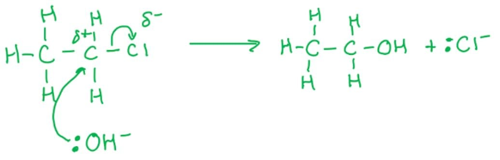
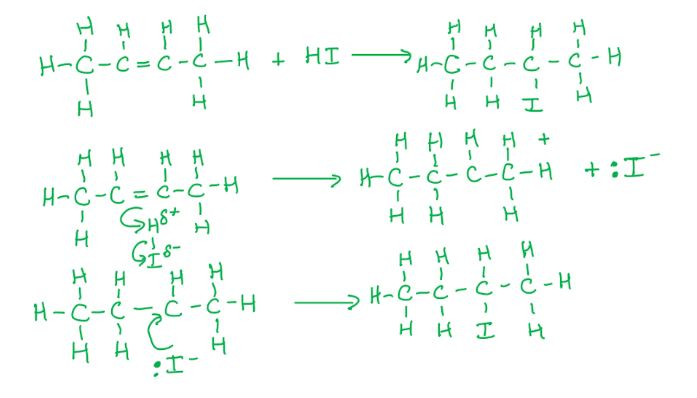
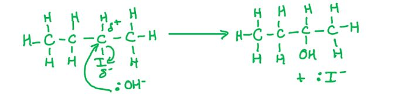
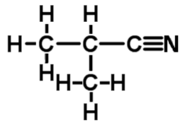
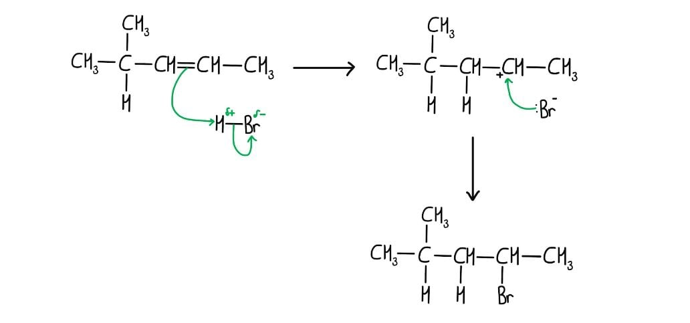
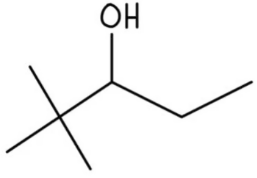

# Mark Schemes — Characteristic Organic Reactions
**13. An Introduction to AS Level Organic Chemistry** · Cambridge (CIE) AS chemistry (9701)

## Multiple Choice Questions (10 questions)

### Q1
**Final answer:** **The correct answer is D**

- When a halogenoalkane reacts with aqueous sodium or potassium hydroxide, the OH- ion replaces the halogen, forming an alcohol.
- The hydroxide ion is a **nucleophile** (an electron-pair donor).
- The hydroxide ion takes the place of the halogen in the compound, so this is a **substitution** reaction.
- The overall mechanism is nucleophilic substitution.

  - The reaction can be summarised as:

**A** is incorrect as electrophilic addition involves an electrophile attacking a C=C double bond. 1-chloroethane has no double bond, and OH- is a nucleophile, not an electrophile.

**B** is incorrect as electrophilic substitution involves an electrophile. OH- is a nucleophile, not an electrophile.

**C** is incorrect as nucleophilic addition adds atoms across a double bond. 1-chloroethane has no C=C double bond. Instead, the halogen is replaced by OH- in a substitution reaction.

### Q2
**Final answer:** **The correct answer is A**

- Nucleophiles have a lone pair of electrons and are electron-pair donors.
- Electrophiles accept electron pairs and are electron-pair acceptors.

**B** is incorrect as both nucleophiles and electrophiles can be covalently bonded molecules or atoms. For example, the double bond in alkenes makes them nucleophiles, and the permanent dipole in HBr makes it an electrophile.

**C** is incorrect as nucleophiles react with many functional groups, not just molecules with double bonds. Electrophiles are involved in both addition reactions (e.g. electrophilic addition to alkenes) and substitution reactions (e.g. electrophilic substitution in benzene).

**D** is incorrect as nucleophiles are electron-pair donors and electrophiles are electron-pair acceptors.

### Q3
**Final answer:** **The correct answer is A**

- The reaction between hydrogen cyanide and propanone is a nucleophilic addition reaction.
- A nucleophile is an electron-pair donor.
- An electrophile is an electron-pair acceptor.
- In this reaction, CN- is donating a pair of electrons (as shown by the arrow) and the carbon in propanone is accepting them.

**B** is incorrect as this is heterolytic bond breaking. Only one atom receives both electrons from the covalent bond, making this heterolytic.

**C** is incorrect as propanone is a ketone, so this statement is true.

**D** is incorrect as this is an example of a nucleophilic addition reaction.

### Q4
**Final answer:** **The correct answer is B**

- A homologous series is a group with the same functional group and similar chemical properties.
- Alkanes and alkenes are different homologous series as they have different functional groups.
- Alkanes have single carbon-carbon bonds and the general formula CnH2n+2
- Alkenes have a double carbon-carbon bond and the general formula CnH2n

**A** is incorrect as aldehydes and ketones both have the general formula CnH2nO, giving a C:H ratio of 1:2.

**C** is incorrect as aldehydes (CnH2nO) and alkenes (CnH2n) both have a C:H ratio of 1:2.

**D** is incorrect as carboxylic acids and esters both have the general formula CnH2nO2, giving a C:H ratio of 1:2.

### Q5
**Final answer:** **The correct answer is B**

- A nucleophile is a species that donates a pair of electrons.

  - The CH3 species has a lone pair of electrons when it has 8 outer shell electrons.

- An electrophile is a species that accepts a pair of electrons.

  - An electron-deficient CH3 species has 6 outer shell electrons.

- To act as a free radical, the CH3 species must have an unpaired electron, giving 7 outer shell electrons.

**A** is incorrect as the nucleophile and electrophile values are swapped. The nucleophile (lone pair, electron donor) requires 8 outer shell electrons and the electrophile (electron-deficient) requires 6.

**C** is incorrect as the free radical requires 7 outer shell electrons (unpaired electron), not 8. The electrophile requires 6 outer shell electrons, not 7.

**D** is incorrect as the free radical requires 7 outer shell electrons (unpaired electron), not 6. The electrophile requires 6 outer shell electrons, not 7.

### Q6
**Final answer:** **The correct answer is B**

- Heterolytic fission involves the movement of a pair of electrons.
- This means that a double-headed arrow is required.
- To form a chloride ion, Cl-, the double-headed arrow should go from the centre of the bond to the chlorine atom.

**A** is incorrect as the electron pair (double-headed arrow) is going to the carbon atom, which would result in a CH3CH2CH2- ion and a Cl+ ion.

**C** is incorrect as there are 2 double-headed arrows, which would suggest the movement of 4 electrons from a single covalent bond that contains only 2 electrons.

**D** is incorrect as this is the correct diagram for homolytic fission of the C–Cl bond, which forms a CH3CH2CH2• radical and a Cl• radical.

### Q7
**Final answer:** **The correct answer is D**

- A nucleophile is an electron-pair donor; it is either a negative ion or has a lone pair of electrons capable of being donated.

- OH- has three lone pairs of electrons and a negative charge, making it a nucleophile.

**A** is incorrect as ethane has no lone pairs and will not act as a nucleophile.

**B** is incorrect as a free radical has an unpaired electron and reacts via homolytic (radical) mechanisms. It does not donate or accept electron pairs, so it is neither a nucleophile nor an electrophile.

**C** is incorrect as a hydrogen ion has no electrons. It accepts electron pairs and is therefore an electrophile, not a nucleophile.

### Q8
**Final answer:** **The correct answer is D**

- The first reaction is electrophilic addition because:

  - HI is acting as an electrophile and is accepting a bonding pair of electrons from the alkene double bond; therefore the reaction is electrophilic.

  - The resulting organic molecule contains 2 more atoms than the initial organic molecule; therefore it is an addition reaction.

- The second reaction is nucleophilic substitution because:

  - The OH- ion from NaOH is acting as a nucleophile and is donating a bonding pair of electrons to the organic molecule; therefore the reaction is nucleophilic.

  - In the resulting organic molecule, the hydroxyl (OH) group has replaced the iodine; therefore it is a substitution reaction.

**A** is incorrect as the first reaction is not nucleophilic addition. HI acts as the electrophile by accepting electrons from the alkene double bond, making reaction 1 electrophilic addition.

**B** is incorrect as the second reaction is not electrophilic substitution. OH- is a nucleophile that replaces the iodine atom, making reaction 2 nucleophilic substitution.

**C** is incorrect as the first reaction is not nucleophilic addition. HI acts as the electrophile, not as a nucleophile, making reaction 1 electrophilic addition.

### Q9
**Final answer:** **The correct answer is D**

- If a reaction is electrophilic, the inorganic reagent is acting as an electrophile (electron-pair acceptor).
- Therefore, the organic reactant acts as a nucleophile (electron-pair donor). This is usually because the organic molecule is an alkene, and one of the electron pairs in the double bond is donated to the inorganic reagent, e.g. HBr.
- In an addition reaction, the organic molecule gains atoms.
- In an electrophilic addition reaction, an alkene is converted to a halogenoalkane and therefore becomes more saturated.

**A** is incorrect as the inorganic reagent (e.g. HBr) acts as the electrophile, not the organic molecule. In addition reactions the organic molecule gains atoms, becoming more saturated.

**B** is incorrect as the inorganic reagent acts as the electrophile, not the organic molecule. In electrophilic addition, the organic molecule acts as the nucleophile.

**C** is incorrect as addition reactions result in the organic molecule gaining atoms, making it more saturated, not less saturated.

### Q10
**Final answer:** **The correct answer is A**

- A homologous series is a family of carbon compounds that all contain the same functional group.
- All members can be represented by the same general formula, e.g. CnH2n+2 for alkanes.
- Since all members contain the same functional group, they have similar chemical properties and undergo the same types of reactions.
- As successive members increase in size by one –CH2– unit, their intermolecular forces increase.

  - This results in a gradual change in physical properties, such as increasing boiling points and densities.

**B** is incorrect as members of a homologous series do have similar chemical properties, because they all contain the same functional group and undergo the same types of reactions.

**C** is incorrect as all members of a homologous series share the same general formula by definition (e.g. CnH2n+2 for alkanes).

**D** is incorrect as the gradual increase in chain length does produce a gradual change in physical properties, such as increasing boiling points and densities.

## Structured Questions (5 questions)

### Q1
> **[mark-scheme]**
> i) Suitable reagents for reactions **1** and **2** are:
> 
> Reaction 1: any **one** from:
> 
> - NaBH4
> - LiAlH4
> - H2 and Ni catalyst / H2 and Pt catalyst
> 
> **[1 mark]**
> 
> Reaction 2: any **one** from:
> 
> - Concentrated sulfuric acid / H2SO4
> - Concentrated phosphoric acid / H3PO4
> - Al2O3
> 
> **[1 mark]**
> 
> ii) The type of reaction that occurs in reaction **2** is:
> 
> - Elimination **[1 mark]**

> **[exam-tip]**
> Reaction 1 reduces the ketone (butanone) to a secondary alcohol. So, X is butan-2-ol.
> 
> Reaction 2 is the elimination (dehydration) of the alcohol to form an alkene (Y). Heat is also required as a condition.
> 
> Before selecting reagents, map out the reaction scheme and identify the functional group at each stage.
> **[mark-scheme]**
> i) The name of the mechanism for reaction **3** is:
> 
> - Electrophilic addition **[1 mark]**

ii) The mechanism for reaction **3** is:

**[4 marks]**

> **[mark-scheme]**
> 1 mark for correct structure of **Y** **AND** correct dipole on HCl
> 
> 1 mark for curly arrow from the C=C bond to the δ+ H in HCl **AND** curly arrow from the H–Cl bond to the Cl atom
> 
> 1 mark for correct intermediate structure with secondary carbocation (C+) identified
> 
> 1 mark for curly arrow from the lone pair on Cl- to the C+ of the secondary carbocation

> **[exam-tip]**
> The question specifies 2-chlorobutane as the product. So, the intermediate must be a secondary carbocation to give this product via Markovnikov’s rule.
> 
> If the question does not specify the major or minor product, draw the major product (secondary carbocation pathway) and note that a minor product also forms.
> **[mark-scheme]**
> A chemical test and observations to distinguish between butane and **Y** are:
> 
> - Bromine water / Br2(aq) **[1 mark]**
> - Remains orange / no colour change with butane **[1 mark]**
> - Decolourises **Y** / goes from orange to colourless with **Y** **[1 mark]**

> **[exam-tip]**
> **Y** is an alkene. This means that the unsaturation test (bromine water) is the simplest chemical test to distinguish between an alkane and an alkene.

### Q2
> **[mark-scheme]**
> The three steps involved in a free radical substitution reaction are:
> 
> - Initiation **[1 mark]**
> - Propagation **[1 mark]**
> - Termination **[1 mark]**

> **[exam-tip]**
> The three steps must be given in order: initiation, propagation, termination.
> 
> Propagation is often the most challenging step as it involves two chain-carrying reactions in which a radical reacts with a molecule to regenerate a radical.
> **[mark-scheme]**
> i) The equation for this reaction is:
> 
> - Cl2 $\overset{\mathrm{UV} \mathrm{light}}{\rightarrow}$ 2Cl• **[1 mark]**
> 
> UV light should be shown above the arrow (or equivalent notation)
> 
> ii) The type of bond fission is:
> 
> - Homolytic (bond fission) **[1 mark]**

> **[exam-tip]**
> In homolytic fission, one electron from the covalent bond goes to each atom, forming two radicals.
> 
> A single-headed curly arrow shows the movement of one electron; a double-headed arrow shows a pair of electrons.
> **[mark-scheme]**
> The name of this type of bond fission is:
> 
> - Heterolytic (fission) **[1 mark]**

> **[exam-tip]**
> In heterolytic fission, one atom takes both electrons from the bond, forming a positive ion and a negative ion.
> 
> The more electronegative atom takes both electrons, forming the anion; the other atom becomes the cation.
> 
> A double-headed curly arrow shows the movement of an electron pair to one atom.
> **[mark-scheme]**
> Three other types of reaction mechanism are:
> 
> Any **three** from (1 mark for each point):
> 
> - Electrophilic addition
> - Nucleophilic substitution
> - Elimination
> - Nucleophilic addition
> - Electrophilic substitution
> 
> **[3 marks]**
> 
> Free radical substitution is not accepted as it was given in part (a).

> **[exam-tip]**
> The curly arrow mechanisms covered at AS Level are electrophilic addition, nucleophilic substitution, and elimination.
> 
> - Electrophilic addition: two reactants combine to form one product (e.g. ethene + bromine → 1,2-dibromoethane)
> - Nucleophilic substitution: an atom or group is replaced by another (e.g. bromoethane + OH- → ethanol + Br-)
> - Elimination: a small molecule is removed from a larger one (e.g. ethanol → ethene + water with acid catalyst)

### Q3
> **[mark-scheme]**
> i) Two characteristics of a homologous series are:
> 
> Any **two** from (1 mark for each point):
> 
> - Same general formula
> - Each successive member differs by a –CH2– group
> - Same functional group / similar chemical properties
> - Gradual trend in physical properties (e.g. boiling point)
> 
> **[2 marks]**
> 
> ii) The homologous series to which propene belongs is:
> 
> - Alkene(s) **[1 mark]**

> **[exam-tip]**
> 'Similar properties' without specifying physical or chemical is too vague and will not be credited.
> 
> You could state a specific physical property that changes down the series, such as boiling point, to gain the mark.
> **[mark-scheme]**
> i) A suitable reagent for this reaction is:
> 
> - Hydrogen chloride / HCl **[1 mark]**
> 
> HCl (aq) / hydrochloric acid is not accepted
> 
> ii) The major product and explanation are:
> 
> - 2-chloropropane
> **AND**
> The secondary carbocation intermediate is more stable than the primary carbocation **[1 mark]**
> - The secondary carbocation is more stable due to the greater electron-donating (+I) effect of two alkyl groups compared to one **[1 mark]**

> **[exam-tip]**
> HCl must be the gas or dissolved in an organic solvent. HCl (aq) (hydrochloric acid) would not react with propene by electrophilic addition.
> 
> Secondary carbocations are more stable than primary carbocations because alkyl groups donate electron density to the positive carbon (+I effect). More alkyl groups gives greater stabilisation, making the secondary carbocation more likely to form.
> **[mark-scheme]**
> i) The reagents and conditions required for this conversion are:
> 
> - Potassium cyanide / KCN
> **OR**
> Sodium cyanide / NaCN **[1 mark]**
> - Ethanol / ethanolic solvent
> **AND**
> Heat / heated under reflux **[1 mark]**

ii) The name and displayed formula of the structural isomer of butanenitrile are:

(2-)methylpropanenitrile / methyl propanenitrile

**[2 marks]**

> **[mark-scheme]**
> 1 mark for the correct name: (2-)methylpropanenitrile / methyl propanenitrile
> 
> 1 mark for the correct displayed formula (all bonds shown, including the C≡N triple bond)

> **[exam-tip]**
> The nucleophilic substitution of halogenoalkanes with KCN extends the carbon chain by one carbon atom.
> 
> For part ii, the displayed formula must show all bonds including the C≡N triple bond. Remember that the CN carbon counts towards the chain length when naming the isomer.

### Q4
The mechanism for the reaction of 4-methylpent-2-ene with HBr is:

**[4 marks]**

> **[mark-scheme]**
> 1 mark for correct structure of 4-methylpent-2-ene **AND** correct dipole on HBr (δ+H–δ-Br)
> 
> 1 mark for curly arrow from the C=C bond to the δ+ H of HBr **AND** curly arrow from the H–Br bond to the δ– Br atom
> 
> 1 mark for correct secondary carbocation intermediate
> 
> 1 mark for curly arrow from the lone pair on :Br- to the C+ of the secondary carbocation

> **[exam-tip]**
> The question specifies 2-bromo-4-methylpentane as the product. This means that the intermediate must be a secondary carbocation at carbon-2 to be consistent with this product.
> 
> The positive charge must be placed on carbon-2.
> **[mark-scheme]**
> The role of HBr in the reaction in **(a)** is:
> 
> - Electrophile **[1 mark]**

> **[exam-tip]**
> The mechanism for this reaction is electrophilic addition. HBr is attracted to the electron-rich C=C bond, making it an electrophile (electron-pair acceptor).
> **[mark-scheme]**
> The reagents and conditions required are:
> 
> - Potassium hydroxide / KOH
> **OR**
> Sodium hydroxide / NaOH **[1 mark]**
> 
> The conditions for this reaction are:
> 
> Any **one** from:
> 
> - Concentrated
> - Ethanol / ethanolic conditions / no water present
> - Heat / boil under reflux / high temperature
> 
> **[1 mark]**

> **[exam-tip]**
> For elimination to occur, the hydroxide must be dissolved in an alcoholic (non-aqueous) solvent. In aqueous conditions, nucleophilic substitution occurs instead, producing an alcohol.

### Q5
> **[mark-scheme]**
> i) The term *hydrocarbon* means:
> 
> - A compound that contains only hydrogen and carbon **[1 mark]**
> 
> The mark cannot be awarded without the word "only"
> 
> ii) The general formula for the homologous series of alkanes is:
> 
> - CnH2n+2 **[1 mark]**
> 
> iii) The molecular formula of an **alkane** containing five carbon atoms is:
> 
> - C5H12 **[1 mark]**

> **[exam-tip]**
> You should know the general formulas for alkanes (CnH2n+2) and alkenes (CnH2n).
> 
> For part iii, substitute n = 5 into the alkane general formula: (2 × 5) + 2 = 12 hydrogen atoms, giving C5H12.
> **[mark-scheme]**
> Two characteristics of a homologous series are:
> 
> Any **two** from (1 mark for each point):
> 
> - Same general formula
> - Each successive member differs by a –CH2– group
> - Same functional group / similar chemical properties
> - Gradual trend in physical properties (e.g. boiling point)
> 
> **[2 marks]**

> **[exam-tip]**
> A homologous series has the same functional group and shows a gradual trend in physical properties.
> 
> 'Similar properties' without specifying physical or chemical is too vague and will not be credited.
The systematic names for the molecules in **Table 1.1** are:

| **Molecule** | **Name** |
|---|---|
| CH3CH(Cl)CH3 | **Final answer:** **2-chloropropane** |
| CH3CH2CH=CH2 | **Final answer:** **but-1-ene** |
| CH3CH2CH2OH | **Final answer:** **propan-1-ol** |
| CH3CH2CH(Br)CH2OH | **Final answer:** **2-bromobutan-1-ol** |

**[4 marks]**

> **[mark-scheme]**
> 1 mark for 2-chloropropane
> 
> 1 mark for but-1-ene
> 
> 1 mark for propan-1-ol
> 
> 1 mark for 2-bromobutan-1-ol

> **[exam-tip]**
> The systematic naming rules for organic compounds are:
> 
> - Identify the longest unbranched carbon chain as this gives the stem (e.g. prop– for 3 carbons, but– for 4 carbons)
> - Identify functional groups and side chains, and select the appropriate prefixes and suffixes
> - Number the chain to give substituents the lowest possible locants
The completed **Table 1.2** is:

| **Organic compound** | **Name** | **Functional groups** |
|---|---|---|
| **A** | Propanoic acid | **Final answer:** **Carboxylic acid** |
| **B** | **Final answer:** **Propanal** | Aldehyde |
| **C** | **Final answer:** **2-chloropropanal** | Aldehyde **AND** Halogenoalkane |
| **D** | 2-hydroxypropanenitrile | **Alcohol** **AND** **Nitrile** |

**[4 marks]**

> **[mark-scheme]**
> 1 mark for carboxylic acid as the functional group of compound A
> 
> 1 mark for propanal as the name of compound B
> 
> 1 mark for 2-chloropropanal as the name of compound C
> 
> 1 mark for both alcohol **AND** nitrile as the functional groups of compound D

> **[exam-tip]**
> For compound A, identify the –COOH group as the carboxylic acid functional group.
> 
> For compound C, the –CHO aldehyde group sets C-1, and the –Cl on C-2 gives the 2-chloro– prefix.
> 
> For compound D, the nitrile group has higher naming priority than the alcohol group. This means that the –OH appears as the hydroxy– prefix rather than the –ol suffix. Remember that the nitrile group contains a carbon atom when counting the chain length.
> **[mark-scheme]**
> i) The empirical formula of 2,2-dimethylpentan-3-ol is:
> 
> - C7H16O **[1 mark]**
> 
> The molecular formula (C7H16O) cannot be simplified further, so the empirical formula is the same.

ii) The skeletal formula of 2,2-dimethylpentan-3-ol is:

**[1 mark]**

> **[exam-tip]**
> In a skeletal formula, C–H bonds are omitted and each line end or vertex represents a carbon atom.
> 
> The longest chain is pentane (5 carbons), with two methyl groups on C-2 and a hydroxyl group on C-3. Make sure the bond to the –OH group is clearly shown to the oxygen atom.
