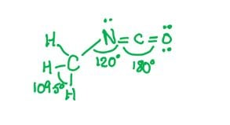
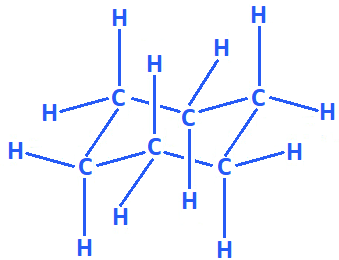
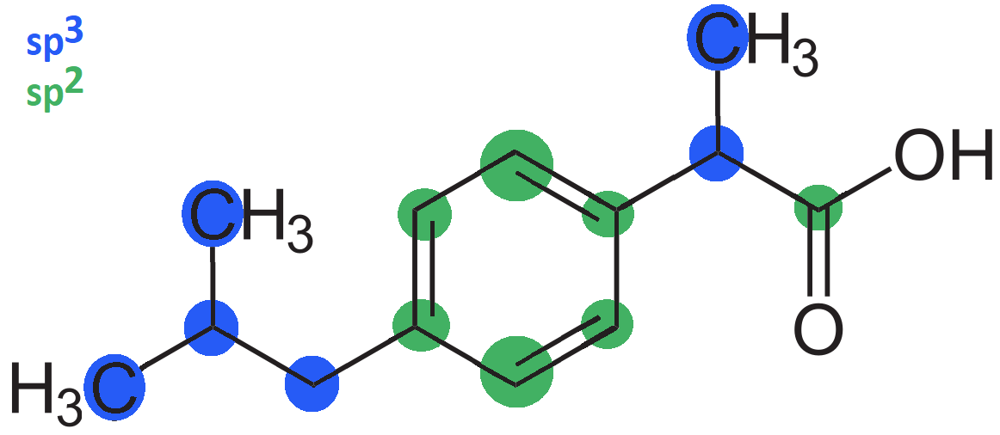
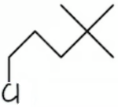
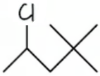
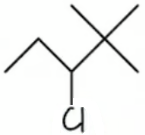
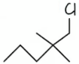
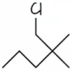
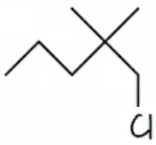

# Mark Schemes — Shapes of Organic Molecules; σ & π Bonds
**13. An Introduction to AS Level Organic Chemistry** · Cambridge (CIE) AS chemistry (9701)

## Multiple Choice Questions (11 questions)

### Q1
**Final answer:** **The correct answer is B**

- π bonds are formed by the sideways overlap of adjacent p orbitals
- Ethene contains one carbon-carbon double bond (C=C)
- The C=C double bond consists of one σ bond, formed by head-on orbital overlap, and one π bond, formed by sideways overlap of p orbitals

**A** is incorrect as 0 would suggest ethene contains only single bonds with no π bonds present.

**C** is incorrect as 2 would suggest the C=C double bond consists of two π bonds. A double bond consists of one σ bond and one π bond only.

**D** is incorrect as 3 π bonds would require multiple double or triple bonds, which are not present in ethene.

### Q2
**Final answer:** **The correct answer is D**

- A straight-chain hydrocarbon consists of a continuous series of carbon atoms without any branches or ring structures
- Propane (CH3CH2CH3) contains a continuous, unbranched chain of three carbon atoms

**A** is incorrect as 2-methylpropane is a branched aliphatic hydrocarbon. The longest continuous chain contains three carbon atoms with a methyl group branching off the central carbon atom.

**B** is incorrect as benzene is an aromatic hydrocarbon. It consists of a planar, cyclic ring of six carbon atoms, not an open chain.

**C** is incorrect as cyclopentane is an alicyclic hydrocarbon. The five carbon atoms form a closed ring rather than an open chain.

### Q3
**Final answer:** **The correct answer is B**

- An atom is sp2 hybridised when it is surrounded by three regions of electron density, as a double bond counts as one region
- In cysteine, only the carboxyl carbon (-COOH) is bonded to three groups: a hydroxyl (-OH) group, the adjacent carbon, and a C=O double bond
- The alpha-carbon and beta-carbon each form four σ bonds with no double bonds, so both are sp3 hybridised

**A** is incorrect as there is one sp2 hybridised carbon atom in cysteine (the carboxyl carbon). A value of 0 would suggest no carbon atom in the molecule contains a double bond.

**C** is incorrect as only one carbon atom (the carboxyl carbon) is sp2 hybridised. The alpha-carbon has four different single-bond groups attached and is sp3 hybridised.

**D** is incorrect as only one carbon atom is sp2 hybridised. The alpha-carbon and beta-carbon each form four σ bonds with no double bonds and are therefore sp3 hybridised.

### Q4
**Final answer:** **The correct answer is C**

- Angle *y*:

  - The central carbon atom has four bond pairs and no lone pairs, giving a tetrahedral geometry with a bond angle of 109.5°
- Angle *x*:

  - The nitrogen atom in the amine group has three bond pairs and one lone pair, giving a trigonal pyramidal geometry with a bond angle of 107°
- Angle *z*:

  - The oxygen atom has two bond pairs and two lone pairs, giving a bent geometry with a bond angle of 104.5°
- The correct size order from smallest to largest is *z* (104.5°) < *x* (107°) < *y* (109.5°)
- All three central atoms have a base tetrahedral electron geometry. Lone pairs repel more strongly than bond pairs, compressing the bond angle by approximately 2.5° per lone pair.

**A** is incorrect as *x* < *y* < *z* would place the oxygen atom as having the largest bond angle. Oxygen has two lone pairs, which cause greater repulsion and produce a smaller bond angle than either carbon or nitrogen.

**B** is incorrect as *x* < *z* < *y* incorrectly assigns a smaller angle to oxygen than to nitrogen. Oxygen has two lone pairs (giving 104.5°), which produce a smaller bond angle than the single lone pair on nitrogen (107°).

**D** is incorrect as *z* < *y* < *x* would suggest the nitrogen atom has the largest bond angle. The tetrahedral carbon atom, with no lone pairs, has the largest bond angle of 109.5°.

### Q5
**Final answer:** **The correct answer is B**

- For a carbon atom to be a chiral centre, it must be bonded to four different groups
- In an acyclic alkane, the four substituents are limited to hydrogen atoms and alkyl chains
- The four smallest different substituents are: H (0 additional carbons), methyl (1 carbon), ethyl (2 carbons), and propyl (3 carbons)
- Minimum total: 1 (central chiral carbon) + 0 + 1 + 2 + 3 = 7 carbon atoms

**A** is incorrect as 6 carbon atoms is not sufficient. After the central chiral carbon, only 5 remain. The three smallest different alkyl groups (methyl, ethyl, propyl) require 1 + 2 + 3 = 6 carbons, but only 5 are available. Any valid distribution of 5 carbons among three groups requires two identical groups, which destroys the chiral centre.

**C** is incorrect as 9 carbon atoms, while sufficient, is not the minimum. The smallest chiral acyclic alkane (3-methylhexane) requires only 7 carbon atoms.

**D** is incorrect as 11 carbon atoms, while sufficient, is not the minimum required to form a chiral acyclic alkane.

### Q6
**Final answer:** **The correct answer is C**

- Methane contains four σ bonds between the central carbon atom and four hydrogen atoms
- To form four equivalent bonds, the carbon atom hybridises one s orbital and three p orbitals to give four identical sp3 hybrid orbitals
- Four sp3 hybrid orbitals arrange themselves tetrahedrally to minimise repulsion

**A** is incorrect as sp hybridisation involves mixing one s orbital and one p orbital, producing two hybrid orbitals. This is associated with triple bonds, such as in ethyne.

**B** is incorrect as sp2 hybridisation involves mixing one s orbital and two p orbitals, producing three hybrid orbitals. This is associated with double bonds, such as in ethene.

**D** is incorrect as sp4 hybridisation is not possible. The p subshell contains only three orbitals (px, py, pz), so a maximum of three p orbitals can participate in hybridisation with one s orbital.

### Q7
**Final answer:** **The correct answer is C**

- From the sequence H3C—N=C=O, the nitrogen atom forms a single bond with the methyl group and a double bond with the isocyanate carbon
- Nitrogen has 5 valence electrons; after forming these bonds, one lone pair remains
- The nitrogen atom therefore has three regions of electron density: two bonding regions and one lone pair

- Three regions of electron density arrange in a trigonal planar geometry, giving an approximate bond angle of 120° (slightly less than 120° due to the greater repulsion from the lone pair)

**A** is incorrect as 107° is the bond angle in ammonia (NH3), where nitrogen has three bonding pairs and one lone pair giving a tetrahedral electron geometry. In methyl isocyanate, the nitrogen has three regions of electron density, not four.

**B** is incorrect as 109.5° is the bond angle for a perfect tetrahedral geometry with four bonding pairs and no lone pairs. The nitrogen in methyl isocyanate has three regions of electron density, giving a trigonal planar geometry.

**D** is incorrect as 180° is the bond angle for a linear geometry with only two regions of electron density. The carbon atom in the isocyanate group (—N=C=O) has a 180° bond angle, not the nitrogen atom.

### Q8
**Final answer:** **The correct answer is D**

- Limonene has the molecular formula C10H16

- Every covalent bond contains one σ bond

  - The carbon skeleton contains 10 C-C σ bonds and 16 C-H σ bonds
  - This gives 26 σ bonds in total
- Each C=C double bond consists of one σ bond and one π bond:

  - Limonene contains two C=C double bonds
  - This gives 2 π bonds

**A** is incorrect as 12 σ bonds accounts only for the visible bonds in the carbon skeleton and does not include the C-H σ bonds to implicit hydrogen atoms. Each CH, CH2, or CH3 group contains additional σ bonds that must be counted.

**B** is incorrect as 4 π bonds would suggest each double bond contains two π bonds. A C=C double bond consists of one σ bond and one π bond only, giving 2 π bonds for a molecule with two double bonds.

**C** is incorrect as 24 σ bonds and 4 π bonds reflects an undercount of σ bonds and an overcount of π bonds. Not all C-H σ bonds have been included in the total, and each double bond contributes only one π bond.

### Q9
**Final answer:** **The correct answer is C**

- An sp2 hybridised carbon atom has three regions of electron density (three σ bonds and no lone pairs)
- Three regions of electron density arrange in a trigonal planar geometry to minimise repulsion
- A trigonal planar geometry gives bond angles of 120°

**A** is incorrect as 104.5° is the bond angle associated with a central atom having two bond pairs and two lone pairs, such as the oxygen atom in water (H2O). Carbon does not have two lone pairs in any stable organic molecule.

**B** is incorrect as 109.5° is the bond angle for a perfect tetrahedral geometry, corresponding to sp3 hybridisation with four σ bonds and no lone pairs, such as in methane (CH4).

**D** is incorrect as 180° is the bond angle for a linear geometry, corresponding to sp hybridisation with only two regions of electron density, such as in ethyne.

### Q10
**Final answer:** **The correct answer is C**

- A π bond is formed by the sideways overlap of adjacent p orbitals above and below the internuclear axis

**A** is incorrect as a dative covalent bond is formed when one atom donates both electrons to a shared pair. It is not formed by the sideways overlap of p orbitals.

**B** is incorrect as a hydrogen bond is an intermolecular force of attraction between an electron-deficient hydrogen atom (bonded to N, O, or F) and a lone pair on a neighbouring electronegative atom. It is not formed by orbital overlap.

**D** is incorrect as a σ bond is formed by the head-on (end-to-end) overlap of atomic orbitals along the internuclear axis, not by sideways overlap.

### Q11
**Final answer:** **The correct answer is B**

- A double bond consists of one σ bond, formed by the head-on overlap of atomic orbitals, and one π bond, formed by the sideways overlap of p orbitals

**A** is incorrect as a combination of 0 σ bonds and 2 π bonds is not possible. The internuclear axis between two bonded atoms must always be occupied by a σ bond before any π bonds can form.

**C** is incorrect as a combination of 1 σ bond and 2 π bonds is the composition of a triple bond, not a double bond.

**D** is incorrect as a combination of 2 σ bonds and 0 π bonds would suggest a double bond consists of two σ bonds. A double bond always consists of one σ bond and one π bond.

## Structured Questions (5 questions)

### Q1
> **[mark-scheme]**
> Cyclohexane has a non-planar ring of carbon atoms because:
> 
> - The carbon atoms are sp3 hybridised **[1 mark]**
> - Each carbon has a tetrahedral arrangement of bonds
> **AND**
> The C–C–C bond angles are 109.5° **[1 mark]**

> **[exam-tip]**
> Hybridisation determines the geometry around each atom:
> 
> - sp3 hybridised carbon ↔ tetrahedral geometry ↔ bond angles of 109.5°
> - sp2 hybridised carbon ↔ trigonal planar geometry ↔ bond angles of 120°
> - sp hybridised carbon ↔ linear geometry ↔ bond angles of 180°
> 
> In cyclohexane, the 109.5° tetrahedral bond angles prevent the ring from being flat:
> 
> 
> 
> A flat ring would require 120° bond angles, which would require sp2 hybridisation and double bonds. The puckered shape allows each carbon to maintain its preferred tetrahedral geometry.
The completed Table 3.1 is:

| atom | hybridisation | approximate bond angle / ° |
|---|---|---|
| carbon | **Final answer:** **sp****2** | **Final answer:** **120** |
| nitrogen | **Final answer:** **sp****3** | **Final answer:** **109.5** |

**[4 marks]**

> **[mark-scheme]**
> 1 mark for sp2 hybridisation of carbon
> 
> 1 mark for approximate bond angle of 120° for carbon
> 
> 1 mark for sp3 hybridisation of each nitrogen atom
> 
> 1 mark for approximate bond angle of 109.5° for each nitrogen atom

> **[exam-tip]**
> Use the number of electron domains around each atom:
> 
> - Carbon has 3 electron domains (one C=O double bond counts as one domain, plus two N–C single bonds) → sp2 hybridised, bond angle ~120°
> - Each nitrogen has 4 electron domains (two N–H bonds, one N–C bond, one lone pair) → sp3 hybridised, bond angle ~109.5°
> 
> Drawing the Lewis structure first makes it straightforward to count electron domains.
> **[mark-scheme]**
> The hybridisation and shape of the carbon atom in methane are:
> 
> - Hybridisation: sp3 **[1 mark]**
> - Shape: tetrahedral **[1 mark]**
> 
> Explanation:
> 
> - 4 bonding pairs of electrons (4 electron domains) around the central carbon **[1 mark]**
> - The electron pairs repel equally to maximise separation, giving bond angles of 109.5° **[1 mark]**

> **[exam-tip]**
> The carbon atom in methane is sp3 hybridised because it forms four identical single bonds. The four sp3 hybrid orbitals repel each other equally, adopting a tetrahedral geometry to maximise separation between bonding pairs.
> 
> The bond angle in methane is 109.5°, the ideal tetrahedral angle.
> **[mark-scheme]**
> The hybridisation of the carbon atom marked in Fig. 3.2 is:
> 
> - sp3 **[1 mark]**

> **[exam-tip]**
> Both carbon atoms in ethanol form only single bonds and have no lone pairs, giving 4 electron domains around each carbon. This means both are sp3 hybridised, with a tetrahedral arrangement and bond angles of approximately 109.5°. The oxygen atom is also sp3 hybridised.

### Q2
> **[mark-scheme]**
> The number of pi (π) bonds and chiral centres in ibuprofen is:
> 
> - π bonds = 4 **[1 mark]**
> - chiral centres = 1 **[1 mark]**

> **[exam-tip]**
> To count π bonds: each double bond contains one π bond. In ibuprofen, the benzene ring has 3 (shown in the Kekulé structure) and the carboxylic acid has 1 C=O, giving 4 π bonds total.
> 
> A chiral centre is a carbon atom bonded to four different groups. In ibuprofen, the carbon bearing the methyl group, the carboxylic acid group, the isobutyl chain, and a hydrogen atom is the only chiral centre (1 total).
> **[mark-scheme]**
> The number of sp2 and sp3 hybridised carbon atoms in ibuprofen is:
> 
> - sp2 = 7 **[1 mark]**
> - sp3 = 6 **[1 mark]**

> **[exam-tip]**
> Each carbon with a tetrahedral arrangement of bonds (four single bonds only) is sp3 hybridised. Each carbon in the benzene ring and the carbonyl carbon are sp2 hybridised.
> 
> 
> 
> When counting, look for double bonds and aromatic ring carbons first, these are sp2. Any carbon with only single bonds is sp3.
> **[mark-scheme]**
> The shape of the benzene ring in ibuprofen is:
> 
> - Bond angle between carbon atoms is 120° **[1 mark]**
> - All carbon atoms in the ring are sp2 hybridised **[1 mark]**
> - The sp2 orbitals overlap head-on to form σ bonds between adjacent carbons; the unhybridised p orbitals overlap sideways to form a delocalised π system above and below the ring **[1 mark]**

> **[exam-tip]**
> All carbons in the benzene ring are sp2 hybridised, giving a trigonal planar arrangement around each carbon with bond angles of 120°. This forces all six carbons into the same plane, making the ring planar.
> 
> The sp2 hybrid orbitals form sigma bonds between adjacent carbon atoms (head-on overlap). Each carbon also has one unhybridised p orbital perpendicular to the ring; these overlap sideways with neighbouring p orbitals to form a delocalised π system above and below the plane of the ring.

### Q3
> **[mark-scheme]**
> The other two terms used to describe the carbon chain arrangement are:
> 
> - Branched
> **AND**
> Cyclic **[1 mark]**

> **[exam-tip]**
> There are three ways to describe the carbon chain of an aliphatic molecule: straight-chained, branched, and cyclic. Learning all three is useful when identifying structural isomers.
The completed Table 1.1 is:

| hybridisation | number of σ bonds | number of π bonds |
|---|---|---|
| sp3 | **Final answer:** **4** | **Final answer:** **0** |
| sp2 | **Final answer:** **3** | **Final answer:** **1** |
| sp | **Final answer:** **2** | **Final answer:** **2** |

**[3 marks]**

> **[mark-scheme]**
> 1 mark for sp3: 4 σ bonds and 0 π bonds
> 
> 1 mark for sp2: 3 σ bonds and 1 π bond
> 
> 1 mark for sp: 2 σ bonds and 2 π bonds

> **[exam-tip]**
> Each sp3 hybridised carbon forms 4 sigma bonds (from the 4 sp3 orbitals overlapping head-on) and no pi bonds, because all valence orbitals are involved in hybridisation.
> 
> An sp2 hybridised carbon forms 3 sigma bonds and 1 pi bond: the 3 sp2 orbitals each form a sigma bond, and the remaining unhybridised p orbital overlaps sideways with an adjacent p orbital to form 1 pi bond.
> 
> An sp hybridised carbon forms 2 sigma bonds and 2 pi bonds: the 2 sp orbitals each form a sigma bond, and the 2 unhybridised p orbitals each overlap sideways to form 2 pi bonds.
The completed Table 1.2 is:

| molecule | shape | bond angle / ° |
|---|---|---|
| **carbon dioxide** | linear | **Final answer:** **180** |
| **water** | **Final answer:** **non-linear / bent** | 104.5 |
| **boron trifluoride** | **Final answer:** **trigonal planar** | 120 |
| **cis-platin** | square planar | **Final answer:** **90** |

**[4 marks]**

> **[mark-scheme]**
> 1 mark for bond angle of 180° for carbon dioxide
> 
> 1 mark for non-linear / bent shape for water
> 
> 1 mark for trigonal planar shape for boron trifluoride
> 
> 1 mark for bond angle of 90° for cis-platin

> **[exam-tip]**
> Make sure you know the shapes and bond angles for all molecules in this topic. Bond angles in particular are poorly answered in exams, so learn these: CO2 (linear, 180°), H2O (non-linear, 104.5°), BF3 (trigonal planar, 120°), and cis-platin (square planar, 90°).
> 
> Note that not all of these molecules are planar: water is non-linear (V-shaped), not flat.

### Q4
> **[mark-scheme]**
> i) The systematic name of compound **X** is:
> 
> - 2,2-dimethylpentane **[1 mark]**
> 
> ii) The general formula for the homologous series to which compound **X** belongs is:
> 
> - CnH2n+2 **[1 mark]**

> **[exam-tip]**
> To name compound **X**:
> 
> - The longest carbon chain is 5 carbons, so the name is pentane-based
> - There are only C–C single bonds, so it is an alkane
> - There are two methyl groups on carbon-2, giving the prefix 2,2-dimethyl
> - Full systematic name: 2,2-dimethylpentane
> 
> The compound belongs to the alkane homologous series, which has the general formula CnH2n+2.
> **[mark-scheme]**
> i) The mechanism for this reaction is:
> 
> - Free radical substitution **[1 mark]**

ii) The skeletal formulae of the four monochlorinated isomers of compound **X** are:

2,2-dimethyl-5-chloropentane

**[1 mark]**

2,2-dimethyl-4-chloropentane

**[1 mark]**

2,2-dimethyl-3-chloropentane

**[1 mark]**

Plus, any **one** of the following 2,2-dimethyl-1-chloropentane structures:

**OR**

**OR**

**[1 mark]**

> **[mark-scheme]**
> 1 mark for the correct structure of 2,2-dimethyl-5-chloropentane
> 
> 1 mark for the correct structure of 2,2-dimethyl-4-chloropentane
> 
> 1 mark for the correct structure of 2,2-dimethyl-3-chloropentane
> 
> 1 mark for one of the correct structures of 2,2-dimethyl-1-chloropentane
> 
> The three structures shown as alternatives for the fourth mark are all representations of the same compound; any one is accepted.

> **[mark-scheme]**
> iii) The type of structural isomerism shown by the isomers in (ii) is:
> 
> - Positional isomerism **[1 mark]**

> **[exam-tip]**
> For part (i): alkanes are relatively unreactive. The combination of a halogen and UV light is the characteristic condition for free radical substitution.
> 
> For part (ii): compound X is being monochlorinated, meaning one hydrogen atom is replaced by one chlorine atom. Draw a skeletal formula for each unique position where chlorine can be substituted. The first three isomers in the mark scheme are all distinct; the last three structures are different representations of the same compound.
> 
> For part (iii): the isomers have the same molecular formula and the same carbon chain, differing only in the position of the chlorine atom. This is positional isomerism.
> **[mark-scheme]**
> i) The role of the aqueous hydroxide ion in this reaction is:
> 
> - Nucleophile **[1 mark]**
> 
> ii) The systematic name of compound **X** is:
> 
> - Propan-1-ol **[1 mark]**
> 
> iii) The conditions and mechanism for this alternative reaction are:
> 
> - Conditions: Heat / warm
> **AND**
> Alcoholic / ethanolic (sodium) hydroxide **[1 mark]**
> - Mechanism: Elimination **[1 mark]**

> **[exam-tip]**
> You should know both reactions of a halogenoalkane with hydroxide ions:
> 
> - Aqueous NaOH: nucleophilic substitution, forming an alcohol
> - Alcoholic / ethanolic NaOH with heat: elimination, forming an alkene and water
> 
> Both conditions require the hydroxide ion, but its role changes depending on whether aqueous or alcoholic solvent is used.
> **[mark-scheme]**
> i) By reference to hybridisation and orbital overlap, the carbonyl carbon in pentanal is trigonal planar because:
> 
> - The carbonyl carbon is sp2 hybridised / the carbonyl bond contains one σ bond **[1 mark]**
> - The unhybridised p orbitals overlap sideways to form a π bond **[1 mark]**
> - The bonding pairs of electrons are in the same plane
> **AND**
> This causes repulsion, giving a trigonal planar shape **[1 mark]**
> 
> ii) The shape and bond angle around carbon-2 in 2-hydroxyhexanenitrile are:
> 
> - Tetrahedral
> **AND**
> 109.5° **[1 mark]**

> **[exam-tip]**
> Any time there is planarity within a molecule, hybridisation is involved. State the hybridisation (sp2) and explain how the σ and π bonds are formed from orbital overlap.
> 
> For part (ii): carbon-2 in the product has reacted and now has four different groups attached, so it adopts a tetrahedral geometry with bond angles of 109.5°. A common error is to give the answer as linear and 180°, which describes the nitrile carbon at the end of the chain (from the HCN), not carbon-2.

### Q5
> **[mark-scheme]**
> The σ and π bonds in the triple bond of propyne are formed as follows:
> 
> - The carbon atoms forming the triple bond are sp hybridised **[1 mark]**
> - The σ bond is formed from the head-on overlap of sp orbitals (from each carbon atom) **[1 mark]**
> - Two π bonds are formed from the sideways overlap of unhybridised p orbitals (on each carbon atom) **[1 mark]**

> **[exam-tip]**
> A triple bond consists of one σ bond and two π bonds. To form a triple bond, the two carbon atoms must be sp hybridised.
> 
> The σ bond forms from the head-on (direct) overlap of one sp orbital from each carbon atom. The two π bonds are formed from the sideways overlap of the two unhybridised p orbitals on each carbon.
> **[mark-scheme]**
> The number of sp2 hybridised carbon atoms in this molecule is:
> 
> - Six / 6 **[1 mark]**

> **[exam-tip]**
> Only carbon atoms involved in double bonds are sp2 hybridised. When counting, it is easy to accidentally count the number of double bonds rather than the number of sp2 carbons. Remember that each double bond involves two carbon atoms, both of which are sp2 hybridised.
The completed Table 1.1 is:

|   | ** NF****4****+** | **N****2****H****2** | **N****2****H****4** |
|---|---|---|---|
| hybridisation | **Final answer:** **sp****3** | **Final answer:** **sp****2** | **Final answer:** **sp****3** |

**[3 marks]**

> **[mark-scheme]**
> 1 mark for sp3 hybridisation for NF4+
> 
> 1 mark for sp2 hybridisation for N2H2
> 
> 1 mark for sp3 hybridisation for N2H4

> **[exam-tip]**
> Use the number of electron domains around each nitrogen atom to determine the hybridisation:
> 
> - 4 electron domains = sp3 hybridisation (e.g. NF4+ has 4 bond pairs; N2H4 has 3 bond pairs and 1 lone pair)
> - 3 electron domains = sp2 hybridisation (e.g. N2H2 has 2 bond pairs and 1 lone pair)
> - 2 electron domains = sp hybridisation
> 
> Drawing the Lewis structure for each species first is a reliable way to count electron domains without making errors.
