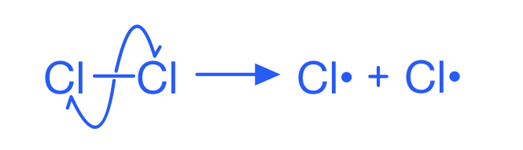
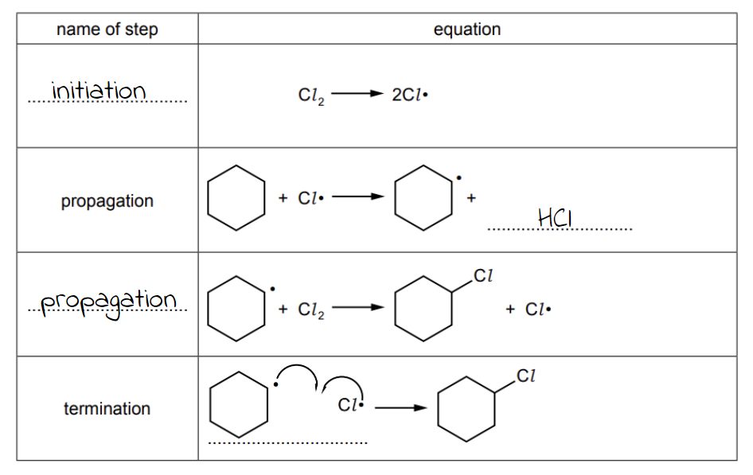

# Mark Schemes — Alkanes
**14. Hydrocarbons** · Cambridge (CIE) AS chemistry (9701)

## Multiple Choice Questions (11 questions)

### Q1
**Final answer:** **The correct answer is D**

- In free-radical substitution of ethane with chlorine, the reaction begins with an initiation step.
- Ultraviolet light provides the energy needed to break the Cl–Cl bond by homolytic fission.
- This produces chlorine radicals, which are required to start the chain reaction.

**A** is incorrect as the collision of two radicals to form a stable molecule occurs in the termination step, not propagation.

**B** is incorrect as the final mixture also contains unreacted ethane, unreacted chlorine, and further substituted products such as dichloroethane.

**C** is incorrect as the initiation step involves homolytic, not heterolytic, fission of the Cl–Cl bond, not the C–H bond.

### Q2
**Final answer:** **The correct answer is C**

- Cracking an alkane to produce exactly two molecules with the same number of carbon atoms yields one alkane and one alkene.

  - For n = 8, C8H18 cracks to give C4H10 (butane) and C4H8 (butene).

- Both products must have non-cyclic structural isomers:

  - C4H10 has two non-cyclic structural isomers: butane and methylpropane
  - C4H8 has three non-cyclic structural isomers: but-1-ene, but-2-ene, and 2-methylpropene
  - Cis-but-2-ene and trans-but-2-ene are E/Z stereoisomers of but-2-ene, not separate structural isomers.
- Both products satisfy the condition, so n = 8.

**A** is incorrect as when n = 4, cracking gives ethane (C2H6) and ethene (C2H4). Neither 2-carbon compound has any structural isomers.

**B** is incorrect as when n = 6, cracking gives propane (C3H8) and propene (C3H6). Propane has no structural isomers, and propene's only structural isomer is cyclopropane, which is cyclic. Neither product satisfies the condition.

**D** is incorrect as n = 9 is odd. It is not possible to split an odd number of carbon atoms into two products with the same number of carbons each.

### Q3
**Final answer:** **The correct answer is A**

- A propagation step involves a free radical reacting with a stable molecule to produce a new radical and a new stable molecule, keeping the chain reaction going.
- **A** shows how a chlorine radical abstracts a hydrogen from chloroethane, producing a chloroethyl radical and HCl.

  - The number of free radicals is unchanged, so this is a valid propagation step.
- The standard propagation steps for the ethane and chlorine reaction are:

C2H6 + Cl• → C2H5• + HCl

C2H5• + Cl2 → C2H5Cl + Cl•

- Further substitution of the product C2H5Cl is also a valid propagation step.

**B** is incorrect as it shows two radicals combining to form one stable molecule, which is a termination step (net destruction of radicals).

**C** is incorrect as it produces an H• radical. Hydrogen radicals are not formed in this mechanism; Cl• abstracts H to form HCl, not H•.

**D** is incorrect as the equation is unbalanced. Chlorine appears in the product (HCl) but not in the reactants.

### Q4
**Final answer:** **The correct answer is D**

- Cracking is a reaction in which larger alkane molecules are broken down into smaller alkane and alkene molecules.
- For C16H34 to be produced from C17H36, the remaining fragment would be CH2:

C17H36 → C16H34 + CH2

- CH2 cannot exist as a stable molecule.
- The minimum stable alkene requires at least two carbon atoms to form a C=C double bond (ethene, C2H4).
- Therefore, C16H34 cannot be produced by cracking.

**A**, **B** and **C** are incorrect as these compounds can all be produced by valid cracking equations that leave a stable alkane or alkene as the other fragment:

C17H36 → C3H8 + C14H28 (alkane + alkene)

C17H36 → C4H8 + C13H28 (alkene + alkane)

C17H36 → C8H16 + C9H20 (alkene + alkane)

### Q5
**Final answer:** **The correct answer is D**

- Heating pentane over an aluminium oxide catalyst cracks the molecule.
- Cracking breaks down larger alkane molecules into smaller alkanes and alkenes.
- So, for pentane, the cracking process will produce alkanes and alkenes of five or fewer carbons.
- Therefore, CH3(CH2)8CH3 would not be produced in this reaction as it contains 10 carbons, which is more than the original pentane (5 carbons).

**A** is incorrect as methane (CH4) is a gas at room temperature and pressure and could be produced by cracking pentane, for example:

C5H12 → CH4 + C4H8

Gases are collected in the inverted tube by displacement of water.

**B** is incorrect as ethane (CH3CH3) is a gas at room temperature and pressure and could be produced by cracking pentane, for example:

C5H12 → C2H6 + C3H6

It would be collected in the inverted tube.

**C** is incorrect as but-1-ene (CH3CH2CH=CH2) is a gas at room temperature and pressure and could be produced by cracking pentane, for example:

C5H12 → C4H8 + CH4

It would be collected in the inverted tube.

### Q6
**Final answer:** **The correct answer is D**

- C8H18 is the correct formula for octane.
- Carbon dioxide (CO2), nitrogen gas (N2) and water (H2O) are all non-toxic products.

**A** and **B** are incorrect as octane is an alkane with formula C8H18, whereas **A** and **B** show C8H16, which is octene.

**C** is incorrect as CO is carbon monoxide, which is a toxic gas.

### Q7
**Final answer:** **The correct answer is B**

- The highest demand hydrocarbon for transportation is octane (C8H18).
- Subtract octane from eicosane to find the remaining fragment:

C20H42 - C8H18 = C12H24

- C12H24 has the general formula CnH2n, so the remaining three products are alkenes.
- Let the smallest alkene have n carbons.

  - Three consecutive alkenes total 12 carbons:

n + (n + 1) + (n + 2) = 12

3n + 3 = 12

n = 3

- The three consecutive alkenes are propene (C3H6), butene (C4H8) and pentene (C5H10).
- Overall cracking equation:
- C20H42 → C8H18 + C3H6 + C4H8 + C5H10

**A** is incorrect as the carbon count of the products (4 + 4 + 6 + 8 = 22) exceeds the 20 carbons in eicosane, so it is stoichiometrically impossible.

**C** is incorrect as ethane is not a hydrocarbon in high demand for transportation (it is a gas at room temperature, not a liquid fuel). The remaining alkenes in this option are also not consecutive members of the same homologous series.

**D** is incorrect as ethene is not a hydrocarbon in high demand for transportation, and the three alkenes (ethene, pentene, heptene) are not consecutive members of the same homologous series.

### Q8
**Final answer:** **The correct answer is D**

- List the known values:

  - mass of CO2 = 35.2 g, *M*r(CO2) = 44
  - mass of H2O = 14.4 g, *M*r(H2O) = 18
  - moles of hydrocarbon = 0.200 mol
- Calculate the moles of CO2:

moles = $\frac{m}{M_{r}}$

moles = 35.2 / 44

moles of CO2 = 0.800 mol

- Calculate the moles of H2O:

moles = $\frac{m}{M_{r}}$

moles = 14.4 / 18

moles of H2O = 0.800 mol

- Scale to per mole of hydrocarbon to find the molecular formula:

C atoms per molecule = 0.800 / 0.200 = 4

H atoms per molecule = (2 x 0.800) / 0.200 = 8

- The molecular formula is C4H8.

**A** is incorrect as C2H4 has the same empirical formula (CH2) as C4H8. This traps candidates who calculate only the simplest ratio without using the 0.200 mol value to scale to the molecular formula.

**B** is incorrect as C2H6 would give a CO2 to H2O mole ratio of 2:3, not 1:1.

**C** is incorrect as C4H4 would give only 0.400 mol H2O from 0.200 mol of compound, not 0.800 mol.

### Q9
**Final answer:** **The correct answer is B**

- The first four members of the alkane series are methane (CH4), ethane (C2H6), propane (C3H8) and butane (C4H10).
- At room temperature, water produced by combustion condenses to liquid and contributes negligible volume to the residual gas.
- Methane:

CH4 + 2O2 → CO2 + 2H2O

O2 consumed = 2 x 10 = 20 cm3; CO2 produced = 10 cm3

Residual volume = (70 − 20) + 10 = 60 cm3

- Ethane:

C2H6 + $\frac{7}{2}$O2 → 2CO2 + 3H2O

O2 consumed = 3.5 x 10 = 35 cm3; CO2 produced = 20 cm3

Residual volume = (70 − 35) + 20 = 55 cm3

- Propane:

C3H8 + 5O2 → 3CO2 + 4H2O

O2 consumed = 5 x 10 = 50 cm3; CO2 produced = 30 cm3

Residual volume = (70 − 50) + 30 = 50 cm3

- Butane:

C4H10 + $\frac{13}{2}$O2 → 4CO2 + 5H2O

O2 consumed = 6.5 x 10 = 65 cm3; CO2 produced = 40 cm3

Residual volume = (70 − 65) + 40 = 45 cm3

- The four values (60, 55, 50, 45 cm3) decrease linearly by 5 cm3 per member, as shown in graph **B**.

### Q10
**Final answer:** **The correct answer is C**

- Initiation = net formation of radicals
- In the initiation step, free radical Cl• atoms are formed:

Cl2 → 2Cl•

- Propagation = no change in the number of free radicals
- These free radical Cl• atoms remove a hydrogen from the ethane making an ethyl free radical, C2H5•:

C2H6 + Cl• → C2H5• + HCl

- Termination = net destruction of free radicals
- Two of these radicals can then pair up in a termination step to form butane, CH3CH2CH2CH3 (C4H10):

C2H5• + C2H5• → C4H10

- Therefore, option **C** is the only compound that could be present in the mixture.

**A** is incorrect as CH3Cl cannot be formed from the reaction between ethane and chlorine. All carbon-containing products must retain the two-carbon skeleton of ethane; a one-carbon product such as chloromethane is not possible.

**B** is incorrect as CH3CH2CH2Cl (1-chloropropane) contains three carbon atoms and cannot be formed from ethane and chlorine. No three-carbon products can arise from a two-carbon starting material.

**D** is incorrect as CH3CH2CH2CH2CH3 (pentane) contains five carbon atoms. The termination step joining two ethyl radicals (C2H5•) produces butane (four carbons), not pentane.

### Q11
**Final answer:** **The correct answer is C**

- Expand the formula Pb(C2H5)4:

1 Pb, 4 x 2 = 8 C, 4 x 5 = 20 H

- The balanced equation for complete combustion is:

Pb(C2H5)4 + $\frac{27}{2}$O2 → PbO + 8CO2 + 10H2O

- Count the total oxygen atoms required on the right-hand side:

1 (in PbO) + 16 (in 8CO2) + 10 (in 10H2O) = 27 oxygen atoms

- Calculate the moles of O2:

moles of O2 = 27 / 2

moles of O2 = 13.5

**A** (9.5) is incorrect and results from failing to multiply the carbon count by 4 when expanding the bracket, giving only 4 CO2 molecules instead of 8.

**B** (11) is incorrect and results from failing to multiply the hydrogen count by 4 when expanding the bracket, giving only 5 H2O molecules instead of 10.

**D** (27) is incorrect as 27 is the total number of oxygen atoms required, not the number of moles of O2 molecules. Dividing by 2 is required since oxygen is diatomic.

## Structured Questions (6 questions)

### Q1
> **[mark-scheme]**
> Alkanes are generally unreactive because:
> 
> - The C–H and C–C bonds have high bond enthalpies / bond strengths **[1 mark]**
> - The C–H bonds are non-polar / have very low polarity **[1 mark]**

> **[exam-tip]**
> The two marking points are the strength of the bonds and their lack of polarity.
> 
> The C–H bond has a bond enthalpy of 411 kJ mol-1 and the C–C bond has a bond enthalpy of 346 kJ mol-1. These high values mean a large amount of energy is needed to break them.
> 
> Carbon and hydrogen have very similar electronegativities, so C–H bonds have very low polarity. There is no significant dipole to attract ionic reagents or nucleophiles.
> **[mark-scheme]**
> i) A free radical is:
> 
> - A species with an unpaired electron **[1 mark]**
> 
> ii) The condition required to form chlorine free radicals from Cl2 is:
> 
> - Ultraviolet / UV light **[1 mark]**

> **[exam-tip]**
> A free radical is represented as X•, where the dot indicates the unpaired electron.
> 
> In CIE A Level Chemistry, always use the full term "free radical" rather than just "radical".
> **[mark-scheme]**
> The type of bond fission in the initiation step is:
> 
> - Homolytic fission **[1 mark]**

> **[exam-tip]**
> In homolytic fission, the covalent bond breaks symmetrically: each atom receives one electron from the shared pair, forming two radicals. This is shown by single-headed (fish-hook) curly arrows in mechanism diagrams.
> 
> 
> 
> Compare with heterolytic fission, where both electrons go to one atom, forming a positive ion and a negative ion. Alkanes undergo homolytic fission with halogens because the Cl–Cl bond breaks equally due to the identical electronegativities of the two atoms.
> **[mark-scheme]**
> i) The two propagation steps are:
> 
> - Cl• + CH4 → CH3• + HCl **[1 mark]**
> - CH3• + Cl2 → CH3Cl + Cl• **[1 mark]**
> 
> State symbols are not required.
> 
> ii) The termination step that forms ethane is:
> 
> - CH3• + CH3• → C2H6 / CH3CH3 **[1 mark]**
> 
> State symbols are not required.

> **[exam-tip]**
> In each propagation step, a free radical reacts with a molecule to generate a new free radical. The chlorine radical consumed in step 1 is regenerated in step 2, keeping the chain reaction going.
> 
> Ethane forms in a termination step, where two methyl radicals combine. This illustrates a key limitation of free radical substitution: unwanted by-products are produced alongside the desired product.
> 
> Other valid termination steps are:
> 
> Cl• + Cl• → Cl2
> 
> Cl• + CH3• → CH3Cl.

### Q2
> **[mark-scheme]**
> i) Cracking is:
> 
> - The breaking down of large hydrocarbon molecules into smaller, more useful ones **[1 mark]**
> 
> ii) Cracking is useful in the petroleum industry because:
> 
> - Smaller hydrocarbons are more useful / in greater demand (as fuels and chemical feedstocks)
> **OR**
> Alkenes produced can be used to make polymers / other useful chemicals **[1 mark]**

> **[exam-tip]**
> Crude oil contains a large proportion of long-chain hydrocarbons, which are less in demand. Cracking breaks these down into shorter-chain alkanes (useful as fuels) and alkenes (useful for making plastics and other chemicals).
> 
> "Cracking" specifically means the decomposition of long-chain hydrocarbons into shorter chains. Do not describe it simply as "breaking bonds". The answer must make clear that large molecules are converted into smaller, more useful ones.
> **[mark-scheme]**
> i) The reagent and conditions required are:
> 
> - Reagent: aluminium oxide / Al2O3 / zeolite / aluminosilicate **[1 mark]**
> - Conditions: high temperature **[1 mark]**
> 
> ii) An equation for the cracking of tetradecane to form heptane and two other products:
> 
> - C14H30 → C7H16 + C2H4 + C5H10
> **OR**
> C14H30 → C7H16 + C3H6 + C4H8
> **OR**
> C14H30 → C7H16 + 2C2H4 + C3H6 **[1 mark]**
> 
> State symbols are not required.
> 
> The equation must show exactly two other organic products in addition to heptane.
> 
> The equation C14H30 → C7H16 + C7H14 is not accepted because it gives only one other product.

> **[exam-tip]**
> For part i), be specific. "Heat" alone is not sufficient, you must say "high temperature".
> 
> For part ii), balance the carbon and hydrogen atoms on both sides. Heptane uses 7 of the 14 carbons, so the remaining 7 carbons must be distributed across two other products. Remember that cracking produces a mixture of alkanes and alkenes.
> **[mark-scheme]**
> i) One adverse effect of carbon monoxide on human health is:
> 
> Any **one** from:
> 
> - It is toxic / poisonous
> - It binds irreversibly to haemoglobin, preventing oxygen from being carried in the blood
> - It prevents oxygen being delivered to cells / organs
> 
> **[1 mark]**
> 
> ii) One environmental consequence of nitrogen monoxide / oxides of nitrogen is:
> 
> Any **one** from:
> 
> - It causes acid rain (by reacting with water to form nitric acid)
> - It damages / kills aquatic life
> - It causes respiratory problems
> 
> **[1 mark]**
> 
> iii) One environmental consequence of unburnt hydrocarbons is:
> 
> Any **one** from:
> 
> - They react with nitrogen oxides in sunlight to form photochemical smog / peroxyacetyl nitrate (PAN)
> - They contribute to global dimming
> 
> **[1 mark]**

> **[exam-tip]**
> Carbon monoxide is toxic because it binds to haemoglobin more strongly than oxygen, preventing oxygen transport to cells.
> 
> Oxides of nitrogen react with water in the atmosphere to form nitric acid, which contributes to acid rain. This damages ecosystems, particularly lakes and rivers.
> 
> Unburnt hydrocarbons react with nitrogen oxides in sunlight to produce photochemical smog, a complex mixture of pollutants including peroxyacetyl nitrate (PAN), which is harmful to human health and vegetation.
> **[mark-scheme]**
> The equation for the catalytic converter reaction is:
> 
> - 2CO + 2NO → 2CO2 + N2 **[1 mark]**

> **[exam-tip]**
> In a catalytic converter, carbon monoxide is oxidised to carbon dioxide and nitrogen monoxide is reduced to nitrogen. This single reaction removes both pollutants simultaneously.
> 
> The catalyst (typically platinum, palladium, or rhodium) lowers the activation energy for this reaction, allowing it to occur at the relatively low temperatures found in exhaust gases.

### Q3
> **[mark-scheme]**
> i) The initiation step is:
> 
> - Br2 → 2Br• **[1 mark]**
> 
> ii) The bond breaking is described as homolytic fission because:
> 
> - Each bromine atom receives one electron from the Br–Br covalent bond / shared pair of electrons **[1 mark]**

> **[exam-tip]**
> In homolytic fission, the bond breaks symmetrically: each atom takes one electron from the shared pair. This produces two radicals (species with unpaired electrons) rather than ions.
> 
> This is different from heterolytic fission, where both electrons go to one atom, forming a positive ion and a negative ion.
> **[mark-scheme]**
> The two propagation steps are:
> 
> - CH2BrCH2Br + Br• → CH2BrCHBr• + HBr **[1 mark]**
> - CH2BrCHBr• + Br2 → CH2BrCHBr2 + Br• **[1 mark]**

> **[exam-tip]**
> In each propagation step, a free radical reacts with a molecule to produce a new free radical. The bromine radical consumed in step 1 is regenerated in step 2, allowing the chain to continue.
> 
> In step 1, the bromine radical removes a hydrogen atom from 1,2-dibromoethane to form HBr, leaving a carbon radical on C-2. In step 2, this carbon radical reacts with Br2 to form 1,1,2-tribromoethane and regenerate a Br•.
> **[mark-scheme]**
> i) The termination step that forms 1,2,3,4-tetrabromobutane is:
> 
> - CH2BrCHBr• + CH2BrCHBr• → CH2BrCHBrCHBrCH2Br **[1 mark]**
> 
> ii) The overall equation for the formation of hexabromoethane is:
> 
> - CHBr2CH2Br + 3Br2 → CBr3CBr3 + 3HBr **[1 mark]**

> **[exam-tip]**
> 1,2,3,4-Tetrabromobutane forms when two CH2BrCHBr• radicals combine in a termination step. Two free radicals combine to form one molecule with no unpaired electrons, ending the chain reaction.
> 
> For the overall equation, count the hydrogen atoms on 1,1,2-tribromoethane (3 H atoms). Each H removed requires one Br2, so 3Br2 are needed and 3HBr are produced.
> **[mark-scheme]**
> Free-radical substitution is not a good method for producing a single, pure halogenoalkane because:
> 
> Any **two** from (1 mark for each point):
> 
> - Further substitution can occur, producing a mixture of mono-, di-, and tri-substituted products
> - The halogen can be substituted at different positions in the carbon chain, forming structural isomers
> - Termination steps produce unexpected by-products (e.g. longer-chain hydrocarbons)
> - The reaction is difficult to control
> 
> **[2 marks]**

> **[exam-tip]**
> The main limitations are:
> 
> - Further substitution (once one H is replaced, the product can react again)
> - Positional isomers (for chains with more than one type of H atom, different structural isomers form)
> - Unexpected by-products from termination steps.
> 
> These limitations mean free-radical substitution produces a mixture of products rather than a single pure compound.

### Q4
> **[mark-scheme]**
> i) The mechanism is:
> 
> - Free-radical substitution **[1 mark]**
> 
> ii) The observations in each test tube are:
> 
> In the dark:
> 
> - No change / the mixture remains pale green **[1 mark]**
> 
> In sunlight:
> 
> - The pale green colour disappears / the mixture becomes colourless
> **OR**
> Misty / steamy fumes of hydrogen chloride (HCl) are produced **[1 mark]**
> 
> Explanation:
> 
> - UV light is required to initiate the reaction / to cause homolytic fission of the Cl–Cl bond **[1 mark]**
> 
> iii) The equation for the overall reaction in sunlight is:
> 
> - CH4 + Cl2 → CH3Cl + HCl **[1 mark]**

> **[exam-tip]**
> Free-radical substitution is a three-stage chain reaction: initiation, propagation, and termination. Only the initiation step requires UV light.
> 
> The pale green colour of the reaction mixture is due to chlorine gas. When UV light causes homolytic fission of the Cl–Cl bond, the reaction proceeds and the chlorine is consumed, so the pale green colour disappears.
> 
> Misty or steamy fumes in the test tube placed in sunlight are hydrogen chloride (HCl) gas produced during the reaction.
> **[mark-scheme]**
> i) The type of bond breaking is:
> 
> - Homolytic fission **[1 mark]**
> - Each atom in the covalent bond receives one electron when the bond breaks **[1 mark]**
> 
> ii) A free radical is:
> 
> - A species with an unpaired electron **[1 mark]**
> 
> iii) The Cl–Cl bond is broken in preference to the C–H bond because:
> 
> - The C–H bond requires more energy to break than is available from UV light
> **OR**
> UV light does not provide enough energy to break the C–H bond **[1 mark]**

> **[exam-tip]**
> Bonds can break in two ways.
> 
> 1. In homolytic fission, the covalent bond splits equally and each atom receives one electron, forming two free radicals.
> 2. In heterolytic fission, the bond splits unequally and one atom receives both electrons, forming a positive ion and a negative ion.
> 
> Free radicals are highly reactive because of their unpaired electron. They can also be called radicals, without the word "free".
> 
> The bond enthalpy of C–H is higher than that of Cl–Cl, so UV light provides sufficient energy to break the Cl–Cl bond but not the C–H bond.
i) The two propagation steps are:

CH4 + Cl• → CH3• + HCl

CH3• + Cl2 → CH3Cl + Cl•

**[2 marks]**

> **[mark-scheme]**
> 1 mark for each correct propagation equation (in any order)

> **[mark-scheme]**
> ii) One possible termination step is:
> 
> - CH3• + CH3• → C2H6
> **OR**
> Cl• + Cl• → Cl2
> **OR**
> Cl• + CH3• → CH3Cl **[1 mark]**

> **[exam-tip]**
> In each propagation step, one free radical is consumed and another is produced. This keeps the chain reaction going. The two propagation steps must be given in the correct stoichiometric form.
> 
> In termination steps, two free radicals combine to form a stable, non-radical molecule. Any one of the three possible termination steps is acceptable unless the question specifies otherwise.

### Q5
> **[mark-scheme]**
> The difference in conditions and equations are:
> 
> - Complete combustion occurs with an excess / plentiful supply of oxygen
> **AND**
> Incomplete combustion occurs with a limited / insufficient supply of oxygen **[1 mark]**
> - C8H18 + 12.5O2 → 8CO2 + 9H2O **[1 mark]**
> - C8H18 + 8.5O2 → 8CO + 9H2O
> **OR**
> C8H18 + 4.5O2 → 8C + 9H2O **[1 mark]**
> 
> Fractional coefficients are accepted.
> 
> Allow doubled coefficients (e.g. 2C8H18 + 25O2 → 16CO2 + 18H2O for complete combustion).

> **[exam-tip]**
> The key difference between complete and incomplete combustion is the oxygen supply. Complete combustion requires excess oxygen and produces only carbon dioxide and water. Incomplete combustion occurs when oxygen is limited and produces carbon monoxide (and/or carbon) and water.
> 
> To balance the complete combustion equation for octane (C8H18): balance C first (8CO2), then H (9H2O), then O (12.5O2). Fractional coefficients are acceptable in CIE exams, or you can double all coefficients to give whole numbers.
> **[mark-scheme]**
> i) One adverse effect of carbon monoxide on human health is:
> 
> Any **one** from:
> 
> - It is toxic / poisonous
> - It binds irreversibly to haemoglobin, reducing the blood's ability to carry oxygen
> - It prevents oxygen being delivered to cells / organs
> - It forms carboxyhaemoglobin instead of oxyhaemoglobin
> 
> **[1 mark]**
> 
> ii) A pollutant and its environmental consequence:
> 
> Any **one** of the following (1 mark for each point):
> 
> Set 1
> 
> - Pollutant: oxides of nitrogen / NOx / nitrogen monoxide / nitrogen dioxide
> - Consequence: reacts with water to form nitric acid / causes acid rain
> **OR**
> Reacts with unburnt hydrocarbons to form photochemical smog / peroxyacetyl nitrate (PAN)
> 
> **OR**
> 
> Set 2
> 
> - Pollutant: unburnt hydrocarbons / volatile organic compounds / VOCs
> - Consequence: reacts with oxides of nitrogen to form photochemical smog / peroxyacetyl nitrate (PAN)
> 
> **[2 marks]**

> **[exam-tip]**
> Carbon monoxide is toxic because it binds to haemoglobin more strongly than oxygen. This prevents oxygen from being transported to cells.
> 
> For part ii), you need to name a specific pollutant AND give its environmental consequence. The two main pollutants tested at CIE A Level are oxides of nitrogen and unburnt hydrocarbons. One mark is for correctly identifying the pollutant, one mark is for stating its environmental consequence.
> **[mark-scheme]**
> i) The equation for the reaction is:
> 
> - C8H18 → C5H12 + C3H6 **[1 mark]**
> 
> ii) The reagent and conditions required are:
> 
> - Reagent: aluminium oxide / Al2O3 / zeolite / aluminosilicate **[1 mark]**
> - Conditions: high temperature **[1 mark]**
> 
> State symbols are not required.

> **[exam-tip]**
> For the cracking equation, balance carbon and hydrogen atoms on both sides.
> 
> - Octane (C8H18) → pentane (C5H12) + propene (C3H6).
> - Check:
> 
>   - 8C = 5 + 3 ✓
>   - 18H = 12 + 6 ✓
> 
> For the conditions, "heat" alone is not sufficient, you must specify "high temperature".
> **[mark-scheme]**
> A chemical test to distinguish between pentane and propene:
> 
> - Add aqueous bromine / bromine water / Br2 (aq) **[1 mark]**
> - Pentane / C5H12: the bromine water remains orange / no change **[1 mark]**
> - Propene / C3H6: the bromine water turns colourless / decolourises **[1 mark]**

> **[exam-tip]**
> This test works because propene (an alkene) contains a C=C double bond, which reacts with bromine by electrophilic addition. Bromine is used up, so the orange colour disappears.
> 
> Pentane (an alkane) does not react with bromine water under these conditions, so the orange colour remains.
> 
> You need to state the reagent clearly (bromine water, not just "bromine") and give distinct observations for both products to score all three marks.

### Q6
> **[mark-scheme]**
> The essential condition required for reaction **1** to occur is:
> 
> - Ultraviolet / UV light **[1 mark]**

> **[exam-tip]**
> Reaction **1** is a free-radical substitution. UV light provides the energy needed to break the Cl–Cl bond homolytically, generating two chlorine radicals that initiate the chain reaction.
> 
> Without UV light, the Cl–Cl bond cannot break, so no free radicals form and the reaction does not proceed. Alkanes are too unreactive to react with Cl2 in the dark.
The completed Table 1.1 is:

**[5 marks]**

> **[mark-scheme]**
> 1 mark for naming the initiation step
> 
> 1 mark for HCl as a product in the first propagation step
> 
> 1 mark for naming the propagation step
> 
> 1 mark for correct species in the termination step
> 
> 1 mark for correct single-headed (fish-hook) curly arrows in the termination step

> **[exam-tip]**
> Free-radical substitution has three stages. Make sure you know the names and equations for each:
> 
> - Initiation: Cl2 → 2Cl• (one molecule gives two radicals)
> - Propagation (two steps): radicals react with molecules to produce new radicals, keeping the chain going
> - Termination: two radicals combine to give a molecule (the chain ends)
> 
> For the curly arrows in the termination step, use single-headed (fish-hook) arrows to show movement of single electrons. These are different from the double-headed arrows used in ionic mechanisms.
> **[mark-scheme]**
> The type of reaction that occurs in reaction **2** is:
> 
> - Elimination **[1 mark]**

> **[exam-tip]**
> In reaction **2**, chlorocyclohexane loses HCl to form cyclohexene. The removal of a small molecule (HCl) from adjacent carbon atoms to form a C=C double bond is called elimination.
> 
> The conditions for this reaction are heat with ethanolic sodium hydroxide (NaOH in ethanol). Compare this with aqueous NaOH, which gives nucleophilic substitution to form cyclohexanol instead.
> **[mark-scheme]**
> The reagents and conditions for reaction **3** are:
> 
> - Reagent: potassium manganate(VII) / KMnO4
> **AND**
> Acid / acidified / acidic conditions **[1 mark]**
> - Conditions: hot
> **AND**
> Concentrated **[1 mark]**

> **[exam-tip]**
> Reaction **3** is an oxidative cleavage of the C=C double bond in hex-3-ene to form propanoic acid. This requires hot, concentrated acidified KMnO4.
> 
> Be careful with the conditions. Cold, dilute KMnO4 opens the double bond to form a diol rather than cleaving it to form carboxylic acids.
> 
> Hex-3-ene is a symmetrical internal alkene, so oxidative cleavage produces two identical molecules of propanoic acid.
