# Mark Schemes — Alkenes
**14. Hydrocarbons** · Cambridge (CIE) AS chemistry (9701)

## Multiple Choice Questions (18 questions)

### Q1
**Final answer:** **The correct answer is B**

- The repeating unit shows a two-carbon backbone, indicating addition polymerisation of an alkene.
- One backbone carbon has one H atom and one CH3 group; the other has two H atoms.
- This corresponds to propene, CH2=CH–CH3, which gives the repeating unit –[–CH2–CH(CH3)–]–.

**A** is incorrect as ethene would produce a –[–CH2–CH2–]– backbone with no CH3 side groups.

**C** is incorrect as butane is a saturated alkane and cannot undergo addition polymerisation.

**D** is incorrect as but-2-ene would give a repeating unit in which both backbone carbons carry a CH3 group, not just one.

### Q2
**Final answer:** **The correct answer is B**

- Hot, concentrated, acidified KMnO4 causes oxidative cleavage, meaning the C=C bond breaks and each carbon is oxidised as far as possible.
- In CH2=C(R)2, the CH2 end is terminal, so it is fully oxidised to CO2 (and H2O).
- The other carbon is disubstituted (no H attached to that double-bond carbon), so it forms a ketone, which is not oxidised further under these conditions.
- Therefore, the final products are carbon dioxide and a ketone.

**A** is incorrect because R–CH=CH–R’ gives two monosubstituted alkene carbons. Each –CH= fragment is oxidised to a carboxylic acid, not an aldehyde as aldehydes are intermediate products that are further oxidised.

**C** is incorrect because the terminal =CH2 end in R–CH=CH2 is fully oxidised to CO2 (and H2O), not methanoic acid.

**D** is incorrect because oxidative cleavage produces carbonyl compounds (carboxylic acids or ketones), not alcohols.

### Q3
**Final answer:** **The correct answer is B**

- Alcohols can be dehydrated to form alkenes by losing a water molecule across adjacent carbons to form a C=C double bond.
- CH3CH2CH2CH(OH)CH2CH3 (hexan-3-ol) can lose H from either C2 or C4, giving two constitutional isomers, each with E/Z stereoisomers:

  - hex-2-ene: (E)-hex-2-ene and (Z)-hex-2-ene
  - hex-3-ene: (E)-hex-3-ene and (Z)-hex-3-ene
- That gives 4 different alkenes in total (more than any other option).

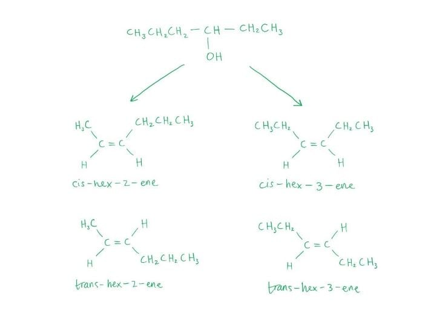

**A** and **D** are incorrect as these are primary alcohols. Elimination can only occur in one direction, giving fewer alkene isomers than a secondary alcohol.

**C** is incorrect as CH3CH2C(CH3)(OH)CH2CH3 (3-methylpentan-3-ol) gives 3 different alkenes on dehydration: (E)-3-methylpent-2-ene, (Z)-3-methylpent-2-ene and 2-ethylbut-1-ene, which is fewer than the 4 from option **B**.

### Q4
**Final answer:** **The correct answer is C**

- Bromine is an electrophile (electron-accepting species) and reacts with ethene via electrophilic addition.

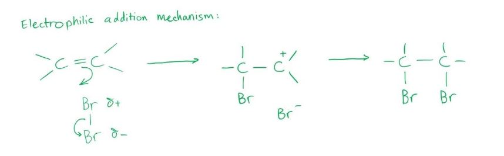

- Both products, CH2BrCH2Br (1,2-dibromoethane) and CH2BrCH2OH (2-bromoethanol), can be hydrolysed using hot aqueous NaOH to give the same organic compound, ethane-1,2-diol.

**A** and **B** are incorrect as both products are formed by electrophilic addition, not electrophilic substitution or nucleophilic addition.

**D** is incorrect as 1,2-dibromoethane (CH2BrCH2Br) has no N–H, O–H, or F–H bonds, so it cannot form hydrogen bonds with water. Only 2-bromoethanol (CH2BrCH2OH) can form hydrogen bonds via its –OH group.

### Q5
**Final answer:** **The correct answer is A**

- In an addition reaction, two compounds come together to form one larger compound with no other products, as shown:

- As Br2 approaches the electron-rich C=C double bond in propene, the Br2 molecule is polarised: the nearer Br atom develops a δ+ charge and acts as an electrophile.
- The π electrons from the C=C double bond attack the δ+ Br atom, and the Br–Br bond breaks heterolytically.
- A Br atom becomes attached to each carbon.
- Therefore, it is an electrophilic addition reaction.

**B** is incorrect as electrophilic substitution involves an electrophile replacing an existing atom or group. No atoms are replaced here.

**C** is incorrect as nucleophilic addition involves a nucleophile attacking an electrophilic carbon. Br2 acts as an electrophile, not a nucleophile.

**D** is incorrect as nucleophilic substitution involves a nucleophile replacing a leaving group. There is no leaving group in this reaction.

### Q6
**Final answer:** **The correct answer is C**

- 2,4-Dinitrophenylhydrazine (2,4-DNPH) reacts with the C=O bond in aldehydes and ketones to give an orange precipitate.
- Although acrylic acid contains a C=O bond (as part of the –COOH group), 2,4-DNPH does not react with carboxylic acids.
- Therefore, acrylic acid does not produce an orange precipitate with 2,4-DNPH.

**A** is incorrect as each sp2 carbon in acrylic acid has 3 bonding groups and no lone pairs, giving bond angles x and y of approximately 120°.

**B** is incorrect as acrylic acid contains a C=C double bond, which undergoes electrophilic addition with aqueous bromine and decolourises it.

**D** is incorrect as acrylic acid is a carboxylic acid, which reacts with alcohols in an esterification reaction to form an ester.

### Q7
**Final answer:** **The correct answer is A**

1. Identify the monomers in the displayed diagram

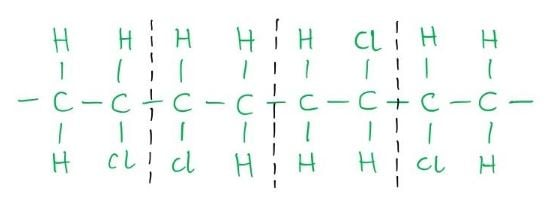

2. Break the bond between these monomers

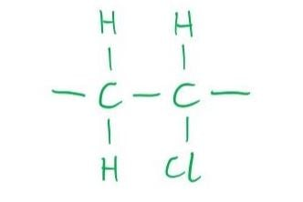

3. Add in the double bond between the carbon atoms

4. Convert the structural formula to the condensed formula

**B** is incorrect as CHCl=CHCl (1,2-dichloroethene) would produce a polymer in which every backbone carbon carries a Cl atom, giving two Cl atoms per repeating unit. This is inconsistent with the structure shown.

**C** is incorrect as CH3CCl=CH2 is a three-carbon monomer. Polymerisation would give a three-carbon backbone repeating unit, not a two-carbon one.

**D** is incorrect as CH3CCl=CHCl is also a three-carbon monomer. Polymerisation would give a three-carbon backbone with two Cl atoms per repeating unit.

### Q8
**Final answer:** **The correct answer is D**

- Limonene contains two C=C double bonds

  - One in the six-membered ring
  - One in the isopropenyl side chain.
- The reaction is carried out at room temperature in the dark.

  - In the dark, only electrophilic addition occurs.
  - UV light would initiate free-radical substitution instead.
- When reacted with excess Br2, electrophilic addition occurs across both double bonds.
- Each double bond reacts with one molecule of Br2, adding two Br atoms across each bond, giving four Br atoms in total.

**A** is incorrect as it shows bromine added across only one of the two double bonds. Excess Br2 ensures both double bonds react fully.

**B** is incorrect as it shows an incomplete or incorrect bromination product of limonene.

**C** is incorrect as it shows addition to only one double bond or addition in the wrong positions.

### Q9
**Final answer:** **The correct answer is C**

- Mild oxidation with cold dilute KMnO4 converts the C=C double bond into a diol, adding an –OH group to each alkene carbon.
- For the diol to undergo further oxidation to a diketone, both –OH groups must be secondary, i.e. each carbon bearing –OH must also carry at least one H atom.

  - A secondary alcohol oxidises to a ketone.
  - A tertiary alcohol (no H on that carbon) cannot be oxidised further.
- In option **C** (C6H5CH=CHC6H5), each alkene carbon carries one H and one C6H5 group. After diol formation, both –OH groups are secondary and are oxidised to C=O, giving a diketone.

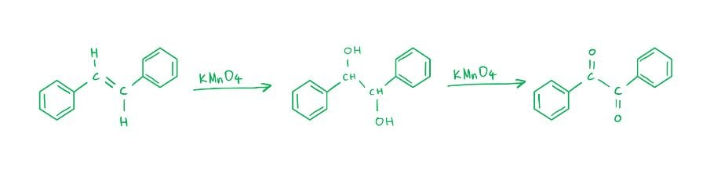

**A** is incorrect as CH3CH=C(CH3)2 gives a diol in which the right-hand C bears no H atoms (tertiary). This –OH group cannot be oxidised further, so a diketone cannot form.

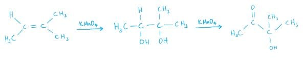

**B** is incorrect as (CH3)2CHCH=CH2 gives a diol in which the terminal C has a primary –OH group. A primary alcohol oxidises to a carboxylic acid, not a ketone, so a diketone is not formed.

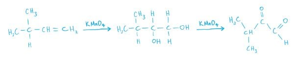

**D** is incorrect as (C6H5)2C=CHCH3 gives a diol in which the left-hand C carries two C6H5 groups and no H atoms (tertiary). This –OH group cannot be further oxidised.

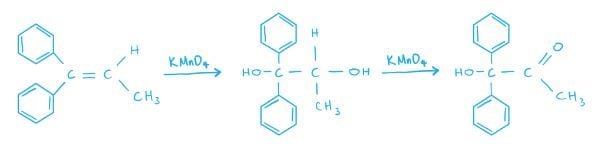

### Q10
**Final answer:** **The correct answer is B**

- In an addition reaction, two compounds come together to form one larger compound.
- There are no other products produced.
- Therefore, the reaction between ethene and steam is an addition reaction.

**A** is incorrect as an acid-base reaction involves an acid and a base as reactants.

**C** is incorrect as in a hydrolysis reaction, chemical bonds are broken by the addition of water, however that is not the case here.

**D** is incorrect as in a substitution reaction, an atom or functional group is replaced by another similar species.

> **[exam-tip]**
> This reaction is also known as hydration, which is the addition of water across the C=C double bond. Do not confuse hydration with hydrolysis:
> 
> - Hydration forms a single product with no bonds broken by water
> - Hydrolysis uses water to break a bond in the substrate (e.g. ester → carboxylic acid + alcohol).

### Q11
**Final answer:** **The correct answer is B**

- In the electrophilic addition of HBr to an alkene, the H end of HBr acts as the electrophile.

  - The δ+ H is attracted to the electron-rich C=C double bond.
- H adds to one carbon and Br adds to the other, breaking the C=C double bond.
- Drawing out the structural formula of each product from X and Y is the clearest approach:

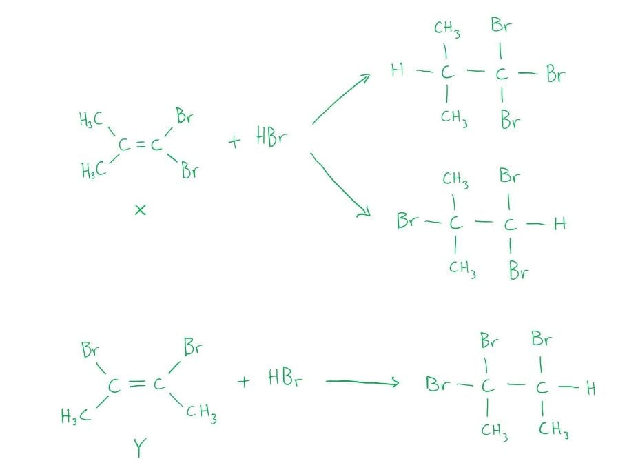

- The three different products from the reaction of HBr with isomers **X** and **Y** are:

  1. (CH3)2CHCBr3
  2. (CH3)2CBrCHBr2
  3. CH3CBr2CHBrCH3

**A** is incorrect as the third product listed (CH3CHBrCHBrCH3) is not formed from this reaction. This product would arise from addition of Br2, not HBr.

**C** is incorrect as the first product listed ((CH3)2CBrCBr3) is not formed; HBr addition to these isomers cannot produce a CBr3 group at that position.

**D** is incorrect as none of the three products in that row correctly reflects the regiochemistry of HBr addition to isomers X and Y.

### Q12
**Final answer:** **The correct answer is A**

- When ethene reacts with cold, dilute, acidified manganate(VII) ions, ethane-1,2-diol is produced.

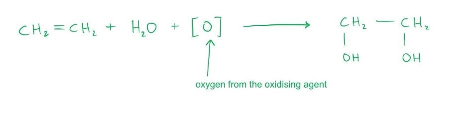

- In a similar way, pent-2-ene reacts with cold, dilute, acidified manganate(VII) ions to form pentan-2,3-diol:

CH3CH2CH=CHCH3 + H2O + [O] → CH3CH2CH(OH)CH(OH)CH3

**B** is incorrect as CH3CH2COCOCH3 (pentane-2,3-dione) cannot be synthesised from pent-2-ene by mild oxidation with cold, dilute manganate(VII) ions.

**C** is incorrect as CH3CH2CH(OH)CH2CH3 (pentan-3-ol) and CH3CH2CH2CH(OH)CH3 (pentan-2-ol) are the products of hydration of pent-2-ene, not mild oxidation with manganate(VII) ions.

**D** is incorrect as CH3CH2COOH (propanoic acid) and CH3COOH (ethanoic acid) are produced only by oxidative cleavage using hot, concentrated, acidified manganate(VII) ions.

### Q13
**Final answer:** **The correct answer is D**

- HBr undergoes electrophilic addition with alkenes only: H adds to one carbon and Br adds to the other across the C=C double bond. Only alkenes react with HBr, so only **B** and **D** are candidates.
- Check compound **D** (hex-3-ene, C6H12):
- Calculate the *M*r of hex-3-ene:

*M*r = (6 x 12) + (12 x 1)

*M*r = 72 + 12

*M*r = 84

- In electrophilic addition, HBr adds across the C=C bond. The *M*r of the product equals *M*r(alkene) + *M*r(HBr):

*M*r(product) = 84 + 80.9

*M*r(product) = 164.9

- Both conditions are satisfied, confirming compound **D**.

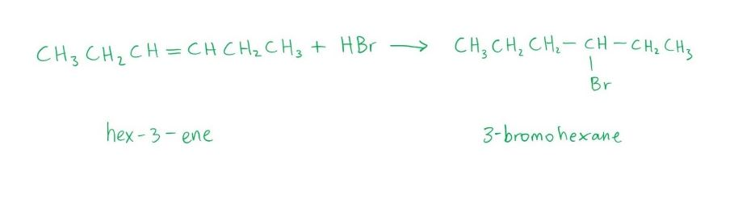

**A** and **C** are incorrect as these compounds are not alkenes and do not react with HBr by electrophilic addition.

**B** is incorrect as although it is an alkene with *M*r = 84, its product with HBr does not have *M*r = 164.9.

### Q14
**Final answer:** **The correct answer is B**

- Adding warm aqueous sodium hydroxide to 2-bromopropane gives propan-2-ol via nucleophilic substitution, not propene.

**A** is incorrect as adding excess hot concentrated sulfuric acid to propan-1-ol gives propene by a dehydration reaction:

**C** is incorrect as adding warm ethanolic sodium hydroxide to 1-bromopropane gives propene by an elimination reaction:

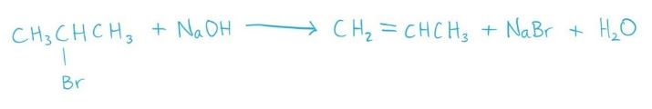

**D** is incorrect as passing propan-2-ol vapour over heated aluminium oxide gives propene by a dehydration reaction:

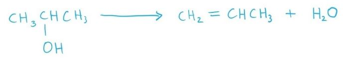

### Q15
**Final answer:** **The correct answer is C**

- Each –OH group in compound Q reacts with HBr to undergo nucleophilic substitution, replacing –OH with Br.
- The C=C double bond also reacts with HBr by electrophilic addition, adding H to one carbon and Br to the other.
- With excess HBr, both types of reaction proceed fully, giving the product shown in option **C**.

**A** is incorrect as it does not show complete substitution of all –OH groups or full addition across the C=C double bond.

**B** is incorrect as it shows an incorrect or incomplete transformation of compound Q with excess HBr.

**D** is incorrect as it shows incorrect regiochemistry or an incomplete reaction with excess HBr.

### Q16
**Final answer:** **The correct answer is B**

- Alkane **X** (C4H10) must be branched for two different monochloroalkanes to both give the same alkene on dehydrohalogenation.

  - Alkane **X** is therefore 2-methylpropane, (CH3)3CH.
- Free radical substitution of 2-methylpropane with Cl2 in sunlight gives 1-chloro-2-methylpropane and 2-chloro-2-methylpropane.
- Both undergo dehydrohalogenation with hot ethanolic KOH to give the same alkene, **Y** = 2-methylprop-1-ene (CH2=C(CH3)2).

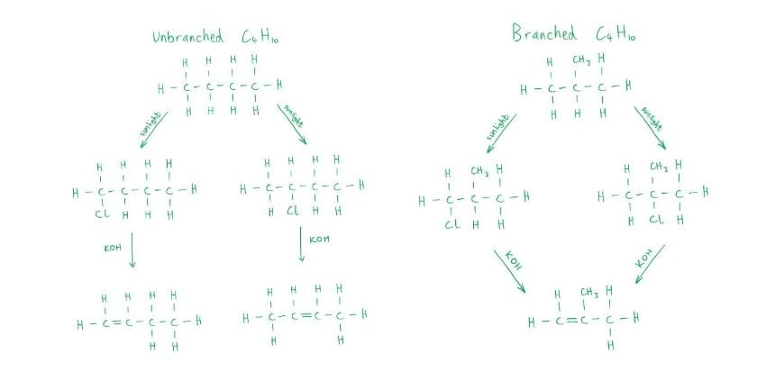

- Hot concentrated acidified KMnO4 cleaves the C=C bond by vigorous oxidation:

  - The terminal =CH2 end is fully oxidised to CO2 (and H2O).
  - The C(CH3)2 end is disubstituted (no H on that carbon) and forms a ketone: CH3COCH3 (propanone).

**A** is incorrect as propanoic acid (CH3CH2CO2H) would require a –CH2CH3 fragment on the double bond, which is not present in 2-methylprop-1-ene.

**C** is incorrect as methanoic acid (HCO2H) comes from a –CH= fragment. The terminal =CH2 in 2-methylprop-1-ene is fully oxidised to CO2, not methanoic acid.

**D** is incorrect as ethanoic acid (CH3CO2H) alone would result from oxidative cleavage of a symmetric alkene such as but-2-ene, not 2-methylprop-1-ene.

### Q17
**Final answer:** **The correct answer is C**

- Ethanol undergoes dehydration to form ethene.

  - Concentrated H2SO4 (heated) is the correct reagent for this reaction, eliminating options **A** and **D**.
- The ethene produced contains acidic impurities, principally SO2 formed by oxidation of ethanol by hot concentrated H2SO4.

  - These must be removed before the gas is collected.
- In option **C**, passing the gas through dilute NaOH neutralises the acidic SO2 impurity, giving purified ethene.

**A** is incorrect as acidified K2Cr2O7 oxidises ethanol to ethanal rather than dehydrating it to ethene.

**B** is incorrect as passing the gas through dilute H2SO4 adds more acid rather than removing it.

**D** is incorrect as ethanolic NaOH promotes elimination of HX from haloalkanes, not dehydration of alcohols.

### Q18
**Final answer:** **The correct answer is C**

1. Draw the monomer structural formula

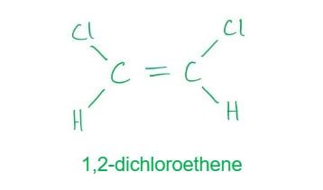

2. Break the C=C double bond to form the polymer backbone unit

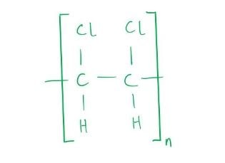

3. Replace each –Cl with –OH by hydrolysis

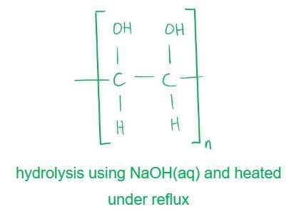

**A** is incorrect as polymerising ethene gives a saturated poly(ethene) backbone with no substituents. Hydrating a saturated polymer does not introduce –OH groups along the chain.

**B** and **D** are incorrect as oxidation with cold acidified KMnO4 converts C=C double bonds into diol groups. Once polymerised, the backbone is saturated and has no C=C bonds to oxidise. In option **D**, the –Cl groups in poly(1,2-dichloroethene) cannot be replaced by cold KMnO4 oxidation because hydrolysis is the correct method.

## Structured Questions (7 questions)

### Q1
To calculate the empirical formula of **B**:

- Convert the percentages to moles:

moles of C = $\frac{54.5}{12.0}$ = 4.5417

moles of H = $\frac{9.1}{1.0}$ = 9.1

moles of O = $\frac{36.4}{16.0}$ = 2.275

**[1 mark]**

- Divide each value by the smallest (2.275…) to get the ratio:

C = $\frac{4.5417}{2.275}$ $\approx$ 2

H = $\frac{9.1}{2.275}$ = 4

O = $\frac{2.275}{2.275}$ = 1

State the empirical formula:

**Final answer:** **C****2****H****4****O**

**[1 mark]**

> **[mark-scheme]**
> 1 mark for correct calculation of moles for C, H and O
> 
> 1 mark for correct simplest whole-number ratio leading to C2H4O

> **[exam-tip]**
> Keep several significant figures during the mole calculations, then simplify the ratio at the end. Rounding too early is a common reason students end up with the wrong whole-number ratio.
> **[mark-scheme]**
> i) The reagent and conditions for the dehydration of butan-2-ol are:
> 
> - Concentrated H2SO4
> **OR**
> H3PO4 **[1 mark]**
> - Heat / around 170 °C **[1 mark]**
> 
> Sulfuric acid must be concentrated for the first mark.
> 
> Heated vapour over Al2O3 scores **[2 marks]**
> 
> ii) The colour change is:
> 
> - Orange to green **[1 mark]**
> 
> iii) The organic product is:
> 
> - Butanone / butan-2-one **[1 mark]**

> **[exam-tip]**
> In (i), you need both parts for full marks: a dehydrating agent (often concentrated sulfuric acid) and heating. Writing “sulfuric acid” without “concentrated”, or missing the heat/temperature, is usually not enough.
> 
> In (ii), “orange to green” is specific to dichromate(VI). Answers like “decolourised” often show confusion with other oxidising agents.
> 
> In (iii), remember that secondary alcohols oxidise to ketones only, so the product is butanone (butan-2-one), not an aldehyde or carboxylic acid.
> **[mark-scheme]**
> i) Geometrical (cis/trans) isomerism arises because:
> 
> - There is restricted rotation about the C=C double bond due to the presence of a π bond **[1 mark]**
> - There are two different groups attached to each carbon of the C=C double bond **[1 mark]**

ii) The displayed formula of trans-but-2-ene is:

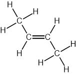

**[1 mark]**

> **[mark-scheme]**
> 1 mark for the correct displayed formula of trans-but-2-ene with methyl groups on opposite sides of the C=C bond
> 
> iii) To test for the C=C double bond in but-2-ene:
> 
> - Reagent: Bromine water / aqueous bromine **[1 mark]**
> - Observation: Orange/brown to colourless (decolourised) **[1 mark]**

> **[exam-tip]**
> For (i), avoid vague phrases such as "different spatial arrangement" on their own. You must refer specifically to restricted rotation due to the presence of the π bond and the requirement for two different groups on each carbon of the C=C bond.
> 
> For (ii), make sure the cis/trans arrangement is unambiguous. The key mark is for showing the methyl groups on opposite sides of the double bond. All bonds must be shown as the question asks for the displayed formula.
> 
> For (iii), always pair the reagent with a clear observable change. Writing "reacts" or "no change" without specifying the colour change will not gain credit.
> **[mark-scheme]**
> i) The bond responsible for a strong absorption peak at 1700 cm-1 is:
> 
> - C=O / carbonyl **[1 mark]**
> 
> ii) The bond responsible for a broad absorption peak in the range 3200–3600 cm-1 is:
> 
> - O–H (alcohol) / hydroxyl **[1 mark]**
> 
> iii) The differences between the spectra are:
> 
> - The product does not have an O–H absorption at 3200–3600 cm-1
> **OR**
> The O–H absorption at 3200–3600 cm-1 disappears or decreases **[1 mark]**
> - The product has a C=O absorption at about 1700 cm-1
> **OR**
> A C=O absorption at about 1700 cm-1 appears **[1 mark]**

> **[exam-tip]**
> For (i), be specific. The peak at around 1700 cm-1 is characteristic of a carbonyl (C=O) group, not just a generic "double bond".
> 
> For (ii), the key clue is that the peak is broad. Sharp peaks in this region are not typical of alcohol O–H bonds.
> 
> For (iii), full marks require two clear comparisons: the loss of the O–H absorption from the alcohol and the appearance of the C=O absorption in the ketone.

### Q2
The major organic product formed in each addition reaction is:

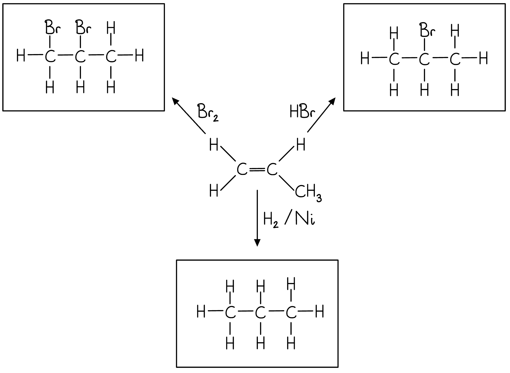

**[3 marks]**

> **[mark-scheme]**
> 1 mark for each correct major organic product structure

> **[exam-tip]**
> The question asks for the major product of each reaction. For the reactions with H2/Ni and Br2, only one product is possible so the distinction between major and minor does not apply. For the reaction with HBr, Markovnikov's rule applies: the H atom adds to the carbon with more hydrogen atoms already attached, giving 2-bromopropane as the major product.
The completed mechanism for the formation of the major product is:

**[3 marks]**

> **[mark-scheme]**
> 1 mark for correct dipole shown on H–Br (Hδ+–Brδ–), curly arrow from the C=C bond to Hδ+, and curly arrow from the H–Br bond to Brδ–
> 
> 1 mark for the correct secondary carbocation intermediate drawn
> 
> 1 mark for a curly arrow from the lone pair on :Br– to the C+ of the carbocation

> **[exam-tip]**
> Curly arrows must start from an area of high electron density (a bond or a lone pair) and point towards an area of low electron density. The dipole on H–Br must be shown to gain full marks unless the question explicitly states otherwise.
> 
> The major product is 2-bromopropane because the secondary carbocation intermediate (positive charge on C2, stabilised by two alkyl groups) is more stable than the primary carbocation (positive charge on C1). The bromide ion attacks the more stable carbocation to give the major product.
The displayed formula of the minor product, 1-bromopropane, is:

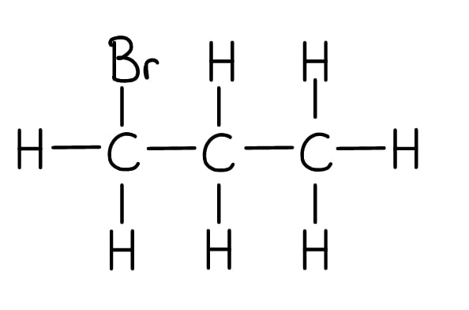

**[1 mark]**

> **[mark-scheme]**
> 1 mark for the correct displayed formula of 1-bromopropane with all bonds shown

> **[exam-tip]**
> The minor product forms via the less stable primary carbocation intermediate, where the positive charge is on C1. The bromide ion attacks this carbon to give 1-bromopropane.
> **[mark-scheme]**
> A major and a minor product are produced because:
> 
> - The intermediate can be a primary or secondary carbocation **[1 mark]**
> - The secondary carbocation is more stable than the primary carbocation **[1 mark]**
> - The major product is formed from the more stable secondary carbocation **[1 mark]**
> 
> The reverse argument (primary carbocation is less stable → forms the minor product) is also accepted.

The two possible carbocation intermediates are:

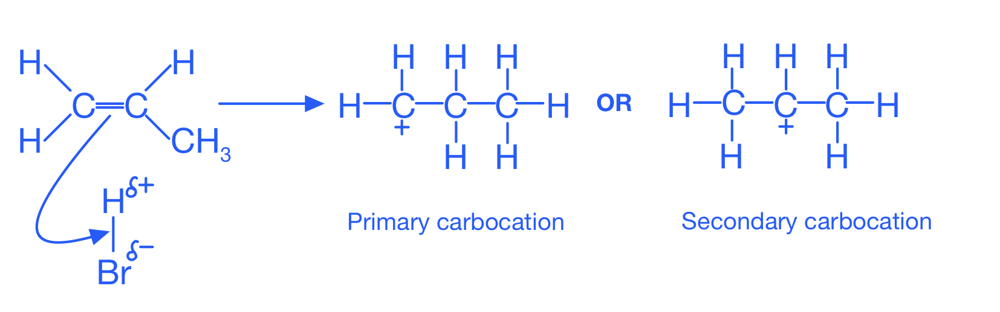

> **[exam-tip]**
> The second step of the mechanism is for the bromide ion (:Br–) to attack the C+ of the carbocation. The secondary carbocation (positive charge on the central carbon, stabilised by two alkyl groups through the inductive effect) forms preferentially, so the major product is 2-bromopropane. The primary carbocation (positive charge on C1) is less stable and gives the minor product, 1-bromopropane.

### Q3
> **[mark-scheme]**
> Propane is relatively unreactive because:
> 
> - C–C and C–H bonds are strong / have high bond enthalpies **[1 mark]**
> - Propane is non-polar / there is very little difference in electronegativity between C and H **[1 mark]**

> **[exam-tip]**
> Alkanes are relatively unreactive because all bonds are C–C and C–H single bonds, which are strong (high bond enthalpy) and non-polar. The very small difference in electronegativity between carbon and hydrogen means there are no partial charges, so propane does not react with polar reagents such as acids, bases, or nucleophiles.
> **[mark-scheme]**
> To distinguish between propane and propene:
> 
> - Add bromine water **[1 mark]**
> - Propene decolourises the bromine water / turns from orange to colourless; propane shows no change **[1 mark]**

> **[exam-tip]**
> Bromine water is an orange solution used to test for the presence of a C=C double bond. Propene undergoes electrophilic addition with bromine to form 1,2-dibromopropane (colourless), so the solution decolourises. Propane has no double bond and does not react with bromine water at room temperature in the absence of UV light, so the solution remains orange.
i) The organic product for each reaction is:

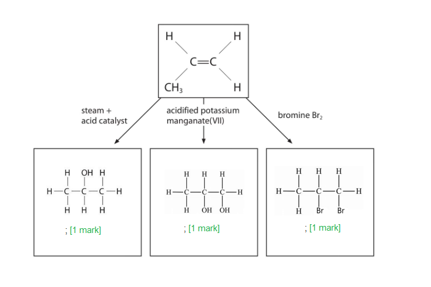

**[3 marks]**

> **[mark-scheme]**
> 1 mark for each correct organic product structure (maximum 3 marks)

ii) The mechanism for the formation of the major product is:

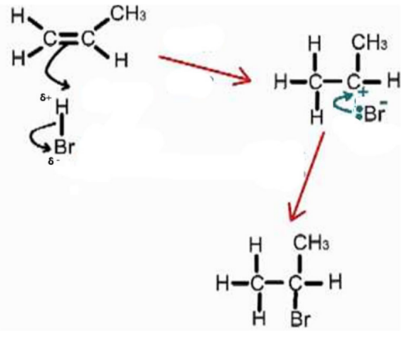

**[3 marks]**

> **[mark-scheme]**
> 1 mark for correct dipole on H–Br (Hδ+–Brδ–) and two correct curly arrows (C=C bond to Hδ+, and H–Br bond to Brδ–)
> 
> 1 mark for the correct secondary carbocation intermediate
> 
> 1 mark for a curly arrow from the lone pair on :Br– to the C+ of the carbocation

> **[exam-tip]**
> The reactions of alkenes you need to know include:
> 
> - alkene + H2/Ni/heat → alkane
> - alkene + steam/H3PO4 → alcohol
> - alkene + halogen (Br2, Cl2) → dihalogenoalkane
> - alkene + hydrogen halide (HX) → halogenoalkane
> - alkene + cold dilute acidified KMnO4 → diol
> 
> For the mechanism in part ii), curly arrows must begin from the C=C bond in the first step. The major product is 2-bromopropane because the secondary carbocation (positive charge on C2, stabilised by two alkyl groups) is more stable than the primary carbocation (positive charge on C1).
The structure of poly(propene) showing two repeat units is:

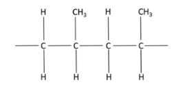

**[1 mark]**

> **[mark-scheme]**
> 1 mark for the correct poly(propene) structure with two repeat units and extension bonds shown on both ends

> **[exam-tip]**
> To draw the repeating unit: start with two propene monomers, remove the C=C double bond from each, connect the carbons that were doubly bonded, then add extension bonds (short bonds extending beyond the bracket at each end) to show the polymer chain continues. Both extension bonds are essential to gain the mark.

### Q4
> **[mark-scheme]**
> i) A balanced equation for this reaction is:
> 
> - C2H5OH → C2H4 + H2O **[1 mark]**
> 
> ii) The type of reaction is:
> 
> - Elimination / Dehydration **[1 mark]**

> **[exam-tip]**
> You should know the formulae for ethanol (C2H5OH) and ethene (C2H4) and be able to construct the balanced equation. The reaction is called elimination because a small molecule (water) is eliminated from the organic compound, and dehydration because water is lost. Both terms are accepted.
> 
> The catalyst shown in the apparatus (pumice) acts as a surface catalyst. Aluminium oxide (Al2O3) and concentrated acids (H2SO4 or H3PO4) are also used as catalysts for this reaction.
The completed table is:

|   | aqueous hydrogen bromide | cold, dilute acidified potassium manganate(VII) |
|---|---|---|
| colour at start | **Final answer:** **colourless** | **Final answer:** **purple** |
| colour after reaction | **Final answer:** **colourless** | **Final answer:** **colourless / decolourised** |
| structural formula of organic product | **Final answer:** **CH****3****CH****2****Br** | **Final answer:** **HOCH****2****CH****2****OH** |

**[4 marks]**

> **[mark-scheme]**
> 1 mark for both correct colour entries for aqueous hydrogen bromide (colourless at start and colourless after reaction)
> 
> 1 mark for the correct structural formula of the product with aqueous hydrogen bromide: CH3CH2Br
> 
> 1 mark for both correct colour entries for potassium manganate(VII) (purple at start, colourless / decolourised after reaction)
> 
> 1 mark for the correct structural formula of the product with cold dilute acidified potassium manganate(VII): HOCH2CH2OH
> 
> "Clear" is not accepted in place of "colourless". Both colour entries must be correct to score each mark.

> **[exam-tip]**
> Aqueous HBr is a colourless solution and the product bromoethane (CH3CH2Br) is also colourless, so no colour change is observed in the HBr reaction.
> 
> KMnO4 is purple. When ethene reacts with cold, dilute acidified KMnO4, the alkene is oxidised to a diol (ethane-1,2-diol: HOCH2CH2OH) and the purple manganate(VII) ion is reduced, so the solution decolourises.
> 
> Alkenes also react with hot concentrated acidified KMnO4, but the product and conditions are different — learn both reactions.
> **[mark-scheme]**
> The molecular formula of cyclohexene is:
> 
> - C6H10 **[1 mark]**

> **[exam-tip]**
> The molecular formula gives the actual number of atoms of each element. Cyclohexene has a six-membered ring with one C=C double bond. The two carbons in the double bond each have one H atom; the remaining four ring carbons each have two H atoms. This gives a total of 6 carbons and 10 hydrogens: C6H10.
i) The structural formula of the compound formed when cyclohexene reacts with bromine is:

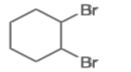

**[1 mark]**

> **[mark-scheme]**
> 1 mark for the correct structure of 1,2-dibromocyclohexane, with both bromine atoms on adjacent carbons that previously formed the double bond
> 
> ii) The type of mechanism is:
> 
> - Electrophilic **[1 mark]**
> - Addition **[1 mark]**

> **[exam-tip]**
> Cycloalkenes undergo the same electrophilic addition reactions as straight-chain alkenes — do not be put off by the ring structure. Bromine adds across the C=C bond: the two bromine atoms go onto the two carbons that previously formed the double bond.
> 
> The mechanism is electrophilic addition: the C=C bond acts as a nucleophile (electron-rich), attracting the electrophile Br2 (which becomes polarised as it approaches). The first step forms a cyclic bromonium ion intermediate; the bromide ion then attacks from the opposite face, giving the trans-addition product.
The structural formula of the compound formed is:

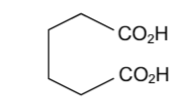

**[1 mark]**

> **[mark-scheme]**
> 1 mark for the correct structural formula of hexanedioic acid: HOOC(CH2)4COOH
> 
> The –COOH group may be written as –CO2H. Accept any unambiguous structural formula for hexanedioic acid.

> **[exam-tip]**
> When hot concentrated acidified KMnO4 reacts with cyclohexene, the C=C bond is completely broken. Each carbon in the double bond is bonded to an H atom and an alkyl group (the rest of the ring), so both carbons are oxidised to carboxylic acid groups (–COOH). This opens the ring to give hexanedioic acid: HOOC(CH2)4COOH.
> 
> The product depends on the substituents on the C=C carbons: if a carbon has one H atom and one alkyl group, oxidation gives –COOH; if a carbon has no H atoms (two alkyl groups), oxidation gives a ketone (C=O) instead.

### Q5
The skeletal formulae of three branched-chain alkenes with molecular formula C5H10 are:

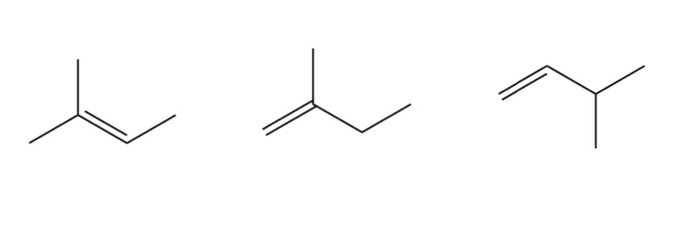

**[3 marks]**

> **[mark-scheme]**
> 1 mark for each correct branched-chain skeletal formula of a C5H10 alkene (maximum 3 marks)
> 
> Straight-chain isomers (pent-1-ene, pent-2-ene) are not accepted.

> **[exam-tip]**
> The three branched-chain alkenes with formula C5H10 are 2-methylbut-1-ene, 3-methylbut-1-ene, and 2-methylbut-2-ene. Pent-1-ene and pent-2-ene are straight-chain isomers and will not score the mark. Ensure the C=C double bond is clearly shown in the skeletal formula.
> **[mark-scheme]**
> i) The formula of the alcohol that forms only pent-2-ene is:
> 
> - CH3CH2CH(OH)CH2CH3 (pentan-3-ol) **[1 mark]**
> 
> Pentan-1-ol is not accepted (forms pent-1-ene only). Pentan-2-ol is not accepted (can form pent-1-ene or pent-2-ene).
> 
> ii) The type of reaction is:
> 
> - Elimination / Dehydration **[1 mark]**

> **[exam-tip]**
> When a secondary alcohol undergoes dehydration, the –OH group and an H atom on an adjacent carbon are lost as water. Pentan-3-ol has equivalent adjacent carbons on both sides (C2 and C4 are both –CH2– groups), so only one alkene (pent-2-ene) can form. This is the only C5 alcohol that gives exclusively pent-2-ene.
> 
> The reaction is called both elimination (a group is removed from the molecule) and dehydration (water is lost). Both terms are accepted.
The completed mechanism for the formation of 2-bromopentane is:

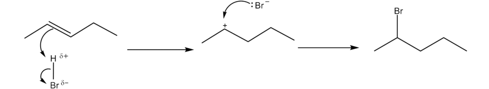

**[4 marks]**

> **[mark-scheme]**
> 1 mark for correct dipole on H–Br (Hδ+–Brδ–) and a curly arrow from the C=C bond to Hδ+
> 
> 1 mark for a curly arrow from the H–Br bond to Brδ–
> 
> 1 mark for the correct secondary carbocation intermediate drawn (positive charge on C2)
> 
> 1 mark for a curly arrow from the lone pair on :Br– to the C+ of the carbocation, giving 2-bromopentane

> **[exam-tip]**
> Curly arrows must begin from an area of high electron density (a bond or lone pair) and point towards an area of low electron density. The dipole must be marked on H–Br; you will only be penalised once for omitting it.
> 
> The major product is 2-bromopentane because the secondary carbocation (positive charge on C2, stabilised by two alkyl groups) is more stable than the primary carbocation (positive charge on C1). The bromide ion then attacks the more stable carbocation.
To calculate the pressure inside the container:

- Calculate the moles of pent-1-ene:

moles = $\frac{1.33}{70.0}$

moles = 0.0190 mol

**[1 mark]**

- Convert the volume and temperature to SI units:

volume = 500 x 10-6 m3

temperature = 60 + 273 = 333 K

**[1 mark]**

- Rearrange the ideal gas equation and substitute:

*p* = $\frac{nRT}{V}$

*p* = $\frac{0.0190\times8.31\times333}{500\times10^{-6}}$

*p* = 105 154 Pa

**[1 mark]**

- Round to an appropriate number of significant figures and state units:

*p* = **105 000 Pa**

**[1 mark]**

> **[mark-scheme]**
> 1 mark for moles of pent-1-ene = 0.019 mol (Mr of C5H10 = 70.0)
> 
> 1 mark for volume = 500 x 10-6 m3 **AND** temperature = 333 K (both required)
> 
> 1 mark for correct substitution into *pV* = *nRT*
> 
> 1 mark for final answer to 2 or 3 sf with correct units
> 
> Allow 1.05 x 105 Pa or 1.1 x 105 Pa. Allow N m-2 in place of Pa or answer expressed in kPa (105 kPa).

> **[exam-tip]**
> The molar mass of pent-1-ene (C5H10) = (5 x 12.0) + (10 x 1.0) = 70.0 g mol-1.
> 
> The ideal gas equation *pV* = *nRT* requires SI units throughout: pressure in Pa, volume in m3, temperature in K, and amount in mol. Divide the volume in cm3 by 106 to convert to m3, and add 273 to convert °C to K.
> 
> A correct final answer with units and no working shown still scores 4 marks, but showing your working allows error-carried-forward credit if an earlier step is wrong.

### Q6
> **[mark-scheme]**
> Two improvements to obtain more consistent results are:
> 
> Any **two** from:
> 
> - Weigh out the oil (density is known, so volume can be calculated from mass)
> - Use a measured / known volume of cooking oil (e.g. with a graduated pipette)
> - Make a standard solution of the cooking oil and solvent
> - Titrate the bromine water against 25.0 cm3 measured portions of the cooking oil / solvent mixture
> 
> **[2 marks]**

> **[exam-tip]**
> Scientific titrations work with known volumes and concentrations to find an unknown quantity. Here, the concentration and volume of the bromine water are known, but "five drops" of cooking oil is not a precise or consistent volume. To calculate the number of C=C bonds per molecule, you need to know the amount (moles) of cooking oil used, which requires a precise mass or volume measurement.
To deduce the number of C=C bonds in the cooking oil:

- Calculate the mass of cooking oil used (5 drops):

mass = density x volume = 0.526 x (5.0 x 10-2 x 5)

mass = 0.1315 g **[1 mark]**

- Calculate the moles of cooking oil:

moles of oil = $\frac{0.1315}{1002}$

moles of oil = 1.312 x 10-4 mol **[1 mark]**

- Calculate the average titre (excluding rough):

average titre = $\frac{26.25+26.35}{2}$ = 26.30 cm3 **[1 mark]**

- Calculate the moles of Br2:

moles of Br2 = 2.0 x 10-2 x $\frac{26.30}{1000}$

moles of Br2 = 5.26 x 10-4 mol **[1 mark]**

- Calculate the molar ratio of oil : Br2:

ratio = 1.312 x 10-4 : 5.26 x 10-4 = 1 : 4 **[1 mark]**

- State the conclusion:

number of C=C bonds per molecule = **4** **[1 mark]**

> **[mark-scheme]**
> Rough titres are not used in titration calculations. The concordant titres are experiment 1 (26.25 cm3) and experiment 2 (26.35 cm3); allow ECF if the student uses a different concordant pair.
> 
> Each C=C bond reacts with one molecule of Br2, so the molar ratio of oil to bromine equals the number of C=C bonds per molecule of oil.

> **[exam-tip]**
> You have all the information needed to find the moles of cooking oil (mass and Mr) and the moles of bromine (concentration and titre). Rough titres are never included in the average, even if they appear concordant with other results.
> 
> Once you have the molar ratio of oil to Br2, the key insight is that each C=C bond reacts with exactly one Br2 molecule. A ratio of 1 : 4 therefore means 4 C=C bonds per molecule of oil.
> **[mark-scheme]**
> i) The terms mean:
> 
> - Mono-unsaturated: (each carbon chain contains) one C=C bond / carbon-carbon double bond **[1 mark]**
> - Polyunsaturated: (each carbon chain contains) two or more / many C=C bonds / carbon-carbon double bonds **[1 mark]**
> 
> ii) To produce the mono-unsaturated oil from the polyunsaturated oil:
> 
> - Reagent: H2 / hydrogen **[1 mark]**
> - Conditions: Pt / Ni catalyst
> **AND**
> Heat **[1 mark]**

> **[exam-tip]**
> The prefixes "mono-" (one) and "poly-" (many) combined with "unsaturated" (containing C=C double bonds) indicate the number of C=C bonds per carbon chain. Looking at the structure of the mono-unsaturated oil, each carbon chain contains exactly one C=C bond.
> 
> Hydrogenation is the addition of H2 across C=C double bonds, converting them to C–C single bonds. The reaction requires a metal catalyst (Pt or Ni) and heat. This process is used industrially to convert liquid polyunsaturated oils into more solid, saturated fats (for example, in the production of margarine).

### Q7
> **[mark-scheme]**
> i) An equation for the reaction between sodium hydroxide and carbon dioxide is:
> 
> - 2NaOH + CO2 → Na2CO3 + H2O **[1 mark]**

ii) The volume of carbon dioxide produced by the combustion of the hydrocarbon is:

volume of CO2 = 95 − 75 = **20 cm****3** **[1 mark]**

iii) The volume of oxygen used up in the reaction with the hydrocarbon is:

volume of O2 used = 100 − 75 = **25 cm****3** **[1 mark]**

iv) Using the volume ratio hydrocarbon : O2 : CO2 = 10 : 25 : 20, simplified to 2 : 5 : 4, the balanced equation is:

**2**C*x*H*y* + **5**O2 → **4**CO2 + *z*H2O

**[2 marks]**

> **[mark-scheme]**
> 2 marks for all three correct balancing numbers (2, 5, and 4); allow 1 mark for exactly two correct balancing numbers
> 
> v) The values of *x*, *y* and *z* are:
> 
> - *x* = 2 **[1 mark]**
> - *y* = 2 **[1 mark]**
> - *z* = 2 **[1 mark]**

> **[exam-tip]**
> After combustion, the gaseous mixture (95 cm3) contains excess O2 and CO2. Treating with NaOH absorbs the CO2, reducing the volume to 75 cm3, so the volume of CO2 = 95 − 75 = 20 cm3. Since the initial O2 was 100 cm3 and 75 cm3 remains, the O2 used = 100 − 75 = 25 cm3.
> 
> The volume ratio is hydrocarbon : O2 : CO2 = 10 : 25 : 20, which simplifies to 2 : 5 : 4. This gives the balanced equation: 2C*x*H*y* + 5O2 → 4CO2 + *z*H2O.
> 
> To find *x*: 4 CO2 means 4 C on the right; with 2 formula units of C~*x*H*y*~ on the left, *x* = 2. To find *z*: 10 O on the left (5O2), 8 in 4CO2, so 2 in *z*H2O, giving *z* = 2. To find *y*: 4 H on the right (2H2O) and 2 formula units of C2Hy, so *y* = 2. The hydrocarbon is C2H2 (ethyne).
> **[mark-scheme]**
> i) The structural formulae and names of **W**, **X**, and **Y** are:
> 
> - **W** = (CH3)2C=CH2
> **AND**
> 2-methylpropene **[1 mark]**
> - **X** = (CH3)2CBrCH3
> **AND**
> 2-bromo-2-methylpropane **[1 mark]**
> - **Y** = (CH3)2CHCH2Br
> **AND**
> 1-bromo-2-methylpropane **[1 mark]**
> 
> ii) More **X** is produced than **Y** because:
> 
> Any **two** from (1 mark for each point):
> 
> - The halide bonds to the carbon with the most alkyl groups / most substituted carbon
> - A tertiary carbocation is more stable than a primary carbocation
> - Alkyl groups stabilise the carbocation through the inductive effect (+I)
> 
> **[2 marks]**

> **[exam-tip]**
> 2-methylpropene is the only branched-chain alkene with the formula C4H8. When it reacts with HBr, the δ+H of H–Br acts as the electrophile and accepts electrons from the C=C bond. This forms a carbocation: either tertiary (positive charge on C2, attached to three alkyl groups) or primary (positive charge on C1, attached to one alkyl group).
> 
> The tertiary carbocation at C2 is more stable because three alkyl groups push electron density towards the positive carbon through the inductive effect. The bromide ion preferentially attacks this more stable intermediate, giving 2-bromo-2-methylpropane (**X**) as the major product.
The mechanism for the reaction of pent-2-ene with hydrogen bromide is:

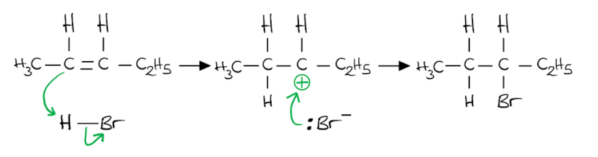

**[4 marks]**

> **[mark-scheme]**
> 1 mark for a curly arrow from the C=C bond to the H atom of H–Br
> 
> 1 mark for a curly arrow from the H–Br bond to the Br atom, forming the carbocation intermediate
> 
> 1 mark for the correct carbocation intermediate drawn
> 
> 1 mark for a curly arrow from the lone pair on :Br– to the C+ of the carbocation

> **[exam-tip]**
> This question specifies that you do not need to include partial charges (δ+ and δ–) on the H–Br molecule. Unless a question explicitly states this, you should always include the dipole to gain full marks.
> 
> Curly arrows must start from an area of high electron density (the C=C bond or a lone pair) and point to an area of low electron density. The major product is the bromoalkane formed via the more stable secondary carbocation intermediate.
