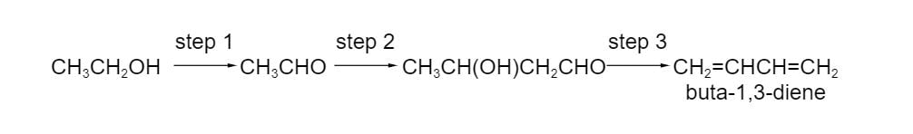
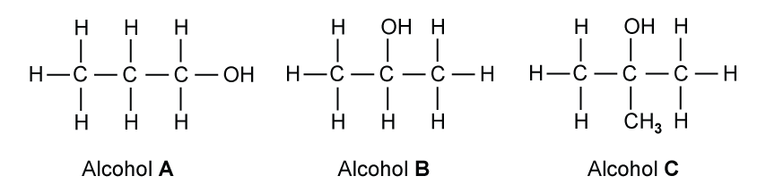
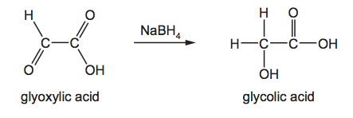
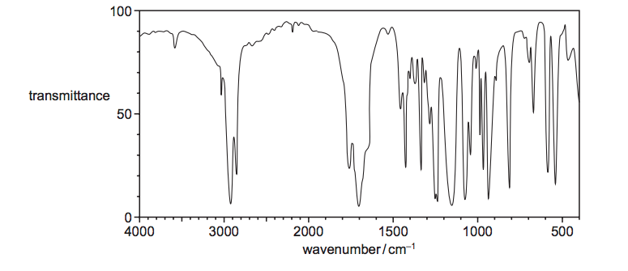

# Exam Questions — Alcohols
**16. Hydroxy Compounds** · Cambridge (CIE) AS chemistry (9701)
> Source: [https://www.savemyexams.com/as/chemistry/cie/25/topic-questions/](https://www.savemyexams.com/as/chemistry/cie/25/topic-questions/) · 39 questions across 2 sets

## Multiple Choice Questions (29 questions)

### Q1 — hard — 1 marks

**Q1** [1 mark]

Alcohols are weaker acids than water. Which statement correctly explains this?

### Q2 — medium — 1 marks

**Q2** [1 mark]

Which reaction will produce propanoic acid?

### Q3 — medium — 1 marks

**Q3** [1 mark]

Which reagent and conditions will convert propan-2-ol into propanone?

### Q4 — medium — 1 marks

**Q4** [1 mark]

A 2.30 g sample of ethanol is mixed with acidified aqueous potassium dichromate(VI) and the mixture is heated. The desired organic product is collected by immediate distillation. The yield of the product is 70.0%.

What mass of organic product is collected?

### Q5 — easy — 1 marks

**Q5** [1 mark]

An alcohol with molecular formula CnH2n+1OH has a chiral centre but does not react with hot, acidified aqueous potassium dichromate(VI).

What is the smallest possible value for n?

### Q6 — hard — 1 marks

**Q6** [1 mark]

1.50 g of butan-2-ol is mixed with excess acidified potassium dichromate(VI). The reaction mixture is heated under reflux and the organic product is collected by distillation. The yield of product is 80.0%.

What mass of product is collected?

### Q7 — medium — 1 marks

**Q7** [1 mark]

Which reagent reacts with prop-2-en-1-ol, CH2=CHCH2OH, to form a product that shows optical isomerism?

### Q8 — hard — 1 marks

**Q8** [1 mark]

In a multi-step synthesis reaction, butanal is converted into a compound Z.

CH3(CH2)2CHO $\overset{\mathrm{HCN},\mathrm{NaCN}}{\rightarrow}$ **X** $\overset{\mathrm{hot} \mathrm{dilute}H_{2}\mathrm{SO}_{4}}{\rightarrow}$ **Y **`-> from trace of conc. H _ 2 SO _ 4 to CH _ 3 CH _ 2 OH , heat of` **Z**

What could **Z** be?

### Q9 — easy — 1 marks

**Q9** [1 mark]

Buta-1,3-diene is currently obtained from fossil fuel sources. In future it may be obtained from ethanol, which can be produced from non-food agricultural crops. The sequence of reactions is as follows.

Which term could be used to describe step 1?

### Q10 — hard — 1 marks

**Q10** [1 mark]

Which reagent reacts differently with the two isomeric alcohols, (CH3)3CCH2OH and (CH3)2CHCH2CH2OH?

### Q11 — hard — 1 marks

**Q11** [1 mark]

The foul smell that skunks spray is due to a number of thiols, one of which is methanethiol, CH3SH, which burns as follows.

CH3SH + 3O2 $\rightarrow$ CO2 + SO2 + 2H2O

A sample of 15 cm3 of methanethiol vapour is exploded with 90 cm3 of oxygen.

What is the final volume of the resultant mixture of gases when cooled to room temperature?

### Q12 — hard — 1 marks

**Q12** [1 mark]

Compound **Q** has the molecular formula C10H14O and is unreactive towards mild oxidising agents.

Which structure formed by the dehydration  of compound **Q**?

### Q13 — hard — 1 marks

**Q13** [1 mark]

An organic compound **J** reacts with sodium to produce an organic ion with a charge of –3.

**J** reacts with aqueous sodium hydroxide to produce an organic ion with a charge of –1.

What could be the structural formula of **J**?

### Q14 — medium — 1 marks

**Q14** [1 mark]

Which reagent reacts with both ethanol and ethanoic acid?

### Q15 — easy — 1 marks

**Q15** [1 mark]

Considering **only** structural isomers, what is the number of alcohols of each type with the formula C5H12O?

|   | **Primary** | **Secondary** | **Tertiary** |
|---|---|---|---|
| **A** | 3 | 3 | 2 |
| **B** | 4 | 2 | 2 |
| **C** | 4 | 3 | 1 |
| **D** | 5 | 2 | 1 |

### Q16 — medium — 1 marks

**Q16** [1 mark]

The compound 'leaf alcohol' is partly responsible for the smell of new-mown grass.

CH3CH2CH=CHCH2CH2OH

**leaf alcohol**

Which organic product is formed when 'leaf alcohol' is heated under reflux with an excess of acidified aqueous potassium dichromate(VI)?

### Q17 — easy — 1 marks

**Q17** [1 mark]

Compound **X** produces a carboxylic acid when heated under reflux with acidified potassium dichromate (VI). Compound **X** has no reaction with sodium metal.

What could be the identity of compound **X**?

### Q18 — medium — 1 marks

**Q18** [1 mark]

What volume of oxygen, measured at room conditions, is needed for the complete combustion of 0.100 mol of propan-1-ol?

### Q19 — easy — 1 marks

**Q19** [1 mark]

Which skeletal formula represents 4-chloropentan-2-ol?

### Q20 — easy — 1 marks

**Q20** [1 mark]

Which reagent reacts with a primary alcohol, under suitable conditions, to give an organic product with the same number of oxygen atoms as the alcohol?

### Q21 — easy — 1 marks

**Q21** [1 mark]

Which alcohol has a chiral centre **and** can be oxidised to a ketone?

### Q22 — medium — 1 marks

**Q22** [1 mark]

Acidified potassium dichromate(VI) and acidified potassium manganate(VII) can both oxidise primary alcohols. Both these oxidising agents change colour as they are reduced.

What is the colour of each oxidising agent before and after it has reacted?

|   | **Acidified potassium dichromate (VI)** | **Acidified potassium manganate (VII)** |   |   |
|---|---|---|---|---|
|   | **Before** | **After** | **Before** | **After** |
| **A** | Green | Orange | Purple | Colourless |
| **B** | Orange | Green | Colourless | Purple |
| **C** | Orange | Green | Purple | Colourless |
| **D** | Purple | Colourless | Orange | Green |

### Q23 — medium — 1 marks

**Q23** [1 mark]

Which reagent could detect the presence of alcohol in a petrol consisting mainly of a mixture of alkanes and alkenes?

### Q24 — medium — 1 marks

**Q24** [1 mark]

Which alcohol gives only **one** possible oxidation product when warmed with acidified aqueous potassium dichromate(VI)?

### Q25 — easy — 1 marks

**Q25** [1 mark]

Which reagents could be used in the laboratory to convert propan-1-ol into 1-bromopropane?

### Q26 — medium — 1 marks

**Q26** [1 mark]

Which isomer of C4H10O forms three alkenes (including stereoisomers) on dehydration?

### Q27 — medium — 1 marks

**Q27** [1 mark]

Lactic acid, CH3CH(OH)CO2H, causes pain when it builds up in muscles.

Which reagent reacts with **both** of the –OH groups in lactic acid?

### Q28 — easy — 1 marks

**Q28** [1 mark]

Which reaction will distinguish between a primary and a secondary alcohol?

### Q29 — medium — 1 marks

**Q29** [1 mark]

In its reaction with an excess of sodium, 1 mol of compound **X** produces 1 mol of H2 (g).

Which compound could **X** be?

## Structured Questions (10 questions)

### Q1 — easy — 5 marks

**Q1** [2 marks]

Three different alcohols, **A**, **B** and **C** are shown in Fig. 3.1.

**Fig. 3.1**

State the systematic name of alcohol **C** and whether it is primary, secondary or tertiary.

**Q1** [2 marks]

**Extract:**

Three different alcohols, **A**, **B** and **C** are shown in Fig. 3.1.

{align=center} **Fig. 3.1**

Alcohol **A** is heated under reflux with acidified potassium dichromate(VI).

i) State the systematic name of the organic product formed.

[1]

ii) State the colour change observed in this reaction.

[1]

**Q1** [1 mark]

**Extract:**

Three different alcohols, **A**, **B** and **C** are shown in Fig. 3.1.

{align=center} **Fig. 3.1**

Alcohols **A**, **B** and **C** are each heated separately with alkaline I2 (aq). Identify which alcohol gives a yellow precipitate.

### Q2 — hard — 9 marks

**Q2** [3 marks]

Compounds **W**, **X** and **Y** are all straight chain carbohydrates with **X** and **Y** each containing five carbons. Compound **W** and a by-product, compound **Z**, are formed from the reaction between compounds **X** and **Y**.

Compound **X** can be fully oxidised by reaction with acidified potassium manganate(VII) to give compound **Y**. 5.508 g of compound **Y** contains 0.054 moles.

Deduce the systematic name of compound **Y**. Justify your answer.

**Q2** [2 marks]

**Extract:**

Compounds **W**, **X** and **Y** are all straight chain carbohydrates with **X** and **Y** each containing five carbons. Compound **W** and a by-product, compound **Z**, are formed from the reaction between compounds **X** and **Y**.

Compound **X** can be fully oxidised by reaction with acidified potassium manganate(VII) to give compound **Y**. 5.508 g of compound **Y** contains 0.054 moles.

i) Draw the displayed formula of compound **W**.

[1]

ii) Explain how compound **Z** is formed in the reaction.

[1]

**Q2** [2 marks]

**Extract:**

Compounds **W**, **X** and **Y** are all straight chain carbohydrates with **X** and **Y** each containing five carbons. Compound **W** and a by-product, compound **Z**, are formed from the reaction between compounds **X** and **Y**.

Compound **X** can be fully oxidised by reaction with acidified potassium manganate(VII) to give compound **Y**. 5.508 g of compound **Y** contains 0.054 moles.

Compound** X** will oxidise to compound** Y** if allowed to fully oxidise.

Explain how a student could stop the full oxidation of compound** X**.

**Q2** [2 marks]

**Extract:**

Compounds **W**, **X** and **Y** are all straight chain carbohydrates with **X** and **Y** each containing five carbons. Compound **W** and a by-product, compound **Z**, are formed from the reaction between compounds **X** and **Y**.

Compound **X** can be fully oxidised by reaction with acidified potassium manganate(VII) to give compound **Y**. 5.508 g of compound **Y** contains 0.054 moles.

Compound **Y** name = Pentanoic acid

i) Draw the structural formula of an isomer of compound **X** that will **not** react with acidified potassium manganate(VII).

[1]

ii) Suggest why this isomer will not react with acidified potassium manganate(VII).

[1]

### Q3 — hard — 10 marks

**Q3** [3 marks]

The structure of glycolic acid is shown in Fig. 2.1.

**Fig. 2.1**

Complete Table 2.1 to show what you would observe when an aqueous solution of glycolic acid is added separately to each reagent. If a reaction occurs, state the functional group of glycolic acid responsible for the reaction.

**Table 2.1**

| Reagent | Observation with glycolic acid | Functional group |
|---|---|---|
| Mg (s) |   |   |
| 2,4-DNPH |   |   |
| Acidified KMnO4 |   |   |

*Source: 2018 9701/21 O/N Q4A*

**Q3** [3 marks]

Glycolic acid can also be made by reacting glyoxylic acid with NaBH4 as shown in Fig. 2.2.

**Fig. 2.2**

i) State the role of NaBH4 in this reaction.

[1]

ii) Construct an equation for this reaction using molecular formulae. Use [H] to represent one atom of hydrogen from the reducing agent.

[1]

iii) Explain why NaBH4 is a suitable reducing agent for this reaction.

[1]

*Source: 2018 9701/21 O/N Q4C*

**Q3** [4 marks]

When glycolic acid is heated in the presence of a sulfuric acid catalyst, a new compound, **Y**, C4H4O4, is formed. The equation for the reaction is given.

2CH2(OH)CO2H → C4H4O4 + 2H2O

The infrared spectrum of **Y** is shown in Fig. 2.3.

**Fig. 2.3**

i) State how this spectrum differs from an infra-red spectrum of glycolic acid. Using Table 2.1, explain your answer with particular reference to the peaks within the range 1500 – 4000 cm–1.

** Table 2.1**

| **Bond ** | **Functional groups containing** **the bond** | **Characteristic infrared absorption range (in wavenumber) / cm****–1** |
|---|---|---|
| C−O | hydroxy, ester | 1040 – 1300 |
| C=C | aromatic compound, alkene | 1500 – 1680 |
| C=O | amide carbonyl, carboxyl ester | 1640 – 1690 1670 – 1740 1710 – 1750 |
| C≡N | nitrile | 2200 – 2250 |
| C−H | alkane | 2850 – 2950 |
| N−H | amine, amide | 3300 – 3500 |
| O−H | carboxyl hydroxy | 2500 – 3000 3200 – 3600 |

[2]

ii) Suggest a structure for **Y.**

[2]

*Source: 2018 9701/21 O/N Q4D*

### Q4 — easy — 6 marks

**Q4** [2 marks]

Construct an equation for the complete combustion of butan-1-ol.

**Q4** [3 marks]

A reaction scheme for some reactions of butan-2-ol is shown in Fig. 1.1.

**Fig. 1.1**

State the reagents and conditions required for:

i) Reaction 1

[2]

ii) Reaction 3

[1]

**Q4** [1 mark]

**Extract:**

A reaction scheme for some reactions of butan-2-ol is shown in Fig. 1.1.

Reaction 1 forms but-2-ene
Reaction 2 is refluxing with acidified K2Cr2O7 to form compound A
Reaction 3 forms 2-bromobutane

State the systematic name of compound **A**.

### Q5 — medium — 8 marks

**Q5** [2 marks]

Butan-1-ol can be oxidised by acidified potassium manganate(VII) using two different methods.

In the first method, butan-1-ol is added dropwise to acidified potassium manganate(VII) and the product is distilled off immediately.

i) State the colour change observed in the reaction mixture.

[1]

ii) Construct an equation for this reaction. Use [O] to represent one atom of oxygen from the oxidising agent.

[1]

**Q5** [1 mark]

In a second method, butan-1-ol is heated under reflux with acidified potassium manganate(VII).

State the systematic name of the organic product formed.

**Q5** [4 marks]

Draw the structural formulae and state the systematic names of two branched-chain isomers of butan-1-ol, **Isomer A** and **Isomer B**. Only **Isomer A** is oxidised when warmed with acidified potassium manganate(VII).

|   | **Isomer A** | **Isomer B** |
|---|---|---|
| Name |   |   |
| Structure |   |   |

**Q5** [1 mark]

Construct an ionic half-equation for the reduction of MnO4- in acidic conditions.

### Q6 — medium — 12 marks

**Q6** [6 marks]

Alcohol** A** has the formula (CH3)3CCH(OH)CH3 and alcohol **B **has the formula (CH3)3CCH2CH2OH

i) Draw the displayed formula of alcohol **A** and state its name.

[2]

ii) Draw the displayed formula of the organic product formed when alcohol **A** is heated under reflux with acidified potassium dichromate(VI)

[1]

iii) When alcohol **B** is heated under reflux with acidified potassium dichromate(VI), a different organic product is formed.

Draw the displayed formula of this product and explain why this product is different to the one formed in part **(ii)**

[4]

**Q6** [2 marks]

2-bromobutane can be prepared from butan-2-ol.

i) Name the type of reaction occurring.

[1]

ii) Suggest suitable reagents for this reaction.

[1]

**Q6** [2 marks]

**Extract:**

Alcohol A has the formula (CH₃)₃CCH(OH)CH₃ and alcohol B has the formula (CH₃)₃CCH₂CH₂OH

Explain why both alcohols **A **and **B** are soluble in water.

**Q6** [2 marks]

**Extract:**

Alcohol **A** has the formula (CH3)3CCH(OH)CH3 and alcohol **B** has the formula (CH3)3CCH2CH2OH

Alcohols **A** and **B** are each heated separately with alkaline I2(aq). State the observations for each alcohol.

### Q7 — medium — 7 marks

**Q7** [1 mark]

2-bromobutane reacts with aqueous OH- to produce alcohol **A**.

Draw the structural formula of alcohol **A**.

**Q7** [3 marks]

**Extract:**

2-bromobutane reacts with aqueous OH^-^ to produce alcohol **A**.

Draw the reaction mechanism for the formation of alcohol **A** in part **(a)**. Include charges, dipoles, lone pairs of electrons and curly arrows, as appropriate.

**Q7** [1 mark]

**Extract:**

2-bromobutane reacts with aqueous OH^-^ to produce alcohol **A**.

The structural formula of alcohol **A** is butan-2-ol.

Alcohol **A** is heated under reflux with ethanoic acid and a concentrated sulfuric acid catalyst to form compound **B**.

Draw the structure of compound **B**.

**Q7** [2 marks]

**Extract:**

2-bromobutane reacts with aqueous OH^-^ to produce alcohol **A**.

The structural formula of alcohol **A** is butan-2-ol (a secondary alcohol with the –OH group at position 2).

Both alcohol **A** and water can act as weak acids. Explain why alcohol **A** is a weaker acid than water.

### Q8 — hard — 9 marks

**Q8** [3 marks]

Four reactions on butan-2-ol are shown below

- Reaction **1**: Butan-2-ol `-> from Heat to H _ 3 PO _ 4 of` compound **A**
- Reaction **2**: Butan-2-ol`-> from _ to reagent X of`compound **B** + HCl + SO2
- Reaction **3**: Butan-2-ol `-> from room temp to PBr _ 3 of`compound **C**
- Reaction 4: Butan-2-ol `-> from room temp to reagent Y of`2-chlorobutane

Compound **A** is a stereoisomer of cis-but-2-ene.

i) Draw the structure of the stereoisomer of cis-but-2-ene.

[1]

ii) Explain why compound **A** is less soluble in water than butan-2-ol.

[2]

**Q8** [3 marks]

**Extract:**

Four reactions on butan-2-ol are shown below

- Reaction **1**: Butan-2-ol \$\$\rightarrow_{Heat}^{H_{3} PO_{4}}\$\$ compound **A**
- Reaction **2**: Butan-2-ol\$\$\rightarrow_{}^{reagent \mathbf{X}}\$\$compound **B** + HCl + SO~2~
- Reaction **3**: Butan-2-ol \$\$\rightarrow_{room temp}^{PBr_{3}}\$\$compound **C**
- Reaction 4: Butan-2-ol \$\$\rightarrow_{room temp}^{reagent \mathbf{Y}}\$\$2-chlorobutane

The reaction of butan-2-ol with reagent **Y** produces three products.

i) State the name of reagent **Y**.

[1]

ii) State the formulae of the **two** other products formed in this reaction.

[2]

**Q8** [1 mark]

**Extract:**

- Reaction **3**: Butan-2-ol \$\$\rightarrow_{room temp}^{PBr_{3}}\$\$compound **C**

Construct an equation for the overall reaction between butan-2-ol and phosphorus tribromide.

**Q8** [2 marks]

**Extract:**

Four reactions on butan-2-ol are shown below

- Reaction **1**: Butan-2-ol \$\$\rightarrow_{Heat}^{H_{3} PO_{4}}\$\$ compound **A**
- Reaction **2**: Butan-2-ol\$\$\rightarrow_{}^{reagent \mathbf{X}}\$\$compound **B** + HCl + SO~2~
- Reaction **3**: Butan-2-ol \$\$\rightarrow_{room temp}^{PBr_{3}}\$\$compound **C**
- Reaction 4: Butan-2-ol \$\$\rightarrow_{room temp}^{reagent \mathbf{Y}}\$\$2-chlorobutane

i) Identify reagent **X**.

[1]

ii) Draw the structure of compound **B**.

[1]

### Q9 — medium — 10 marks

**Q9** [3 marks]

When pentan-2-ol reacts with concentrated phosphoric acid under reflux, three alkenes are formed, **X**, **Y** and **Z**.

**X** and** Y** are stereoisomers of one another.

Draw the skeletal structures of alkenes, **X, Y **and** Z**.

**Q9** [2 marks]

**Extract:**

When pentan-2-ol reacts with concentrated phosphoric acid under reflux, three alkenes are formed, **X**, **Y** and **Z**. 

**X** and** Y** are stereoisomers of one another.

Explain the origin of the stereoisomerism shown by the alkenes **X** and **Y** in part **(a)**.

**Q9** [3 marks]

Construct an equation for the reaction of pentan-2-ol with:

i) oxygen

[1]

ii) sodium

[1]

iii) phosphorus(V) chloride

[1]

**Q9** [2 marks]

Pentan-2-ol can be oxidised to a ketone by heating under reflux with acidified potassium dichromate(VI). Draw a labelled diagram of the apparatus used.

### Q10 — easy — 8 marks

**Q10** [4 marks]

Complete Table 2.1 to classify each alcohol as primary, secondary or tertiary.

**Table 2.1**

| Alcohol | Class of alcohol |
|---|---|
| 2-methylpropan-2-ol |   |
| Butan-1-ol |   |
| Butan-2-ol |   |
| 2-methylpropan-1-ol |   |

**Q10** [2 marks]

Construct an equation for the dissociation of:

i) water

[1]

ii) butan-1-ol

[1]

**Q10** [2 marks]

Explain why alcohols are weaker acids than water.
