# Mark Schemes — Aldehydes & Ketones
**17. Carbonyl Compounds** · Cambridge (CIE) AS chemistry (9701)

## Multiple Choice Questions (21 questions)

### Q1
**Final answer:** **The correct answer is C**

- The presence of a carbonyl group in an aldehyde or ketone can be tested by adding 2,4-DNPH.

  - A deep-orange precipitate is formed via a condensation reaction.
- Therefore, only one of the three compounds should contain an aldehyde or ketone group.
- Alcohols and carboxylic acids react with PCl5 to generate hydrogen chloride.
- In option **C**: only compound 2 contains an aldehyde group (reacts with 2,4-DNPH), and all three compounds contain an alcohol or carboxylic acid group (or both), which react with PCl5.

**A** is incorrect as both compounds 2 and 3 contain an aldehyde group and will react with 2,4-DNPH.

**B** is incorrect as both compounds 1 and 3 contain an aldehyde group and will react with 2,4-DNPH.

**D** is incorrect as compound 2 does not contain an alcohol or carboxylic acid group and will not react with PCl5.

### Q2
**Final answer:** **The correct answer is D**

- The molecular ion peak at m/z = 58 shows that *M*r = 58.
- This fits **D **(propanone), **B **(propanal) and **A **(butane), but not **C **(propanoic acid, *M*r = 74).
- An orange precipitate with 2,4-DNPH confirms a carbonyl (C=O) group, so **A** (butane) is eliminated.
- Tollens' reagent gives no change, so X is not an aldehyde, eliminating **B **(propanal).
- Therefore X must be a ketone, which matches propanone (**D**).

**A** is incorrect because butane has no carbonyl group and would not react with 2,4-DNPH.

**B** is incorrect because propanal is an aldehyde and would give a positive Tollens' test (silver mirror).

**C** is incorrect because propanoic acid has *M*r = 74, not 58.

### Q3
**Final answer:** **The correct answer is B**

- The results of the chemical tests identify the functional group and structure of **X**
- 2,4-DNPH gives an orange precipitate

  - This shows that X contains a carbonyl group (aldehyde or ketone)
  - This eliminates **A**, butan-2-ol
- Tollens’ reagent gives no silver mirror

  - This shows that X is not an aldehyde
  - This eliminates **D**, propanal
- Alkaline aqueous iodine gives a yellow precipitate

  - This is a positive iodoform test, showing that a CH3CO– group (a methyl ketone) is present
- Among the remaining options

  - Butanone (CH3COCH2CH3) is a methyl ketone and fits all three results.
  - Pentan-3-one (CH3CH2COCH2CH3) is a ketone but does not contain a CH3CO– group.
- Therefore, the identity of **X** is butanone.

### Q4
**Final answer:** **The correct answer is C**

- Only primary alcohols, secondary alcohols and aldehydes can be oxidised by acidified potassium dichromate(VI).
- Hydroxyethanal contains a primary alcohol and an aldehyde group.
- Since the compound is heated under reflux until no further oxidation takes place, both groups are oxidised to carboxylic acid groups:

Primary alcohol → aldehyde → carboxylic acid

Aldehyde → carboxylic acid

- The correct answer is therefore **C**.

**A** is incorrect as only the aldehyde group has been oxidised.

**B** is incorrect as this compound contains the incorrect number of carbon atoms (there should be only 2).

**D** is incorrect as the molecule is not fully oxidised; the aldehyde can undergo further oxidation to a carboxylic acid.

### Q5
**Final answer:** **The correct answer is A**

- Esters are sweet and fruity-smelling organic compounds formed by the reaction of alcohols with carboxylic acids.
- Butan-1-ol is a primary alcohol which can be oxidised to butanoic acid (a carboxylic acid).
- The reaction of butan-1-ol with butanoic acid forms the ester butyl butanoate.

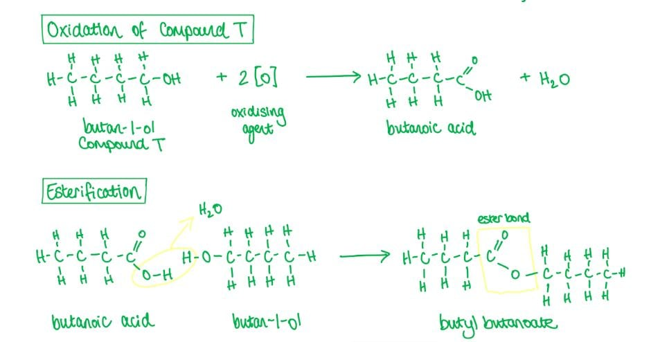

**B** is incorrect as butanal is an aldehyde and will be oxidised to butanoic acid. The reaction of butanal with butanoic acid does not produce an ester.

**C** is incorrect as butanoic acid is a carboxylic acid and cannot be further oxidised.

**D** is incorrect as butanone is a ketone and cannot be further oxidised.

### Q6
**Final answer:** **The correct answer is C**

- Butanal will undergo a nucleophilic addition reaction with HCN, with KCN as catalyst and heat, to form the hydroxynitrile 2-hydroxypentanenitrile (product **X**).
- The hydrolysis of hydroxynitriles by aqueous acid, such as dilute HCl, results in the formation of a carboxylic acid and an ammonium salt.

  - Hydrolysis of 2-hydroxypentanenitrile gives 2-hydroxypentanoic acid (product **Y**).
- Acidified potassium dichromate(VI) is an orange oxidising agent which oxidises primary alcohols, secondary alcohols and aldehydes.

  - Pentanal is an aldehyde and will be oxidised to pentanoic acid (product **Z**).

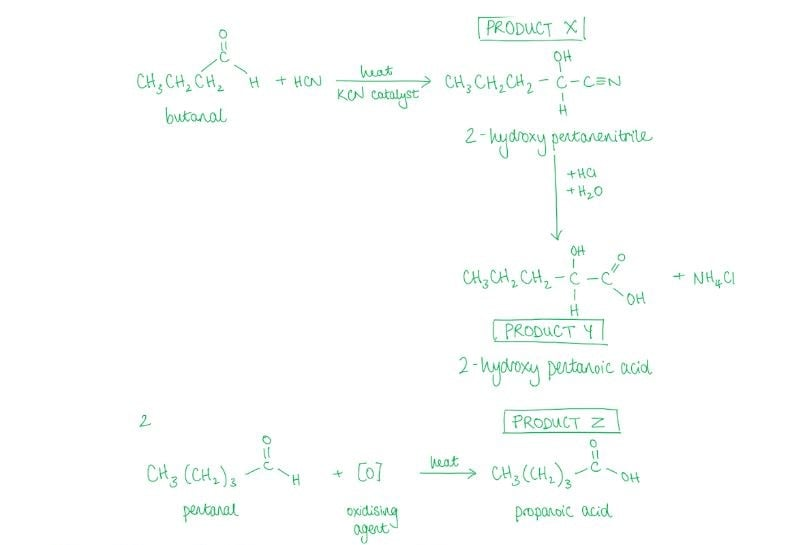

- The relative molecular masses are as follows:

| **Compound** | **Carbon** | **Hydrogen** | **Oxygen** | **Total** |
|---|---|---|---|---|
| **Y** (CH3(CH2)2CH(OH)COOH) | 5 x 12 | 10 x 1 | 3 x 16 | 118 |
| **Z** (CH3(CH2)3COOH) | 5 x 12 | 10 x 1 | 2 x 16 | 102 |

- The difference in relative molecular mass is (118 – 102) = 16.

### Q7
**Final answer:** **The correct answer is D**

- Tri-iodomethane (also known as iodoform) forms a yellow precipitate with compounds containing a methyl ketone (CH3CO–) group.
- An alkaline solution of iodine is warmed with the substance to be tested.
- The carbonyl compound is triply halogenated at the CH3 group adjacent to the carbonyl, replacing the three hydrogen atoms with iodine atoms.
- An intermediate is then hydrolysed to form the yellow precipitate of tri-iodomethane.

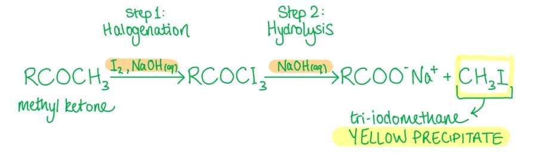

**A** is incorrect as this is the carboxylate salt formed from hydrolysis of the halogenated ketone intermediate, not the yellow precipitate.

**B** is incorrect as the ketone has not been fully halogenated. All three hydrogen atoms in the CH3 group must be replaced.

**C** is incorrect as halogenation takes place on the methyl ketone (CH3CO–) group, not an internal CH2 group.

### Q8
**Final answer:** **The correct answer is A**

- The presence of a carbonyl group in an aldehyde or ketone can be tested by adding 2,4-dinitrophenylhydrazine (2,4-DNPH).
- If an aldehyde or ketone is present, a deep-orange precipitate is formed via a condensation reaction.
- 2,4-DNPH will therefore form a deep-orange precipitate with both propanone (a ketone) and propanal (an aldehyde).

**B** is incorrect as acidified potassium dichromate(VI) only oxidises propanal (an aldehyde). Ketones such as propanone cannot be further oxidised.

**C** is incorrect as Fehling's solution tests for aldehydes only. Only propanal changes the solution from blue to red.

**D** is incorrect as Tollens' reagent only reacts with propanal, producing a silver mirror. Propanone does not give a positive Tollens' test.

### Q9
**Final answer:** **The correct answer is A**

- CH3COCH2CH2CHO contains two carbonyl groups:

  - A ketone (C=O)
  - An aldehyde (CHO).
- HCN undergoes nucleophilic addition with carbonyl groups in a 1:1 molar ratio.
- **Test-tube 3** (no reagent):

  - Both carbonyl groups remain intact.
  - 2 mol HCN react.
- **Test-tube 1** (excess NaBH4):

  - NaBH4 reduces both the ketone and the aldehyde to alcohols.
  - No carbonyl groups remain.
  - 0 mol HCN react.
- **Test-tube 2** (excess acidified KMnO4):

  - KMnO4 oxidises the aldehyde to a carboxylic acid but cannot oxidise the ketone.
  - One ketone remains.
  - 1 mol HCN reacts.

**B** is incorrect as it assumes acidified KMnO4 can oxidise the ketone to give an additional carbonyl group. Ketones are resistant to oxidation by KMnO4.

**C** is incorrect as it assumes NaBH4 only reduces one of the two carbonyl groups. Excess NaBH4 reduces both the ketone and the aldehyde.

**D** is incorrect as it reverses the effects of NaBH4 and acidified KMnO4 on the compound.

### Q10
**Final answer:** **The correct answer is D**

- Acidified potassium dichromate(VI) is an orange oxidising agent that turns green as the Cr2O72- ions are reduced to Cr3+ ions.
- Only primary alcohols, secondary alcohols and aldehydes can be oxidised by acidified potassium dichromate(VI).

  - Compound Y therefore contains an aldehyde group.
- Hydroxynitriles can be formed from the nucleophilic addition reaction of aldehydes and ketones with HCN.

  - Since two moles of CN- react with 1 mol of Y, compound Y must contain two aldehyde groups.

**A** and **C** are incorrect as these compounds only contain one aldehyde group.

**B** is incorrect as this compound contains two ketone groups. Though ketones react with hydrogen cyanide, they will not be oxidised by acidified potassium dichromate(VI).

### Q11
**Final answer:** **The correct answer is C**

- Oxidation in organic chemistry is the gain of oxygen atoms.
- Acidified potassium manganate(VII) solution oxidises alkenes by breaking the C=C double bond and replacing it with two C=O double bonds.

  - The products are known as carbonyl compounds.
- As carvone is heated under reflux with excess hot concentrated acidified potassium manganate(VII), complete oxidation will take place wherever possible.

  - Compound **X** contains 3 carbonyl groups (three ketones).
- 2,4-dinitrophenylhydrazine (2,4-DNPH) reacts with carbonyl groups (ketones and aldehydes) and will therefore react with all 3 ketones.

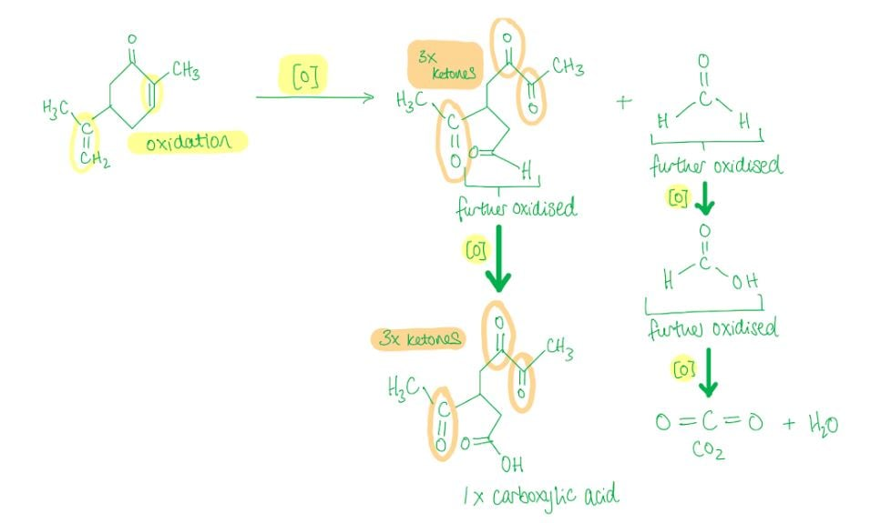

- The CO2 is formed from the oxidation of –C=CH2 to methanal, which is then oxidised to methanoic acid, which in turn is oxidised to carbon dioxide.

### Q12
**Final answer:** **The correct answer is C**

- Hydroxynitriles can be formed from the nucleophilic addition reaction of aldehydes and ketones with HCN.
- CH3CO2CH3 in the presence of a strong base generates –CH2CO2CH3, which acts as a nucleophile analogously to CN–.
- The reaction of propanal (an aldehyde) with –CH2CO2CH3 forms compound C.

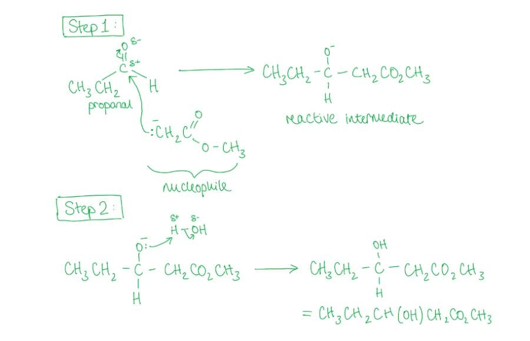

**A** is incorrect as this is the reaction between a ketone (propanone) and –CH2CO2CH3.

**B** is incorrect as the aldehyde is ethanal. The nucleophile is –CH2CO2CH3, not –CO2CH3.

**D** is incorrect as the aldehyde is methanal. The nucleophile is –CH2CO2CH3, not –CHCH2CO2CH3.

### Q13
**Final answer:** **The correct answer is C**

- Hydroxynitriles can be formed from the nucleophilic addition reaction of aldehydes and ketones with HCN, with KCN as catalyst and heat.
- The cyanide ion, CN-, acts as a nucleophile and adds on to the carbonyl carbon.
- Both the aldehyde and ketone groups in the compound will undergo a nucleophilic addition reaction with HCN.

**A** is incorrect as acidified potassium dichromate(VI) turns green as the Cr2O72- ions are reduced to Cr3+ ions when reacting with primary alcohols, secondary alcohols and aldehydes. The ketone group cannot be oxidised by this reagent.

**B** is incorrect as Fehling's solution is an alkaline solution containing copper(II) ions. When warmed with an aldehyde, the Cu2+ ions are reduced to Cu+, giving an opaque red precipitate of copper(I) oxide. Fehling's solution only reacts with the aldehyde group, not the ketone.

**D** is incorrect as aldehydes and ketones do not react with sodium hydroxide.

### Q14
**Final answer:** **The correct answer is A**

- NaBH4 is a reducing agent that reduces aldehydes to primary alcohols.
- The carbonyl group is polarised due to the high electronegativity of the oxygen atom, making the carbon atom open to attack by a nucleophile (H-).
- The negatively charged intermediate then reacts quickly with an aqueous H+ ion to form an alcohol.

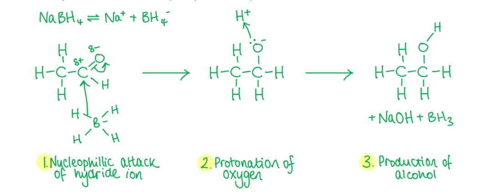

**B** and **D** are incorrect as NaBH4 provides H- (hydride) ions as the nucleophile, not H+ ions.

**C** is incorrect as H- is a nucleophile and attacks a partial positively charged centre. The oxygen atom is partially negatively charged and repels the H- ion.

### Q15
**Final answer:** **The correct answer is C**

- The two functional groups in hex-3-enal are the alkene (C=C) and aldehyde (CHO) groups.
- H2 with a nickel catalyst is a hydrogenation reagent that reduces C=C double bonds.

  - The carbonyl group remains unaffected.
- NaBH4 reduces aldehydes to primary alcohols. It is not strong enough to reduce the alkene.

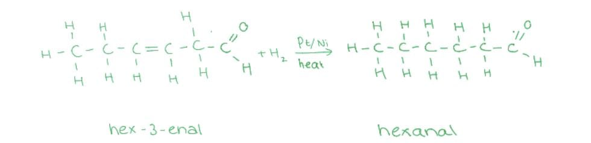

**A** is incorrect as H2 + Ni reduces only the C=C double bond, leaving the carbonyl group unaffected. The product is hexanal, not hexane.

**B** and **D** are incorrect as NaBH4 reduces the aldehyde to a primary alcohol and cannot reduce the alkene. The C=C bond remains unaffected.

### Q16
**Final answer:** **The correct answer is B**

- Oxidation in organic chemistry is the gain of oxygen atoms.
- Acidified potassium manganate(VII) solution oxidises alkenes by breaking the C=C double bond and replacing it with two C=O double bonds.

  - The products are known as carbonyl compounds.
- In β-carotene, look at the carbon atoms in the double bonds that are attached to two other carbon atoms, which will form ketone functional groups upon oxidation.
- There are 8 such carbon atoms, but upon oxidation the double bonds are broken to form 6 product molecules.

  - 4 of these product molecules contain one ketone group.
  - 2 of these product molecules contain two ketone groups.

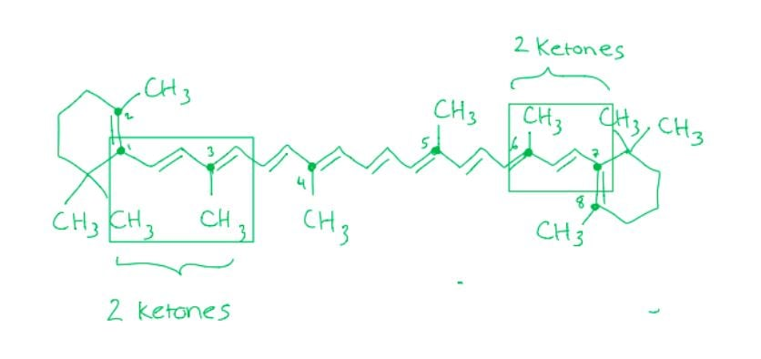

### Q17
**Final answer:** **The correct answer is B**

- Tollens' reagent is an aqueous solution of silver ions in excess ammonia solution, used to test for the presence of aldehydes.

  - The silver ions act as a mild oxidising agent.
- When warmed with the silver ions, an aldehyde is oxidised to a carboxylic acid, which is then neutralised to the carboxylate ion in the alkaline conditions.

  - The silver ions are reduced to silver atoms, forming a 'mirror' on the inside of the tube.
- CH3CH2CHO is an aldehyde and will react with Tollens' reagent to form CH3CH2COOH (propanoic acid).

**A** is incorrect as alcohols react with concentrated phosphoric acid to generate an alkene via a dehydration (elimination) reaction. No change in oxidation state occurs.

**C** is incorrect as this is a hydrolysis reaction of a nitrile with dilute acid, not a redox reaction.

**D** is incorrect as 2,4-DNPH forms a deep-orange precipitate with carbonyl compounds via a condensation reaction. No change in oxidation state occurs.

### Q18
**Final answer:** **The correct answer is C**

- A nucleophilic addition reaction is when a nucleophile is added to an unsaturated bond to form a single product.
- A nucleophile is a species that donates a pair of electrons.
- Hydroxynitriles can be formed from the nucleophilic addition reaction of aldehydes and ketones with HCN, with KCN as catalyst and heat.
- The cyanide ion, CN-, acts as a nucleophile and is added on to the carbonyl carbon to form a single product only.
- The reaction of propanone with hydrogen cyanide results in the formation of 2-hydroxy-2-methylpropanenitrile.
- The reaction mechanism is:

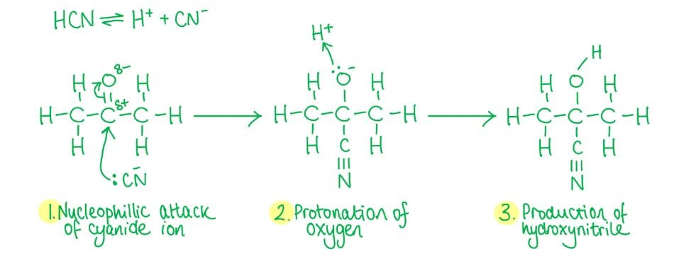

**A** and **B** are incorrect as the cyanide ion, CN-, is a nucleophile, not an electrophile. The reaction is an addition reaction, not a substitution reaction.

**D** is incorrect as the cyanide ion, CN-, is a nucleophile but it is not replacing another atom or group in propanone. An addition reaction produces one product; a substitution reaction produces two products.

### Q19
**Final answer:** **The correct answer is B**

- Reduction is the addition of hydrogen to an organic compound.
- Butanone is a ketone and ketones undergo reduction reactions when warmed with a reducing agent such as NaBH4 or LiAlH4.
- A secondary alcohol is formed from the reduction of a ketone.
- Butan-2-ol is a secondary alcohol.
- The reaction mechanism for this reaction is:

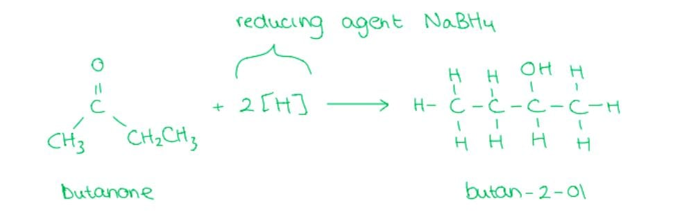

**A** is incorrect as butan-1-ol is a primary alcohol and would have been formed from the reduction of an aldehyde (butanal) with NaBH4.

**C** is incorrect as butanal is an **aldehyde**. The reduction of a ketone with NaBH4 produces a secondary alcohol.

**D** is incorrect as butane is an **alkane**. The reduction of a ketone with NaBH4 produces a **secondary alcohol**.

### Q20
**Final answer:** **The correct answer is A**

- Reduction is the addition of hydrogen to an organic compound.
- NaBH4 is a reducing agent.

  - Aldehydes are reduced to primary alcohols by warming with an aqueous alkaline solution of NaBH4.
- The carbonyl group in aldehydes and ketones is polarised due to the high electronegativity of the oxygen atom.

  - This makes the carbon atom open to attack by a nucleophile (in this case H-).
  - The negatively charged intermediate formed in the first step reacts quickly with an aqueous H+ ion to form an alcohol.

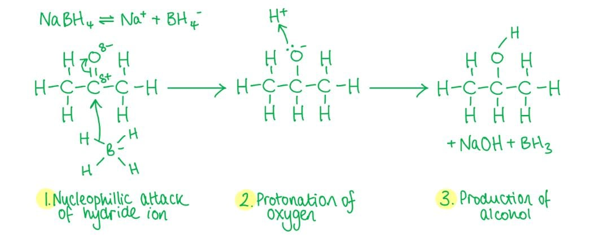

**B** is incorrect as H- is a nucleophile and attacks a partial positively charged centre. The oxygen atom of the carbonyl group is partially negatively charged and repels the H- ion.

**C** and **D** are incorrect as NaBH4 provides H- (hydride) ions as the nucleophile, not H+ ions.

### Q21
**Final answer:** **The correct answer is A**

- Tollens' reagent is an aqueous solution of silver ions (Ag+) in excess ammonia solution, used to test for the presence of aldehyde compounds.

  - The silver ions act as a mild oxidising agent.
- When warmed with the silver ions, an aldehyde will be oxidised to form a carboxylic acid, which is then neutralised to the carboxylate ion in the alkaline conditions of the test.

  - The silver ions themselves are reduced to silver atoms, forming a 'mirror' on the inside of the tube.
  - No change is observed when a ketone is warmed in Tollens' reagent, as no redox reaction can take place.
- LiAlH4 is a strong reducing agent that reduces both aldehydes and ketones to alcohols.

  - Aldehydes are reduced to primary alcohols; ketones are reduced to secondary alcohols.

**B** and **C** are incorrect as ketones do not react with Tollens' reagent as they cannot be further oxidised.

**D** is incorrect as both aldehydes and ketones react with LiAlH4. Only aldehydes react with Tollens' reagent.

## Structured Questions (8 questions)

### Q1
> **[mark-scheme]**
> Isomers with formula C3H6O that cannot be reduced by NaBH4:
> 
> Any **two** from (1 mark for each):
> 
> - Cyclopropanol
> - Prop-1-en-1-ol
> - Prop-2-en-1-ol
> - Prop-2-en-2-ol
> 
> **[2 marks]**

> **[exam-tip]**
> NaBH4 reduces carbonyl compounds (aldehydes and ketones) to alcohols. Isomers of C3H6O that lack a C=O group cannot be reduced by NaBH4,  such as alkene-based alcohols and cyclic alcohols
> 
> Epoxides and ethers also have the formula C3H6O but are not specified on the syllabus.
> **[mark-scheme]**
> The two isomers with formula C3H6O that can be reduced by NaBH4 are:
> 
> - Propanal **[1 mark]**
> - Propanone **[1 mark]**

> **[exam-tip]**
> NaBH4 reduces aldehydes and ketones (compounds containing a C=O group). Propanal is the only possible aldehyde with formula C3H6O, and propanone is the only possible ketone. There are exactly two correct answers here.
> **[mark-scheme]**
> i) Classes of alcohol formed:
> 
> - An aldehyde (e.g. propanal) is reduced to a primary alcohol **[1 mark]**
> - A ketone (e.g. butanone) is reduced to a secondary alcohol **[1 mark]**
> 
> ii) Explanation:
> 
> - The reduction product of propanal is propan-1-ol: the alcoholic carbon has two H atoms attached, so it cannot have four different groups and cannot be a chiral centre **[1 mark]**
> - The reduction product of butanone is butan-2-ol: the alcoholic carbon has H, OH, CH3, and CH2CH3 attached / four different groups, giving a chiral centre and allowing optical isomers **[1 mark]**

> **[exam-tip]**
> A chiral centre requires four different substituents on one carbon. Primary alcohols always have two H atoms on the alcoholic carbon, so a chiral centre is impossible. Whether a secondary alcohol has a chiral centre depends on whether the two groups on either side of the C–OH are different. For butan-2-ol they are (CH3 and CH2CH3), but for propan-2-ol they are not (both CH3).
> **[mark-scheme]**
> The reduction product of a carbonyl compound cannot be a tertiary alcohol because:
> 
> - Tertiary alcohols have the formula R3COH, requiring three carbon groups on the alcoholic carbon
> **AND**
> Carbonyl compounds have the formula R2C=O, with only two carbon groups on the carbonyl carbon **[1 mark]**
> 
> - Reduction of a ketone (R2C=O) gives R2CHOH (secondary alcohol)
> **AND**
> Reduction of an aldehyde (RCHO) gives RCH2OH (primary alcohol), where the C–H bond formed means the product cannot be a tertiary alcohol **[1 mark]**

> **[exam-tip]**
> A tertiary alcohol requires three carbon substituents on the alcoholic carbon. NaBH4 adds a hydride ion (H–) to the carbonyl carbon, so the alcoholic carbon always retains at least one H, making the product primary or secondary, never tertiary.
> 
> The reverse logic also works: tertiary alcohols cannot be oxidised under normal conditions; the reverse of reduction of a carbonyl would therefore be impossible.

### Q2
The completed table is:

|   | **Initial observation** | **Final observation** |
|---|---|---|
| **Ketone** | Colourless solution | **Final answer:** **Colourless solution** |
| **Aldehyde** | Colourless solution | **Final answer:** **Silver mirror** |

**[2 marks]**

> **[mark-scheme]**
> 1 mark for ketone: colourless solution remains / no change
> 
> 1 mark for aldehyde: silver mirror formed

> **[exam-tip]**
> Tollens' reagent is a colourless ammoniacal silver nitrate solution. Aldehydes reduce the Ag+ ions to silver metal, forming a silver mirror on the inside of the test tube. Ketones cannot be oxidised under these conditions and give no visible change.
The completed table is:

|   | **Initial observation** | **Final observation** |
|---|---|---|
| **Ketone** | Blue solution | **Final answer:** **Blue solution (remains)** |
| **Aldehyde** | Blue solution | **Final answer:** **Red / brick-red precipitate** |

**[2 marks]**

> **[mark-scheme]**
> 1 mark for ketone: blue solution remains / no change
> 
> 1 mark for aldehyde: red / brick-red precipitate formed

> **[exam-tip]**
> Fehling's solution contains Cu2+ ions in alkaline solution (blue colour). When warmed with an aldehyde, the Cu2+ ions are reduced to Cu+ ions, forming a red/brick-red precipitate of copper(I) oxide, Cu2O. Ketones cannot be oxidised under these conditions, so the solution remains blue.
> **[mark-scheme]**
> i) The compound that gives a yellow precipitate is:
> 
> - Ethanal **[1 mark]**
> 
> ii) The reason is:
> 
> - Ethanal contains a methyl ketone / CH3CO– group **[1 mark]**

> **[exam-tip]**
> The iodoform reaction gives a yellow precipitate of triiodomethane, CHI3, with compounds that contain the CH3CO– group. This includes methyl ketones and ethanal.
> 
> Propanal does not contain the CH3CO– group. Its carbonyl carbon has an ethyl group attached rather than a methyl group, so it does not give a positive iodoform test.

### Q3
The completed mechanism is:

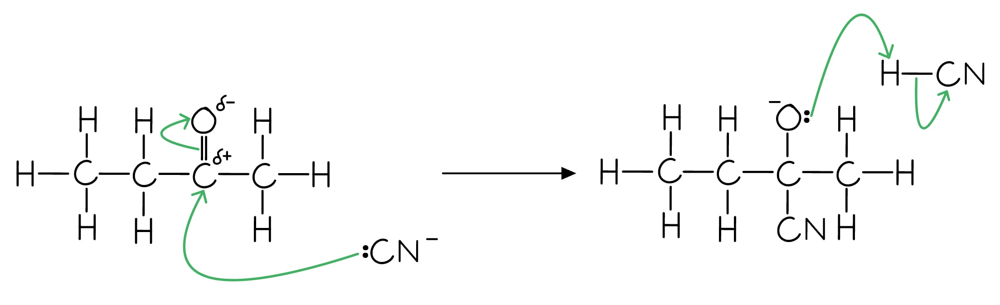

**[4 marks]**

> **[mark-scheme]**
> 1 mark for a curly arrow from the lone pair on CN– to the δ+ carbon atom
> 
> 1 mark for a curly arrow from the C=O bond to the δ– O atom
> 
> 1 mark for a curly arrow from the lone pair on the O– intermediate to the H in HCN
> 
> 1 mark for a curly arrow from the H–CN bond to the C atom

> **[exam-tip]**
> The nucleophilic addition of hydrogen cyanide to carbonyl compounds is a two-step process.
> 
> 1. The cyanide ion attacks the carbonyl carbon to form a negatively charged intermediate.
> 2. The negatively charged oxygen atom quickly reacts with H+ ions present in the acidic solution.
> 
> Although HCN appears in the mechanism, it is generated in situ from KCN and dilute acid. HCN itself is not added directly due to its toxicity.
> **[mark-scheme]**
> The systematic name of the organic product is:
> 
> - 2-hydroxy-2-methylbutanenitrile **[1 mark]**

> **[exam-tip]**
> The product contains both a hydroxyl group (–OH) and a nitrile group (–CN), so it is named as a hydroxynitrile. The longest carbon chain including the CN group has 5 carbons (butanenitrile), with an –OH group and a methyl group both at position 2.
> **[mark-scheme]**
> A number is not required because:
> 
> - The carbonyl group can only be positioned at carbon 2 in a 4-carbon chain **[1 mark]**

> **[exam-tip]**
> In a 4-carbon chain, a ketone carbonyl group must be on carbon 2. Placing it on carbon 1 or 4 would give an aldehyde rather than a ketone. Numbering from either end of the chain gives the same carbon, so no locant is needed.
> 
> The names butan-2-one and butan-3-one refer to the same compound as they are identical structures, not isomers. This confirms why IUPAC naming requires no number for butanone.

### Q4
> **[mark-scheme]**
> i) Reagents and conditions for reaction 2:
> 
> - KCN / NaCN **[1 mark]**
> - Dilute acid / dilute H2SO4 / catalyst **[1 mark]**

ii) The completed mechanism for reaction 2 is:

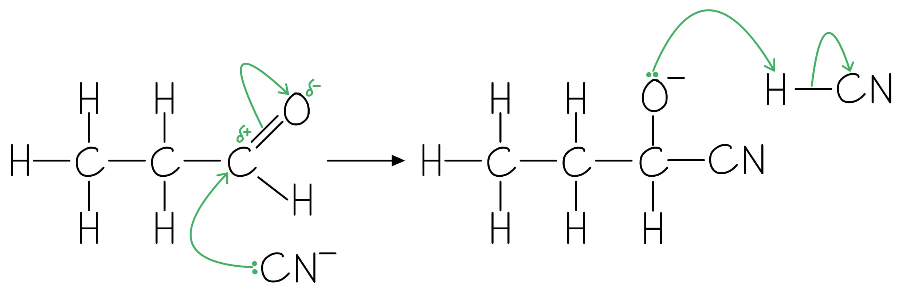

**[4 marks]**

> **[mark-scheme]**
> 1 mark for a curly arrow from the lone pair on C of CN– to the δ+ carbon atom
> 
> 1 mark for a curly arrow from the C=O bond to the δ– oxygen atom
> 
> 1 mark for a curly arrow from the lone pair on the negatively charged O atom to the H in HCN
> 
> 1 mark for correct lone pairs AND partial charges shown throughout the mechanism

> **[exam-tip]**
> HCN is toxic and is generated in situ from KCN and dilute acid. Heating is not required as this reaction proceeds at room temperature.
> 
> Remember to include lone pairs and partial charges (δ+ and δ–) as well as curly arrows. All these components are required for the mechanism marks.
The two optical isomers of 2-hydroxybutanenitrile are:

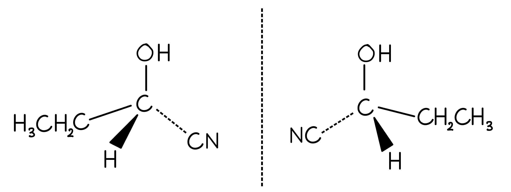

**[2 marks]**

> **[mark-scheme]**
> 1 mark for one correct 3D structure of an optical isomer
> 
> 1 mark for the non-superimposable mirror image
> 
> Both structures must use wedge and dash bonds; no bonds at 180° to each other

> **[exam-tip]**
> In 2-hydroxybutanenitrile, carbon 2 is bonded to H, OH, CN, and CH2CH3, which is four different groups and confirms the chiral centre.
> 
> Use wedge bonds (toward you) and dash bonds (away from you) to show the 3D arrangement. The two structures should be non-superimposable mirror images with no bonds drawn at 180° to each other.
> **[mark-scheme]**
> The reagent(s) for reaction 3 (hydrolysis of the nitrile):
> 
> - Dilute acid
> **OR**
> Dilute alkali, followed by acidification with a strong acid **[1 mark]**

> **[exam-tip]**
> Nitriles can be hydrolysed by dilute acid (producing a carboxylic acid and ammonium salt) or by dilute alkali followed by acidification with a strong acid such as H2SO4 or HCl.
> **[mark-scheme]**
> The structural formula of compound A:
> 
> - CH3CH2CH2OH **[1 mark]**

> **[exam-tip]**
> Acidified K2Cr2O7 oxidises primary alcohols to aldehydes under distillation conditions. The aldehyde is distilled off as it forms, preventing further oxidation to the carboxylic acid.
> 
> The colour change observed is orange to green as Cr2O72– is reduced to Cr3+.
The completed table is:

| **Reagent** | **Compound(s) giving a positive result** |
|---|---|
| Alkaline I2 (aq) | **Final answer:** **Neither** |
| Na2CO3 (aq) | **Final answer:** **Neither** |
| 2,4-DNPH | **Final answer:** **Propanal** |

**[3 marks]**

> **[mark-scheme]**
> 1 mark for alkaline I2 (aq): neither compound
> 
> 1 mark for Na2CO3 (aq): neither compound
> 
> 1 mark for 2,4-DNPH: propanal only (aldehydes and ketones give an orange precipitate; alcohols do not)

> **[exam-tip]**
> The iodoform test is positive only for compounds containing the CH3CO– group (methyl ketones) or the CH3CH(OH)– group (secondary alcohols with OH at carbon 2). Propan-1-ol has OH at carbon 1 and propanal has an ethyl group, so neither qualifies.
> 
> Na2CO3 reacts with carboxylic acids (producing CO2 bubbles) but not with alcohols or aldehydes.
> 
> 2,4-DNPH (Brady's reagent) gives an orange precipitate with aldehydes and ketones. Alcohols do not react.

### Q5
> **[mark-scheme]**
> The equation for the formation of X is:
> 
> - CH3CH2CHO + 2[H] → CH3CH2CH2OH **[1 mark]**

> **[exam-tip]**
> NaBH4 acts as a reducing agent, donating hydride ions to reduce the aldehyde (W = propanal) to a primary alcohol (X = propan-1-ol).
> 
> The equation must be balanced, so propanal requires 2[H] to form propan-1-ol.
> **[mark-scheme]**
> i) The specific type of stereoisomerism shown by product Y:
> 
> - Optical isomerism **[1 mark]**

ii) The completed mechanism for the nucleophilic addition of HCN to compound W is:

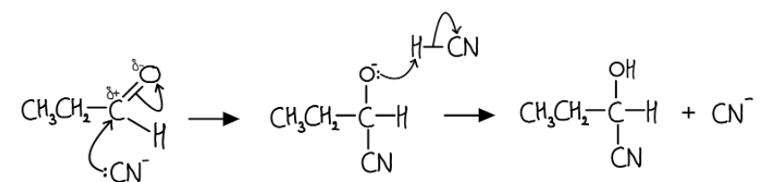

**[3 marks]**

> **[mark-scheme]**
> ii)
> 
> 1 mark for a curly arrow from the lone pair on C of CN– to the C in the C=O bond
> 
> 1 mark for a curly arrow from the C=O bond to the O atom AND a correct dipole shown on the C=O bond
> 
> 1 mark for a curly arrow from the lone pair on O– to the H in HCN
> 
> iii) Optical isomers of Y form because:
> 
> - The C=O bond is planar
> **AND**
> CN– can attack from above or below the plane, producing two non-superimposable mirror images **[1 mark]**

> **[exam-tip]**
> Although HCN appears in the mechanism, it is generated in situ from KCN and dilute acid. The hydrogen ion that protonates the intermediate O– could come from H2O or H3O+ in the acidic solution.
> 
> The planar C=O means there is no preference for attack from either face, so both enantiomers are produced in equal amounts (a racemic mixture).
To calculate the percentage yield:

- Convert volume to mass of propanal:

mass = volume x density = 5.00 x 0.810 = 4.05 g

- Calculate moles of propanal:

moles = $\frac{\mathrm{mass}}{M_{r}}$ = $\frac{4.05}{58.0}$ = 0.06983 mol **[1 mark]**

- Calculate theoretical mass of propanoic acid (1:1 mole ratio):

theoretical mass = 0.06983 x 74.0 = 5.167 g **[1 mark]**

- Calculate percentage yield:

percentage yield = $\frac{4.25}{5.167}$ x 100 = **82.3%** **[1 mark]**

> **[mark-scheme]**
> 1 mark for correct moles of propanal (0.0698 mol); allow ECF from incorrect mass
> 
> 1 mark for correct theoretical mass of propanoic acid (5.167 g)
> 
> 1 mark for correct percentage yield (82.3%); allow ECF

> **[exam-tip]**
> Convert the volume of propanal to a mass first using mass = volume x density before calculating moles.
> 
> The answer should be given to 3 significant figures, consistent with the data provided.
> **[mark-scheme]**
> i) The observation when Q reacts with 2,4-dinitrophenylhydrazine:
> 
> - Orange precipitate **[1 mark]**
> 
> ii) The functional group present in Q:
> 
> - Ketone **[1 mark]**
> 
> iii) Compound Q is:
> 
> - Butanone / CH3COCH2CH3 **[1 mark]**

> **[exam-tip]**
> 2,4-dinitrophenylhydrazine (Brady's reagent) reacts with both aldehydes and ketones to give an orange precipitate. The fact that Q does not react with Tollens' reagent eliminates aldehydes, confirming Q is a ketone.
> 
> To find the structure: formula C4H8O gives *M*r = (4 x 12) + (8 x 1) + 16 = 72. The only ketone with this formula is butanone.
> **[mark-scheme]**
> i) A suitable reducing agent:
> 
> - NaBH4
> **OR**
> LiAlH4 / NaAlH4
> **OR**
> H2 with Ni or Pt catalyst **[1 mark]**
> 
> ii) The functional group in compound R:
> 
> - Secondary alcohol **[1 mark]**
> 
> iii) The structural formula of compound R:
> 
> - CH3CH(OH)CH2CH3 / CH3CH2CHOHCH3 **[1 mark]**

> **[exam-tip]**
> Reduction of a ketone always gives a secondary alcohol. Butanone (compound Q) has the carbonyl group at carbon 2, so reduction gives butan-2-ol.
> 
> The structural formula must show the hydroxyl group position clearly. Both CH3CH(OH)CH2CH3 and CH3CH2CHOHCH3 are acceptable.

### Q6
> **[mark-scheme]**
> A possible explanation is:
> 
> - CaSO4 does not react with / is resistant to sulfuric acid
> **OR**
> The layer of CaSO4 on the surface of the calcium prevents further contact between the reactants **[1 mark]**

> **[exam-tip]**
> CaSO4 (calcium sulfate) is sparingly soluble and forms as an insoluble coating on the surface of the calcium metal. This blocks contact between the calcium and the acid, so no collisions can occur between reacting particles and the reaction stops.
> **[mark-scheme]**
> i) Full electronic configuration of the cation in calcium ethanedioate:
> 
> - 1s22s22p63s23p6 **[1 mark]**
> 
> ii) Charge on the cation:
> 
> - +2 **[1 mark]**

iii) The fully displayed formula of ethanedioic acid is:

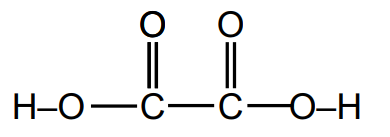

**[1 mark]**

> **[mark-scheme]**
> 1 mark for correct fully displayed formula with all bonds shown

> **[exam-tip]**
> The cation in calcium ethanedioate is Ca2+. Calcium (Z = 20) loses 2 electrons to form Ca2+ with 18 electrons, which is the same configuration as argon.
> 
> Write the full electronic configuration, not the abbreviated form [Ne]3s23p6.
> 
> For the displayed formula of ethanedioic acid, ensure all bonds are shown, including both O–H bonds, which are frequently missed out.
> **[mark-scheme]**
> i) The ionic equation for the reaction is:
> 
> - Cl2 + 2OH– → Cl– + ClO– + H2O **[1 mark]**
> 
> State symbols are not required
> 
> ii) A disproportionation reaction is one in which:
> 
> - A species is simultaneously oxidised
> **AND**
> reduced **[1 mark]**
> 
> The oxidation number of a species both increases and decreases / a species both gains and loses electrons are also accepted

iii) The oxidation numbers of chlorine in each species are:

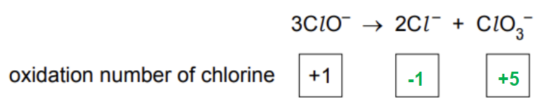

**[1 mark]**

> **[mark-scheme]**
> 1 mark for –1 **AND **+5 both correct

> **[exam-tip]**
> For i): write the full equation 2NaOH + Cl2 → NaCl + NaClO + H2O first, then cancel the Na+ spectator ions.
> 
> Note: cold NaOH gives ClO– (chlorate(I)); hot NaOH gives ClO3– (chlorate(V)) instead.
> 
> For the oxidation number of Cl in ClO3–: the ion charge is –1, each O is –2, so Cl = –1 – (3 × –2) = +5.
> **[mark-scheme]**
> i) The two other products of the reaction are:
> 
> - Carbon dioxide
> **AND**
> Water **[1 mark]**
> 
> ii) Suitable reagents and conditions:
> 
> Reaction 1:
> 
> - KCN / NaCN **[1 mark]**
> - Dilute acid / dilute H2SO4 / catalyst **[1 mark]**
> 
> Reaction 3:
> 
> - Acidified potassium dichromate(VI) **[1 mark]**
> - Heat under reflux **[1 mark]**
> 
> iii) The type of reaction in reaction 2:
> 
> - Hydrolysis **[1 mark]**
> 
> iv) The role of NaBH4 in reaction 4:
> 
> - Reducing agent **[1 mark]**
> 
> v) A chiral centre is:
> 
> - A carbon atom bonded to four different groups / atoms / chains **[1 mark]**

> **[exam-tip]**
> For i): the reaction of a carbonate with an acid always gives salt + CO2 + H2O.
> 
> For ii), reaction 1: HCN is toxic and is formed in situ from KCN and dilute acid. It is not added directly.
> 
> For ii), reaction 3: oxidation of a primary alcohol to a carboxylic acid requires acidified K2Cr2O7 under reflux. Both the acid and reflux must be stated.
> 
> For v): a chiral centre has four different substituents, enabling two non-superimposable mirror image arrangements. Do not define the chiral centre itself as 'having non-superimposable images' as that is a description of the resulting enantiomers, not of the carbon.

### Q7
> **[mark-scheme]**
> i) The class of alcohol that is oxidised to give an aldehyde is:
> 
> - Primary **[1 mark]**
> 
> ii) The class of alcohol that is oxidised to give a ketone is:
> 
> - Secondary **[1 mark]**

> **[exam-tip]**
> A primary alcohol has the hydroxyl group on the terminal carbon of the hydrocarbon chain. Oxidation with acidified K2Cr2O7 produces an aldehyde as the first oxidation product.
> 
> A secondary alcohol has the hydroxyl group on an internal carbon. Oxidation produces a ketone. Ketones resist further oxidation under normal conditions.
> **[mark-scheme]**
> i) The oxidation product of an aldehyde is:
> 
> - Carboxylic acid **[1 mark]**
> 
> ii) A ketone:
> 
> - Does not undergo further oxidation (without breakdown of the carbon skeleton) **[1 mark]**

> **[exam-tip]**
> The oxidation pathway for a primary alcohol goes:
> 
> primary alcohol → aldehyde → carboxylic acid.
> 
> Ketones have no hydrogen attached to the carbonyl carbon, so they cannot be oxidised further under normal conditions.
> **[mark-scheme]**
> How to identify an unknown carbonyl compound using 2,4-DNPH:
> 
> - Carbonyl compounds form a crystalline product / orange precipitate when reacted with 2,4-DNPH **[1 mark]**
> - The precipitate is purified / recrystallised **[1 mark]**
> - The melting point of the crystalline product is measured
> **AND**
> This value is compared to known melting points of 2,4-DNPH derivatives of different carbonyl compounds **[1 mark]**

> **[exam-tip]**
> Brady's reagent is the common name for 2,4-DNPH dissolved in methanol and sulfuric acid.
> 
> The crystalline products are sometimes called 2,4-DNPH derivatives. A derivative is a compound that has been made from, or is chemically similar to, the original compound.

### Q8
i) To calculate the empirical formula of compound R:

- Calculate the mass of each element in the 15.0 g sample:

carbon: 15.0 x $\frac{69.8}{100}$ = 10.47 g

hydrogen: 15.0 – 10.47 – 2.79 = 1.74 g

**[1 mark]**

- Divide each mass by the relative atomic mass:

C = $\frac{10.47}{12.0}$ = 0.8725

H = $\frac{1.74}{1.0}$ = 1.74

O = $\frac{2.79}{16.0}$ = 0.174

**[1 mark]**

- Divide by the smallest value (0.174) to find the simplest ratio:

C : H : O = 5 : 10 : 1

Empirical formula = **C****5****H****10****O**

**[1 mark]**

> **[mark-scheme]**
> 1 mark for correct masses of carbon (10.47 g) **AND **hydrogen (1.74 g)
> 
> 1 mark for correct moles/ratios for all three elements
> 
> 1 mark for correct empirical formula (C5H10O)

ii) To deduce the molecular formula:

- Calculate the *M*r of the empirical formula:

(5 x 12.0) + (10 x 1.0) + 16.0 = 86.0

- This equals the given *M*r, so the molecular formula is:

**C****5****H****10****O** **[1 mark]**

> **[mark-scheme]**
> Allow error carried forward from incorrect empirical formula

> **[exam-tip]**
> Alternative method for part i): convert all to percentages first (oxygen = 2.79/15.0 x 100 = 18.6%, hydrogen = 100 – 69.8 – 18.6 = 11.6%), then divide by *A*r to get ratios.
> 
> For part ii): if the empirical formula *M*r equals the given *M*r, the molecular formula is the same as the empirical formula.
> **[mark-scheme]**
> Deduction of the identities of R and S:
> 
> - Both R and S react with acidified K2Cr2O7, therefore both could be an aldehyde, primary alcohol, or secondary alcohol **[1 mark]**
> 
> - Compound R forms a silver mirror with Tollens' reagent (positive test)
> **AND**
> Compound R has the formula C5H10O (from part (a)) and is a straight chain compound
> therefore compound R is pentanal **[1 mark]**
> 
> - Compound S reacts with acidified K2Cr2O7 but does not react with Tollens' reagent, therefore it is a primary or secondary alcohol **[1 mark]**
> 
> - Compound S is formed from compound R (pentanal) by reaction with HCN
> **AND**
> compound S is 2-hydroxyhexanenitrile **[1 mark]**

> **[exam-tip]**
> Aldehydes give positive results with both acidified K2Cr2O7 and Tollens' reagent. The positive Tollens' result for R confirms it is an aldehyde. With formula C5H10O and a straight chain, the only possible aldehyde is pentanal.
> 
> The name of compound S must include the 'e': 2-hydroxyhexan**e**nitrile, not 2-hydroxyhexannitrile.
The three-dimensional structures of the two optical isomers of compound S are:

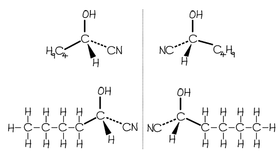

**[1 mark]**

> **[mark-scheme]**
> 1 mark for correct 3D representations of both optical isomers (both structures must be correct to gain the mark)

> **[exam-tip]**
> Compound S is 2-hydroxyhexanenitrile. The chiral centre is carbon 2, which is bonded to H, OH, CN, and CH2CH2CH2CH3 (four different groups).
> 
> Use wedge bonds (toward you) and dash bonds (away from you) to show the 3D arrangement. The two structures should be non-superimposable mirror images. Show at least one wedge and one dash in each structure; no bonds should be at 180° to each other.
Two straight-chain positional isomers of compound S that do not exhibit optical isomerism are:

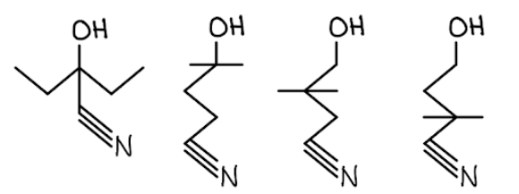

**[1 mark]**

> **[mark-scheme]**
> 1 mark for any two correct straight-chain positional isomers of compound S in which no carbon has four different groups attached

> **[exam-tip]**
> Compound S is 2-hydroxyhexanenitrile (C6H11NO), containing –OH and –CN groups. Positional isomers place the same functional groups at different positions along the straight chain.
> 
> For the isomer to lack a chiral centre, no carbon should have four different groups attached. For example, placing –OH at the terminal carbon (which then has two H atoms) removes chirality.
