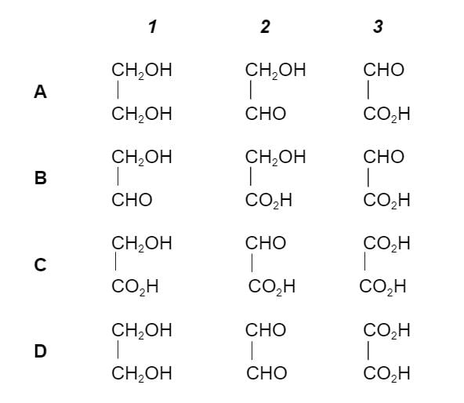
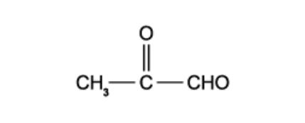
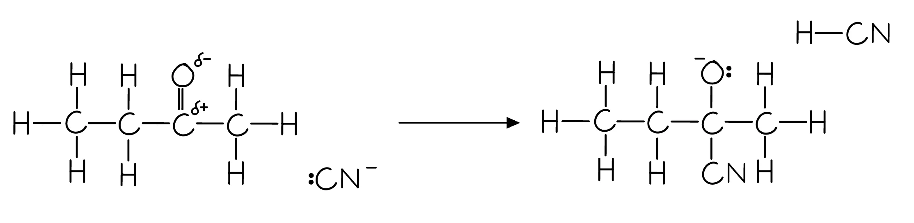
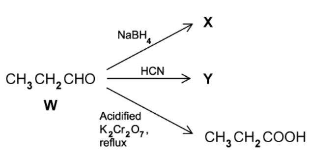
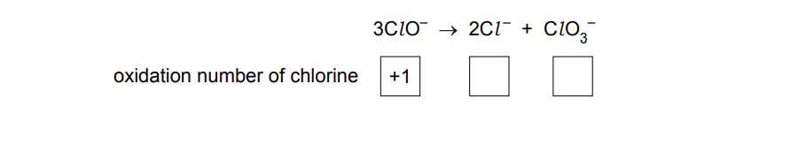
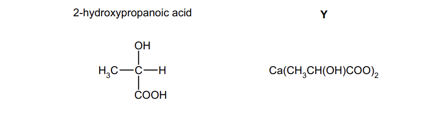
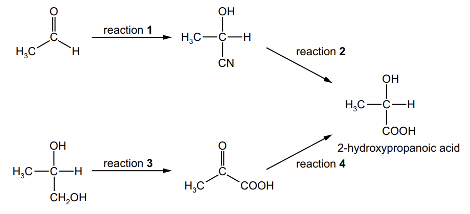

# Exam Questions — Aldehydes & Ketones
**17. Carbonyl Compounds** · Cambridge (CIE) AS chemistry (9701)
> Source: [https://www.savemyexams.com/as/chemistry/cie/25/topic-questions/](https://www.savemyexams.com/as/chemistry/cie/25/topic-questions/) · 29 questions across 2 sets

## Multiple Choice Questions (21 questions)

### Q1 — medium — 1 marks

**Q1** [1 mark]

When compounds 1, 2 and 3 react with PCl5, hydrogen chloride is evolved. However, only one of the three reacts with 2,4-dinitrophenylhydrazine reagent.

Which one of the following combinations could be 1, 2 and 3?

### Q2 — medium — 1 marks

**Q2** [1 mark]

An organic compound **X** has a molecular ion peak at **m/z = 58** in its mass spectrum.

Experimental data for compound **X** is shown in the table below:

| Test | Observation |
|---|---|
| Addition of 2,4-dinitrophenylhydrazine (2,4-DNPH) | Orange precipitate formed |
| Warming with Tollens' reagent | No visible change |

What is the identity of compound **X**?

### Q3 — medium — 1 marks

**Q3** [1 mark]

An organic liquid **X** gives the following results:

- Forms an orange precipitate with 2,4-DNPH
- Does **not** form a silver mirror with Tollens’ reagent
- Forms a yellow precipitate with alkaline aqueous iodine

What is the identity of **X**?

### Q4 — medium — 1 marks

**Q4** [1 mark]

Hydroxyethanal has the structural formula HOCH2CHO.

In an experiment hydroxyethanal is heated under reflux with an excess of acidified potassium dichromate (VI) until no further oxidation takes place.

What is the skeletal formula of the organic product formed in the experiment?

### Q5 — hard — 1 marks

**Q5** [1 mark]

When compound **T** reacts with its own oxidation product, a sweet-smelling liquid is produced.

What is the identity of compound **T**?

### Q6 — hard — 1 marks

**Q6** [1 mark]

When HCN reacts with butanal, CH3CH2CH2CHO, product X is formed. If X is then hydrolysed by aqueous acid, product Y is produced.

When pentanal, CH3CH2CH2CH2CHO, is heated under reflux with acidified potassium dichromate(VI), product Z is formed.

What is the difference in relative molecular mass of products Y and Z?

### Q7 — medium — 1 marks

**Q7** [1 mark]

When alkaline I2 solution is added to butanone, a yellow precipitate is formed.

Which of the following compounds is responsible for the precipitate?

### Q8 — medium — 1 marks

**Q8** [1 mark]

Which reagent will give similar results with both propanone and propanal?

### Q9 — hard — 1 marks

**Q9** [1 mark]

1 mol of CH3COCH2CH2CHO is placed into each of three separate test-tubes.

An excess of NaBH4 is added to test-tube 1 and an excess of acidified potassium manganate(VII) is added to test-tube 2. No reagent is added to test-tube 3.

An excess of HCN is then added to each test-tube.

Which row correctly shows the number of moles of HCN that react with the organic compound in each test-tube?

|   | test-tube 1 | test-tube 2 | test-tube 3 |
|---|---|---|---|
| **A** | 0 | 1 | 2 |
| **B** | 0 | 2 | 2 |
| **C** | 1 | 1 | 2 |
| **D** | 2 | 1 | 0 |

### Q10 — medium — 1 marks

**Q10** [1 mark]

The colour of warm acidified potassium dichromate(VI) changes from orange to green when added to compound Y. 1 mol of Y reacts with 2 mol of hydrogen cyanide in the presence of potassium cyanide.

What could Y be?

### Q11 — medium — 1 marks

**Q11** [1 mark]

Carvone is used as a flavouring for spearmint chewing gum.

When carvone is heated under reflux with excess hot concentrated acidified potassium manganate(VII) the products carbon dioxide and compound **X** are formed.

**X** contains nine carbon atoms and reacts with 2,4-dinitrophenylhydrazine reagent.

What is the maximum number of molecules of 2,4-dinitrophenylhydrazine that will react with one molecule of **X**?

### Q12 — hard — 1 marks

**Q12** [1 mark]

Hydroxynitriles can be made from carbonyl compounds by generating CN– ions from HCN in the presence of a weak base.

In a similar reaction, –CH2CO2CH3 ions are generated from CH3CO2CH3 by strong bases.

Which compound can be made from an aldehyde and CH3CO2CH3 in the presence of a strong base?

### Q13 — easy — 1 marks

**Q13** [1 mark]

The characteristic smell of burnt sugar is partly caused by the following compound.

Which reagent will react with **both** functional groups?

### Q14 — easy — 1 marks

**Q14** [1 mark]

Ethanal, CH3CHO, is reduced using NaBH4 in aqueous ethanol.

What is the first step of this mechanism?

### Q15 — easy — 1 marks

**Q15** [1 mark]

Hex-3-enal is used as a flavouring agent.

CH3CH2CH=CHCH2CHO

Which row correctly shows the product formed when hex-3-enal is treated with the given reducing agent?

|   | **Product** | **Reducing agent** |
|---|---|---|
| **A** | CH3(CH2)4CH3 | H2 + Ni |
| **B** | CH3(CH2)4CH2OH | NaBH4 |
| **C** | CH3(CH2)4CHO | H2 + Ni |
| **D** | CH3(CH2)4CHO | NaBH4 |

### Q16 — easy — 1 marks

**Q16** [1 mark]

The orange colour of carrots is due to the presence of β-carotene, the structure of which is shown in the diagram below.

Excess hot concentrated acidified potassium manganate(VII) will oxidise β-carotene.

When an individual molecule of β-carotene is oxidised in this way there are multiple possible products.

How many of these product molecules contain a ketone functional group?

### Q17 — easy — 1 marks

**Q17** [1 mark]

In which reaction is the organic compound oxidised?

### Q18 — easy — 1 marks

**Q18** [1 mark]

In 1903, Arthur Lapworth investigated the reaction of hydrogen cyanide with propanone.

What is the name of this type of mechanism?

### Q19 — easy — 1 marks

**Q19** [1 mark]

What is formed when butanone is warmed with a solution of NaBH4?

### Q20 — easy — 1 marks

**Q20** [1 mark]

An aqueous methanolic solution of NaBH4 acts as a reducing agent when added to propanal, CH3CH2CHO.

What is the first step of this mechanism?

### Q21 — easy — 1 marks

**Q21** [1 mark]

Which carbonyl compound(s) react with **both** LiAlH4 and Tollens’ reagent?

## Structured Questions (8 questions)

### Q1 — hard — 10 marks

**Q1** [2 marks]

Aqueous sodium tetrahydridoborate, NaBH4, is a common reducing agent.

State the systematic names of **two** isomers with the formula C3H6O that **cannot** be reduced by aqueous NaBH4.

**Q1** [2 marks]

**Extract:**

Aqueous sodium tetrahydridoborate, NaBH~4~, is a common reducing agent.

State the systematic names of the **two** isomers with the formula C3H6O that **can** be reduced by aqueous NaBH4.

**Q1** [4 marks]

When NaBH4 is used as a reducing agent, carbonyl compounds are reduced to alcohols.

i) State the class of alcohol formed when each of the following is reduced by NaBH4:

an aldehyde (e.g. propanal)

a ketone (e.g. butanone)

[2]

ii) Explain why the reduction product of butanone can exhibit optical isomerism, but the reduction product of propanal cannot.

[2]

**Q1** [2 marks]

**Extract:**

When NaBH~4~ is used as a reducing agent, carbonyl compounds are reduced to alcohols.

i) State the class of alcohol formed when each of the following is reduced by NaBH~4~:

an aldehyde (e.g. propanal)

a ketone (e.g. butanone)

i) Classes of alcohol formed:

- An aldehyde (e.g. propanal) is reduced to a primary alcohol
- A ketone (e.g. butanone) is reduced to a secondary alcohol

Explain why the reduction product of a carbonyl compound, by NaBH4 and acid, cannot be a tertiary alcohol.

### Q2 — easy — 6 marks

**Q2** [2 marks]

Complete **Table 3.1** to show the observations when an aldehyde and a ketone are each tested with Tollens' reagent.

**Table 3.1**

|   | **Initial observation** | **Final observation** |
|---|---|---|
| **Ketone** | Colourless solution |   |
| **Aldehyde** | Colourless solution |   |

**Q2** [2 marks]

Complete **Table 3.2** to show the observations when an aldehyde and a ketone are each warmed separately with Fehling's solution.

**Table 3.2**

|   | **Initial observation** | **Final observation** |
|---|---|---|
| **Ketone** | Blue solution |   |
| **Aldehyde** | Blue solution |   |

**Q2** [2 marks]

Ethanal and propanal are each warmed separately with alkaline iodine solution, I2(aq).

i) State which compound gives a yellow precipitate in this reaction.

[1]

ii) Explain your answer to part **(c)(i)**.

[1]

### Q3 — easy — 6 marks

**Q3** [4 marks]

Butanone reacts with potassium cyanide, KCN, in the presence of a dilute acid catalyst to produce a hydroxynitrile by nucleophilic addition.

Complete the mechanism for this reaction.

**Fig. 2.1**

**Q3** [1 mark]

**Extract:**

Butanone reacts with potassium cyanide, KCN, in the presence of a dilute acid catalyst to produce a hydroxynitrile by nucleophilic addition.

State the systematic name of the organic **product** formed in part **(a)**.

**Q3** [1 mark]

Explain why a number is not required to indicate the position of the carbonyl group in the name butanone.

### Q4 — medium — 13 marks

**Q4** [6 marks]

2-hydroxybutanoic acid can be synthesised from propanal via a reaction with hydrogen cyanide and subsequent hydrolysis of 2-hydroxybutanenitrile. A possible pathway is shown in **Fig. 3.1**. The incomplete mechanism for reaction **2** is shown in **Fig. 3.2**.

compound **A** $\overset{\mathrm{reaction}1}{\rightarrow}$ propanal $\overset{\mathrm{reaction}2}{\rightarrow}$ 2-hydroxybutanenitrile $\overset{\mathrm{reaction}3}{\rightarrow}$ 2-hydroxybutanoic acid

**Fig. 3.1**

**Fig. 3.2**

i) State the reagents and conditions required for reaction **2**.

[2]

ii) Complete the mechanism for this reaction, showing all relevant curly arrows, lone pairs, and partial charges.

[4]

**Q4** [2 marks]

2-hydroxybutanenitrile contains a chiral centre. Draw the three-dimensional structures of the two optical isomers.

|   |   |
|---|---|

**Q4** [1 mark]

**Extract:**

2-hydroxybutanoic acid can be synthesised from propanal via a reaction with hydrogen cyanide and subsequent hydrolysis of 2-hydroxybutanenitrile. A possible pathway is shown in **Fig. 3.1**.

compound **A** \$\$\overset{reaction 1}{\rightarrow}\$\$ propanal \$\$\overset{reaction 2}{\rightarrow}\$\$ 2-hydroxybutanenitrile \$\$\overset{reaction 3}{\rightarrow}\$\$ 2-hydroxybutanoic acid

State the reagent(s) for reaction **3**.

**Q4** [1 mark]

Compound **A** forms propanal when oxidised with acidified potassium dichromate(VI) under distillation conditions.

Draw the structural formula of compound **A**.

**Q4** [3 marks]

Compound **A** (propan-1-ol) and propanal are each tested with the reagents shown in **Table 3.1**.

Complete **Table 3.1** by identifying which compound(s) give a positive result for each test. If neither gives a positive result, write 'neither'.

**Table 3.1**

| **Reagent** | **Compound(s) giving a positive result** |
|---|---|
| Alkaline I2 (aq) |   |
| Na2CO3 (aq) |   |
| 2,4-DNPH |   |

### Q5 — medium — 15 marks

**Q5** [1 mark]

Compound **W** can be converted into three different organic compounds as shown by the reaction scheme in **Fig. 2.1**.

**Fig. 2.1**

Construct an equation for the formation of **X**, using [H] to represent one atom of hydrogen from the reducing agent.

**Q5** [5 marks]

**Extract:**

Compound **W** can be converted into three different organic compounds as shown by the reaction scheme in **Fig. 2.1**.

{align=center} **Fig. 2.1**

W = CH₃CH₂CHO (propanal), product Y is formed with HCN, and propanoic acid (CH₃CH₂COOH) is formed with acidified K₂Cr₂O₇ under reflux.

Product **Y** is formed from compound **W** as shown in **Fig. 2.1**.

i) State the specific type of stereoisomerism shown by product **Y**.

[1]

ii) Draw the mechanism for the nucleophilic addition of HCN to compound **W**. Show all relevant curly arrows, dipoles, and lone pairs.

[3]

iii) Explain how the mechanism leads to the formation of optical isomers of **Y**.

[1]

**Q5** [3 marks]

When 5.00 cm3 of propanal (*M*r = 58.0) were reacted with an excess of acidified potassium dichromate(VI) solution, 4.25 g of propanoic acid (*M*r = 74.0) were obtained.

The density of propanal is 0.810 g cm−3.

Calculate the percentage yield for this reaction. Show your working.

**Q5** [3 marks]

A different carbonyl compound, **Q**, has an *M*r of 72. Compound **Q** reacts with 2,4-dinitrophenylhydrazine but not with Tollens' reagent.

i) State the observation when **Q** reacts with 2,4-dinitrophenylhydrazine.

[1]

ii) State the functional group present in **Q**.

[1]

iii) Deduce the name or structural formula of compound **Q**.

[1]

**Q5** [3 marks]

**Extract:**

A different carbonyl compound, **Q**, has an *M*~r~ of 72. Compound **Q** reacts with 2,4-dinitrophenylhydrazine but not with Tollens' reagent.

ii) The functional group present in Q:
- Ketone

iii) Compound Q is:
- Butanone / CH~3~COCH~2~CH~3~

Compound **Q** can be reduced to compound **R**.

i) State a suitable reducing agent for this reaction.

[1]

ii) State the functional group present in compound **R**.

[1]

iii) Draw the structural formula of compound **R**.

[1]

### Q6 — medium — 15 marks

**Q6** [1 mark]

Calcium and its compounds have a large variety of applications.

Calcium metal reacts readily with most acids.

When calcium metal is placed in dilute sulfuric acid, it reacts vigorously at first.

After a short time, a layer of calcium sulfate forms on the calcium metal and the reaction stops. Some of the calcium metal and dilute sulfuric acid remain unreacted.

Suggest an explanation for these observations.

*Source: 2022 Specimen Paper 2 Q3A*

**Q6** [3 marks]

Calcium ethanedioate is formed when calcium reacts with ethanedioic acid, HOOCCOOH.

Calcium ethanedioate contains one cation and one anion.

i) State the full electronic configuration of the cation in calcium ethanedioate.

[1]

ii) Deduce the charge on the cation.

[1]

iii) Draw the fully displayed formula of ethanedioic acid.

[1]

*Source: 2022 Specimen Paper 2 Q3B*

**Q6** [3 marks]

Calcium chlorate(I), Ca(ClO)2, is used as an alternative to sodium chlorate(I), NaClO, in some household products.

i) The chlorate(I) ion is formed when cold aqueous sodium hydroxide reacts with chlorine.

Write an ionic equation for this reaction. State symbols are **not** required.

[1]

ii) The chlorate(I) ion is unstable and decomposes when heated as shown.

3ClO– → 2Cl– + ClO3–

This reaction can be described as a disproportionation reaction. Describe what is meant by disproportionation reaction.

[1]

iii) Deduce the oxidation number of chlorine in each species for the equation in **(c)(ii). **

Complete the boxes.

[1]

*Source: 2022 Specimen Paper 2 Q3C*

**Q6** [8 marks]

Calcium carbonate reacts with 2-hydroxypropanoic acid to form product Y.

**Fig. 1.1**

i) Identify the **two** other products of the reaction of 2-hydroxypropanoic acid with calcium carbonate.

[1]

Two possible methods of making 2-hydroxypropanoic acid are shown in Fig. 1.2.

**Fig. 1.2**

ii) State suitable reagents and conditions for reactions **1** and **3. **

reaction **1** .......................................................................

reaction **3 **........................................................................

[4]

iii) Deduce the type of reaction that occurs in reaction **2**.

[1]

iv) The reagent for reaction **4** is NaBH4.

Identify the role of NaBH4 in this reaction.

[1]

v) 2-hydroxypropanoic acid has a chiral centre.

State what is meant by chiral centre.

[1]

*Source: 2022 Specimen Paper 2 Q3D*

### Q7 — easy — 7 marks

**Q7** [2 marks]

State the class of alcohol that can be oxidised to give:

i) an aldehyde

[1]

ii) a ketone

[1]

**Q7** [2 marks]

State the oxidation products, where appropriate, of an aldehyde and a ketone.

**Q7** [3 marks]

Describe how 2,4-dinitrophenylhydrazine (2,4-DNPH) and melting point data can be used to determine the identity of an unknown carbonyl compound.

### Q8 — hard — 10 marks

**Q8** [4 marks]

This question is about the reactions of an organic compound **R**.

Analysis of 15.0 g of an organic compound, **R**, showed it to contain 69.8% carbon, 2.79 g of oxygen and the remaining mass was hydrogen.

i) Calculate the empirical formula of the organic compound **R**.

ii) Compound **R** has a molecular mass of 86.0 g mol-1, deduce the molecular formula of compound **R**.

**Q8** [4 marks]

**Extract:**

Analysis of 15.0 g of an organic compound, **R**, showed it to contain 69.8% carbon, 2.79 g of oxygen and the remaining mass was hydrogen.

Compound **R** has a molecular mass of 86.0 g mol^-1^

Compound **R** is a straight chain organic compound. Compound **R** reacts with HCN, followed by dilute acid, to form compound **S**, which shows optical isomerism.

Compounds **R** and **S** were tested with acidified potassium dichromate(VI) and Tollens' reagent. The results are shown in **Table 2.1**.

**Table 2.1**

|   | **R** | **S** |
|---|---|---|
| Acidified potassium dichromate(VI) | Green solution | Green solution |
| Tollens' reagent | Silver mirror formed | No visible change |

Using this information and your answer from part **(a)**, deduce the identities of compounds **R** and **S**. Justify your answer.

**Q8** [1 mark]

**Extract:**

Compound **R** is a straight chain organic compound. Compound **R** reacts with HCN, followed by dilute acid, to form compound **S**, which shows optical isomerism.

Compound S is formed from compound R (pentanal) by reaction with HCN and compound S is 2-hydroxyhexanenitrile.

Draw the three-dimensional structures of the two optical isomers of compound **S**.

**Q8** [1 mark]

**Extract:**

Compound S is formed from compound R (pentanal) by reaction with HCN and compound S is 2-hydroxyhexanenitrile.

Draw the skeletal formulae of two straight-chain positional isomers of compound **S** that do not exhibit optical isomerism.
