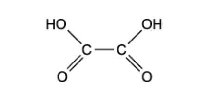
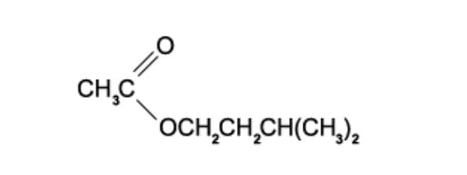
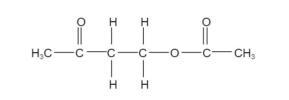
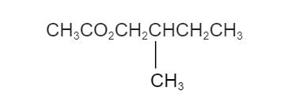
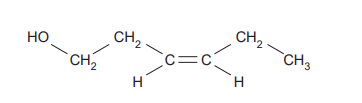

# Exam Questions — Esters
**18. Carboxylic Acids & Derivatives** · Cambridge (CIE) AS chemistry (9701)
> Source: [https://www.savemyexams.com/as/chemistry/cie/25/topic-questions/](https://www.savemyexams.com/as/chemistry/cie/25/topic-questions/) · 18 questions across 2 sets

## Multiple Choice Questions (12 questions)

### Q1 — hard — 1 marks

**Q1** [1 mark]

Which statement correctly describes the hydrolysis of an ester?

### Q2 — medium — 1 marks

**Q2** [1 mark]

How many ester compounds have the molecular formula C4H8O2?

### Q3 — medium — 1 marks

**Q3** [1 mark]

The diagram shows the structure of ethanedioic acid.

Ethanedioic acid reacts with ethanol in the presence of a few drops of concentrated sulfuric acid to form a diester. The molecular formula of the diester is C6H10O4.

What is the structural formula of the diester?

### Q4 — medium — 1 marks

**Q4** [1 mark]

Cetyl palmitate is a waxy solid and has the molecular formula C15H31CO2C16H33.

Which products are formed when cetyl palmitate is heated under reflux with an excess of aqueous sodium hydroxide?

### Q5 — hard — 2 marks

**Q5** [1 mark]

30 g of an alcohol and 30 g of a carboxylic acid are heated under reflux together to produce 33.2 g of propyl butanoate.

What is the yield of the ester?

**Q5** [1 mark]

30 g of an alcohol and 30 g of a carboxylic acid are heated under reflux together to produce 33 g of propyl butanoate.

What is the yield of the ester?

### Q6 — medium — 1 marks

**Q6** [1 mark]

Compound **Q** has the formula CH3CH2CO2CH3.

Which row correctly shows the name of compound **Q** and how its boiling point compares with that of butanoic acid?

|   | **Name of Q** | **Boiling point compared to butanoic acid** |
|---|---|---|
| **A** | Methyl propanoate | Lower |
| **B** | Propyl methanoate | Lower |
| **C** | Methyl propanoate | Higher |
| **D** | Propyl methanoate | Higher |

### Q7 — easy — 1 marks

**Q7** [1 mark]

How many isomeric esters, including stereoisomers, can be synthesised from the reaction of methanoic acid with an alcohol of formula C4H10O?

### Q8 — easy — 1 marks

**Q8** [1 mark]

The structure of ester **E** is shown in the diagram below.

**E** is hydrolysed in the presence of hydrochloric acid.

Which are the products of this hydrolysis?

### Q9 — hard — 2 marks

**Q9** [1 mark]

During a lesson, a teacher heated ethyl propanoate under reflux with aqueous sodium hydroxide. The mixture was then acidified, and the two organic products are then separated, purified and weighed.

Out of the total mass of products obtained, what is the percentage by mass of each product?

**Q9** [1 mark]

In the presence of an H+ catalyst, compound X reacts with ethanoic acid to produce the compound below.

What is the molecular formula of compound X?

### Q10 — hard — 1 marks

**Q10** [1 mark]

In the presence of an H+ catalyst, compound X reacts with ethanoic acid to produce the compound below.

What is the molecular formula of compound X?

### Q11 — easy — 1 marks

**Q11** [1 mark]

The ester shown is responsible for the odour of bananas.

Which pair of compounds reacts to form this ester?

### Q12 — medium — 1 marks

**Q12** [1 mark]

Lactic acid is a naturally occurring molecule.

What is a property of lactic acid?

## Structured Questions (6 questions)

### Q1 — medium — 13 marks

**Q1** [5 marks]

Two isomeric compounds are shown below in Fig. 1.1.

**Fig. 1.1**

i) State the systematic name of each isomer.

[1]

ii) Suggest a chemical reagent to distinguish between these isomers and deduce the type of reaction taking place.

[2]

iii) State the observations made in each case.

[2]

**Q1** [3 marks]

i) Compound **B**, CH3CH(CH3)CH(OH)COOH, can be oxidised into compound **C**.

Construct an equation for this oxidation, using [O] to represent the oxidising agent.

[1]

ii) The half-equation for the reduction of acidified potassium dichromate(VI) is:

Cr2O72- (aq) + 14H+ (aq) + 6e– → 2Cr3+ (aq) + 7H2O (l)

Deduce the overall ionic equation for the oxidation of compound **B** to compound **C** using acidified dichromate(VI).

[2]

**Q1** [2 marks]

Acidified dichromate(VI) can be used to oxidise ethanol into ethanal or ethanoic acid, depending on the reaction conditions.

Outline how the reaction conditions can be changed to produce ethanal or ethanoic acid.

**Q1** [3 marks]

**Extract:**

Two isomeric compounds are shown below in Fig. 1.1.

Fig. 1.1

i) State the systematic name of each isomer.

A = 3-hydroxy-3-methylbutanoic acid

AND

B = 2-hydroxy-3-methylbutanoic acid

Under the right conditions, two molecules of compound **A** can react together to produce a dimer.

i) Name the type of reaction taking place and state the reaction conditions.

[2]

ii) Draw the structure of the product, showing clearly how the two molecules are joined.

[1]

### Q2 — hard — 13 marks

**Q2** [5 marks]

Ester S is 2-methylpropyl propanoate.

State the systematic names of the carboxylic acid and the alcohol used to form ester S.

State the catalyst and one condition for this reaction.

Construct an equation for the formation of ester S.

**Q2** [4 marks]

**Extract:**

Ester S is 2-methylpropyl propanoate.

Draw the skeletal formulae of the organic products formed when ester S is:

i) heated under reflux with dilute aqueous sulfuric acid

[2]

ii) heated under reflux with aqueous sodium hydroxide

[2]

**Q2** [4 marks]

Ester T has the molecular formula C5H10O2. When ester T is hydrolysed, one of the organic products is 2-methylpropan-1-ol.

Deduce the systematic names of the carboxylic acid and the alcohol used to prepare ester T.

Draw the displayed formula of ester T and state its systematic name.

### Q3 — medium — 11 marks

**Q3** [1 mark]

An organic ester, **B**, has the empirical formula C2H4O. The relative molecular mass, *M*r, of **B** is 88.0.

Deduce the molecular formula of **B**.

**Q3** [4 marks]

**Extract:**

An organic ester, **B**, has the empirical formula C~2~H~4~O. The relative molecular mass, *M*~r~, of **B** is 88.0.

Draw the skeletal formulae of four isomers of **B** that are esters.

**Q3** [4 marks]

**Extract:**

An organic ester, **B**, has the empirical formula C~2~H~4~O. The relative molecular mass, *M*~r~, of **B** is 88.0.

The student hydrolysed his sample of **B** by heating with aqueous mineral acid and then separating the alcohol, **C**, that was formed. He heated the alcohol **C** under reflux with acidified dichromate(VI) ions and collected the product **D**.

A sample of **D** gave a yellow/orange precipitate with 2,4-dinitrophenylhydrazine (2,4-DNP) reagent. A second sample of **D** gave no reaction with Tollens' reagent.

i) State the functional group shown to be present in **D** by the reaction with 2,4-DNP reagent.

[1]

ii) State what the result of the test with Tollens' reagent shows about **D**.

[1]

iii) Deduce the structural formula of the alcohol **C**.

[1]

iv) Which ester has the same structure as that of the ester **B**?

[1]

**Q3** [2 marks]

**Extract:**

An organic ester, **B**, has the empirical formula C~2~H~4~O. The relative molecular mass, *M*~r~, of **B** is 88.0.

Draw the skeletal formulae of four isomers of **B** that are esters.

The skeletal formulae of four isomers of **B** that are esters are:

|  |  |
| --- | --- |
|  |  |

Which ester, if any, is chiral? Explain your answer.

### Q4 — medium — 12 marks

**Q4** [4 marks]

The ester methyl butanoate, CH3(CH2)2CO2CH3, contributes to the aroma of apples.

i) State the reagents and conditions needed for the hydrolysis of this ester.

[2]

ii) Construct an equation for the hydrolysis of this ester.

[1]

iii) Apart from their use as perfumes and food flavourings, state one major commercial use of esters.

[1]

**Q4** [3 marks]

Leaf alcohol has the structure shown below.

i) Draw the other stereoisomer of leaf alcohol.

[1]

ii) Draw the structure of the ester formed when leaf alcohol reacts with ethanoic acid. Show all bonds in the ester linkage.

[2]

**Q4** [3 marks]

**Extract:**

Leaf alcohol has the structure shown below.

(Z)-hex-3-en-1-ol with the hydroxyl group and a cis double bond

i) Calculate the relative molecular mass, *M*r, for leaf alcohol.

[1]

ii) Leaf alcohol was reacted to form a product with an *M*r value 18 units less.

Suggest a structure for this product and deduce the type of reaction that took place.

[2]

**Q4** [2 marks]

**Extract:**

Leaf alcohol has the structure shown below.

ii) Leaf alcohol was reacted to form a product with an *M*~r~ value 18 units less.

Suggest a structure for this product and deduce the type of reaction that took place.

The structure of the dehydration product and type of reaction:
- CH~2~ = CH – CH = CH – CH~2~CH~3~
- Dehydration / elimination

A product with M~r~ 18 less than leaf alcohol has lost water (M~r~ of H~2~O = 18). The loss of H~2~O from an alcohol is dehydration / elimination and forms an alkene.

Describe a simple chemical test to distinguish between leaf alcohol and your product in **part (c)(ii).**

State the reagent and the observation for each compound.

### Q5 — easy — 8 marks

**Q5** [2 marks]

Draw the fully displayed formulae of:

i) 3-methylbutanoic acid

[1]

ii) methyl ethanoate

[1]

**Q5** [1 mark]

2-methylbutanoic acid can be produced by the oxidation of 2-methylbutan-1-ol when heated under reflux with acidified potassium dichromate(VI).

State the colour change observed during this reaction.

**Q5** [1 mark]

State the systematic names of the organic products formed when methyl ethanoate is hydrolysed by heating with dilute sulfuric acid.

**Q5** [4 marks]

**Extract:**

ii) methyl ethanoate

State the systematic names of the organic products formed when methyl ethanoate is hydrolysed by heating with dilute sulfuric acid.

Methyl ethanoate can also be hydrolysed under alkaline conditions using sodium hydroxide.

i) Draw the fully displayed formulae of the two products formed in this reaction.

[2]

ii) State the reagent required to convert the organic salt formed in (i) into a carboxylic acid.

[1]

iii) State one difference between the acid hydrolysis and the alkaline hydrolysis of esters, other than the reagents and products.

[1]

### Q6 — easy — 8 marks

**Q6** [3 marks]

Complete Table 1.1 to show the carboxylic acid and alcohol required to form each ester.

**Table 1.1**

| carboxylic acid | alcohol | ester |
|---|---|---|
| ethanoic acid |   | methyl ethanoate |
|   | ethanol | ethyl propanoate |
| butanoic acid | propan-1-ol |   |

**Q6** [2 marks]

All of the esters in part **(a)** are formed via a condensation reaction.

State the catalyst and conditions required to form an ester from a carboxylic acid and an alcohol.

**Q6** [2 marks]

State the reagents and conditions required for the acidic hydrolysis of an ester.

**Q6** [1 mark]

State one commercial use of esters.
