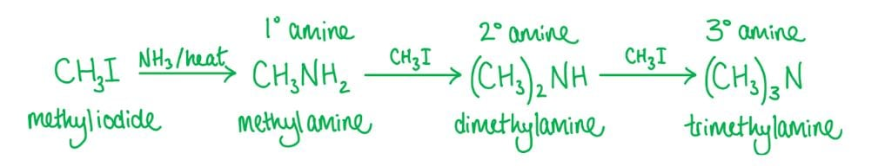
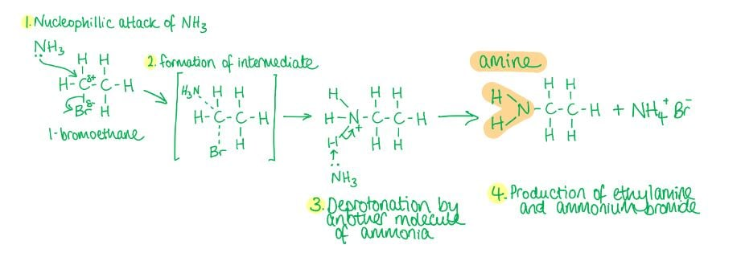
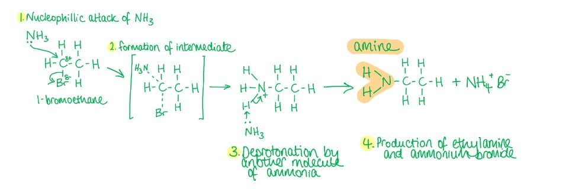
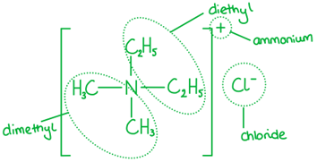
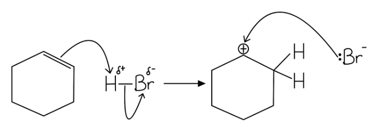
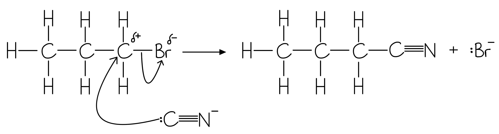
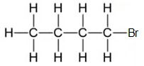
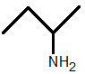
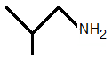
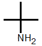

# Mark Schemes — Primary Amines
**19. Nitrogen Compounds** · Cambridge (CIE) AS chemistry (9701)

## Multiple Choice Questions (9 questions)

### Q1
**Final answer:** **The correct answer is D**

- 1-chloropropane reacts with excess ethanolic ammonia under pressure via nucleophilic substitution.
- Ammonia acts as the nucleophile, attacking the electron-deficient carbon bonded to chlorine; the chlorine is displaced as a chloride ion to form propylamine.
- The overall equation is:

CH3CH2CH2Cl + 2NH3 → CH3CH2CH2NH2 + NH4Cl

**A** is incorrect as electrophilic addition requires an electrophile as the attacking species and applies only to unsaturated molecules. 1-chloropropane is saturated and ammonia is a nucleophile, not an electrophile.

**B** is incorrect as aqueous ammonia hydrolyses 1-chloropropane via nucleophilic substitution to form propan-1-ol (an alcohol), not propylamine. Ethanolic ammonia is required to synthesise the amine.

**C** is incorrect as electrophilic addition applies only to unsaturated molecules. Even with ethanolic ammonia, the reaction type is nucleophilic substitution, not electrophilic addition.

### Q2
**Final answer:** **The correct answer is A**

- When ammonia is not in excess, the primary amine formed (methylamine) can react further with iodomethane.
- Methylamine acts as a nucleophile and reacts with a second molecule of iodomethane to form dimethylamine (a secondary amine).
- Dimethylamine reacts with a third molecule of iodomethane to form trimethylamine (a tertiary amine).
- A mixture of all three amines is therefore produced.

**B** is incorrect as dimethylamine alone would only be produced if the reaction stopped after a single further substitution. In practice all three amines form when ammonia is not in excess.

**C** is incorrect as trimethylamine also forms when ammonia is not in excess. The cascade continues past dimethylamine.

**D** is incorrect as methylamine alone would only be the sole product if ammonia were in excess. Without excess ammonia the reaction cascade continues to give secondary and tertiary amines.

> **[exam-tip]**
> To produce only a primary amine, excess ethanolic ammonia under pressure should be used. The high concentration of ammonia suppresses further substitution, favouring formation of the primary amine only.

### Q3
**Final answer:** **The correct answer is D**

- Nitrile reduction always produces a primary amine with the -NH2 group on a primary carbon.
- When a nitrile (-C≡N) is reduced, the nitrile carbon gains two hydrogen atoms and the nitrogen gains two more, giving a -CH2NH2 group.

  - The -NH2 is always positioned on a primary carbon.
- Butan-2-amine has the -NH2 group attached to C-2, a secondary carbon, which cannot arise from nitrile reduction.

**A** is incorrect as 2,2-dimethylpropan-1-amine can be produced by reducing 2,2-dimethylpropanenitrile. The -NH2 group is on a primary carbon.

**B** is incorrect as 2-methylpropan-1-amine can be produced by reducing 2-methylpropanenitrile. The -NH2 group is on a primary carbon.

**C** is incorrect as butan-1-amine can be produced by reducing butanenitrile. The -NH2 group is on a primary carbon.

### Q4
**Final answer:** **The correct answer is B**

- 'Ethyl' indicates a two-carbon chain.
- '-amine' indicates the -NH2 group is at the end of the chain.
- Therefore, B shows ethylamine, a primary amine with a two-carbon chain terminating in -NH2.

**A** is incorrect as this is dimethylamine, a secondary amine with two methyl groups bonded to nitrogen.

**C** is incorrect as this is methylamine, a primary amine with only one carbon atom rather than two.

**D** is incorrect as this is trimethylamine, a tertiary amine with three methyl groups bonded to nitrogen.

### Q5
**Final answer:** **The correct answer is B**

- Bromoethane reacts with excess ethanolic ammonia under pressure.
- Ammonia acts as a nucleophile, donating a lone pair to the electron-deficient carbon bonded to bromine.
- Bromine is displaced as a bromide ion, forming ethylamine via nucleophilic substitution.
- The reaction mechanism is:

**A** is incorrect as electrophilic substitution requires an electrophile as the attacking species. Ammonia is a nucleophile, not an electrophile.

**C** is incorrect as oxidation of bromoethane replaces the C-Br bond with a C-OH bond, forming ethanol (an alcohol), not an amine.

**D** is incorrect as reduction of bromoethane replaces the C-Br bond with a C-H bond, forming ethane (an alkane), not an amine.

### Q6
**Final answer:** **The correct answer is A**

- Halogenoalkanes react with excess ethanolic ammonia under pressure via nucleophilic substitution to form a primary amine.
- Ammonia acts as the nucleophile, donating a lone pair to the electron-deficient carbon bonded to bromine, displacing bromide to form ethylamine.

**B** is incorrect as methanol reacts with bromoethane via nucleophilic substitution to form an ether (methoxyethane), not an ester.

**C** is incorrect as methylamine does react with bromoethane via nucleophilic substitution, but the product is a secondary amine (N-methylethanamine), not an amide.

**D** is incorrect as water reacts with bromoethane via hydrolysis (nucleophilic substitution) to form ethanol, which is an alcohol and not an acid.

### Q7
**Final answer:** **The correct answer is A**

- When a halogenoalkane is reacted with excess ethanolic ammonia under pressure, the main product is a primary amine.
- Ammonia acts as the nucleophile, displacing the chlorine atom from chloroethane via nucleophilic substitution to form ethylamine.
- Excess ammonia suppresses further substitution, so the primary amine is the main product.

**B** is incorrect as diethylamine is a secondary amine formed when ethylamine undergoes a further substitution with chloroethane. Excess ammonia suppresses this reaction.

**C** is incorrect as triethylamine is a tertiary amine that would form through a further cascade substitution. Again, excess ammonia prevents this from being the main product.

**D** is incorrect as tetraethylammonium chloride is a quaternary ammonium salt, not an amine, and would only form through extensive substitution in the absence of excess ammonia.

### Q8
**Final answer:** **The correct answer is D**

- In the first reaction, propanone undergoes nucleophilic addition with acidified KCN (KCN and dilute H2SO4); CN- acts as the nucleophile, attacking the carbonyl carbon to form 2-hydroxy-2-methylpropanenitrile.
- Dilute H2SO4 is required to generate HCN in situ and maintain the acidic conditions needed for nucleophilic addition.

  - Ethanolic KCN alone does not give the cyanohydrin product reliably.
- In the second reaction, 2-chloropropane undergoes nucleophilic substitution with excess ethanolic ammonia under pressure.

  - Ammonia acts as the nucleophile, displacing chlorine to form propan-2-amine.
- Propan-2-amine (CH3CH(NH2)CH3) is a primary amine because the nitrogen carries only one carbon substituent, regardless of the class of the carbon it is bonded to.
- Excess ammonia suppresses further substitution and ensures the primary amine is the main product.

**A** is incorrect as ethanolic KCN does not provide the acidic conditions required for nucleophilic addition in reaction 1, and aqueous ammonia hydrolyses 2-chloropropane to give propan-2-ol (an alcohol) rather than the amine in reaction 2.

**B** is incorrect as ethanolic KCN is the wrong reagent for reaction 1. Dilute H2SO4 is required to generate HCN in situ and promote cyanohydrin formation.

**C** is incorrect as aqueous ammonia hydrolyses 2-chloropropane via nucleophilic substitution to give propan-2-ol (an alcohol), not an amine. Ethanolic ammonia under pressure is required for amine synthesis.

### Q9
**Final answer:** **The correct answer is A**

- The compound is a quaternary ammonium salt containing two ethyl groups and two methyl groups bonded to a positively charged nitrogen, with chloride as the counterion.
- Substituents are named in alphabetical order.

  - So, diethyl (e) comes before dimethyl (m).
- Each pair of identical groups requires the prefix 'di-'.
- The systematic name is therefore diethyldimethylammonium chloride.

**B** is incorrect as the compound contains two methyl groups; the 'di-' prefix is missing, giving 'diethylmethyl' instead of 'diethyldimethyl'.

**C** is incorrect as the groups are correct but placed in the wrong alphabetical order. Dimethyl appears before diethyl, whereas alphabetically diethyl (e) precedes dimethyl (m).

**D** is incorrect as both 'di-' prefixes are absent. The compound contains two ethyl and two methyl groups, requiring 'diethyldimethyl', not 'ethylmethyl'.

## Structured Questions (5 questions)

### Q1
> **[mark-scheme]**
> i) The mechanism of reaction **1** is:
> 
> - Nucleophilic substitution **[1 mark]**
> 
> ii) Suitable reagents and conditions for reaction **1** are:
> 
> - Excess concentrated ammonia solution in ethanol / concentrated ethanolic ammonia / excess NH3 in ethanol **[1 mark]**
> - Under pressure **[1 mark]**

> **[exam-tip]**
> An ammonia molecule (NH3) acts as a nucleophile as the nitrogen atom has a lone pair of electrons, which it donates to form a covalent bond with the electron-deficient carbon atom in C–Cl.
> 
> When comparing the reactants (1-chlorobutane) to the product (butylamine), the chlorine atom has been replaced by the amine group. So, this is therefore a nucleophilic substitution reaction.
> 
> Learn all reagents and conditions for the reactions in your specification.
The mechanism for reaction **1** is:

**[4 marks]**

> **[mark-scheme]**
> 1 mark for a curly arrow from the lone pair on N of NH3 to the C of C–Cl
> 
> 1 mark for a curly arrow from the C–Cl bond to the Cl
> 
> 1 mark for all correct partial charges (δ+ on C and δ– on Cl)
> 
> 1 mark for compound **X** correctly drawn with a positive charge on N and :Cl- shown as a byproduct

> **[exam-tip]**
> An ammonia molecule (NH3) acts as a nucleophile as the nitrogen atom has a lone pair of electrons that it donates to the electron-deficient carbon atom.
> 
> Since the carbon atom in C–Cl cannot have five bonds, the C–Cl bond breaks and the chlorine is displaced by NH3.
> 
> The product formed (compound X) has a nitrogen atom bonded to four atoms and therefore carries a positive charge.
> 
> Read the question carefully as compound X is the intermediate formed before the mechanism is complete, not butylamine itself.
> 
> Curly arrows must start from a lone pair or a bond (not the atom itself):
> 
> - The first arrow starts at the lone pair on N and points to the electron-deficient carbon
> - The second arrow starts from the C–Cl bond and ends at the Cl atom
> **[mark-scheme]**
> i) The role of ammonia in reaction **2** is:
> 
> - (Brønsted-Lowry) base / proton acceptor **[1 mark]**
> 
> ii) The formula of compound **Y** is:
> 
> - NH4+ **[1 mark]**
> 
> iii) The name of compound **Z** is:
> 
> - Ammonium chloride **[1 mark]**

> **[exam-tip]**
> Compound X is an organic molecule with an –NH3+ group, where the nitrogen atom is bonded to four atoms and carries a positive charge.
> 
> Since ammonia is a neutral nucleophile, a proton (H+) must be lost from compound X to form the neutral amine product. Ammonia acts as a Brønsted-Lowry base in reaction 2 by accepting this proton to form NH4+ (compound Y). This is why excess ammonia is used.
> 
> The ammonium ion (NH4+) combines with the chloride ion (Cl-) displaced in reaction 1 to form ammonium chloride (NH4Cl).
> 
> If a different halogenoalkane were used (for example 1-bromobutane), a Br- ion would be formed instead, combining with the ammonium ion to give ammonium bromide (NH4Br).

### Q2
The mechanism for the formation of compound **X** from cyclohexene using HBr is:

**[4 marks]**

> **[mark-scheme]**
> 1 mark for a curly arrow from the C=C π bond to the H atom of H–Br / H–Cl / H–I
> 
> 1 mark for correct partial charges on the H–X bond (δ+H, δ–X) **AND** a curly arrow from the H–X bond to the X atom
> 
> 1 mark for the correct carbocation intermediate drawn
> 
> 1 mark for a curly arrow from the lone pair on X– to the positively charged carbon of the carbocation
> 
> Allow HBr, HCl, or HI as the hydrogen halide; compound **X** is then the corresponding halocyclohexane

> **[exam-tip]**
> This is an electrophilic addition mechanism. The π electrons of the C=C bond act as a nucleophile and are attracted to the δ+ hydrogen of H–Br. Two curly arrows are needed in the first step: one from the C=C to H, and one from the H–Br bond to Br. Both bonds must be shown breaking and forming simultaneously.
> 
> The carbocation intermediate has a positive charge on the carbon that did not bond to H. In the second step, Br– attacks this C+ using its lone pair. The curly arrow must start from the lone pair on Br–, not from the Br– ion itself.
> 
> You can use HBr, HCl, or HI. The mechanism is the same for all three; compound **X** is the corresponding halocyclohexane (e.g. bromocyclohexane if HBr is used). Compound **X** is a halogenoalkane that can then undergo nucleophilic substitution with excess ethanolic ammonia to form cyclohexylamine.
> **[mark-scheme]**
> i) The reagents and conditions required are:
> 
> - Excess ammonia / NH3 in ethanol / ethanolic solution of ammonia **[1 mark]**
> - Heated under pressure / in a sealed tube **[1 mark]**
> 
> ii) An excess of ammonia is used to:
> 
> - Prevent the amine / cyclohexylamine from acting as a nucleophile and reacting with (another molecule of) compound **X** / the halogenoalkane
> **OR**
> Prevent the formation of secondary / tertiary amines **[1 mark]**

> **[exam-tip]**
> The reaction must be carried out under pressure because ammonia is a gas at room temperature. A sealed tube or pressurised vessel keeps the ammonia in contact with compound **X** long enough to react.
> 
> If ammonia is not in excess, the newly formed cyclohexylamine can act as a nucleophile (it also has a lone pair on nitrogen) and attack another molecule of compound **X**. This produces a secondary amine as a by-product. Excess ammonia ensures the ammonia outcompetes the amine for the available halogenoalkane.
> **[mark-scheme]**
> The equation is:
> 
> - CH3CH2CH2NH2 + H2O ⇌ CH3CH2CH2NH3+ + OH- 
> **OR**
> C3H7NH2 + H2O ⇌ C3H7NH3+ + OH-**[1 mark]**

> **[exam-tip]**
> A Brønsted-Lowry base is a species that accepts a proton (H+). Propylamine has a lone pair on its nitrogen atom. When dissolved in water, the lone pair accepts a proton from H2O, forming the propylammonium ion (CH3CH2CH2NH3+) and releasing a hydroxide ion (OH-).
> 
> The equilibrium arrow (⇌) is required because propylamine is a weak base. Weak bases only partially ionise in water, so the forward and reverse reactions both occur simultaneously.

### Q3
> **[mark-scheme]**
> i) The systematic name of compound **A** is:
> 
> - 1-bromopropane **[1 mark]**

ii) The mechanism is:

**[4 marks]**

> **[mark-scheme]**
> 1 mark for :CN- / :C≡N- as the reactive ion
> 
> 1 mark for a curly arrow from the lone pair on :CN- to the δ+ carbon of the C–Br bond
> 
> 1 mark for correct partial charges on C–Br (δ+C, δ–Br) **AND** a curly arrow from the C–Br bond to the Br atom
> 
> 1 mark for the correct structure of compound **B** (butanenitrile, CH3CH2CH2CN) drawn

> **[exam-tip]**
> The cyanide ion (CN-) is the nucleophile here, not the K+ ion. The negative charge sits on the carbon end of CN-, so the curly arrow showing attack must start from the lone pair on C of :CN-.
> 
> Compound **A** is a primary halogenoalkane, so the carbon of the C–Br bond carries a partial positive charge (δ+). The lone pair on C of :CN- attacks this δ+C, while a second curly arrow shows the C–Br bond breaking with Br leaving as Br-.
> 
> Compound **B** is a nitrile: the CN group has been added to compound **A**, extending the chain by one carbon. 1-bromopropane (3 carbons) reacts with CN- to give butanenitrile (4 carbons).
> **[mark-scheme]**
> The type of reaction that occurs is:
> 
> - Reduction **[1 mark]**

> **[exam-tip]**
> Reduction in organic chemistry involves the gain of hydrogen or the loss of oxygen. Compound **B** is a nitrile (R–C≡N), which gains hydrogen atoms in the presence of H2 and a Ni catalyst to form compound **C** (a primary amine, R–CH2–NH2). Because hydrogen is gained, this is a reduction reaction.
i) The displayed formula of compound **D** is:

**[1 mark]**

> **[mark-scheme]**
> Allow 1-chlorobutane as compound **D**

> **[mark-scheme]**
> ii) Suitable reagents and conditions for reaction **3** are:
> 
> - Excess ammonia / NH3 in ethanol / ethanolic ammonia **[1 mark]**
> - Heated under pressure / in a sealed tube **[1 mark]**

> **[exam-tip]**
> Compound **D** is 1-bromobutane (or 1-chlorobutane). To produce butylamine (compound **C**) directly from a halogenoalkane in one step, nucleophilic substitution with excess ethanolic ammonia under pressure is required. The halogen is replaced by an NH2 group.
> 
> Excess ammonia is used to prevent the newly formed amine from attacking another molecule of compound **D**, which would produce secondary amines as by-products.
Any two of the following primary amine isomers of compound **C**:

**[2 marks]**

> **[mark-scheme]**
> 1 mark each for any two of the three skeletal formulae shown, to a maximum of 2 marks

> **[exam-tip]**
> Compound **C** is 1-aminobutane (butylamine), with the –NH2 group on carbon 1 of a four-carbon chain. A primary amine has exactly one alkyl group bonded to the nitrogen atom.
> 
> To find the isomers:
> 
> - Move the –NH2 group along the chain: placing it on carbon 2 gives 2-aminobutane
> - Branch the chain: a three-carbon main chain with a methyl branch on carbon 2 and –NH2 on carbon 1 gives 2-methylpropylamine
> - Place –NH2 on the branched carbon: 2-methylpropan-2-amine has –NH2 on the central carbon of the branched structure
> 
> All three isomers have the molecular formula C4H11N.

### Q4
> **[mark-scheme]**
> The equation for this reaction is:
> 
> - CH3CH2CH2Br + NH3 → CH3CH2CH2NH2 + HBr **[1 mark]**

> **[exam-tip]**
> Propylamine has the formula CH3CH2CH2NH2. The propyl- prefix tells you there is a three-carbon chain (CH3CH2CH2–) and the -amine suffix tells you an NH2 group is attached to it.
> 
> If you cannot recall the product, work backwards from the name. You know the product is an amine (contains N) and the three-carbon chain comes from 1-bromopropane. So the product is CH3CH2CH2NH2.
> 
> Once you know both organic species, balance by counting atoms: you need NH3 on the left to provide the N and two extra H atoms, and HBr forms as the bromide leaves.
> **[mark-scheme]**
> The reagents and conditions required are:
> 
> - Excess ammonia / NH3 in ethanol / ethanolic solution of ammonia **[1 mark]**
> - Heated under pressure / in a sealed tube **[1 mark]**

> **[exam-tip]**
> Excess ammonia is used to prevent the newly formed propylamine from acting as a nucleophile and attacking another molecule of 1-bromopropane. If the ammonia is not in excess, a secondary amine (dipropylamine) would form as a by-product.
> 
> The reaction must be carried out under pressure because ammonia is a gas at room temperature. A sealed tube or pressurised vessel keeps the ammonia in contact with 1-bromopropane long enough to react.
> **[mark-scheme]**
> The mechanism for this reaction is:
> 
> - Nucleophilic substitution **[1 mark]**

> **[exam-tip]**
> The bromine atom in 1-bromopropane is more electronegative than carbon, so the C–Br bond is polarised (δ+C–δ–Br). The lone pair on the nitrogen atom of ammonia is attracted to this δ+C, making ammonia the nucleophile. The C–Br bond breaks and the bromide ion (Br–) leaves, so the overall process is nucleophilic substitution.

### Q5
> **[mark-scheme]**
> i) The role of ammonia in this reaction is:
> 
> - Nucleophile **[1 mark]**
> 
> ii) The mechanism of this reaction is:
> 
> - Nucleophilic substitution **[1 mark]**

> **[exam-tip]**
> The nitrogen atom in ammonia has a lone pair of electrons. The carbon of the C–Cl bond carries a partial positive charge (δ+C) because chlorine is more electronegative. The lone pair on N attacks this δ+C, making ammonia the nucleophile.
> 
> Since the Cl atom is replaced by the NH2 group and a nucleophile performs the replacement, the mechanism is nucleophilic substitution.
> **[mark-scheme]**
> Propylamine acts as a Brønsted-Lowry base because:
> 
> - It accepts a proton / H+ from water / it has a lone pair of electrons that accepts a proton **[1 mark]**
> 
> The equation is:
> 
> - CH3CH2CH2NH2 + H2O ⇌ CH3CH2CH2NH3+ + OH- 
> **OR**
> C3H7NH2 + H2O ⇌ C3H7NH3+ + OH-**[1 mark]**

> **[exam-tip]**
> A Brønsted-Lowry base is a species that accepts a proton (H+). Propylamine has a lone pair on its nitrogen atom. When dissolved in water, this lone pair accepts a proton from H2O, forming the propylammonium ion (CH3CH2CH2NH3+) and releasing a hydroxide ion (OH-).
> 
> The question asks you to explain, not just state. You must link the lone pair on nitrogen to the ability to accept a proton. Stating 'it accepts a proton' without reference to the lone pair will not score the first mark.
> 
> The equilibrium arrow (⇌) is required because propylamine is a weak base. Weak bases only partially ionise in water.
> **[mark-scheme]**
> As the reaction proceeds, the bond angles around nitrogen change:
> 
> - Bond angle in ammonia **AND** propylamine = 107°
> **AND**
> Bond angle in the intermediate = 109.5° **[1 mark]**
> - Lone pair(s) on nitrogen in ammonia **AND** propylamine cause greater repulsion than bonding pairs
> **AND**
> The molecules have a pyramidal shape **[1 mark]**
> - All four bonds / bonding pairs around nitrogen in the intermediate
> **AND**
> The intermediate has a tetrahedral shape **[1 mark]**

> **[exam-tip]**
> In step 1, the lone pair on ammonia attacks the C–Cl bond. This forms an intermediate where nitrogen is bonded to four groups (no lone pairs remaining on N). Four bonding pairs with no lone pairs gives a tetrahedral shape with a bond angle of 109.5°.
> 
> In step 2, a proton is lost from the intermediate and the lone pair is restored on nitrogen in propylamine. One lone pair with three bonding pairs gives a pyramidal shape. The lone pair repels bonding pairs more strongly than bonding pairs repel each other, compressing the angle below the tetrahedral value to 107°.
> 
> Note that ammonia and propylamine have the same bond angle (107°) because both have one lone pair and three bonding pairs around nitrogen.
