# Mark Schemes — Nitriles & Hydroxynitriles
**19. Nitrogen Compounds** · Cambridge (CIE) AS chemistry (9701)

## Multiple Choice Questions (15 questions)

### Q1
**Final answer:** **The correct answer is B**

- Heating a nitrile with aqueous NaOH under reflux hydrolyses it to a carboxylate salt
- Acidification converts the carboxylate salt into the carboxylic acid
- This sequence correctly converts butanenitrile into butanoic acid

**A** is incorrect as acid hydrolysis already forms the acid and does not require neutralisation.

**C** is incorrect as LiAlH4 reduces nitriles to primary amines, not acids.

**D** is incorrect as distillation is a separation technique, it does not change the functional group.

### Q2
**Final answer:** **The correct answer is B**

- Alkanes are very unreactive compounds due to their non-polar C-H bonds.
- They are therefore not likely to undergo reactions with nucleophiles and electrophiles.

  - Nucleophiles are species that can donate a pair of electrons.
  - Electrophiles are species that can accept a pair of electrons.
- The conversion of alkanes to nitriles is therefore a multi-step process.

**A **is incorrect as aldehydes can undergo a 1-step addition reaction with HCN at room temperature to form nitriles:

CH3CHO + HCN → CH3CH(OH)(CN)

**C **is incorrect as amides can undergo a 1-step dehydration reaction to form nitriles.

**D **is incorrect as halogenoalkanes undergo a 1-step substitution reaction with KCN in ethanol and heat to form nitriles:

CH3CH2CH2Br + CN- → CH3CH2CH2CN + Br-

### Q3
**Final answer:** **The correct answer is C**

- **Hydrolysis** is the breakdown of a compound using water.
- **Nitriles** can be hydrolysed either by **refluxing** it with **dilute hydrochloric acid** or with **sodium hydroxide solution.**
- When hydrolysed with **sodium hydroxide solution**, instead of forming an **ammonium salt**, now a **sodium salt** is formed, and **ammonia gas** is given off.
- The ammonia is formed from the reaction between **ammonium** (NH4+) ions and **hydroxide** (OH-) ions.

  - Option **C** is therefore the correct option.
- To form the free carboxylic acid the final solution has to be acidified with a strong acid such as dilute hydrochloric acid (HCl).

  - This means that the ethanoate ion in the sodium ethanoate salt will react with the hydrogen ions to form ethanoic acid.
  - Once reacted, ethanoic acid is a weak acid and holds onto the hydrogen rather than dissociating.

**A** is incorrect as the water molecules are not correctly balanced in this reaction. 1 mole of water is needed for the reaction to become balanced.

**B** is incorrect as the water molecules are not correctly balanced in this reaction. 1 mole of water is needed for the reaction to become balanced and ammonium is not formed in the hydrolysis of nitriles by dilute aqueous hydroxide.

**D** is incorrect as ammonia (NH3) is formed, not ammonium (NH4+). An ammonium salt would have been formed if the nitrile was hydrolysed by dilute hydrochloric acid solution.

### Q4
**Final answer:** **The correct answer is A**

- 2-hydroxybutanenitrile is a hydroxynitrile.
- Hydroxynitriles can be formed from the nucleophilic addition reaction of aldehydes and ketones with HCN at room temperature.
- A nucleophilic addition is when a nucleophile is added to an unsaturated bond to form a single product — a nucleophile donates a pair of electrons.
- Since propan-1-ol is a primary alcohol it should be first oxidised to an aldehyde using acidified potassium dichromate under distillation to form propanal.
- The aldehyde propanal is then reacted with hydrogen cyanide (acidified NaCN) at room temperature to produce 2-hydroxybutanenitrile.

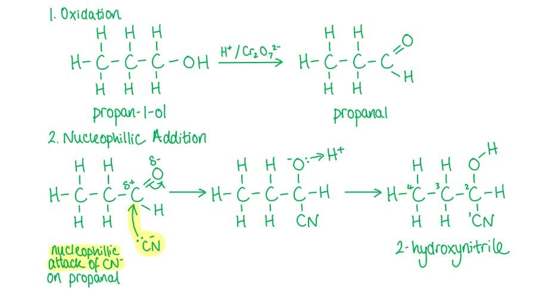

**B** is incorrect as the reaction of propan-1-ol with NaCl / H2SO4 will result in a nucleophilic substitution reaction resulting in the removal of the OH group so the compound cannot be oxidised to an aldehyde.

**C** is incorrect as the steps are in the wrong order because the CN- group will only attack a carbonyl carbon atom so propan-1-ol needs to be oxidised first.

**D** is incorrect as this is similar to reaction B but the steps are in the wrong order.

### Q5
**Final answer:** **The correct answer is C**

- **Hydrolysis** is the breakdown of a compound using water.
- When a nitrile is **refluxed** with dilute hydrochloric acid, **hydrolysis** occurs.
- The -CN group at the end of the hydrocarbon chain is converted into a -COOH group, forming a **carboxylic acid.**
- The ammonia in solution will act as a **base** and form an **ammonium salt** with Cl- (**NH**~**4****Cl**).
- The reaction equation for this **hydrolysis** is:

CH3CH2CN + 2H2O + HCl → CH3CH2COOH + NH4Cl

**A** is incorrect as this is a primary amine which would have been formed if the nitrile group in CH3CH2CN was **reduced** instead of **hydrolysed**.

**B** is incorrect as this is an aldehyde and would not form upon hydrolysis of the nitrile.

**D** is incorrect as though a carboxylic acid is formed, the carbon chain is one carbon too short.

### Q6
**Final answer:** **The correct answer is B**

- The reaction of a halogenoalkane with ethanolic KCN and heat is a nucleophilic substitution reaction to form a nitrile.

  - A nucleophilic substitution reaction is a reaction in which a nucleophile replaces another nucleophile.
  - A nucleophile is a species that can donate a pair of electrons.
- Therefore, only option **B** and **D** can be correct.
- The reaction of nitriles with aqueous alkali solution when heated is a hydrolysis reaction to produce a sodium salt (sodium butanoate) and ammonia.

  - In a hydrolysis reaction a compound is broken down by water.
- The sodium butanoate is acidified with dilute hydrochloric acid.
- The butanoate ion in the sodium butanoate salt will react with the hydrogen ions to form butanoic acid.

  - Once reacted, butanoic acid is a weak acid and holds onto the hydrogen rather than dissociating.
- Therefore, only option **B** is correct.

**A** & **C** are incorrect as compound **X** is not a **nitrile** and option **C** has compounds **Y** and **Z** swapped around.

**D** is incorrect as compound **Y** and **Z** are swapped around.

### Q7
**Final answer:** **The correct answer is A**

- Hydrolysis is the breakdown of a compound using water.
- When a nitrile is refluxed with sodium hydroxide solution, hydrolysis occurs.
- Instead of forming an ammonium salt (as seen in HCl reflux reactions), a sodium salt is formed, and ammonia gas is given off.
- The ammonia is formed from the reaction between ammonium (NH4+) ions and hydroxide (OH-) ions.
- The reaction equation for this hydrolysis is:

CH3CN + H2O + NaOH → CH3COONa + NH3

- To form the free carboxylic acid the final solution has to be acidified with a strong acid such as dilute hydrochloric acid (HCl)

  - This means that the ethanoate ion in the sodium ethanoate salt will react with the hydrogen ions to form ethanoic acid.
  - Once reacted, ethanoic acid is a weak acid and holds onto the hydrogen rather than dissociating.

**C** & **D** are incorrect as the number of carbons in the carbon chain remain unchanged. The sodium salt should therefore be sodium ethanoate and not sodium propanoate.

**B** is incorrect as the ammonium salt is formed when a nitrile is refluxed with dilute hydrochloric acid, not sodium hydroxide.

### Q8
**Final answer:** **The correct answer is B**

- Hydrolysis is the breakdown of a compound using water.
- Nitriles can be hydrolysed either by refluxing it with dilute hydrochloric acid or with sodium hydroxide solution.
- When hydrolysed with a dilute acid the -CN group at the end of the hydrocarbon chain is converted into a -COOH group, forming a carboxylic acid.
- Ammonia in solution will act as a base to form ammonium salt with Cl- (NH4Cl).

  - Option **B **is therefore the only correct option.
- When a nitrile is refluxed with sodium hydroxide solution, hydrolysis can also occur.

  - Instead of forming an ammonium salt, now a sodium salt is formed, and ammonia gas is given off.
  - The ammonia is formed from the reaction between ammonium (NH4+) ions and hydroxide (OH-) ions.
- The reaction equation for this hydrolysis is:

CH3CN + H2O + NaOH → CH3COONa + NH3

- To form the free carboxylic acid the final solution has to be acidified with a strong acid such as dilute hydrochloric acid (HCl).

  - This means that the ethanoate ion in the sodium ethanoate salt will react with the hydrogen ions to form ethanoic acid.
  - Once reacted, ethanoic acid is a weak acid and holds onto the hydrogen rather than dissociating.

**A** is incorrect as ammonium chloride (NH4Cl) is formed, not ammonia chloride (NH3Cl).

**C** is incorrect as ammonium chloride (NH4Cl) is formed, **not** ammonia (NH3). Ammonia would have been formed if the nitrile was hydrolysed by a sodium hydroxide solution.

**D** is incorrect as the water molecules are not correctly balanced in this reaction. 2 moles of water are needed for the reaction to become balanced.

### Q9
**Final answer:** **The correct answer is D**

- A nucleophilic addition is when a nucleophile is added to an unsaturated bond to form a single product.
- Hydroxynitriles are formed from the nucleophilic addition reaction of aldehydes and ketones with HCN at room temperature.
- Butanone is a ketone and will form 2-methyl-2-hydroxybutanenitrile.
- Hydrolysis is the breakdown of a compound using water.

  - Nitriles can be hydrolysed by refluxing it with dilute hydrochloric acid.
- The -CN group is converted into a -COOH group, forming a carboxylic acid.
- The ammonia in solution will act as a base and form an ammonium salt with Cl- (NH4Cl).

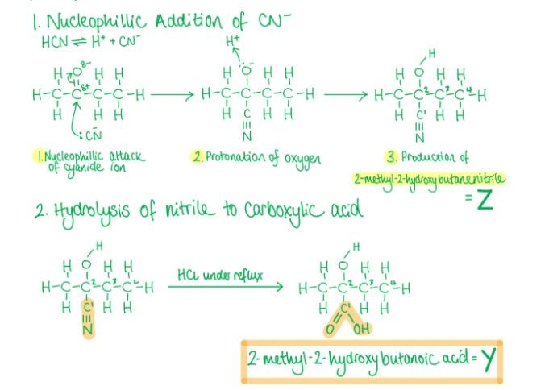

**A** & **B** are incorrect as these are amine products formed when the CN- group in Z is reduced rather than hydrolysed.

**C** is incorrect as this is the product if the reactant is an **aldehyde** rather than a **ketone.**

### Q10
**Final answer:** **The correct answer is B**

- Hydrolysis is the breakdown of a compound using water.
- When a nitrile is refluxed with dilute hydrochloric acid, hydrolysis occurs.
- The -CN group at the end of the hydrocarbon chain is converted into a -COOH group, forming a carboxylic acid.
- The ammonia in solution will act as a base and form an ammonium salt with Cl- (NH4Cl).
- The reaction equation for this hydrolysis is:

CH3CN + 2H2O + HCl → CH3COOH + NH4Cl

**C** & **D** are incorrect as the number of carbons in the carbon chain remains unchanged. The carboxylic acid should therefore be ethanoic acid and not propanoic acid.

**A** is incorrect as the ammonia will react in solution to form an ammonium salt.

### Q11
**Final answer:** **The correct answer is D**

- 2-hydroxy-2-methylpropanenitrile is a hydroxynitrile.
- Hydroxynitriles can be formed from the nucleophilic addition reaction of aldehydes and ketones with HCN at room temperature.
- A nucleophilic addition is when a nucleophile is added to an unsaturated bond to form a single product.

  - A nucleophile is a species that donates a pair of electrons.
- Propanone (which is a ketone) and hydrogen cyanide are the correct reagents required for the conversion of propanone to 2-hydroxy-2-methylpropanenitrile.
- The reaction mechanism is:

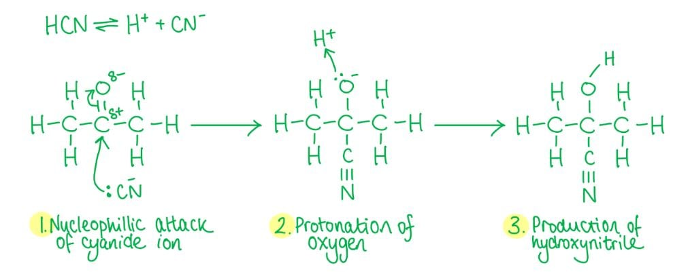

**A, B** & **C** are incorrect as though these reactions contain the correct reactant (either an aldehyde or ketone), they do not contain the correct reagent (hydrogen cyanide, HCN).

### Q12
**Final answer:** **The correct answer is A**

- A nucleophilic addition is when a nucleophile is added to an unsaturated bond to form a single product.
- A nucleophile is a species that donates a pair of electrons.
- Hydroxynitriles are formed from the nucleophilic addition reaction of aldehydes and ketones with HCN at room temperature.
- Option **A** shows the reaction type, reactants and reagents correctly.

**B** is incorrect as this is a nucleophilic substitution reaction to form an amine.

**C** is incorrect as this is an addition reaction, not a substitution reaction, to form a hydroxynitrile.

**D** is incorrect as this is a nucleophilic substitution reaction to form a nitrile.

### Q13
**Final answer:** **The correct answer is D**

- A **nucleophilic substitution** reaction is one in which a **nucleophile** replaces another nucleophile.

  - A **nucleophile** is a species which can donate a pair of electrons.
- The cyanide ion (CN-) in this reaction is the **nucleophile** and replaces the **chlorine atom** in CH3CH2CHClCH3.
- 2-chlorobutane is a **secondary halogenoalkane** so the nucleophilic substitution of 2-chlorobutane by the cyanide ion can follow an SN2 or SN1 reaction mechanism.
- The reaction of the halogenoalkane with cyanide ions (CN-) will add an extra carbon atom to the carbon chain.
- The reaction mechanism for this reaction via SN2 is as follows:

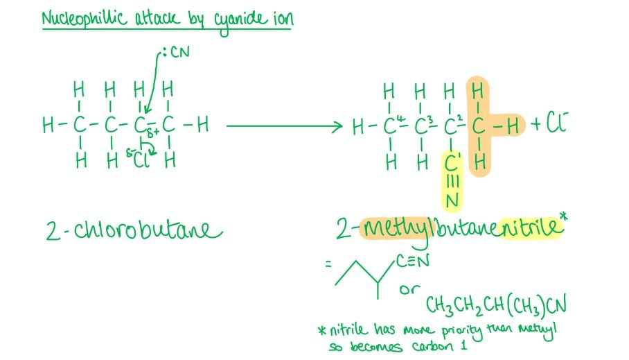

**A** is incorrect as CN- is not an **electrophile**, which is an electron pair acceptor.

**B** is incorrect as a free radical substitution reaction is the reaction in which **halogen atoms** (not CN-) replace **hydrogen atoms** in alkanes.

**C** is incorrect as the reaction is a substitution reaction, **not** an addition reaction.

### Q14
**Final answer:** **The correct answer is D**

- A **nucleophilic substitution** reaction is one in which a **nucleophile** replaces another nucleophile.

  - A **nucleophile** is a species which can **donate** a pair of electrons.
- The reaction of halogenoalkanes with cyanide ions, CN-, is an example of a **nucleophilic substitution** reaction.
- The cyanide ion (CN-) in this reaction is the **nucleophile** and **replaces** the **bromine atom** in bromopropane to give butanenitrile.
- The reaction of the halogenoalkane with cyanide ions (CN-) will add an extra carbon atom to the carbon chain.

  - '-**propane**' changes into '**butane**-' as there are now four carbon atoms in the carbon chain instead of three.
- The reaction should be carried out with KCN (to provide the **nucleophile** which is the cyanide ion) in ethanol (also known as **ethanolic solution of potassium cyanide**) which is then **heated** under reflux with the 1-bromopropane.

**A** is incorrect as ethanol and heat alone do not provide the cyanide ion (CN-) needed for the nucleophilic substitution reaction.

**B** is incorrect as KCN alone does not provide the correct conditions. Ethanol (as solvent) and heat under reflux are also required.

**C** is incorrect as KCN and ethanol are necessary but heat under reflux is also required to drive the nucleophilic substitution reaction.

### Q15
**Final answer:** **The correct answer is D**

- To produce nitriles from aldehydes and ketones, **hydrogen cyanide** should be used.
- The reagent in option D should have been **hydrogen cyanide** and not ammonia.

**A, B** & **C** are incorrect as these are all correct combinations of reactants and reagents.

## Structured Questions (7 questions)

### Q1
i) The displayed formula of the organic product is:

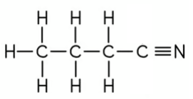

**[1 mark]**

> **[mark-scheme]**
> ii) The systematic name of this organic product is:
> 
> - Butanenitrile **[1 mark]**

> **[exam-tip]**
> When halogenoalkanes react with KCN, or NaCN, in ethanol, a nitrile is formed.
> 
> Nitriles have the organic functional group –CN.
> 
> Remember: there is a triple bond between the C and N atoms in the nitrile group.
> 
> When naming the organic product, don't forget the C atom in the nitrile group. The most common mistake is to give the name as propanenitrile.
> **[mark-scheme]**
> This reaction is useful to chemists during the synthesis of other organic compounds because:
> 
> - It lengthens the carbon chain / forms a C–C bond **[1 mark]**

> **[exam-tip]**
> This reaction is of particular importance as it forms a carbon-carbon bond which can lengthen the carbon chain.
> 
> This is useful as new compounds can be synthesised which have more carbon atoms.
> 
> Sometimes, an organic compound may not be easily available as a raw material, but another organic compound with one less carbon atom may be readily available.
> 
> If this compound with one less carbon atom is made into a halogenoalkane and then refluxed with ethanolic KCN, a nitrile can be made with the desired number of carbon atoms which can undergo further synthesis.
> **[mark-scheme]**
> i) The equation for the acid hydrolysis of CH3CH2CH2CN is:
> 
> - CH3CH2CH2CN + HCl + 2H2O → CH3CH2CH2COOH + NH4Cl **[1 mark]**

ii) The displayed formula of the intermediate formed when CH3CH2CH2CN is hydrolysed by sodium hydroxide is:

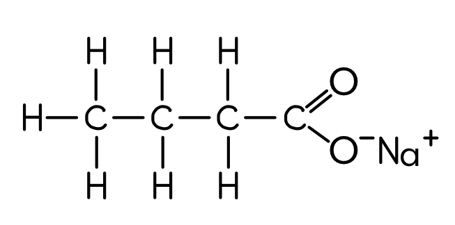

**[1 mark]**

> **[mark-scheme]**
> 1 mark for correct displayed formula of sodium butanoate

> **[exam-tip]**
> Hydrolysis of nitriles can occur either by dilute acid or dilute alkali followed by acidification.
> 
> A carboxylic acid is the product in both cases, but when hydrolysed by dilute alkali, a carboxylate salt is the intermediate which requires acidification to form the carboxylic acid.
> 
> Alkali hydrolysis:
> 
> CH3CH2CH2CN + NaOH + 2H2O → CH3CH2CH2COO–Na+ + NH3
> 
> Acidification of sodium butanoate produces the carboxylic acid CH3CH2CH2COOH.
> 
> Unlike the formation of nitriles (which adds a carbon atom to the carbon chain), hydrolysis does not change the number of carbon atoms.

### Q2
> **[mark-scheme]**
> The number of sigma (σ) and pi (π) bonds in 2-hydroxy-2-phenylpropanenitrile are:
> 
> - Sigma = 20 **[1 mark]**
> - Pi = 5 **[1 mark]**

> **[exam-tip]**
> It is easy to miss sigma bonds in this structure because some are not explicitly shown. They are contained within the CH3 and OH groups, and there are 5 hidden hydrogen atoms in the phenyl ring.
> 
> Re-draw the molecule showing all hidden hydrogen atoms and all bonds within CH3 and OH groups to make counting easier.
> 
> Remember:
> 
> - Single bonds are sigma bonds
> - Double bonds are one sigma bond and one pi bond
> - Triple bonds are one sigma bond and two pi bonds
> 
> There are 20 sigma bonds in total.
> 
> There are 3 double bonds (one pi bond each) and 1 triple bond (two pi bonds), giving 5 pi bonds in total.
> **[mark-scheme]**
> The number of sp, sp2 and sp3 hybridised carbon atoms in 2-hydroxy-2-phenylpropanenitrile are:
> 
> - sp = 1
> **AND**
> sp2 = 6
> **AND**
> sp3 = 2 **[1 mark]**

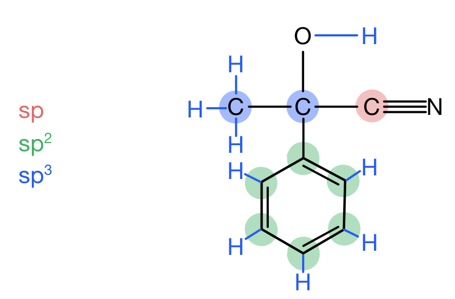

> **[exam-tip]**
> Each carbon with tetrahedral geometry (the central quaternary carbon and the methyl carbon) has sp3 hybridised orbitals.
> **[mark-scheme]**
> The reagents and conditions required for step 1 are:
> 
> - Reagents: Acidified potassium dichromate **OR** K2Cr2O7 **AND** H+ / H2SO4
> **OR**
> Acidified potassium manganate **OR** KMnO4 **AND** H+ / H2SO4 **[1 mark]**
> - Conditions: Heat **[1 mark]**
> 
> The reagents and conditions required for step 2 are:
> 
> - Reagents: HCN and KCN (as a catalyst) **[1 mark]**
> - Conditions: Heat **[1 mark]**

> **[exam-tip]**
> This type of question shows how important it is to know the different routes of organic synthesis and the reagents and conditions for each.
> 
> A hydroxynitrile is synthesised from an aldehyde or ketone by nucleophilic addition with HCN. HCN is produced in situ by the reaction of KCN and dilute sulfuric acid.
> 
> 2-hydroxy-2-phenylpropanenitrile is produced from a ketone (compound Y), so compound X is a secondary alcohol which is oxidised in step 1.
> 
> Distillation is not required as further oxidation of the ketone cannot occur.
i) The mechanism for the second step in the synthesis of 2-hydroxy-2-phenylpropanenitrile is:

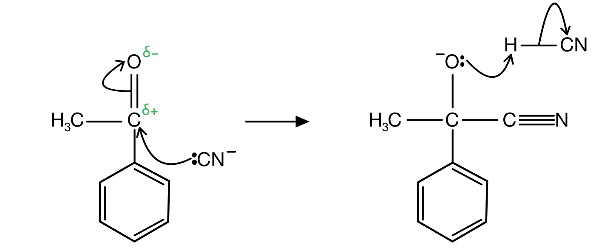

**[4 marks]**

> **[mark-scheme]**
> 1 mark for correct structure of compound **Y**
> 
> 1 mark for curly arrow from lone pair on C of :CN– to δ+ C atom
> 
> 1 mark for curly arrow from C=O bond to δ– O atom **AND** correct structure of intermediate including negative charge on O atom
> 
> 1 mark for curly arrow from lone pair on O atom to H of HCN **AND** curly arrow from H–CN bond to C atom

ii) The structure of compound **X** is:

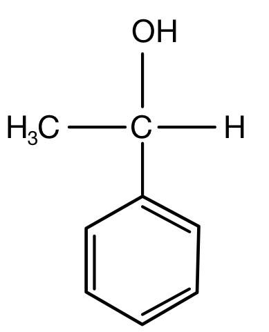

**[1 mark]**

> **[mark-scheme]**
> 1 mark for correct structure of compound **X**

> **[exam-tip]**
> Remember: the carbon chain lengthens when this hydroxynitrile is produced, so compound Y has one less carbon than the product.
> 
> Show all lone pairs and charges (both full and partial). You do not need to show the end product in the mechanism.
> 
> The CN– ions come from KCN and are regenerated, so KCN acts as a catalyst.
> 
> Compound X is a secondary alcohol. Draw it by replacing the C=O of compound Y with C–OH and adding an H to both the O and the adjacent carbon.

### Q3
The skeletal formula of 2,2-dimethylpentanenitrile is:

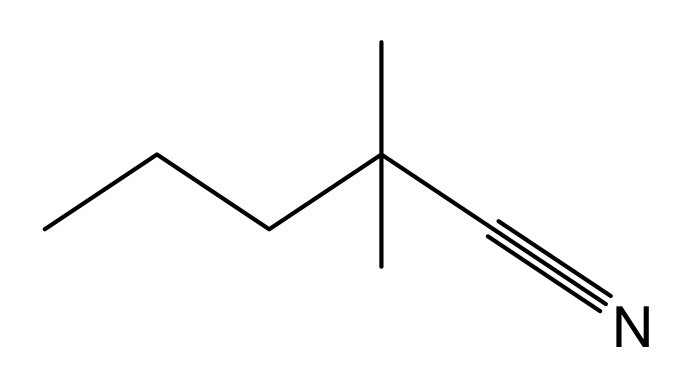

**[1 mark]**

> **[mark-scheme]**
> 1 mark for correct skeletal formula of 2,2-dimethylpentanenitrile

> **[exam-tip]**
> To draw the skeletal formula:
> 
> 1. Draw the straight chain for pentane (5 carbons)
> 2. Add the nitrile functional group (C≡N) on carbon 1
> 
>   - This carbon is part of the carbon chain
> 3. Add two methyl groups on carbon 2
> 
> A common mistake is to add the nitrile group in addition to five chain carbons. The nitrile carbon is carbon 1 and is counted as part of the pentane chain.
> **[mark-scheme]**
> An equation for the acid hydrolysis of 2,2-dimethylpentanenitrile is:
> 
> - CH3(CH2)2C(CH3)2CN + HCl + 2H2O → CH3(CH2)2C(CH3)2COOH + NH4Cl **[1 mark]**

> **[exam-tip]**
> Hydrolysis is the breakdown of a compound using water, so include water as a reactant.
> 
> Acid hydrolysis of a nitrile forms a carboxylic acid and an ammonium salt. In this case: 2,2-dimethylpentanoic acid and ammonium chloride.
> 
> You would also obtain the mark if you had drawn the displayed formula of 2,2-dimethylpentanenitrile and the organic product.
i) The fully displayed formula of the intermediate organic product is:

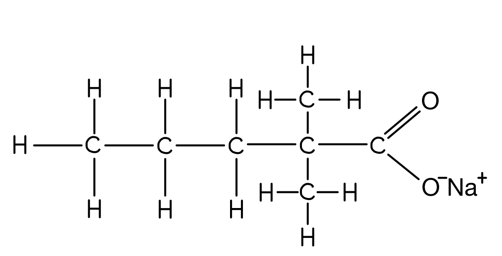

**[1 mark]**

> **[mark-scheme]**
> ii) The other product formed with this intermediate is:
> 
> - Ammonia / NH3 **[1 mark]**
> 
> iii) The type of reaction required to produce 2,2-dimethylpentanoic acid from this intermediate is:
> 
> - Acidification **[1 mark]**

> **[exam-tip]**
> Sodium hydroxide is an alkali, so alkali hydrolysis occurs.
> 
> Hydrolysis by dilute alkali forms a sodium carboxylate salt and ammonia.
> 
> Acidification is required to convert the carboxylate ion into a carboxylic acid.

### Q4
> **[mark-scheme]**
> The systematic name of this hydroxynitrile is:
> 
> - 2-hydroxybutanenitrile **[1 mark]**

> **[exam-tip]**
> The longest carbon chain is four carbons long, and there is a nitrile group on the first carbon, so the name contains ‘butanenitrile’.
> 
> There is a hydroxy group on the second carbon, giving the prefix 2-hydroxy.
> 
> This gives the full name 2-hydroxybutanenitrile.
> 
> A common mistake is to overlook the carbon of the nitrile group and give the name as 2-hydroxypropanenitrile.
The completed reaction mechanism for the reaction between propanal and the cyanide ion is:

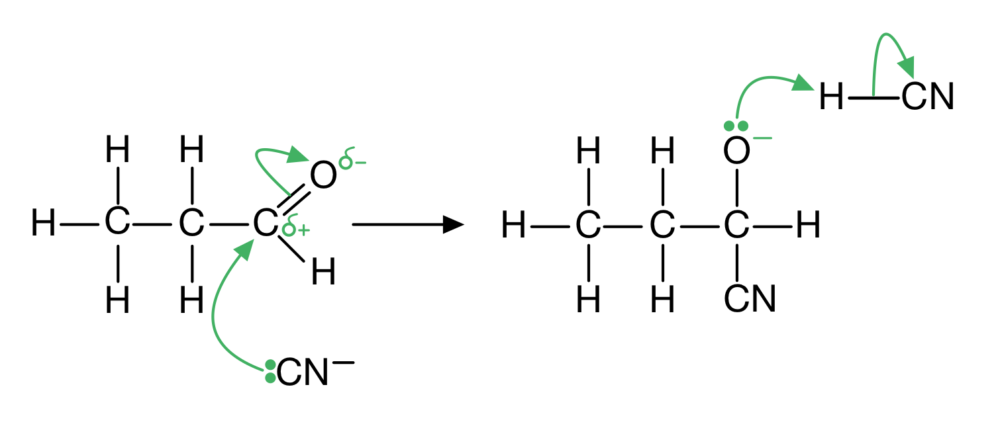

**[4 marks]**

> **[mark-scheme]**
> 1 mark for lone pair of electrons on the C of CN– **AND** curly arrow from the lone pair to the δ+ C atom
> 
> 1 mark for curly arrow from C=O bond to the δ– O atom
> 
> 1 mark for lone pair **AND** negative charge shown on the O atom of the intermediate **AND** curly arrow from the lone pair to H of HCN
> 
> 1 mark for curly arrow from H–CN bond to the C atom

> **[exam-tip]**
> You must show the dipole on the C=O bond by adding partial charges δ+ and δ–.
> 
> The :CN– ion is a nucleophile and attacks the δ+ C atom, forming a dative covalent bond. The C=O breaks by heterolytic fission, forming a negatively charged intermediate.
> 
> The negatively charged oxygen in the intermediate reacts with H+ from HCN (or from dilute acid or water present in the reaction mixture).
> 
> Remember: curly arrows show the transfer of pairs of electrons and should start from a lone pair or from a bond.
> **[mark-scheme]**
> The type of reaction mechanism shown in Fig. 2.2 is:
> 
> - Nucleophilic addition **[1 mark]**

> **[exam-tip]**
> The lone pair of electrons on the :CN– ion is attracted to the partially positive carbon atom of the C=O bond, acting as a nucleophile.
> 
> Aldehydes undergo addition reactions because they contain a C=O bond which can break, allowing another species to be added to it.

### Q5
> **[mark-scheme]**
> The species which acts as the nucleophile during this reaction is:
> 
> - CN– / :CN– / the cyanide ion **[1 mark]**
> - (Because) it has a lone pair / is a lone pair donor **[1 mark]**

> **[exam-tip]**
> Remember: a nucleophile is a species that is attracted to areas of (partial) positive charge.
> 
> This means they are an electron-rich species that is able to donate a pair of electrons.
> 
> The NaCN consists of Na+ and CN– ions. The CN– ion has an available lone pair, which makes it the nucleophile in this reaction.
The mechanism for the second step involving the intermediate reacting with HCN to form 2-hydroxybutanenitrile is:

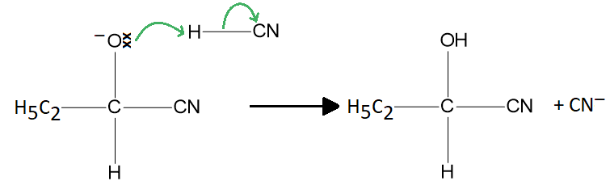

**[3 marks]**

> **[mark-scheme]**
> 1 mark for correct intermediate drawn including negative charge **AND** lone pair on the oxygen atom
> 
> 1 mark for curly arrow from the oxygen lone pair to the hydrogen atom (of HCN)
> 
> 1 mark for curly arrow from H–C bond (of HCN) to the carbon atom

> **[exam-tip]**
> This question focuses on the second half of the full nucleophilic addition mechanism. A sound understanding of both steps is required.
> 
> The negative charge is technically on the carbon atom, but it is accepted to have the negative charge associated with the whole ion.
> 
> Part (a) established that CN– is the nucleophile for the first step; this part requires the intermediate to be drawn correctly before applying the second step curly arrows.
> **[mark-scheme]**
> The bond angles **a** and **b** are:
> 
> - **a** = 109.5° **[1 mark]**
> - **b** = 180° **[1 mark]**

> **[exam-tip]**
> Bond **a** is one of four bonds on a carbon with four bonding pairs of electrons (tetrahedral geometry), giving a bond angle of 109.5°.
> 
> Bond **b** is part of the C≡N triple bond. The nitrile carbon has 2 regions of electron density (the triple bond counts as 1 region and there are no lone pairs on this carbon), giving a linear geometry and a bond angle of 180°.
> **[mark-scheme]**
> i) The type of stereoisomerism shown by 2-hydroxybutanenitrile is:
> 
> - Optical (isomerism) **[1 mark]**

ii) One example of the pair of stereoisomers is:

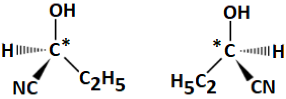

**[3 marks]**

> **[mark-scheme]**
> 1 mark for one correct 3-D structure
> 
> 1 mark for the mirror image of the first structure
> **OR**
> the same diagram with two groups swapped
> 
> 1 mark for the chiral carbon correctly labelled on one of the diagrams

> **[exam-tip]**
> First identify the chiral carbon, which has four different atoms or groups of atoms around it.
> 
> 2-hydroxybutanenitrile has an OH group, CN group, H atom, and C2H5 group around the chiral carbon.
> 
> Apply these four groups to a tetrahedral 3-D structure to get one optical isomer, then draw its mirror image for the second structure.

### Q6
> **[mark-scheme]**
> The reagents and solvents for reactions 1, 2 and 3 are:
> 
> Reaction 1:
> 
> - Reagent: NaOH / sodium hydroxide
> **OR**
> KOH / potassium hydroxide **[1 mark]**
> - Solvent: H2O / water / aqueous **[1 mark]**
> 
> Reaction 2:
> 
> - Reagent: NH3 / ammonia **[1 mark]**
> - Solvent: C2H5OH / ethanol / alcohol **[1 mark]**
> 
> Reaction 3:
> 
> - Reagent: NaCN / sodium cyanide
> **OR**
> KCN / potassium cyanide **[1 mark]**
> - Solvent: C2H5OH / ethanol / alcohol **[1 mark]**

> **[exam-tip]**
> There are often marks for reagents, solvents, and conditions of organic reactions, so make sure you know them.
> **[mark-scheme]**
> The alternative solvents and products for reactions 1 and 3 are:
> 
> Reaction 1:
> 
> - Alternative solvent: C2H5OH / ethanol / alcohol **[1 mark]**
> - Alternative product: C2H4 / ethene **[1 mark]**
> 
> Reaction 3:
> 
> - Alternative solvent: H2O / water / aqueous **[1 mark]**
> - Alternative product: C2H5OH / ethanol **[1 mark]**

> **[exam-tip]**
> This type of question is more commonly asked about reaction 1, but the same principle applies to reaction 3.
> 
> The use of solvent affects the outcome of the reaction.
> 
> In reaction 1: using water as the solvent gives nucleophilic substitution to form an alcohol. Using ethanol as the solvent gives an elimination reaction to form an alkene.
> 
> In reaction 3: using ethanol as the solvent allows CN– to act as the nucleophile, giving nitrile formation. Using water as the solvent gives nucleophilic substitution to form an alcohol instead.
> **[mark-scheme]**
> i) The name of the compound CH3CN is:
> 
> - Ethanenitrile **[1 mark]**
> 
> ii) The type of reaction used to form CH3CN is:
> 
> - Oxidation
> **OR**
> Dehydrogenation **[1 mark]**

> **[exam-tip]**
> To name CH3CN: the CH3C portion has two carbon atoms (ethane-based), and CN indicates a nitrile group, so the name is ethanenitrile.
> 
> Nitrile compounds are often named incorrectly because the nitrile carbon is overlooked.
> 
> Ethylamine, CH3CH2NH2, has lost four hydrogen atoms to become CH3CN (ethanenitrile).
> 
> Loss of hydrogen can be described as oxidation or dehydrogenation.
> **[mark-scheme]**
> Comparing the two types of hydrolysis for producing propanoic acid from the product of reaction 3:
> 
> - (The two types of hydrolysis are) acid hydrolysis
> **AND**
> Alkali(ne) hydrolysis **[1 mark]**
> - Acid hydrolysis forms propanoic acid in one step / reaction
> **AND**
> Alkali(ne) hydrolysis forms propanoic acid in two steps / reactions **[1 mark]**
> - Acid hydrolysis forms an ammonium salt / named ammonium salt
> **AND**
> Alkali(ne) hydrolysis forms ammonia **[1 mark]**
> - Both types of hydrolysis require water / aqueous solutions **[1 mark]**
> - Both types of hydrolysis involve acid
> **OR**
> Alkali(ne) hydrolysis also requires acid to acidify the (metal / sodium) carboxylate salt **[1 mark]**

> **[exam-tip]**
> You can score the first mark by talking about acid and alkaline hydrolysis in your answer. They do not need to be seen as two separate bullet points.
> 
> Remember: the command word ‘compare’ means discuss both similarities and differences.

### Q7
> **[mark-scheme]**
> i) The reagents and conditions required for reaction 1 are:
> 
> - Heated under reflux **[1 mark]**
> - With a solution of sodium cyanide / NaCN in ethanol
> **OR**
> With a solution of potassium cyanide / KCN in ethanol **[1 mark]**
> 
> ii) The identity of the halogenoalkane that student **B** uses is:
> 
> - 1-chloropropane
> **OR**
> 1-fluoropropane **[1 mark]**
> - (Because) the carbon-chlorine / C–Cl bond is stronger than the carbon-bromine / C–Br bond
> **OR**
> (Because) the carbon-fluorine / C–F bond is stronger than the carbon-bromine / C–Br bond
> **OR**
> (Because) the reactivity of halogenoalkanes increases as you move down the halogens
> **OR**
> (Because) the halogenoalkanes above bromopropane are less reactive / react more slowly **[1 mark]**

> **[exam-tip]**
> You must state that the sodium cyanide (or potassium cyanide) is in ethanol / alcoholic conditions. If it is in water, a different reaction takes place (aqueous KCN gives an alcohol, not a nitrile).
> 
> The reactivity of halogenoalkanes increases as you move down the halogens because the carbon-halogen bond becomes weaker as the halogen becomes less electronegative.
> **[mark-scheme]**
> i) The type of reaction occurring in reaction 2 is:
> 
> - Acid hydrolysis **[1 mark]**
> 
> ii) An appropriate reagent for reaction 2 and the other product of the reaction are:
> 
> - Hydrochloric acid / HCl 
> **OR** 
> Sulfuric acid / H2SO4 
> **OR** 
> Nitric acid / HNO3 **[1 mark]**
> - Corresponding ammonium salt: ammonium chloride / NH4Cl 
> **OR** 
> Ammonium sulfate / (NH4)2SO4 
> **OR** 
> Ammonium nitrate / NH4NO3 **[1 mark]**
> 
> The ammonium salt must correspond to the acid stated.

> **[exam-tip]**
> Reaction 2 is acid hydrolysis, which forms the carboxylic acid and an ammonium salt . The specific ammonium salt depends on the acid used.
> 
> Reaction 3 is alkaline hydrolysis and reaction 4 is acidification. Together, reactions 3 and 4 also produce butanoic acid.
> **[mark-scheme]**
> The structural formula of **Q** is:
> 
> - CH3CH2CH2COONa
> **OR**
> CH3(CH2)2COONa
> **OR**
> CH3CH2CH2COO– Na+
> **OR**
> CH3(CH2)2COO– Na+ **[1 mark]**

> **[exam-tip]**
> Alkaline hydrolysis of a nitrile forms the carboxylate salt and ammonia.
> 
> The carboxylate salt is then acidified to form the carboxylic acid.
> **[mark-scheme]**
> It is likely that student **A** will have a higher overall yield of butanoic acid because:
> 
> - Student **A** completes the preparation in fewer steps than student **B** (two steps vs three steps)
> **AND**
> some product is lost during each step, so student **A** loses less product overall **[1 mark]**

> **[exam-tip]**
> It is rare for any chemical reaction to have a 100% yield as some product is often lost at each step.
> 
> Without further information, yield can only be discussed qualitatively.
> 
> As a rough illustration: if you start with 10 g and lose 1 g per step, student A has 10 − 1 − 1 = 8 g while student B has 10 − 1 − 1 − 1 = 7 g.
