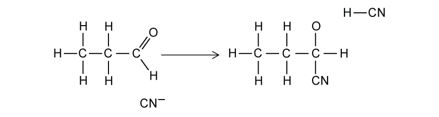
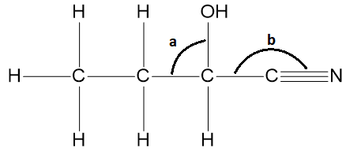
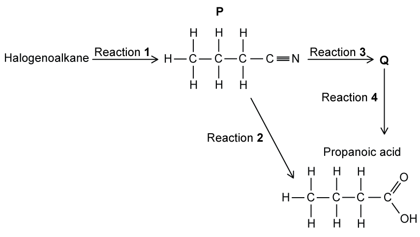

# Exam Questions — Nitriles & Hydroxynitriles
**19. Nitrogen Compounds** · Cambridge (CIE) AS chemistry (9701)
> Source: [https://www.savemyexams.com/as/chemistry/cie/25/topic-questions/](https://www.savemyexams.com/as/chemistry/cie/25/topic-questions/) · 22 questions across 2 sets

## Multiple Choice Questions (15 questions)

### Q1 — medium — 1 marks

**Q1** [1 mark]

The reaction scheme shows a two-step synthesis starting from butanenitrile.

CH3CH2CH2CN $\overset{\text{step 1}}{\rightarrow}$  **X**  $\overset{\text{step 2}}{\rightarrow}$ CH3CH2CH2COOH

Which row identifies the reagents and conditions for step 1 and step 2?

|   | Step 1 | Step 2 |
|---|---|---|
| **A** | Heat with dilute HCl under reflux | Neutralisation with NaOH |
| **B** | Heat with aqueous NaOH under reflux | Acidification with dilute HCl |
| **C** | Heat with LiAlH4 in dry ether | Oxidation with acidified K2Cr2O7 |
| **D** | Heat with dilute H2SO4 under reflux | Distillation |

### Q2 — easy — 1 marks

**Q2** [1 mark]

Which one of the following reactants would **not** produce a nitrile in a one-step reaction?

### Q3 — medium — 1 marks

**Q3** [1 mark]

The following equations show reactions with nitrogen compounds. Which one correctly shows the hydrolysis of nitriles with dilute sodium hydroxide?

### Q4 — hard — 1 marks

**Q4** [1 mark]

The reaction sequence shows the two-step synthesis for the production of 2-hydroxybutanenitrile from propan-1-ol.

CH3CH2CH2OH $\overset{\text{step 1}}{\rightarrow}$  **X**  $\overset{\text{step 2}}{\rightarrow}$ CH3CH2CHOHCN

Which set of reagents and conditions correctly completes **Step 1** and **Step 2**?

|   | Step 1 | Step 2 |
|---|---|---|
| **A** | K2Cr2O7 / H2SO4 under distillation | NaCN (aq) / H+ (aq) |
| **B** | NaCl / H2SO4 | NaCN / Ethanol |
| **C** | NaCN (aq) / H+ (aq) | K2Cr2O7 / H2SO4 under distillation |
| **D** | NaCN / Ethanol | NaCl / H2SO4 |

### Q5 — easy — 1 marks

**Q5** [1 mark]

Hydrolysis of CH3CH2CN with dilute HCl produces which compound?

### Q6 — hard — 1 marks

**Q6** [1 mark]

What would **X, Y** and **Z** be in the following reaction sequence?

CH3CH2CH2Br $\overset{\text{KCN + ethanol + heat}}{\rightarrow}$ **X** + KBr $\overset{\text{NaOH + H}_{2}\text{O + heat}}{\rightarrow}$ **Y** + NH3 $\overset{\text{dil HCl}}{\rightarrow}$ **Z**

|   | **X** | **Y** | **Z** |
|---|---|---|---|
| **A** | CH3CH2CH2K | CH3CH2CH2COONa | CH3CH2CH2COOH |
| **B** | CH3CH2CH2CN | CH3CH2CH2COONa | CH3CH2CH2COOH |
| **C** | CH3CH2CH2K | CH3CH2CH2COOH | CH3CH2CH2COONa |
| **D** | CH3CH2CH2CN | CH3CH2CH2COOH | CH3CH2CH2COONa |

### Q7 — easy — 1 marks

**Q7** [1 mark]

What are the products in the reaction of ethanenitrile and sodium hydroxide?

### Q8 — medium — 1 marks

**Q8** [1 mark]

The following equations show reactions with nitrogen compounds. Which one correctly shows the hydrolysis of nitriles with dilute acid?

### Q9 — hard — 1 marks

**Q9** [1 mark]

Butanone can undergo addition when mixed with NaCN (aq) / H+ (aq), forming product **Z**. Product **Z** can then undergo hydrolysis when heated with dilute HCl, forming product **Y**.

Which compound is product Y?

### Q10 — easy — 1 marks

**Q10** [1 mark]

What are the products when ethanenitrile is heated under reflux with dilute hydrochloric acid?

### Q11 — medium — 1 marks

**Q11** [1 mark]

Which of the following reactions would produce 2-hydroxy-2-methylpropanenitrile?

### Q12 — hard — 1 marks

**Q12** [1 mark]

Which row in the table gives the correct type of reaction, reactants and reagents to produce a hydroxynitrile?

|   | **Type of reaction** | **Reactants** | **Reagents** |
|---|---|---|---|
| **A** | Addition | Aldehyde | HCN |
| **B** | Hydrolysis | Halogenoalkane | Ethanolic NH3 |
| **C** | Substitution | Ketone | HCN |
| **D** | Addition | Halogenoalkane | KCN, ethanol |

### Q13 — easy — 1 marks

**Q13** [1 mark]

The equation shows a chemical reaction

CH3CH2CHClCH3  +  CN–  →  CH3CH2CH(CH3)CN  +  Cl–

What is the name for this type of reaction?

### Q14 — easy — 1 marks

**Q14** [1 mark]

What are the reagents needed in the reaction of 1-bromopropane to butanenitrile?

### Q15 — medium — 1 marks

**Q15** [1 mark]

Which row does **not** identify a correct combination of reactant and reagent to produce a nitrile?

|   | **Reactant** | **Reagent** |
|---|---|---|
| **A** | Halogenoalkane | Potassium cyanide and ethanol |
| **B** | Amide | Phosphorus(V) oxide |
| **C** | Aldehyde | Hydrogen cyanide |
| **D** | Ketone | Ammonia |

## Structured Questions (7 questions)

### Q1 — easy — 5 marks

**Q1** [2 marks]

When 1-chloropropane is heated under reflux with ethanolic potassium cyanide, KCN, the following reaction occurs.

CH3CH2CH2Cl + KCN → CH3CH2CH2CN + KCl

i) Draw the displayed formula of the organic product formed in this reaction.

[1]

ii) State the systematic name of this organic product.

[1]

**Q1** [1 mark]

**Extract:**

When 1-chloropropane is heated under reflux with ethanolic potassium cyanide, KCN, the following reaction occurs.

CH~3~CH~2~CH~2~Cl + KCN → CH~3~CH~2~CH~2~CN + KCl

Suggest why this reaction is useful to chemists during the synthesis of other organic compounds.

**Q1** [2 marks]

The CH3CH2CH2CN can undergo hydrolysis.

i) Construct an equation for the acid hydrolysis of CH3CH2CH2CN.

[2]

ii) Draw the displayed formula of the intermediate formed when CH3CH2CH2CN is hydrolysed by sodium hydroxide.

[1]

### Q2 — hard — 12 marks

**Q2** [2 marks]

2-hydroxy-2-phenylpropanenitrile is shown in Fig. 1.1.

**Fig. 1.1**

Deduce the number of sigma (σ) and pi (π) bonds in 2-hydroxy-2-phenylpropanenitrile.

sigma ..............................

pi ..............................

**Q2** [1 mark]

**Extract:**

2-hydroxy-2-phenylpropanenitrile is shown in Fig. 1.1.

A molecule of 2-hydroxy-2-phenylpropanenitrile contains sp, sp2 and sp3 hybridised carbon atoms.

State the number of sp, sp2 and sp3 hybridised carbon atoms in a molecule of 2-hydroxy-2-phenylpropanenitrile.

**Q2** [4 marks]

2-hydroxy-2-phenylpropanenitrile can be produced from compound **X**, a secondary alcohol, in a two-step synthesis.

compound **X** $\overset{\mathrm{step}1}{\rightarrow}$ compound **Y** $\overset{\mathrm{step}2}{\rightarrow}$ 2-hydroxy-2-phenylpropanenitrile

State the reagents and conditions required for step 1 and step 2.

step 1

reagent ............................................................

conditions ............................................................

step 2

reagent ............................................................

conditions ............................................................

**Q2** [5 marks]

**Extract:**

2-hydroxy-2-phenylpropanenitrile is shown in Fig. 1.1.

2-hydroxy-2-phenylpropanenitrile can be produced from compound **X**, a secondary alcohol, in a two-step synthesis.

compound **X** → compound **Y** → 2-hydroxy-2-phenylpropanenitrile

The reagents and conditions required for step 2 are:
- Reagents: HCN and KCN (as a catalyst)
- Conditions: Heat

i) Draw the mechanism for the second step in the synthesis of 2-hydroxy-2-phenylpropanenitrile.

You should clearly show the structure of compound **Y** and any intermediate formed and include all relevant charges, partial charges, curly arrows and lone pairs.

[4]

ii) Draw the structure of compound **X**.

[1]

### Q3 — hard — 5 marks

**Q3** [1 mark]

2,2-dimethylpentanenitrile is useful in the synthesis of a variety of medicines and pharmaceuticals.

Draw the skeletal formula of 2,2-dimethylpentanenitrile.

**Q3** [1 mark]

2,2-dimethylpentanenitrile undergoes hydrolysis when heated with dilute hydrochloric acid.

Construct an equation for the hydrolysis of 2,2-dimethylpentanenitrile.

**Q3** [3 marks]

2,2-dimethylpentanoic acid can also be produced by the hydrolysis of 2,2-dimethylpentanenitrile using sodium hydroxide but this occurs in two steps.

i) Draw the fully displayed formula of the intermediate organic product.

[1]

ii) State the other product formed with this intermediate organic product.

[1]

iii) State the type of reaction that is required to produce 2,2-dimethylpentanoic acid from this intermediate organic product.

[1]

### Q4 — easy — 6 marks

**Q4** [1 mark]

This question is about hydroxynitriles.

The hydroxynitrile shown in Fig. 2.1 can be prepared from the reaction between propanal and hydrogen cyanide.

**Fig. 2.1**

Give the systematic name of this hydroxynitrile.

**Q4** [4 marks]

Using 'curly arrows', complete the reaction mechanism shown in Fig. 2.2 for the reaction between propanal and the cyanide ion, CN–.

Include any lone pairs of electrons and partial or whole charges.

**Fig. 2.2**

**Q4** [1 mark]

**Extract:**

Using 'curly arrows', complete the reaction mechanism shown in Fig. 2.2 for the reaction between propanal and the cyanide ion, CN⁻.

Include any lone pairs of electrons and partial or whole charges.

Name the type of reaction mechanism shown in Fig. 2.2.

### Q5 — medium — 11 marks

**Q5** [2 marks]

Propanal undergoes nucleophilic addition with a mixture of HCN and NaCN to make 2-hydroxybutanenitrile, CH3CH2CH(OH)CN.

The mechanism for this reaction occurs in two main steps. The first step involves a nucleophile attacking the carbonyl carbon of propanal.

Explain which species acts as the nucleophile during this reaction.

**Q5** [3 marks]

**Extract:**

Propanal undergoes nucleophilic addition with a mixture of HCN and NaCN to make 2-hydroxybutanenitrile, CH~3~CH~2~CH(OH)CN.

The mechanism for this reaction occurs in two main steps. The first step involves a nucleophile attacking the carbonyl carbon of propanal.

The second step in the mechanism involves an intermediate species, CH3CH2C(O)HCN–, reacting with HCN to form 2-hydroxybutanenitrile.

Draw the mechanism for this step.

- Identify the intermediate species that reacts with HCN.
- Include all charges, partial charges, lone pairs and curly arrows.

**Q5** [2 marks]

The structure of the 2-hydroxybutanenitrile product is shown in **Fig. 1.1**.

**Fig. 1.1**

Predict the values for the bond angles **a** and **b** shown in the diagram.

**Q5** [4 marks]

**Extract:**

Propanal undergoes nucleophilic addition with a mixture of HCN and NaCN to make 2-hydroxybutanenitrile, CH₃CH₂CH(OH)CN.

The product 2-hydroxybutanenitrile exists as a pair of stereoisomers.

i) Name the type of stereoisomerism shown by 2-hydroxybutanenitrile.

[1]

ii) Draw three-dimensional diagrams of this pair of stereoisomers. Indicate with an asterisk (*) the chiral centre on one of the structures drawn.

[3]

### Q6 — medium — 17 marks

**Q6** [6 marks]

Halogenoalkanes are often used as intermediates in organic reactions.

Three reactions of bromoethane, CH3CH2Br, are shown in **Fig. 3.1**.

**Fig. 3.1**

For each reaction, state the reagent and solvent used.

reaction 1

reagent ............................................................

solvent ............................................................

reaction 2

reagent ............................................................

solvent ............................................................

reaction 3

reagent ............................................................

solvent ............................................................

**Q6** [4 marks]

**Extract:**

Halogenoalkanes are often used as intermediates in organic reactions.

Three reactions of bromoethane, CH~3~CH~2~Br, are shown in **Fig. 3.1**.

{align=center} **Fig. 3.1**

Reactions 1 and 3 require specific reaction conditions to occur as shown in **Fig. 3.1**.

For each reaction, give another solvent and the alternative product that will be formed.

reaction 1

alternative solvent ............................................................

alternative product............................................................

reaction 3

alternative solvent ............................................................

alternative product............................................................

**Q6** [2 marks]

**Extract:**

Halogenoalkanes are often used as intermediates in organic reactions.

Three reactions of bromoethane, CH~3~CH~2~Br, are shown in **Fig. 3.1**.

Reaction 2:
- Reagent: NH~3~ / ammonia
- Solvent: C~2~H~5~OH / ethanol / alcohol
- Product: an amine (ethylamine, CH~3~CH~2~NH~2~)

The product of reaction 2 can be converted into CH3CN.

i) Name the compound CH3CN.

[1]

ii) Name the type of reaction used to form CH3CN.

[1]

**Q6** [5 marks]

**Extract:**

Halogenoalkanes are often used as intermediates in organic reactions.

Three reactions of bromoethane, CH~3~CH~2~Br, are shown in **Fig. 3.1**.

{align=center} **Fig. 3.1**

The product of reaction 3 can be used to produce propanoic acid by two different hydrolysis reactions.

Compare the two types of hydrolysis reaction in the production of propanoic acid from the product of reaction 3.

### Q7 — medium — 9 marks

**Q7** [4 marks]

Two students try to prepare butanoic acid from a halogenoalkane in the laboratory.

Both students perform a nucleophilic substitution reaction to form **P** in reaction 1 of **Fig. 2.1**.

They both form butanoic acid from **P** but student **A** uses a single reaction, while student **B** uses two reactions.

**Fig. 2.1**

i) State the reagents and conditions required for reaction 1.

[2]

ii) Student **A** uses 1-bromopropane to form **P**.

Student **B** uses a different halogenoalkane which forms **P** at a slower rate.

Suggest the identity of the halogenoalkane that student **B** uses. Explain your answer.

[2]

**Q7** [3 marks]

**Extract:**

Two students try to prepare butanoic acid from a halogenoalkane in the laboratory.

Both students perform a nucleophilic substitution reaction to form **P** in reaction 1 of **Fig. 2.1**.

They both form butanoic acid from **P** but student **A** uses a single reaction, while student **B** uses two reactions.

{align=center} **Fig. 2.1**

Student **A** converts **P **into butanoic acid in a single step, reaction 2.

i)  Name the type of reaction occurring in reaction 2.

[1]

ii) State an appropriate reagent for reaction 2 and name the other product of the reaction.

[2]

**Q7** [1 mark]

**Extract:**

Two students try to prepare butanoic acid from a halogenoalkane in the laboratory.

Both students perform a nucleophilic substitution reaction to form **P** in reaction 1 of **Fig. 2.1**.

They both form butanoic acid from **P** but student **A** uses a single reaction, while student **B** uses two reactions.

i) State the reagents and conditions required for reaction 1.

The reagents and conditions required for reaction 1 are:
- Heated under reflux
- With a solution of sodium cyanide / NaCN in ethanol OR With a solution of potassium cyanide / KCN in ethanol

Student **B** converts **P** into **Q** using dilute sodium hydroxide in reaction 3. This is followed by acidification of the product in reaction 4 to form butanoic acid.

Draw the structural formula of **Q**.

**Q7** [1 mark]

**Extract:**

Two students try to prepare butanoic acid from a halogenoalkane in the laboratory.

Both students perform a nucleophilic substitution reaction to form **P** in reaction 1 of **Fig. 2.1**.

They both form butanoic acid from **P** but student **A** uses a single reaction, while student **B** uses two reactions.

Explain why it is likely that student **A** will have a higher overall yield of butanoic acid from their halogenoalkane than student **B**.
