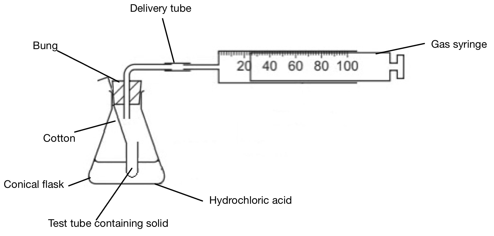
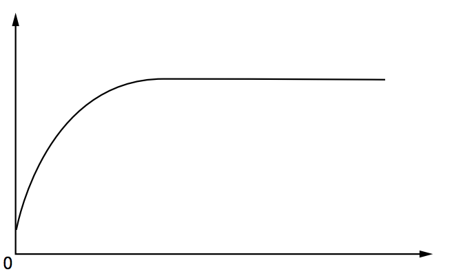
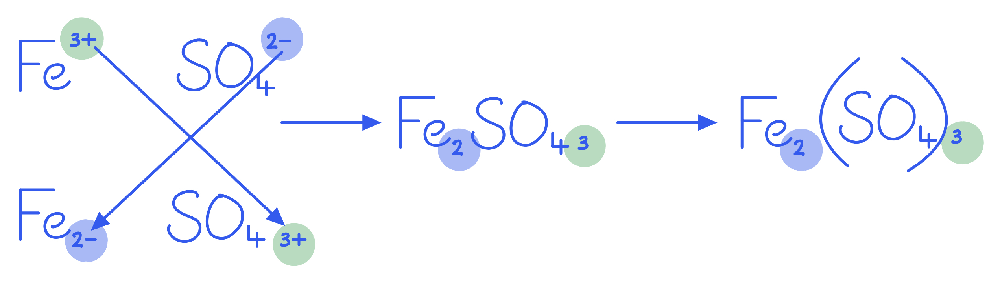
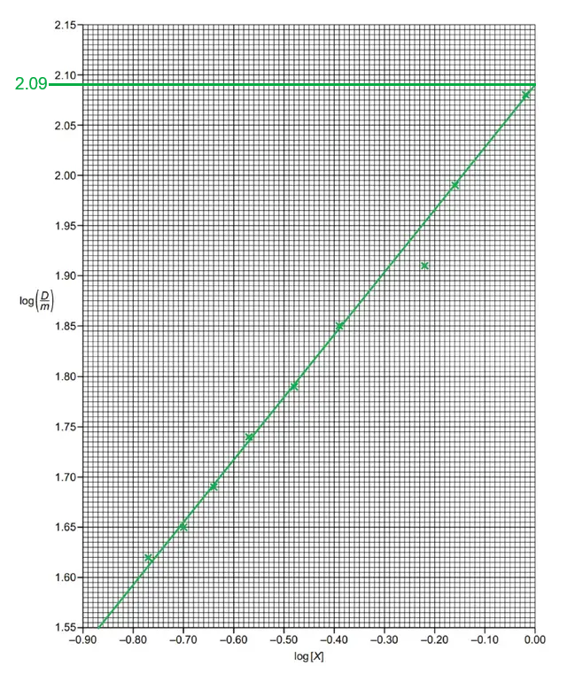

# Mark Schemes — Reacting Masses & Volumes (of Solutions & Gases)
**2. Atoms, Molecules & Stoichiometry** · Cambridge (CIE) AS chemistry (9701)

## Multiple Choice Questions (19 questions)

### Q1
**Final answer:** **The correct answer is B**

- Compounds with the same empirical formula share the same simplest ratio of atoms.
- This means the percentage by mass of each element must be identical, regardless of the molecular formula.

**A** is incorrect as compounds with the same empirical formula can have different molecular formulae and therefore different *M*r values.

**C** is incorrect as the integer multiplier used to convert an empirical formula to a molecular formula does not have to be the same for different compounds.

**D** is incorrect as different molecular formulae contain different numbers of atoms per molecule, so one mole of each compound contains a different total number of atoms.

### Q2
**Final answer:** **The correct answer is B**

- Calculate mass of nitrogen in 28 g of fertiliser:

mass of N = 28 x $\frac{15}{100}$

mass of N = 4.2 g

- Calculate moles of nitrogen:

moles = $\frac{\mathrm{mass}}{M_{r}}$

moles = $\frac{4.2}{14.0}$

moles = 0.30 mol

- Calculate concentration of nitrogen:

concentration = $\frac{\mathrm{moles}}{\mathrm{volume}}$

concentration = $\frac{0.30}{5}$

concentration = 0.060 mol dm-3

**A** is incorrect as 0.030 mol dm-3 uses the molar mass of N2 (28 g mol-1) instead of N atoms (14 g mol-1) when converting mass to moles.

**C** is incorrect as 0.40 mol dm-3 misses out the 15% mass fraction. Instead, it divides the total fertiliser mass directly by *M*r(N) and the volume without accounting for the nitrogen content.

**D** is incorrect as 0.84 mol dm-3 reports a mass concentration rather than a molar concentration, i.e. the mass of nitrogen (4.2 g) is divided by volume without first converting to moles.

### Q3
**Final answer:** **The correct answer is B**

- Balanced equation:

10Al + 3Ba(NO3)2 → 5Al2O3 + 3BaO + 3N2

- Calculate *M*r of Ba(NO3)2:

*M*r = 137.3 + 2(14.0) + 6(16.0) = 261.3 g mol-1

- Calculate moles of Ba(NO3)2:

moles = $\frac{\mathrm{mass}}{M_{r}}$

moles = $\frac{0.783}{261.3}$

moles of Ba(NO3)2 = 0.00300 mol

- From the equation, Ba(NO3)2 : N2 = 3:3 = 1:1:

moles of N2 = 0.00300 mol

- Calculate volume of N2 at r.t.p.:

volume = moles x molar volume

volume = 0.00300 x 24 000

volume = 72.0 cm3

**A** is incorrect as 1.62 cm3 results from a decimal point error in the moles calculation, giving a value approximately 44 times smaller than the correct number of moles.

**C** is incorrect as 93.6 cm3 results from using an incorrect molar mass for Ba(NO3)2, treating it as a single nitrate unit rather than the full barium dinitrate formula.

**D** is incorrect as 144.0 cm3 results from counting moles of nitrogen atoms rather than nitrogen molecules. Each Ba(NO3)2 contains 2 nitrogen atoms, but these combine to form 1 molecule of N2, not 2.

### Q4
**Final answer:** **The correct answer is C**

- Half-equations:

Sn2+ → Sn4+ + 2e-

MnO4- + 8H+ + 5e- → Mn2+ + 4H2O

- Balance electrons (×5 for Sn, ×2 for Mn) to give the overall equation:

5Sn2+ + 2MnO4- + 16H+ → 5Sn4+ + 2Mn2+ + 8H2O

- Calculate moles of Sn2+:

moles = $\frac{\mathrm{mass}}{M_{r}}$

moles = $\frac{9.5}{190}$

moles of Sn2+ = 0.050 mol

- From the 5:2 ratio (Sn2+ : Mn2+), calculate moles of Mn2+:

moles of Mn2+ = 0.050 x $\frac{2}{5}$

moles of Mn2+ = 0.020 mol

**A** is incorrect as 0.010 mol uses a 5:1 ratio, which results from treating Sn2+ as losing only 1 electron (Sn2+ → Sn3+) rather than the correct 2 electrons (Sn2+ → Sn4+).

**B** is incorrect as 0.015 mol results from an error in balancing the half-equations, giving an incorrect Sn to Mn mole ratio.

**D** is incorrect as 0.050 mol applies a 1:1 ratio of Sn2+ to Mn2+, ignoring the electron-balancing step that gives the 5:2 ratio.

### Q5
**Final answer:** **The correct answer is A**

- Convert volume to dm3:

500 cm3 = 0.500 dm3

- Calculate moles of O2:

moles = $\frac{\mathrm{volume}}{\mathrm{molar} \mathrm{volume}}$

moles = $\frac{0.500}{24.0}$

moles = 0.0208 mol

- Calculate number of molecules:

number of molecules = moles x L

number of molecules = 0.0208 x 6.02 x 1023

number of molecules = 1.25 x 1022

**B** is incorrect as 1.34 x 1022 uses the molar volume at s.t.p. (22.4 dm3 mol-1) rather than r.t.p. (24.0 dm3 mol-1).

**C** is incorrect as 2.51 x 1022 counts oxygen atoms rather than molecules. O2 has 2 atoms per molecule, giving double the correct value.

**D** is incorrect as 1.25 x 1025 uses 500 dm3 rather than the correct 0.500 dm3 (500 cm3 ÷ 1000).

### Q6
**Final answer:** **The correct answer is D**

- Balanced equation:

2Mg(NO3)2 (s) → 2MgO (s) + 4NO2 (g) + O2 (g)

- Calculate moles of Mg(NO3)2:

moles = $\frac{\mathrm{mass}}{M_{r}}$

moles = $\frac{7.4}{148.3}$

moles = 0.0499 mol

- From the equation, the ratio of Mg(NO3)2 to NO2 is 1:2:

moles of NO2 = 0.0499 x 2 = 0.0998 mol

- Calculate mass of NO2:

mass = moles x *M*r

mass = 0.0998 x 46.0

mass = 4.6 g

**A** is incorrect as 1.5 g uses the molar mass of NO (30 g mol-1) instead of NO2 (46 g mol-1), and applies a 1:1 mole ratio instead of 1:2.

**B** is incorrect as 2.3 g applies a 1:1 mole ratio of Mg(NO3)2 to NO2 rather than the correct 1:2 ratio from the equation.

**C** is incorrect as 3.0 g uses the molar mass of NO (30 g mol-1) instead of NO2 (46 g mol-1), though the 1:2 mole ratio is applied correctly.

### Q7
**Final answer:** **The correct answer is C**

- Combustion equations:

CH4 + 2O2 → CO2 + 2H2O

C2H6 + 3.5O2 → 2CO2 + 3H2O

- At 25 °C, water condenses to a liquid and contributes no gas volume
- Only CO2 is absorbed by aqueous KOH: CO2 + 2KOH → K2CO3 + H2O

- Volume of CO2 from CH4 (1 mol CH4 : 1 mol CO2):

volume of CO2 = 10 cm3

- Volume of CO2 from C2H6 (1 mol C2H6 : 2 mol CO2):

volume of CO2 = 10 x 2 = 20 cm3

- Total volume of gas absorbed by KOH:

total volume = 10 + 20 = 30 cm3

**A** is incorrect as 10 cm3 counts only the CO2 produced from methane, ignoring the 20 cm3 of CO2 produced from ethane.

**B** is incorrect as 20 cm3 counts only the CO2 produced from ethane, ignoring the 10 cm3 of CO2 produced from methane.

**D** is incorrect as 45 cm3 results from adding the CO2 from methane (10 cm3) to the volume of O2 consumed by ethane combustion (35 cm3), incorrectly treating O2 as a gas absorbed by KOH.

### Q8
**Final answer:** **The correct answer is D**

- Calculate moles of O2:

moles = $\frac{\mathrm{volume}}{\mathrm{molar} \mathrm{volume}}$

moles = $\frac{0.300}{24.0}$

moles of O2 = 0.0125 mol

- Test Group 1 (oxide M2O): 4M + O2 → 2M2O, so moles of metal = 4 x moles of O2:

moles of metal = 4 x 0.0125 = 0.050 mol

- Calculate *M*r of metal:

*M*r = $\frac{\mathrm{mass}}{\mathrm{moles}}$

*M*r = $\frac{1.15}{0.050}$

*M*r = 23 → sodium (Group 1)

- Test Group 2 (oxide MO): 2M + O2 → 2MO, so moles of metal = 2 x moles of O2:

moles of metal = 2 x 0.0125 = 0.025 mol

*M*r = 1.15 ÷ 0.025 = 46 → no matching Group 2 element

- The metal is sodium, *M*r = 23

**A** is incorrect as calcium has *M*r = 40, which does not match either calculated value (23 for Group 1 or 46 for Group 2).

**B** is incorrect as magnesium has *M*r = 24, which does not match the Group 2 calculated value of 46.

**C** is incorrect as potassium has *M*r = 39, which does not match the Group 1 calculated value of 23.

### Q9
**Final answer:** **The correct answer is A**

- Ion exchange: each Ca2+ in the sample is exchanged for 2H+ ions from the resin
- The H+ ions are then neutralised: H+ (aq) + KOH (aq) → K+ (aq) + H2O (l)

- Calculate moles of KOH:

moles = concentration x volume

moles = 1.0 x 10-2 x 0.025

moles of KOH = 2.5 x 10-4 mol

- Moles of H+ = moles of KOH = 2.5 x 10-4 mol

- From the Ca2+ : H+ exchange ratio of 1:2, calculate moles of Ca2+:

moles of Ca2+ = 2.5 x 10-4 ÷ 2 = 1.25 x 10-4 mol

- Calculate concentration of CaSO4:

concentration = $\frac{\mathrm{moles}}{\mathrm{volume}}$

concentration = $\frac{1.25\times10^{-4}}{0.050}$

concentration = 2.5 x 10-3 mol dm-3

**B** is incorrect as 1.0 x 10-2 mol dm-3 is the concentration of the KOH solution itself, not the CaSO4 concentration in the original sample.

**C** is incorrect as 2.0 x 10-2 mol dm-3 results from using the KOH titration volume (25 cm3) instead of the sample volume (50 cm3) in the concentration step.

**D** is incorrect as 4.0 x 10-2 mol dm-3 results from combining errors: using the Ca2+ to H+ ratio in reverse (doubling rather than halving) and applying the wrong volume.

### Q10
**Final answer:** **The correct answer is C**

- Reaction:

CH3CH2OH → CH3COOH (oxidation using excess acidified K2Cr2O7)

- Calculate moles of ethanol:

moles = $\frac{\mathrm{mass}}{M_{r}}$

moles = $\frac{2.76}{46.0}$

moles of ethanol = 0.0600 mol

- 1:1 molar ratio, so theoretical moles of ethanoic acid = 0.0600 mol
- Calculate theoretical mass of ethanoic acid:

theoretical mass = moles x *M*r

theoretical mass = 0.0600 x 60.0

theoretical mass = 3.60 g

- Apply the 75.0% yield:

actual mass = 3.60 x 0.750

actual mass = 2.70 g

**A** is incorrect as 1.98 g uses the molar mass of partial oxidation product ethanal (CH3CHO, *M*r = 44) rather than the full oxidation product ethanoic acid (*M*r = 60).

**B** is incorrect as 2.07 g multiplies the starting mass of ethanol directly by the percentage yield, without first converting to moles and calculating the theoretical product mass.

**D** is incorrect as 4.80 g divides the theoretical mass by the percentage yield rather than multiplying, inverting the yield calculation.

### Q11
**Final answer:** **The correct answer is A**

- Balanced equation:

2NaOH (aq) + Cl2 (g) → NaClO (aq) + NaCl (aq) + H2O (l)

- From the equation, 1 mol Cl2 produces 1 mol NaClO:

moles of NaClO = 0.125 mol

- Calculate *M*r of NaClO:

*M*r = 23.0 + 35.5 + 16.0 = 74.5 g mol-1

- Calculate mass of NaClO:

mass = moles x *M*r

mass = 0.125 x 74.5

mass = 9.31 g

**B** is incorrect as 13.3 g uses the molar mass of NaClO3 (106.5 g mol-1), the product of the reaction with hot concentrated NaOH, rather than NaClO from the cold reaction.

**C** is incorrect as 18.6 g doubles the moles of product to 0.250 mol, treating the ratio as 2 mol NaOH producing 2 mol NaClO rather than the correct 2:1 ratio.

**D** is incorrect as 26.6 g combines both errors: using the molar mass of NaClO3 (106.5 g mol-1) and double the moles (0.250 mol).

### Q12
**Final answer:** **The correct answer is A**

- Combustion reactions:

C + O2 → CO2

2C + O2 → 2CO

- CO2 is absorbed by excess NaOH:

CO2 + 2NaOH → Na2CO3 + H2O

- CO does not react with NaOH, so only CO remains after passing through the solution
- Calculate moles of CO produced:

moles = $\frac{\mathrm{mass}}{M_{r}}$

moles = $\frac{0.50}{12.0}$

moles of CO = 0.0417 mol

- Calculate volume of CO remaining:

volume = moles x molar volume

volume = 0.0417 x 24.0

volume = 1.0 dm3

**B** is incorrect as 1.5 dm3 arises from incorrectly including part of the CO2 volume. Only the CO that remains after absorption should be counted.

**C** is incorrect as 2 dm3 is the total volume of CO and CO2 produced before passing through NaOH, without accounting for the absorption of CO2.

**D** is incorrect as 3 dm3 results from including oxygen gas volumes alongside the carbon oxide products in the final calculation.

### Q13
**Final answer:** **The correct answer is B**

- Balanced equation:

PbCl4 + 2NaBr → PbCl2 + Br2 + 2NaCl

- Calculate *M*r of PbCl4:

*M*r = 207.2 + (4 x 35.5) = 349.2 g mol-1

- Calculate moles of PbCl4:

moles = $\frac{\mathrm{mass}}{M_{r}}$

moles = $\frac{6.980}{349.2}$

moles of PbCl4 = 0.0200 mol

- From the 1:1 ratio (PbCl4 : Br2):

moles of Br2 = 0.0200 mol

- Calculate mass of Br2:

mass = moles x *M*r

mass = 0.0200 x 159.8

mass = 3.196 g

**A** is incorrect as 0.799 g uses a 4:1 ratio of PbCl4 to Br2, as if each chloride in PbCl4 independently reduces one bromide without pairing to form Br2.

**C** is incorrect as 6.392 g uses a 1:2 ratio of PbCl4 to Br2, doubling the moles of Br2 produced.

**D** is incorrect as 1598 g results from using the relative atomic mass of bromine (79.9) rather than the molar mass of Br2 (159.8), then applying an incorrect factor of 1000.

### Q14
**Final answer:** **The correct answer is B**

- Reactions:

K2O + H2O → 2KOH and 2KOH + H2SO4 → K2SO4 + 2H2O

- Calculate moles of H2SO4:

moles = concentration x volume

moles = 2.00 x $\frac{15}{1000}$

moles of H2SO4 = 0.030 mol

- From the 2:1 ratio (KOH : H2SO4), calculate moles of KOH in the 25 cm3 aliquot:

moles of KOH = 0.030 x 2 = 0.060 mol

- Scale up to the full 250 cm3 solution:

moles of KOH = 0.060 x $\frac{250}{25}$ = 0.60 mol

- From K2O + H2O → 2KOH (ratio 1:2), calculate moles of K2O:

moles of K2O = $\frac{0.60}{2}$ = 0.30 mol

- Calculate mass of K2O:

mass = moles x *M*r

mass = 0.30 x 94.2

mass = 28.3 g

**A** is incorrect as 2.83 g uses only the 25 cm3 titration aliquot without scaling up to the full 250 cm3 solution.

**C** is incorrect as 47.1 g results from an error in the stoichiometric ratio between K2O and KOH in the dissolving step, leading to an incorrect number of moles of K2O.

**D** is incorrect as 56.6 g treats the K2O to KOH ratio as 1:1 rather than 1:2, using 0.60 mol K2O directly in the mass calculation.

### Q15
**Final answer:** **The correct answer is C**

- Calculate *M*r of Na2SO4:

*M*r = (2 x 23.0) + 32.1 + (4 x 16.0) = 142.1 g mol-1

- Calculate moles of Na2SO4:

moles = $\frac{\mathrm{mass}}{M_{r}}$

moles = $\frac{5.62}{142.1}$

moles = 0.0395 mol

- Convert volume to dm3:

250 cm3 = 0.250 dm3

- Calculate concentration:

concentration = $\frac{\mathrm{moles}}{\mathrm{volume}}$

concentration = $\frac{0.0395}{0.250}$

concentration = 0.158 mol dm-3

**A** is incorrect as 1.6 x 10-4 mol dm-3 results from dividing moles by 250 cm3 without first converting to dm3.

**B** is incorrect as 0.016 mol dm-3 results from using 2.50 dm3 instead of 0.250 dm3 as the volume.

**D** is incorrect as 0.61 mol dm-3 results from inverting the moles calculation, dividing *M*r by mass rather than mass by *M*r.

### Q16
**Final answer:** **The correct answer is B**

- Calculate moles of N2 at r.t.p.:

moles = $\frac{\mathrm{volume}}{\mathrm{molar} \mathrm{volume}}$

moles = $\frac{2.00}{24.0}$

moles = 0.0833 mol

- Apply the 15.0% yield to find moles that react:

moles of N2 that react = 0.0833 x 0.150 = 0.0125 mol

- From N2 + 3H2 → 2NH3, calculate moles of NH3:

moles of NH3 = 0.0125 x 2 = 0.0250 mol

- Calculate mass of NH3:

mass = moles x *M*r

mass = 0.0250 x 17.0

mass = 0.425 g

**A** is incorrect as 0.213 g uses a 1:1 molar ratio of N2 to NH3 rather than the correct 1:2 ratio from the equation.

**C** is incorrect as 0.455 g uses the molar volume at s.t.p. (22.4 dm3 mol-1) instead of r.t.p. (24.0 dm3 mol-1).

**D** is incorrect as 2.83 g does not apply the 15.0% yield, instead it assumes all of the nitrogen reacts to form ammonia.

### Q17
**Final answer:** **The correct answer is C**

- The compound reacts with water to give Al(OH)3 and CH4.

  - The methane burns completely to give CO2.

- Convert volume and calculate moles of CO2:

volume of CO2 = 72 ÷ 1000 = 0.072 dm3

moles = $\frac{\mathrm{volume}}{\mathrm{molar} \mathrm{volume}}$

moles = $\frac{0.072}{24.0}$

moles of CO2 = 0.003 mol

- Moles of C in the original compound = moles of CO2 = 0.003 mol

- Calculate mass of C:

mass of C = 0.003 x 12.0 = 0.036 g

- Calculate mass of Al:

mass of Al = 0.144 − 0.036 = 0.108 g

- Calculate moles of Al:

moles = $\frac{\mathrm{mass}}{M_{r}}$

moles = $\frac{0.108}{27.0}$

moles of Al = 0.004 mol

- Determine the ratio Al : C:

Al : C = 0.004 : 0.003 = 4 : 3

- The formula is Al4C3

**A** is incorrect as Al2C3 has a ratio of 2:3, which does not match the calculated Al to C mole ratio of 4:3.

**B** is incorrect as Al3C4 inverts the mole ratio, placing the smaller value (C) as the Al subscript and the larger value (Al) as the C subscript.

**D** is incorrect as Al5C3 does not correspond to the calculated mole ratio and results from an error in determining the mass of aluminium in the compound.

### Q18
**Final answer:** **The correct answer is C**

- Calculate moles of CH4:

moles = $\frac{\mathrm{mass}}{M_{r}}$

moles = $\frac{200}{16.0}$

moles = 12.5 mol

- From the equation, 1 mol CH4 produces 3 mol H2:

theoretical yield = 12.5 x 3 = 37.5 mol

- Calculate actual yield of H2:

actual yield = $\frac{\mathrm{volume}}{\mathrm{molar} \mathrm{volume}}$

actual yield = $\frac{642}{24.0}$

actual yield = 26.75 mol

- Calculate percentage yield:

percentage yield = $\frac{\mathrm{actual} \mathrm{yield}}{\mathrm{theoretical} \mathrm{yield}}$ x 100

percentage yield = $\frac{26.75}{37.5}$ x 100

percentage yield = 71.3%

**A** is incorrect as 33.3% divides the moles of CH4 (12.5 mol) by the theoretical yield of H2 (37.5 mol), confusing the two quantities.

**B** is incorrect as 46.7% uses a 1:1 ratio of CH4 to H2 (theoretical yield = 12.5 mol) and then inverts the percentage yield formula, dividing theoretical by actual.

**D** is incorrect as 140.2% inverts the percentage yield formula, dividing the theoretical yield by the actual yield rather than actual by theoretical.

### Q19
**Final answer:** **The correct answer is B**

- Balanced equation:

2CH3COOH + CaCO3 → (CH3COO)2Ca + CO2 + H2O

- Calculate moles of CaCO3 per eggshell (*M*r of CaCO3 = 100):

mass of eggshell per egg = 5% x 50 = 2.5 g

moles of CaCO3 = $\frac{2.5}{100}$ = 0.025 mol per eggshell

- Calculate moles of ethanoic acid:

moles = concentration x volume

moles = 2.0 x $\frac{50}{1000}$

moles of CH3COOH = 0.10 mol

- From the 2:1 ratio, calculate moles of CaCO3 needed:

moles of CaCO3 = $\frac{0.10}{2}$ = 0.050 mol

- Calculate number of eggshells:

number of eggshells = $\frac{0.050}{0.025}$ = 2

**A** is incorrect as 1 eggshell results from using the full egg mass (50 g) as if it were entirely CaCO3, greatly underestimating the moles of carbonate per shell.

**C** is incorrect as 3 eggshells results from an error in applying the 2:1 acid-to-carbonate mole ratio, leading to an overestimate of the CaCO3 required.

**D** is incorrect as 4 eggshells results from using a 1:1 ratio of ethanoic acid to CaCO3 rather than the correct 2:1 ratio, doubling the moles of carbonate required.

## Structured Questions (8 questions)

### Q1
To calculate the maximum mass of sodium carbonate from 0.75 kg of sodium chloride:

- Calculate the *M*r of NaCl:

*M*r of NaCl = 23.0 + 35.5

*M*r of NaCl = 58.5

- Calculate the moles of NaCl:

moles = $\frac{mass ( \mathrm{g} )}{M_{r} }$

moles of NaCl = $\frac{750}{58.5}$

moles of NaCl = 12.8 mol

**[1 mark]**

- Use the two equations to find the moles of Na2CO3:

equation 1 ratio NaCl : NaHCO3 = 1 : 1

moles of NaHCO3 = 12.8 mol

equation 2 ratio NaHCO3 : Na2CO3 = 2 : 1

moles of Na2CO3 = $\frac{12.8}{2}$ = 6.41 mol

**[1 mark]**

- Calculate the *M*r of Na2CO3:

*M*r of Na2CO3 = (2 × 23.0) + 12.0 + (3 × 16.0)

*M*r of Na2CO3 = 106.0

- Calculate the mass of Na2CO3:

mass = moles x *M*r

mass = 6.41 × 106.0

mass = **679 g**

**[1 mark]**

> **[mark-scheme]**
> 1 mark for *M*r of NaCl = 58.5 **AND** moles of NaCl = 12.8 mol
> 
> 1 mark for moles of NaHCO3 = 12.8 mol **AND** moles of Na2CO3 = 6.41 mol
> 
> 1 mark for *M*r of Na2CO3 = 106.0 **AND** mass of Na2CO3 = 679 g
> 
> Allow error carried forward if an incorrect moles value is used

> **[exam-tip]**
> Note that 0.75 kg must be converted to grams: 0.75 kg = 750 g.
> 
> This is a two-step conversion. From equation 1, the NaCl : NaHCO3 ratio is 1 : 1. From equation 2, the NaHCO3 : Na2CO3 ratio is 2 : 1. Apply both ratios in sequence.
> 
> Keep the full calculator value for moles throughout to avoid rounding errors accumulating.
To calculate the minimum mass of CaCO3 needed to react with 37.4 cm3 of 0.531 mol dm–3 nitric acid:

- Write the balanced equation for the reaction:

CaCO3 + 2HNO3 → Ca(NO3)2 + CO2 + H2O

**[1 mark]**

- Calculate the moles of HNO3:

moles = concentration × $\frac{\mathrm{volume}}{1000}$

moles of HNO3 = 0.531 × $\frac{37.4}{1000}$

moles of HNO3 = 0.0199 mol

**[1 mark]**

- Calculate the moles and *M*r of CaCO3:

ratio CaCO3 : HNO3 = 1 : 2

moles of CaCO3 = $\frac{0.0199}{2}$ = 9.93 × 10–3 mol

*M*r of CaCO3 = 40.1 + 12.0 + (3 × 16.0) = 100.1

**[1 mark]**

- Calculate the mass of CaCO3:

mass = moles × *M*r

mass = 9.93 × 10–3 × 100.1

mass = **0.994 g (to 3 s.f.)**

**[1 mark]**

> **[mark-scheme]**
> 1 mark for the balanced equation
> 
> 1 mark for moles of HNO3 = 0.0199 mol (allow 0.01986)
> 
> 1 mark for moles of CaCO3 = 9.93 × 10–3 mol **AND** *M*r of CaCO3 = 100.1
> 
> 1 mark for mass of CaCO3 = 0.994 g to 3 significant figures
> 
> The data in the question are given to 3 significant figures, so the answer must be to 3 significant figures
> 
> Allow error carried forward if an incorrect equation or moles value is used

> **[exam-tip]**
> The balanced equation comes from the general rule: carbonate + acid → salt + carbon dioxide + water.
> 
> The moles of acid is calculated using: moles = concentration × volume (in dm3). Remember to convert cm3 to dm3 by dividing by 1000.
> 
> The question asks for an appropriate number of significant figures. Since the given data are all to 3 significant figures (37.4, 0.531), the answer must also be to 3 significant figures.
To calculate the mass of zinc chloride with a 60.6% yield:

- Write the balanced equation for the reaction:

ZnO + 2HCl → ZnCl2 + H2O

**[1 mark]**

- Calculate the moles of HCl:

moles = concentration x volume (dm3)

moles of HCl = 0.90 × $\frac{75.0}{1000}$

moles of HCl = 0.0675 mol

- HCl required for all ZnO = 0.0830 × 2 = 0.166 mol

  - This is more than the available 0.0675 mol
  - So, HCl is the limiting reagent
- Calculate the moles of ZnCl2:

molar ratio HCl : ZnCl2 = 2 : 1

moles of ZnCl2 = $\frac{0.0675}{2}$ = 0.03375 mol

**[1 mark]**

- Calculate the theoretical mass of ZnCl2:

*M*r of ZnCl2 = 65.4 + (2 × 35.5) = 136.4

theoretical mass = 0.03375 × 136.4 = 4.60 g

**[1 mark]**

- Calculate the mass of ZnCl2 with a 60.6% yield:

mass = $\frac{4.60}{100}$ × 60.6

mass = **2.8 g**

**[1 mark]**

> **[mark-scheme]**
> 1 mark for the balanced equation for the reaction
> 
> 1 mark for moles of HCl = 0.0675 mol **AND** moles of ZnCl2 = 0.03375 mol
> 
> 1 mark for *M*r of ZnCl2 = 136.4 **AND** theoretical mass of ZnCl2 = 4.60 g
> 
> 1 mark for mass of ZnCl2 at 60.6% yield = 2.8 g
> 
> Allow error carried forward if an incorrect theoretical mass is used in the yield step

> **[exam-tip]**
> When both reactants are given as amounts (or can be converted to moles), always check which is the limiting reagent before calculating the product.
> 
> Here, 0.0830 mol ZnO would need 0.166 mol HCl (ratio 1 : 2), but only 0.0675 mol HCl is available. HCl is the limiting reagent, so use moles of HCl in the calculation.
> 
> To apply the percentage yield: multiply the theoretical mass by (60.6 ÷ 100), or equivalently by 0.606.
To calculate the number of molecules of NH3 produced by the reaction of 12.62 g of Mg3N2:

- Write the balanced equation for the reaction:

Mg3N2 + 6H2O → 3Mg(OH)2 + 2NH3

**[1 mark]**

- Calculate the moles of Mg3N2:

*M*r of Mg3N2 = (3 × 24.3) + (2 × 14.0) = 100.9

moles = $\frac{\mathrm{mass}}{M_{r}}$

moles of Mg3N2 = $\frac{12.62}{100.9}$

moles of Mg3N2 = 0.125 mol

**[1 mark]**

- Calculate the number of molecules of NH3:

molar ratio Mg3N2 : NH3 = 1 : 2

moles of NH3 = 0.125 × 2 = 0.250 mol

number of molecules = 0.250 × 6.02 × 1023

number of molecules = **1.51 × 10****23** **[1 mark]**

> **[mark-scheme]**
> 1 mark for the balanced equation for the reaction
> 
> 1 mark for *M*r of Mg3N2 = 100.9 **AND** moles of Mg3N2 = 0.125 mol
> 
> 1 mark for number of molecules of NH3 = 1.51 × 1023
> 
> Allow error carried forward if an incorrect equation or moles value is used

> **[exam-tip]**
> Start by constructing the unbalanced equation from the names given in the question:
> 
> Mg3N2 + H2O → Mg(OH)2 + NH3
> 
> The three Mg atoms form 3Mg(OH)2, and the two N atoms form 2NH3. Balancing the hydrogen atoms then requires 6H2O:
> 
> Mg3N2 + 6H2O → 3Mg(OH)2 + 2NH3
> 
> From the equation, the Mg3N2 : NH3 ratio is 1 : 2. Multiply moles of Mg3N2 by 2 to find moles of NH3.
> 
> One mole of any substance contains *L* = 6.02 × 1023 mol–1 molecules. Multiply moles of NH3 by *L* to find the number of molecules.

### Q2
To calculate the mass of KNO3 required to produce 1.5 g of oxygen:

- Write the balanced equation for the decomposition of KNO3:

2KNO3 (s) → 2KNO2 (s) + O2 (g) **[1 mark]**

- Calculate the moles of O2:

moles = $\frac{\mathrm{mass}}{M_{r}}$

moles of O2 = $\frac{1.5}{32.0}$

moles of O2 = 0.0469 mol **[1 mark]**

- Calculate the moles of KNO3:

molar ratio KNO3 : O2 = 2 : 1

moles of KNO3 = 0.0469 x 2

moles of KNO3 = 0.0938 mol **[1 mark]**

- Calculate the *M*r of KNO3:

*M*r of KNO3 = 39.1 + 14.0 + (3 x 16.0)

*M*r of KNO3 = 101.1

- Calculate the mass of KNO3:

mass = moles × *M*r

mass of KNO3 = 0.0938 x 101.1

mass of KNO3 = **9.5 g (to 2 s.f.)** **[1 mark]**

> **[mark-scheme]**
> Final answers must be given to 2 significant figures
> 
> Allow error carried forward throughout if an incorrect equation is used

> **[exam-tip]**
> Always write and check the balanced equation before starting. The stoichiometric ratio (2 : 1 for KNO3 : O2) is essential for the moles step.
> 
> Retain the full calculator value for moles of O2 throughout the calculation rather than rounding at each step, otherwise small rounding errors accumulate and the final answer may be slightly off.
> 
> Check that *M*r values are given to 1 decimal place, in line with the Periodic Table (e.g. K = 39.1, not 39).
To calculate the volume of gas produced at room conditions:

volume = moles × molar volume

volume of gas produced = 0.0469 x 24.0

volume of gas produced = **1.1 dm****3** **(to 2 s.f.)** **[1 mark]**

> **[mark-scheme]**
> Answers must be given to 2 significant figures
> 
> Allow error carried forward if an incorrect moles value from part (a) is used

> **[exam-tip]**
> One mole of any gas at room conditions occupies 24.0 dm3.
> 
> For the most accurate answer, use the unrounded moles of O2 from part (a) rather than the rounded value.
> 
> Here, 1.5 ÷ 32.0 = 0.046875 mol, giving a volume of 0.046875 x 24.0 = 1.125 dm3, which rounds to 1.1 dm3 at 2 significant figures.
To calculate the volume of CO2 that will react with 5.00 g of KO2 at room conditions:

- Write the balanced equation for the reaction:

4KO2 + 2CO2 → 2K2CO3 + 3O2 **[1 mark]**

- Calculate the moles of KO2:

*M*r of KO2 = 39.1 + (2 x 16.0) = 71.1

moles = $\frac{\mathrm{mass}}{M_{r}}$

moles of KO2 = $\frac{5.00}{71.1}$

moles of KO2 = 0.0703 mol **[1 mark]**

- Calculate the moles of CO2:

ratio KO2 : CO2 = 4 : 2 = 2 : 1

moles of CO2 = $\frac{0.0703}{2}$

moles of CO2 = 0.0352 mol **[1 mark]**

- Calculate the volume of CO2 at room conditions:

volume = moles x molar volume

volume of CO2 = 0.0352 x 24.0

volume of CO2 = **0.844 dm****3**  **(to 3 s.f.)** **[1 mark]**

> **[mark-scheme]**
> Final answers must be given to 3 significant figures
> 
> Allow error carried forward if an incorrect equation or moles value is used

> **[exam-tip]**
> Always start with a balanced equation. This question is less structured than some, so you need to choose the steps yourself.
> 
> Start with what you know: 5.00 g of KO2. Calculate moles of KO2, use the molar ratio from the equation to find moles of CO2, then multiply by *V*m (24.0 dm3 mol-1) to find the volume.
> 
> The question specifies 3 significant figures — not decimal places. 0.844 is to 3 sf.
To calculate the percentage yield of potassium carbonate:

- Calculate the theoretical moles of K2CO3:

ratio KO2 : K2CO3 = 4 : 2 = 2 : 1

moles of K2CO3 = $\frac{0.0703}{2}$ = 0.0352 mol **[1 mark]**

- Calculate the *M*r of K2CO3:

*M*r of K2CO3 = (2 x 39.1) + 12.0 + (3 x 16.0)

*M*r of K2CO3 = 138.2

- Calculate the theoretical mass (yield) of K2CO3:

mass = moles x *M*r

theoretical mass = 0.0352 x 138.2

theoretical mass = **4.86 g** **[1 mark]**

- Calculate the percentage yield:

percentage yield = $\frac{\mathrm{actual} \mathrm{yield}}{\mathrm{theoretical} \mathrm{yield}}$ x 100

percentage yield = $\frac{2.61}{4.86}$ x 100

percentage yield = **53.71%** **[1 mark]**

> **[mark-scheme]**
> Allow 53.70% if the rounded 4.86 g is used in the final step
> 
> Allow error carried forward from part (c) if an incorrect moles value is carried forward

> **[exam-tip]**
> The actual yield is given in the question (2.61 g). The theoretical yield must be calculated using the moles of KO2 from part (c).
> 
> From the balanced equation, the ratio of KO2 : K2CO3 = 4 : 2 = 2 : 1. Use the unrounded moles of KO2 from part (c) to maximise precision in the theoretical mass.

### Q3
i) The equation for the reaction of silica with magnesium is:

SiO2 (s) + 4Mg (s) → 2MgO (s) + Mg2Si (s)

**[2 marks]**

> **[mark-scheme]**
> 1 mark for correct chemical species **AND** correct state symbols
> 
> 1 mark for correct balancing

ii) To deduce which reagent is the limiting reagent:

- Calculate the *M*r of silica:

*M*r of SiO2 = 28.1 + (2 x 16.0)

*M*r of SiO2 = 60.1

- Calculate the moles of silica:

moles = $\frac{\mathrm{mass}}{M_{r}}$

moles of SiO2 = $\frac{0.50}{60.1}$

moles of SiO2 = 8.32 x 10-3 mol

**[1 mark]**

- Calculate the moles of magnesium:

moles of Mg = $\frac{2.40}{24.3}$

moles of Mg = 9.88 x 10-2 mol

- So, silica is the limiting reagent.

**[1 mark]**

> **[mark-scheme]**
> 1 mark for *M*r of SiO2 = 60.1 **AND** amount of SiO2 = 8.32 x 10-3 mol
> 
> 1 mark for amount of Mg = 9.88 x 10-2 mol **AND** silica is the limiting reagent

> **[exam-tip]**
> For part (i), note that quartz sand and silica are both forms of SiO2. The quartz sand is a distractor and does not appear in the equation. Only the powdered silica reacts with the magnesium.
> 
> Balance the equation systematically:
> 
> - The two oxygen atoms in SiO2 form 2MgO on the right-hand side
> - That gives 2 Mg in MgO plus 2 Mg in Mg2Si, so 4Mg on the left
> 
> For part (ii), calculate the moles of each reactant, then compare with the 1:4 molar ratio from the equation (1 mol SiO2 reacts with 4 mol Mg). The reactant present in the smaller stoichiometric quantity is the limiting reagent.
The equation for the combustion of silane, including state symbols, is:

SiH4 (g) + 2O2 (g) → SiO2 (s) + 2H2O (l)

**[2 marks]**

> **[mark-scheme]**
> 1 mark for correct chemical species **AND** correct state symbols
> 
> 1 mark for correct balancing
> 
> The type of reaction:
> 
> - Oxidation
> **OR**
> Combustion **[1 mark]**

> **[exam-tip]**
> Silane igniting spontaneously in air means it is reacting with oxygen. Any reaction with oxygen that releases energy is a combustion reaction, which is also an oxidation reaction (silicon and hydrogen are both oxidised).
> 
> Construct the equation by analogy with methane combustion. Silicon goes to SiO2 and the four hydrogen atoms form 2H2O:
> 
> SiH4 (g) + O2 (g) → SiO2 (s) + 2H2O (l)
> 
> Balance the oxygens last: SiO2 needs 2 O and 2H2O needs 2 O, so 4 O total = 2O2.
To calculate the maximum mass of trichlorosilane produced from the reaction of 35.125 g of silicon:

- Calculate the moles of silicon:

moles = $\frac{\mathrm{mass}}{A_{r}}$

moles of Si = $\frac{35.125}{28.1}$

moles of Si = 1.25 mol **[1 mark]**

- Calculate the *M*r of trichlorosilane, HSiCl3:

*M*r of HSiCl3 = 1.0 + 28.1 + (3 x 35.5)

*M*r of HSiCl3 = 135.6 **[1 mark]**

- Calculate the mass of trichlorosilane, HSiCl3:

molar ratio Si : HSiCl3 = 1 : 1

moles of HSiCl3 = 1.25 mol

mass = moles x *M*r

mass of HSiCl3 = 1.25 x 135.6

mass of HSiCl3 = **169.5 g** **[1 mark]**

> **[exam-tip]**
> This is a standard reacting mass calculation. Work through these steps:
> 
> 1. Calculate the moles of one species from the chemical equation
> 2. Apply the molar ratio
> 3. Calculate the moles of the target species
> 4. Calculate the mass of the target species
> **[mark-scheme]**
> The volume of hydrogen gas required to produce 10.0 dm3 of silane gas is:
> 
> - 20.0 (dm3) **[1 mark]**
> - (Because,) the ratio of H2 (g) : SiH4 (g) is 6 : 3
> **OR**
> The ratio of H2 (g) : SiH4 (g) is 2 : 1
> **OR**
> There are twice as many moles of hydrogen as silane **[1 mark]**

> **[exam-tip]**
> When all gases are measured under the same conditions, volumes are proportional to moles. You do not need to use the molar volume (24.0 dm3 mol-1).
> 
> The equation shows 6 mol H2 produces 3 mol SiH4, a ratio of 2 : 1. So to produce 10.0 dm3 of SiH4, you need 20.0 dm3 of H2.

### Q4
> **[mark-scheme]**
> A flame helps initiate the reaction by:
> 
> - Providing the particles with the required activation energy
> **OR**
> Increasing the energy of some particles so that it is greater than the activation energy **[1 mark]**

> **[exam-tip]**
> This question is about activation energy.
> 
> The reaction between N2O and CS2 requires a large activation energy, meaning the particles need a substantial energy input before they can react.
> 
> A flame provides this initial energy. Once the reaction starts, the energy released by the exothermic reaction is sufficient to sustain it.
i) To calculate the amount, in mol, of nitrous oxide in the measuring cylinder:

volume = 100 ÷ 1000 = 0.100 dm3

moles = $\frac{\mathrm{volume}}{\mathrm{molar} \mathrm{volume}}$

moles of N2O = $\frac{0.100}{24.0}$

moles of N2O = 4.17 x 10-3 mol **[1 mark]**

ii) To calculate the number of carbon disulfide molecules required to react with the nitrous oxide:

- Calculate the amount of carbon disulfide:

molar ratio N2O : CS2 = 2 : 1

moles of CS2 = $\frac{4.17\times10^{-3}}{2}$

moles of CS2 = 2.08 x 10-3 mol **[1 mark]**

- Calculate the number of molecules:

number of molecules = amount x *L*

number of molecules = 2.08 x 10-3 x 6.022 x 1023

number of molecules = **1.25 x 10****21** **[1 mark]**

> **[exam-tip]**
> For part (i), convert the volume from cm3 to dm3 first: 100 ÷ 1000 = 0.100 dm3. Then divide by *V*m = 24.0 dm3 mol-1 at room conditions.
> 
> For part (ii), use the 2:1 molar ratio from the equation to find moles of CS2. Then multiply by the Avogadro constant *L* = 6.022 x 1023 mol-1 to convert moles to number of molecules.
i) To deduce which reagent is in excess:

- Calculate the moles of each reagent:

moles = $\frac{\mathrm{mass}}{M_{r}}$

moles of N2O = $\frac{10.8}{24.0}$ = 0.450 mol

moles of CS2 = $\frac{5.6}{24.0}$ = 0.233 mol

**[1 mark]**

- Use the molar ratio from the equation:

2 mol N2O requires 1 mol CS2

0.450 mol N2O requires only 0.225 mol CS2

there is 0.233 mol CS2 present

So, carbon disulfide is in excess.

**[1 mark]**

> **[mark-scheme]**
> 1 mark for amount of N2O = 0.450 mol **AND** amount of CS2 = 0.233 mol
> 
> 1 mark for carbon disulfide is in excess **AND** 0.450 mol N2O requires only 0.225 mol CS2 / the ratio is 2:1 and more CS2 is present than required / nitrous oxide is the limiting reagent

ii) To calculate the maximum mass of sulfur produced:

molar ratio N2O : S = 2 : 2 = 1 : 1

moles of sulfur = 0.450 mol

mass = amount x *A*r

mass of S = 0.450 x 32.1

mass of S = **14.4 g**

**[1 mark]**

> **[mark-scheme]**
> 1 mark for moles of S = 0.450 mol **AND** mass of S = 14.4 g

> **[exam-tip]**
> For part (i), calculate the moles of both reagents, then compare the actual mole ratio with the stoichiometric ratio from the equation (2N2O : 1CS2). The reagent present in greater than the stoichiometric proportion is in excess.
> 
> For part (ii), use the limiting reagent (N2O) to find the theoretical yield. The 2N2O : 2S ratio simplifies to 1:1, so moles of S = moles of N2O used.
To calculate the percentage yield for the demonstration using 16.50 dm3 of nitrous oxide:

- Calculate the moles of nitrous oxide:

moles = $\frac{\mathrm{mass}}{M_{r}}$

moles of N2O = $\frac{16.50}{24.0}$

moles of N2O = 0.6875 mol **[1 mark]**

- Determine the moles of sulfur:

molar ratio N2O : S = 1 : 1

moles of sulfur = 0.6875 mol

- Calculate the theoretical mass (yield) of sulfur:

mass = amount x *A*r

theoretical mass of S = 0.6875 x 32.1

theoretical mass of S = 22.07 g **[1 mark]**

- Calculate the percentage yield:

percentage yield = $\frac{\mathrm{actual} \mathrm{yield}}{\mathrm{theoretical} \mathrm{yield}}$ x 100

percentage yield = $\frac{14.32}{22.07}$ x 100

percentage yield = **64.9%** **[1 mark]**

> **[exam-tip]**
> Work through three steps:
> 
> 1. Moles of N2O from volume
> 2. Theoretical yield of S from moles
> 3. Percentage yield from actual and theoretical masses.

### Q5
> **[mark-scheme]**
> i) The method would not work because:
> 
> - CuCO3 and Cu(OH)2 both react with HCl / two reactions consume HCl so it is not possible to distinguish between them **[1 mark]**
> 
> ii) To prepare 250.0 cm3 of 0.500 mol dm–3 HCl from 10.0 mol dm–3 HCl:
> 
> - Transfer 12.5 cm3 of 10.0 mol dm–3 HCl **[1 mark]**
> - Using a burette / graduated pipette **[1 mark]**
> - Add to a 250 cm3 volumetric flask **AND** make up to the graduation mark with distilled water **[1 mark]**

iii) A suitable apparatus set-up to measure the total volume of gas produced:

**[2 marks]**

> **[mark-scheme]**
> iii)
> 
> 1 mark for suitable apparatus for CO2 production without initial gas loss (e.g. divided conical flask, or solid suspended in a test tube above the acid)
> 
> 1 mark for a suitable means of measuring the CO2 produced (e.g. gas syringe, or inverted measuring cylinder over water)
> 
> Ensure all joints are sealed so no gas escapes before measurement begins

iv) A sketch graph showing how the volume of gas produced changes during the experiment:

**[2 marks]**

> **[mark-scheme]**
> iv)
> 
> 1 mark for correct axis labels: y-axis volume (of gas) **AND** x-axis time (or *t*)
> 
> 1 mark for a curved line from the origin that rises and levels off at a plateau

v) To calculate the minimum volume of 0.500 mol dm–3 HCl needed to completely react with 0.494 g of CuCO3:

- Calculate the moles of CuCO3:

moles = $\frac{\mathrm{mass}}{M_{r}}$

moles of CuCO3 = $\frac{0.494}{123.5}$

moles of CuCO3 = 4.00 × 10–3 mol **[1 mark]**

- Calculate the volume of HCl:

ratio CuCO3 : HCl = 1 : 2

moles of HCl = 2 × 4.00 × 10–3 = 8.00 × 10–3 mol

volume = $\frac{\mathrm{moles}}{\mathrm{concentration}}$

volume = $\frac{8.00\times10^{-3}}{0.500}$ = 0.0160 dm3

volume = **16.0 cm****3** **[1 mark]**

> **[mark-scheme]**
> Allow error carried forward if an incorrect moles value is used to calculate the volume

> **[exam-tip]**
> For part i, both CuCO3 and Cu(OH)2 react with HCl. This means the total volume of HCl used reflects both reactions combined — you cannot separate the contribution of each compound. However, only CuCO3 produces a gas (CO2), which is why measuring gas volume is a valid method.
> 
> For part ii, calculate the volume of concentrated HCl needed using *C*1*V*1 = *C*2*V*2: 10.0 × *V*1 = 0.500 × 250.0, so *V*1 = 12.5 cm3.
> 
> For part iii, the key design challenge is preventing gas loss before measurement begins. A divided flask (reactants kept separate until sealed) or a solid suspended above the acid in a test tube achieves this.
> 
> For part v, use the 1 : 2 molar ratio from the balanced equation to find moles of HCl, then use volume = moles ÷ concentration to get dm3, and multiply by 1000 for cm3.
i) The completed Table 1.1 is:

| **titration** | **rough** | **1** | **2** | **3** |
|---|---|---|---|---|
| final reading / cm3 | 25.55 | 23.90 | 48.30 | 28.10 |
| initial reading / cm3 | 0.00 | 0.00 | 23.90 | 3.95 |
| titre / cm3 | **Final answer:** **25.55** | **Final answer:** **23.90** | **Final answer:** **24.40** | **Final answer:** **24.15** |

**[1 mark]**

> **[mark-scheme]**
> 1 mark for all four titres correct: 25.55, 23.90, 24.40, and 24.15 cm3

ii) To calculate the percentage uncertainty in titre 1:

percentage uncertainty = $\frac{\mathrm{total} \mathrm{uncertainty}}{\mathrm{measurement}}$ × 100

percentage uncertainty = $\frac{2\times0.05}{23.90}$ × 100

percentage uncertainty = **0.418%** **[1 mark]**

> **[mark-scheme]**
> Percentage uncertainty values rounded to 2 or 3 significant figures are accepted

iii) To calculate the percentage by mass of Cu3(CO3)2(OH)2 in the azurite sample:

- Calculate the moles of H2SO4:

moles = concentration × $\frac{\mathrm{volume}}{1000}$

moles of H2SO4 = 0.400 × $\frac{24.15}{1000}$

moles of H2SO4 = 9.66 × 10–3 mol **[1 mark]**

- Calculate the moles of Cu3(CO3)2(OH)2:

ratio Cu3(CO3)2(OH)2 : H2SO4 = 1 : 3

moles of Cu3(CO3)2(OH)2 = $\frac{9.66\times10^{-3}}{3}$ = 3.22 × 10–3 mol

- Calculate the mass of Cu3(CO3)2(OH)2:

mass = 3.22 × 10–3 × 344.5

mass = **1.11 g** **[1 mark]**

- Calculate the percentage by mass:

% by mass = $\frac{1.11}{1.50}$ × 100

% by mass = **74.0%** **[1 mark]**

> **[mark-scheme]**
> Allow error carried forward for percentage by mass if an incorrect mass is used

> **[mark-scheme]**
> iv) Two possible problems and improvements are:
> 
> - Problem 1: titres are not concordant / too far apart (titres 1 and 3 differ by 0.50 cm3) **[1 mark]**
> - Improvement 1: repeat titrations until two concordant titres are obtained (within 0.10 cm3) **[1 mark]**
> - Problem 2: the colour change of bromophenol blue is difficult to see clearly at the endpoint **[1 mark]**
> - Improvement 2: use an alternative / named indicator **[1 mark]**
> 
> Each improvement must be correctly paired with an associated problem to achieve the improvement mark

> **[exam-tip]**
> For part ii, a common error is to not double the uncertainty. Since two burette readings are taken (initial and final), the total absolute uncertainty is 2 × 0.05 = 0.10 cm3.
> 
> For part iii, use the 1 : 3 molar ratio from the balanced equation (Cu3(CO3)2(OH)2 : H2SO4) to find moles of the copper compound, then calculate mass = moles × *M*r.
> 
> For part iv, concordant titres are typically within 0.10 cm3 of each other. Here, titres 1 and 3 differ by 0.50 cm3, which is too large. An indicator that gives a clear colour change between two distinct colours makes the endpoint easier to identify.

### Q6
> **[mark-scheme]**
> i) The reaction of copper with hydrochloric acid is not used to form copper(II) chloride because:
> 
> - Copper is unreactive
> **OR**
> Copper is lower in the reactivity series than hydrogen **[1 mark]**

ii) The completed table is:

| Copper(II) compound | Chemical equation |
|---|---|
| Copper(II) oxide, CuO | CuO + 2HCl → CuCl2 + H2O |
| Copper(II) hydroxide, Cu(OH)2 | Cu(OH)2 + 2HCl → CuCl2 + 2H2O |
| Copper(II) carbonate, CuCO3 | CuCO3 + 2HCl → CuCl2 + H2O + CO2 |

**[3 marks]**

> **[mark-scheme]**
> 1 mark for the correct chemical equation for copper(II) oxide, CuO
> 
> 1 mark for the correct chemical equation for copper(II) hydroxide, Cu(OH)2
> 
> 1 mark for the correct chemical equation for copper(II) carbonate, CuCO3

> **[exam-tip]**
> For part (i), recall that copper sits below hydrogen in the reactivity series. This means copper cannot displace hydrogen from an acid and will not react with hydrochloric acid.
> 
> For part (ii), use the general reaction patterns for copper(II) compounds with acid:
> 
> - Metal oxide + acid → metal salt + water
> - Metal hydroxide + acid → metal salt + water
> - Metal carbonate + acid → metal salt + water + carbon dioxide
> 
> In each case, two moles of HCl are needed because CuCl2 contains two chloride ions. Check that both sides of each equation are balanced before writing your final answer.
i) To calculate the amount, in mol, of copper(II) oxide and hydrochloric acid:

- Calculate the amount of copper(II) oxide:

*M*r of CuO = 63.5 + 16.0 = 79.5

moles = $\frac{\mathrm{mass}}{M_{r}}$

moles of CuO = $\frac{11.93}{79.5}$

moles of CuO = 0.150 mol **[1 mark]**

- Calculate the amount of hydrochloric acid:

moles = concentration x volume

moles of HCl = 2.00 x 0.0500

moles of HCl = 0.100 mol **[1 mark]**

> **[mark-scheme]**
> ii) The limiting reagent is:
> 
> - Hydrochloric acid
> **AND**
> (because) there are fewer moles of hydrochloric acid **[1 mark]**

> **[exam-tip]**
> Remember to convert the volume from cm3 to dm3 before using the concentration equation: 50.0 ÷ 1000 = 0.0500 dm3.
> 
> For part (ii), use the 1:2 molar ratio from the equation CuO + 2HCl → CuCl2 + H2O. You have 0.150 mol CuO and 0.100 mol HCl. To react with all the CuO you would need 0.300 mol HCl, but only 0.100 mol is present. HCl is the limiting reagent.
To complete Table 1.2:

- Calculate the *M*r of Cu(OH)2:

*M*r Cu(OH)2 = 63.5 + (16.0 + 1.0) x 2

*M*r Cu(OH)2 = 97.5

- Calculate the moles of Cu(OH)2:

moles = $\frac{\mathrm{mass}}{M_{r}}$

moles of Cu(OH)2 = $\frac{22.43}{97.5}$

moles of Cu(OH)2 = 0.230 mol

- Calculate the *M*r of CuCl2:

*M*r CuCl2 = 63.5 + (35.5 x 2)

*M*r CuCl2 = 134.5

- Calculate the theoretical mass (yield) of CuCl2:

mass = moles x *M*r

theoretical mass of CuCl2 = 0.230 x 134.5

theoretical mass of CuCl2 = 30.9 g

- Calculate the percentage yield:

percentage yield = $\frac{\mathrm{actual} \mathrm{yield}}{\mathrm{theoretical} \mathrm{yield}}$ x 100

percentage yield = $\frac{23.63}{30.9}$ x 100

percentage yield = 76.4%

So, the completed Table 1.2 is:

| Relative formula mass of copper(II) hydroxide | **Final answer:** **97.5** |
|---|---|
| Moles of copper(II) hydroxide | **Final answer:** **0.230** |
| Relative formula mass of copper(II) chloride | **Final answer:** **134.5** |
| Theoretical yield of copper(II) chloride | **Final answer:** **30.9** |
| Percentage yield of copper(II) chloride | **Final answer:** **76.4%** |

**[3 marks]**

> **[mark-scheme]**
> 1 mark for *M*r of Cu(OH)2 = 97.5 **AND** moles of Cu(OH)2 = 0.230
> 
> 1 mark for *M*r of CuCl2 = 134.5 **AND** theoretical yield = 30.9 g (allow 30.94)
> 
> 1 mark for percentage yield = 76.4%
To calculate the volume, in cm3, of the gas produced:

- Calculate the *M*r of copper(II) carbonate:

*M*r of CuCO3 = 63.5 + 12.0 + (16.0 x 3)

*M*r of CuCO3 = 123.5

- Calculate the moles of copper(II) carbonate:

moles = $\frac{\mathrm{mass}}{M_{r}}$

amount = $\frac{22.23}{123.5}$

amount = 0.180 mol **[1 mark]**

- Calculate the volume of carbon dioxide produced:

volume = moles x molar volume

volume of CO2 produced = 0.180 x 24 000

volume of CO2 produced = **4 320 cm****3** **[1 mark]**

> **[exam-tip]**
> The equation from part (a)(ii) is:
> 
> CuCO3 + 2HCl → CuCl2 + H2O + CO2
> 
> It shows a 1:1 molar ratio between CuCO3 and CO2. So, the amount of CO2 produced equals the amount of CuCO3 that reacted.
> 
> At room conditions, one mole of any gas occupies 24.0 dm3 (24 000 cm3). Multiplying the moles of CO2 by 24 000 converts directly to the volume in cm3.

### Q7
> **[mark-scheme]**
> Two possible formulae for iron sulfate are:
> 
> - FeSO4
> **AND**
> Fe2(SO4)3 **[1 mark]**

> **[exam-tip]**
> This question does not specify iron(II) or iron(III), so both possible formulae must be given to score the mark.
> 
> The sulfate ion has the formula SO42– and a charge of 2–.
> 
> Iron(II) ions, Fe2+, carry a 2+ charge. The 2+ from Fe2+ and the 2– from SO42– balance, giving the formula FeSO4.
> 
> Iron(III) ions, Fe3+, carry a 3+ charge. To achieve charge balance, two Fe3+ ions (total 6+) and three SO42– ions (total 6–) are needed, giving the formula Fe2(SO4)3.
> 
> The cross-over method (Figure 1) is a useful tool for working out the formula of an ionic compound from its ionic charges:
> 
> 
> **[mark-scheme]**
> i) The equation for the reaction of iron with chlorine:
> 
> - 2Fe + 3Cl2 → 2FeCl3 **[1 mark]**
> 
> State symbols are not required

ii) To calculate the mass of iron(III) chloride produced from 5.02 g of iron, assuming a 78% yield:

- Calculate the moles of iron:

moles = $\frac{\mathrm{mass}}{A_{r}}$

moles of Fe = $\frac{5.02}{55.8}$

moles of Fe = 0.0900 mol

- The ratio of Fe : FeCl3 is 1 : 1, so:

moles of FeCl3 = 0.0900 mol

**[1 mark]**

- Calculate the *M*r of FeCl3:

*M*r of FeCl3 = 55.8 + (3 × 35.5)

*M*r of FeCl3 = 162.3

- Calculate the mass of FeCl3 assuming 100% yield:

mass = moles × *M*r

mass = 0.0900 × 162.3

mass = **14.6 g**

**[1 mark]**

- Calculate the mass of FeCl3 at a 78% yield:

mass = $\frac{14.6}{100}$ × 78

mass = **11.4 g**

**[1 mark]**

> **[mark-scheme]**
> 1 mark for moles of Fe = 0.0900 mol **AND** moles of FeCl3 = 0.0900 mol
> 
> 1 mark for mass of FeCl3 at 100% yield = 14.6 g
> 
> 1 mark for mass of FeCl3 at 78% yield = 11.4 g
> 
> The mass of FeCl3 = 14.5 g is accepted but only if *A*r of Fe = 56.0 is used
> 
> Allow error carried forward if an incorrect mass of FeCl3 assuming 100% yield is used in the final step

> **[exam-tip]**
> The key to this question is having a correctly balanced equation before starting the calculation.
> 
> For part i, build the unbalanced equation from the information given:
> 
> Fe + Cl2 → FeCl3
> 
> With two chlorine atoms on the left and three on the right, use six chlorine atoms on both sides:
> 
> Fe + 3Cl2 → 2FeCl3
> 
> There are now two iron atoms on the right, so double the iron on the left:
> 
> 2Fe + 3Cl2 → 2FeCl3
> 
> For part ii, the 1 : 1 ratio of Fe : FeCl3 means the moles of FeCl3 equal the moles of Fe.
> 
> The *M*r of FeCl3 = 55.8 + (3 × 35.5) = 162.3.
> 
> To apply the 78% yield, multiply the theoretical mass by 0.78, or calculate (14.6 ÷ 100) × 78.
To calculate the volume of carbon dioxide produced by the reduction of 9.86 g of iron(III) oxide:

- Calculate the *M*r of iron(III) oxide:

*M*r of Fe2O3 = (2 × 55.8) + (3 × 16.0)

*M*r of Fe2O3 = 159.6

- Calculate the moles of iron(III) oxide:

moles = $\frac{\mathrm{mass}}{M_{r}}$

moles of Fe2O3 = $\frac{9.86}{159.6}$

moles of Fe2O3 = 0.0618 mol **[1 mark]**

- Calculate the moles of carbon dioxide:

molar ratio Fe2O3 : CO2 = 2 : 3

moles of CO2 = $\frac{0.0618}{2}$ × 3

moles of CO2 = 0.0927 mol **[1 mark]**

- Calculate the volume of carbon dioxide at room conditions:

volume = moles × molar volume

volume of carbon dioxide = 0.0927 × 24.0

volume of carbon dioxide = **2.22 dm****3** **[1 mark]**

> **[mark-scheme]**
> 1 mark for moles of Fe2O3 = 0.0618 mol
> 
> 1 mark for moles of CO2 = 0.0927 mol
> 
> 1 mark for volume of CO2 = 2.22 dm3
> 
> Allow error carried forward for the volume step if an incorrect number of moles is used

> **[exam-tip]**
> Calculate the *M*r of Fe2O3 first: *M*r = (2 × 55.8) + (3 × 16.0) = 159.6.
> 
> Use the balanced equation to find the molar ratio: Fe2O3 : CO2 = 2 : 3. For every 2 moles of Fe2O3, 3 moles of CO2 are produced.
> 
> One mole of any gas at room conditions occupies 24.0 dm3. Multiply the moles of CO2 by 24.0 to find the volume.
To deduce the equation for the reaction:

- Calculate the moles of each species:

moles = $\frac{\mathrm{mass}}{M_{r}}$

moles of Fe2O3 = $\frac{4.95}{159.6}$ = 0.0310 mol

moles of C = $\frac{1.12}{12.0}$ = 0.0933 mol

moles of Fe = $\frac{3.46}{55.8}$ = 0.0620 mol

moles of CO = $\frac{2.60}{28.0}$ = 0.0929 mol

**[1 mark]**

- Determine the molar ratio by dividing each value by the smallest (0.0310 mol):

Fe2O3 : C : Fe : CO = 1 : 3.01 : 2.00 : 2.997

- Round the molar ratio values to whole numbers:

  - (No scaling required as they are all close to whole numbers)

Fe2O3 : C : Fe : CO ≈ 1 : 3 : 2 : 3

**[1 mark]**

- Deduce the equation using the molar ratios as stoichiometric coefficients:

**Final answer:** **Fe****2****O****3**** + 3C → 2Fe + 3CO**

**[1 mark]**

> **[mark-scheme]**
> 1 mark for correct moles of all four species: Fe2O3 = 0.0310 mol, C = 0.0933 mol, Fe = 0.0620 mol, CO = 0.0929 mol
> 
> 1 mark for molar ratio Fe2O3 : C : Fe : CO = 1 : 3 : 2 : 3
> 
> 1 mark for Fe2O3 + 3C → 2Fe + 3CO
> 
> Accept 2 or 3 significant figures throughout

> **[exam-tip]**
> You cannot score all three marks by writing a balanced equation alone — you must show the mole calculations and molar ratios.
> 
> Calculate the moles of each species using moles = mass ÷ *M*r (or *A*r for elements).
> 
> Divide every mole value by the smallest mole value to find the simplest whole-number ratio. These ratios become the stoichiometric coefficients in the equation.
> 
> The moles of CO (0.0929) divided by the smallest value (0.0310) gives 2.997, which rounds to 3. Values within approximately 5% of a whole number should be rounded to that whole number.

### Q8
i) The completed Table 2.1 is:

| **mass of** **activated** **charcoal,** **m / g** | **initial** **concentration** **of blue dye /** **g dm****–3** | **final** **concentration** **of blue dye,** **[X] / g dm****–3** | **difference in** **concentration** **of blue dye,** ***D***** / g dm****–3** | $\frac{D}{m}$ | **log**$\frac{D}{m}$ | **log [X]** |
|---|---|---|---|---|---|---|
| 0.20 | 25.00 | 0.96 | **Final answer:** **24.04** | 120.20 | 2.08 | **Final answer:** **–0.02** |
| 0.25 | 25.00 | 0.69 | **Final answer:** **24.31** | 97.24 | 1.99 | **Final answer:** **–0.16** |
| 0.30 | 25.00 | 0.60 | **Final answer:** **24.40** | 81.33 | 1.91 | **Final answer:** **–0.22** |
| 0.35 | 25.00 | 0.41 | **Final answer:** **24.59** | 70.26 | 1.85 | **Final answer:** **–0.39** |
| 0.40 | 25.00 | 0.33 | **Final answer:** **24.67** | 61.68 | 1.79 | **Final answer:** **–0.48** |
| 0.45 | 25.00 | 0.27 | **Final answer:** **24.73** | 54.96 | 1.74 | **Final answer:** **–0.57** |
| 0.50 | 25.00 | 0.23 | **Final answer:** **24.77** | 49.54 | 1.69 | **Final answer:** **–0.64** |
| 0.55 | 25.00 | 0.20 | **Final answer:** **24.80** | 45.09 | 1.65 | **Final answer:** **–0.70** |
| 0.60 | 25.00 | 0.17 | **Final answer:** **24.83** | 41.38 | 1.62 | **Final answer:** **–0.77** |

**[2 marks]**

> **[mark-scheme]**
> 1 mark for all *D* values correct to 2 decimal places
> 
> 1 mark for all log [X] values correct to 2 decimal places
> 
> ii) The dependent variable in this experiment:
> 
> - Final concentration of blue dye / [X] **[1 mark]**
> 
> iii) The effect of increasing the mass of activated charcoal on the amount of adsorption:
> 
> - As the mass of charcoal increases, the final concentration of blue dye [X] decreases **[1 mark]**
> - Greater surface area is available, leading to higher adsorption **[1 mark]**

> **[exam-tip]**
> For part i, calculate *D* as: *D* = initial concentration – final concentration = 25.00 – [X]. Give all values to two decimal places.
> 
> For log [X]: since all [X] values are less than 1 g dm–3, all log [X] values will be negative.
> 
> For part ii:
> 
> - The independent variable is what is deliberately changed (mass of charcoal)
> - The controlled variables are kept constant
> - The dependent variable is what is measured to observe the effect.
> 
> The dependent variable here is [X], the final concentration of blue dye.
> 
> For part iii, as more charcoal is added, more surface area is available for dye molecules to adsorb onto, so the final concentration of dye in solution decreases.
The plotted data points and line of best fit are:

![Graph showing log(D/m) on the y-axis versus log[X] on the x-axis, with nine data points plotted as crosses and a straight line of best fit drawn through them](assets/007-graph-showing-log-d-m-on-the-y-axis-versus-log-x.jpeg)

**[2 marks]**

> **[mark-scheme]**
> 1 mark for all nine points correctly plotted using crosses (×)
> 
> 1 mark for a single straight line of best fit with an approximately equal number of points above and below the line

> **[exam-tip]**
> Use the log [X] values from Table 2.1 for the x-axis and the log(D/*m*) values for the y-axis.
> 
> Plot each point using a cross (×) so that the points remain visible when the line of best fit is drawn through them.
> 
> For the line of best fit, use a ruler and aim for an equal number of points above and below the line. Do not force the line through the origin.
> 
> Note that each small square on the x-axis represents 0.01 and each small square on the y-axis represents 0.005 — take care when plotting.
The anomalous point is at coordinates (–0.22, 1.91):

![Log–log scatter plot with a green trend line and labelled anomaly point above the line, axes showing log[X] horizontally and log(D/m) vertically.](assets/008-log-log-scatter-plot-with-a-green-trend-line-and.png)

This anomaly may have happened during the experimental procedure because:

Any **one** from:

- Not enough stirring during the experiment
- Not left for long enough (less than one hour)
- Coagulation of charcoal particles
- Charcoal particles too bulky / too large

**[1 mark]**

> **[mark-scheme]**
> 1 mark for correct identification of the anomalous point **AND **a correct suggestion for how it happened

> **[exam-tip]**
> The anomalous point lies above the line of best fit, meaning adsorption was lower than expected for that mass of charcoal. Think about what could have prevented full adsorption from occurring.
> 
> Any factor that reduces the effective surface area of the charcoal, or reduces contact time between the dye and the charcoal, would produce a reading lower than expected.
i) To determine the gradient of the line of best fit:

- Read two coordinates from the line of best fit, choosing points as far apart as possible:

Example using line coordinates (–0.70, 1.65) and (–0.02, 2.08)

**[1 mark]**

- Calculate the gradient:

gradient = $\frac{Δy}{Δx}$

gradient = $\frac{2.08-1.65}{-0.02-(-0.70)}$

gradient = $\frac{0.43}{0.68}$

gradient = **0.632** **[1 mark]**

> **[mark-scheme]**
> i)
> 
> 1 mark for correctly reading two coordinates from the line
> 
> 1 mark for correct gradient calculation; expected value ≈ 0.625 (accept 0.59–0.66)
> 
> Both coordinates must be read from the line of best fit, not taken directly from the data table (unless the data points lie exactly on the line)
> 
> The difference between the y-coordinates must be at least 0.3 **AND** the difference between the x-coordinates must be at least 0.45

To determine a value for A:

**[1 mark]**

> **[mark-scheme]**
> ii) Values in the range 2.09 to 2.10 are accepted

> **[exam-tip]**
> For part i, always use two points on your line of best fit to calculate the gradient — never use data points from the table unless they happen to lie exactly on your line. Choose points as far apart as possible to minimise reading error.
> 
> The gradient of the line equals the constant b in the equation log(D/*m*) = A + b log [X], by comparison with y = mx + c.
> 
> For part ii, A is the y-intercept of the line, i.e. the value of log(D/*m*) when log [X] = 0. Read this directly from the y-axis where your line of best fit crosses it.
