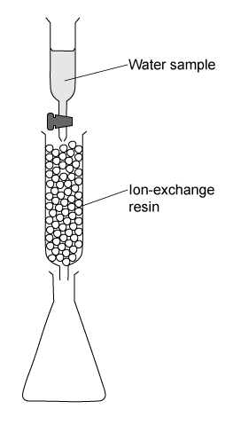
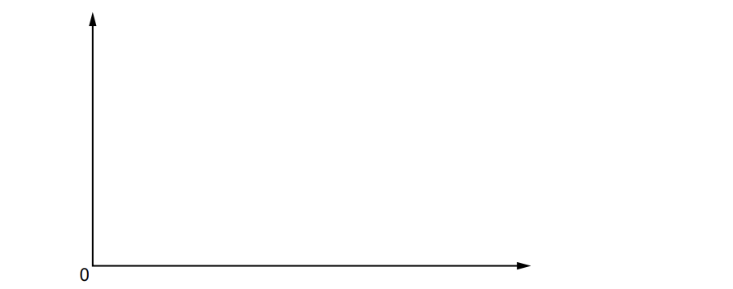

# Exam Questions — Reacting Masses & Volumes (of Solutions & Gases)
**2. Atoms, Molecules & Stoichiometry** · Cambridge (CIE) AS chemistry (9701)
> Source: [https://www.savemyexams.com/as/chemistry/cie/25/topic-questions/](https://www.savemyexams.com/as/chemistry/cie/25/topic-questions/) · 27 questions across 2 sets

## Multiple Choice Questions (19 questions)

### Q1 — medium — 1 marks

**Q1** [1 mark]

Two distinct organic compounds, **X** and **Y**, are found to have the same empirical formula.

Which of the following **must** be identical for both compounds?

### Q2 — medium — 1 marks

**Q2** [1 mark]

Solid fertilisers often contain the elements N, P and K in a ratio of 15 g : 30 g : 15 g per 100 g of fertiliser. It is recommended that the fertiliser is used at 28 g of fertiliser per 5 dm3 of water.

What is the concentration of nitrogen atoms in the solution?

### Q3 — hard — 1 marks

**Q3** [1 mark]

Some fireworks can use the reaction between aluminium powder and anhydrous barium nitrate as a propellant. Metal oxides and nitrogen are the only products.

10Al + 3Ba(NO3)2 → 5Al2O3 + 3BaO + 3N2

0.783 g of anhydrous barium nitrate reacts with an excess of aluminium.

What volume of nitrogen is produced?

### Q4 — hard — 1 marks

**Q4** [1 mark]

A solution of Sn2*+** *ions will reduce MnO4- ions to Mn2+ ions when acidified. The Sn2+ ions are oxidised to Sn4+ ions in this reaction.

How many moles of Mn2+ ions are formed when a solution containing 9.5 g of Sn*C*l2 (*M*r: 190) is added to an excess of acidified KMnO4 solution?

### Q5 — easy — 1 marks

**Q5** [1 mark]

What is the number of molecules in 500 cm3 of oxygen at room temperature and pressure (r.t.p.)?

### Q6 — medium — 1 marks

**Q6** [1 mark]

When heated magnesium nitrate, Mg(NO3)2, will decompose to a white solid and a mixture of gases. One of the gases released is an oxide of nitrogen, **X**.

7.4 g of anhydrous magnesium nitrate is heated until no further reaction takes place.

What is the mass of **X** produced?

### Q7 — hard — 1 marks

**Q7** [1 mark]

10 cm3 of methane and 10 cm3 of ethane were sparked with an excess of oxygen. Once cooled the remaining gas was passed through aqueous potassium hydroxide.

Assume all measurements were taken at 25˚C and 1 atm pressure.

Which volume of gas is absorbed by the alkali?

### Q8 — medium — 1 marks

**Q8** [1 mark]

A metal element of mass 1.15 g reacted with 300 cm3 of oxygen at room conditions to form an oxide which contains O2- ions.

Which one of these is the metal?

### Q9 — hard — 1 marks

**Q9** [1 mark]

The concentration of calcium ions in a sample of water can be determined by using an ion-exchange column, shown in the diagram below:

A 50 cm3 sample of water was passed through the ion-exchange resin, this contained dissolved calcium sulfate

Each calcium ion in the sample was exchanged for two hydrogen ions. The resulting acidic solution, collected in the flask, required 25 cm3 of 1.0 x 10-2 mol dm-3 potassium hydroxide for complete neutralisation.

What is the concentration of the calcium sulfate in the original sample?

### Q10 — hard — 1 marks

**Q10** [1 mark]

Excess acidified aqueous potassium dichromate(VI) was mixed with 2.76 g of ethanol. The reaction mixture was then boiled under reflux for one hour. The organic product was collected by distillation.

The yield of the product was 75.0%

What is the mass of the product collected?

### Q11 — medium — 1 marks

**Q11** [1 mark]

Excess aqueous cold sodium hydroxide is reacted with 0.125 mol of chlorine gas, Cl2. One of the products is a compound of sodium, oxygen and chlorine.

What mass of the product is formed?

### Q12 — hard — 1 marks

**Q12** [1 mark]

1.00 g of carbon is combusted in a limited supply of oxygen. 0.50 g of the carbon combusts to form CO2 and 0.50 g of the carbon combusts to form CO.

These were passed through excess NaOH (aq) and the remaining gas then dried and collected.

Assuming that all gas volumes were taken at room conditions, what is the volume of gas at the end of the reaction?

### Q13 — hard — 1 marks

**Q13** [1 mark]

Bromide ions are oxidised to bromine by lead (IV) chloride. The Pb4+ ions are reduced to Pb2+ ions in this reaction.

6.980 g of lead (IV) chloride is added to an excess of sodium bromide solution.

What is the mass of bromine produced?

### Q14 — hard — 1 marks

**Q14** [1 mark]

When a sample of potassium oxide, K2O, is dissolved in 250 cm3 of distilled water, 25 cm3 of this solution is titrated against sulfuric acid with a concentration of 2.00 mol dm-3. Complete neutralisation takes place with 15 cm3 of sulfuric acid.

What is the mass of the original sample of potassium oxide dissolved in 250 cm3 of distilled water?

### Q15 — easy — 1 marks

**Q15** [1 mark]

A 5.62 g sample of anhydrous sodium sulfate, Na2SO4, is dissolved in water and the solution made up to 250 cm3 in a volumetric flask.

What is the concentration in mol dm-3 of the sodium sulfate solution?

### Q16 — medium — 1 marks

**Q16** [1 mark]

A volume of nitrogen gas, 2.00 dm3 measured at room temperature and pressure (r.t.p.), was reacted with a large volume of hydrogen gas to produce ammonia. Only 15.0% of the nitrogen gas reacted to produce ammonia.

What mass of ammonia was produced?

### Q17 — medium — 1 marks

**Q17** [1 mark]

Excess water and 0.144 g of an aluminium compound **X** were reacted to form a gas. The gas burns completely in O2 to form H2O and 72 cm3 of CO2 only. The volume of CO2 was measured at room temperature and pressure.

What is the formula for **X**?

### Q18 — easy — 1 marks

**Q18** [1 mark]

Methane and steam can be used to prepare hydrogen and carbon monoxide as shown by the equation below.

CH4 (g) + H2O (g) → 3H2 (g) + CO (g)

200 g of methane was reacted with an excess of steam to produce 642 dm3 of hydrogen gas at r.t.p.

What is the percentage yield of hydrogen?

### Q19 — hard — 1 marks

**Q19** [1 mark]

The eggshell of a chicken egg makes up 5% of the total egg mass.

The average egg has a mass of 50 g.

Assume that chicken eggshell is pure calcium carbonate.

What is the number of eggshells needed to neutralise 50 cm3 of 2.0 mol dm-3 ethanoic acid?

## Structured Questions (8 questions)

### Q1 — hard — 16 marks

**Q1** [3 marks]

This question is about the reactions of ionic compounds.

Sodium carbonate is manufactured in a two-stage process as shown.

NaCl + NH3 + CO2 + H2O → NaHCO3 + NH4Cl

2NaHCO3 → Na2CO3 + H2O + CO2

Calculate the maximum mass of sodium carbonate that can be obtained from 0.75 kg of sodium chloride.

Show your working.

**Q1** [4 marks]

Norgessaltpeter, Ca(NO3)2, was the first nitrogen fertiliser to be manufactured in Norway. It is produced by the reaction of calcium carbonate with nitric acid.

In an experiment, an excess of powdered calcium carbonate was added to 37.4 cm3 of 0.531 mol dm–3 nitric acid.

Calculate the minimum mass of CaCO3 that should be added to react with all of the nitric acid. Give your answer to an appropriate number of significant figures.

Show your working.

**Q1** [4 marks]

A 0.0830 mol sample of pure zinc oxide was added to 75.0 cm3 of 0.90 mol dm−3 hydrochloric acid.

Assuming the reaction has a percentage yield of 60.6%, calculate the mass of anhydrous zinc chloride that could be obtained from the products of this reaction.

Show your working.

**Q1** [5 marks]

Magnesium nitride, Mg3N2, reacts with water to form magnesium hydroxide and ammonia.

Calculate the number of molecules of ammonia gas produced by the reaction of 12.62 g of magnesium nitride.

Show your working.

### Q2 — hard — 12 marks

**Q2** [4 marks]

Fireworks contain elements to give them their colour, as well as oxygen-containing compounds to facilitate speedy combustion.

In a firework, solid potassium nitrate, KNO3, decomposes to form solid potassium nitrite, KNO2, and oxygen, O2.

Calculate the mass, in g, of potassium nitrate, KNO3, required to make 1.5 g of oxygen. Give your answer to 2 significant figures.

Show your working.

**Q2** [1 mark]

**Extract:**

Fireworks contain elements to give them their colour, as well as oxygen-containing compounds to facilitate speedy combustion.

In a firework, solid potassium nitrate, KNO~3~, decomposes to form solid potassium nitrite, KNO~2~, and oxygen, O~2~.

Calculate the mass, in g, of potassium nitrate, KNO~3~, required to make 1.5 g of oxygen.

moles of O~2~ = 0.0469 mol

Calculate the volume, in dm3, of gas that is produced when solid potassium nitrate, KNO3, decomposes at room conditions. Give your answer to 2 significant figures.

**Q2** [4 marks]

Potassium can form a superoxide, KO2 (s), which will react with carbon dioxide, CO2 (g), to produce potassium carbonate, K2CO3 (s) and oxygen, O2 (g).

Calculate the volume, in dm3, at room conditions, of carbon dioxide that will react with 5.00 g of the superoxide. Give your answer to 3 significant figures.

Show your working.

**Q2** [3 marks]

**Extract:**

Potassium can form a superoxide, KO~2~ (s), which will react with carbon dioxide, CO~2~ (g), to produce potassium carbonate, K~2~CO~3~ (s) and oxygen, O~2~ (g).

Balanced equation: 4KO~2~ + 2CO~2~ → 2K~2~CO~3~ + 3O~2~

moles of KO~2~ = 5.00 / 71.1 = 0.0703 mol

2.61 g of potassium carbonate, K2CO3, was produced during the reaction in part (c).

Calculate the percentage yield of potassium carbonate. Give your answer to 2 decimal places.

Show your working.

### Q3 — medium — 12 marks

**Q3** [4 marks]

This question is about the formation and reaction of silane, SiH4.

0.50 g of quartz sand and 0.50 g of powdered silica are mixed with 2.40 g of magnesium powder. The resulting mixture is placed in a pot half filled with sand. A magnesium ribbon fuse is added and the mixture is ignited to form magnesium oxide and solid magnesium silicide, Mg2Si.

i) Construct an equation for this reaction.

Include state symbols.

[2]

ii) Deduce which reagent is the limiting reagent. Show your working.

[2]

**Q3** [3 marks]

The magnesium silicide is reacted with hydrochloric acid according to the following equation:

Mg2Si (s) + 4HCl (aq) → 2MgCl2 (aq) + SiH4 (g)

The gaseous silane formed spontaneously ignites in air.

State the type of reaction and construct an equation for this reaction.

Include state symbols.

**Q3** [3 marks]

An alternative method to produce silane involves the reaction of silicon with hydrochloric acid to form trichlorosilane, HSiCl3.

Si (s) + 3HCl (aq) → HSiCl3 (l) + H2 (g)

Calculate the maximum mass of trichlorosilane produced from the reaction of 35.125 g of silicon. Show your working.

**Q3** [2 marks]

Another method of silane production involves the reduction of silicon dioxide by aluminium and hydrogen gas.

3SiO2 (s) + 6H2 (g) + 4Al (s) → 3SiH4 (g) + 2Al2O3 (s)

Calculate the volume, in dm3, of hydrogen gas required to produce 10.0 dm3 of silane gas. Explain your answer.

Assume all volumes are measured under the same conditions.

### Q4 — medium — 10 marks

**Q4** [1 mark]

The reaction of nitrous oxide gas, N2O (g), with carbon disulfide vapour, CS2 (g), is an example of a chemical luminescence reaction producing a flame with a bright blue light.

2N2O (g) + CS2 (g) → 2S (s) + 2N2 (g) + CO2 (g)

The brightness of the light produced was a reason why this reaction was once used in low-light photography.

When nitrous oxide and carbon disulfide are placed together there is no immediate reaction.

Explain how a flame can help initiate the reaction.

**Q4** [3 marks]

**Extract:**

The reaction of nitrous oxide gas, N~2~O (g), with carbon disulfide vapour, CS~2~ (g), is an example of a chemical luminescence reaction producing a flame with a bright blue light.

2N~2~O (g) + CS~2~ (g) → 2S (s) + 2N~2~ (g) + CO~2~ (g)

A measuring cylinder containing 100 cm3 of nitrous oxide is used in a demonstration of the reaction between nitrous oxide and carbon disulfide.

i) Calculate the amount, in mol, of nitrous oxide in the measuring cylinder.

[1]

ii) Calculate the number of carbon disulfide molecules required to react with the nitrous oxide at room conditions. Show your working.

[2]

**Q4** [3 marks]

**Extract:**

The reaction of nitrous oxide gas, N₂O (g), with carbon disulfide vapour, CS₂ (g), is an example of a chemical luminescence reaction producing a flame with a bright blue light.

2N₂O (g) + CS₂ (g) → 2S (s) + 2N₂ (g) + CO₂ (g)

In a second demonstration, 10.8 dm3 of nitrous oxide is reacted with 5.6 dm3 carbon disulfide vapour.

i) Explain which reagent is in excess. Show your working.

[2]

ii) Calculate the maximum mass of sulfur that will be produced from this demonstration.

[1]

**Q4** [3 marks]

**Extract:**

The reaction of nitrous oxide gas, N~2~O (g), with carbon disulfide vapour, CS~2~ (g), is an example of a chemical luminescence reaction producing a flame with a bright blue light.

2N~2~O (g) + CS~2~ (g) → 2S (s) + 2N~2~ (g) + CO~2~ (g)

The demonstration is performed a third time to determine the percentage yield of sulfur of the reaction.

For this demonstration, 16.50 dm3 of nitrous oxide is reacted with an excess of carbon disulfide at room conditions. This produces 14.32 g of sulfur.

Calculate the percentage yield for this demonstration. Show your working.

### Q5 — medium — 19 marks

**Q5** [10 marks]

Verdigris is a green pigment that contains both copper(II) carbonate, CuCO3, and copper(II) hydroxide, Cu(OH)2, in varying amounts. Both copper compounds react with dilute hydrochloric acid.

CuCO3 (s) + 2HCl (aq) → CuCl2 (aq) + CO2 (g) + H2O (l)

Cu(OH)2 (s) + 2HCl (aq) → CuCl2 (aq) + 2H2O (l)

You are to plan an experiment to determine the percentage of copper(II) carbonate in a sample of verdigris. Your method should involve the reaction of verdigris with excess dilute hydrochloric acid.

You are provided with the following:

- 0.494 g of verdigris
- 10.0 mol dm–3 hydrochloric acid, HCl (aq)
- commonly available laboratory reagents and equipment

You may assume that any other material present in verdigris is unaffected by heating and is **not** acidic or basic.

i) A student suggests that finding the volume of dilute hydrochloric acid required to react with a known mass of verdigris would be a suitable method to determine the percentage of copper(II) carbonate in a sample of verdigris.

Suggest why this method would **not** work.

[1]

ii) The 10.0 mol dm–3 HCl is too concentrated for use in the experiment. Instead, a more dilute solution should be prepared.

Describe how you would accurately prepare 250.0 cm3 of 0.500 mol dm–3 hydrochloric acid from the 10.0 mol dm–3 HCl provided.

Your answer should state the name and capacity in cm3 of any apparatus you would use.

[3]

iii) The percentage of copper(II) carbonate in a sample of verdigris can be determined by measuring the volume of gas produced when excess hydrochloric acid is added to the sample of verdigris.

Draw a diagram to show how you would set up the apparatus and chemicals to measure the total volume of gas produced in this reaction.

Label your diagram.

[2]

iv) Sketch a graph on the axes to show how the volume of gas produced would change during your experiment. The independent variable should be on the x-axis.

- Label both axes.
- Extend the graph beyond the point at which the reaction is complete.

[2]

v) A student thinks that their 0.494 g sample of verdigris only contains CuCO3.

Calculate the minimum volume, in cm3, of 0.500 mol dm–3 HCl that is needed to completely react with this sample if the student is correct. Show your working. [*M*r: CuCO3 = 123.5]

[2]

*Source: 2022 Specimen Paper 5 Q1A*

**Q5** [9 marks]

Azurite is a blue copper-containing mineral. The copper compound in azurite has the formula Cu3(CO3)2(OH)2. This copper compound reacts with sulfuric acid according to the equation.

Cu3(CO3)2(OH)2 (s) + 3H2SO4 (aq) → 3CuSO4 (aq) + 2CO2 (g) + 4H2O (l)

A student carries out a series of titrations on 1.50 g samples of solid azurite using 0.400 mol dm–3 sulfuric acid.

Assume that any other material present in azurite does not react with sulfuric acid. Some titration data is given in Table 1.1.

**Table 1.1**

| **titration** | **rough** | **1** | **2** | **3** |
|---|---|---|---|---|
| final reading / cm3 | 25.55 | 23.90 | 48.30 | 28.10 |
| initial reading / cm3 | 0.00 | 0.00 | 23.90 | 3.95 |
| titre / cm3 |   |   |   |   |

The indicator for the titration is bromophenol blue. Bromophenol blue is blue at pH 4.6 and yellow at pH 3.0.

i) Complete Table 1.1.

[1]

ii) Calculate the percentage uncertainty in titre 1.

[1]

iii) The student concludes that 24.15 cm3 of 0.400 mol dm–3 sulfuric acid completely reacts with 1.50 g of azurite. Calculate the percentage by mass of Cu3(CO3)2(OH)2 in the sample of azurite using the student's value of 24.15 cm3 of 0.400 mol dm–3 sulfuric acid.

Write your answer to **three** significant figures. Show your working. [*M*r: Cu3(CO3)2(OH)2 = 344.5]

[3]

iv) Identify **two** possible problems with the student's titration experiment and suggest improvements to it.

problem 1

improvement 1

problem 2

improvement 2

[4]

*Source: 2022 Specimen Paper 5 Q1B*

### Q6 — easy — 12 marks

**Q6** [4 marks]

Copper(II) chloride can be produced by the reaction of hydrochloric acid with different copper(II) compounds.

i) Suggest why the reaction of copper with hydrochloric acid is not used to form copper(II) chloride.

[1]

ii) Complete Table 1.1 by constructing the equation for the formation of copper(II) chloride using hydrochloric acid and each of the copper(II) compounds.

**Table 1.1 **

| Copper(II) compound | Chemical equation |
|---|---|
| Copper(II) oxide, CuO |   |
| Copper(II) hydroxide, Cu(OH)2 |   |
| Copper(II) carbonate, CuCO3 |   |

** **[3]

**Q6** [3 marks]

**Extract:**

Copper(II) chloride can be produced by the reaction of hydrochloric acid with different copper(II) compounds.

Table 1.1

| Copper(II) compound | Chemical equation |
| --- | --- |
| Copper(II) oxide, CuO | CuO + 2HCl → CuCl₂ + H₂O |

11.93 g of copper(II) oxide is reacted with 50.0 cm3 of 2.00 mol dm-3 hydrochloric acid.

i) Calculate the amount, in mol, of copper(II) oxide and hydrochloric acid. Show your working.

[2]

ii) Deduce which chemical is the limiting reagent.

[1]

**Q6** [3 marks]

**Extract:**

Copper(II) hydroxide, Cu(OH)~2~: Cu(OH)~2~ + 2HCl → CuCl~2~ + 2H~2~O

22.43 g of copper(II) hydroxide reacts with hydrochloric acid to form 23.63 g of copper(II) chloride.

Complete Table 1.2 to calculate the percentage yield of this reaction.

**Table 1.2**

| Relative formula mass of copper(II) hydroxide | ........................................ |
|---|---|
| Moles of copper(II) hydroxide | ........................................ |
| Relative formula mass of copper(II) chloride | ........................................ |
| Theoretical yield of copper(II) chloride | ........................................ |
| Percentage yield of copper(II) chloride | ........................................ |

**Q6** [2 marks]

**Extract:**

ii) Complete Table 1.1 by constructing the equation for the formation of copper(II) chloride using hydrochloric acid and each of the copper(II) compounds.

Table 1.1

| Copper(II) compound | Chemical equation |
| --- | --- |
| Copper(II) oxide, CuO |   |
| Copper(II) hydroxide, Cu(OH)~2~ |   |
| Copper(II) carbonate, CuCO~3~ |   |

22.23 g of copper(II) carbonate reacts with hydrochloric acid at room conditions. One of the products is a gas.

Calculate the volume, in cm3, of the gas produced. Show your working.

### Q7 — medium — 11 marks

**Q7** [1 mark]

Iron compounds have a variety of uses. Many iron compounds are found in fertilisers and as food additives and supplements.

Iron sulfate is used to treat and prevent iron deficiency anaemia.

Suggest **two** possible formulae for iron sulfate.

**Q7** [4 marks]

Iron reacts with chlorine to form iron(III) chloride.

i) Construct an equation for this reaction of iron with chlorine.

State symbols are **not** required.

[1]

ii) Calculate the mass of iron(III) chloride produced from 5.02 g of iron, assuming a 78% yield.

Show your working.

[3]

**Q7** [3 marks]

Iron(III) oxide is reduced to Fe with carbon at a temperature of 1200 °C in the blast furnace.

2Fe2O3 + 3C → 4Fe + 3CO2

An example reaction is set up by heating 9.86 g of iron(III) oxide with an excess of carbon powder. After the reaction is complete, it is left to cool to room temperature.

Calculate the volume of carbon dioxide, in dm3, produced at room conditions by this reduction of 9.86 g of iron(III) oxide.

Show your working.

**Q7** [3 marks]

A student reacts 4.95 g of iron(III) oxide with 1.12 g of carbon.

The resulting products are 3.46 g of iron and 2.60 g of carbon monoxide.

Deduce the equation for this reaction. Show your working.

### Q8 — medium — 11 marks

**Q8** [5 marks]

Activated charcoal is a form of carbon with a very high surface area. It can be used to remove impurities from mixtures. It does this by a process called adsorption, where particles of the impurity bond (adsorb) to the activated charcoal surface.

A student wants to determine the ability of activated charcoal to adsorb a blue dye (the impurity) from aqueous solution.

The equation that links the mass of activated charcoal with the amount of blue dye adsorbed is shown.

log `\left(\frac{\mathit{D}}{\mathit{m}}\right)` = A + b log [X]

D = difference in concentration of dye (in g dm–3) before and after adsorption
m = mass of activated charcoal (in g)
[X] = final concentration of dye (in g dm–3) after adsorption
A and b are constants

The student uses the following procedure to investigate the ability of activated charcoal to adsorb a blue dye from an aqueous solution.

- Place a 50.0 cm3 sample of a 25.00 g dm–3 solution of blue dye in a conical flask.
- Add a weighed mass of activated charcoal to the flask.
- Stir the contents of the flask for three minutes and then leave for one hour.
- Filter the mixture.
- Determine the final concentration of the blue dye, [X].
- Repeat the procedure using different masses of activated charcoal.

The procedure is carried out. The final concentrations of blue dye, [X], are shown in Table 2.1.

i) Process the results to complete Table 2.1.

Record your data to **two** decimal places.

**Table 2.1**

| **mass of** **activated** **charcoal,** **m / g** | **initial** **concentration** **of blue dye /** **g dm****–3** | **final** **concentration** **of blue dye,** **[X] / g dm****–3** | **difference in** **concentration** **of blue dye,** ***D***** / g dm****–3** | $\frac{D}{m}$ | **log**$\frac{D}{m}$ | **log [X]** |
|---|---|---|---|---|---|---|
| 0.20 | 25.00 | 0.96 |   | 120.20 | 2.08 |   |
| 0.25 | 25.00 | 0.69 |   | 97.24 | 1.99 |   |
| 0.30 | 25.00 | 0.60 |   | 81.33 | 1.91 |   |
| 0.35 | 25.00 | 0.41 |   | 70.26 | 1.85 |   |
| 0.40 | 25.00 | 0.33 |   | 61.68 | 1.79 |   |
| 0.45 | 25.00 | 0.27 |   | 54.96 | 1.74 |   |
| 0.50 | 25.00 | 0.23 |   | 49.54 | 1.69 |   |
| 0.55 | 25.00 | 0.20 |   | 45.09 | 1.65 |   |
| 0.60 | 25.00 | 0.17 |   | 41.38 | 1.62 |   |

[2]

ii) Identify the dependent variable in this experiment.

[1]

iii) State and explain the effect, if any, of increasing the mass of activated charcoal, *m*, on the amount of adsorption that occurs.

[2]

*Source: 2022 Specimen Paper 5 Q2A*

**Q8** [2 marks]

**Extract:**

The equation that links the mass of activated charcoal with the amount of blue dye adsorbed is shown.

log (D/m) = A + b log [X]

D = difference in concentration of dye (in g dm^–3^) before and after adsorption

m = mass of activated charcoal (in g)

[X] = final concentration of dye (in g dm^–3^) after adsorption

A and b are constants

**Table 2.1**

| **mass of** **activated** **charcoal,** **m / g** | **initial** **concentration** **of blue dye /** **g dm**^**–3**^ | **final** **concentration** **of blue dye,** **[X] / g dm**^**–3**^ | **difference in** **concentration** **of blue dye,** ***D***** / g dm**^**–3**^ | D/m | **log** D/m | **log [X]** |
| :---: | :---: | :---: | :---: | :---: | :---: | :---: |
| 0.20 | 25.00 | 0.96 | 24.04 | 120.20 | 2.08 | –0.02 |
| 0.25 | 25.00 | 0.69 | 24.31 | 97.24 | 1.99 | –0.16 |
| 0.30 | 25.00 | 0.60 | 24.40 | 81.33 | 1.91 | –0.22 |
| 0.35 | 25.00 | 0.41 | 24.59 | 70.26 | 1.85 | –0.39 |
| 0.40 | 25.00 | 0.33 | 24.67 | 61.68 | 1.79 | –0.48 |
| 0.45 | 25.00 | 0.27 | 24.73 | 54.96 | 1.74 | –0.57 |
| 0.50 | 25.00 | 0.23 | 24.77 | 49.54 | 1.69 | –0.64 |
| 0.55 | 25.00 | 0.20 | 24.80 | 45.09 | 1.65 | –0.70 |
| 0.60 | 25.00 | 0.17 | 24.83 | 41.38 | 1.62 | –0.77 |

Plot a graph on the grid to show the relationship between log `\left(\frac{\mathit{D}}{\mathit{m}}\right)` and log [X].

Use a cross (×) to plot each data point. Draw the straight line of best fit.

![Empty graph grid for plotting log(D/m) on the y-axis versus log[X] on the x-axis](assets/006-empty-graph-grid-for-plotting-log-d-m-on-the-y-a.png)

*Source: 2022 Specimen Paper 5 Q2B*

**Q8** [1 mark]

**Extract:**

Activated charcoal is a form of carbon with a very high surface area. It can be used to remove impurities from mixtures. It does this by a process called adsorption, where particles of the impurity bond (adsorb) to the activated charcoal surface.

A student wants to determine the ability of activated charcoal to adsorb a blue dye (the impurity) from aqueous solution.

The student uses the following procedure to investigate the ability of activated charcoal to adsorb a blue dye from an aqueous solution.

- Place a 50.0 cm^3^ sample of a 25.00 g dm^–3^ solution of blue dye in a conical flask.
- Add a weighed mass of activated charcoal to the flask.
- Stir the contents of the flask for three minutes and then leave for one hour.
- Filter the mixture.
- Determine the final concentration of the blue dye, [X].
- Repeat the procedure using different masses of activated charcoal.

Circle the most anomalous point on the graph.

Suggest why this anomaly may have happened during the experimental procedure.

*Source: 2022 Specimen Paper 5 Q2C*

**Q8** [3 marks]

**Extract:**

The equation that links the mass of activated charcoal with the amount of blue dye adsorbed is shown.

log (D/m) = A + b log [X]

D = difference in concentration of dye (in g dm^–3^) before and after adsorption

m = mass of activated charcoal (in g)

[X] = final concentration of dye (in g dm^–3^) after adsorption

A and b are constants

i) Use the graph to determine the gradient of the line of best fit. State the coordinates of both points you used in your calculation. These must be selected from your line of best fit.

Write your answer to **three** significant figures.

coordinates 1 ....................

coordinates 2 ..........................

gradient = ..........................................

[2]

ii) Use the graph to deduce a value for A.

A = ....................

[1]

*Source: 2022 Specimen Paper 5 Q2D*

