# Mark Schemes — Organic Synthesis
**21. Organic Synthesis** · Cambridge (CIE) AS chemistry (9701)

## Multiple Choice Questions (19 questions)

### Q1
**Final answer:** **The correct answer is C**

- **Cold, dilute acidified MnO****4****-** is a **mild** oxidising reagent which oxidises alkenes to a diol.
- The C=C in cholesterol becomes a **diol**.

  - The two carbon atoms are now bonded to four different groups, creating **two new chiral centres** (+2).
- Cold, dilute MnO4- will not oxidise the -OH group already present in cholesterol.

  - Therefore, the **total number of hydroxy groups** in the product is **three** (1 original + 2 from diol).
- **Hot, concentrated acidified MnO****4****-** is a **strong** oxidising reagent that completely breaks the C=C bond to form a ketone and an aldehyde.

  - The aldehyde is further oxidised to a carboxylic acid.
- The secondary alcohol group already present in cholesterol is also oxidised to a **ketone**, removing that chiral centre (**−1 chiral centre**).
- Only **two 6-membered rings** remain in the product.

**A** is incorrect as the cold, dilute KMnO4 values are wrong: the diol formation adds **two** new chiral centres (+2, not +1) and gives **three** hydroxy groups in total (not one). The hot value of -1 chiral centre is correct, but **two** 6-membered rings remain (not three).

**B** is incorrect as the cold, dilute KMnO4 values are wrong for the same reasons as A (+1 and 1 should be +2 and 3). The hot value of 2 rings is correct, but the chiral change is **-1** (not 0) as the secondary alcohol is oxidised to a ketone, removing that chiral centre.

**D** is incorrect as the cold, dilute KMnO4 values (+2 and 3) are both correct. However, both hot, concentrated KMnO4 values are wrong: the chiral change is **-1** (not 0), and **two** 6-membered rings remain (not three).

### Q2
**Final answer:** **The correct answer is B**

- Compound G contains an **amide** and an **ester** group which can both undergo **hydrolysis** when heated with dilute hydrochloric acid.

  - Hydrolysis of the **amide** produces an **amine** and a **carboxylic acid**.
- Under acidic conditions, the basic amine is protonated to give NH3+.

  - Hydrolysis of the **ester** produces an **alcohol** and a **carboxylic acid**.

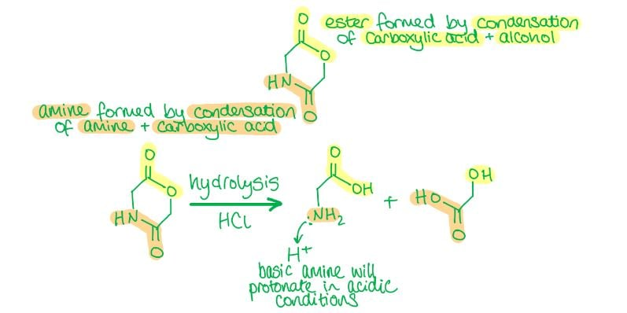

**A** is incorrect as neither product is the result of complete hydrolysis. H2NCOCH2OH retains the amide bond intact rather than breaking it to give separate amine and carboxylic acid groups. HOCH2CHO (glycolaldehyde) has an aldehyde group rather than a carboxylic acid, which is not the product of ester hydrolysis.

**C** is incorrect as HOCH2CO2H (glycolic acid from ester hydrolysis) is correct, but H2NCH2CO2H (glycine) is incorrect. Under acidic conditions (dilute HCl), the amine is protonated to NH3+, so the correct amide hydrolysis product is HO2CCH2NH3+, not the free amine.

**D** is incorrect as the amide bond in HOCH2CONH3+ has not been hydrolysed. The amide linkage is merely protonated, not broken. Acid hydrolysis of the amide produces separate NH3+ and carboxylic acid groups. HOCH2CHO is also incorrect for the ester product (should be HOCH2CO2H).

### Q3
**Final answer:** **The correct answer is D**

- Phenylhydrazine contains a terminal **hydrazine group** (-NHNH₂) which undergoes a **nucleophilic addition-elimination (condensation)** reaction with the **ketone group** (C=O) of compound **X**.

  - The ketone carbonyl carbon is electrophilic due to the electronegativity of the oxygen.
  - The nitrogen lone pair of the terminal NH2 attacks this carbon.
- After proton transfers, a water molecule is eliminated to form a **C=N** (hydrazone) linkage, giving the phenylhydrazone product.
- The **ester group** in compound **X** is not attacked and is preserved in product **Y**.

**A** is incorrect as the ester group of compound **X** has been replaced by an amide linkage (-CONH-Ph), suggesting reaction at the ester rather than the ketone. In the condensation, phenylhydrazine reacts selectively with the more electrophilic ketone C=O; the ester group is preserved in the product.

**B** is incorrect as both the ketone group of compound **X** and the N–N bond of phenylhydrazine appear to have been lost. In the actual condensation, only the ketone oxygen is lost as water. The N–N bond is retained in the C=N–NHPh linkage of the phenylhydrazone.

**C** is incorrect as the NHNH2 group remains unreacted and the acyl group has been transferred directly to the phenyl ring, which does not occur under these conditions. In the condensation, the terminal NH2 attacks the ketone to form a hydrazone C=N linkage with elimination of water.

### Q4
**Final answer:** **The correct answer is C**

- Since propanone is produced upon oxidation of mixture **F** with acidified potassium dichromate, **F** must contain a **secondary alcohol**.
- **Propan-2-ol** (**F**) forms when compound **G** reacts with aqueous NaOH via **nucleophilic substitution**, in which OH- replaces the halogen.
- Compound **G** is therefore a **secondary halogenoalkane** which reacts with silver nitrate to form a coloured precipitate of a **silver halide**.
- **Silver bromide** gives a **cream precipitate**, so the unknown halogen is **bromine**.

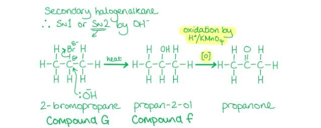

**A** is incorrect as CH3CH2CH2Br is a **primary** halogenoalkane. Reaction with NaOH gives propan-1-ol (a primary alcohol), which is oxidised to **propanal** (an aldehyde), not propanone.

**B** is incorrect as CH3CH2CH2I is a **primary** halogenoalkane, also giving propanal on oxidation rather than propanone. Additionally, silver iodide gives a **yellow** precipitate with silver nitrate, not a cream precipitate.

**D** is incorrect as CH3CHICH3 is a secondary halogenoalkane and would give propan-2-ol and thus propanone on oxidation. However, silver iodide gives a **yellow** precipitate with silver nitrate, not a cream precipitate.

### Q5
**Final answer:** **The correct answer is D**

- Two molecules of HOCH2COOH will react with each other to form **two ester groups** in a cyclic structure.
- Each ester group is formed by a **condensation** reaction between the **alcohol** (-OH) of one molecule and the **carboxylic acid** (-COOH) of the other, eliminating water.

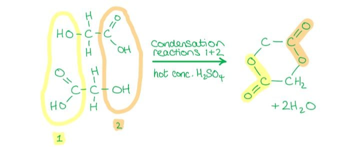

**A** & **C** are incorrect as neither molecule contains a free alcohol (-OH) group that can react with a carboxylic acid group of another molecule to form an ester linkage. Without a free -OH, self-esterification to give the cyclic diester cannot occur.

**B** is incorrect as mixing CH3COOH with HOCH2COOH would not produce compound M. The CH3COOH would react with the alcohol group of HOCH2COOH to give a single linear mixed ester, not a cyclic diester with two ester groups.

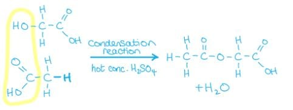

### Q6
**Final answer:** **The correct answer is B**

- A relative molecular mass increase of 34 corresponds to the addition of two hydrogen atoms and two oxygen atoms.

- This occurs when an alkene undergoes mild oxidation with cold, dilute acidified MnO4- to form a **diol**.

  - A diol is an organic compound containing two -OH groups.

- The relative molecular mass of the two -OH groups added: 2 x (16 + 1) = 34

**A** is incorrect as cold, concentrated MnO4- would be too strongly oxidising for selective diol formation. Dilute conditions are required for mild oxidation.

**C** is incorrect as hot, concentrated MnO4- is a strong oxidant that fully cleaves the C=C bond, forming ketones, aldehydes, or carboxylic acids rather than a diol.

**D** is incorrect as hot conditions promote stronger oxidation that cleaves the C=C bond rather than forming a diol. Cold conditions are required to limit the extent of oxidation.

### Q7
**Final answer:** **The correct answer is C**

- **Aldehydes** and **ketones** react with 2,4-dinitrophenylhydrazine (2,4-DNPH) in a **condensation** reaction.
- Two molecules join together while eliminating a small molecule (water) to form a **deep orange** precipitate.
- CH3CHO (ethanal) is an **aldehyde** which undergoes condensation with 2,4-DNPH to form a deep orange precipitate.

**A** is incorrect as ethene undergoes **mild oxidation** with cold dilute acidified KMnO4 to form a colourless diol (ethane-1,2-diol). The purple MnO4- ions are reduced to colourless Mn2+ ions.

**B** is incorrect as ethanol is **oxidised** by acidified K2Cr2O7, but the coloured product is Cr3+ (green), which is an **inorganic** species, not a coloured organic compound. The organic product (ethanal or ethanoic acid) is colourless.

**D** is incorrect as **ketones** do not react with Fehling's solution. Only aldehydes reduce the Cu2+ ions in Fehling's solution to form a brick red Cu2O precipitate, which is an inorganic product.

### Q8
**Final answer:** **The correct answer is A**

- Warm acidified potassium dichromate (VI) **oxidises** aldehydes to **carboxylic acids**.
- The aldehyde group (-CHO) in the precursor shown in **A** is oxidised to give the carboxylic acid (-CO2H) group of ibuprofen.

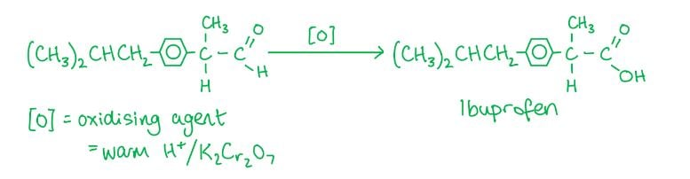

**B** is incorrect as hot, concentrated KMnO4 causes **oxidative cleavage** of the C=C double bond. The =CH2 end is oxidised to CO2 and the ring-attached carbon becomes a ketone, giving a methyl ketone and CO2.

**C** is incorrect as warm H2SO4 (aq) cannot oxidise a **ketone** to a carboxylic acid. Ketones are resistant to mild oxidation, and H2SO4 is not an oxidising agent under these conditions.

**D** is incorrect as H2/Pt catalyst causes **hydrogenation**, reducing the C=C double bonds to C–C single bonds. This does not introduce a carboxylic acid group, so ibuprofen is not formed.

### Q9
**Final answer:** **The correct answer is D**

- When a **lactone (cyclic ester)** is heated with dilute H2SO4, it undergoes **hydrolysis** to form a **carboxylic acid** and an **alcohol** (+2 active H atoms from these two -OH groups).
- Santonin contains **two alkene groups**, both of which undergo **mild oxidation** by cold, dilute acidified MnO4- to form **diols** (+4 active H atoms from the four -OH groups).
- Cold, dilute MnO4- is not a strong enough oxidising reagent to further oxidise the alcohol from ester hydrolysis.
- Total displaceable H atoms:

4 (from two diols) + 1 (carboxylic acid -OH) + 1 (alcohol -OH) = **6**.

- **Alcohols** and **carboxylic acids** both react with reactive metals such as Na to form a **salt** and **hydrogen gas (H****2****)**.

**A** is incorrect as 2 accounts only for the carboxylic acid (1 H) and alcohol (1 H) produced by lactone hydrolysis. The four additional O–H groups from mild oxidation of the two C=C bonds to diols are not included.

**B** is incorrect as 4 would account for two diol OH groups (from one C=C) plus the carboxylic acid and alcohol (2 H). However, santonin contains two C=C double bonds, both oxidised to diols, giving four diol OH groups in total, not two.

**C** is incorrect as 5 omits one of the six displaceable hydrogen atoms. Both the carboxylic acid and the alcohol produced by lactone hydrolysis each contribute one active hydrogen, and the two diols from mild oxidation of the two alkenes contribute four more, giving six in total.

### Q10
**Final answer:** **The correct answer is C**

- Lactic acid contains a **carboxylic acid** (-COOH) group.
- **Sodium carbonate** reacts with carboxylic acids to form a salt, carbon dioxide and water.

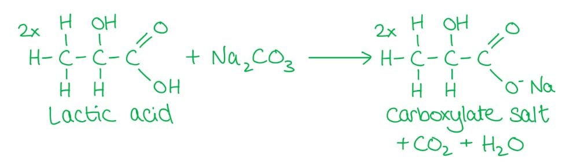

**A** is incorrect as bromine water is decolourised when shaken with an **alkene** which undergoes an **addition reaction** with the bromine. Lactic acid contains no C=C double bond.

**B** is incorrect as lactic acid contains two **polar** groups: -COOH (carboxylic acid) and -OH (hydroxyl) which can form H-bonds with water. Lactic acid is therefore readily soluble in water.

**D** is incorrect as only **aldehydes** react with Fehling's reagent by being oxidised to a **carboxylic acid**, reducing the Cu²⁺ ions. This causes the **clear blue** solution to become an **opaque red/orange** colour as lactic acid contains no aldehyde group.

### Q11
**Final answer:** **The correct answer is A**

- Propanoic acid is a **liquid** at room temperature.
- The carboxylic acid group (-COOH) is highly polar and forms H-bonds with water, causing propanoic acid to be readily soluble in water.
- Propanoic acid is an **acid** which reacts with cold aqueous sodium hydroxide in an acid-base reaction to form sodium propanoate and water.

**B** is incorrect as propanol does not react with cold sodium hydroxide. Propanol is a very weak acid and OH- is not strong enough to deprotonate the alcohol group.

**C** is incorrect as propene is a **gas** at room temperature. It is also insoluble in water as it is non-polar, and it does not react with sodium hydroxide.

**D** is incorrect as propyl propanoate does not react with cold aqueous sodium hydroxide. Saponification of an ester requires heating under reflux with concentrated alkali. Additionally, the large non-polar alkyl groups make propyl propanoate poorly soluble in water.

### Q12
**Final answer:** **The correct answer is D**

- The first step involves **nucleophilic addition** of HCN (with trace NaCN to generate CN- ions) at **room temperature**.

  - The CN- nucleophile attacks the slightly positive carbonyl carbon of each aldehyde group in OHCCHO to form a **dihydroxynitrile**.

- In the second step, the nitrile groups are **hydrolysed** by refluxing with dilute aqueous sulfuric acid, forming a **carboxylic acid** and an ammonium salt.

**A** is incorrect as HCl does not perform nucleophilic addition to an aldehyde group. Cl- is a weaker nucleophile than CN- and this combination of reagents does not produce a hydroxynitrile.

**B** is incorrect as H2SO4 (aq) alone cannot add across the C=O bond of an aldehyde, and K2Cr2O7/H2SO4 is an oxidising agent used to oxidise alcohols and aldehydes, not to hydrolyse nitriles.

**C** is incorrect as KCN in aq/alcoholic solution can form the dihydroxynitrile (step 1 is plausible), but K2Cr2O7/H2SO4 (step 2) would oxidise the secondary alcohol groups in the intermediate to ketones, rather than hydrolysing the nitrile groups to carboxylic acids.

### Q13
**Final answer:** **The correct answer is D**

- The oxygen is more electronegative and therefore has a stronger pull on the electrons in the C=O bond.
- This leaves the carbon slightly positively charged and the oxygen slightly negatively charged.
- The carbonyl carbon is attracted to **nucleophiles** and will undergo **nucleophilic addition**.
- A nucleophile attacks the carbon atom in the carbonyl group and addition across the C=O bond occurs.

**A** is incorrect as the C=C in group **1** cannot undergo electrophilic substitution because there are no groups on the double bond that can be replaced. Group **1** undergoes **electrophilic addition**.

**B** is incorrect as the C=C double bond in group **1** is rich in electrons and is therefore attracted to **electrophiles**. Group **1** undergoes **electrophilic addition**, not nucleophilic addition.

**C** is incorrect as the carbon in C=O is slightly positively charged because oxygen is more electronegative and draws electrons away from the carbon. The carbonyl carbon is attracted to **nucleophiles**, not electrophiles. Group **2** undergoes **nucleophilic addition**, not electrophilic substitution.

### Q14
**Final answer:** **The correct answer is D**

- The addition of H2 to a double bond in the presence of a Ni catalyst is a **hydrogenation** reaction, which reduces the C=C but does not affect the aldehyde group.

  - When reacted with H2 / Ni, the alkene group in hept-4-enal undergoes hydrogenation to give heptanal (aldehyde preserved).
- NaBH4 is a reducing agent that reduces **ketones** and **aldehydes** to secondary and primary alcohols respectively.

  - When reacted with NaBH4, the aldehyde group in hept-4-enal is reduced to a primary alcohol, giving hept-4-en-1-ol (C=C preserved).

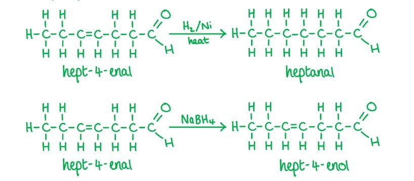

**A** is incorrect as the alkene group has been reduced but so has the aldehyde group, which is not possible using a single reagent from those given.

**B** is incorrect as NaBH4 reduces **aldehydes**, not **alkenes**. The product shown is heptanal (saturated, CHO preserved), which is the H2/Ni product, not the NaBH4 product.

**C** is incorrect as H2/Ni reduces **alkenes**, not **aldehydes**. The product shown has the C=C preserved and the aldehyde reduced, which is what NaBH4 does, not H2/Ni.

### Q15
**Final answer:** **The correct answer is B**

- Fehling's reagent tests for the presence of **aldehydes** by oxidising the aldehyde to a **carboxylic acid**.

  - The Cu2+ ions are reduced to Cu+ ions, changing the clear **blue** solution to an **opaque orange/red** due to the formation of copper(I) oxide.
- Civetone does not contain any aldehyde group, so it will **not** react with Fehling's reagent.

**A** is incorrect as the ketone group in civetone can undergo a **condensation reaction** with **2,4-dinitrophenylhydrazine** to form a **deep-orange** precipitate and water.

**C** is incorrect as the C=C double bond in civetone can undergo **electrophilic addition** with HBr.

**D** is incorrect as the ketone group in civetone will be reduced by NaBH4 to a secondary alcohol.

### Q16
**Final answer:** **The correct answer is A**

- **Alkenes** will undergo an addition reaction when shaken with orange/yellow bromine water (Br2) to turn the solution colourless.
- The first step involves **electrophilic** attack of the slightly positively charged bromine atom on the C=C bond.
- This results in the formation of a primary carbocation, which then undergoes **nucleophilic** attack by the Br- to form 1,2-dibromoethane.

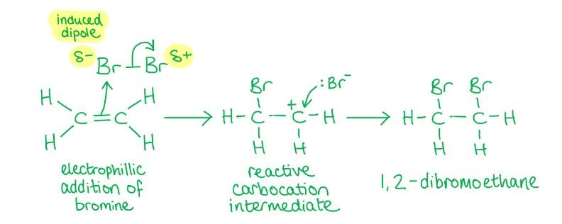

**B** is incorrect as this is **nucleophilic substitution** of the bromine by OH- in the primary halogenoalkane following an SN2 mechanism. This reaction does not involve a carbocation intermediate.

**C** is incorrect as this is a **free-radical substitution** reaction initiated by sunlight, which involves free radicals, not carbocation intermediates.

**D** is incorrect as this is **nucleophilic addition** of CN- to the carbonyl carbon to form a hydroxynitrile. This reaction does not involve a carbocation intermediate.

### Q17
**Final answer:** **The correct answer is A**

- The **halogenation** of methyl propanoate (CH3CH2CO2CH3) can be achieved by a **free-radical substitution** reaction.
- The hydrogen atom in the alkyl group (-CH3) is substituted for a halogen.
- The reaction is **initiated** by the formation of two **radicals** using UV light (which comes from the Sun).

  - Radicals are species with unpaired electrons.
- In the **propagation** step the formed radicals attack **reactant molecules** to generate more free radicals.
- In the **termination** step two radicals react together to form an unreactive molecule.
- **Initiation step**

Cl2 $\overset{\mathrm{UV}}{\rightarrow}$ 2Cl•

- **Propagation steps:**

CH3CH2CO2CH3 + Cl• → CH3CH2CO2CH2• + HCl

CH3CH2CO2CH2• + Cl2 → CH3CH2CO2CH2Cl + Cl•

- **Termination steps:**

2Cl• → Cl2

CH3CH2CO2CH2• + Cl• → CH3CH2CO2CH2Cl

2CH3CH2CO2CH2• → CH3CH2CO2CH2CH2CO2CH2CH3

**B**, **C** & **D** are incorrect as these reagents are used in the **nucleophilic substitution** reaction of alcohols. CH3CH2CO2CH3 is not an alcohol but an ester.

### Q18
**Final answer:** **The correct answer is A**

- Sorbic acid contains two C=C double bonds.
- Each C=C double bond undergoes **electrophilic addition** with one mole of bromine (Br2) in an organic solvent.

  - So, two moles of Br2 are incorporated per mole of sorbic acid.
- Each C=C double bond also undergoes **addition** with one mole of hydrogen in a **hydrogenation** reaction in the presence of a Ni catalyst.

  - So, two moles of H2 are incorporated per mole of sorbic acid.

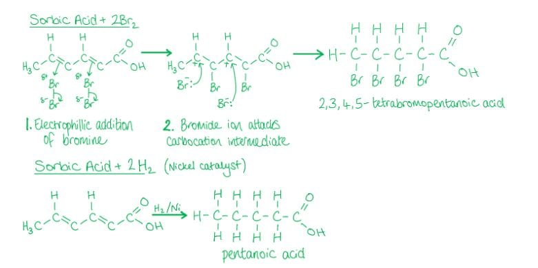

**B** is incorrect as sorbic acid reacts with two moles of hydrogen, not three. There are two C=C double bonds in sorbic acid, each incorporating one mole of H2 during hydrogenation.

**C** is incorrect as sorbic acid reacts with two moles of bromine, not half a mole. Each of the two C=C double bonds undergoes electrophilic addition with one mole of Br2.

**D** is incorrect as sorbic acid reacts with two moles of bromine (not 2½) and two moles of hydrogen (not three). Each C=C double bond reacts with one mole of each reagent.

### Q19
**Final answer:** **The correct answer is A**

- 1-bromobutane undergoes **nucleophilic substitution** with KCN in ethanol, in which the CN- ion replaces the bromine atom to form pentanenitrile.
- Pentanenitrile then undergoes **hydrolysis** with dilute HCl under reflux to produce pentanoic acid and ammonium chloride.

**B** is incorrect as KCN in ethanol does form a nitrile correctly, but NaOH (aq) hydrolyses the nitrile under alkaline conditions to give a carboxylate salt, not pentanoic acid.

**C** is incorrect as NaOH (aq) substitutes the bromine to give 1-butanol (an alcohol); treatment with HCl (aq) then substitutes the -OH with Cl, giving 1-chlorobutane, not pentanoic acid.

**D** is incorrect as NH3 in ethanol substitutes the bromine to give a primary amine; primary amines cannot be oxidised by H+/Cr2O72- (aq) to produce a carboxylic acid.

## Structured Questions (11 questions)

### Q1
> **[mark-scheme]**
> The reagents, conditions and equation for the one-step process (hydration) are:
> 
> - Steam / water vapour / H2O (g) **[1 mark]**
> - Concentrated phosphoric acid / H3PO4 catalyst
> **OR**
> Concentrated sulfuric acid / H2SO4 catalyst **[1 mark]**
> - CH3CH=CHCH3 + H2O → CH3CH(OH)CH2CH3 **[1 mark]**

> **[exam-tip]**
> The one-step conversion of an alkene directly to an alcohol is hydration. It requires steam (not liquid water) and a strong acid catalyst such as phosphoric acid or sulfuric acid.
> 
> This reaction is also an example of electrophilic addition.
> **[mark-scheme]**
> The intermediate and reagents/conditions are:
> 
> - Intermediate: 2-bromobutane **[1 mark]**
> - Step 1 reagent: hydrogen bromide / HBr **[1 mark]**
> - Step 2 reagent: aqueous sodium hydroxide / NaOH (aq) **AND **heat under reflux
> **OR**
> Aqueous potassium hydroxide / KOH (aq) **AND **heat under reflux **[1 mark]**

> **[exam-tip]**
> Step 1 is electrophilic addition of HBr to but-2-ene. Because but-2-ene is a symmetrical alkene, there is only one possible product: 2-bromobutane.
> 
> Step 2 is nucleophilic substitution: aqueous NaOH (or KOH) replaces the Br with OH, giving butan-2-ol.
> **[mark-scheme]**
> Using but-1-ene gives a lower yield of butan-2-ol because:
> 
> - But-1-ene is an unsymmetrical alkene, so when the C=C breaks it can form a primary or a secondary carbocation intermediate **[1 mark]**
> - This results in the formation of both butan-1-ol and butan-2-ol, reducing the yield of butan-2-ol **[1 mark]**

> **[exam-tip]**
> But-2-ene is a symmetrical alkene where the two carbons of the C=C are equivalent, so only one product is possible: butan-2-ol.
> 
> But-1-ene is unsymmetrical, so two different carbocation intermediates can form, giving a mixture of products. The yield of butan-2-ol is lower because some of the but-1-ene converts to butan-1-ol instead.
Reaction with cold dilute acidified KMnO4:

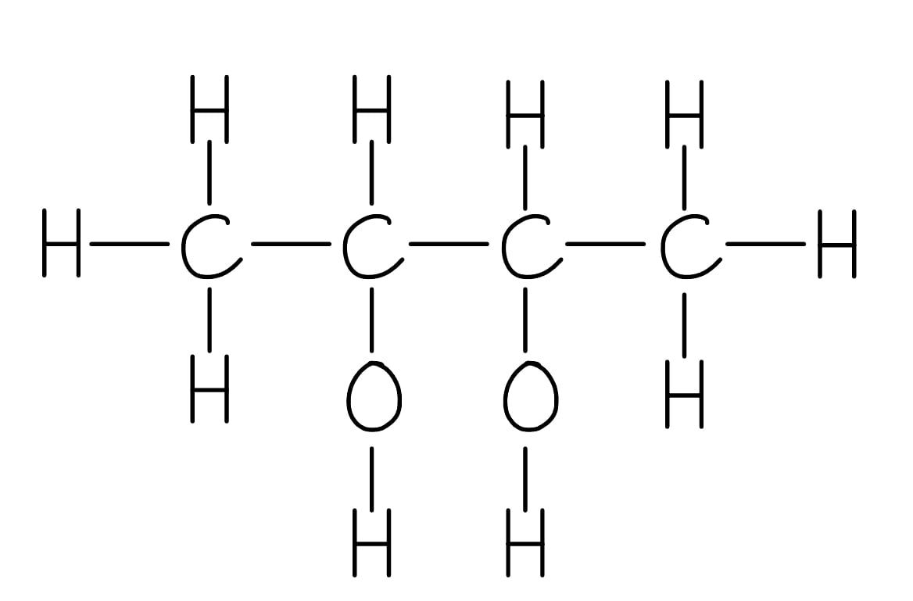

**[1 mark]**

Reaction with hot concentrated acidified KMnO4:

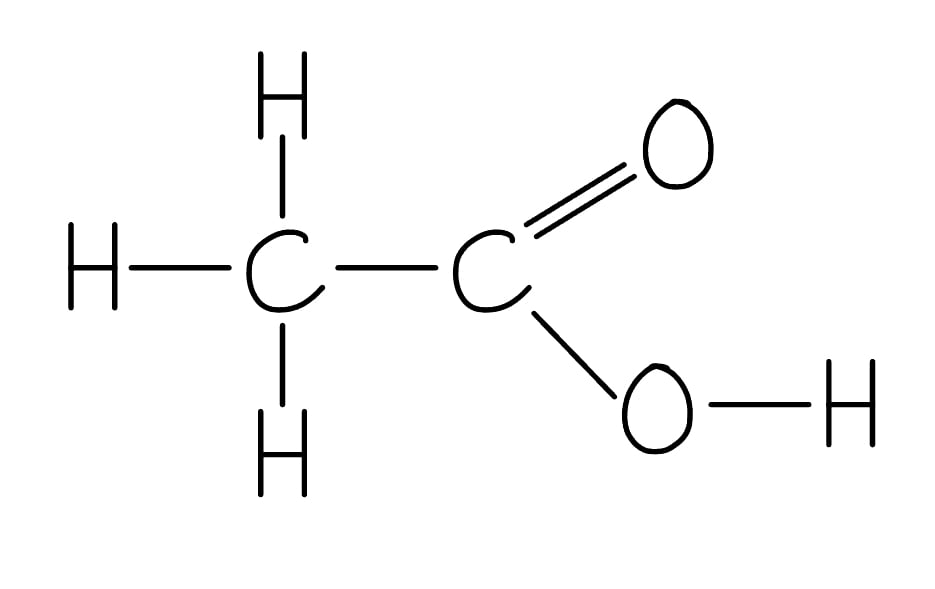

**[1 mark]**

> **[mark-scheme]**
> 1 mark for correct fully displayed formula of butane-2,3-diol (diol formed across the C=C)
> 
> 1 mark for correct fully displayed formula of ethanoic acid (both sides of but-2-ene give CH3COOH; only one type of product)

> **[exam-tip]**
> The reaction of an alkene with KMnO4 depends on conditions:
> 
> Cold dilute acidified KMnO4:
> 
> - Adds two OH groups across the C=C to form a diol.
> - Colour change: purple to colourless.
> 
> Hot concentrated acidified KMnO4:
> 
> - Cleaves the C=C completely.
> - Each carbon of the double bond is oxidised to a carboxylic acid (if it carries a H) or CO2 (if it is =CH2).
> 
> For but-2-ene (CH3CH=CHCH3), both carbons of the C=C carry a CH3 group, so both oxidise to give ethanoic acid and only one organic product is formed.

### Q2
The skeletal formulae of compounds **B**, **C** and **D** are:

| Compound** B** | Compound **C** | Compound **D** |
|---|---|---|
| 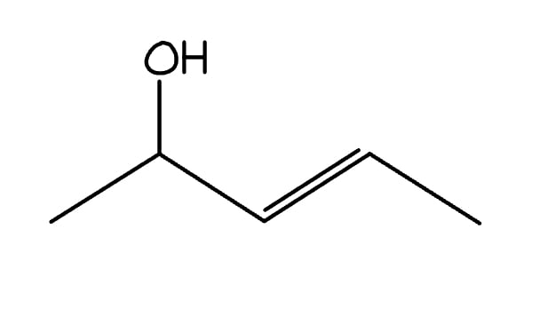 | 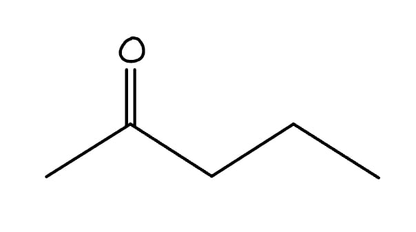 | 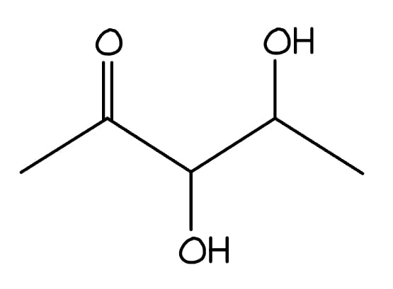 |

**[3 marks]**

> **[mark-scheme]**
> 1 mark for correct skeletal formula of compound **B** (pent-3-en-2-ol)
> 
> 1 mark for correct skeletal formula of compound **C** (pentan-2-one)
> 
> 1 mark for correct skeletal formula of compound **D** (3,4-dihydroxypentan-2-one)

> **[exam-tip]**
> The key to this question is knowing which functional group each reagent attacks:
> 
> - LiAlH4:
> 
>   - Reduces C=O (ketone/aldehyde) to C-OH
>   - Does **not** react with C=C
> - H2/Ni:
> 
>   - Reduces C=C (alkene)
>   - Does **not** normally reduce C=O under these conditions
> - Cold dilute acidified KMnO4:
> 
>   - Oxidises C=C to form a diol
>   - Does **not** cleave the bond
> **[mark-scheme]**
> The colour change is:
> 
> - Purple / violet to colourless **[1 mark]**

> **[exam-tip]**
> Potassium manganate(VII) (KMnO4) is purple/violet in solution. When it oxidises an alkene, the Mn is reduced from +7 to +2 (Mn2+), which is colourless in dilute acidic solution. This decolourisation is the test for the presence of a C=C double bond.
The yellow precipitate is:

- Triiodomethane / CHI3 / iodoform **[1 mark]**

The skeletal formula of the organic ion is:

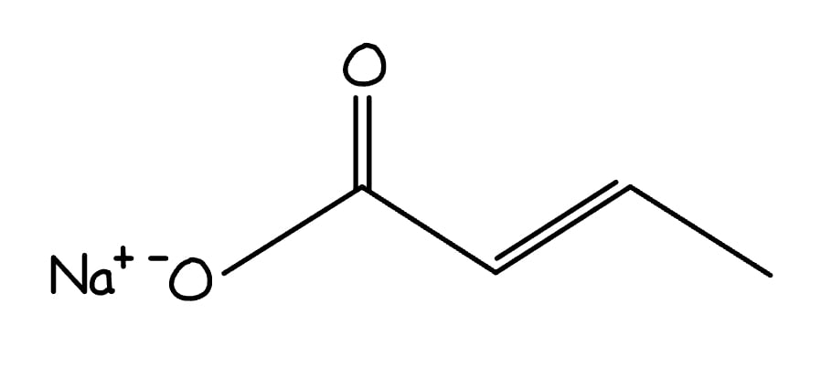

**[1 mark]**

> **[mark-scheme]**
> 1 mark for correct skeletal formula of the organic carboxylate ion

> **[exam-tip]**
> The iodoform reaction is a specific test for the CH3CO- group (methyl ketone). It produces two products:
> 
> - A yellow solid precipitate of triiodomethane (CHI3)
> - The organic carboxylate ion (from the rest of the molecule)
> 
> Note: CHI3 has only one carbon atom and cannot be drawn as a skeletal formula, so it must be identified by name or molecular formula.
> **[mark-scheme]**
> The systematic name of compound **A** is:
> 
> - Pent-3-en-2-one
> **OR**
> 3-penten-2-one; **[1 mark]**

> **[exam-tip]**
> Compound **A** has 5 carbons in the main chain, so uses the prefix 'pent'.
> 
> 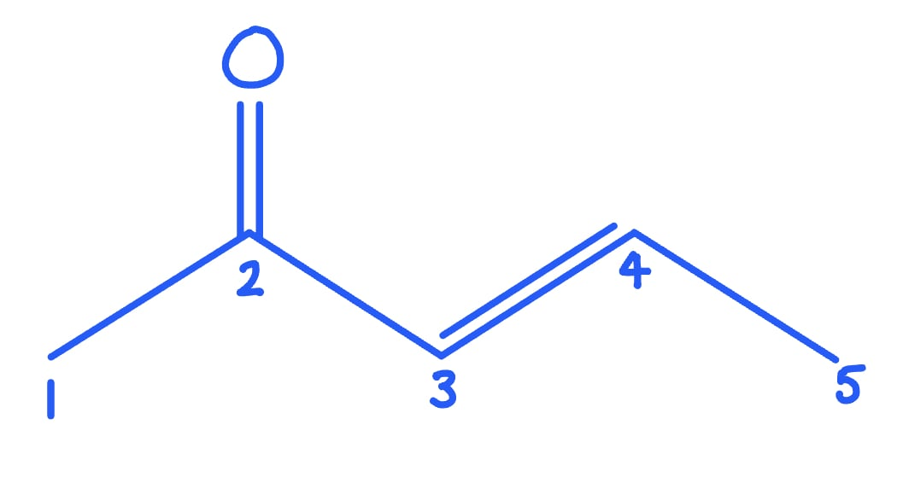
> 
> The ketone group (C=O) is on carbon 2, giving the suffix '2-one'. The C=C double bond is on carbon 3, giving '3-en' in the name.

### Q3
> **[mark-scheme]**
> The mechanisms are:
> 
> - Reaction **1**: electrophilic addition **[1 mark]**
> - Reaction **3**: nucleophilic addition **[1 mark]**

> **[exam-tip]**
> Reaction 1 (propene → propan-2-ol) is hydration: an electrophile (H+ from water) adds to the C=C bond.
> 
> Reaction 3 (propanone → 2-hydroxy-2-methylpropanenitrile) is nucleophilic addition: the CN- ion (a nucleophile) attacks the electron-deficient carbonyl carbon.
> **[mark-scheme]**
> The reagents and conditions are:
> 
> Reaction **1** (propene → propan-2-ol):
> 
> - Steam / H2O (g) **[1 mark]**
> - Concentrated phosphoric acid / H3PO4 / concentrated sulfuric acid / H2SO4 (catalyst) **[1 mark]**
> 
> Reaction **2** (propan-2-ol → compound **G**, propanone):
> 
> - Acidified potassium dichromate / K2Cr2O7 / H+
> **OR**
> Acidified potassium manganate(VII) / KMnO4 / H+ **[1 mark]**
> - Heat
> **AND**
> Reflux **[1 mark]**

> **[exam-tip]**
> Reaction 1 is hydration of propene. Steam (not liquid water) is required as the reagent, along with an acid catalyst.
> 
> Reaction 2 is oxidation of propan-2-ol (a secondary alcohol) to propanone (a ketone). Unlike primary alcohols, secondary alcohols can only be oxidised to ketones under these conditions.
The completed mechanism for reaction **3** (nucleophilic addition of HCN to propanone) is:

**[4 marks]**

> **[mark-scheme]**
> 1 mark for correct partial charges (δ+ on carbonyl C, δ- on carbonyl O) and lone pair shown on CN-
> 
> 1 mark for curly arrow from lone pair on CN- to δ+ carbon atom of C=O bond
> 
> 1 mark for curly arrow from C=O bond to O atom
> 
> 1 mark for curly arrow from lone pair on negatively charged O- intermediate to H+ ion, giving the final product

> **[exam-tip]**
> The nucleophilic addition of HCN to a carbonyl compound is a two-step mechanism:
> 
> 1. The CN- ion (nucleophile) attacks the δ+ carbonyl carbon. The C=O bond breaks, with both electrons going to the oxygen, forming a negatively charged tetrahedral intermediate.
> 2. The negatively charged oxygen is protonated by H+ (from HCN, water, or dilute acid) to give the 2-hydroxynitrile product.
> 
> HCN is generated in situ from KCN or NaCN with dilute sulfuric acid. It is highly toxic.
> **[mark-scheme]**
> 2-hydroxy-2-methylpropanenitrile does not exhibit optical isomerism because:
> 
> - There is no chiral carbon / chiral centre; **[1 mark]**
> - The central carbon bears two identical methyl groups (two of the four substituents are the same), so it does not have four different groups attached; **[1 mark]**

> **[exam-tip]**
> For optical isomerism to occur, a molecule must contain a chiral carbon (a carbon with four different atoms or groups attached).
> 
> It can help to draw out the structure and identify the main carbon chain. In nitriles, the CN carbon is the first carbon.
> 
> 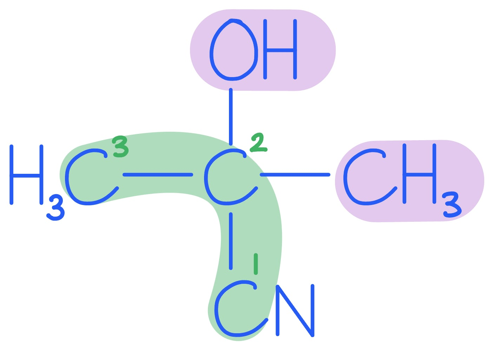
> 
> In 2-hydroxy-2-methylpropanenitrile, the central carbon is bonded to: –OH, –CN, –CH3, and –CH3. Since two of the groups are identical (–CH3), this carbon is not chiral and optical isomers cannot form.

### Q4
To determine the systematic name of compound **Y**:

- Calculate the relative molecular mass:

*M*r = $\frac{\mathrm{mass}}{\mathrm{moles}}$

*M*r = $\frac{2.754}{0.0270}$

*M*r = 102.0 g mol-1 **[1 mark]**

- Compound **Y** has 5 carbons
- It is a carboxylic acid (oxidation product of a primary alcohol)
- So, compound **Y** is:

**pentanoic acid** **[1 mark]**

> **[exam-tip]**
> Start by calculating *M*r.
> 
> - With 5 carbons (60 g mol-1) accounted for, the remaining mass is 42 g mol-1.
> - Testing with 2 oxygen atoms: 42 − 32 = 10 g mol-1 of hydrogen, giving C5H10O2
> - This is consistent with a carboxylic acid.
> 
> Compound **X** is a primary alcohol (pentan-1-ol), which oxidises fully to the carboxylic acid (compound **Y**). A carboxylic acid has two oxygen atoms in the formula.
> **[mark-scheme]**
> The structural formula of compound **W** and identity of **Z** are:
> 
> - **W** = CH3CH2CH2CH2COOCH2CH2CH2CH2CH3 **[1 mark]**
> - Compound **Z** = H2O, formed by condensation reaction between compound **X** (pentan-1-ol) and compound **Y** (pentanoic acid); **[1 mark]**

> **[exam-tip]**
> Compound **W** is an ester formed from pentanoic acid (**Y**) and pentan-1-ol (**X**). Its systematic name is pentyl pentanoate.
> 
> The condensation reaction between an alcohol and a carboxylic acid always produces an ester and water. The water molecule is lost from the −OH of the acid and the H of the alcohol's −OH group.
> **[mark-scheme]**
> The homologous series and conditions are:
> 
> - Aldehyde / pentanal **[1 mark]**
> - Distil the product immediately as it forms / use distillation conditions so it is removed from the reaction mixture before further oxidation can occur **[1 mark]**

> **[exam-tip]**
> A primary alcohol oxidises in two stages: first to an aldehyde, then to a carboxylic acid. To stop at the aldehyde stage, the aldehyde must be removed from the reaction mixture as soon as it forms. This is achieved by distilling it off immediately.
> 
> Under reflux conditions, the aldehyde stays in the flask and is further oxidised to the carboxylic acid. Using distillation instead of reflux prevents this.
The skeletal formula and systematic name are:

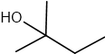

2-methylbutan-2-ol

**[2 marks]**

> **[mark-scheme]**
> 1 mark for the skeletal formula of 2-methylbutan-2-ol
> 
> 1 mark for the name: 2-methylbutan-2-ol

> **[exam-tip]**
> For a C5 alcohol to not react with acidified K2Cr2O7, it must be a tertiary alcohol. Only 2-methylbutan-2-ol fits: the central carbon has an OH group and is bonded to three other carbon atoms (no H on the OH-bearing carbon).
> 
> Primary and secondary alcohols both react with acidified K2Cr2O7 to give aldehydes/carboxylic acids or ketones respectively. Tertiary alcohols cannot be oxidised in this way because there is no H atom on the carbon bearing the OH group.

### Q5
> **[mark-scheme]**
> The reagent and conditions required for reaction 1 are:
> 
> - Concentrated H2SO4 / concentrated H3PO4 **[1 mark]**
> - Heat
> **OR**
> Pass vapour over hot Al2O3 **[1 mark]**

> **[exam-tip]**
> Reaction 1 is the dehydration of butan-1-ol to give but-1-ene, which is an elimination reaction. It requires a dehydrating agent (concentrated H2SO4 or H3PO4) and heat, or the vapour can be passed over hot Al2O3.
> **[mark-scheme]**
> i) The equation for reaction 2 is:
> 
> - C4H9OH + 2[O] → C3H7CO2H + H2O **[1 mark]**
> 
> ii) The reagents and conditions required for reaction 2 are:
> 
> - Reagent: sodium dichromate / Na2Cr2O7
> **OR**
> Potassium dichromate / K2Cr2O7 **[1 mark]**
> - Conditions: H+ / acidified
> **AND**
> Heat under reflux **[1 mark]**

> **[exam-tip]**
> Reaction 2 is the full oxidation of butan-1-ol (a primary alcohol) to butanoic acid (a carboxylic acid). Full oxidation requires heating under reflux. If distillation were used instead, the product would be the aldehyde (butanal), not the carboxylic acid.
> **[mark-scheme]**
> The structural formulae of **U** and **V** are:
> 
> Any **one** of the following pairs (1 mark for **U** and 1 mark for **V**):
> 
> Pair 1
> 
> - **U** = CH3CH2CH(OH)CH3
> - **V** = CH3CH2CHBrCH3
> 
> Pair 2
> 
> - **U** = CH3CH2CH2CH2OH
> - **V** = CH3CH2CH2CH2Br
> 
> **[2 marks]**
> 
> **U** and **V** must be consistent with each other (i.e. if **U** is the secondary alcohol, **V** must be the secondary bromoalkane).

> **[exam-tip]**
> But-1-ene is an unsymmetrical alkene. When it reacts with steam (electrophilic addition / hydration), two alcohols can form:
> 
> - Butan-2-ol: major product (via more stable secondary carbocation)
> - Butan-1-ol: minor product (via less stable primary carbocation)
> 
> Whichever alcohol you choose for **U**, compound **V** is the corresponding bromoalkane formed by reaction of that alcohol with HBr.
> **[mark-scheme]**
> The reagent and conditions required for reaction 3 are:
> 
> - Reagent: KOH / NaOH **[1 mark]**
> - Conditions: ethanol / alcoholic
> **AND**
> Heat / reflux **[1 mark]**

> **[exam-tip]**
> Reaction 3 is an elimination reaction: a hydrogen and a bromine atom are removed from compound **V** to reform but-1-ene (an alkene).
> 
> This requires a strong base (KOH or NaOH) dissolved in ethanol (not water as aqueous conditions would give nucleophilic substitution instead) and heat.

### Q6
> **[mark-scheme]**
> The reagents and conditions required to convert butan-1-ol into 1-bromobutane are:
> 
> Any **one** of the following (1 mark for each point):
> 
> Set 1
> 
> - Reagents: sodium bromide / NaBr **AND** concentrated sulfuric acid / H2SO4
> - Conditions: heat / heat under reflux
> 
> **OR**
> 
> Set 2
> 
> - Reagents: phosphorus tribromide / PBr3
> - Conditions: added dropwise / room temperature
> 
> **[2 marks]**

> **[exam-tip]**
> Two reagent sets can convert butan-1-ol into 1-bromobutane:
> 
> 1. NaBr and concentrated H2SO4 with heat — the acid generates HBr in situ from the NaBr, which reacts with the alcohol.
> 2. PBr3 added dropwise at room temperature — reacts directly with the alcohol.
> 
> Make sure your stated conditions are consistent with the reagents you give.
> **[mark-scheme]**
> The type of reaction and the systematic name of the alkene formed are:
> 
> - Elimination / dehydration **[1 mark]**
> - But-1-ene **[1 mark]**

> **[exam-tip]**
> When a primary alcohol such as butan-1-ol is heated with concentrated sulfuric acid, an elimination reaction (also called dehydration) occurs. A water molecule is removed from the alcohol, and a C=C double bond forms.
> 
> Since the hydroxyl group is on carbon 1 of butan-1-ol, the only alkene that can form is but-1-ene.
> **[mark-scheme]**
> The major organic product is:
> 
> - 2-bromobutane **[1 mark]**

> **[exam-tip]**
> But-1-ene is an unsymmetrical alkene. When HBr adds across the double bond, two products form:
> 
> - 1-bromobutane (minor product, via primary carbocation intermediate)
> - 2-bromobutane (major product, via more stable secondary carbocation intermediate)

### Q7
> **[mark-scheme]**
> The reagents and conditions required are:
> 
> i) Conversion of compound **A** to compound **B** (elimination):
> 
> - Potassium hydroxide / KOH / sodium hydroxide / NaOH **[1 mark]**
> - Ethanol / ethanolic / alcoholic **[1 mark]**
> - Heat / heat under reflux **[1 mark]**
> 
> ii) Conversion of compound **A** to compound **C** (nucleophilic substitution):
> 
> - Potassium cyanide / KCN **[1 mark]**
> - Ethanol / ethanolic / alcoholic **[1 mark]**
> - Heat / heat under reflux **[1 mark]**

> **[exam-tip]**
> The conversion of a halogenoalkane to an alkene (**A** to **B**) is an elimination reaction. It requires an alkoxide/hydroxide base dissolved in ethanol as the solvent, heated under reflux. Using aqueous conditions instead would give nucleophilic substitution to produce an alcohol, not the alkene.
> 
> The conversion of a halogenoalkane to a nitrile (**A** to **C**) is a nucleophilic substitution. The cyanide ion (CN-) from KCN acts as the nucleophile, displacing the halide. Ethanol is used as solvent and heat is applied.
> **[mark-scheme]**
> The systematic name of compound **C** is:
> 
> - Butanenitrile **[1 mark]**

> **[exam-tip]**
> When a cyanide ion (CN-) reacts with a halogenoalkane by nucleophilic substitution, the CN group adds one carbon to the chain. Compound **A** has three carbon atoms, so compound **C** has four carbons in total.
> 
> When naming a nitrile, count the CN carbon as part of the main chain. Butanenitrile has four carbons: CH3CH2CH2CN.
i) The skeletal formula of compound **D** is:

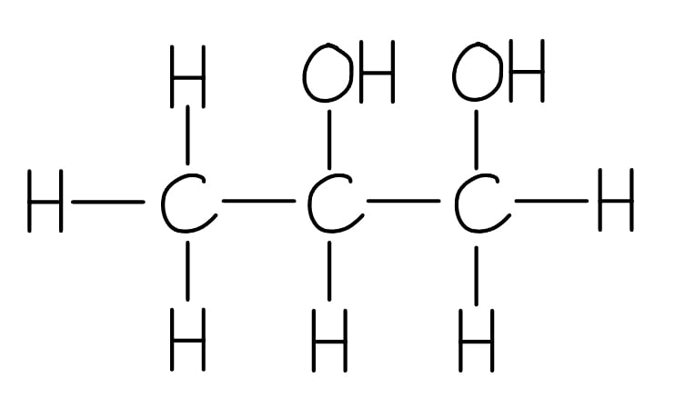

**[1 mark]**

> **[mark-scheme]**
> 1 mark for correct diol structure of compound **D** with OH groups on adjacent carbons

ii) The skeletal formulae of compounds **E** and **F** are (in any order):

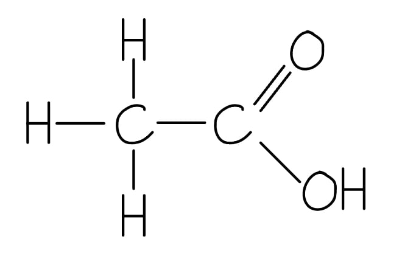

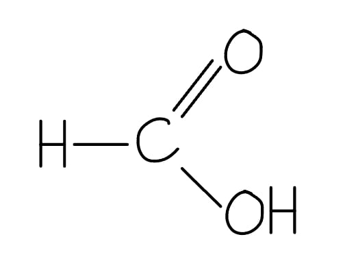

**[2 marks]**

> **[mark-scheme]**
> 1 mark for correct skeletal formula of ethanoic acid
> 
> 1 mark for correct skeletal formula of methanoic acid (or CO2 if methanoic acid is fully oxidised)

> **[exam-tip]**
> The reaction of an alkene with potassium manganate(VII) depends on the conditions used:
> 
> - Cold dilute acidified KMnO4: oxidises the C=C to form a diol (two OH groups added across the double bond). Colour change: purple to colourless.
> - Hot concentrated acidified KMnO4: cleaves the C=C bond completely. Each carbon of the double bond is oxidised: a CH2= group gives methanoic acid (which may be further oxidised to CO2 and H2O); a CH3CH= group gives ethanoic acid.
> 
> The actual products depend on what is bonded to each carbon of the C=C double bond in the starting alkene.

### Q8
> **[mark-scheme]**
> The reagents, conditions and type of reaction for step 1 are:
> 
> - K2Cr2O7 / Cr2O72- / (potassium) dichromate
> **OR**
> KMnO4 / MnO4- / (potassium) permanganate **[1 mark]**
> - H2SO4 / H+ / acidified
> **OR**
> Heat **[1 mark]**
> - Oxidation **[1 mark]**

> **[exam-tip]**
> Compound **A** is a carboxylic acid formed by oxidation of an aldehyde. The aldehyde and the carboxylic acid both contain the same number of carbon atoms as oxidation does not extend the carbon chain.
> 
> A carboxylic acid cannot be produced from the ketone (the second molecule shown in Fig. 5.1), which is why step 1 uses the aldehyde.
i) The systematic name and fully displayed formula of compound **B** are:

Butan-2-ol

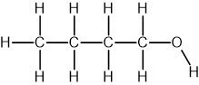

**[2 marks]**

> **[mark-scheme]**
> 1 mark for the correct name of butan-2-ol
> 
> 1 mark for a fully displayed formula for butan-2-ol, including all C-H, C-C and O-H bonds explicitly shown

> **[mark-scheme]**
> ii) The type of reaction and reagents/conditions for step 2 are:
> 
> - Reduction **[1 mark]**
> - LiAlH4 / lithium aluminium hydride / lithium tetrahydridoaluminate
> **OR**
> NaBH4 / sodium borohydride / sodium tetrahydridoborate **[1 mark]**

> **[exam-tip]**
> Step 2 is the reduction of butanone (a ketone) to butan-2-ol (a secondary alcohol). Two reducing agents are acceptable: LiAlH4 and NaBH4.
> 
> LiAlH4 is more reactive and must be used in dry ether solvent (water would decompose it). NaBH4 is safer and can be used in aqueous or alcoholic solution.
> **[mark-scheme]**
> The two-step synthesis of ethanol from ethane:
> 
> Step 1 (ethane → chloroethane / bromoethane):
> 
> - Reagent: chlorine / Cl2 **OR** bromine / Br2 **[1 mark]**
> - Conditions: UV light / high temperature **[1 mark]**
> - Type of reaction: free radical substitution / halogenation **[1 mark]**
> 
> Step 2 (chloroethane / bromoethane → ethanol):
> 
> - Reagent: aqueous sodium hydroxide / NaOH (aq)
> **OR**
> Aqueous potassium hydroxide / KOH (aq) **[1 mark]**
> - Conditions: heat / heat under reflux **[1 mark]**
> - Type of reaction: nucleophilic substitution / hydrolysis **[1 mark]**

> **[exam-tip]**
> This is a non-standard synthesis route as ethanol is made by hydration of ethene in industry. However, the route via free radical halogenation tests your ability to connect alkane and halogenoalkane chemistry.
> 
> Note: free radical halogenation of ethane can produce multiple products (CH3CH2Cl, CH3CHCl2, etc.), making it impractical in reality. The question assumes controlled monohalogenation for the purposes of the synthesis.
> **[mark-scheme]**
> i) The systematic name of compound **D** is:
> 
> Any **one** from:
> 
> - 1-bromopropane
> - 1-chloropropane
> - 1-iodopropane
> 
> **[1 mark]**
> 
> Any 1-halopropane is accepted
> 
> ii) The reagents and conditions for step 4 are:
> 
> - Aqueous sodium hydroxide / NaOH (aq)
> **OR**
> Aqueous potassium hydroxide / KOH (aq) **[1 mark]**
> - Heat / heat under reflux **[1 mark]**

> **[exam-tip]**
> In Fig. 5.2:
> 
> - **A** = propanone
> - **B** = propan-2-ol
> - **C** = propene
> - **D** = 1-halopropane
> 
> Note on step 3:
> 
> - 1-halopropane is the minor product of HX addition to propene.
> - By Markovnikov's rule, the major product is 2-halopropane (via the more stable secondary carbocation).
> - The pathway in Fig. 5.2 requires anti-Markovnikov addition.
> - In practice, propan-1-ol can be produced via other routes such as hydroboration.
> 
> Step 4 is nucleophilic substitution: the OH- ion displaces the halide from compound **D**, giving propan-1-ol. Aqueous (not ethanolic) NaOH or KOH is required as ethanolic conditions would favour elimination, regenerating propene.

### Q9
> **[mark-scheme]**
> i) The name of the mechanism is:
> 
> Electrophilic addition **[1 mark]**

ii) The completed mechanism is:

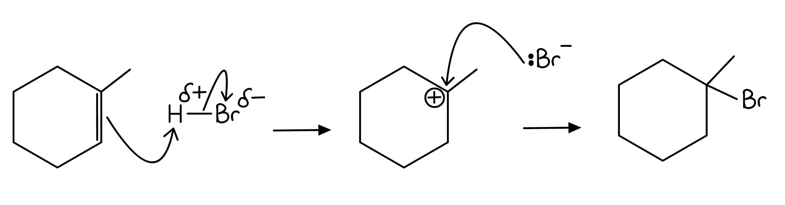

**[4 marks]**

> **[mark-scheme]**
> 1 mark for curly arrow from C=C bond to H in H-Br **AND** δ+ shown on H and δ- shown on Br
> 
> 1 mark for curly arrow from H-Br bond to Br atom
> 
> 1 mark for tertiary carbocation correctly drawn and labelled with positive charge on carbon
> 
> 1 mark for curly arrow from lone pair on :Br- to carbocation **AND** correct skeletal structure of 1-bromo-1-methylcyclohexane drawn as major product

> **[exam-tip]**
> The methyl substituent on compound **E** (1-methylcyclohexene) means the addition of H-Br can generate either a tertiary or a secondary carbocation intermediate. The major product forms via the more stable carbocation.
> 
> For full marks on a mechanism, always show:
> 
> - The bond dipole on the electrophile (δ+ on H, δ- on Br)
> - Each curly arrow starting from a bond or a lone pair, ending at the atom being attacked
> - The charge on any ionic intermediate
> **[mark-scheme]**
> A major and a minor product are produced because:
> 
> - The reaction proceeds via a tertiary carbocation intermediate (giving the major product)
> **OR**
> A secondary carbocation intermediate (giving the minor product) **[1 mark]**
> - The tertiary carbocation is more stable than the secondary carbocation, due to the greater electron-donating effect of three alkyl groups delocalising the positive charge **[1 mark]**

> **[exam-tip]**
> This is an application of Markovnikov's rule. Because one carbon of the C=C double bond in compound **E** carries a methyl group (and is part of the ring), addition of H+ to that carbon would give a secondary carbocation, while addition to the other carbon gives a tertiary carbocation.
> 
> Tertiary carbocations are more stable because three alkyl groups donate electron density towards the positive charge. The more stable intermediate forms more readily, so the tertiary carbocation pathway is favoured and 1-bromo-1-methylcyclohexane is the major product.
i) Possible structures for compound **D** are:

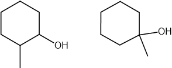

**[1 mark]**

> **[mark-scheme]**
> 1 mark for the skeletal formula of 1-methylcyclohexanol **OR** 2-methylcyclohexanol

> **[mark-scheme]**
> ii) The reagents and conditions required for step 1 are:
> 
> - Concentrated phosphoric acid / H3PO4
> **OR**
> Concentrated sulfuric acid / H2SO4
> **OR**
> Aluminium oxide / Al2O3 **[1 mark]**
> - Heat **[1 mark]**

> **[exam-tip]**
> Step 1 is a dehydration (elimination) reaction, where compound **D** (a methylcyclohexanol) loses water to form compound **E** (1-methylcyclohexene).
> 
> The dehydrating agent can be concentrated H3PO4, concentrated H2SO4, or hot Al2O3. Make sure your conditions match the reagent given and that heat is included.

### Q10
> **[mark-scheme]**
> A test-tube reaction to distinguish between compounds **G** and **H** is:
> 
> - Reagent: acidified potassium dichromate(VI) / K2Cr2O7 / H+ / Cr2O72- **[1 mark]**
> - Compound **G** (secondary alcohol) turns the solution from orange to green
> **AND**
> Compound **H** (ketone) produces no colour change **[1 mark]**
> 
> (Acidified) potassium manganate(VII) solution going purple to colourless with **G** and showing no change with **H**

> **[exam-tip]**
> Compound **G** is cyclopentanol, a secondary alcohol. Compound **H** is cyclopentanone, a ketone.
> 
> Secondary alcohols are oxidised by acidified potassium dichromate(VI), turning the orange solution green. Ketones cannot be oxidised under these conditions, so the solution remains orange.
> **[mark-scheme]**
> A test-tube reaction to distinguish between compounds **I** and **J** is:
> 
> - Reagent: warm with aqueous silver nitrate / AgNO3 (aq) **[1 mark]**
> - Compound **J** (halogenoalkane) produces a white precipitate (silver chloride / AgCl)
> **AND**
> Compound **I** (saturated hydrocarbon) produces no precipitate **[1 mark]**

> **[exam-tip]**
> Compound **I** is methylcyclopentane, a saturated hydrocarbon. Compound **J** is (chloromethyl)cyclopentane, a halogenoalkane.
> 
> When warmed with aqueous silver nitrate, the C–Cl bond in **J** undergoes hydrolysis, releasing Cl- ions that precipitate as white silver chloride (AgCl). The saturated hydrocarbon **I** has no halogen and produces no precipitate.
> 
> Warming is needed to provide sufficient energy for hydrolysis of the C–Cl bond. State the colour and composition of the precipitate clearly: white AgCl.
> **[mark-scheme]**
> A test-tube reaction to distinguish between compounds **K** and **L** is:
> 
> Any **one** of the following pairs (1 mark for the reagent and 1 mark for the associated observation):
> 
> Pair 1
> 
> - Reagent: Tollens' reagent / ammoniacal silver nitrate
> - Observations: Compound **K** (aldehyde / propanal) produces a silver mirror
> **AND**
> Compound **L** (carboxylic acid / propanoic acid) produces no reaction
> 
> Pair 2
> 
> - Reagent: Benedict's / Fehling's solution
> - Observations: Compound **K** (aldehyde / propanal) produces a red / brick-red precipitate
> **AND**
> Compound **L** (carboxylic acid / propanoic acid) produces no reaction
> 
> Pair 3
> 
> - Reagent: Sodium carbonate / Na2CO3 / sodium hydrogencarbonate / NaHCO3
> - Observations: Compound **K** (aldehyde / propanal) produces no reaction
> **AND**
> Compound **L** (carboxylic acid / propanoic acid) produces effervescence / CO2 / bubbles
> 
> **[2 marks]**

> **[exam-tip]**
> Compound **K** is propanal, an aldehyde. Compound **L** is propanoic acid, a carboxylic acid.
> 
> Aldehydes are reducing agents:
> 
> - Tollens' reagent is reduced to give a silver mirror
> - Fehling's solution is reduced to give a red/brick-red precipitate.
> - Carboxylic acids do not reduce these reagents.
> 
> Alternatively, sodium carbonate or sodium hydrogencarbonate reacts with the carboxylic acid (**L**) to produce CO2 effervescence; the aldehyde (**K**) does not react. If using this reagent, the positive observation is for compound **L**, not compound **K**.

### Q11
> **[mark-scheme]**
> The types of reaction are:
> 
> - Step 1: nucleophilic substitution **[1 mark]**
> - Step 2: oxidation **[1 mark]**

> **[exam-tip]**
> In step 1, 1-chlorobutane reacts with NaOH (aq). The hydroxide ion is a nucleophile that displaces the chloride ion, forming butan-1-ol (compound **G**).
> 
> In step 2, the acidified K2Cr2O7 oxidises butan-1-ol. The reagents in step 2 are the clue: K2Cr2O7/H2SO4 is an oxidising agent used for alcohol oxidation.
> **[mark-scheme]**
> The systematic name of compound **H** is:
> 
> - Butanoic acid **[1 mark]**

> **[exam-tip]**
> Compound **G** is butan-1-ol (a primary alcohol). When a primary alcohol is heated under reflux with acidified K2Cr2O7, full oxidation occurs and a carboxylic acid is formed. If distillation were used instead, the product would be the aldehyde (butanal).
The skeletal formula of the alkene is:

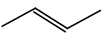

**[1 mark]**

> **[mark-scheme]**
> 1 mark for the skeletal formula of but-2-ene
> 
> The reagent is:
> 
> - Hydrogen chloride / HCl **[1 mark]**

> **[exam-tip]**
> Due to Markovnikov's rule, when HCl adds to but-1-ene, the major product is 2-chlorobutane (formed via the more stable secondary carbocation). 1-chlorobutane is only the minor product.
> 
> But-2-ene cannot give 1-chlorobutane at all. Addition of HCl to but-2-ene only gives 2-chlorobutane.
> **[mark-scheme]**
> The homologous series is:
> 
> - Ketone (rather than carboxylic acid) **[1 mark]**
> 
> Explanation:
> 
> - 2-chlorobutane undergoes nucleophilic substitution to form a secondary alcohol / butan-2-ol, which is oxidised to a ketone when heated under reflux with acidified K2Cr2O7 **[1 mark]**

> **[exam-tip]**
> The key distinction:
> 
> - Primary alcohols: oxidised to aldehydes (distillation) or carboxylic acids (reflux)
> - Secondary alcohols: oxidised to ketones (whether distillation or reflux)
> - Tertiary alcohols: not oxidised by acidified K2Cr2O7
> 
> Since 2-chlorobutane gives the secondary alcohol butan-2-ol in step 1, the product of step 2 is butanone (a ketone), not a carboxylic acid.
