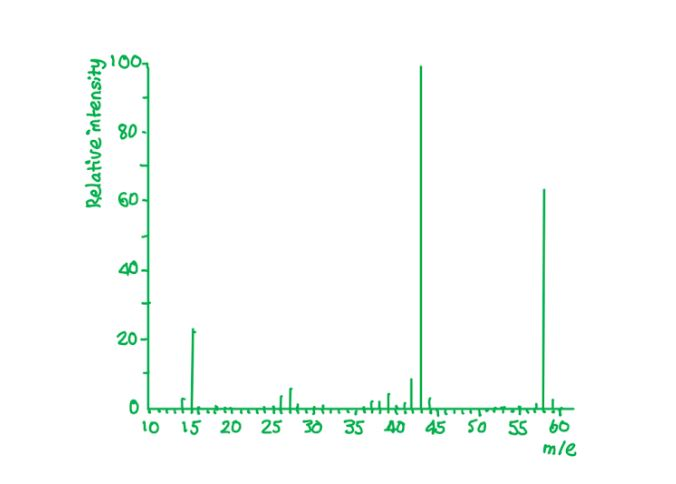
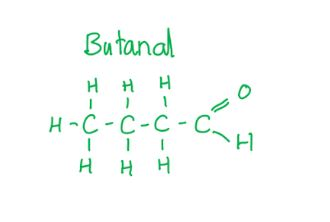
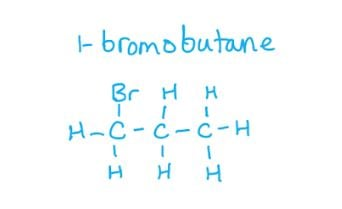
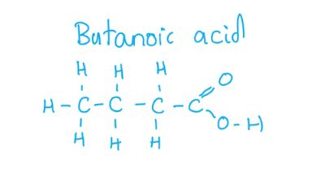
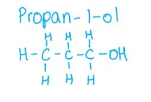
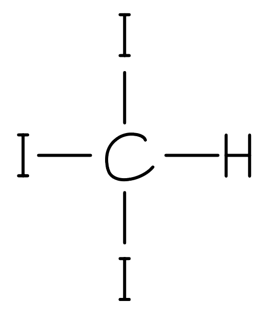
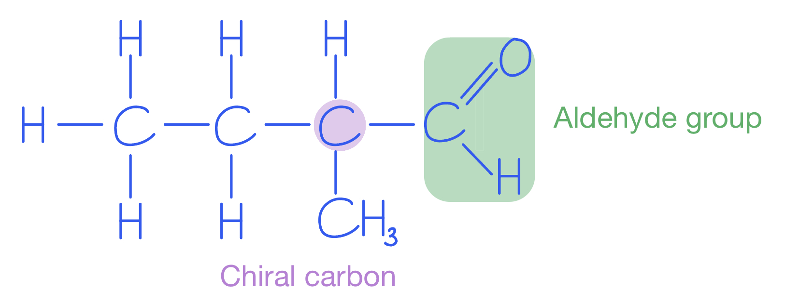
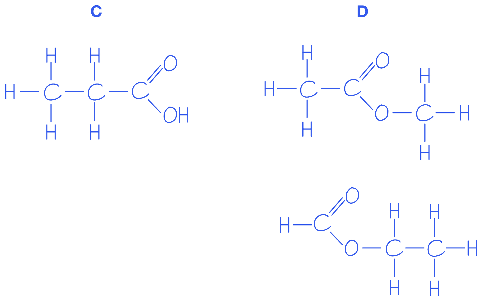
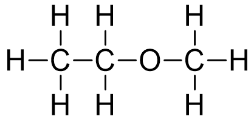

# Mark Schemes — Infrared Spectroscopy
**22. Analytical Techniques** · Cambridge (CIE) AS chemistry (9701)

## Multiple Choice Questions (9 questions)

### Q1
**Final answer:** **The correct answer is C**

- Butanal contains a C=O (carbonyl) group, which gives the characteristic absorption between 1670 and 1740 cm-1.

**A** is incorrect as there is no absorption at 1500–1680 cm-1 due to C=C, therefore the compound cannot be but-1-ene.

**B** is incorrect as there is no absorption at 3200–3600 cm-1 due to O-H (alcohol), therefore the compound cannot be butan-1-ol.

**D** is incorrect as there is no absorption at 2500–3000 cm-1 due to O-H (acid), therefore the compound cannot be butanoic acid.

### Q2
**Final answer:** **The correct answer is D**

- The molecular ion peak (M+) is the peak with the highest *m/e* ratio, excluding any peaks due to heavier isotopes.
- Both propanal and propanone have the molecular formula C3H6O and so both have a molecular ion peak at *m/e* = 58.

  - Propanal arises from the CH3CH2CHO+ ion.
  - Propanone arises from the CH3COCH3+ ion.
- Propanal mass spectrum

- Propanone mass spectrum

**A** is incorrect as propanal and propanone do have a different fingerprint region in the infrared spectrum.

**B** is incorrect as both compounds show absorption in the infrared spectrum due to the C=O bond.

**C** is incorrect as propanal and propanone do have different fragmentation patterns in the mass spectrum.

### Q3
**Final answer:** **The correct answer is C**

- The spectrum shows a strong absorption between 1670 and 1740 cm-1, characteristic of a C=O (carbonyl) bond in an aldehyde.
- C-H absorptions are visible at 2850–2950 cm-1 (alkyl C-H) and at approximately 2700–2820 cm-1 (the characteristic aldehyde C-H doublet).
- Butanal is an aldehyde and contains a C=O group consistent with the spectrum.

**A** is incorrect as 1-bromobutane contains no C=O bond and would show no absorption at approximately 1700 cm-1.

**B** is incorrect as butan-1-ol would show a strong O-H absorption at 3200–3600 cm-1 due to the hydroxyl group, with no C=O absorption at approximately 1700 cm-1.

**D** is incorrect as butanoic acid would show a broad O-H absorption at 2500–3000 cm-1 due to the carboxyl group, in addition to the C=O absorption.

### Q4
**Final answer:** **The correct answer is B**

- The spectrum shows an absorption at 3200–3600 cm-1, characteristic of the O-H bond in an alcohol.
- The spectrum also shows an absorption at approximately 1700–1740 cm-1, characteristic of a C=O (carbonyl) bond in a ketone or aldehyde.
- The compound contains both an alcohol O-H and a ketone C=O; the O-H of a carboxylic acid absorbs at 2500–3000 cm-1, which is not observed here.

**A** is incorrect as butanoic acid is a carboxylic acid whose O-H absorption appears at 2500–3000 cm-1, not at 3200–3600 cm-1 as shown in the spectrum.

**C** is incorrect as pent-4-en-1-ol contains a C=C bond that would produce a characteristic absorption at 1500–1680 cm-1, which is absent in this spectrum.

**D** is incorrect as pent-4-en-2-one does not contain an O-H bond, but the spectrum shows an O-H absorption at 3200–3600 cm-1.

> **[exam-tip]**
> Note the position of the O-H absorption carefully:
> 
> - In alcohols it appears at 3200–3600 cm-1
> - In carboxylic acids it is a broader absorption at 2500–3000 cm-1.
> 
> A common error is to label the C-H absorption (2850–2950 cm-1) as O-H.

### Q5
**Final answer:** **The correct answer is B**

- Infrared spectroscopy measures the absorption of infrared radiation by molecules, which is used to identify functional groups based on the bond strength and mass of the atoms involved.
- It is not used to determine the molecular mass.

  - A mass spectrometer is used for this.

**A** is incorrect as the identity of a compound can be determined by comparing its infrared spectrum with reference spectra.

**C** is incorrect as the presence of C=O bonds can be detected from the infrared spectrum.

**D** is incorrect as the presence of O-H bonds can be detected from the infrared spectrum.

### Q6
**Final answer:** **The correct answer is C**

- A carboxylic acid shows two key absorptions in the infrared spectrum:
- The C=O bond absorbs at 1670–1740 cm-1.
- The O-H bond in carboxylic acids produces a broad absorption at 2500–3000 cm-1.

**A** is incorrect as an alcohol would only show an O-H absorption at 3200–3600 cm-1 and not the broad O-H absorption at 2500–3000 cm-1 characteristic of a carboxylic acid.

**B** is incorrect as an aldehyde would only show a C=O absorption at 1670–1740 cm-1 and not the broad O-H absorption at 2500–3000 cm-1.

**D** is incorrect as a ketone would only show a C=O absorption at 1670–1740 cm-1 and not the broad O-H absorption at 2500–3000 cm-1.

### Q7
**Final answer:** **The correct answer is D**

- The infrared spectrum has a strong absorption at approximately 1700 cm-1.
- This matches the C=O absorption of propanone in the range 1670–1740 cm-1.
- Propanone contains a ketone C=O group, consistent with this absorption.

**A** is incorrect as propan-1-ol would not show an absorption at approximately 1700 cm-1 but would show an O-H absorption at 3200–3600 cm-1 due to the hydroxyl group.

**B** is incorrect as propan-2-ol would not show an absorption at approximately 1700 cm-1 but would show an O-H absorption at 3200–3600 cm-1 due to the hydroxyl group.

**C** is incorrect as propanal would show a C=O absorption at approximately 1700 cm-1, but also shows characteristic aldehyde C-H absorptions at 2700–2775 cm-1 and 2820–2900 cm-1, which are absent in this spectrum.

### Q8
**Final answer:** **The correct answer is A**

- The absorption between 1670 and 1740 cm-1 is characteristic of the C=O (carbonyl) bond, found in aldehydes, ketones, and carboxylic acids.
- Alcohols do not contain a C=O bond; the characteristic absorption of an alcohol is the O-H bond at 3200–3550 cm-1.

**B** is incorrect as aldehydes contain a C=O bond, which produces the characteristic absorption between 1670 and 1740 cm-1.

**C** is incorrect as carboxylic acids contain a C=O bond as part of the carboxyl group, which absorbs between 1670 and 1740 cm-1.

**D** is incorrect as ketones contain a C=O bond, which produces the characteristic absorption between 1670 and 1740 cm-1.

> **[exam-tip]**
> The three key infrared absorptions to learn for CIE IAL Chemistry are:
> 
> - O-H (alcohol): 3230–3550 cm-1.
> - C=O (aldehyde, ketone, carboxylic acid): 1670–1740 cm-1.
> - O-H (carboxylic acid, broad): 2500–3000 cm-1.

### Q9
**Final answer:** **The correct answer is A**

- A carboxylic acid shows a broad O-H absorption from 2500 to 3000 cm-1, caused by hydrogen bonding of the carboxyl O-H group, in addition to a strong C=O absorption at approximately 1700 cm-1.

**B** is incorrect as this is the IR spectrum of an alcohol, identified by the sharp O-H absorption at 3200–3600 cm-1 with no C=O absorption present.

**C** is incorrect as this is the IR spectrum of an ester, showing a strong C=O absorption between 1710 and 1750 cm-1 with no O-H absorption.

**D** is incorrect as this is the IR spectrum of a ketone, identified by the strong C=O absorption at approximately 1710 cm-1 with no O-H absorption.

## Structured Questions (7 questions)

### Q1
> **[mark-scheme]**
> The functional group present in each compound is:
> 
> - **Y**: carbonyl group / C=O
> **AND**
> Absorption at 1670-1740 cm-1 **[1 mark]**
> 
> - **Z**: carboxyl group / −COOH
> **AND**
> Absorptions at 1670-1740 cm-1 (C=O) and broad absorption at 2500–3000 cm-1 (O−H) **[1 mark]**

> **[exam-tip]**
> When identifying compounds from IR spectra, work through the absorptions above 1500 cm-1 and match them to the data table:
> 
> - A single absorption at 1670–1740 cm-1 (C=O) with no O−H absorption indicates an aldehyde or ketone
> - Absorptions at both 1670–1740 cm-1 (C=O) and 2500–3000 cm-1 (O−H in carboxyl) together indicate a carboxylic acid
> 
> Alcohols are oxidised by acidified potassium dichromate(VI). Primary alcohols can be oxidised to aldehydes (partial) or carboxylic acids (complete). Secondary alcohols are oxidised to ketones. Tertiary alcohols are not oxidised.
> **[mark-scheme]**
> The presence of a carbonyl group can be identified because:
> 
> - There is an absorption at 1670-1740 cm-1,  which corresponds to a C=O (carbonyl) bond / group **[1 mark]**

> **[exam-tip]**
> According to Table 2.1, a C=O (carbonyl) absorption occurs at 1670–1740 cm-1. The absorption visible in Fig. 2.2 falls within this range, confirming the presence of a carbonyl group.
> 
> A carbonyl group (C=O) is present in aldehydes, ketones, carboxylic acids, and esters. IR spectroscopy alone cannot distinguish between these compound types without additional information.
> **[mark-scheme]**
> i) The bonds responsible for the absorptions are:
> 
> - Ethanol at 3400 cm-1: O−H bond **[1 mark]**
> - Ethanal at 1720 cm-1: C=O bond **[1 mark]**
> 
> ii) The absorption at 3400 cm-1 does not appear in the ethanal spectrum because:
> 
> - Ethanal has no O−H bond **[1 mark]**

> **[exam-tip]**
> Use the data table to match each absorption to a bond:
> 
> - 3400 cm-1 falls within 3200–3600 cm-1 (O−H, hydroxy), present in ethanol
> - 1720 cm-1 falls within 1670–1740 cm-1 (C=O, carbonyl), present in ethanal
> 
> When ethanol (CH3CH2OH) is oxidised to ethanal (CH3CHO), the O−H group is replaced by a C=O group. This is why the broad O−H absorption at 3400 cm-1 disappears and a new C=O absorption appears at around 1720 cm-1.

### Q2
The structure of the yellow precipitate is:

**[1 mark]**

> **[mark-scheme]**
> 1 mark for the correct structure of triiodomethane (CHI3): carbon bonded to one hydrogen and three iodine atoms

> **[exam-tip]**
> The yellow precipitate from the iodoform reaction is triiodomethane (CHI3), sometimes called iodoform.
> 
> The reaction occurs when a methyl ketone (or ethanol) is warmed with alkaline I2 (aq). Compound **A** has a straight chain and gives a positive iodoform test, confirming it is a methyl ketone: pentan-2-one (CH3COCH2CH2CH3).
> **[mark-scheme]**
> i) The structural formulae of **A** and **B** are:
> 
> - **A** = CH3CH2CH2COCH3 **[1 mark]**
> - **B** = C2H5CH(CH3)CHO **[1 mark]**
> 
> ii) A chiral centre is:
> 
> - A carbon atom bonded to four different groups / atoms / substituents
> **OR**
> A tetrahedral carbon with four different substituents attached **[1 mark]**

> **[exam-tip]**
> Use the clues in the question to identify **A** and **B**:
> 
> Both react with 2,4-DNPH
> 
> - Both contain a carbonyl group (C=O)
> 
> **A** is unbranched and gives a positive iodoform test
> 
> - This confirms a methyl ketone group (COCH3).
> - The straight chain and methyl ketone give pentan-2-one: CH3CH2CH2COCH3
> 
> **B** contains a chiral centre (must be branched) and gives a silver mirror with Tollens' reagent
> 
> - This confirms an aldehyde.
> - The branching and chiral centre give 2-methylbutanal: C2H5CH(CH3)CHO
> 
> The chiral centre in **B** is the carbon bearing four different groups: H, CH3, C2H5, and CHO.
> 
> 
> **[mark-scheme]**
> The bonds responsible for the principal absorptions above 1500 cm-1 are:
> 
> Compound **C**:
> 
> - C=O (carboxyl / carbonyl)
> **AND**
> O−H (carboxyl) **[1 mark]**
> 
> Compound **D**:
> 
> - C=O (carbonyl / ester)
> **AND**
> C−H (alkane) **[1 mark]**

> **[exam-tip]**
> Use Table 2.1 to match the absorptions in each spectrum to bond types:
> 
> For compound **C** (propanoic acid, a carboxylic acid):
> 
> - Broad absorption at 2500–3000 cm-1 suggests O−H bond (carboxyl)
> - Absorption at around 1715 cm-1 suggests  C=O bond (carboxyl, range 1670–1740 cm-1)
> 
> For compound **D** (methyl ethanoate or ethyl methanoate, an ester):
> 
> - Absorption at around 1740 cm-1 suggests  C=O bond (ester, range 1710–1750 cm-1)
> - Absorption at 2850–2950 cm-1 suggests  C−H bond (alkane)
> - Note: esters do NOT have an O−H absorption. This is how you distinguish them from carboxylic acids
The displayed formulae of isomers **C** and **D** are:

**[2 marks]**

> **[mark-scheme]**
> 1 mark for the correct displayed formula of propanoic acid (CH3CH2COOH)
> 
> 1 mark for the correct displayed formula of methyl ethanoate (HCOOCH2CH3) **OR** ethyl methanoate (CH3COOCH3)

> **[exam-tip]**
> Isomers **C** and **D** both have the molecular formula C3H6O2. From the IR spectra:
> 
> Compound **C** has both C=O and O−H absorptions, which indicates a carboxylic acid. The only carboxylic acid with formula C3H6O2 is propanoic acid (CH3CH2COOH)
> 
> Compound **D** has C=O but no O−H, which indicates an ester. There are two ester isomers of C3H6O2:
> 
> - Methyl ethanoate (CH3COOCH3)
> - Ethyl methanoate (HCOOC2H5)
> **[mark-scheme]**
> The fragment ions responsible for the peaks are:
> 
> - *m*/*e* = 73: [C3H5O2]+ **[1 mark]**
> - *m*/*e* = 45: [COOH]+ **[1 mark]**
> - *m*/*e* = 29: [C2H5]+ **[1 mark]**

> **[exam-tip]**
> Compound **C** is propanoic acid (CH3CH2COOH, *M*r = 74). Work out the mass of each fragment:
> 
> - *m*/*e* = 73: *M*r − 1 = 73 → loss of H from the molecular ion → [C3H5O2]+
> - *m*/*e* = 45: COOH group → 12 + 16 + 16 + 1 = 45 → [COOH]+
> - *m*/*e* = 29: C2H5 group → (2 × 12) + (5 × 1) = 29 → [C2H5]+
> 
> Check: CH3 (15) + CH2 (14) + COOH (45) = 74 = *M*r of propanoic acid.
> 
> Always include the + charge when writing fragment ion formulae.

### Q3
To calculate the percentage by mass of hydrogen and oxygen in C3H8O:

- Calculate the *M*r of C3H8O:

*M*r = (3 x 12.0) + (8 x 1.0) + 16.0

*M*r = 60.0

**[1 mark]**

- Calculate the percentage by mass of each element:

% by mass = $\frac{\mathrm{total} \mathrm{mass} \mathrm{of} \mathrm{element}}{\mathrm{overall} \mathrm{mass} \mathrm{of} \mathrm{compound}}$ x 100

% by mass of H = $\frac{8.0}{60.0}$ x 100 = 13.3%

% by mass of O = $\frac{16.0}{60.0}$ x 100 = 26.7%

**[1 mark]**

> **[mark-scheme]**
> 1 mark for *M*r = 60.0
> 
> 1 mark for % H = 13.3% **AND** % O = 26.7%
> 
> Percentages given to 2 significant figures are accepted

> **[exam-tip]**
> All three isomers have the same molecular formula, so they all have the same percentage by mass for each element.
> 
> To find percentage by mass: divide the total mass of the element in one molecule by *M*r, then multiply by 100.
> 
> Check your answer:
> 
> 60.0 + 13.3 + 26.7 = 100.0
i) The fully displayed formula of isomer **C** is:

**[1 mark]**

> **[mark-scheme]**
> 1 mark for the correct fully displayed formula of methoxyethane (CH3OCH2CH3)
> 
> ii) The bond responsible for the absorption at around 1130 cm-1 is:
> 
> - C−O **[1 mark]**

> **[exam-tip]**
> Isomers **A** and **B** have an O−H absorption at 3200–3600 cm-1, confirming they are alcohols. Isomer **C** is a functional group isomer with no O−H absorption, meaning the oxygen is bonded differently. The only oxygen-containing functional group for C3H8O without O−H is an ether (C−O−C).
> 
> For part (ii), the absorption at 1130 cm-1 is below 1500 cm-1 (the fingerprint region). Although fingerprint absorptions normally require database comparison, the C−O bond is the only reasonable assignment here given the molecular formula and absence of other key absorptions.
> **[mark-scheme]**
> The systematic names of isomers **A** and **B** are:
> 
> - Propan-1-ol **[1 mark]**
> - Propan-2-ol **[1 mark]**
> 
> Either order is accepted as the question does not provide sufficient information to determine which is **A** and which is **B**.

> **[exam-tip]**
> Both **A** and **B** are positional isomers with an O−H absorption at 3200–3600 cm-1, confirming they are both alcohols. The only two positional isomers of C3H8O that are alcohols are propan-1-ol (−OH on carbon 1) and propan-2-ol (−OH on carbon 2).
> **[mark-scheme]**
> Isomer **A** is:
> 
> - Propan-1-ol **[1 mark]**
> 
> Explanation:
> 
> - The peak at *m*/*e* = 31 corresponds to the fragment ion CH2OH+ **[1 mark]**
> 
> Propan-2-ol is not accepted.

> **[exam-tip]**
> To find which fragment has *m*/*e* = 31, calculate the mass of possible fragments from propan-1-ol and propan-2-ol:
> 
> - CH2OH: 12 + 2(1) + 16 + 1 = 31, which is CH2OH+
> 
> This fragment comes from propan-1-ol (CH3CH2CH2OH) by cleavage of the C2−C3 bond, losing CH3CH2 (mass 29) to give CH2OH+ (mass 31).
> 
> Propan-2-ol ((CH3)2CHOH) cannot produce *m*/*e* = 31. Breaking its C−C bonds gives CH3+ (*m*/*e* = 15) or CH3CHOH+ (*m*/*e* = 45).
> 
> Always include the + charge when writing fragment ion formulae.

### Q4
> **[mark-scheme]**
> Determining the exact mass using mass spectrometry would not help because:
> 
> - All three compounds have the same molecular formula / are all C4H8O
> **OR**
> All three compounds have the same number and type of atoms **[1 mark]**
> - They would all give the same molecular ion peak / M+ at the same *m*/*e* value
> **OR**
> The exact mass of the molecular ion is the same for all three **[1 mark]**

> **[exam-tip]**
> High-resolution mass spectrometry determines the exact mass of the molecular ion. Structural isomers have the same molecular formula, so they have the same exact mass and the same *M*r. This means the molecular ion peak would appear at the same *m*/*e* value for all three compounds, making them impossible to distinguish by this method.
> 
> To distinguish structural isomers by mass spectrometry, you would need to look at the fragmentation pattern instead.
> **[mark-scheme]**
> The identity of the compound is:
> 
> - Compound **Z** **[1 mark]**
> 
> Explanation:
> 
> - Absorption at 3200–3600 cm-1 from the O−H bond / hydroxyl group
> **OR**
> Absorption at 1620–1680 cm-1 from the C=C bond / alkene group **[1 mark]**

> **[exam-tip]**
> Compounds **X** (butan-2-one) and **Y** (2-methylpropanal) are both carbonyl compounds with only a C=O absorption at 1670–1740 cm-1. Neither has an O−H or C=C group.
> 
> Compound **Z** (but-3-en-2-ol) has both an O−H group and a C=C double bond, producing absorptions at 3200–3600 cm-1 (O−H) and around 1620–1680 cm-1 (C=C). Either absorption is sufficient to identify the spectrum as belonging to compound **Z**.
> 
> You will always be given the data table in the exam, so use the wavenumber ranges to match absorptions to functional groups.
> **[mark-scheme]**
> Infrared spectroscopy could not be used to distinguish between **X** and **Y** because:
> 
> - They both contain the same key functional group
> **OR**
> They both contain a C=O bond and no other distinguishing functional group
> **OR**
> They are both carbonyl compounds **[1 mark]**
> - Both spectra would show an absorption at 1670–1740 cm-1 due to the C=O bond, with no other key distinguishing absorption **[1 mark]**

> **[exam-tip]**
> Compound **X** is a ketone (butan-2-one) and compound **Y** is an aldehyde (2-methylpropanal). Both functional groups contain a C=O bond that absorbs at 1670–1740 cm-1.
> 
> IR spectroscopy identifies functional groups by their characteristic absorptions. When two compounds share the same functional group and have no other distinguishing groups, their IR spectra look the same in the key regions above 1500 cm-1. This is why IR alone cannot distinguish between them.
> 
> To distinguish between an aldehyde and a ketone, chemical tests (such as Tollens' reagent or Fehling's solution) or mass spectrometry would be needed.
> **[mark-scheme]**
> A fragment ion present in compound **Y** but absent from compound **X** is:
> 
> - *m*/*e* = 28 **[1 mark]**
> - Formula: CO+ **[1 mark]**

> **[exam-tip]**
> Compound **Y** is an aldehyde (2-methylpropanal). Aldehydes produce a characteristic CHO+ fragment at *m*/*e* = 29. This can lose a hydrogen atom to give CO+ at *m*/*e* = 28.
> 
> Compound **X** is a ketone (butan-2-one). Ketones undergo α-cleavage to give acylium ions such as CH3CO+ (*m*/*e* = 43), but do not readily produce CO+ at *m*/*e* = 28.
> 
> This difference in fragmentation patterns allows mass spectrometry to distinguish between the two isomers even though they have the same *M*r and the same IR absorption region.

### Q5
> **[mark-scheme]**
> One possible identity of compound **C** is:
> 
> - Propanenitrile / propionitrile / C2H5CN **[1 mark]**
> 
> Explanation:
> 
> - The infrared spectrum shows an absorption at around 2250 cm-1
> **AND**
> This corresponds to a C≡N (nitrile) group **[1 mark]**
> - The C≡N group has a mass of 26
> **AND**
> 55 − 26 = 29, which corresponds to an ethyl group (C2H5), giving propanenitrile **[1 mark]**

> **[exam-tip]**
> This question requires you to use both spectra together.
> 
> From the IR spectrum: the absorption at around 2250 cm-1 is easy to overlook as it is less prominent than others. According to Table 2.1, C≡N (nitrile) absorbs at 2200–2250 cm-1. Do not be distracted by the absorption near 1450 cm-1 as this is in the fingerprint region and the question instructs you to use absorptions above 1500 cm-1 only.
> 
> From the MS: the molecular ion at *m*/*e* = 55 gives *M*r = 55. Subtract the mass of the C≡N group (26) to find the remaining fragment: 55 − 26 = 29. A fragment of mass 29 is an ethyl group (C2H5). Together: C2H5CN = propanenitrile.
> **[mark-scheme]**
> The M+1 peak at *m*/*e* = 56 is caused by:
> 
> - The carbon-13 (13C) isotope **[1 mark]**

> **[exam-tip]**
> The most common cause of the M+1 peak is the natural abundance of the carbon-13 isotope. About 1% of carbon atoms are 13C rather than 12C. When a molecule contains a 13C atom, its *M*r is 1 unit higher than normal, producing a small peak at M+1.
> 
> The more carbon atoms in a molecule, the larger the M+1 peak, because there is a greater probability of at least one 13C being present.
To calculate the percentage by mass of each element in compound **C** (propanenitrile, C3H5N, *M*r = 55):

- Calculate the percentage by mass of each element:

% C = $\frac{36.0}{55.0}$ x 100

% H = $\frac{5.0}{55.0}$ x 100

% N = $\frac{14.0}{55.0}$ x 100

**[1 mark]**

- Rounded to 3 significant figures:

% C = **65.5%**

% H = **9.09%**

% N = **25.5%**

**[1 mark]**

> **[mark-scheme]**
> 1 mark for correct method: (mass of element / *M*r) × 100 applied to at least one element
> 
> 1 mark for all three correct percentages to 3 sf: C = 65.5%, H = 9.09%, N = 25.5%

> **[exam-tip]**
> The percentage by mass of an element = (total mass of that element in one molecule / *M*r) × 100.
> 
> For propanenitrile (C3H5N, *M*r = 55):
> 
> - Mass of C = 3 × 12.0 = 36.0
> - Mass of H = 5 × 1.0 = 5.0
> - Mass of N = 14.0
> 
> Check: 65.5 + 9.09 + 25.5 ≈ 100 (small rounding difference is expected).
> **[mark-scheme]**
> The reagents and conditions required are:
> 
> - H2 (g) **AND **Nickel catalyst (Ni) / heat
> **OR**
> LiAlH4 **AND **Dry ether **[1 mark]**
> 
> Justification:
> 
> - The C≡N (nitrile) absorption at 2200–2250 cm-1 disappears
> **AND**
> An absorption appears at 3300–3500 cm-1, corresponding to N−H bonds in an amine **[1 mark]**

> **[exam-tip]**
> The C≡N group is reduced to an NH2 group in this reaction. There are two reagents that can reduce a nitrile:
> 
> 1. H2 (g) with a nickel catalyst is the most common answer expected at A level
> 2. LiAlH4 in dry ether is also acceptable (from nitrogen compounds topic)
> 
> To justify using the IR spectrum:
> 
> - The C≡N absorption at 2200–2250 cm-1 disappears (the nitrile is consumed)
> - A new N−H absorption appears at 3300–3500 cm-1 in the spectrum of compound **D** (the amine product)

### Q6
The equation for the hydrolysis of C2H5CHBrCH3 with aqueous sodium hydroxide is:

C2H5CHBrCH3 (l) + NaOH (aq) → C2H5CHOHCH3 (l) + NaBr (aq)

**[2 marks]**

> **[mark-scheme]**
> 1 mark for correct chemical formulae: C2H5CHBrCH3 + NaOH → C2H5CHOHCH3 + NaBr
> 
> 1 mark for all four correct state symbols: (l), (aq), (l), (aq)
> 
> C2H5CHOHCH3 may also be written as CH3CH(OH)CH2CH3

> **[exam-tip]**
> This is a nucleophilic substitution reaction. The OH− ion from NaOH replaces the Br atom attached to the carbon chain.
> 
> To deduce the state symbols, use Table 1.1:
> 
> - The boiling points of C2H5CHBrCH3 (364 K) and alcohol **A** (373 K) are both above room temperature (~298 K), so both are liquids (l)
> - NaOH is dissolved in water, so it is aqueous (aq)
> - NaBr is a soluble salt, so it forms an aqueous solution (aq)
> **[mark-scheme]**
> Alcohol **A** can be separated using the following steps:
> 
> - Distil the reaction mixture
> **AND**
> To remove NaBr (aq) from the organic/aqueous mixture **[1 mark]**
> - Cool the distillate to approximately 0 °C
> **AND**
> Water freezes (mp 273 K) while alcohol **A** remains liquid (mp 158 K), using the data in Table 1.1 **[1 mark]**
> - Filter the cooled mixture
> **AND**
> To remove the solid ice, leaving liquid alcohol **A** **[1 mark]**
> 
> The separating funnel method is also accepted: add an organic solvent to dissolve alcohol **A**, separate the organic layer using a separating funnel, then distil off the solvent to obtain pure alcohol **A**.

> **[exam-tip]**
> The key challenge here is that alcohol **A** and water have the same boiling point (373 K), so simple distillation cannot separate them.
> 
> The question specifically tells you to use Table 1.1, where the key data is the melting points. The melting point of alcohol **A** is 158 K, much lower than water (273 K). Cooling to just below 0 °C freezes the water while alcohol **A** stays liquid. The solid ice can then be removed by filtration.
> 
> An alternative is the separating funnel method: dissolve alcohol **A** in an organic solvent (such as ether), which forms a separate organic layer. Use a separating funnel to drain off the aqueous layer, then distil the organic layer to remove the solvent.
> **[mark-scheme]**
> To confirm the identity of the inorganic product:
> 
> Na+ ion:
> 
> - Flame test
> **AND**
> Yellow / orange flame **[1 mark]**
> 
> Br− ion:
> 
> - Add dilute nitric acid then silver nitrate solution / acidified AgNO3(aq)
> **AND**
> A cream precipitate forms **[1 mark]**

> **[exam-tip]**
> The inorganic product is sodium bromide (NaBr). To confirm its identity, test for both ions.
> 
> Na+ ion = flame test:
> 
> - Dip a clean nichrome wire in the solution and hold it in a Bunsen flame
> - A yellow/orange colour confirms Na+
> 
> Br− ion = silver nitrate test:
> 
> - Add dilute nitric acid first (to remove any carbonate or sulfite ions that would interfere), then add silver nitrate solution
> - A cream precipitate of silver bromide (AgBr) confirms Br−
> - AgBr is partially soluble in concentrated ammonia solution, distinguishing it from white AgCl (soluble in dilute ammonia) and yellow AgI (insoluble in ammonia)
> **[mark-scheme]**
> Three differences between the infrared spectra of C2H5CHBrCH3 and alcohol **A** are:
> 
> - Disappearance of the absorption at 500–800 cm-1 representing the C−Br bond (labelled in Fig. 1.1) **[1 mark]**
> - Appearance of a broad absorption at 3200–3600 cm-1 representing the O−H bond of the alcohol **[1 mark]**
> - Appearance of an absorption at 1040–1300 cm-1 representing the C−O bond of the alcohol **[1 mark]**

> **[exam-tip]**
> Think about which bonds are broken and which bonds are formed in the nucleophilic substitution:
> 
> - Lost: C−Br bond (500–800 cm-1, labelled in Fig. 1.1). This absorption disappears in alcohol **A**
> - Gained: O−H (3200–3600 cm-1) and C−O (1040–1300 cm-1). These new absorptions appear in alcohol **A**
> 
> Note: the C−Br range (500–800 cm-1) is not in Table 1.2, so you must read it from Fig. 1.1 where it is labelled.
> **[mark-scheme]**
> The formula of the fragment ion responsible for the peak with the greatest relative abundance is:
> 
> - (CH3)2CH+ **[1 mark]**

> **[exam-tip]**
> The peak with the greatest relative abundance is the base peak. From Fig. 1.2, the base peak is at *m*/*e* = 43.
> 
> The *M*r of (CH3)2CHCH2OH is 74. A fragment at *m*/*e* = 43 is formed by loss of CH2OH (mass 31) from the molecular ion:
> 
> - 74 − 31 = 43 → fragment is (CH3)2CH+
> 
> The (CH3)2CH+ (isopropyl cation) is stabilised by the two electron-donating methyl groups, making it the most abundant fragment.
> 
> Always include the + charge when writing fragment ion formulae as it is required for the mark.

### Q7
> **[mark-scheme]**
> Infrared spectroscopy can provide information about bonds in an organic molecule because:
> 
> - IR radiation causes bonds within a molecule to vibrate / stretch / bend **[1 mark]**
> - Different bonds absorb IR radiation at characteristic wavenumber ranges, identifying the functional groups / bonds present **[1 mark]**

> **[exam-tip]**
> For this type of question, link the mechanism (IR radiation causes bond vibrations) to the outcome (different bonds absorb at characteristic wavenumber ranges, allowing functional groups to be identified). Simply stating that IR identifies functional groups without explaining the underlying process will not score marks.
> **[mark-scheme]**
> The two molecules can be distinguished because:
> 
> - The aldehyde would show a carbonyl group / C=O absorption
> **AND**
> There would be an absorption at 1670–1740 cm–1 **[1 mark]**
> - The alcohol would show a hydroxyl group / O–H absorption
> **AND**
> There would be a broad absorption at 3200–3600 cm–1 **[1 mark]**

> **[exam-tip]**
> Always quote the specific wavenumber range from the data table. Do not estimate. Identify both the bond or functional group **AND **the wavenumber range for each substance to score the mark.
> **[mark-scheme]**
> Infrared spectroscopy could prove the reaction has taken place because:
> 
> - A broad absorption at 2500–3000 cm–1 would appear, showing an O–H bond in a carboxyl group
> **AND**
> An absorption at 1670–1740 cm–1 would appear, showing a C=O / carboxyl group **[1 mark]**

> **[exam-tip]**
> Full oxidation of a primary alcohol produces a carboxylic acid. To prove the reaction is complete, look for evidence of both the broad O–H absorption (2500–3000 cm–1) and the C=O carboxyl absorption (1670–1740 cm–1) in the product spectrum. The alcohol O–H absorption at 3200–3600 cm–1 would no longer be present.
