# Mark Schemes — Mass Spectrometry
**22. Analytical Techniques** · Cambridge (CIE) AS chemistry (9701)

## Multiple Choice Questions (23 questions)

### Q1
**Final answer:** **The correct answer is B**

- In mass spectrometry, peaks correspond to specific isotopic masses, not average relative atomic masses.
- Bromine has two stable isotopes:

  - 79Br (mass 79)
  - 81Br (mass 81)
- If X = 79Br:

remaining mass for F atoms = 222 − 79 = 143

n = 143 ÷ 19 = 7.53 (not a whole number)

- If X = 81Br:

remaining mass for F atoms = 222 − 81 = 141

n = 141 ÷ 19 = 7.42 (not a whole number)

- Neither bromine isotope gives a whole number of F atoms, so the compound cannot contain bromine.

**A** is incorrect as iodine has one stable isotope with mass 127. Substituting: 222 − 127 = 95; n = 95 ÷ 19 = 5 (a whole number), confirming IF5. This statement is correct.

**C** is incorrect as iodine fits all conditions. IF5 has molecular mass = 127 + (5 × 19) = 222, consistent with the single molecular ion peak. This statement is correct.

**D** is incorrect as both 19F and 127I each exist as a single stable isotope, which explains why the molecular ion appears as a single unfragmented peak at m/z = 222 with no M+2 peak. This statement is correct.

### Q2
**Final answer:** **The correct answer is B**

- If CF3CO2H fragmented by sequential loss of F atoms (mass 19 each time), peaks would be expected at m/z = 203, 184, 165, etc.
- The observed peaks at m/z = 69 ([CF3]+) and 45 ([HO2C]+) are consistent with a single C−C bond cleavage, not sequential F loss.
- The small peak at m/z = 70 (1.1% of m/z = 69) is consistent with the natural abundance of 13C (~1.1%).

  - Since fluorine exists as a single stable isotope (19F only), this peak cannot arise from a heavier F isotope.

**A** is incorrect as this statement is supported. C−C bond cleavage is the fragmentation pathway, producing [CF3]+ at m/z = 69 and [HO2C]+ at m/z = 45.

**C** is incorrect as this statement is supported. 19F is the only stable isotope of fluorine, which explains why the peak at m/z = 70 arises from 13C and not from a heavier fluorine isotope.

**D** is incorrect as this statement is supported. [HO2C]+ is a fragment ion at m/z = 45, which is the base peak formed by C−C bond cleavage.

### Q3
**Final answer:** **The correct answer is D**

- The molecular ion peak (M+ or M●+) corresponds to the unfragmented molecule that has lost one electron.
- It is the peak with the highest m/z value (excluding isotope peaks).
- The molecular formula C4H10O has a relative molecular mass of (4 × 12) + (10 × 1) + 16 = 74.
- In all three mass spectra, the highest m/z peak (the molecular ion peak) appears at m/z = 74, confirming the molecular formula.

**A** is incorrect as m/z = 73 is a fragment ion peak ([M − H]+), not the molecular ion peak.

**B** is incorrect as m/z = 15 is a fragment ion peak ([CH3]+), not the molecular ion peak.

**C** is incorrect as m/z = 33 is a fragment ion peak, not the molecular ion peak.

### Q4
**Final answer:** **The correct answer is C**

- To calculate the relative atomic mass of neon, multiply each isotopic mass by its percentage abundance, add the values, then divide by 100.

*A*r(Ne) = $\frac{(20\times90.92)+(21\times0.26)+(22\times8.82)}{100}$

*A*r(Ne) = $\frac{1818.40+5.46+194.04}{100}$

*A*r(Ne) = $\frac{2017.90}{100}$

*A*r(Ne) = 20.18

**A** is incorrect as 20.00 is the mass of the most abundant isotope (20Ne), not the relative atomic mass.

**B** is incorrect as 20.09 results from mixing up the percentage abundances of 21Ne and 22Ne (using 0.26% for 22Ne and 8.82% for 21Ne).

**D** is incorrect as 21.00 is the simple mean of 20, 21 and 22 without weighting for percentage abundance.

### Q5
**Final answer:** **The correct answer is B**

- A fragment ion at m/z = 43 corresponds to [C3H7]+, for example:

  - [CH3CH2CH2]+
  - [(CH3)2CH]+

- CH3CH2CH(OH)CH3 cannot produce a [C3H7]+ fragment.

  - C−C cleavage on either side of the OH group gives at most a two-carbon fragment ([CH3CH2]+, m/z = 29) or a one-carbon fragment ([CH3]+, m/z = 15).

**A** is incorrect as [CH3CH2CH2]+ can be produced from CH3CH2CH2CH2OH by C−C cleavage adjacent to the OH, giving m/z = 43.

**C** is incorrect as [CH3CH2CH2]+ can be produced from CH3CH(OH)CH2CH2CH3 by cleavage of the bond between C-3 and C-4, giving m/z = 43.

**D** is incorrect as [(CH3)2CH]+ can be produced from (CH3)2CHCH2OH by cleavage adjacent to the CH2OH group, giving m/z = 43.

> **[exam-tip]**
> Draw a vertical line through each C−C bond in turn to identify possible fragment ions. For m/z = 43, look for a three-carbon, seven-hydrogen fragment ([C3H7]+) on either side of each bond.

### Q6
**Final answer:** **The correct answer is B**

- Reading relative abundances from the mass spectrum: m/z = 28 (80%), m/z = 29 (12%), m/z = 30 (8%).
- To calculate the relative atomic mass, multiply each isotopic mass by its relative abundance, add the values, then divide by 100.

*A*r(Si) = $\frac{(28\times80)+(29\times12)+(30\times8)}{100}$

*A*r(Si) = $\frac{2240+348+240}{100}$

*A*r(Si) = $\frac{2828}{100}$

*A*r(Si) = 28.3

**A** is incorrect as 28.0 is the mass of the most abundant isotope (28Si), not the relative atomic mass.

**C** is incorrect as 28.8 results from misreading the graph by swapping the relative abundances of the peaks at m/z = 28 and m/z = 29.

**D** is incorrect as 29.0 is the simple mean of 28, 29 and 30 without weighting for relative abundance.

### Q7
**Final answer:** **The correct answer is D**

- Cl2 is a diatomic molecule. When it passes through the mass spectrometer, an electron is removed to form the molecular ion:

Cl2 → Cl2+ + e−

- Cl2+ can then fragment:

Cl2+ → Cl+ + Cl

- The neutral Cl atom carries no charge and is not detected; the Cl+ ions give peaks at m/z = 35 and 37.
- Three isotopologue combinations give three molecular ion peaks:

  - 35Cl35Cl+ at m/z = 70 — relative probability ∝ 3 × 3 = 9
  - 35Cl37Cl+ (two arrangements) at m/z = 72 — relative probability ∝ 2 × (3 × 1) = 6
  - 37Cl37Cl+ at m/z = 74 — relative probability ∝ 1 × 1 = 1
- The three molecular ion peaks at m/z = 70, 72 and 74 therefore appear in a 9:6:1 ratio.

**A** is incorrect as there are three molecular ion peaks (at m/z = 70, 72 and 74), not two. A 3:1 ratio applies to the individual chlorine isotopes, not to the molecular ion peaks.

**B** is incorrect as three molecular ion peaks exist. The peak at m/z = 72 from 35Cl37Cl+ is absent from this option.

**C** is incorrect as the middle peak arises from two arrangements (35Cl37Cl+ and 37Cl35Cl+), giving a relative probability of 2 × (3 × 1) = 6. The correct ratio is 9:6:1, not 9:3:1.

### Q8
**Final answer:** **The correct answer is A**

- A peak at m/z = 43 can arise from an ion with a mass of 43 for example:

  - [CH3CH2CH2]+
  - [CH3CO]+
  - [(CH3)2CH]+
- Propanoic acid (compound A) cannot produce any of these fragments:

  - It has no three-carbon hydrocarbon fragment .
  - It has no [CH3CO]+ unit — the carbonyl is bonded to CH3CH2, giving [CH3CH2CO]+ at m/z = 57, not 43.

**B** is incorrect as it contains a [CH3CO]+ unit, which produces [CH3CO]+ at m/z = 43.

**C** is incorrect as it contains a (CH3)2CH unit, which produces [(CH3)2CH]+ at m/z = 43.

**D** is incorrect as it contains a CH3CH2CH2 unit, which produces [CH3CH2CH2]+ at m/z = 43.

> **[exam-tip]**
> Draw a vertical line through each C−C bond in turn to identify possible fragment ions. For m/z = 43, look for either a three-carbon hydrocarbon unit ([C3H7]+) or a CH3−C=O unit ([CH3CO]+) on either side of the bond.

### Q9
**Final answer:** **The correct answer is B**

- To calculate the relative atomic mass of chlorine, multiply each isotopic mass by its percentage abundance, add the values, then divide by 100.

*A*r(Cl) = $\frac{(35\times75.3)+(37\times24.7)}{100}$

*A*r(Cl) = $\frac{2635.5+913.9}{100}$

*A*r(Cl) = $\frac{3549.4}{100}$

*A*r(Cl) = 35.49

**A** is incorrect as 35.00 is the mass of the more abundant isotope, 35Cl, not the relative atomic mass.

**C** is incorrect as 36.00 is the simple mean of 35 and 37 without weighting for percentage abundance.

**D** is incorrect as 36.51 results from swapping the percentage abundances — using 75.3% for 37Cl and 24.7% for 35Cl instead.

### Q10
**Final answer:** **The correct answer is B**

- To calculate the relative atomic mass of silicon, multiply each isotopic mass by its percentage abundance, add the values, then divide by 100.

*A*r(Si) = $\frac{(28\times81.21)+(29\times14.10)+(30\times4.69)}{100}$

*A*r(Si) = $\frac{2823.48}{100}$

*A*r(Si) = 28.2

**A** is incorrect as 28.0 is the mass of the most abundant isotope (28Si), not the relative atomic mass.

**C** is incorrect as 29.0 is the simple mean of the three isotopic masses without weighting for abundance.

**D** is incorrect as 29.8 results from incorrectly mixing up the percentage abundances of the isotopes.

### Q11
**Final answer:** **The correct answer is B**

- In a mass spectrometer, ions with a smaller m/z ratio are deflected to a greater extent by the magnetic field.

  - 35Cl+ has m/z = 35
  - 35Cl2+ has m/z = $\frac{35}{2}$ = 17.5
  - 37Cl+ has m/z = 37
- 35Cl2+ has the smallest m/z ratio of the charged species and is therefore deflected to the greatest extent.

**A** is incorrect as 35Cl+ has m/z = 35, which is greater than the m/z of 35Cl2+.

**C** is incorrect as 37Cl carries no charge and is not deflected by the magnetic field.

**D** is incorrect as 37Cl+ has m/z = 37, which is the largest m/z of the charged species and is therefore deflected the least.

### Q12
**Final answer:** **The correct answer is A**

- The mass spectrum of CH3Br shows three peaks:

1. Ionisation of CH379Br:

CH379Br → [CH379Br]•+ + e− at m/z = 94

2. Ionisation of CH381Br:

CH381Br → [CH381Br]•+ + e− at m/z = 96

3. Fragmentation:

[CH3Br]•+ → [CH3]+ + Br• at m/z = 15

- The two molecular ion peaks at m/z = 94 and 96 are of approximately equal size because 79Br and 81Br occur in approximately equal abundance.

**B** is incorrect as the two molecular ion peaks at m/z = 94 and 96 are of approximately equal size, not in a 3:1 ratio. A 3:1 ratio is characteristic of compounds containing chlorine, not bromine.

**C** is incorrect as there is no molecular ion peak at m/z = 44 in the mass spectrum of CH3Br. The molecular ion peaks occur at m/z = 94 and 96.

**D** is incorrect as there is no single molecular ion peak at m/z = 95. Mass spectrometry separates isotopes, giving two distinct molecular ion peaks at m/z = 94 and 96.

### Q13
**Final answer:** **The correct answer is B**

- A line at m/z = 29 can correspond to one of two fragment ions:

  - [C2H5]+ (m/z = 29)
  - [CHO]+ (m/z = 29)
- Propan-1-ol gives a peak at m/z = 29 due to the [C2H5]+ fragment ion, and propanal gives a peak at m/z = 29 due to the [CHO]+ fragment ion.

![[Structural diagrams showing C–C bond cleavage in propan-1-ol producing [C2H5]+ at m/z = 29 and C–C bond cleavage in propanal producing [CHO]+ at m/z = 29]](assets/007-structural-diagrams-showing-c-c-bond-cleavage-in.jpg)

**A** is incorrect as propan-2-ol does not give a [C2H5]+ fragment ion and does not have a peak at m/z = 29.

**C** is incorrect as propan-2-ol does not give a [C2H5]+ fragment ion and does not have a peak at m/z = 29.

![[Structural diagram of propan-2-ol showing that bond cleavage does not produce a [C2H5]+ fragment ion at m/z = 29]](assets/008-structural-diagram-of-propan-2-ol-showing-that-b.jpg)

**D** is incorrect as propanone does not give a [C2H5]+ or [CHO]+ fragment ion and does not have a peak at m/z = 29.

### Q14
**Final answer:** **The correct answer is A**

- A line at m/z = 31 corresponds to an ion with a mass of 31, for example:

  - [CH2OH]+
- 2-methylpropan-1-ol is likely to have a fragment at m/z = 31 as it contains a [CH2OH]+ group.

**B** is incorrect as pentan-2-ol does not contain a [CH2OH]+ group and does not give a fragment ion at m/z = 31.

**C** is incorrect as 2-methylpentan-2-ol does not contain a [CH2OH]+ group; the OH group is not bonded to a –CH2– unit.

**D** is incorrect as butan-2-ol does not contain a [CH2OH]+ group and does not give a fragment ion at m/z = 31.

> **[exam-tip]**
> If you are not sure, draw vertical lines in the structural formula of each compound to identify the possible fragment ions.

### Q15
**Final answer:** **The correct answer is B**

- Chlorine exists as diatomic molecules.

  - When a sample of Cl2 is ionised in the mass spectrometer, each molecule loses one electron to form the molecular ion, Cl2•+.
- There are three possible Cl2•+ molecular ions, depending on which combination of isotopes is present:

  - 35Cl2•+ at m/z = 70
  - 35Cl37Cl•+ at m/z = 72
  - 37Cl2•+ at m/z = 74
- This gives three molecular ion peaks.
- Some Cl2•+ ions fragment further:

Cl2•+ → Cl• + Cl+

- The Cl+ ions give additional fragment ion peaks at m/z = 35 and m/z = 37, but these are not molecular ion peaks.

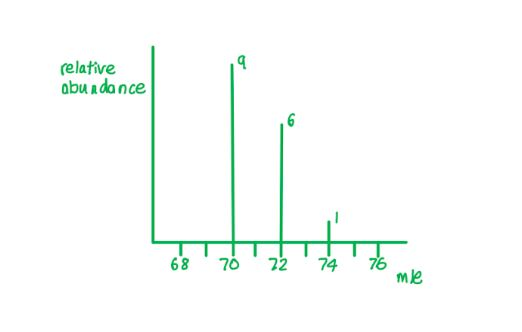

**A** is incorrect as 2 is the number of chlorine isotopes, not the number of molecular ion peaks.

**C** is incorrect as there are three possible Cl2•+ molecular ions (at m/z = 70, 72 and 74), not four.

**D** is incorrect as 5 is the total number of peaks in the mass spectrum, including two fragment ion peaks at m/z = 35 and 37, not just the molecular ion peaks.

### Q16
**Final answer:** **The correct answer is B**

- The peak representing the **molecular ion (M****+**** or M•****+****)** is called the **molecular ion peak**.
- Excluding any peaks due to the presence of heavier isotopes, this is the peak with the highest m/z ratio.

  - This is the whole molecule that has lost one electron.
- Bromine has two isotopes, so there are two possible molecular ions:

  - M (79Br) m/z = 122
  - M+2 (81Br) m/z = 124

**A** is incorrect as isotopes have identical chemical reactivities.

**C** is incorrect as the differences in the number of neutrons do not affect atomic radii.

**D** is incorrect as the differences in the number of neutrons do not affect the first ionisation energy.

### Q17
**Final answer:** **The correct answer is ****D**** because:**

- The question states that there are only nitrogen atoms with a mass of 14.
- All three Cl as 35Cl:

[14N(35Cl)3]+, m/z = 14 + (3 × 35) = 119

- Two 35Cl and one 37Cl:

[14N(35Cl)2(37Cl)]+, m/z = 14 + (2 × 35) + 37 = 121

- One 35Cl and two 37Cl:

[14N(35Cl)(37Cl)2]+, m/z = 14 + 35 + (2 × 37) = 123

- All three Cl as 37Cl:

[14N(37Cl)3]+, m/z = 14 + (3 × 37) = 125

- Therefore, ion **D** should be N(37Cl)3+

**A**, **B** and **C** are incorrect as these are all valid molecular ions with correct m/z values.

### Q18
**Final answer:** **The correct answer is A**

- A peak at m/z = 55 corresponds to a fragment ion with a mass of 55.
- [C4H7]+ has m/z = (4 × 12) + (7 × 1) = 55.

**B** is incorrect as [CH2CO2]+ has m/z = 58, not 55.

**C** is incorrect as [CH$\equiv$CHCHOH]+ has m/z = 56, not 55.

**D** is incorrect as [COOH]+ has m/z = 45, not 55.

### Q19
**Final answer:** **The correct answer is D**

- The **base peak** is the most intense (tallest) peak in a mass spectrum.
- It corresponds to the ion with the greatest abundance in the sample.

**A** is incorrect as a fragment ion does not necessarily produce the base peak. The base peak is the most abundant ion regardless of how it is formed.

**B** is incorrect as the base peak is not necessarily produced by the ion with the lowest m/z ratio.

**C** is incorrect as the molecular ion peak does not necessarily correspond to the base peak. The molecular ion (M+ or M●+) is the unfragmented ionised molecule. It has the highest m/z ratio (excluding isotope peaks) but is not always the most abundant ion.

### Q20
**Final answer:** **The correct answer is D**

- Each Cl atom can be either 35Cl or 37Cl, giving 5 possible isotopologue combinations for a molecule with 4 Cl atoms.
- The 5 possible molecular ions for [C4H6Cl4]+ are:

  - All four Cl atoms as 35Cl → M (base mass)
  - Three 35Cl and one 37Cl → M+2
  - Two 35Cl and two 37Cl → M+4
  - One 35Cl and three 37Cl → M+6
  - All four Cl atoms as 37Cl → M+8

**A** is incorrect as 2 is the number of chlorine isotopes, not the number of molecular ion peaks.

**B** is incorrect as 3 molecular ion peaks would be expected for a molecule containing two chlorine atoms (M, M+2 and M+4). C4H6Cl4 contains four chlorine atoms, giving five molecular ion peaks.

**C** is incorrect as 4 peaks omits the M+8 peak (corresponding to all four chlorine atoms being 37Cl). Five molecular ion peaks are expected.

### Q21
**Final answer:** **The correct answer is A**

- A strong absorption at 1720 cm-1 is consistent with a C═O (carbonyl) stretch.

  - Compound A contains a carbonyl group in the ketone wavenumber range (~1715–1725 cm-1).
- The molecular ion peak at m/z = 128 matches the relative molecular mass of compound A.
- The fragment ion at m/z = 15 corresponds to [CH3]+, consistent with a terminal methyl group in compound A.
- The absence of a broad absorption around 3200 cm-1 confirms that no O−H group is present.

**B** is incorrect as compound B contains a hydroxyl (O−H) group, which would produce a broad absorption around 3200 cm-1. This absorption is absent from the data.

**C** is incorrect as compound C has a relative molecular mass of 129, not 128. A molecular ion at m/z = 129 does not match the data.

**D** is incorrect as compound D contains both a carbonyl group and a hydroxyl group. The O−H group would produce a broad absorption around 3200 cm-1, which is absent from the data.

### Q22
**Final answer:** **The correct answer is C**

- Bromine is a diatomic molecule, so the mass spectrum of Br2 shows peaks from both the molecular ion (Br2+) and fragment ions (Br+).
- When Br2 passes through the mass spectrometer, an electron is removed to form the molecular ion:

Br2 → Br2+ + e−

- Br2+ can then fragment:

Br2+ → Br+ + Br

- The Br+ fragment ions give peaks at m/z = 79 and 81 in equal intensity.
- The unfragmented Br2+ ion exists in three isotopologue combinations:

  - 79Br79Br+: m/z = 79 + 79 = 158 (relative probability 1)
  - 79Br81Br+: m/z = 79 + 81 = 160 (relative probability 2)
  - 81Br81Br+: m/z = 81 + 81 = 162 (relative probability 1)
- This gives five peaks in total: Br+ at 79 and 81 (equal height), and Br2+ at 158, 160 and 162 in a 1:2:1 ratio.

**A** is incorrect as it shows only a single molecular ion peak, not three.

**B** is incorrect as it also shows only a single molecular ion peak, not three.

**D** is incorrect as it shows three molecular ion peaks at m/z = 158, 160 and 162 in a 9:6:1 ratio. The 9:6:1 pattern corresponds to Cl2 (35Cl : 37Cl ≈ 3:1), not Br2 (79Br : 81Br ≈ 1:1).

### Q23
**Final answer:** **The correct answer is A**

- A line at m/z = 57 corresponds to an ion with a mass of 57, for example:

  - [C4H9]+
  - [C2H5CO]+
- 3-methylbutan-2-one will not have either of these fragments.

**B** is incorrect as hexan-3-one has a peak at m/z = 57 due to the fragment ion [C2H5CO]+.

**C** is incorrect as pentan-3-one has a peak at m/z = 57 due to the fragment ion [C2H5CO]+.

**D** is incorrect as butanone has a peak at m/z = 57 due to the fragment ion [C2H5CO]+.

## Structured Questions (7 questions)

### Q1
> **[mark-scheme]**
> Evidence that compound **X** is a hydrocarbon:
> 
> - (Strong) absorption at approximately 2950 cm−1 in the infrared spectrum indicates C−H bonds are present **[1 mark]**
> - No absorptions for other functional groups (such as O−H, C=O or C≡N) are present, indicating the molecule contains only carbon and hydrogen **[1 mark]**

> **[exam-tip]**
> A hydrocarbon contains only carbon and hydrogen.
> 
> Look for two things in the infrared spectrum:
> 
> 1. A C−H absorption is present
> 2. No absorptions for oxygen- or nitrogen-containing functional groups appear.
> 
> The mass spectrum confirms the Mr but does not identify functional groups.
> **[mark-scheme]**
> The mass spectrum supports the molecular formula C4H10 because:
> 
> - (There is a) molecular ion / M+ peak at *m/e* = 58
> **AND**
> C4H10 has a relative molecular mass / *M*r of 58 **[1 mark]**

> **[exam-tip]**
> State both the supporting evidence AND how it supports the conclusion: identify the molecular ion peak at m/e = 58, then link this to the Mr of C4H10.
The fully displayed formulae of two possible isomers for compound **X** are:

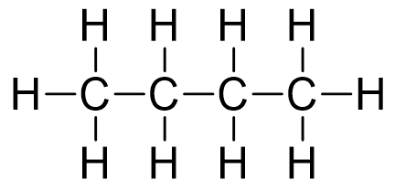

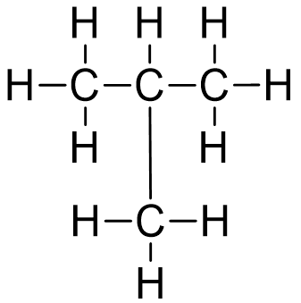

**[2 marks]**

> **[mark-scheme]**
> 1 mark for correct fully displayed formula of butane: linear chain of 4 carbons with all bonds shown
> 
> 1 mark for correct fully displayed formula of methylpropane: branched structure with all bonds shown

> **[exam-tip]**
> C4H10 has exactly two structural isomers: butane (straight chain) and methylpropane (branched). Both must be drawn as fully displayed formulae, so all bonds must be shown explicitly. Skeletal or shortened structural formulae do not score the mark.
> **[mark-scheme]**
> i) The formulae of the fragment ions of **X**:
> 
> - *m/e* = 15: CH3+ **[1 mark]**
> - *m/e* = 29: C2H5+ **[1 mark]**
> - *m/e* = 43: C3H7+ **[1 mark]**
> 
> Do not accept formulae without the + charge

> **[exam-tip]**
> Each fragment ion formula must include the + charge. The ions CH3+, C2H5+ and C3H7+ are consecutive alkyl cations produced by successive cleavage along an unbranched carbon chain.

> **[mark-scheme]**
> ii) The systematic name of compound **X** and the reasoning:
> 
> - Butane **[1 mark]**
> - The consecutive fragment ions CH3+, C2H5+ and C3H7+ are consistent with an unbranched carbon chain **[1 mark]**

> **[exam-tip]**
> Butane and methylpropane are both C4H10 isomers. The mass spectrum distinguishes them: an unbranched chain produces consecutive alkyl cation fragments at m/e = 15, 29 and 43. Methylpropane would not produce a C2H5+ ion at m/e = 29.

### Q2
i) To calculate the empirical formula of compound **F**:

- Calculate the percentage of carbon:

% C = 100 − 6.98 − 37.21 = 55.81%

- Calculate the moles of each element:

moles of C = $\frac{55.81}{12.0}$ = 4.65

moles of H = $\frac{6.98}{1.0}$ = 6.98

moles of O = $\frac{37.21}{16.0}$ = 2.33

**[1 mark]**

- Find the simplest molar ratio:

C : H : O = $\frac{4.65}{2.33}$ : $\frac{6.98}{2.33}$ : $\frac{2.33}{2.33}$ = 1.99 : 2.99 : 1 ≈ 2 : 3 : 1

Empirical formula = **C****2****H****3****O**

**[1 mark]**

> **[mark-scheme]**
> 1 mark for moles of C = 4.65, H = 6.98 and O = 2.33
> 
> 1 mark for correct empirical formula C2H3O

> **[exam-tip]**
> Calculate the missing percentage first: % C = 100 − 6.98 − 37.21 = 55.81%. Then divide each percentage by the relative atomic mass to find moles, and divide by the smallest value (O = 2.33) to find the simplest ratio.

> **[mark-scheme]**
> ii) The empirical formula C2H3O cannot be the molecular formula because:
> 
> - It has an odd number of hydrogen atoms, making it impossible to form a complete, fully-bonded molecule **[1 mark]**

> **[exam-tip]**
> For any organic molecule, the hydrogen count must be even (carbon forms 4 bonds, oxygen forms 2 bonds as any complete arrangement requires an even number of hydrogen atoms). C2H3O has only 3 hydrogen atoms (odd), so no complete bonded structure is possible.
To deduce the molecular formula of compound **F**:

- Identify the molecular ion peak:

Molecular ion peak (M) at *m* / *e* = 86.0 → *M*r of compound **F** = 86.0

- Divide by the *M*r of the empirical formula:

*M*r of C2H3O = (2 x 12.0) + (3 x 1.0) + 16.0 = 43.0

$\frac{86.0}{43.0}$ = 2

Molecular formula = **C****4****H****6****O****2** **[1 mark]**

> **[mark-scheme]**
> 1 mark for correct molecular formula C4H6O2
> 
> Allow error carried forward from part (a)(i) if the empirical formula and calculation are consistent

> **[exam-tip]**
> The molecular ion peak (M) gives the *M*r of the compound directly. Divide this (86.0) by the *M*r of the empirical formula (43.0): 86.0 ÷ 43.0 = 2, so the molecular formula is 2 × C2H3O = C4H6O2.
The completed table is:

| **Principal absorption in infrared spectrum** | **Bond responsible** |
|---|---|
| 2500 – 3000 cm-1 | **Final answer:** **O−H (carboxyl)** |
| 1710 cm-1 | **Final answer:** **C=O (carboxyl)** |
| 1620 cm-1 | **Final answer:** **C=C** |

**[2 marks]**

> **[mark-scheme]**
> 1 mark for both: O−H (carboxyl / carboxylic acid) at 2500–3000 cm-1 **AND** C=O (carboxyl / carboxylic acid) at 1710 cm-1
> 
> 1 mark for C=C / alkene at 1620 cm-1

> **[exam-tip]**
> For the absorptions at 2500–3000 cm-1 and 1710 cm-1, specifying 'carboxyl' or 'carboxylic acid' is required. Both ranges can correspond to more than one functional group in Table 3.1, so the functional group context is essential for full credit.
The displayed formulae and systematic names of the **three** possible isomers that could be compound **F** are:

But-3-enoic acid

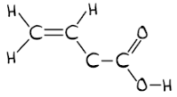

**[1 mark]**

*cis*-but-2-enoic acid / Z-but-2-enoic acid

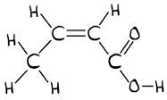

**[1 mark]**

*trans*-but-2-enoic acid / E-but-2-enoic acid

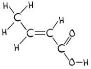

**[1 mark]**

> **[mark-scheme]**
> 1 mark for the correct fully displayed formula **AND** correct systematic name of but-3-enoic acid
> 
> 1 mark for the correct fully displayed formula **AND** correct systematic name of *cis*-but-2-enoic acid / Z-but-2-enoic acid
> 
> 1 mark for the correct fully displayed formula **AND** correct systematic name of *trans*-but-2-enoic acid / E-but-2-enoic acid
> 
> *Cis*/*trans *and E/Z names are both accepted

> **[exam-tip]**
> From parts **(b)** and **(c)**: compound **F** has molecular formula C4H6O2, a carboxylic acid group and a C=C double bond. Being unbranched means the carbon chain is straight. Start with COOH at C-1, then place C=C at C-2 (giving *cis *and *trans *but-2-enoic acid) or at C-3 (giving but-3-enoic acid, which has no geometric isomerism).
> **[mark-scheme]**
> The name of compound **F** is:
> 
> - cis-but-2-enoic acid / Z-but-2-enoic acid **[1 mark]**
> - The cis arrangement of substituents around the C=C reduces molecular surface area, weakening van der Waals forces, so less energy is required to overcome them **[1 mark]**

> **[exam-tip]**
> But-3-enoic acid is not a stereoisomer so it is excluded. Of the remaining two isomers, cis-but-2-enoic acid has both larger substituents on the same side of the C=C, giving a more compact shape, smaller surface area, weaker van der Waals forces and therefore a lower boiling point.

### Q3
To calculate the molecular formula of compound **B**:

- Calculate the percentage of hydrogen:

% H = 100 − 69.7 − 18.6 = 11.7%

- Calculate the moles of each element:

moles of C = $\frac{69.7}{12.0}$ = 5.80

moles of O = $\frac{18.6}{16.0}$ = 1.16

moles of H = $\frac{11.7}{1.0}$ = 11.7

**[1 mark]**

- Find the simplest molar ratio:

C : O : H = $\frac{5.80}{1.16}$ : $\frac{1.16}{1.16}$ : $\frac{11.7}{1.16}$ = 5 : 1 : 10

Empirical formula = C5H10O

**[1 mark]**

- Confirm the molecular formula:

*M*r of C5H10O = (5 x 12.0) + (10 x 1.0) + 16.0 = 86.0

This matches the molecular ion peak at *m* / *e* = 86

Molecular formula = **C****5****H****10****O**

**[1 mark]**

> **[mark-scheme]**
> 1 mark for moles of C = 5.80, O = 1.16 and H = 11.7
> 
> 1 mark for correct empirical formula C5H10O
> 
> 1 mark for confirming molecular formula C5H10O with *M*r = 86 matching the molecular ion peak

> **[exam-tip]**
> When the percentage composition is incomplete, calculate the missing element's percentage by subtracting from 100: % H = 100 − 69.7 − 18.6 = 11.7%.
> 
> The molecular ion peak (M) at *m* / *e* = 86 confirms the molecular formula directly as the empirical formula C5H10O has a molar mass of 86.0 g mol-1, matching the M peak exactly. The M+1 peak at *m* / *e* = 87.0 arises from molecules containing one 13C atom.
> **[mark-scheme]**
> i) The functional group present in compound **B** is:
> 
> - Ketone / carbonyl group **[1 mark]**
> 
> Aldehyde is not accepted

> **[exam-tip]**
> The infrared absorption at 1705 cm-1 falls in the 1670–1740 cm-1 range for C=O in a carbonyl / ketone. The absence of a broad absorption around 3200 cm-1 eliminates O−H groups, ruling out carboxylic acid and alcohol. Aldehyde also has a C=O absorption in this range, but can be eliminated using the fragment ion analysis in part (c).

ii) The **two** possible skeletal formulae for compound **B** are:

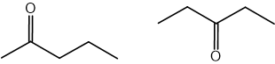

**[2 marks]**

> **[mark-scheme]**
> 1 mark for the correct skeletal formula of pentan-2-one
> 
> 1 mark for the correct skeletal formula of pentan-3-one
> 
> Structures must show the C=O group at the correct position on the carbon chain

> **[exam-tip]**
> With molecular formula C5H10O and a ketone functional group: pentan-2-one has C=O at C-2 and pentan-3-one has C=O at C-3. Pentanal (an aldehyde) is excluded by the functional group identified in (i).
> **[mark-scheme]**
> The formula of the fragment ion responsible for the peak at *m* / *e* = 29 is:
> 
> - C2H5+ **[1 mark]**
> 
> How this peak distinguishes between the two isomers:
> 
> - Pentan-2-one can form only **one** C2H5+ fragment
> **AND**
> Pentan-3-one can form **two** C2H5+ fragments due to its symmetry **[1 mark]**
> - Therefore, the peak at *m* / *e* = 29 will have a greater relative abundance in the mass spectrum of pentan-3-one **[1 mark]**

> **[exam-tip]**
> Pentan-3-one (CH3CH2COCH2CH3) is symmetric: both ethyl (C2H5) groups can fragment to give C2H5+ at *m* / *e* = 29, so this peak will be approximately twice as intense. Pentan-2-one (CH3COCH2CH2CH3) has only one ethyl group, giving a weaker peak at *m* / *e* = 29.

### Q4
To calculate the number of carbon atoms in compound **X**:

- Apply the M+1 peak formula:

n = $\frac{100\times6.5}{1.1\times100}$

n = 5.91 **[1 mark]**

Number of carbon atoms = **6** **[1 mark]**

> **[mark-scheme]**
> 1 mark for correct substitution into the M+1 formula
> 
> 1 mark for n ≈ 6 carbon atoms

> **[exam-tip]**
> The M+1 peak arises because ~1.1% of all carbon atoms are 13C. Each carbon contributes approximately 1.1% to the [M+1] peak relative to the M peak. The formula is:
> 
> n =$\frac{ ( 100 \times [ \mathrm{M} + 1 ] \text{abundance} )}{ ( 1.1 \times \mathrm{M} \text{abundance} )}$
> 
> From Fig. 1.1: the peak at *m* / *e* = 102 is the molecular ion peak (M, abundance 100%) and the peak at *m* / *e* = 103 is the M+1 peak (abundance 6.5%).
To suggest the molecular formula of compound **X**:

- Use the molecular ion peak:

*M*r = 102 (from M peak at *m* / *e* = 102)

- Calculate remaining mass after carbon:

102 − (6 x 12.0) = 30

- Assign oxygen and hydrogen:

30 − 16.0 (one O) = 14 → 14 hydrogen atoms

Molecular formula = **C****6****H****14****O ****[1 mark]**

> **[mark-scheme]**
> 1 mark for correct molecular formula C6H14O

> **[exam-tip]**
> The molecular ion peak (M) at *m* / *e* = 102 gives *M*r = 102. Six carbon atoms contribute 6 × 12.0 = 72.0, leaving 30. One oxygen atom (mass 16.0) leaves 14, which corresponds to 14 hydrogen atoms. The molecular formula is therefore C6H14O.
> **[mark-scheme]**
> The formula of the fragment ion at *m* / *e* = 31 is:
> 
> - CH2OH+ **[1 mark]**

> **[exam-tip]**
> Build up the formula from common fragments:
> 
> - CH2+ has a mass of 14
> - OH has a mass of 17
> - Together: 14 + 17 = 31
> 
> The fragment ion CH2OH+ is formed by cleavage of the C−C bond adjacent to the OH group in compound **X**.
> **[mark-scheme]**
> The functional group present in **X** is:
> 
> - Hydroxy / OH group **[1 mark]**
> - The broad absorption at ~3300 cm-1 corresponds to O−H (hydroxy, range 3200–3600 cm-1) 
> **AND**
> Compound **X** has only one oxygen atom, so a carboxyl group (which requires two oxygen atoms) is excluded **[1 mark]**

> **[exam-tip]**
> The infrared spectrum shows a broad absorption at ~3300 cm-1, which falls in the 3200–3600 cm-1 range for O−H (hydroxy).
> 
> The carboxyl O−H absorption falls in the 2500–3000 cm-1 range, so the peak at ~3300 cm-1 rules out carboxylic acid.
> 
> The molecular formula C6H14O contains only one oxygen atom, which further confirms a hydroxy group (COOH would require two oxygen atoms).

### Q5
The relative abundances of the three isotopes are:

| isotope | relative abundance |
|---|---|
| 24Mg | **Final answer:** **78–79** |
| 25Mg | **Final answer:** **10** |
| 26Mg | **Final answer:** **11–12** |

**[1 mark]**

> **[mark-scheme]**
> 1 mark for all three correct values: 24Mg = 78–79, 25Mg = 10, 26Mg = 11–12
> 
> Values must add up to 100

> **[exam-tip]**
> A range is given to allow for the readability of the diagram, but the values must add up to 100% to score the mark.
To calculate the relative atomic mass, *A*r, of magnesium to two decimal places:

- Substitute into the relative atomic mass equation using values from (a):

*A*r = $\frac{(24\times78)+(25\times10)+(26\times12)}{100}$

*A*r = $\frac{1872+250+312}{100}$ **[1 mark]**

*A*r (Mg) = **24.34** **[1 mark]**

> **[mark-scheme]**
> 1 mark for correct method: sum of (isotopic mass × relative abundance) divided by 100, using own values from (a)
> 
> 1 mark for correct final answer to 2 d.p., consistent with values from (a)
> 
> Allow error carried forward from (a) if method is correct

> **[exam-tip]**
> Use your values from part (a). Multiply each isotope's mass number by its relative abundance, add the results, then divide by 100.
> **[mark-scheme]**
> The full electronic configuration of the magnesium ion, 26Mg2+:
> 
> - 1s22s22p6 **[1 mark]**
> 
> The isotopic mass does not affect the electron configuration

> **[exam-tip]**
> Magnesium has 12 electrons (1s22s22p63s2). Forming the +2 ion removes 2 electrons, giving 1s22s22p6. The isotopic mass (26Mg vs 24Mg) affects only the number of neutrons, not electrons.
To calculate the relative abundance of each isotope of boron:

- Let the relative abundance of 10B = *x*, so the relative abundance of 11B = (100 − *x*)

- Substitute into the relative atomic mass equation:

*A*r = $\frac{(10\timesx)+(11\times(100-x))}{100}$

10.8 = $\frac{10x+1100-11x}{100}$

**[1 mark]**

- Rearrange and solve for *x*:

1080 = 1100 − *x*

*x* = 20

relative abundance of 10B = **20**

relative abundance of 11B = **80**

**[1 mark]**

> **[mark-scheme]**
> 1 mark for correct substitution into the *A*r equation and rearrangement
> 
> 1 mark for both correct values: 10B = 20, 11B = 80

> **[exam-tip]**
> Let the relative abundance of 10B = *x*.
> 
> The two abundances must sum to 100, so 11B = (100 − *x*).
> 
> Substitute into the *A*r formula: 10.8 = ((10*x*) + (11(100 − *x*))) / 100.
> 
> Solve for *x*.

### Q6
To calculate the empirical formula and deduce the molecular formula of alcohol **E**:

- Calculate the moles of each element:

moles of C = $\frac{68.2}{12.0}$ = 5.68

moles of H = $\frac{13.6}{1.0}$ = 13.6

moles of O = $\frac{18.2}{16.0}$ = 1.14

**[1 mark]**

- Find the simplest molar ratio:

C : H : O = $\frac{5.68}{1.14}$ : $\frac{13.6}{1.14}$ : $\frac{1.14}{1.14}$ = 4.98 : 11.93 : 1 ≈ 5 : 12 : 1

Empirical formula = C5H12O

**[1 mark]**

- Deduce the molecular formula using the molecular ion peak:

*M*r of C5H12O = (5 x 12.0) + (12 x 1.0) + 16.0 = 88.0

This matches the molecular ion peak at *m* / *e* = 88.0

Molecular formula = **C****5****H****12****O**

**[1 mark]**

> **[mark-scheme]**
> 1 mark for moles of C = 5.68, H = 13.6 and O = 1.14
> 
> 1 mark for correct empirical formula C5H12O
> 
> 1 mark for correct molecular formula C5H12O, confirmed using *M*r = 88.0 matching the molecular ion peak

> **[exam-tip]**
> Divide each percentage by the corresponding relative atomic mass to find moles, then divide by the smallest value to find the ratio. Here, O gives the smallest mole value (1.14), giving a C : H : O ratio of approximately 5 : 12 : 1.
> 
> Always verify the molecular formula against the molecular ion peak. Here, the empirical formula mass (88.0) matches *m* / *e* = 88.0, confirming the molecular and empirical formulae are the same.
> **[mark-scheme]**
> The class of alcohol **E** is:
> 
> - Primary / 1° alcohol **[1 mark]**

> **[exam-tip]**
> A primary alcohol has the OH group attached to a terminal carbon (a carbon bonded to only one other carbon). Primary alcohols are oxidised first to aldehydes, then further to carboxylic acids. Secondary alcohols are oxidised to ketones only. Tertiary alcohols cannot be oxidised under standard laboratory conditions.
The fully displayed formulae and systematic names of the **four** possible structural isomers of alcohol **E** are:

Pentan-1-ol

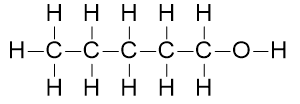

**[1 mark]**

2-methylbutanol

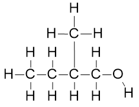

**[1 mark]**

3-methylbutanol

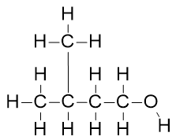

**[1 mark]**

2,2-dimethylpropanol

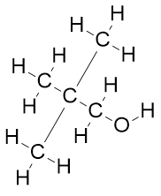

**[1 mark]**

> **[mark-scheme]**
> 1 mark for the correct fully displayed formula **AND** correct systematic name of pentan-1-ol
> 
> 1 mark for the correct fully displayed formula **AND** correct systematic name of 2-methylbutanol
> 
> 1 mark for the correct fully displayed formula **AND** correct systematic name of 3-methylbutanol
> 
> 1 mark for the correct fully displayed formula **AND** correct systematic name of 2,2-dimethylpropanol
> 
> Systematic names without the locant "-1-" are accepted where the alcohol position is unambiguous (e.g. 3-methylbutanol accepted for 3-methylbutan-1-ol)

> **[exam-tip]**
> From part **(b)**, alcohol **E** is a primary alcohol, so the OH group must be on a terminal carbon in all four structures. All structures must have the molecular formula C5H12O.
> 
> Number the chain from the end closest to the OH group. Include the position number of the OH group in the systematic name.
> **[mark-scheme]**
> The formula of the fragment ion responsible for the peak at *m* / *e* = 45.0 is:
> 
> - C2H4OH+ / CH2CH2OH+ / C2H5O+ **[1 mark]**

> **[exam-tip]**
> Start from the OH group: CH2OH has a mass of 31 (C = 12, 2×H = 2, O = 16, H = 1). The remaining mass is 45.0 − 31 = 14, which corresponds to a CH2 group. Therefore the fragment ion is CH2CH2OH+, formed by cleavage of the C−C bond adjacent to the OH group.
> **[mark-scheme]**
> The isomer from part **(c)** that is alcohol **E** is:
> 
> - 3-methylbutan-1-ol **[1 mark]**
> - It is the only branched-chain primary alcohol from part **(c)** that can produce a fragment ion at *m* / *e* = 45.0 **[1 mark]**

> **[exam-tip]**
> The three branched-chain isomers from part (c) are: 3-methylbutan-1-ol, 2-methylbutan-1-ol and 2,2-dimethylpropan-1-ol. Only 3-methylbutan-1-ol has an ethanol-type fragment (C2H4OH+) that produces a peak at *m* / *e* = 45.0.

### Q7
To calculate the relative atomic mass of boron:

- Calculate the weighted mean of the isotopic masses:

*A*r(B) = $\frac{(10\times20)+(11\times80)}{100}$ **[1 mark]**

*A*r(B) = **10.8** **[1 mark]**

> **[exam-tip]**
> The relative atomic mass is the weighted mean of the isotopic masses. Multiply each isotopic mass by its relative abundance, sum the results, then divide by the total abundance (100 when expressed as percentages):
> 
> $\frac{(\mathrm{abundance}_{1}\times\mathrm{mass}_{1})+(\mathrm{abundance}_{2}\times\mathrm{mass}_{2})}{100}$
> 
> The relative abundance of an isotope can be given as a percentage or read directly from the mass spectrum.
To calculate the relative atomic mass of potassium:

- Calculate the total relative abundance:

Total abundance = 130.6 + 9.4 = 140 **[1 mark]**

- Calculate the weighted mean:

*A*r(K) = $\frac{(39\times130.6)+(41\times9.4)}{140}$ = **39.1** **[1 mark]**

> **[mark-scheme]**
> Allow *A*r = 39.13 or 39.14.
> 
> Allow error carried forward from an incorrect total abundance value.

> **[exam-tip]**
> The y-axis of the mass spectrum gives relative abundance, not percentage abundance.
> 
> The total abundance is 130.6 + 9.4 = 140, not 100. Use 140 as the denominator, not 100.
> **[mark-scheme]**
> The equation for the formation of the molecular ion of octane and its m / e value are:
> 
> - C8H18 → C8H18+ + e– **[1 mark]**
> - m / e = (8 x 12) + (18 x 1) = 114 **[1 mark]**
> 
> State symbols are not required in the equation.

> **[exam-tip]**
> The molecular ion is formed when a molecule loses one electron in the mass spectrometer. Since the mass of an electron is negligible, the molecular ion has the same m / e value as the relative molecular mass of the compound.
> **[mark-scheme]**
> The smaller peak at m / e = 59.0 in the mass spectrum of butane appears because:
> 
> - Some butane molecules contain a 13C isotope / one carbon atom has mass 13 instead of 12, giving a molecular ion with m / e = 59 / producing an [M+1] peak **[1 mark]**

> **[exam-tip]**
> Approximately 1.1% of all carbon atoms are 13C. When a butane molecule contains one 13C atom, its molecular ion has m / e = 59 rather than 58. This produces the [M+1] peak, which is always smaller than the M peak because 13C is much less abundant than 12C.
> **[mark-scheme]**
> The compound with the greater relative abundance of the [M+1] peak is:
> 
> - Octane **[1 mark]**
> - Because it contains more carbon atoms, so there is a greater probability of one being 13C **[1 mark]**

> **[exam-tip]**
> The [M+1] peak arises when one carbon atom in a molecule is 13C. The more carbon atoms a molecule contains, the greater the probability that one of them will be 13C, and so the larger the [M+1] peak relative to the M peak.
> **[mark-scheme]**
> The ratios of the relative abundances of the M and [M+2] peaks are:
> 
> - In 1-chlorobutane, M : [M+2] = 3 : 1 **[1 mark]**
> - In 1-bromobutane, M : [M+2] = 1 : 1 **[1 mark]**

> **[exam-tip]**
> Both chlorine and bromine exist as two isotopes:
> 
> - 35Cl and 37Cl: 35Cl is approximately three times more abundant than 37Cl, giving M : [M+2] = 3 : 1 for compounds containing one chlorine atom.
> - 79Br and 81Br: these isotopes have approximately equal abundances, giving M : [M+2] = 1 : 1 for compounds containing one bromine atom.
> 
> The [M+2] peak arises because some molecules contain the heavier isotope of the halogen, giving a molecular ion 2 mass units heavier than the M peak.
