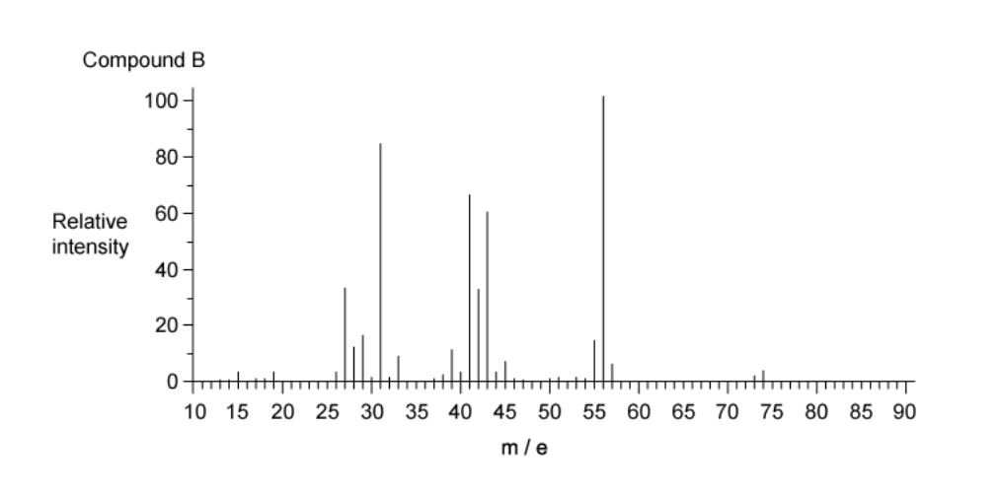
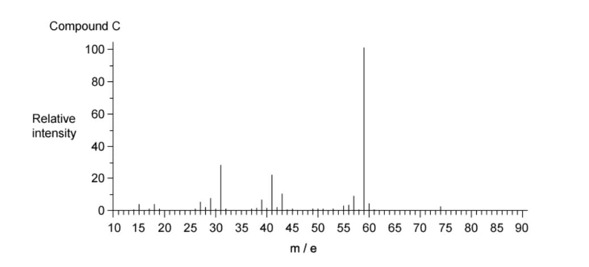
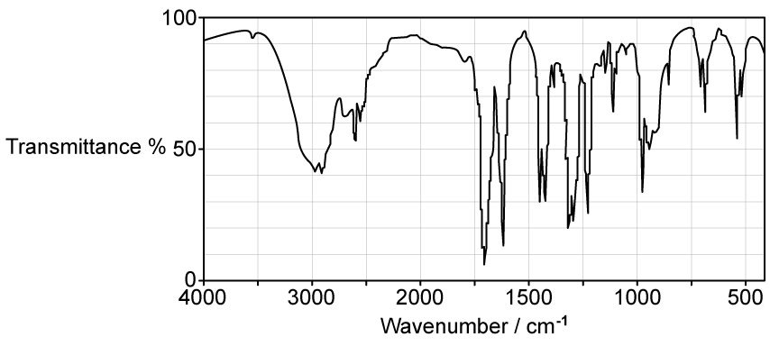
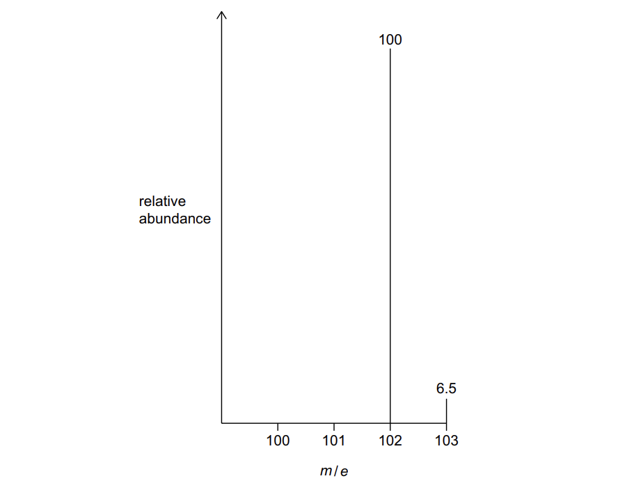
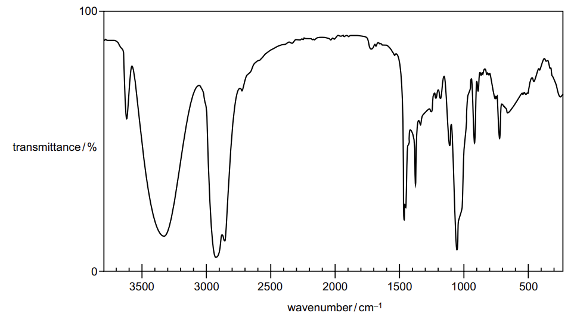
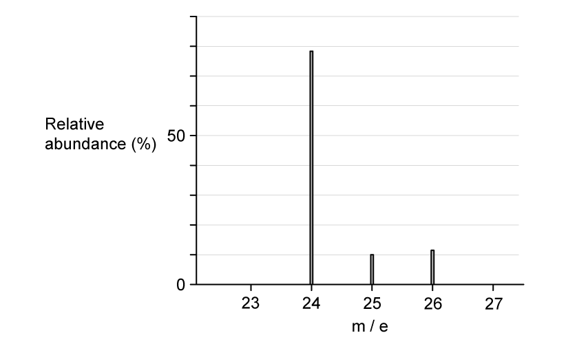

# Exam Questions — Mass Spectrometry
**22. Analytical Techniques** · Cambridge (CIE) AS chemistry (9701)
> Source: [https://www.savemyexams.com/as/chemistry/cie/25/topic-questions/](https://www.savemyexams.com/as/chemistry/cie/25/topic-questions/) · 30 questions across 2 sets

## Multiple Choice Questions (23 questions)

### Q1 — hard — 1 marks

**Q1** [1 mark]

A compound XFn is a fluoride of another halogen, X, and it is known that n > 1. The highest mass peak in the mass spectrum of XFn is assigned to the molecular ion and appears as a single peak at m/z = 222.

Which of the following statements is **not **correct?

### Q2 — hard — 1 marks

**Q2** [1 mark]

In the mass spectrum of trifluoroacetic acid, CF3CO2H, intense peaks are observed at m/z = 69 and 45 (base peak) in addition to other peaks.

The peak at m/z = 69 is accompanied by a peak at m/z = 70, which is about 1.1% the intensity of the peak at m/z = 69.

Which of the following statements is **not** supported by this information?

### Q3 — hard — 1 marks

**Q3** [1 mark]

The mass spectra of three compounds A, B and C are shown below.

Which feature of the three mass spectra confirms that all three compounds have the molecular formula C4H10O?

### Q4 — easy — 1 marks

**Q4** [1 mark]

A sample of neon contains the following isotopes.

| **Isotope** | **Percentage abundance** |
|---|---|
| 20Ne | 90.92 |
| 21Ne | 0.26 |
| 22Ne | 8.82 |

Which is the relative atomic mass of neon in this sample, to 2 dp?

### Q5 — medium — 1 marks

**Q5** [1 mark]

Which alcohol does **not** have a fragment ion at m/z = 43 in its mass spectrum?

### Q6 — easy — 1 marks

**Q6** [1 mark]

The mass spectrum of silicon is shown below.

Which is the relative atomic mass of silicon in this sample, to 1 dp?

### Q7 — hard — 1 marks

**Q7** [1 mark]

Chlorine exists as two isotopes, 35Cl and 37Cl, in the ratio 3:1.

Which of the following statements about the molecular ion peaks in the mass spectrum of Cl2 is correct?

### Q8 — medium — 1 marks

**Q8** [1 mark]

Which of the compounds below is not likely to have a fragment ion at *m/e* = 43 in its mass spectrum?

### Q9 — easy — 1 marks

**Q9** [1 mark]

Chlorine exists as two isotopes with mass numbers 35 and 37. A sample of chlorine contains 75.3% of chlorine-35 atoms.

Which is the relative atomic mass of chlorine in this sample, to 2 dp?

### Q10 — easy — 1 marks

**Q10** [1 mark]

A sample of silicon contains the following isotopes.

| **Isotope** | **Percentage abundance** |
|---|---|
| 28Si | 81.21 |
| 29Si | 14.10 |
| 30Si | 4.69 |

Which is the relative atomic mass of silicon in this sample, to 1 dp?

### Q11 — easy — 1 marks

**Q11** [1 mark]

In a mass spectrometer, the ions are separated.

Which of the following species will be deflected to the greatest extent?

### Q12 — medium — 1 marks

**Q12** [1 mark]

Which of the following statements about the mass spectrum of CH3Br is correct?

### Q13 — medium — 1 marks

**Q13** [1 mark]

Which pair of compounds would you expect to both have a singly charged peak at *m/z* = 29 in the mass spectrum?

### Q14 — medium — 1 marks

**Q14** [1 mark]

Which alcohol is likely to have a fragment ion at *m/z* = 31 in its mass spectrum?

### Q15 — medium — 1 marks

**Q15** [1 mark]

Chlorine has two isotopes, 35Cl and 37Cl.

Which of the following is the number of molecular ion peaks in the mass spectrum of a sample of Cl2?

### Q16 — medium — 1 marks

**Q16** [1 mark]

Bromine exists as two isotopes 79Br and 81Br, which are found in almost equal abundance.

Which of the following statements is correct?

### Q17 — easy — 1 marks

**Q17** [1 mark]

Nitrogen trichloride has the formula NCl3. A sample contains only 14N atoms and chlorine atoms with mass numbers 35 and 37.

Which ion and m/z value in the table is **not** correct?

|   | **Ion** | **m/z** |
|---|---|---|
| **A** | [14N(35Cl)3]+ | 119 |
| **B** | [14N(35Cl)2(37Cl)]+ | 121 |
| **C** | [14N(35Cl)(37Cl)2]+ | 123 |
| **D** | [14N(37Cl)2]+ | 125 |

### Q18 — easy — 1 marks

**Q18** [1 mark]

The diagram shows the structural formula of ricinoleic acid.

The mass spectrum of ricinoleic acid shows a peak at m/z = 55.

Which fragment ion is responsible for this peak?

### Q19 — easy — 1 marks

**Q19** [1 mark]

Which of the following corresponds to the base peak in a mass spectrum?

### Q20 — medium — 1 marks

**Q20** [1 mark]

Assuming chlorine exists as two isotopes and that carbon and hydrogen each exist as a single stable isotope only, how many molecular ion peaks are shown in the mass spectrum of C4H6Cl4?

### Q21 — hard — 1 marks

**Q21** [1 mark]

A sample is analysed by mass spectrometry and infrared spectroscopy. The data obtained are shown below.

| **Mass spectrometry** | **Infrared spectroscopy** |
|---|---|
| Molecular ion peak at m/z = 128 | Strong absorption at 1720 cm-1 |
| Fragment ion peak at m/z = 15 | No broad absorption around 3200 cm-1 |

Which compound is consistent with these spectroscopic data?

### Q22 — hard — 1 marks

**Q22** [1 mark]

Two stable isotopes of bromine, 79Br and 81Br, exist in approximately equal abundance.

Which is the correct pattern of peaks in the mass spectrum of Br2?

### Q23 — medium — 1 marks

**Q23** [1 mark]

Which of the ketones listed would **not** be expected to have a peak in its mass spectrum at *m/z* = 57?

## Structured Questions (7 questions)

### Q1 — medium — 10 marks

**Q1** [2 marks]

Compound **X** was analysed by infrared spectroscopy and mass spectrometry. Fig. 3.1 shows the infrared spectrum of compound **X** and Fig. 3.2 shows the mass spectrum of compound **X**.

**Fig. 3.1**

**Fig. 3.2**

**Table 3.1**

| **Bond ** | **Functional groups containing** **the bond** | **Characteristic infrared absorption range (in wavenumber) / cm****–1** |
|---|---|---|
| C−O | hydroxy, ester | 1040 – 1300 |
| C=C | aromatic compound, alkene | 1500 – 1680 |
| C=O | amide  carbonyl, carboxyl  ester | 1640 – 1690 1670 – 1740 1710 – 1750 |
| C≡N | nitrile | 2200 – 2250 |
| C−H | alkane | 2850 – 2950 |
| N−H | amine, amide | 3300 – 3500 |
| O−H | carboxyl  hydroxy | 2500 – 3000 3200 – 3600 |

Use Fig. 3.1, Fig. 3.2 and Table 3.1 to explain the evidence that compound **X** is a hydrocarbon.

**Q1** [1 mark]

**Extract:**

Compound **X** was analysed by infrared spectroscopy and mass spectrometry. Fig. 3.2 shows the mass spectrum of compound **X**.

{align=center} **Fig. 3.2**

Explain how the mass spectrum supports that compound **X** has a molecular formula of C4H10.

**Q1** [2 marks]

**Extract:**

Explain how the mass spectrum supports that compound **X** has a molecular formula of C~4~H~10~.

Draw the fully displayed formulae of **two** possible isomers for compound **X**.

**Q1** [5 marks]

**Extract:**

Compound **X** was analysed by infrared spectroscopy and mass spectrometry. Fig. 3.1 shows the infrared spectrum of compound **X** and Fig. 3.2 shows the mass spectrum of compound **X**.

Mass spectrum of compound X showing a molecular ion peak at m/e 58 and fragment ion peaks at m/e 43, 29 and 15

Explain how the mass spectrum supports that compound **X** has a molecular formula of C~4~H~10~.

The mass spectrum supports the molecular formula C~4~H~10~ because:
- (There is a) molecular ion / M^+^ peak at *m/e* = 58
AND
C~4~H~10~ has a relative molecular mass / *M*~r~ of 58

i) Deduce the formulae of the fragment ions of **X** at *m/e* = 15, *m/e* = 29 and *m/e* = 43.

[3]

ii) State the systematic name of compound **X**. Explain your answer.

[2]

### Q2 — hard — 11 marks

**Q2** [3 marks]

Compound **F** contains 6.98% hydrogen and 37.21% oxygen by mass. The remainder of the mass is carbon.

i) Calculate the empirical formula of compound **F**. Show your working.

[2]

ii) Explain why this empirical formula cannot be the molecular formula of compound **F**.

[1]

**Q2** [1 mark]

**Extract:**

Compound **F** contains 6.98% hydrogen and 37.21% oxygen by mass. The remainder of the mass is carbon.

i) Calculate the empirical formula of compound **F**. Show your working.

Empirical formula = C₂H₃O

Fig. 3.1 shows the mass spectrum of compound **F**.

**Fig. 3.1**

Using your answer to part **(a)(i)**, deduce the molecular formula of compound **F**.

**Q2** [2 marks]

Fig. 3.2 shows the infrared spectrum of compound **F**.

**Fig. 3.2**

Table 3.1 shows the characteristic infrared absorption frequencies for some selected bonds.

**Table 3.1**

| **Bond ** | **Functional groups containing** **the bond** | **Characteristic infrared absorption range (in wavenumber) / cm****–1** |
|---|---|---|
| C−O | hydroxy, ester | 1040 – 1300 |
| C=C | aromatic compound, alkene | 1500 – 1680 |
| C=O | amide  carbonyl, carboxyl  ester | 1640 – 1690 1670 – 1740 1710 – 1750 |
| C≡N | nitrile | 2200 – 2250 |
| C−H | alkane | 2850 – 2950 |
| N−H | amine, amide | 3300 – 3500 |
| O−H | carboxyl  hydroxy | 2500 – 3000 3200 – 3600 |

Complete Table 3.2 with the bond responsible for each of the principal absorptions seen in the infrared spectrum of compound **F**.

**Table 3.2**

| **Principal absorption in infrared spectrum** | **Bond responsible** |
|---|---|
| 2500 – 3000 cm-1 |   |
| 1710 cm-1 |   |
| 1620 cm-1 |   |

**Q2** [3 marks]

**Extract:**

From part (b): Molecular formula = C4H6O2

From part (c): The completed table is:
| Principal absorption in infrared spectrum | Bond responsible |
| 2500 – 3000 cm^-1^ | O−H (carboxyl) |
| 1710 cm^-1^ | C=O (carboxyl) |
| 1620 cm^-1^ | C=C |

This indicates compound F contains a carboxylic acid group and a C=C double bond.

Compound **F** is an unbranched molecule.

Using all of the available information including your answers from parts **(b)** and **(c)**, draw the displayed formulae and state the systematic names of the **three** possible isomers that could be compound **F**.

**Q2** [2 marks]

**Extract:**

The displayed formulae and systematic names of the three possible isomers that could be compound F are:

But-3-enoic acid

cis-but-2-enoic acid / Z-but-2-enoic acid

trans-but-2-enoic acid / E-but-2-enoic acid

Compound **F** is the stereoisomer with the lowest boiling point.

Using the isomers identified in part **(d)**, state the name of compound **F**. Explain your answer.

### Q3 — hard — 9 marks

**Q3** [3 marks]

An unknown compound, **B**, is analysed and shown to have a composition of 69.7% carbon, 18.6% oxygen and the remainder is hydrogen.

The following **incomplete** mass spectrometry and infrared spectroscopy data are collected.

**Mass spectrum**

- Molecular ion peak (M) at *m* / *e* = 86
- M+1 peak at *m* / *e* = 87.0
- Fragment ion peak at *m* / *e* = 28

**Infrared spectrum**

- Sharp absorption at 1705 cm-1
- **No** broad absorption around 3200 cm-1

Calculate the molecular formula of compound **B**. Show your working.

**Q3** [3 marks]

**Extract:**

An unknown compound, **B**, is analysed and shown to have a composition of 69.7% carbon, 18.6% oxygen and the remainder is hydrogen.

The following **incomplete** mass spectrometry and infrared spectroscopy data are collected.

**Mass spectrum**

- Molecular ion peak (M) at *m* / *e* = 86
- M+1 peak at *m* / *e* = 87.0
- Fragment ion peak at *m* / *e* = 28

**Infrared spectrum**

- Sharp absorption at 1705 cm^-1^
- **No** broad absorption around 3200 cm^-1^

Molecular formula = C~5~H~10~O

Using Table 1.1 and the mass spectrometry and infrared spectroscopy data:

**Table 1.1**

| **Bond ** | **Functional groups containing** **the bond** | **Characteristic infrared absorption range (in wavenumber) / cm****–1** |
|---|---|---|
| C−O | hydroxy, ester | 1040 – 1300 |
| C=C | aromatic compound, alkene | 1500 – 1680 |
| C=O | amide  carbonyl, carboxyl  ester | 1640 – 1690 1670 – 1740 1710 – 1750 |
| C≡N | nitrile | 2200 – 2250 |
| C−H | alkane | 2850 – 2950 |
| N−H | amine, amide | 3300 – 3500 |
| O−H | carboxyl  hydroxy | 2500 – 3000 3200 – 3600 |

i) State the functional group present in compound **B**.

[1]

ii) Draw the skeletal formulae of **two** possible structures for compound **B**.

[2]

**Q3** [3 marks]

**Extract:**

ii) Draw the skeletal formulae of **two** possible structures for compound **B**.

The **two** possible skeletal formulae for compound **B** are:

Pentan-2-one and pentan-3-one

1 mark for the correct skeletal formula of pentan-2-one

1 mark for the correct skeletal formula of pentan-3-one

Structures must show the C=O group at the correct position on the carbon chain

A mass spectrum peak at *m* / *e* = 29 can be used to distinguish between the two isomers identified in **(b)(ii)**.

Deduce the formula of the fragment ion responsible for this peak. Explain how this peak can be used to distinguish between the **two** isomers.

### Q4 — medium — 6 marks

**Q4** [2 marks]

Compound **X** contains atoms of carbon, hydrogen and oxygen only.

The mass spectrum of **X** is recorded. Information about the two peaks with *m* / *e* greater than 100 is shown in Fig. 1.1.

**Fig. 1.1**

Calculate the number of carbon atoms in compound **X** using information from Fig. 1.1. Show your working.

*Source: 2022 Specimen Paper 2 Q5A*

**Q4** [1 mark]

**Extract:**

Compound **X** contains atoms of carbon, hydrogen and oxygen only.

The mass spectrum of **X** is recorded. Information about the two peaks with *m* / *e* greater than 100 is shown in Fig. 1.1.

Mass spectrum of compound X showing a molecular ion peak at m/e 102 with 100% relative abundance and an M+1 peak at m/e 103 with 6.5% relative abundance

**Fig. 1.1**

Suggest the molecular formula of **X** using information from Fig. 1.1.

*Source: 2022 Specimen Paper 2 Q5B*

**Q4** [1 mark]

**Extract:**

Compound **X** contains atoms of carbon, hydrogen and oxygen only.

Molecular formula = C~6~H~14~O

Deduce the formula of the fragment ion at *m* / *e* = 31.

*Source: 2022 Specimen Paper 2 Q5C*

**Q4** [2 marks]

**Extract:**

Suggest the molecular formula of **X** using information from Fig. 1.1.

Molecular formula = C~6~H~14~O

Fig. 1.2 shows the infrared spectrum of **X**.

**Fig. 1.2**

The data in Fig. 1.2, Table 1.1 and your answer to (b) should be used in answering this question.

State the functional group present in **X**. Explain your answer.

**Table 1.1**

| **Bond ** | **Functional groups containing** **the bond** | **Characteristic infrared absorption range (in wavenumber) / cm****–1** |
|---|---|---|
| C−O | hydroxy, ester | 1040 – 1300 |
| C=C | aromatic compound, alkene | 1500 – 1680 |
| C=O | amide  carbonyl, carboxyl  ester | 1640 – 1690 1670 – 1740 1710 – 1750 |
| C≡N | nitrile | 2200 – 2250 |
| C−H | alkane | 2850 – 2950 |
| N−H | amine, amide | 3300 – 3500 |
| O−H | carboxyl  hydroxy | 2500 – 3000 3200 – 3600 |

*Source: 2022 Specimen Paper 2 Q5D*

### Q5 — medium — 6 marks

**Q5** [1 mark]

The mass spectrum of magnesium is shown in Fig. 2.1.

**Fig. 2.1**

From the mass spectrum, complete Table 2.1 with the relative abundances of the three isotopes.

**Table 2.1**

| isotope | relative abundance |
|---|---|
| 24Mg |   |
| 25Mg |   |
| 26Mg |   |

**Q5** [2 marks]

**Extract:**

The mass spectrum of magnesium is shown in Fig. 2.1.

From the mass spectrum, complete Table 2.1 with the relative abundances of the three isotopes.

Table 2.1

| isotope | relative abundance |
| :---: | :---: |
| ^24^Mg |   |
| ^25^Mg |   |
| ^26^Mg |   |

Use your values in (a) to calculate the relative atomic mass, *A*r, of magnesium to two decimal places.

*A*r (Mg) = ...........................

**Q5** [1 mark]

State the full electronic configuration of the magnesium ion, 26Mg2+.

**Q5** [2 marks]

Boron has two naturally occurring isotopes, 10B and 11B. The relative atomic mass of boron is 10.8

Use this information to calculate the relative abundance of each isotope. Show your working.

### Q6 — hard — 11 marks

**Q6** [3 marks]

Alcohol **E** is analysed using a combination of techniques. The analytical data is shown below.

**Elemental analysis by mass**

- C = 68.2%, H = 13.6%, O = 18.2%

**Mass spectrum**

- Molecular ion peak at *m* / *e* = 88.0
- Major ion peak at *m* / *e* = 45.0

Calculate the empirical formula of alcohol **E**. Deduce the molecular formula. Show your working.

**Q6** [1 mark]

**Extract:**

Alcohol **E** is analysed using a combination of techniques. The analytical data is shown below.

**Elemental analysis by mass**

- C = 68.2%, H = 13.6%, O = 18.2%

**Mass spectrum**

- Molecular ion peak at *m* / *e* = 88.0
- Major ion peak at *m* / *e* = 45.0

Molecular formula = C~5~H~12~O

State the class of alcohol **E**.

**Q6** [4 marks]

**Extract:**

Molecular formula = C5H12O

The class of alcohol E is: Primary / 1° alcohol

Using the information from part **(b)**, draw the fully displayed formulae and state the systematic names of the **four** possible structural isomers that could be alcohol **E**.

**Q6** [1 mark]

**Extract:**

Alcohol **E** is analysed using a combination of techniques. The analytical data is shown below.

**Elemental analysis by mass**

- C = 68.2%, H = 13.6%, O = 18.2%

**Mass spectrum**

- Molecular ion peak at *m* / *e* = 88.0
- Major ion peak at *m* / *e* = 45.0

Deduce the formula of the fragment ion responsible for the major peak at *m* / *e* = 45.0.

**Q6** [2 marks]

**Extract:**

Alcohol **E** is analysed using a combination of techniques. The analytical data is shown below.

**Elemental analysis by mass**

- C = 68.2%, H = 13.6%, O = 18.2%

**Mass spectrum**

- Molecular ion peak at *m* / *e* = 88.0
- Major ion peak at *m* / *e* = 45.0

The **four** possible structural isomers that could be alcohol **E** (primary alcohols with molecular formula C~5~H~12~O):
- Pentan-1-ol
- 2-methylbutan-1-ol
- 3-methylbutan-1-ol
- 2,2-dimethylpropan-1-ol

The formula of the fragment ion responsible for the peak at *m* / *e* = 45.0 is: C~2~H~4~OH^+^ / CH~2~CH~2~OH^+^ / C~2~H~5~O^+^

State which isomer from part **(c)** is alcohol **E**. Explain your answer.

### Q7 — easy — 11 marks

**Q7** [2 marks]

A sample of boron contains two isotopes, 10B and 11B, with relative abundances of 20% and 80% respectively.

Calculate the relative atomic mass of boron. Show your working.

**Q7** [2 marks]

Fig. 2.1 shows the mass spectrum of potassium.

**Fig. 2.1**

Use the information in Fig. 2.1 to calculate the relative atomic mass of potassium. Show your working.

**Q7** [2 marks]

The mass spectra of octane and butane were obtained and analysed.

Construct an equation for the formation of the molecular ion of octane. State the m / e value of this molecular ion.

**Q7** [1 mark]

The mass spectrum of butane shows a molecular ion peak at *m / e* = 58.0.

Explain why there is also a smaller peak at *m / e* = 59.0 on the mass spectrum of butane.

**Q7** [2 marks]

**Extract:**

The mass spectra of octane and butane were obtained and analysed.

The mass spectrum of butane shows a molecular ion peak at *m / e* = 58.0.

Explain why there is also a smaller peak at *m / e* = 59.0 on the mass spectrum of butane.

State whether butane or octane has a greater relative abundance of the [M+1] peak compared to the M peak. Explain your answer.

**Q7** [2 marks]

State the ratio of the relative abundances of the M peak and the [M+2] peak in the mass spectra of 1-bromobutane and 1-chlorobutane.
