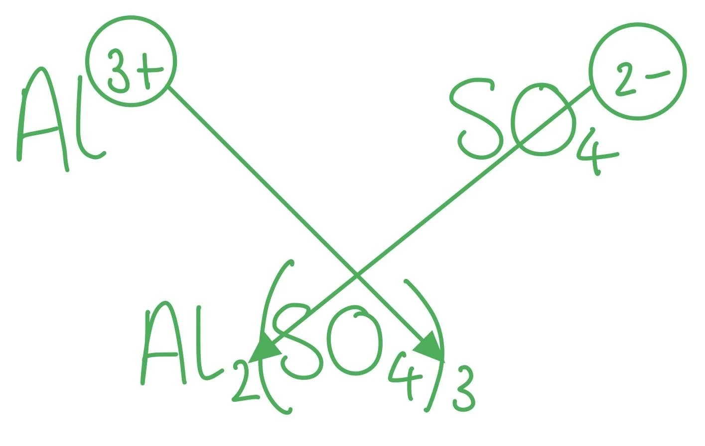
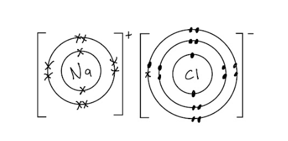

# Mark Schemes — Ionic Bonding
**3. Chemical Bonding** · Cambridge (CIE) AS chemistry (9701)

## Multiple Choice Questions (9 questions)

### Q1
**Final answer:** **The correct answer is A**

- Magnesium is a metal and oxygen is a non-metal.
- Magnesium loses two electrons to form Mg2+ ions and oxygen gains two electrons to form O2- ions.
- These oppositely charged ions are held together by strong electrostatic attraction in a giant ionic lattice.

**B** is incorrect as giant metallic bonding involves metal ions surrounded by a sea of delocalised electrons. It is only present in pure metals or alloys, not in metal–non-metal compounds such as MgO.

**C** is incorrect as macromolecular (giant covalent) structures consist of a network of atoms linked by covalent bonds. Examples include elements such as silicon, diamond, and graphite, and compounds such as silicon dioxide (SiO2). MgO does not contain covalent bonds.

**D** is incorrect as simple molecular structures consist of discrete molecules held together by weak intermolecular forces, giving low melting points. Iodine (I2) is a typical example.

### Q2
**Final answer:** **The correct answer is C**

- Aluminium is in Group 13 and forms a 3+ ion (Al3+).
- The sulfate ion has a fixed charge of 2- (SO42-).

- To balance: 2 x Al3+ gives 6+ total; 3 x SO42- gives 6- total.
- The formula is Al2(SO4)3.

**A** is incorrect as AlSO4 would require aluminium to have a charge equal in magnitude to sulfate, which is not consistent with Group 13 chemistry.

**B** is incorrect as Al(SO4)2 would imply aluminium has a 4+ charge, which is not consistent with aluminium being in Group 13.

**D** is incorrect as Al3(SO4)2 implies aluminium forms a 2+ ion — a common trap for students who confuse aluminium with a Group 2 metal such as magnesium.

### Q3
**Final answer:** **The correct answer is D**

- Silicon tetrachloride undergoes vigorous hydrolysis with water, producing a white precipitate of silicon dioxide (or silicic acid) and hydrochloric acid, which dissolves to give an acidic solution.
- Steamy fumes of HCl (g) may also be observed.

- The equation for this reaction is:

SiCl4 + 2H2O → SiO2 + 4HCl

**A** is incorrect as SiCl4 undergoes hydrolysis (a chemical reaction), not simple dissolution.

**B** is incorrect as a white precipitate of SiO2 is also produced alongside the acidic solution.

**C** is incorrect as hydrochloric acid is produced, making the resulting solution strongly acidic, not neutral.

### Q4
**Final answer:** **The correct answer is A**

- Gallium is in Group 13 and loses three valence electrons to form a Ga3+ cation.
- Phosphorus is in Group 15 and gains three electrons to form a P3- anion.
- The 3+ and 3- charges balance in a 1:1 ratio, giving the formula GaP.

**B** is incorrect as GaP2 would require gallium to form a 2+ ion and phosphorus to form a 1- ion, which does not match their Group 13 and 15 positions.

**C** is incorrect as Ga2P would imply gallium has a 1+ charge and phosphorus has a 2- charge, which is inconsistent with their respective group positions.

**D** is incorrect as Ga3P2 implies gallium forms a 2+ ion and phosphorus a 3- ion. This is a common trap for students who confuse gallium with a Group 2 metal.

### Q5
**Final answer:** **The correct answer is A**

- Ionic bonding is the strong electrostatic attraction between oppositely charged ions (cations and anions) in a crystal lattice.

**B** is incorrect as the electrostatic attraction between positive ions and a sea of delocalised electrons is the definition of metallic bonding, not ionic bonding.

**C** is incorrect as nuclei are positively charged, so two nuclei would experience electrostatic repulsion, not attraction.

**D** is incorrect as the electrostatic attraction between shared pairs of electrons and positively charged nuclei is the definition of covalent bonding.

### Q6
**Final answer:** **The correct answer is C**

- CH3OH contains only non-metal atoms (carbon, hydrogen, and oxygen) with no metal involved.
- The atoms share electrons to form covalent bonds only.

  - No electron transfer occurs.

**A** is incorrect as barium is a metal and chloride is a non-metal ion. BaCl2 forms a giant ionic lattice with ionic bonds between Ba2+ and Cl- ions.

**B** is incorrect as CaCO3 contains ionic bonds between Ca2+ and CO32- ions. The carbonate ion also contains covalent bonds, but the compound is held together by ionic bonding.

**D** is incorrect as NaOH contains ionic bonds between Na+ and OH- ions. The hydroxide ion also contains a covalent O–H bond.

### Q7
**Final answer:** **The correct answer is A**

- Aluminium is in Group 13 and loses three electrons to form Al3+.
- Chloride is a 1- ion (Cl-).
- Three chloride ions are required to balance one aluminium ion, giving the correct formula AlCl3, not AlCl2.

**B** is not the answer as (NH4)3PO4 is the correct formula for ammonium phosphate. The ammonium ion has a charge of 1+ (NH4+) and the phosphate ion has a charge of 3- (PO43-), so three ammonium ions balance one phosphate ion. This statement is true.

**C** is not the answer as nitrogen is in Group 15 and gains three electrons to achieve a stable octet, forming the nitride ion N3-. This statement is true.

**D** is not the answer as potassium is in Group 1 and loses one electron to form K+, a cation. This statement is true.

### Q8
**Final answer:** **The correct answer is D**

- Sodium nitrate contains both bonding types:

  - Na+ and NO3- ions are held together by ionic bonds.
  - The nitrogen and oxygen atoms within the nitrate ion are bonded covalently.

**A** is incorrect as 1,2-dibromoethane contains only non-metal atoms, forming a simple molecular structure with covalent bonds only.

**B** is incorrect as calcium chloride is formed from a metal and a non-metal with a large electronegativity difference. CaCl2 forms a giant ionic lattice containing only ionic bonds between Ca2+ and Cl- ions.

**C** is incorrect as propanoic acid contains only non-metal elements (carbon, hydrogen, and oxygen), forming a simple molecular structure with covalent bonds only.

### Q9
**Final answer:** **The correct answer is C**

- The correct formulas are:

  - Phosphate PO43-
  - Ammonium NH4+
  - Ethanoate CH3COO-
  - Nitrite NO2- - Note the distinction between nitrate (NO3-) and nitrite (NO2-).
- The ethanoate ion is derived from the dissociation of ethanoic acid:

CH3COOH (aq) ⇌ CH3COO- (aq) + H+ (aq)

**A** is incorrect as the ethanoate ion is an anion (CH3COO-), not a cation (CH3COO+); and NO3- is the nitrate ion, not the nitrite ion.

**B** is incorrect as the phosphate ion has the formula PO43-, not PO32-; and the ammonium ion is a cation (NH4+), not an anion.

**D** is incorrect as the phosphate ion has a 3- charge (PO43-), not 2-; and CH3CH2COO- is the propanoate ion, not ethanoate.

## Structured Questions (4 questions)

### Q1
The term ionic bonding refers to:

- The strong force of attraction; **[1 mark]**
- Between + and – ions / oppositely charged ions; **[1 mark]**

**[Total: 2 marks]**

- *You need to know this standard definition*

  - *An ionic bond is the strong electrostatic force of attraction between oppositely charged ions*
  - *Using the word particles instead of ions will sometimes get the second mark but this is not guaranteed *
The information in which shows lithium bromide is an ionic compound is:

- Does not conduct electricity when solid but conducts when molten; **[1 mark]**
- Higher boiling point; **[1 mark]**

**[Total: 2 marks]**

- *Ionic compounds cannot conduct electricity when they are solid as the ions are not able to move*

  - *Ionic compounds can conduct electricity when they are melted / molten or dissolved as the ions can now move*
- *The boiling point of ionic compounds is high as the strong (electrostatic) forces of attraction require a large amount of energy to overcome*
A reason for the difference in solubility in organic solvents:

- The lithium ion is small and highly charged; **[1 mark]**
- Bromide ion is polarised;** [1 mark]**
- Therefore lithium bromide has covalent character;** [1 mark] **
- Potassium fluoride does not have covalent character / potassium ion does not polarise the fluoride ion;** [1 mark]**

**[Total: 4 marks]**

- *The lithium ion is small compared to the potassium ion*
- *They also have the same charge*
- *Therefore the lithium ion can pull electron density from the large bromide ion towards itself and this creates covalent character which means it can interact with the organic solvent*
- *Any fully ionic compound can not interact with the organic solvent*

### Q2
The balanced symbol equation is:

Sr3N2 + 6H2O → 3Sr(OH)2 + 2NH3

**[2 marks]**

> **[mark-scheme]**
> 1 mark for the correct formulae of all reactants and products.
> 
> 1 mark for correctly balanced equation.
> 
> State symbols are not required.

> **[exam-tip]**
> First write the formulae using the charges on the ions, then balance the atoms.
> 
> Step 1: write the formulae.
> 
> - Strontium nitride: Sr2+ and N3-. Use the swap-and-drop method to get Sr3N2.
> - Strontium hydroxide: Sr2+ and OH-. Swap-and-drop gives Sr(OH)2. Note the brackets, because the hydroxide is a polyatomic ion.
> - Ammonia: NH3 (covalent, not ionic).
> - Water: H2O.
> 
> Step 2: balance the atoms.
> 
> - 3 Sr on the left → 3 Sr(OH)2 on the right.
> - 6 OH on the right → 6 H2O on the left (each provides one OH).
> - 2 N on the left → 2 NH3 on the right.
> - Check H: 12 on the left (6 × H2O) and 12 on the right (3 × 2 + 2 × 3 = 12). Balanced.
> 
> A common slip is to forget the brackets around (OH) in strontium hydroxide. Without brackets, Sr(OH)2 becomes SrOH2, which has the wrong stoichiometry.
> **[mark-scheme]**
> i) The melting point of strontium nitride is high because:
> 
> - The strong electrostatic forces of attraction between the oppositely charged ions require a large amount of energy to overcome; **[1 mark]**
> 
> ii) Strontium nitride will act as an electrical conductor when:
> 
> - It is molten / liquid; **[1 mark]**
> - It is dissolved (in water) / aqueous; **[1 mark]**
> 
> Explanation:
> 
> - The ions are free to move / mobile (and carry charge); **[1 mark]**

> **[exam-tip]**
> For part i), the question asks why the melting point is HIGH. The mark scheme requires three elements:
> 
> - 'Strong' attraction (just 'attraction' is not enough)
> - 'Electrostatic' attraction (the specific force type)
> - 'Between oppositely charged ions' (the particles involved)
> 
> Drop any one element and you risk losing the mark.
> 
> For part ii), strontium nitride is an ionic compound, so:
> 
> - As a SOLID, the ions are fixed in the giant ionic lattice and cannot move. No charge flow, no conduction.
> - When MOLTEN or in AQUEOUS solution, the ions are free to move and can carry charge.
> 
> The third explanation mark is for linking the mobility of the ions to charge flow. CIE wording note: use 'free to move' or 'mobile' (CIE's canonical phrase). Do NOT add 'when a potential difference is applied'. This clause is not in the CIE mark scheme.
> **[mark-scheme]**
> The melting points are different because:
> 
> - Mg2+ is smaller than Sr2+ / Mg2+ has (a) higher charge density; **[1 mark]**
> - Stronger electrostatic attraction between Mg2+ and N3- than between Sr2+ and N3-
> **AND**
> More energy is needed to overcome the attraction; **[1 mark]**

> **[exam-tip]**
> Magnesium and strontium are both Group 2 metals, so their ions both carry a 2+ charge. The difference in melting points is therefore controlled by ion SIZE (or charge density), not the magnitude of the charge.
> 
> Smaller ions can pack more closely in the lattice, so:
> 
> - The distance between the centres of the cation and anion is shorter.
> - The electrostatic attraction between Mg2+ and N3- is therefore stronger than between Sr2+ and N3-.
> - More energy is needed to break the lattice on melting, so magnesium nitride has the higher melting point (1500 °C vs 1200 °C for strontium nitride).
> 
> CIE wording note: use 'higher charge density'. This is the canonical CIE phrase and appears in 9701/41 May/June 2024 mark schemes. Charge density combines ion size and charge, so it is more precise than 'smaller ion' alone.
> 
> For full marks in M2, include the energy-to-overcome link. Stating only 'stronger attraction' without 'more energy needed to break' may only score the first mark.

### Q3
A labelled diagram showing the arrangement of particles in a crystal of sodium:

**[3 marks]**

> **[mark-scheme]**
> 1 mark for a regular arrangement / lattice of (at least six) positive metal ions.
> 
> 1 mark for the positive charge shown on each metal ion, e.g. a + sign inside each ion / labelled as Na+ / labelled as 'positive metal ions' or 'cations'.
> 
> 1 mark for at least six electrons drawn between the ions AND labelled as 'delocalised electrons' (or described as a 'sea of delocalised electrons').

> **[exam-tip]**
> A metallic crystal should be drawn as a regular lattice of positive metal ions surrounded by a 'sea' of delocalised electrons.
> 
> Show the structure clearly:
> 
> - Each sodium ion must have a + sign inside the circle (or be explicitly labelled Na+) to indicate the loss of its outer electron.
> - The electrons drawn between the ions MUST be labelled as 'delocalised electrons' (or shown as a 'sea of delocalised electrons'). CIE examiner reports (Nov 2022) flag this as a frequent reason for losing the mark. A bare dot, a − sign, or 'e-' on its own is not enough.
> - Arrange the ions in a regular pattern (rows and columns) to show that ions can slide past one another, which explains why metals are malleable.
> 
> The question specifies 'at least six particles of each type', so draw at least six ions AND at least six electrons. Drawing fewer ions will cost you the first marking point.
> **[mark-scheme]**
> The term 'ionic bond' means:
> 
> - Electrostatic attraction between oppositely charged ions / between cations and anions / between positive and negative ions; **[1 mark]**

> **[exam-tip]**
> This is a high-frequency CIE definition. Learn the syllabus wording word-for-word.
> 
> The two key elements:
> 
> - 'Electrostatic attraction' (not just 'attraction' or 'force')
> - 'Between oppositely charged ions' (also accepted as 'between cations and anions' or 'between positive and negative ions')
> 
> CIE accepts variations on the polarity wording but NOT on 'electrostatic'. Saying 'ions are attracted to each other' is too vague to score.
> 
> A common slip is to describe ionic bonding as 'electron transfer'. While electron transfer forms the ions, the bond itself is the electrostatic attraction between the ions formed.
> 
> For context: in sodium chloride, sodium loses one electron to become Na+ and chlorine gains one electron to become Cl-. The ionic bond is the electrostatic attraction between Na+ and Cl- in the giant ionic lattice.
The 'dot and cross' diagram of the ions in sodium chloride:

**[2 marks]**

> **[mark-scheme]**
> 1 mark for sodium ion shown as [Na]+ with square brackets around the ion, an empty outer shell, and a single + charge as superscript outside the bracket.
> 
> 1 mark for chloride ion shown as [Cl]- with square brackets, 8 electrons in the outer shell (7 of one symbol AND 1 of the other to show electron transfer from sodium), and a single − charge as superscript outside the bracket.
> 
> Inner shells are not required, but if drawn must be correct. Missing brackets, missing charges, undifferentiated dots/crosses, or an incomplete outer shell on Cl- are not accepted.

> **[exam-tip]**
> The mark in CIE dot-and-cross questions is awarded for the DIAGRAM, not for written electronic configuration. To secure both marks:
> 
> - Use square brackets [ ] around each ion.
> - Place the charge as a superscript outside the brackets, e.g. [Na]+ and [Cl]-.
> - Show only the OUTER shell of each ion (inner shells are optional but must be correct if drawn).
> - Use dots for one ion's electrons and crosses for the other to show that one electron has transferred from sodium to chlorine.
> 
> For Na+, the outer shell is empty because the 3s1 electron has transferred away, so the bracket contains an empty outer circle.
> 
> For Cl-, the outer shell has 8 electrons in total. Show 7 of one symbol (Cl's own electrons) and 1 of the other (the electron transferred from Na). This visually demonstrates the transfer.
> 
> Charge notation:
> 
> - CIE uses '+' and '−' for single charges (never '+1', '1+', or just '1').
> - For multiple charges (e.g. Mg2+), the number goes before the sign and both go as superscript outside the bracket.
> 
> Common mistakes that cost marks:
> 
> - Forgetting the square brackets.
> - Showing all 8 electrons on Cl- as the same symbol (this fails to show electron transfer).
> - Drawing only 7 electrons on Cl- (forgetting the transferred electron).
> - Missing the charge entirely.

### Q4
> **[mark-scheme]**
> The ions are held together in solid lithium and solid lithium chloride by:
> 
> - Lithium: (strong) electrostatic attraction between (positive) lithium ions / Li+ and delocalised electrons; **[1 mark]**
> - Lithium chloride: (strong) electrostatic attraction between oppositely charged ions / Li+ and Cl-; **[1 mark]**

> **[exam-tip]**
> This question tests two distinct types of bonding side-by-side:
> 
> - Metallic bonding (in lithium): a regular lattice of Li+ ions held together by their electrostatic attraction to delocalised outer electrons (often described as a 'sea' of electrons in textbooks, though the CIE mark scheme just says 'delocalised electrons').
> - Ionic bonding (in lithium chloride): a giant ionic lattice of Li+ and Cl- ions held together by the electrostatic attraction between the oppositely charged ions.
> 
> For both marks, the words 'electrostatic attraction' (or 'electrostatic forces') are what the mark scheme rewards. Saying just 'attraction' or 'force' will not score.
> 
> A common slip is to describe ionic bonding as 'electron transfer'. While the ions are formed by electron transfer, the bond itself is the electrostatic attraction between the ions formed.
> **[mark-scheme]**
> What can be deduced from Table 4.1:
> 
> - Lithium chloride has higher melting and boiling points than lithium
> **OR**
> The ionic bonding (in LiCl) is stronger than the metallic bonding (in Li); **[1 mark]**
> - More energy is needed to overcome the (stronger) electrostatic attraction between oppositely charged ions (in LiCl) than between Li+ and delocalised electrons (in Li); **[1 mark]**

> **[exam-tip]**
> The question says 'explain what can be deduced from the information in Table 4.1', so you must:
> 
> - Make a comparison from the data (e.g. LiCl mp 605 °C vs Li mp 180.5 °C).
> - Link that comparison to the relative strengths of the bonding types AND the energy needed to overcome the forces.
> 
> The mark scheme gives credit in two parts. The first mark is for noticing that LiCl has the higher mp / bp (or that ionic bonding is stronger than metallic bonding). The second mark is for the explicit energy link: more energy is required to overcome the stronger attraction in LiCl. Stating only 'stronger forces' without the energy-to-overcome step will only score 1 of 2 marks.
> 
> Note: the boiling points (1342 °C vs 1382 °C) are very close, so most of the contrast comes from the melting points. Either or both pairs of values can be cited.
> **[mark-scheme]**
> Whether Student A, Student B, or neither is correct:
> 
> - Student B is incorrect AND Student A is partly correct
> **OR**
> Both Student A and Student B are incorrect; **[1 mark]**
> 
> Lithium:
> 
> - Lithium will conduct electricity (at all times); **[1 mark]**
> - Lithium has delocalised electrons that move (through the metal structure) and carry charge; **[1 mark]**
> 
> Lithium chloride:
> 
> - Lithium chloride conducts electricity when molten / dissolved (in solution), but not when solid; **[1 mark]**
> - When solid the ions are in fixed positions / cannot move
> **AND**
> When molten / dissolved the ions are free to move / mobile (and carry charge); **[1 mark]**

> **[exam-tip]**
> For a substance to conduct electricity, charged particles (electrons or ions) must be free to move.
> 
> Lithium (a metal):
> 
> - Has delocalised outer electrons that move through the metallic lattice at all times.
> - Conducts electricity in both solid and molten states.
> 
> Lithium chloride (an ionic compound):
> 
> - Solid: ions are locked in position in the giant ionic lattice and cannot move, so it does NOT conduct electricity.
> - Molten or aqueous: the lattice has broken apart, so the Li+ and Cl- ions are free to move and carry charge.
> 
> The trick is that BOTH students are wrong. Student A is wrong because LiCl does not conduct as a solid. Student B is wrong because LiCl does conduct when molten or dissolved (so 'only lithium will conduct' is too strong).
> 
> CIE wording note: use 'free to move' or 'mobile' (CIE's standard phrase), not 'can flow'. Say 'carry charge' not 'carry the charge'.
> 
> Marking note: stating just 'they are wrong' without justification will not score the explanation marks. You need to explicitly cover (i) lithium conducts via delocalised electrons and (ii) LiCl conducts only when molten or dissolved because the ions are then mobile.
> **[mark-scheme]**
> CaF2 is formed from its atoms by:
> 
> - 1 Ca atom loses 2 electrons (to form Ca2+); **[1 mark]**
> - 2 F atoms (each) gain 1 electron (to form F-); **[1 mark]**
> - Forming Ca2+ AND 2 F- (correct charges and ratio); **[1 mark]**

> **[exam-tip]**
> The 'in terms of electrons' command means you must describe the loss and gain of electrons explicitly. You must:
> 
> - State which atom loses electrons and how many.
> - State which atom gains electrons and how many.
> - Identify the resulting ions (with correct charges and ratio).
> 
> For CaF2:
> 
> - Calcium (Group 2) loses its 2 outer electrons to achieve a full outer shell, forming Ca2+.
> - Each fluorine (Group 17) gains 1 electron to achieve a full outer shell, forming F-.
> - The formula tells you there are TWO fluoride ions per calcium ion, so 2 fluorine atoms each gain 1 electron (not 'fluorine gains 2 electrons', which would form F2- and is incorrect).
> 
> CIE convention: use digits ('2 electrons') rather than words ('two electrons'). The third mark is for stating the resulting ions clearly with correct charges and the 1:2 ratio.
