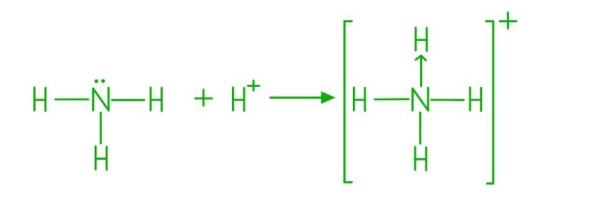
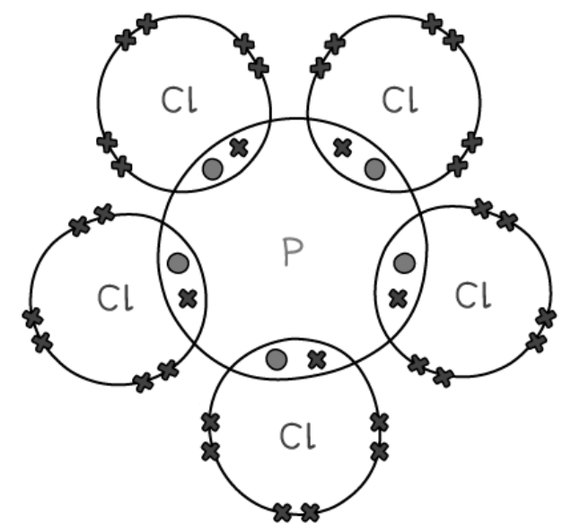
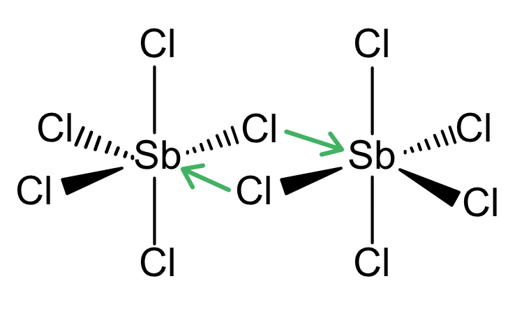
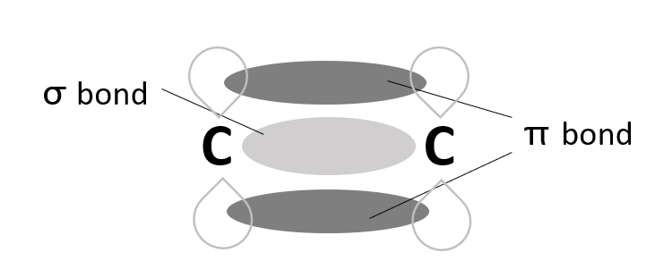

# Mark Schemes — Covalent Bonding & Coordinate (Dative Covalent) Bonding
**3. Chemical Bonding** · Cambridge (CIE) AS chemistry (9701)

## Multiple Choice Questions (14 questions)

### Q1
**Final answer:** **The correct answer is C**

- Expand the condensed formula into the full displayed structure:

CH2=CH–C≡N

- Count each bond type systematically:

  - 3 C–H single bonds: 3 σ bonds.
  - C=C double bond: 1 σ bond + 1 π bond.
  - C–C single bond: 1 σ bond.
  - C≡N triple bond: 1 σ bond + 2 π bonds.

- Total σ bonds = 3 + 1 + 1 + 1 = 6
- Total π bonds = 1 + 2 = 3

**A** is incorrect as only 4 σ bonds have been counted. The C=C double bond, the C–C single bond, and the C≡N triple bond each contain one σ bond that must be included.

**B** is incorrect as the C≡N triple bond contributes 2 π bonds, not zero. The total π bond count is 1 (from C=C) + 2 (from C≡N) = 3.

**D** is incorrect as the C≡N triple bond contains only one σ bond (plus two π bonds), giving a total of 6 σ bonds, not 7.

### Q2
**Final answer:** **The correct answer is C**

- Structure of ethanenitrile: H3C−C≡N
- **σ bonds:**

  - 3 (C−H) + 1 (C−C) + 1 (C≡N) = **5**
- **π bonds:**

  - The triple bond between C and N contains **2** π bonds.

**A** is incorrect as there are 5 σ bonds, not 4; the C−C single bond is also a σ bond and must be counted.

**B** is incorrect as the C≡N triple bond contains 2 π bonds, not 1.

**D** is incorrect as there are 5 σ bonds, not 6; the triple bond contributes only one σ bond (plus two π bonds).

> **[exam-tip]**
> Every bond (single, double, or triple) contains exactly one σ bond.
> 
> A double bond adds 1 π bond.
> 
> A triple bond adds 2 π bonds.
> 
> Count all σ bonds first, then count π bonds separately from any multiple bonds.

### Q3
**Final answer:** **The correct answer is C**

- All four compounds have similar relative molecular masses (*M*r ≈ 58–60).
- So, differences in boiling point are determined by the type of intermolecular forces present.
- CH3CH2CH2OH has the highest boiling point due to **hydrogen bonding** between the O–H group and adjacent molecules.
- Hydrogen bonds are stronger than all other intermolecular forces present in these compounds.

**A** is incorrect as butane has only instantaneous dipole-induced dipole forces, which are weaker than hydrogen bonds.

**B** is incorrect as 2-methylpropane also has only instantaneous dipole-induced dipole forces. Its branched structure further reduces intermolecular contact, giving a slightly lower boiling point than butane.

**D** is incorrect as propanal has a polar C=O group, giving permanent dipole–dipole forces, but these are weaker than hydrogen bonds.

### Q4
**Final answer:** **The correct answer is D**

- Bond polarity depends on the **difference in electronegativity** between the two bonded atoms.
- Electronegativity increases across a period; the greater the separation in group number, the larger the difference.
- In the Si–Cl bond, silicon is in Group 14 and chlorine is in Group 17.

  - This is a separation of three groups across Period 3.
- The other three bonds are all between elements in adjacent groups.

  - So, their electronegativity differences are much smaller.
- Therefore, Si–Cl therefore has the largest electronegativity difference and is the most polar bond.

**A** is incorrect as C and N are adjacent elements in Period 2 (Groups 14 and 15), so the electronegativity difference is small.

**B** is incorrect as N and O are adjacent elements in Period 2 (Groups 15 and 16), giving a similarly small electronegativity difference.

**C** is incorrect as P and S are adjacent elements in Period 3 (Groups 15 and 16), so the electronegativity difference is also small.

### Q5
**Final answer:** **The correct answer is B**

- Bond length is determined by bond order and atomic radius.

  - A higher bond order and smaller atomic radius both result in a shorter bond.

- Nitrogen gas, N2, contains a triple bond (bond order 3).

  - Nitrogen (Group 15) has a greater nuclear charge and smaller atomic radius than carbon (Group 14).
  - So, the N≡N bond is shorter than the C≡C bond in ethyne.

**A** is incorrect as ethyne, C2H2, also contains a triple bond (bond order 3), but carbon atoms have a larger atomic radius than nitrogen atoms. Therefore the C≡C bond is longer than the N≡N bond.

**C** is incorrect as oxygen gas, O2, contains a double bond (bond order 2). Double bonds have fewer shared electrons than triple bonds, resulting in a weaker electrostatic attraction between the nuclei and the shared electrons, and therefore a longer bond.

**D** is incorrect as ozone, O3, has a delocalised π electron system across its three oxygen atoms. The O–O bonds have an average bond order of 1.5, which is lower than the double bond in O2, making the bonds in ozone longer than those in oxygen gas.

### Q6
**Final answer:** **The correct answer is B**

- The bonding within the carbonate ion consists of covalent bonds between the carbon atom and the oxygen atoms.
- A covalent bond is defined as the strong electrostatic attraction between shared pairs of electrons and the positively charged nuclei of the bonded atoms.

**A** is incorrect as the separate carbonate ions, CO32–, both carry a negative charge. Electrostatic attraction cannot occur between two negatively charged species. Also, this describes an interaction between ions, not the bonding within the ion itself.

**C** is incorrect as instantaneous dipole-induced dipole forces are weak intermolecular forces acting between separate molecules, not the intramolecular covalent bonds holding atoms together within an ion.

**D** is incorrect as permanent dipole–permanent dipole forces are intermolecular forces acting between separate polar molecules, not the intramolecular covalent bonds within a polyatomic ion.

### Q7
**Final answer:** **The correct answer is A**

- The nitrogen atom in NO2 has three electron domains:

  - One double bond to oxygen.
  - One single bond to oxygen.
  - One unpaired electron.
- To accommodate three regions of electron density, the nitrogen atom is sp2 hybridised, giving a bent (V-shaped) geometry with a bond angle of approximately 134°.

- Ethene, C2H4, contains:

  - A C=C double bond.
  - Each carbon atom forms three σ bonds (two C–H and one C–C) and has no lone pairs, giving three electron domains and sp2 hybridisation.

**B** is incorrect as ethyne, C2H2, contains a C≡C triple bond. Each carbon atom forms only two σ bonds and has two electron domains, so it is sp hybridised (linear, 180°).

**C** is incorrect as methane, CH4, contains only single bonds. The carbon atom forms four σ bonds and has four electron domains, so it is sp3 hybridised (tetrahedral, 109.5°).

**D** is incorrect as propane, CH3CH2CH3, is an alkane containing only single bonds. All carbon atoms form four σ bonds and are sp3 hybridised.

### Q8
**Final answer:** **The correct answer is D**

- A sigma (σ) bond is formed by the direct, end-on (head-on) overlap of atomic orbitals along the internuclear axis between the bonding atoms.

**A** is incorrect as ionic bonds are formed by the strong electrostatic attraction between oppositely charged ions. They do not involve the overlap of atomic orbitals.

**B** is incorrect as metallic bonds are formed by the electrostatic attraction between positive metal ions and a sea of delocalised electrons. They do not involve the directional end-on overlap of atomic orbitals.

**C** is incorrect as pi (π) bonds are formed by the sideways (lateral) overlap of adjacent p orbitals, not by end-on overlap.

### Q9
**Final answer:** **The correct answer is B**

- A sigma (σ) bond is formed by the direct, head-on overlap of atomic orbitals; this can be two s orbitals, an s and a p orbital, or two p orbitals meeting end-on.

- A pi (π) bond is formed by the sideways (lateral) overlap of two adjacent, parallel p orbitals, producing electron density above and below the internuclear axis.

- Diagram B correctly shows two p orbitals overlapping head-on to form a σ bond, and two p orbitals overlapping sideways to form a π bond.

**A** is incorrect as the diagram for the π bond shows an s orbital overlapping sideways with a p orbital; s orbitals are spherical and cannot form the above-and-below electron density required for a π bond.

**C** is incorrect as the π bond diagram does not show the sideways overlap of two adjacent p orbitals.

**D** is incorrect as the σ bond diagram does not show the correct head-on overlap of atomic orbitals.

### Q10
**Final answer:** **The correct answer is A**

- A co-ordinate (dative covalent) bond is a covalent bond in which both shared electrons are provided by the same atom.
- The H+ ion has an empty 1s orbital.
- The lone pair on the phosphorus atom in PH3 is donated to the H+ ion, forming a co-ordinate bond and creating the PH4+ ion.

![Diagram of phosphine showing a lone pair on phosphorus reacting with H⁺ to form the tetrahedral phosphonium ion, [PH₄]⁺, labelled throughout](assets/006-diagram-of-phosphine-showing-a-lone-pair-on-phos.jpg)

**B** is incorrect as dipole-dipole forces are intermolecular forces of attraction between polar molecules, not an intramolecular bond formed during a chemical reaction.

**C** is incorrect as hydrogen bonds only form when hydrogen is covalently bonded to nitrogen, oxygen, or fluorine. Phosphorus is not electronegative enough to form hydrogen bonds. Also, hydrogen bonding is an intermolecular force, not the bond formed in this reaction.

**D** is incorrect as ionic bonding is the strong electrostatic attraction between oppositely charged ions.

### Q11
**Final answer:** **The correct answer is D**

- An O2 molecule contains a double bond (4 shared electrons, bond order 2).
- An N2 molecule contains a triple bond (6 shared electrons, bond order 3).
- The greater number of shared electrons in the N2 triple bond creates a stronger electrostatic attraction between the shared electrons and the two nitrogen nuclei.

  - This pulls the atoms closer together and results in a shorter bond length.

**A** is incorrect as nitrogen (Group 15) actually has a larger atomic radius than oxygen (Group 16). Both are in Period 2, but oxygen has a greater nuclear charge (8 protons vs 7 protons), which pulls its outer electrons closer to the nucleus. A larger atomic radius would tend to increase bond length.

**B** is incorrect as it is true that oxygen is more electronegative than nitrogen. However, higher electronegativity tends to shorten bonds, not lengthen them. The fact that N2 is shorter than O2 demonstrates that bond order overrides electronegativity in this comparison.

**C** is incorrect as the O–O double bond in O2 is not stronger than the N≡N triple bond. The triple bond (bond order 3) is stronger than the double bond (bond order 2).

### Q12
**Final answer:** **The correct answer is B**

- A nitrogen molecule contains a triple covalent bond.
- A triple bond consists of exactly one sigma (σ) bond and two pi (π) bonds.

  - σ bonds are formed by the end-on overlap of atomic orbitals.
  - π bonds are formed by the sideways (lateral) overlap of adjacent p orbitals.
- Therefore, three π bonds are not present in N2.

**A** is incorrect as the triple bond in N2 does contain exactly one σ bond. The statement is TRUE and so this is not the answer.

**C** is incorrect as the triple bond in N2 consists of three shared pairs of electrons (six electrons total). The statement is TRUE and so this is not the answer.

**D** is incorrect as nitrogen has five valence electrons. Three are used in the triple bond, leaving one lone pair on each nitrogen atom (two lone pairs in the molecule). The statement is TRUE and so this is not the answer.

### Q13
**Final answer:** **The correct answer is C**

- Diatomic molecules like HBr and HI consist of only two atoms.
- A bond angle requires at least three atoms to be defined.
- Therefore, neither molecule has a bond angle, making this row an impossible and incorrect completion of the sentence.

**A** is incorrect as the H–Br bond is shorter than the H–I bond; bromine is in a lower period than iodine and has fewer electron shells, giving a smaller atomic radius and a shorter bond length. The statement is TRUE and so this is not the answer.

**B** is incorrect as the shorter H–Br bond has a greater bond energy than the longer H–I bond. A shorter, stronger bond requires more energy to break. The statement is TRUE and so this is not the answer.

**D** is incorrect as bromine (Group 17) is more electronegative than iodine. The greater electronegativity difference in HBr creates a larger permanent dipole and greater bond polarity compared with HI. The statement is TRUE and so this is not the answer.

### Q14
**Final answer:** **The correct answer is D**

- The ammonium ion, NH4+, is formed when ammonia, NH3, reacts with a hydrogen ion, H+.

- The nitrogen atom in NH3 has a lone pair of electrons.
- The H+ ion has an empty 1s orbital.
- The lone pair on nitrogen is donated to the H+ ion to form a co-ordinate (dative covalent) bond, creating the NH4+ ion

.**A** is incorrect as the cyanide ion, CN–, contains a standard covalent triple bond between carbon and nitrogen. The negative charge means carbon effectively has 5 valence electrons (isoelectronic with nitrogen). So, both atoms share three electrons in a normal triple bond and no co-ordinate bond is present.

**B** is incorrect as nitrogen gas, N2, contains a triple covalent bond in which each nitrogen atom shares three of its five valence electrons. The remaining two electrons form a lone pair on each nitrogen atom.

**C** is incorrect as ammonia, NH3, contains three standard single covalent bonds. The lone pair on the nitrogen atom is present but is not donated within the NH3 molecule itself.

## Structured Questions (5 questions)

### Q1
i) The shape and bond angles in a molecule of PCl5 are:

| shape of PCl5 | trigonal bipyramidal / trigonal bipyramid |
|---|---|
| bond angles in PCl5 | 120° **AND** 90° |

> **[mark-scheme]**
> 1 mark for the correct shape: trigonal bipyramidal / trigonal bipyramid
> 
> 1 mark for both bond angles: 120° **AND** 90°

ii) The dot-and-cross diagram of a molecule of PCl5 (showing outer electrons only) is:

**[2 marks]**

> **[mark-scheme]**
> 1 mark for 5 bonded pairs of electrons between P and each Cl, each shown with one dot and one cross.
> 
> 1 mark for the rest of the structure correct (each Cl atom showing its 3 lone pairs, P with no lone pairs, expanded octet of 10 electrons).

> **[exam-tip]**
> PCl5 is an example of a molecule where the central atom expands its octet. It has 10 electrons in its outer shell instead of 8.
> 
> Phosphorus has 5 outer electrons (3s2 3p3). Each pairs with one electron from a chlorine atom to form 5 covalent bonds, so P ends up with 10 outer-shell electrons.
> 
> Shape and bond angles:
> 
> - 5 bonding pairs around P, no lone pairs.
> - Trigonal bipyramidal arrangement: 3 atoms in a triangular plane (120° between them) + 2 atoms above and below (90° to the plane).
> - The two distinct bond angles are 120° (between the three equatorial Cl atoms) and 90° (between equatorial and axial Cl atoms).
> 
> For the dot-and-cross diagram:
> 
> - Show only the outer-shell electrons (the question specifies this).
> - Each P-Cl bond contains 1 electron from P (dot) and 1 from Cl (cross).
> - Each Cl atom has 3 lone pairs in addition to the bonding pair. Show all three.
> - The P expands its octet, so 10 electrons around P is correct (not 8).
The shapes of [PCl4]+ and [PCl6]– are:

[PCl4]+

[PCl6]–

**[2 marks]**

> **[mark-scheme]**
> 1 mark for the correct tetrahedral shape of [PCl4]+.
> 
> 1 mark for the correct octahedral shape of [PCl6]–.
> 
> Three-dimensional shapes should be shown using wedges and dotted lines.

> **[exam-tip]**
> Apply VSEPR theory to each ion by counting the bonding pairs and lone pairs around the central P atom:
> 
> - [PCl4]+: 4 bonding pairs (4 P-Cl bonds), 0 lone pairs. Tetrahedral shape, bond angle 109.5°.
> - [PCl6]–: 6 bonding pairs (6 P-Cl bonds), 0 lone pairs. Octahedral shape, bond angle 90°.
> 
> Drawing tips:
> 
> - Use wedges (solid triangles) for bonds coming out of the page, dotted lines for bonds going behind, and plain lines for bonds in the plane of the page.
> - Include square brackets and the charge to label the ions clearly.
> **[mark-scheme]**
> The student is incorrect because:
> 
> - sp3 hybridisation produces only 4 (hybrid) orbitals (from one s + three p orbitals) **[1 mark]**
> - But PCl5 has 5 covalent / sigma / σ bonds, so requires 5 hybrid orbitals (sp3d hybridisation) **[1 mark]**

> **[exam-tip]**
> The number of hybrid orbitals needed equals the number of σ bonds + lone pairs around the central atom.
> 
> For PCl5:
> 
> - 5 σ bonds (P-Cl) and 0 lone pairs = 5 electron domains.
> - 5 hybrid orbitals are required.
> - sp3 hybridisation only generates 4 hybrid orbitals (1 s + 3 p), so it cannot account for the 5 bonds.
> 
> PCl5 actually has sp3d hybridisation (1 s + 3 p + 1 d = 5 hybrid orbitals), but you are not expected to know this in detail. The specification doesn't require you to name the hybridisation in PCl5. You only need to explain why sp3 isn't enough.
> 
> A common slip is to focus on the shape (trigonal bipyramidal) rather than the orbital count. The mark scheme awards marks for the orbital-counting argument, not the geometry.
> **[mark-scheme]**
> Phosphorus(V) chloride in its solid form has a higher melting point than antimony(V) chloride because:
> 
> - Solid PCl5 has strong electrostatic forces of attraction between oppositely charged ions ([PCl4]+ and [PCl6]-) **[1 mark]**
> - SbCl5 has only weak van der Waals' / intermolecular forces between SbCl5 molecules **[1 mark]**

> **[exam-tip]**
> This question requires you to apply the structure information from earlier parts:
> 
> - Solid PCl5 exists as ionic [PCl4]+[PCl6]- (from part b's equilibrium). It has a giant ionic lattice with strong electrostatic forces of attraction between cations and anions.
> - SbCl5 exists as discrete SbCl5 molecules. It has a simple molecular structure with weak van der Waals' / intermolecular forces (id–id and pd–pd) between molecules.
> 
> Strong ionic bonds require much more energy to break than weak intermolecular forces, so PCl5 has the higher melting point.
> 
> Mark scheme strictness:
> 
> - The first mark requires the full long form 'electrostatic forces of attraction between oppositely charged ions'. Saying 'PCl5 has stronger forces' or just 'ionic' will not score.
> - The second mark requires reference to weak van der Waals' / intermolecular forces in SbCl5. Acceptable terms: van der Waals' forces, intermolecular forces, id–id, pd–pd.
> - Do NOT refer to 'breaking covalent bonds' in either case. Boiling and melting break intermolecular forces (or the ionic lattice), NOT covalent bonds.
The bonding in Sb2Cl10 is:

**[1 mark]**

> **[mark-scheme]**
> 1 mark for two coordinate bonds shown as arrows from (bridging) Cl to Sb (the arrow direction must be Cl → Sb, indicating Cl as the donor and Sb as the acceptor).

> **[exam-tip]**
> Sb is in Group 15 (like P), so SbCl5 can also expand its octet. Just as P can accept a lone pair from a Cl- to form [PCl6]-, Sb can accept a lone pair from a Cl atom on a neighbouring SbCl5 molecule to form Sb2Cl10.
> 
> For each coordinate (dative covalent) bond:
> 
> - The lone pair of electrons comes from the Cl atom on one molecule.
> - The lone pair is donated to the Sb atom on the neighbouring molecule.
> - The arrow must point FROM the donor (Cl) TO the acceptor (Sb). Direction is checked.
> 
> In Sb2Cl10, two such bridging coordinate bonds form between the two SbCl5 units, giving a dimeric structure with each Sb now bonded to 6 Cl atoms (octahedral around Sb).
> 
> Examiners comment that many students are not familiar with the arrow convention for coordinate bonds. Make sure you draw the arrowheads clearly and pointing from Cl (donor) to Sb (acceptor).
> **[mark-scheme]**
> Nitrogen does not form NCl5 because:
> 
> Any **one** from:
> 
> - Nitrogen has no (accessible) d orbitals (in the valence / 2nd shell)
> - Nitrogen cannot expand its octet (only 8 electrons in valence shell)
> - Nitrogen is too small (to bond to 5 chlorine atoms)
> - The repulsion between electron pairs would be too great
> 
> **[1 mark]**

> **[exam-tip]**
> Period 2 elements (Li to Ne) cannot expand their octets. They are limited to a maximum of 8 electrons in their outer shell. Two reasons:
> 
> - They have no available d orbitals in the second shell. (2d orbitals don't exist; 3d is too high in energy.)
> - Their atoms are too small to physically accommodate more than 4 substituent atoms around the central atom.
> 
> Period 3 elements (Na to Ar) and below CAN expand their octets because they have available 3d orbitals (or 4d, 5d, etc.) and are physically larger.
> 
> This is why P, As, Sb form pentachlorides (PCl5, AsCl5, SbCl5) but N does not form NCl5.
> 
> The most commonly credited answers are 'no d orbitals' and 'cannot expand octet'. 'Too small' is also accepted; 'repulsion too great' is rarely the prime answer in mark schemes.
> 
> Examiner reports note that this type of question is often poorly answered. Students forget that the octet rule has limits and that Period 2 elements cannot exceed it.

### Q2
> **[mark-scheme]**
> The carbon-carbon triple bond in propyne forms as follows:
> 
> - The two carbon atoms (in the triple bond) are sp hybridised **[1 mark]**
> - The σ bond is formed from end-on / head-on overlap of sp hybrid orbitals (one from each carbon) **[1 mark]**
> - Two π bonds are formed from sideways overlap of unhybridised p orbitals (one pair on each carbon) **[1 mark]**
> 
> The third mark requires explicit reference to two π bonds.

> **[exam-tip]**
> A triple bond consists of 1 σ bond + 2 π bonds.
> 
> Hybridisation determines the geometry around each carbon and the bonds formed:
> 
> - **sp** hybridisation: 2 sp hybrid orbitals + 2 unhybridised p orbitals. Forms 1 σ + 2 π bonds (triple bond, linear geometry).
> - **sp****2** hybridisation: 3 sp2 hybrid orbitals + 1 unhybridised p orbital. Forms 1 σ + 1 π bond (double bond, trigonal planar).
> - **sp****3** hybridisation: 4 sp3 hybrid orbitals. Forms 4 σ bonds only (single bonds, tetrahedral).
> 
> For propyne (CH3C≡CH):
> 
> - The two triple-bonded carbons are sp hybridised.
> - The σ bond between them comes from end-on (head-on) overlap of one sp orbital from each carbon.
> - The two π bonds come from sideways overlap of two pairs of unhybridised p orbitals (one pair in the y-direction, one in the z-direction, both perpendicular to the bond axis).
> 
> A common slip is to mention only ONE π bond. The mark scheme explicitly requires TWO π bonds. This is what distinguishes a triple bond from a double bond.
> **[mark-scheme]**
> The number of carbon atoms in the molecule that exhibit sp2 hybridisation:
> 
> - 6 **[1 mark]**

> **[exam-tip]**
> Quick rule of thumb for hybridisation in organic molecules:
> 
> - C in a triple bond → sp
> - C in a double bond → sp2
> - C in single bonds only → sp3
> 
> Only the carbon atoms involved in C=C double bonds are sp2. Count each carbon at the end of a double bond, not the bonds themselves.
> 
> A common slip is to count the bonds (e.g. 3 double bonds = 3 sp2 carbons). Each C=C double bond involves TWO carbon atoms, so 3 double bonds means 6 sp2 carbons.
> 
> For Fig. 3.1, identify each C=C double bond, then count both carbons in each.
The completed Table 3.1:

|   | **NF****4****+** | **N****2****H****2** | **N****2****H****4** |
|---|---|---|---|
| **Hybridisation of nitrogen** | **Final answer:** **sp****3** | **Final answer:** **sp****2** | **Final answer:** **sp****3** |

**[3 marks]**

> **[mark-scheme]**
> 1 mark for sp3 for NF4+.
> 
> 1 mark for sp2 for N2H2.
> 
> 1 mark for sp3 for N2H4.

> **[exam-tip]**
> Use the number of electron domains (bonding pairs + lone pairs) around the central atom to determine hybridisation:
> 
> - 4 electron domains: sp3
> - 3 electron domains: sp2
> - 2 electron domains: sp
> 
> For each nitrogen:
> 
> - In NF4+: N has 4 bonding pairs (4 N—F bonds) and 0 lone pairs. 4 electron domains, so sp3.
> - In N2H2 (HN=NH): each N has 1 N=N double bond (1 domain) + 1 N—H bond (1 domain) + 1 lone pair (1 domain) = 3 electron domains, so sp2.
> - In N2H4 (H2N—NH2): each N has 2 N—H bonds + 1 N—N bond + 1 lone pair = 4 electron domains, so sp3.
> 
> A double bond counts as ONE electron domain (not two), and a lone pair counts as one electron domain alongside bonding pairs.

### Q3
> **[mark-scheme]**
> i) The type of bond represented in the diagram by N—H:
> 
> - Covalent **[1 mark]**
> 
> ii) The type of bond represented in the diagram by N→H:
> 
> - Dative (covalent) / coordinate **[1 mark]**

> **[exam-tip]**
> The two bond types differ in HOW the shared pair of electrons is supplied:
> 
> - A single covalent bond (N—H): one electron donated from each atom (one from N, one from H).
> - A dative (covalent) / coordinate bond (N→H): both electrons in the pair come from the same atom. In this case, both come from the nitrogen atom.
> 
> The arrow notation N→H shows the direction in which the electrons have been donated. Once formed, the bond itself behaves identically to a normal covalent bond.
> 
> For the ammonium ion (NH4+):
> 
> - 3 of the 4 N—H bonds are normal covalent bonds (carried over from NH3).
> - The 4th bond is a dative covalent bond formed when NH3 donates its lone pair to H+.
> **[mark-scheme]**
> The coordinate (dative covalent) N→H bond forms because:
> 
> - Both electrons in the bonding pair come from nitrogen
> **OR**
> A lone pair of electrons from N is donated to H+ **[1 mark]**

> **[exam-tip]**
> In the ammonium ion (NH4+), the H+ that joined NH3 to form the ion has no electrons of its own. It is a bare proton. The nitrogen atom in NH3 has a lone pair and donates BOTH electrons of that lone pair to the H+ to form the new N—H bond.
> 
> Once formed, the coordinate bond is indistinguishable from the other three N—H bonds in terms of length and strength.
> 
> A common slip is to describe dative covalent bond formation as 'electron transfer from N to H'. That would be ionic bonding. In a dative covalent bond, both electrons in the bonding pair come from one atom. The electrons are shared between both atoms once the bond forms.
> **[mark-scheme]**
> The bond angles in the NH4+ ion are all 109.5° because:
> 
> - There are four bonding pairs of electrons (around the central N atom) **[1 mark]**
> - They repel each other / repel as far apart as possible (giving a tetrahedral shape) **[1 mark]**

> **[exam-tip]**
> VSEPR (Valence Shell Electron Pair Repulsion) theory says that electron pairs around a central atom arrange themselves to minimise repulsion (i.e. as far apart as possible).
> 
> For NH4+:
> 
> - 4 bonding pairs (the four N—H bonds, including the dative one) and 0 lone pairs around the central N.
> - 4 bonding pairs arrange themselves tetrahedrally, with bond angles of 109.5°.
> - All four pairs are bonding pairs, so the repulsion is symmetrical, giving a regular tetrahedral shape.
> 
> Compare with the parent molecule NH3:
> 
> - 3 bonding pairs + 1 lone pair around N.
> - The lone pair repels more strongly than the bonding pairs, compressing the H—N—H bond angle to 107°.
> 
> When NH3 donates its lone pair to form NH4+, that lone pair becomes a bonding pair, removing the unequal repulsion and opening the bond angle from 107° to 109.5°.
> 
> The order of repulsion strengths is:
> 
> - lone pair / lone pair > lone pair / bonding pair > bonding pair / bonding pair

### Q4
> **[mark-scheme]**
> The number of sigma and pi bonds in the molecule:
> 
> - 21 sigma bonds **[1 mark]**
> - 5 pi bonds **[1 mark]**

> **[exam-tip]**
> Bond-counting rules:
> 
> - Single bond = 1 σ bond
> - Double bond = 1 σ + 1 π bond
> - Triple bond = 1 σ + 2 π bonds
> 
> For Fig. 2.1, count each type of bond first, then convert to σ and π totals.
> 
> Working for this molecule:
> 
> - 12 C-H single bonds → 12 σ
> - 5 C-C single bonds → 5 σ
> - 3 C=C double bonds → 3 σ + 3 π
> - 1 C≡C triple bond → 1 σ + 2 π
> 
> Totals: 12 + 5 + 3 + 1 = 21 σ; 3 + 2 = 5 π.
> 
> A common slip is to count only the multiple bonds and forget the C-H and C-C single bonds (which contribute most of the sigma count).
> **[mark-scheme]**
> The hybridisation of the carbon atom marked in Fig. 2.2:
> 
> - sp3 **[1 mark]**

> **[exam-tip]**
> Quick hybridisation check by counting bonds at the atom:
> 
> - 4 single bonds (or equivalent: e.g. 3 single bonds + 1 lone pair) → sp3
> - 1 double bond + 2 single bonds → sp2
> - 1 triple bond + 1 single bond OR 2 double bonds → sp
> 
> The marked carbon in ethanol has 4 single bonds (3 to H, 1 to C or 1 to O). All sigma bonds, no pi bonds, no lone pairs, so sp3.
> 
> In ethanol overall (CH3CH2OH):
> 
> - Both carbon atoms are sp3.
> - The oxygen is also sp3 (2 bonds + 2 lone pairs = 4 electron domains).
The diagram showing the orbital overlap in methanol:

**[3 marks]**

> **[mark-scheme]**
> 1 mark for correct C-H overlap (sp3 on C with 1s on H) **AND** correct C-O bond (sp3 on C with sp3 on O).
> 
> 1 mark for correct O-H bond (sp3 on O with 1s on H).
> 
> 1 mark for two lone pairs on the oxygen (in sp3 orbitals).
> 
> A generic 'correct overlap' without labelled orbital types is not accepted.

> **[exam-tip]**
> Methanol has the formula CH3OH, with all single bonds. All bonds are σ bonds, formed from end-on overlap of orbitals.
> 
> For the diagram, label each overlap with the specific orbital types:
> 
> - Each C-H bond: end-on overlap between an sp3 hybrid orbital on C and the 1s orbital on H.
> - The C-O bond: end-on overlap of an sp3 hybrid orbital on C with an sp3 hybrid orbital on O.
> - The O-H bond: end-on overlap of an sp3 hybrid orbital on O with the 1s orbital on H.
> - The oxygen atom has two lone pairs in its remaining sp3 orbitals. These must be drawn explicitly.
> 
> Common errors:
> 
> - Drawing p orbitals (figure-of-eight shape) instead of sp3 hybrids (asymmetric lobes) on C and O.
> - Forgetting to label orbital types (the mark scheme requires sp3 and 1s labels explicitly).
> - Forgetting the two lone pairs on oxygen.
> - Drawing the H 1s orbital too large or as a hybrid (it should be a small sphere).

### Q5
The diagram showing the orbital overlap for each bond:

**[2 marks]**

> **[mark-scheme]**
> 1 mark for correctly drawn **AND** labelled σ bond (showing direct/end-on overlap of orbitals between the two carbon atoms).
> 
> 1 mark for correctly drawn **AND** labelled π bond (showing sideways overlap of p orbitals above **AND** below the carbon–carbon bond axis).
> 
> If both bonds are drawn correctly but the labels are swapped, award 1 mark only.

> **[exam-tip]**
> A C=C double bond consists of:
> 
> - 1 σ bond, formed from end-on (direct) overlap of sp2 hybrid orbitals between the two carbon atoms. The electron density is concentrated along the line connecting the two nuclei.
> - 1 π bond, formed from sideways overlap of the unhybridised p orbitals on each carbon. The electron density forms two lobes, one above and one below the plane of the σ bond.
> 
> Important diagram conventions:
> 
> - The two lobes above and below the C=C bond represent ONE π bond, not two.
> - Only ONE of the lobes needs to be labelled as π for the mark.
> - The σ bond label goes on the electron density between the two carbon nuclei (along the bond axis).
> **[mark-scheme]**
> The covalent bond between carbon atoms in ethene is stronger than in ethane because:
> 
> - The C=C bond is shorter (134 pm) than the C-C bond (150 pm) **[1 mark]**
> - (Because) there is greater electron density between the carbon atoms (in ethene) **[1 mark]**
> - There is more attraction between the (bonding) electrons and the atomic nuclei **[1 mark]**

> **[exam-tip]**
> The question requires you to use the data in Table 5.1, so talk about the bond lengths in your answer.
> 
> Why C=C is stronger than C-C:
> 
> - A double bond contains 1 σ + 1 π bond (vs 1 σ for a single bond), so there is twice as much electron density between the nuclei in C=C.
> - Greater electron density between the nuclei pulls the atoms closer together, so C=C is shorter (134 pm) than C-C (150 pm).
> - The closer the nuclei, the stronger the electrostatic attraction between the bonding electrons and both nuclei, so the bond is stronger and harder to break.
> 
> A common slip is to state only 'C=C is shorter' or 'there is more electron density' without linking these to the increased attraction. The mark scheme awards three independent marks for:
> 
> 1. The bond-length comparison
> 2. The electron-density observation
> 3. The attraction-strength conclusion.
> **[mark-scheme]**
> The relative thermal stabilities of HCl, HBr and HI:
> 
> - HCl is the most thermally stable and HI is the least thermally stable
> **OR**
> The order of thermal stability, from most to least stable, is HCl > HBr > HI **[1 mark]**
> - (Because) HI has the largest bond length and the lowest bond energy **[1 mark]**
> - Less energy is needed to break the H–I bond / HI decomposes more readily because there is less attraction between the nucleus and the bonding electrons (due to the larger atomic radius / longer bond going down the group) **[1 mark]**

> **[exam-tip]**
> You must use the data from Table 5.2 to score full marks. Identify the trend, explain the cause, and link to thermal stability.
> 
> Trend in Table 5.2 (going down the group H-Cl → H-Br → H-I):
> 
> - Bond energy decreases (431 → 366 → 299 kJ mol-1).
> - Bond length increases (127 → 141 → 161 pm).
> 
> Why this happens:
> 
> - The halogen atom gets larger going down Group 17, so the bonding pair of electrons is further from the halogen nucleus.
> - The attraction between the H-X bonding electrons and the halogen nucleus weakens.
> - Less energy is needed to break the bond, so the hydrogen halide decomposes more readily and is less thermally stable.
> 
> A common pitfall is to confuse thermal stability with the reactivity of elemental halogens. Going down Group 17, elemental halogens become less reactive as oxidising agents, but the hydrogen halides become less thermally stable. HI has the weakest H-I bond and decomposes most readily. Always use the data in the table.
> **[mark-scheme]**
> i) Hydrogen halides have relatively low boiling points despite having strong covalent bonds because:
> 
> - Only the weak (van der Waals' / id–id / pd–pd) intermolecular forces between molecules are broken at the boiling point, NOT the (strong) covalent bonds within molecules **[1 mark]**
> - The intermolecular forces are weaker than the covalent bonds **[1 mark]**
> 
> ii) HF has a higher boiling point than HCl because:
> 
> - Both have instantaneous dipole–induced dipole (id–id) forces **[1 mark]**
> - HCl has permanent dipole–permanent dipole (pd–pd) forces (in addition to id–id forces) **[1 mark]**
> - HF has hydrogen bonding (in addition to id–id forces) **[1 mark]**
> - Hydrogen bonds are stronger than pd–pd forces, so more energy is required to break them **[1 mark]**

> **[exam-tip]**
> Two ideas underpin both sub-parts:
> 
> - Boiling point depends on the strength of the INTERMOLECULAR forces, NOT the covalent bonds within the molecules.
> - Stronger intermolecular forces require more energy to overcome, giving a higher boiling point.
> 
> For part i), the trick is recognising that 'strong covalent bonds' is irrelevant. The covalent bonds stay intact on boiling. Only the (relatively weak) intermolecular forces break.
> 
> For part ii), according to the specification van der Waals' forces is a generic term covering BOTH:
> 
> - Instantaneous dipole–induced dipole (id–id) forces (formerly called London dispersion forces): present in ALL molecules.
> - Permanent dipole–permanent dipole (pd–pd) forces: present in molecules with a permanent dipole (polar covalent bonds with no symmetric cancellation).
> 
> The hierarchy of intermolecular forces, from weakest to strongest:
> 
> - id–id < pd–pd < hydrogen bonding
> 
> For HF vs HCl:
> 
> - HCl has pd–pd forces (Cl is more electronegative than H, but not enough to form hydrogen bonds).
> - HF has hydrogen bonding (F is one of the three elements F, O, N that allow hydrogen bonding because F is highly electronegative AND has a lone pair).
> - Hydrogen bonding is stronger than pd–pd, so HF has a higher boiling point despite both molecules being similar in size.
> 
> A common slip is to conflate van der Waals' forces with hydrogen bonding. Hydrogen bonding is a SEPARATE, STRONGER type of intermolecular force, present only when H is bonded to F, O, or N.
