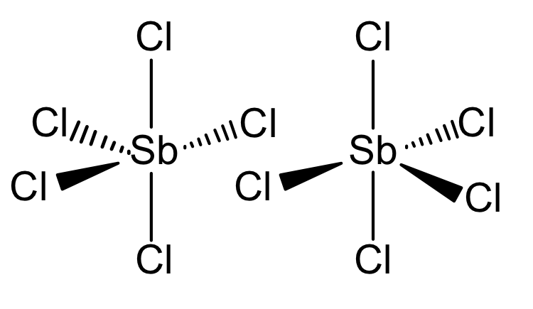

# Exam Questions — Covalent Bonding & Coordinate (Dative Covalent) Bonding
**3. Chemical Bonding** · Cambridge (CIE) AS chemistry (9701)
> Source: [https://www.savemyexams.com/as/chemistry/cie/25/topic-questions/](https://www.savemyexams.com/as/chemistry/cie/25/topic-questions/) · 19 questions across 2 sets

## Multiple Choice Questions (14 questions)

### Q1 — medium — 1 marks

**Q1** [1 mark]

Which row gives the number of σ and π bonds in one molecule of acrylonitrile?

|   | number of σ bonds | number of π bonds |
|---|---|---|
| **A** | 4 | 2 |
| **B** | 6 | 1 |
| **C** | 6 | 3 |
| **D** | 7 | 3 |

### Q2 — medium — 1 marks

**Q2** [1 mark]

How many σ and π bonds are present in ethanenitrile?

### Q3 — medium — 1 marks

**Q3** [1 mark]

Which compound has the highest boiling point?

### Q4 — medium — 1 marks

**Q4** [1 mark]

Which bond is the most polar?

### Q5 — hard — 1 marks

**Q5** [1 mark]

Which bond is the shortest?

### Q6 — hard — 1 marks

**Q6** [1 mark]

Which statement describes the bonding within a carbonate ion, CO32–?

### Q7 — hard — 1 marks

**Q7** [1 mark]

The structure of the NO2 molecule is shown below.

Which compound has the same hybridisation of carbon atoms as the nitrogen atom in NO2?

### Q8 — easy — 1 marks

**Q8** [1 mark]

Which bond is formed by the end-on overlap of atomic orbitals?

### Q9 — medium — 1 marks

**Q9** [1 mark]

Which diagrams correctly illustrate the formation of a σ bond and a π bond from the overlap of atomic orbitals?

### Q10 — easy — 1 marks

**Q10** [1 mark]

Phosphine, PH3, can react with a hydrogen ion, H+, to form the phosphonium ion.

Which type of bond is formed in this reaction?

### Q11 — medium — 1 marks

**Q11** [1 mark]

The bond length in an O2 molecule is 0.121 nm and the bond length in an N2 molecule is 0.109 nm.

Which statement explains why the bond in N2 is shorter than the bond in O2?

### Q12 — medium — 1 marks

**Q12** [1 mark]

Which feature is **not** present in a nitrogen molecule, N2?

### Q13 — medium — 1 marks

**Q13** [1 mark]

“The bond **X** between the hydrogen and halogen atoms in HBr is **Y** than in HI.”

Which row does **not** correctly complete the sentence?

|   | **X** | **Y** |
|---|---|---|
| **A** | length | shorter |
| **B** | energy | greater |
| **C** | angle | smaller |
| **D** | polarity | greater |

### Q14 — easy — 1 marks

**Q14** [1 mark]

Which species contains a co-ordinate (dative covalent) bond?

## Structured Questions (5 questions)

### Q1 — hard — 12 marks

**Q1** [4 marks]

Phosphorus reacts with chlorine to form PCl5.

i) State the shape of, and two different bond angles in, a molecule of PCl5.

| shape of PCl5 |   |
|---|---|
| bond angles in PCl5 |   |

[2]

ii) Draw a dot-and-cross diagram to show the bonding in a molecule of PCl5. Show the outer electrons only.

[2]

**Q1** [2 marks]

In the solid state, phosphorus(V) chloride exists as an ionic lattice containing [PCl4]+ and [PCl6]– ions.

Draw three-dimensional diagrams to show the shapes of the [PCl4]+ and [PCl6]– ions.

| [PCl4]+ | [PCl6]– |
|---|---|
|   |   |

**Q1** [2 marks]

A student suggests that the PCl5 molecule has sp3 hybridisation. Explain why the student is incorrect.

**Q1** [2 marks]

**Extract:**

In the solid state, phosphorus(V) chloride exists as an ionic lattice containing [PCl~4~]^+^ and [PCl~6~]^–^ ions.

Antimony(V) chloride is another Group 15 chloride. Under standard conditions, it is a liquid made from SbCl5 molecules.

Use your answer to (b) to explain why phosphorus(V) chloride, in its solid form, has a higher melting point than antimony(V) chloride.

**Q1** [1 mark]

Under the right conditions, molecules of SbCl5 join together to form Sb2Cl10.

Complete Fig. 4.1 to show the bonding in Sb2Cl10. Include the coordinate (dative covalent) bonds.

**Fig. 4.1**

**Q1** [1 mark]

The other Group 15 elements also form pentachlorides with the exception of nitrogen.

Suggest a reason why nitrogen does not form NCl5.

### Q2 — medium — 7 marks

**Q2** [3 marks]

Describe how the carbon-carbon triple bond forms in propyne, CH3C≡CH. Refer to orbital overlap and hybridisation in your answer.

**Q2** [1 mark]

Fig. 3.1 shows the structure of an organic molecule.

**Fig. 3.1**

State the number of carbon atoms that are sp2 hybridised in this molecule.

**Q2** [3 marks]

Table 3.1 shows three nitrogen-containing species. Complete Table 3.1 to state the hybridisation of the nitrogen atom in each species.

**Table 3.1**

|   | **NF****4****+** | **N****2****H****2** | **N****2****H****4** |
|---|---|---|---|
| **Hybridisation of nitrogen** |   |   |   |

### Q3 — easy — 5 marks

**Q3** [2 marks]

The reaction between an ammonia molecule and a hydrogen ion forms an ammonium ion.

The structure of an ammonium ion is shown.

i) State the type of bond represented in the diagram by N—H.

[1]

ii) State the type of bond represented in the diagram by N→H.

[1]

**Q3** [1 mark]

**Extract:**

The reaction between an ammonia molecule and a hydrogen ion forms an ammonium ion.

The structure of an ammonium ion is shown.

i) State the type of bond represented in the diagram by N—H.

ii) State the type of bond represented in the diagram by N→H.

The type of bond represented in the diagram by N→H:
- Dative (covalent) / coordinate

Explain how the N→H bond is formed.

**Q3** [2 marks]

Explain why the bond angles in the NH4+ ion are all 109.5°.

### Q4 — medium — 6 marks

**Q4** [2 marks]

The structure of a molecule is shown in Fig. 2.1.

**Fig. 2.1**

State the number of σ bonds and π bonds in one molecule of this compound.

**Q4** [1 mark]

Fig. 2.2 shows the structure of ethanol.

**Fig. 2.2**

State the hybridisation of the carbon atom marked in Fig. 2.2.

**Q4** [3 marks]

Sketch a labelled diagram to show, in terms of orbital overlap, how the bonds are formed in methanol, CH3OH. Your diagram should include any lone pairs of electrons.

### Q5 — medium — 14 marks

**Q5** [2 marks]

Alkenes contain a carbon to carbon double bond that consists of a σ bond and a π bond.

Complete the diagram to show, in terms of orbital overlap, how the σ bond and the π bond are formed in a C=C double bond. Label each bond.

**Q5** [3 marks]

Use the data in Table 5.1 to explain why ethene contains stronger covalent bonds between carbon atoms than ethane.

**Table 5.1**

| **Bond** | **Bond Length** |
|---|---|
| C-C | 150 pm |
| C=C | 134 pm |

**Q5** [3 marks]

Describe and explain the relative thermal stabilities of HCl, HBr and HI, using the data in Table 5.2.

**Table 5.2**

|   | **Bond energy / kJ mol****-1** | **Bond length / pm** |
|---|---|---|
| HCl | 431 | 127 |
| HBr | 366 | 141 |
| HI | 299 | 161 |

**Q5** [6 marks]

The boiling points of the hydrogen halides are shown in Table 5.3.

**Table 5.3**

| **Hydrogen halide** | **Boiling point / K** |
|---|---|
| HF | 293 |
| HCl | 188 |
| HBr | 207 |
| HI | 238 |

i) Explain why hydrogen halides have relatively low boiling points despite having strong covalent bonds.

[2]

ii) Explain why HF has a higher boiling point than HCl.

[4]
