# Mark Schemes — Intermolecular Forces, Electronegativity & Bond Properties
**3. Chemical Bonding** · Cambridge (CIE) AS chemistry (9701)

## Multiple Choice Questions (9 questions)

### Q1
**Final answer:** **The correct answer is D**

- In the liquid state, water molecules are held together by strong intermolecular hydrogen bonds.
- Vaporisation is a physical change that converts liquid water to gaseous water molecules by overcoming the intermolecular forces between them.
- The magnitude of the enthalpy change of vaporisation is therefore directly proportional to the strength of the intermolecular forces present, which for water are dominated by hydrogen bonds.

**A** is incorrect as activation energy is the minimum energy required for a successful chemical reaction. Vaporisation is a physical process, not a chemical reaction.

**B** is incorrect as bond dissociation energy measures the energy required to break a covalent bond within a molecule. Vaporising water produces steam (gaseous H2O molecules), so the intramolecular O-H covalent bonds are not broken during this process.

**C** is incorrect as the enthalpy change of formation is the energy change when one mole of a compound is formed from its constituent elements in their standard states. This quantity relates to intramolecular bond energies, not to the strength of intermolecular forces between molecules.

### Q2
**Final answer:** **The correct answer is D**

- Hydrogen bonding requires a hydrogen bond donor (a hydrogen atom directly bonded to N, O, or F, creating a highly polarised δ+ hydrogen) and a hydrogen bond acceptor (a lone pair on an N, O, or F atom).
- Methanal (HCHO) contains an oxygen atom with lone pairs, but its hydrogen atoms are bonded to carbon.
- Methanal can therefore only act as a hydrogen bond acceptor.
- For hydrogen bonding to occur between the two liquids, liquid **Y** must act as the hydrogen bond donor.
- Methanol (CH3OH) contains a hydroxyl (–OH) group, providing the polarised hydrogen atom needed to donate a hydrogen bond to the lone pair on methanal's oxygen atom.

**A**, **B**, and **C** are incorrect as these molecules (an aldehyde, an ester, and a ketone) each contain electronegative oxygen atoms, making them polar molecules capable of permanent dipole-permanent dipole interactions. However, their hydrogen atoms are all bonded to carbon, not oxygen or nitrogen. They cannot act as hydrogen bond donors, so hydrogen bonding cannot occur between them and methanal.

### Q3
**Final answer:** **The correct answer is A**

- The overall dipole moment of a molecule is the vector sum of its individual polar bond dipoles.
- Carbon-chlorine (C-Cl) bonds are highly polar because chlorine is significantly more electronegative than carbon.
- In 1,1-dichlorobut-1-ene, both C-Cl bonds are attached to the same sp2 carbon atom on the double bond.
- The two C-Cl bond dipole vectors point in broadly the same direction, so they reinforce each other, producing the largest combined vector sum and the greatest overall dipole moment.

**B**, **C**, and **D** are incorrect as in these structural isomers the chlorine atoms are positioned at different points on the carbon skeleton. When the C-Cl bond dipole vectors point in opposing or diverging directions, they partially or fully cancel, resulting in a smaller overall dipole moment than in **A**.

### Q4
**Final answer:** **The correct answer is B**

- Hydrogen bonding occurs when a hydrogen atom is directly covalently bonded to a highly electronegative atom (N, O, or F).
- The structure of serine contains a hydroxyl group (-OH), a carboxylic acid group (-COOH), and an amino group (-NH2).
- Each of these provides a site for hydrogen bond formation between neighbouring serine molecules.
- Hydrogen bonding is the strongest type of intermolecular force.

**A** is incorrect as covalent bonds are strong intramolecular bonds holding the atoms within the serine molecule together. They are not intermolecular forces acting between separate molecules.

**C** and **D** are incorrect as serine does experience instantaneous dipole-induced dipole forces and permanent dipole-permanent dipole forces. However, hydrogen bonding is significantly stronger than both of these, so it is the dominant intermolecular force. The question asks for the strongest intermolecular force present.

### Q5
**Final answer:** **The correct answer is B**

- In solid iodine, I2 is a non-polar diatomic molecule.

  - The only forces between neighbouring I2 molecules are instantaneous dipole-induced dipole forces, arising from temporary uneven distributions of electrons within the electron cloud.
- In solid silver, positive metal ions are held in a giant metallic lattice.

  - The electrostatic attraction between the lattice of positive ions and the sea of delocalised electrons constitutes metallic bonding.

**A** is incorrect as iodine does contain covalent bonds, but these are intramolecular, existing within each I2 molecule between the two iodine atoms. The question asks for the forces between neighbouring molecules, which are instantaneous dipole-induced dipole forces. Silver does not form covalent bonds.

**C** is incorrect as iodine is a non-metal that cannot form ions with itself. Ionic bonds form only between species with opposite charges.

**D** is incorrect as silver is a metal and forms metallic bonds. Iodine does not form a metallic lattice.

### Q6
**Final answer:** **The correct answer is B**

- Ice is a simple molecular solid made of H2O molecules.
- It contains two distinct types of bonding:

  - Strong intramolecular covalent bonds between the oxygen and hydrogen atoms within each water molecule.
  - Intermolecular hydrogen bonds between separate water molecules.

**A** is incorrect as diamond is a giant covalent lattice. Every carbon atom is bonded to four other carbon atoms exclusively by covalent bonds throughout the entire structure. There are no separate molecules and therefore no intermolecular forces.

**C** is incorrect as iron is a giant metallic lattice held together entirely by metallic bonds, the electrostatic attraction between the lattice of positive iron ions and the sea of delocalised electrons.

**D** is incorrect as sodium chloride is a giant ionic lattice held together entirely by ionic bonds, the electrostatic attraction between Na+ and Cl- ions.

### Q7
**Final answer:** **The correct answer is C**

- Propanone contains a polar carbonyl group (C=O), so its molecules are held together by permanent dipole-permanent dipole forces.
- Ethane-1,2-diol has two hydroxyl (–OH) groups, allowing extensive hydrogen bonds to form between its molecules.
- Hydrogen bonds are significantly stronger than permanent dipole forces.
- So, ethane-1,2-diol requires more energy to overcome its intermolecular forces.
- Therefore, ethane-1,2-diol has a higher melting point than propanone, not a lower one.

**A** is not the answer as the statement is true: the cyclic acetal (liquid **Y**) contains two electronegative oxygen atoms within its ring. The molecule is not perfectly symmetrical, so the individual C–O bond dipoles do not fully cancel, leaving liquid **Y** with an overall permanent dipole. Both liquid **Y** and water are polar molecules.

**B** is not the answer as the statement is true: ethane-1,2-diol has two hydroxyl (–OH) groups that can form strong hydrogen bonds with water molecules. This makes it highly soluble in water.

**D** is not the answer as the statement is true: water molecules form an extensive network of hydrogen bonds. Liquid **Y** is polar but contains no hydrogen atoms directly bonded to an electronegative atom (N, O, or F), so it cannot form hydrogen bonds. Hydrogen bonds are stronger than permanent dipole forces, so water has a higher melting point than liquid **Y**.

### Q8
**Final answer:** **The correct answer is C**

- Carbon dioxide (CO2) is a linear, non-polar molecule.
- Although the individual C=O bonds are polar, they point in exactly opposite directions and the bond dipoles cancel, giving no overall permanent dipole.
- The only intermolecular forces between CO2 molecules are instantaneous dipole-induced dipole forces.
- Converting liquid CO2 to gas requires overcoming only these forces.

**A** is incorrect as ethanol (C2H5OH) contains a hydroxyl (-OH) group, so its molecules are held together by hydrogen bonds as well as instantaneous dipole-induced dipole forces. Vaporising ethanol requires overcoming hydrogen bonds, not only instantaneous dipole-induced dipole forces.

**B** is incorrect as propane (C3H8) is a non-polar alkane whose molecules experience only instantaneous dipole-induced dipole forces. However, this equation shows freezing, a liquid converting to a solid. During freezing, intermolecular forces are formed, not overcome.

**D** is incorrect as water molecules are held together by an extensive network of hydrogen bonds. Melting ice requires overcoming a portion of these hydrogen bonds, not only instantaneous dipole-induced dipole forces.

### Q9
**Final answer:** **The correct answer is C**

- CHCl3:

  - Chlorine is significantly more electronegative than carbon, creating polar C-Cl bonds.
  - The CHCl3 molecule is asymmetrical.
  - Unlike CCl4, where four identical C-Cl bonds point symmetrically in all directions and cancel, CHCl3 has three C-Cl bonds and one C-H bond.
  - The bond dipoles do not cancel, giving the molecule an overall permanent dipole.
  - CHCl3 therefore experiences both permanent dipole-permanent dipole forces and instantaneous dipole-induced dipole forces.
- Br2:

  - Both bromine atoms are identical, so the Br-Br bond is non-polar.
  - The molecule has no permanent dipole.
  - Instantaneous dipole-induced dipole forces arise from the continuous random movement of electrons within the Br2 electron cloud, creating temporary uneven charge distributions that induce dipoles in neighbouring molecules.

**A** is incorrect as it reverses the properties of the two molecules, suggesting CHCl3 has no permanent dipole and Br2 does.

**B** is incorrect as it states that neither molecule has a permanent dipole. CHCl3 does have a permanent dipole due to its polar, asymmetric structure.

**D** is incorrect as it states that Br2 has permanent dipole-permanent dipole forces. Br2 is a homonuclear diatomic molecule with no permanent dipole.

## Structured Questions (5 questions)

### Q1
> **[mark-scheme]**
> Water has a high surface tension because:
> 
> - Water molecules form strong hydrogen bonds with each other **[1 mark]**
> - Molecules at the surface are only attracted inward / downward by hydrogen bonds, creating a strong net cohesive force at the surface **[1 mark]**

> **[exam-tip]**
> Whenever you need to explain an anomalous property of water, think about hydrogen bonding first.
> 
> Molecules in the bulk liquid are surrounded by water molecules on all sides and experience hydrogen bonding in all directions, so the net force is zero. Molecules at the surface have no water molecules above them, so they experience a net inward pull. This makes the surface resistant to being broken or stretched, giving water its unusually high surface tension.
The two ways a hydrogen bond can form between water and ammonia are:

| 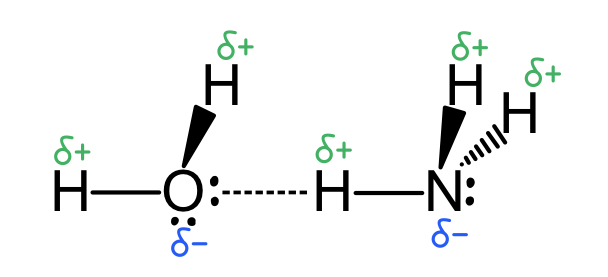 | 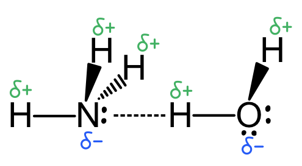 |
|---|---|

**[4 marks]**

> **[mark-scheme]**
> 1 mark for δ- on O and at least one δ+ H shown correctly in a water molecule
> 
> 1 mark for δ- on N and at least one δ+ H shown correctly in an ammonia molecule
> 
> 1 mark for one diagram showing a hydrogen bond between the H of an ammonia molecule (N-H) and the O atom of a water molecule
> 
> 1 mark for one diagram showing a hydrogen bond between the H of a water molecule (O-H) and the N atom of an ammonia molecule

> **[exam-tip]**
> There are two distinct hydrogen bonds that can form between NH3 and H2O:
> 
> - Way 1: The δ+ H on ammonia (N-H bond) forms a hydrogen bond with the lone pair on the δ- O of water
> - Way 2: The δ+ H on water (O-H bond) forms a hydrogen bond with the lone pair on the δ- N of ammonia
> 
> Represent hydrogen bonds as dashed lines. Show partial charges (δ+ and δ-) and lone pairs clearly in both diagrams.
> **[mark-scheme]**
> - F2 has the lowest boiling point **[1 mark]**
> - F2 has only instantaneous dipole-induced dipole (id-id) / London dispersion forces **[1 mark]**
> - HCl also has permanent dipole-permanent dipole (pd-pd) forces (in addition to id-id forces) **[1 mark]**
> - F2 and HCl have the same number of electrons (18 each), so their id-id forces are similar in strength **[1 mark]**
> - HCl therefore has stronger overall intermolecular forces than F2, requiring more energy to overcome
> **OR**
> F2 has weaker overall intermolecular forces, requiring less energy to overcome **[1 mark]**

> **[exam-tip]**
> The key to this question is recognising that F2 and HCl are isoelectronic (both have 18 electrons), so their id-id forces are approximately equal in strength. The additional pd-pd forces in HCl (from the polar H-Cl bond) give it stronger overall intermolecular forces and a higher boiling point than F2.
> 
> NH3 has the highest boiling point of the three because it forms hydrogen bonds (the strongest type of intermolecular force), which require significantly more energy to overcome than either pd-pd or id-id forces.
> 
> Always identify all types of intermolecular forces present in each substance before comparing their relative boiling points.

### Q2
The completed table is:

|   | NH3 | CH4 |
|---|---|---|
| dot-and-cross diagram | 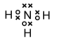 | 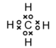 |
| shape of molecule | **Final answer:** **Pyramidal / trigonal pyramidal** | **Final answer:** **Tetrahedral** |

**[4 marks]**

> **[mark-scheme]**
> 1 mark for correct dot-and-cross diagram of NH3
> 
> 1 mark for correct dot-and-cross diagram of CH4
> 
> 1 mark for pyramidal / trigonal pyramidal for NH3
> 
> 1 mark for tetrahedral for CH4

> **[exam-tip]**
> Both compounds form covalent bonds by sharing pairs of electrons. After drawing your diagram, count around each atom to check it has a full outer shell: 8 electrons for nitrogen and carbon, 2 electrons for each hydrogen.
> 
> Applying VSEPR theory: NH3 has one lone pair and three bonding pairs on nitrogen. The lone pair repels bonding pairs more strongly, compressing the H-N-H angle to 107° and giving a pyramidal shape. CH4 has four bonding pairs and no lone pairs, which repel equally to give a tetrahedral shape with H-C-H angles of 109.5°.
> **[mark-scheme]**
> i) Bond polarity, using the N-H bond as an example:
> 
> - Nitrogen and hydrogen have different electronegativities
> **OR**
> The N-H bond has a dipole **[1 mark]**
> - The bonding electrons are more attracted to nitrogen (Nδ--Hδ+)
> **OR**
> The bonding electrons are unequally shared **[1 mark]**
> 
> ii) The ammonia molecule is polar because:
> 
> - The molecule is asymmetrical / the bond dipoles do not cancel out **[1 mark]**

> **[exam-tip]**
> You must reference the N-H bond or ammonia in your answer to part i) or you may not score the marks.
> 
> Electronegativity is the ability of an atom to attract electrons in a covalent bond. Nitrogen (electronegativity 3.0) is more electronegative than hydrogen (electronegativity 2.1), so the bonding electrons are pulled towards nitrogen, giving the N-H bond a permanent dipole (Nδ--Hδ+).
> 
> For part ii): a molecule is polar only when its bond dipoles do not cancel. In NH3, the three N-H dipoles all point towards nitrogen and the lone pair adds to the asymmetry, so the dipoles do not cancel and ammonia has a net dipole moment.
> **[mark-scheme]**
> The strongest type of intermolecular force present in liquid ammonia is:
> 
> - Hydrogen bonding **[1 mark]**

> **[exam-tip]**
> Ammonia, NH3, has a lone pair on nitrogen and N-H bonds where the H is δ+ (due to nitrogen's high electronegativity). This allows hydrogen bonds to form between the lone pair on one nitrogen and the δ+ hydrogen of an adjacent NH3 molecule.
> 
> All simple molecular substances also have instantaneous dipole-induced dipole (id-id) forces, but hydrogen bonding is the strongest type present and has the greatest influence on ammonia's physical properties.
> **[mark-scheme]**
> The three types of bonding present in solid ammonium chloride are:
> 
> - Covalent bonding (between N and H in the NH4+ ion) **[1 mark]**
> - Co-ordinate / dative covalent bonding (one N-H bond formed using the lone pair on N) **[1 mark]**
> - Ionic bonding (between NH4+ and Cl-) **[1 mark]**

> **[exam-tip]**
> When NH3 reacts with HCl, the HCl donates H+ (a proton with no electrons). The nitrogen in NH3 uses its lone pair to form a co-ordinate (dative covalent) bond with this H+, creating the ammonium ion, NH4+.
> 
> Once the NH4+ ion is formed, all four N-H bonds are identical in length and strength. It is not possible to distinguish the original covalent bonds from the co-ordinate bond in the final ion. This question tests your understanding of how the bond forms, not the final structure.
> 
> The NH4+ ion then forms an ionic bond with the Cl- ion, giving solid ammonium chloride its giant ionic lattice structure.

### Q3
> **[mark-scheme]**
> Butan-1-ol has a higher boiling point than butanal because:
> 
> - Butan-1-ol contains hydrogen bonding
> **AND**
> Butanal contains permanent dipole-permanent dipole (pd-pd) forces **[1 mark]**
> - Hydrogen bonding is stronger than pd-pd forces, requiring more energy to overcome **[1 mark]**

> **[exam-tip]**
> It can be helpful to draw out the structures of both molecules to identify the relevant functional groups.
> 
> Butan-1-ol:
> 
> 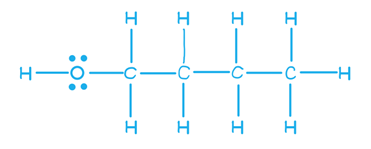
> 
> Butan-1-ol has an -OH group: the O-H bond is polar (δ- on O, δ+ on H) and oxygen has lone pairs, allowing hydrogen bonding between butan-1-ol molecules.
> 
> Butanal:
> 
> 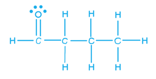
> 
> Butanal has a C=O group but no O-H bond, so it cannot donate hydrogen bonds. Its strongest intermolecular force is permanent dipole-permanent dipole (pd-pd) forces from the polar C=O bond.
> 
> Hydrogen bonding is stronger than pd-pd forces, so butan-1-ol requires more energy to overcome its intermolecular forces and has a higher boiling point.
> **[mark-scheme]**
> Disilane has a higher boiling point than ethane because:
> 
> - Disilane has stronger instantaneous dipole-induced dipole (id-id) / London dispersion forces **[1 mark]**
> - (Due to) more electrons
> **OR**
> A stronger instantaneous dipole **[1 mark]**

> **[exam-tip]**
> Both ethane and disilane are non-polar molecules, so the only intermolecular forces present are instantaneous dipole-induced dipole (id-id) forces, also called London dispersion forces.
> 
> The strength of id-id forces depends on how easily the electron cloud can be polarised, which in turn depends on the number of electrons. Si2H6 contains more electrons than C2H6 (silicon is one period below carbon and has more electron shells), giving it a more polarisable electron cloud. This produces stronger id-id forces and a higher boiling point.
> **[mark-scheme]**
> Ethanol is soluble but ethane is insoluble because:
> 
> - Ethane has only non-polar C-H bonds / no polar bonds **[1 mark]**
> - Ethanol forms hydrogen bonds with water (due to the -OH group) **[1 mark]**
> - The energy released forming ethanol-water hydrogen bonds is sufficient to overcome the hydrogen bonds between water molecules / ethanol-water interactions compensate for breaking water-water hydrogen bonds **[1 mark]**

> **[exam-tip]**
> Ethane contains only C-H bonds, which are non-polar due to the small electronegativity difference between carbon and hydrogen. Non-polar substances cannot form hydrogen bonds with water, so the energy released when ethane interacts with water (only id-id forces form) is insufficient to break the water-water hydrogen bonds.
> 
> Ethanol has an -OH group with a highly electronegative oxygen bonded to hydrogen. This allows ethanol to form hydrogen bonds with water, both as a donor (via O-H) and as an acceptor (via the lone pair on O).
> 
> 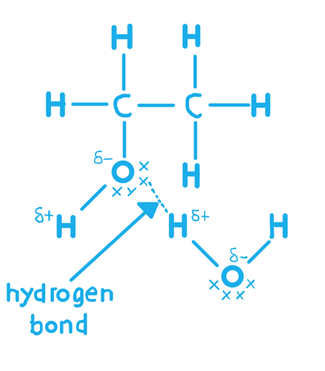
> 
> The energy released by these new hydrogen bonds is sufficient to overcome the water-water hydrogen bonds, so ethanol dissolves.

### Q4
> **[mark-scheme]**
> The three main types of intermolecular force, in ascending order of strength:
> 
> - Instantaneous dipole-induced dipole (id-id) forces / London dispersion forces, permanent dipole-permanent dipole (pd-pd) forces, and hydrogen bonding **[1 mark]**
> - (In ascending order of strength) instantaneous dipole-induced dipole forces < permanent dipole-permanent dipole forces < hydrogen bonding **[1 mark]**

> **[exam-tip]**
> Van der Waals' forces is a generic term that covers all intermolecular forces except hydrogen bonding. It does not distinguish between id-id and pd-pd forces, so use the specific syllabus terms above to be precise.
> 
> You must know the order of strength: id-id forces are the weakest, pd-pd forces are intermediate, and hydrogen bonding is the strongest.
A diagram showing hydrogen bonding between two molecules of methanol is:

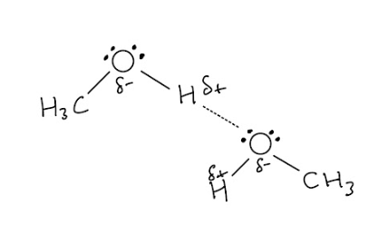

**[2 marks]**

> **[mark-scheme]**
> 1 mark for two lone pairs on at least one oxygen atom **AND** correct dipoles (δ- on O and δ+ on H) on at least one O-H bond
> 
> 1 mark for a dotted line shown between a lone pair on one oxygen and the correct O-H hydrogen on another molecule

> **[exam-tip]**
> It is good practice to draw lone pairs on every oxygen atom, but showing at least one is sufficient for the mark.
> 
> Hydrogen bonding forms between an electronegative atom with a lone pair (O, N, or F) as the acceptor and a hydrogen atom bonded directly to O, N, or F as the donor. For methanol, the relevant hydrogen is the O-H hydrogen (δ+). The C-H hydrogens are not involved, as C-H bonds are not significantly polar.
> **[mark-scheme]**
> The strongest type of intermolecular force in each case:
> 
> i) Methanal molecules:
> 
> - Permanent dipole-permanent dipole (pd-pd) forces **[1 mark]**
> 
> ii) Methanoic acid molecules:
> 
> - Hydrogen bonding **[1 mark]**
> 
> iii) A molecule of water and a molecule of methanal:
> 
> - Hydrogen bonding **[1 mark]**
> 
> iv) A molecule of water and a molecule of methanoic acid:
> 
> - Hydrogen bonding / ion-dipole forces **[1 mark]**

> **[exam-tip]**
> Methanal has a polar C=O bond (δ- on O, δ+ on C) but no O-H, N-H, or F-H bond, so it cannot act as a hydrogen bond donor. Its strongest self-interaction is permanent dipole-permanent dipole (pd-pd) forces.
> 
> All these molecules can form hydrogen bonds with water because water has both O-H bonds (hydrogen bond donors, δ+) and lone pairs on oxygen (hydrogen bond acceptors, δ-). The lone pair on the C=O oxygen in methanal accepts a hydrogen bond from the δ+ H of water.
> 
> Methanoic acid partially ionises in water as it is a weak acid, so ion-dipole interactions can also form between the resulting ions and water molecules.
> **[mark-scheme]**
> Sodium methanoate is a solid and methanoic acid is a liquid at room temperature because:
> 
> - Sodium methanoate is ionic / contains Na+ and HCOO- / is a giant ionic lattice **[1 mark]**
> - Methanoic acid is a simple molecular / covalent substance / has hydrogen bonds between molecules **[1 mark]**
> - Ionic bonds are stronger than hydrogen bonds / require more energy to overcome / require a higher temperature to break (or reverse argument) **[1 mark]**

> **[exam-tip]**
> This reaction is an acid-base neutralisation using an organic acid, producing a salt (sodium methanoate) and water. Salts are ionic, so sodium methanoate has a giant ionic lattice structure with strong ionic bonds between Na+ and HCOO- ions.
> 
> Although methanoic acid has the strongest type of intermolecular force (hydrogen bonding), hydrogen bonds are still far weaker than ionic bonds. This is why the melting point of sodium methanoate is much higher, making it a solid while methanoic acid remains a liquid at room temperature.
The completed dot-and-cross diagram of methanol is:

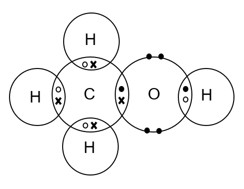

**[2 marks]**

> **[mark-scheme]**
> 1 mark for five bonding pairs of electrons shown correctly between carbon, oxygen, and hydrogen
> 
> 1 mark for two lone pairs of electrons shown on oxygen

> **[exam-tip]**
> Show outer shell electrons only. Check that each atom has a full outer shell: 8 electrons for carbon and oxygen, and 2 electrons for each hydrogen.
> 
> Any combination of dots and crosses is acceptable, as long as electrons from the same atom are drawn consistently throughout the diagram.

### Q5
> **[mark-scheme]**
> i) The number of lone pairs of electrons around the oxygen atom in methoxymethane:
> 
> - 2 **[1 mark]**
> 
> ii) A value for the C-O-C bond angle in methoxymethane:
> 
> - Between 104° and 105° **[1 mark]**

> **[exam-tip]**
> The oxygen atom in methoxymethane has two bonding pairs (one to each carbon) and two lone pairs, giving four electron domains. The question asks for the number of lone pairs, not the total number of electrons.
> 
> The four electron domains give a tetrahedral electron geometry, but the lone pairs repel the bonding pairs more strongly, compressing the C-O-C bond angle below the ideal tetrahedral value of 109.5° to approximately 104-105°. This is the same reasoning as for water (H-O-H angle ~104.5°).
The strongest intermolecular force in each compound:

| Compound | Formula | Strongest intermolecular force |
|---|---|---|
| ethanal | CH3CHO | **Final answer:** **A** |
| ethanol | CH3CH2OH | **Final answer:** **C** |
| methoxymethane | CH3OCH3 | **Final answer:** **A** |
| 2-methylpropane | (CH3)2CHCH3 | **Final answer:** **B** |

**[4 marks]**

> **[mark-scheme]**
> 1 mark for ethanal = A (pd-pd forces)
> 
> 1 mark for ethanol = C (hydrogen bonding)
> 
> 1 mark for methoxymethane = A (pd-pd forces)
> 
> 1 mark for 2-methylpropane = B (id-id forces)

> **[exam-tip]**
> The order of strength is: C (hydrogen bonding) > A (pd-pd forces) > B (id-id forces). Identify the strongest force that can be present in each molecule.
> 
> Hydrogen bonding (C) requires an O-H, N-H, or F-H bond as the donor. Ethanol has an -OH group, so C applies.
> 
> Permanent dipole-permanent dipole forces (A) require a net molecular dipole. Ethanal has a polar C=O bond; the dipoles do not cancel, giving pd-pd forces. Methoxymethane has two polar C-O bonds in a bent arrangement; the dipoles do not fully cancel, so pd-pd forces apply. Neither has an O-H bond, so hydrogen bonding is not possible.
> 
> 2-methylpropane is a non-polar hydrocarbon. Only id-id forces (B) are present.
> **[mark-scheme]**
> i) The strongest type of intermolecular force between methanol and water:
> 
> - Hydrogen bonding **[1 mark]**

ii) A diagram showing the hydrogen bond between one molecule of methanol and one molecule of water is:

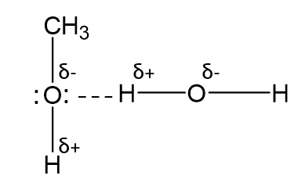

**OR**

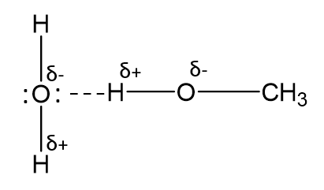

**[3 marks]**

> **[mark-scheme]**
> 1 mark for correct dipoles (δ- on O and δ+ on H) shown on an O-H bond
> 
> 1 mark for lone pair on the O atom of CH3OH **OR** H2O clearly shown in the hydrogen bond
> 
> 1 mark for hydrogen bond shown as a dotted line between a lone pair on an O atom and the H of an O-H bond

> **[exam-tip]**
> These hydrogen bonding diagrams between different molecules come up frequently. Practise drawing them with both molecules labelled, showing: δ+ and δ- on the relevant O-H bonds, the lone pairs on the oxygen atoms, and the hydrogen bond as a dashed line between the δ- oxygen and the δ+ hydrogen of the other molecule.
> **[mark-scheme]**
> Ethoxyethane does not dissolve in water because:
> 
> - Hydrogen bonds exist between H2O molecules **[1 mark]**
> - Ethoxyethane has no O-H bonds and cannot form hydrogen bonds with water / the interactions between ethoxyethane and water are insufficient to compensate for breaking water-water hydrogen bonds **[1 mark]**

> **[exam-tip]**
> To dissolve in water, hydrogen bonds between water molecules must be broken and new intermolecular interactions must form between the solute and water. If these new interactions are not strong enough to compensate, the substance is immiscible.
> 
> Ethoxyethane has a lone pair on oxygen, so it can accept a hydrogen bond from water. However, it has no O-H bond, so it cannot donate hydrogen bonds. The large non-polar C2H5 groups also disrupt the water hydrogen bonding network. The net interaction between ethoxyethane and water is insufficient to overcome the extensive water-water hydrogen bonding.
