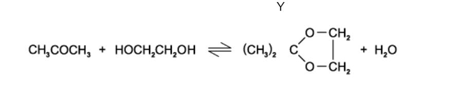

# Exam Questions — Intermolecular Forces, Electronegativity & Bond Properties
**3. Chemical Bonding** · Cambridge (CIE) AS chemistry (9701)
> Source: [https://www.savemyexams.com/as/chemistry/cie/25/topic-questions/](https://www.savemyexams.com/as/chemistry/cie/25/topic-questions/) · 14 questions across 2 sets

## Multiple Choice Questions (9 questions)

### Q1 — easy — 1 marks

**Q1** [1 mark]

Which quantity gives the best indication of the relative strengths of the hydrogen bonds between water molecules in the liquid state?

### Q2 — hard — 1 marks

**Q2** [1 mark]

Hydrogen bonding occurs between molecules of liquid methanal, HCHO, and molecules of liquid **Y**.

Which compound is liquid **Y**?

### Q3 — medium — 1 marks

**Q3** [1 mark]

Which molecule has the largest dipole moment?

### Q4 — medium — 1 marks

**Q4** [1 mark]

What is the strongest intermolecular force between molecules of serine?

**Serine**

### Q5 — easy — 1 marks

**Q5** [1 mark]

Silver and iodine are both crystalline solids.

Which row gives the forces between the particles in solid iodine and in solid silver?

|   | **iodine** | **silver** |
|---|---|---|
| **A** | covalent bonds | covalent bonds |
| **B** | instantaneous dipole-induced dipole forces | metallic bonds |
| **C** | ionic bonds | metallic bonds |
| **D** | metallic bonds | covalent bonds |

### Q6 — easy — 1 marks

**Q6** [1 mark]

Which solid contains more than one type of bonding?

### Q7 — hard — 1 marks

**Q7** [1 mark]

Propanone reacts with ethane-1,2-diol to form a cyclic acetal, liquid **Y**, and water.

Which statement is **not **correct?

### Q8 — medium — 1 marks

**Q8** [1 mark]

Which change of state involves only instantaneous dipole-induced dipole forces being overcome?

### Q9 — hard — 1 marks

**Q9** [1 mark]

Which row gives the intermolecular forces present in liquid CHCl3 and in liquid Br2?

|   | **CHCl**3 | **Br**2 |
|---|---|---|
| **A** | instantaneous dipole-induced dipole forces only | instantaneous dipole-induced dipole and permanent dipole-permanent dipole forces |
| **B** | instantaneous dipole-induced dipole forces only | instantaneous dipole-induced dipole forces only |
| **C** | instantaneous dipole-induced dipole and permanent dipole-permanent dipole forces | instantaneous dipole-induced dipole forces only |
| **D** | instantaneous dipole-induced dipole and permanent dipole-permanent dipole forces | instantaneous dipole-induced dipole and permanent dipole-permanent dipole forces |

## Structured Questions (5 questions)

### Q1 — hard — 11 marks

**Q1** [2 marks]

Water has a relatively high surface tension compared to most liquids.

Explain this anomalous property of water.

**Q1** [4 marks]

Ammonia, NH3, is highly soluble in water.

Draw diagrams to show the **two** different ways a hydrogen bond can form between one molecule of water and one molecule of ammonia. Your diagrams should include all relevant dipoles and lone pairs of electrons.

**Q1** [5 marks]

Ammonia, NH3, hydrogen chloride, HCl, and fluorine, F2, all exist as gases at room temperature and pressure. The boiling point of NH3 is −33 °C.

Predict which gas, HCl or F2, has the lowest boiling point. Explain the relative boiling points of all three gases in terms of the intermolecular forces present.

### Q2 — medium — 11 marks

**Q2** [4 marks]

Ammonia, NH3, and methane, CH4, are simple molecules.

Complete Table 1.1 to show the dot-and-cross diagram and the shape of a molecule of each compound. Show outer shell electrons only.

|   | NH3 | CH4 |
|---|---|---|
| dot-and-cross diagram |   |   |
| shape of molecule |   |   |

**Q2** [3 marks]

Ammonia is a polar molecule whereas methane is non-polar.

i) Explain what is meant by the term *bond polarity*, using the N-H bond as an example.

[2]

ii) Explain why the ammonia molecule is polar.

[1]

**Q2** [1 mark]

State the strongest type of intermolecular force present in liquid ammonia.

**Q2** [3 marks]

Ammonia gas reacts with hydrogen chloride gas to form solid ammonium chloride, NH4Cl.

State the three types of bonding present in solid ammonium chloride.

### Q3 — medium — 7 marks

**Q3** [2 marks]

Explain why butan-1-ol has a higher boiling point than butanal.

**Q3** [2 marks]

Ethane, C2H6, and disilane, Si2H6, are hydrides of Group 14 elements.

Explain why disilane has a higher boiling point than ethane.

**Q3** [3 marks]

Ethanol is soluble in water, whereas ethane is insoluble.

Explain this difference.

### Q4 — easy — 13 marks

**Q4** [2 marks]

State the three main types of intermolecular force and place them in ascending order of strength.

**Q4** [2 marks]

Draw a diagram to show hydrogen bonding between two molecules of methanol, CH3OH.

Your diagram should include all relevant lone pairs of electrons and dipoles.

**Q4** [4 marks]

**Extract:**

The three main types of intermolecular force, in ascending order of strength:
- Instantaneous dipole-induced dipole (id-id) forces / London dispersion forces, permanent dipole-permanent dipole (pd-pd) forces, and hydrogen bonding
- (In ascending order of strength) instantaneous dipole-induced dipole forces < permanent dipole-permanent dipole forces < hydrogen bonding

Methanol, CH3OH, can be oxidised to methanal, CH2O, and then to methanoic acid, HCOOH.

State the strongest type of intermolecular force present between:

i) Methanal molecules

[1]

ii) Methanoic acid molecules

[1]

iii) A molecule of water and a molecule of methanal

[1]

iv) A molecule of water and a molecule of methanoic acid

[1]

**Q4** [3 marks]

Methanoic acid reacts with sodium hydroxide to form sodium methanoate:

HCOOH + NaOH → HCOONa + H2O

Explain why sodium methanoate is a solid at room temperature and methanoic acid is a liquid.

**Q4** [2 marks]

Complete the dot-and-cross diagram of methanol, CH3OH. Show outer shell electrons only.

### Q5 — medium — 12 marks

**Q5** [2 marks]

The structural formulae of water, methanol and methoxymethane, CH3OCH3, are given below.

i) State the number of lone pairs of electrons around the oxygen atom in a molecule of methoxymethane.

[1]

ii) Suggest a value for the C-O-C bond angle in methoxymethane.

[1]

**Q5** [4 marks]

The physical properties of covalent compounds depend on the intermolecular forces between their molecules.

|   | Type of intermolecular force |
|---|---|
| **A** | Permanent dipole-permanent dipole (pd-pd) forces |
| **B** | Instantaneous dipole-induced dipole (id-id) forces |
| **C** | Hydrogen bonding |

Using the letters A, B, or C, state the strongest intermolecular force present in each of the following compounds.

| Compound | Formula | Strongest intermolecular force |
|---|---|---|
| ethanal | CH3CHO |   |
| ethanol | CH3CH2OH |   |
| methoxymethane | CH3OCH3 |   |
| 2-methylpropane | (CH3)2CHCH3 |   |

**Q5** [4 marks]

**Extract:**

The structural formulae of water, methanol and methoxymethane, CH~3~OCH~3~, are given below.

Methanol and water are completely soluble in each other.

i) Name the strongest type of intermolecular force between a molecule of methanol and a molecule of water.

[1]

ii) Draw a diagram to show this intermolecular force between one molecule of methanol and one molecule of water. Include all relevant dipoles and lone pairs of electrons.

[3]

**Q5** [2 marks]

Ethoxyethane, C2H5OC2H5, and water are immiscible.

Explain why ethoxyethane does not dissolve in water.
