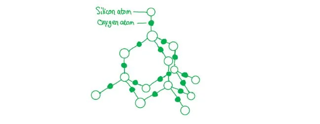
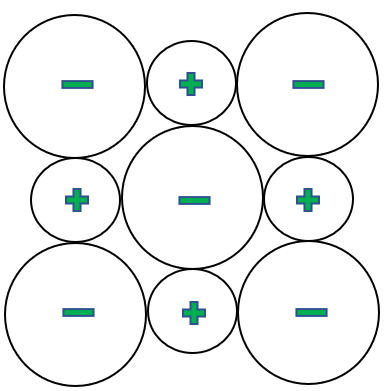

# Mark Schemes — Bonding & Structure
**4. States of Matter** · Cambridge (CIE) AS chemistry (9701)

## Multiple Choice Questions (10 questions)

### Q1
**Final answer:** **The correct answer is A**

- **Diagram 1** shows graphite, which has a layered structure of carbon atoms, each covalently bonded to 3 others, with delocalised electrons between the layers. This is a **giant covalent** lattice.

- **Diagram 2** shows sodium chloride (NaCl) with an alternating cubic arrangement of Na+ and Cl- ions held together by strong electrostatic forces of attraction. This is a **giant ionic** lattice.

- **Diagram 3** shows diamond, which has a regular tetrahedral network of carbon atoms, each covalently bonded to 4 others, with no free electrons. This is a **giant covalent** lattice.

**B** is incorrect as it identifies Diagram 2 (NaCl) as a giant covalent lattice, but NaCl is ionic.

**C** and **D** are incorrect as they identify Diagram 1 (graphite) as a giant ionic lattice, when graphite is a giant covalent structure.

### Q2
**Final answer:** **The correct answer is C**

- Silicon(IV) dioxide has a giant covalent lattice structure.
- Silicon and oxygen are non-metals bonded together by strong covalent bonds.
- The atoms are joined in a regular three-dimensional arrangement.
- Each silicon atom is covalently bonded to 4 oxygen atoms, and each oxygen atom is covalently bonded to 2 silicon atoms, giving the formula SiO2.

**A** is incorrect as calcium fluoride is a **giant ionic lattice**, which consists of Ca2+ and F- ions held together by electrostatic forces of attraction.

**B** is incorrect as nickel is a **giant metallic lattice**, which consists of a regular arrangement of Ni2+ ions surrounded by a sea of delocalised electrons.

**D** is incorrect as elemental sulfur forms a **simple molecular** structure consisting of cyclic S8 molecules held together by weak instantaneous dipole-induced dipole forces.

### Q3
**Final answer:** **The correct answer is C**

- Substance **C** has a giant ionic lattice.
- Ionic compounds do not conduct electricity as a solid because the ions are held in fixed positions and cannot move to carry a charge.
- When molten or dissolved in water (aqueous), the lattice breaks down and the ions become mobile, allowing them to conduct electricity.
- Only substance **C** has poor electrical conductivity as a solid but good conductivity when molten and in aqueous solution, combined with high melting and boiling points.

**A** is incorrect as this substance has low melting and boiling points and cannot conduct electricity in any state, indicating a non-polar **simple molecular** structure.

**B** is incorrect as this substance has low melting and boiling points but good electrical conductivity in aqueous solution. It cannot conduct as a solid or liquid, indicating a polar **simple molecular** structure that ionises in water.

**D** is incorrect as this substance has very high melting and boiling points but cannot conduct electricity in any state, indicating a **giant covalent lattice** such as silicon(IV) dioxide.

### Q4
**Final answer:** **The correct answer is C**

- **Ammonium sulfate**, (NH4)2SO4:

  - This consists of polyatomic ammonium cations (NH4+) and sulfate anions (SO42-) held together by electrostatic forces of attraction.
  - Although it contains only non-metal elements, the presence of oppositely charged ions means it forms a **giant ionic lattice**.

- **Potassium iodide**, KI:

  - This consists of K+ cations and I- anions held together by electrostatic forces of attraction.
  - It forms a **giant ionic lattice**.

- **Silicon dioxide**, SiO2:

  - This does not contain ions.
  - Each Si atom is covalently bonded to 4 O atoms in a continuous network.
  - It is a **giant covalent** lattice.

**A** and **B** are incorrect as they both identify silicon dioxide as having an ionic lattice. SiO2 has no ions; it has a giant covalent structure.

**D** is incorrect as ammonium sulfate does form a giant ionic lattice. Ionic compounds are not restricted to metal + non-metal combinations, and polyatomic ions such as NH4+ and SO42- also form ionic lattices.

### Q5
**Final answer:** **The correct answer is A**

- Calcium oxide (CaO) has the highest melting point (2614 °C) because it forms a **giant ionic lattice** with highly charged ions, Ca2+ and O2-.
- The high charges on these ions, combined with their small ionic radii, result in a large **lattice energy**
- The electrostatic forces of attraction between the ions are very strong and require the most thermal energy to overcome.

**B** is incorrect as lithium forms a **giant metallic lattice**. The singly charged Li+ ions with one delocalised electron per atom produce relatively weak metallic bonding, giving it a low melting point (181 °C).

**C** is incorrect as sodium fluoride also forms a **giant ionic lattice**, but the Na+ and F- ions carry only +1 and −1 charges respectively. The lower ionic charges result in a smaller lattice energy than CaO, so sodium fluoride has a lower melting point (993 °C).

**D** is incorrect as sulfur forms a **simple molecular** structure (S8 molecules). Only weak instantaneous dipole-induced dipole forces exist between molecules, requiring very little thermal energy to overcome, giving sulfur a low melting point (113 °C).

### Q6
**Final answer:** **The correct answer is C**

- Substance **R** has a high melting point and conducts electricity when liquid, indicating a **giant ionic** lattice.

  - The strong electrostatic forces of attraction between oppositely charged ions require a large amount of thermal energy to overcome, and the ions become mobile when molten.

- Substance **S** has low melting and boiling points and does not conduct electricity when liquid, indicating a **simple molecular** structure.

  - Only weak instantaneous dipole-induced dipole forces exist between molecules, requiring little energy to overcome.

- Substance **T** has very high melting and boiling points and does not conduct electricity when liquid, indicating a **giant covalent** (giant molecular) lattice.

  - A continuous network of strong covalent bonds extends throughout the structure, and there are no mobile charge carriers.

### Q7
**Final answer:** **The correct answer is B**

- Substance **X** (NaCl) has poor electrical conductivity as a solid but good conductivity as a liquid, indicating a **giant ionic** lattice. Its melting point (801 °C) is consistent with singly charged Na+ and Cl- ions.

- Substance **Y** (MgO) also has poor conductivity as a solid but good conductivity as a liquid, indicating a **giant ionic** lattice. Its much higher melting point (2852 °C) reflects the higher charges on Mg2+ and O2- compared to Na+ and Cl-, resulting in a larger **lattice energy** and stronger electrostatic forces of attraction between the ions.

- Substance **Z** (C, graphite) conducts electricity as a solid due to its delocalised electrons moving between the layers, and has an exceptionally high melting point, indicating a **giant covalent** lattice.

**A** is incorrect as the formula for calcium fluoride is CaF2. Furthermore, copper (Cu) is a **giant metallic** lattice and would conduct electricity as a solid, contradicting the data for substance **Z**.

**C** and **D** are incorrect as diamond and silicon(IV) dioxide (SiO2) are giant covalent structures that do not conduct electricity in any state — all valence electrons are localised in covalent bonds and there are no mobile charge carriers. This contradicts the data for substance **Z**.

### Q8
**Final answer:** **The correct answer is C**

- Sodium chloride is a giant ionic lattice.
- As a solid, the Na+ and Cl- ions are held in fixed positions by electrostatic forces of attraction and cannot move.

  - There are no mobile charge carriers, so it does not conduct electricity.
- When molten or dissolved in water (aqueous), the ionic lattice breaks down.

  - The ions become free to move and act as mobile charge carriers, allowing sodium chloride to conduct electricity.

**A** and **B** are incorrect as sodium chloride cannot conduct electricity as a solid because the ions are fixed in the lattice and cannot carry a charge.

**D** is incorrect as sodium chloride does conduct electricity when molten because the lattice breaks down and the ions become mobile.

### Q9
**Final answer:** **The correct answer is B**

- All three metal oxides form **giant ionic lattices**.

  - The melting point depends on the amount of thermal energy required to overcome the electrostatic forces of attraction between the oppositely charged ions, which is directly related to the magnitude of the **lattice energy**.

- **MgO > CaO**:

  - Both lattices contain +2 cations and the O2- anion.
  - However, the Mg2+ cation has a smaller ionic radius than Ca2+, giving it a higher charge density.
  - This results in a greater lattice energy for MgO, so MgO has the higher melting point.

- **CaO > Na****2****O**:

  - The Ca2+ cation carries a +2 charge, whereas the Na+ cation carries only a +1 charge.
  - The higher ionic charge on Ca2+ results in a significantly greater lattice energy for CaO compared to Na2O, giving CaO the higher melting point.

- The correct decreasing order is therefore MgO > CaO > Na2O.

**A**, **C** and **D** are incorrect as they place Na2O above one or both of the Group 2 metal oxides. Since Na+ has a lower charge than Ca2+ and Mg2+, Na2O has the smallest lattice energy and therefore the lowest melting point of the three.

### Q10
**Final answer:** **The correct answer is B**

- **Contains localised covalent bonds** (✓):

  - The single covalent bond in HF consists of a shared pair of electrons localised between the H nucleus and F nucleus only.
  - There are no delocalised electrons.

- **Highly soluble in polar solvents** (✓):

  - The large difference in electronegativity between H and F makes the bond highly polar (Hδ+-Fδ-). HF dissolves readily in polar solvents such as water by forming hydrogen bonds with solvent molecules.

- **Lowest bond energy of the hydrogen halides** (✗):

  - HF actually has the highest bond energy of the hydrogen halides.
  - Fluorine is the smallest halogen, making the H−F bond the shortest and allowing the most effective orbital overlap.
  - Bond energy decreases down the group as the halogen atom increases in size and bond length increases.

- **Highest boiling point of the hydrogen halides** (✓):

  - HF has the highest boiling point of the hydrogen halides because it is the only one capable of forming hydrogen bonds between its molecules.
  - Hydrogen bonding is significantly stronger than the permanent dipole−permanent dipole forces and instantaneous dipole-induced dipole forces present in HCl, HBr and HI.

**A** is incorrect as it states that HF does not contain localised covalent bonds.

**C** is incorrect as it states that the H−F bond has the lowest bond energy of the hydrogen halides.

**D** is incorrect as it states that HF does not have the highest boiling point and is not highly soluble in polar solvents. Both are incorrect.

## Structured Questions (8 questions)

### Q1
> **[mark-scheme]**
> Comparing the electrical conductivity of mercury and sodium chloride:
> 
> - Mercury conducts electricity in both solid and liquid states
> **AND**
> Sodium chloride does not conduct in the solid state but does conduct when molten **[1 mark]**
> - Mercury has delocalised electrons that are mobile in both states and carry electrical charge **[1 mark]**
> - Sodium chloride has Na+ and Cl– ions that are mobile when molten but fixed in the lattice when solid, and only mobile ions can carry charge **[1 mark]**

> **[exam-tip]**
> This is a comparison question, so address each substance in turn to keep your answer clear and logical.
> 
> Metals have delocalised electrons which can carry charge in both the solid and liquid state.
> 
> Solid ionic compounds cannot conduct because the ions are held in fixed positions by strong electrostatic forces. Only when molten do the ions become free to move.
> **[mark-scheme]**
> Explaining the effect of changes in the cation on the strength of ionic bonding:
> 
> - The higher the charge on the cation, the greater the charge density and the stronger the ionic bonding
> **AND**
> A higher amount of energy is needed to separate Mg2+ in MgF2 than Li+ / Na+ in LiF / NaF **[1 mark]**
> - The smaller the ionic radius of the cation, the stronger the ionic bonding between the ions
> **AND**
> Li+ has a smaller ionic radius, so a higher energy is needed to separate the ions in LiF than in NaF **[1 mark]**

> **[exam-tip]**
> You must use the data from the table in your answer and refer specifically to the ions (Li+, Na+, Mg2+), not to the atoms.
> 
> Two factors affect the strength of ionic bonding:
> 
> - Ionic charge (higher charge → stronger bonding)
> - Ionic radius (smaller radius → stronger bonding).
> 
> A smaller ionic radius means the centres of the ions are closer together, resulting in stronger electrostatic forces of attraction.
> **[mark-scheme]**
> i) The type of structure and bonding of iodine and sodium chloride is:
> 
> - Iodine has a simple molecular structure with weak van der Waals / id-id forces between I2 molecules **[1 mark]**
> - Sodium chloride has a giant ionic lattice structure with ionic bonds / strong electrostatic attraction between oppositely charged Na+ and Cl– ions **[1 mark]**
> 
> ii) Iodine is volatile because:
> 
> - Iodine has weak van der Waals / id-id forces between I2 molecules **[1 mark]**
> - These weak forces are easily overcome at low temperatures, allowing iodine to vaporise / sublime easily **[1 mark]**
> 
> iii) The difference in electrical conductivity is because:
> 
> - Iodine has no ions or free electrons to carry electrical charge **[1 mark]**
> - Molten sodium chloride has Na+ and Cl– ions that are free to move and carry electrical charge **[1 mark]**
> - Solid sodium chloride cannot conduct as the ions are held in fixed positions in the lattice **[1 mark]**

> **[exam-tip]**
> The four types of crystalline structure are:
> 
> - Simple molecular
> - Giant covalent (macromolecular)
> - Ionic
> - Metallic
> 
> When explaining volatility, refer to the weak van der Waals forces between molecules being overcome, not the covalent bonds within the molecules.
> 
> Iodine has no charged species (no ions, no free electrons), so it cannot conduct electricity.
> 
> Sodium chloride can only conduct when molten or dissolved in water, as in these states the ions are mobile.
> **[mark-scheme]**
> Explaining the electrical conductivity of graphene, graphite and diamond:
> 
> - In both graphene and graphite, each carbon atom is covalently bonded to three others, leaving one delocalised electron per carbon atom **[1 mark]**
> - These delocalised electrons are mobile and can carry electrical charge in graphene and graphite **[1 mark]**
> - In diamond, each carbon atom is covalently bonded to four others in a tetrahedral arrangement **[1 mark]**
> - All four outer electrons are used in covalent bonds / there are no delocalised electrons in diamond, so diamond cannot conduct electricity **[1 mark]**

> **[exam-tip]**
> The key difference between graphene/graphite and diamond is the number of covalent bonds each carbon atom forms: 3 in graphene/graphite (leaves 1 delocalised) vs 4 in diamond (none delocalised).
> 
> Both graphene and graphite have delocalised electrons, so mention both in your answer.
> 
> Delocalised electrons are mobile and act as the charge carriers in graphene and graphite, just as they do in metals.

### Q2
> **[mark-scheme]**
> i) The two forms are:
> 
> - Diamond
> **AND**
> Graphite
> 
> **[1 mark]**
> 
> ii) Any **three** from (1 mark for each difference):
> 
> - Graphite can conduct electricity but diamond cannot
> - Graphite is soft / slippery but diamond is hard
> - Graphite is black but diamond is transparent / colourless
> - Graphite is less dense than diamond
> - Graphite has a lower melting point than diamond
> 
> **[3 marks]**

> **[exam-tip]**
> Make sure you refer to both graphite and diamond for each difference — a statement about only one of them will not gain a mark.
> 
> In graphite, each carbon atom is bonded to only three other carbon atoms, leaving one electron per atom delocalised. This allows graphite to conduct electricity and makes it softer, as the layers can slide over each other.
> **[mark-scheme]**
> Buckminsterfullerene reacts with hydrogen because:
> 
> - Each carbon is bonded to three other carbons / has three bonding locations
> **OR**
> It is unsaturated / contains double bonds **[1 mark]**
> - C60H60 **[1 mark]**

> **[exam-tip]**
> Each carbon in C60 uses three of its four outer electrons to bond with three neighbouring carbons. The remaining electron can form a double bond, making the molecule unsaturated and able to react with hydrogen.
> 
> If each of the 60 carbon atoms forms one additional bond with a hydrogen atom, the formula of the product is C60H60.
i) To calculate the number of carbon atoms:

- Calculate the moles of carbon:

moles = $\frac{\mathrm{mass}}{A_{r}}$

moles of C = $\frac{0.001}{12.0}$

moles of C = 8.33 × 10-5 mol

- Calculate the number of atoms of carbon:

number of atoms = moles × Avogadro's constant

number of atoms of C = 8.33 × 10-5 × 6.022 × 1023

number of atoms of C = **5.02 × 10****19**

**[1 mark]**

ii) To calculate the area of the sheet:

- Calculate the number of hexagons:

number of hexagons = $\frac{5.02\times10^{19}}{2}$

number of hexagons = 2.51 × 1019 **[1 mark]**

- Calculate the area:

area = 690 × 2.51 × 1019

area = **1.73 × 10****22**** nm****2**** ****[1 mark]**
> **[mark-scheme]**
> Graphene and buckminsterfullerene as electrical conductors:
> 
> - Graphene would conduct electricity because it has delocalised / free electrons **[1 mark]**
> - Buckminsterfullerene would not conduct electricity because it consists of simple molecules **[1 mark]**

> **[exam-tip]**
> Although buckminsterfullerene contains delocalised electrons within each C60 molecule, these electrons are confined to individual molecules and cannot flow through the entire structure to carry charge.
> 
> In graphene, the delocalised electrons extend across the whole sheet and are free to move, allowing electrical conduction.

### Q3
> **[mark-scheme]**
> i) The structure of solid C60:
> 
> - Simple molecular **[1 mark]**
> - Lattice / regular arrangement of C60 molecules **[1 mark]**
> 
> ii) C60 and diamond sublime at such different temperatures because:
> 
> - C60 has weak intermolecular / van der Waals' / London / dispersion / id–id forces (between molecules) **[1 mark]**
> - Diamond has strong covalent bonds **[1 mark]**
> - More energy required to break (the bonds in diamond than the intermolecular forces in C60) **[1 mark]**
> - Lots of covalent bonds in diamond / (complex) 3D network / giant covalent structure **[1 mark]**

> **[exam-tip]**
> C60 (buckminsterfullerene) has strong covalent bonds within each molecule, but only weak London dispersion forces between molecules. It is these intermolecular forces that are broken when C60 sublimes, requiring relatively little energy.
> 
> Diamond has a giant covalent structure with a complex 3D network of strong covalent bonds throughout. Breaking these requires much more energy, hence its far higher sublimation temperature.
> **[mark-scheme]**
> i) A hydrocarbon is:
> 
> - A molecule / compound that is made up of carbon and hydrogen atoms **only ****[1 mark]**
> 
> The answer must inlcude the word 'only' to achieve the mark
> 
> ii) A test to indicate the presence of double bonds between carbon atoms in alkene molecules:
> 
> - Add bromine water / Br2(aq) **[1 mark]**
> 
> iii) The observation when the test in (b)(ii) is carried out on an alkene:
> 
> - (The solution would turn from) orange / brown to colourless **[1 mark]**
> 
> Bromine water is orange-brown

> **[exam-tip]**
> For the definition of a hydrocarbon you must make sure you include the word 'only' in your answer or you will lose the mark
> 
> Bromine water is an orange-brown liquid
> 
> When it is added to an alkene, the bromine adds across the double bond to form a halogenoalkane resulting in the solution turning colourless
> 
> A saturated compound such as an alkane would not react with the bromine water and would remain orange
> **[mark-scheme]**
> i) The type of reaction:
> 
> - Addition / hydrogenation **[1 mark]**

ii) To calculate the moles of C60:

- Calculate the *M*r of C60:

*M*r(C60) = 12 × 60

*M*r(C60) = 720 g mol-1

- Calculate the moles of C60:

moles = $\frac{mass}{M_{r}}$

n(C60) = $\frac{0.144}{720}$

n(C60) = **2.00 × 10****-4** mol **[1 mark]**

iii) To calculate the moles of H2 that reacted:

- Calculate the pressure of H2 consumed (= decrease in pressure):

*p*(H2) = 1.00 × 105 − 2.21 × 104

*p*(H2) = 7.79 × 104 Pa

- Convert units:

*V* = 100 cm3 = 1.00 × 10-4 m3

*T* = 20 + 273 = 293 K

**[1 mark]**

- Rearrange *pV* = *nRT *and substitute:

n = $\frac{pV}{RT}$

n(H2) = $\frac{7.79\times10^{4}\times1.00\times10^{-4}}{8.31\times293}$

**[1 mark]**

- Calculate the moles:

n(H2) = **3.20 × 10****-3** **mol**

**[1 mark]**

> **[mark-scheme]**
> 1 mark for correctly calculating the pressure of H2 consumed (7.79 × 104 Pa) **AND **converting pressure and temperature to SI units
> 
> 1 mark for rearranging the ideal gas equation **AND **substituting the values
> 
> 1 mark for correctly calculating the moles (3.20 × 10-3 mol)

iv) To deduce the molecular formula:

- Find the molar ratio of C60 to H2:

C60 : H2 = 2.00 × 10-4 : 3.20 × 10-3

C60 : H2 = 1 : 16 **[1 mark]**

- Determine x and write the molecular formula:

x = 16, so H2x = H32

molecular formula = **C****60****H****32**** ****[1 mark]**

> **[mark-scheme]**
> Allow error carried forward from part (ii) and part (iii)

> **[exam-tip]**
> The decrease in pressure after the reaction equals the pressure of the H2 that was consumed, since C60 is a solid and does not contribute to gas pressure.
> 
> To convert cm3 to m3: divide by 106.
> 
> The *M*r of C60 is 12 × 60 = 720 g mol-1.
i) The equation for the reaction, including state symbols, is:

Mg2Si (s) + 4HCl (aq) → SiH4 (g) + 2MgCl2 (aq)

**[2 marks]**

> **[mark-scheme]**
> i)
> 
> 1 mark for correct species **AND** correct balancing
> 
> 1 mark for all four correct state symbols
> 
> ii) The shape of the SiH4 molecule is:
> 
> - Tetrahedral **[1 mark]**

> **[exam-tip]**
> The state symbols can be deduced from the question: Mg2Si is described as solid, HCl is a dilute acid (aqueous), SiH4 is described as gaseous, and magnesium chloride forms in solution (aqueous).
> 
> SiH4 has the same structure as CH4.Silicon is in Group 14, so it forms 4 bonds with 4 hydrogen atoms. With 4 bonding pairs and no lone pairs, VSEPR theory predicts a tetrahedral shape with bond angles of 109.5°.

### Q4
> **[mark-scheme]**
> i) Comparing the boiling points of chlorine and calcium:
> 
> - Chlorine is a simple molecular substance
> **AND**
> Calcium is a giant metallic structure / contains positive Ca2+ ions in a sea of delocalised electrons **[1 mark]**
> - Chlorine has weak van der Waals / id-id forces between Cl2 molecules
> **AND**
> Calcium has strong metallic bonds **[1 mark]**
> - More energy is required to break metallic bonds in calcium than to overcome the weak van der Waals forces in chlorine **[1 mark]**
> 
> ii) Explaining the electrical conductivity of calcium and chlorine:
> 
> - Calcium has delocalised electrons that can move and carry charge
> **AND**
> Chlorine has no mobile electrons or ions to carry charge **[1 mark]**

> **[exam-tip]**
> When comparing boiling points, always refer to both the type of structure **AND **the type of forces/bonds present.
> 
> Chlorine molecules contain covalent bonds. It is the weak van der Waals forces between molecules that are overcome on boiling, not the covalent bonds.
> 
> Metals have delocalised electrons in both solid and liquid states, so they conduct electricity in both states.
> **[mark-scheme]**
> i) Explaining the difference in melting points of SO2 and MgO:
> 
> - Magnesium oxide / MgO is a giant ionic structure
> **AND**
> Sulfur dioxide / SO2 is a simple molecular structure **[1 mark]**
> - The ionic bonds in MgO are much stronger than the weak van der Waals / intermolecular forces between SO2 molecules **[1 mark]**
> - More energy is required to break the strong ionic bonds in MgO than to overcome the weak van der Waals forces in SO2 **[1 mark]**
> 
> ii) Explaining why HF has a higher melting point than HCl:
> 
> - HF has hydrogen bonding between molecules
> **AND**
> HCl only has weak van der Waals / id-id forces between molecules **[1 mark]**
> - More energy is required to overcome the hydrogen bonds in HF than the van der Waals forces in HCl **[1 mark]**

> **[exam-tip]**
> When comparing substances with different structures, always identify both structures explicitly.
> 
> Hydrogen bonding occurs when hydrogen is bonded to a highly electronegative atom (F, O or N).
> 
> Always link the strength of bonding/forces back to the energy needed to break them, which explains the relative melting/boiling points.
> **[mark-scheme]**
> i) Describing the structure and bonding in silver chloride:
> 
> - Silver chloride / AgCl has a giant ionic lattice structure **[1 mark]**
> - Strong electrostatic attraction / ionic bonds between oppositely charged Ag+ and Cl– ions **[1 mark]**
> 
> ii) Explaining the high melting point of silver chloride:
> 
> - There is strong electrostatic attraction between the oppositely charged Ag+ and Cl– ions in the giant ionic lattice **[1 mark]**
> - A large number of ionic bonds must be broken / overcome throughout the lattice **[1 mark]**
> - This requires large amounts of energy / heat **[1 mark]**

> **[exam-tip]**
> The melting point of an ionic compound is determined by the strength of the electrostatic attraction between the oppositely charged ions in the lattice.
> 
> For a high melting point ionic compound, always state:
> 
> 1. The type of structure
> 2. The strength of the ionic bonds
> 3. The energy needed to break them
> 
> Do not confuse the electronegativity difference (which predicts whether a bond is ionic or covalent) with the strength of the ionic bond itself.
> **[mark-scheme]**
> i) Describing the structure and bonding in diamond:
> 
> - Diamond has a giant covalent / macromolecular lattice structure **[1 mark]**
> - Each carbon atom is covalently bonded to four others in a tetrahedral arrangement **[1 mark]**
> 
> ii) Describing the structure and bonding in ice:
> 
> - Ice has a simple molecular structure with hydrogen bonds between water molecules **[1 mark]**
> 
> iii) Explaining why diamond has a much higher melting point than ice:
> 
> - In diamond, strong covalent bonds between carbon atoms must be broken **[1 mark]**
> - In ice, weaker hydrogen bonds between molecules are overcome, so less energy is required **[1 mark]**

> **[exam-tip]**
> Both diamond and ice contain covalent bonds. In diamond, these are between C atoms in the lattice. In ice (H2O), the covalent bonds are within each water molecule.
> 
> When ice melts, it is the hydrogen bonds between water molecules that are broken, not the covalent O–H bonds within the molecules.
> 
> Always use 'overcome' for intermolecular forces and 'broken' for covalent/ionic bonds to be precise in your language.

### Q5
> **[mark-scheme]**
> Diamond has a much higher melting temperature than iodine because:
> 
> - Iodine is (simple) molecular **[1 mark]**
> - Diamond is a giant molecular / covalent / lattice structure (with 4 covalent bonds per carbon atom) **[1 mark]**
> - Iodine molecules are held together by weak London (dispersion) forces / dispersion forces / instantaneous induced dipole-dipole attractions **[1 mark]**
> - Carbon atoms in diamond are held together by (strong) covalent bonds **[1 mark]**
> - Strong covalent bonds require more energy to break than intermolecular forces / intermolecular forces require less energy to break than strong covalent bonds **[1 mark]**

> **[exam-tip]**
> When explaining the properties of substances, always state the type of structure.
> 
> Refer to the bonding or forces of attraction within the substance and describe how strong or weak they are.
> 
> Use comparative language to link structure to property, e.g. 'the strong covalent bonds in diamond require more energy to break than the London dispersion forces in iodine.'
> 
> Any reference to diamond as a molecule will not gain a mark, and neither would 'strong intermolecular forces' as covalent bonds within a giant covalent lattice are not intermolecular.
> **[mark-scheme]**
> Graphite conducts electricity because:
> 
> - One electron per carbon atom is delocalised / free to move (within the layer to carry charge) **[1 mark]**
> - Each carbon atom is (covalently) bonded to three other carbon atoms / uses three of its four outer electrons in bonding **[1 mark]**

> **[exam-tip]**
> Stating 'free electrons' alone will not gain the mark, you should describe the electron as delocalised.
> 
> In graphite, each carbon uses three of its four outer electrons to form covalent bonds with three neighbouring carbons. The remaining electron from each atom becomes delocalised across the layer, allowing electrical conduction.
> **[mark-scheme]**
> i) A crystalline solid that conducts electricity, is malleable and has a melting point of 900 °C:
> 
> - Giant metallic (lattice) **[1 mark]**
> 
> ii) A crystalline solid that does not conduct electricity and has a melting point of 92 °C:
> 
> - Simple molecular / covalent (lattice) **[1 mark]**
> 
> iii) A crystalline solid that does not conduct electricity and has a melting point of more than 3100 °C:
> 
> - Giant covalent (lattice) / macromolecular **[1 mark]**
> 
> iv) A crystalline solid that does not conduct electricity and has a melting point of 790 °C and when molten becomes a conductor:
> 
> - Giant ionic (lattice) **[1 mark]**
> 
> Being able to compare the properties of giant ionic, simple molecular, giant covalent and giant metallic lattices is key in this topic.
> 
> Electrical conductivity is present in: molten ionic compounds, solid or molten metals, and some giant covalent substances (graphite and graphene).
> 
> A simple molecular solid with a relatively low melting point could be iodine, as seen in the earlier parts of this question.

### Q6
> **[mark-scheme]**
> The particles present in the iodine crystal are:
> 
> - Molecules **[1 mark]**
> 
> The formula is:
> 
> - I2 **[1 mark]**

> **[exam-tip]**
> Group 17 elements such as iodine exist as diatomic molecules — two atoms share electrons to achieve a full outer shell, giving the formula I2.
> **[mark-scheme]**
> Copper remains solid at 50 °C because:
> 
> - Cations are held in a sea of delocalised electrons **[1 mark]**
> - By strong metallic bonds **[1 mark]**

> **[exam-tip]**
> Metallic bonds exist between the positive metal ions (cations) and the delocalised electrons that move freely throughout the lattice.
> 
> A large amount of energy is required to overcome these strong bonds, hence copper has a very high melting point (1085 °C), which is well above 50 °C.
> **[mark-scheme]**
> Iodine turns into a vapour when heated to 50 °C because:
> 
> - There are instantaneous dipole-induced dipole forces / London dispersion forces between molecules **[1 mark]**
> - These forces are weak (so require little energy to overcome them) **[1 mark]**

> **[exam-tip]**
> Be specific about the type of intermolecular force. Van der Waals' forces is used as a generic term in the specification and is not an acceptable answer here.
> 
> The weak London dispersion forces between I2 molecules mean that relatively little energy is needed to separate them, allowing iodine to vaporise at a low temperature.
- Calculate the *M*r of iodine vapour:

*M*r(I2) = 2 × 126.9 = 253.8

- Calculate the moles of iodine vapour:

moles = $\frac{\mathrm{mass}}{M_{r}}$

moles of iodine vapour  = $\frac{5.00}{253.8}$

moles of iodine vapour  = 0.01970 mol

**[1 mark]**

- Convert units:

*T *= 185 + 273 = 458 K

*p *= 100 kPa = 1.00 × 105 Pa

**[1 mark]**

- Rearrange *pV *= *nRT *to find *V *and substitute:

*V *= $\frac{nRT}{p}$

*V *= $\frac{0.01970\times8.31\times458}{1.00\times10^{5}}$

**[1 mark]**

- Convert to cm3:

*V *= 7.50 × 10-4 m3 × 106

*V* = **750 cm****3**

**[1 mark]**

> **[mark-scheme]**
> 1 mark for the moles of iodine vapour
> 
> 1 mark for correct conversions of temperature **AND **pressure to SI units
> 
> 1 mark for correctly rearranging *pV* = *nRT* **AND **correct substitution of values into the rearranged equation
> 
> 1 mark for the final volume in cm3

> **[exam-tip]**
> To convert °C to K, add 273.
> 
> To convert kPa to Pa, multiply by 1000.
> 
> *V* from *pV *= *nRT *will be in m3. To convert to cm3, multiply by 106.
> **[mark-scheme]**
> i) The role of chlorine in this reaction:
> 
> - Oxidising agent **[1 mark]**
> 
> ii) No reaction occurs when copper and iodine are heated because:
> 
> - Iodine is a weaker oxidising agent than chlorine **[1 mark]**

> **[exam-tip]**
> An oxidising agent oxidises another substance as it gains electrons and is itself reduced. In this reaction, chlorine is reduced from Cl2 (oxidation state 0) to Cl- (−1) as it oxidises copper.
> 
> Iodine is less electronegative than chlorine and is a weaker oxidising agent, so it cannot oxidise copper under these conditions.

### Q7
The completed lattice diagram is:

**[2 marks]**

> **[mark-scheme]**
> 1 mark for alternating positive and negative charges
> 
> 1 mark for positive charges in smaller circles **AND** negative charges in larger circles

> **[exam-tip]**
> Like charges repel, so ions with opposite charges are arranged alternately in the lattice to minimise repulsions.
> 
> The question states that the sodium ions are smaller, so you do not need to memorise this.
> 
> You would also be awarded the mark for labelling the ions Na+ and Cl- instead of + and −.
> **[mark-scheme]**
> MgF2 has a higher melting point than NaCl because:
> 
> - Mg2+ has a higher charge than Na+ / F- has a smaller ionic radius than Cl- **[1 mark]**
> - Greater electrostatic attraction between ions in MgF2 / more energy required to overcome these forces **[1 mark]**

> **[exam-tip]**
> The strength of an ionic bond depends on the charge and size of the ions involved. Higher charge and smaller ionic radius both increase charge density and strengthen the electrostatic attraction.
> 
> Mg2+ has a greater charge than Na+
> 
> F- has a smaller ionic radius than Cl-
> 
> Both factors increase the electrostatic attraction in MgF2 compared to NaCl, resulting in a higher melting point.
The electrical conductivity of magnesium fluoride is:

| **State** | **Electrical conductivity (Y / N)** |
|---|---|
| Solid | **Final answer:** **N** |
| Liquid | **Final answer:** **Y** |
| Aqueous | **Final answer:** **Y** |

**[3 marks]**

> **[mark-scheme]**
> 1 mark for Solid: N
> 
> 1 mark for Liquid: Y
> 
> 1 mark for Aqueous: Y

> **[exam-tip]**
> Ionic compounds cannot conduct electricity when solid as the ions are fixed in the lattice and cannot move.
> 
> Ionic compounds conduct when aqueous or liquid (molten) because the ions are free to move.
> 
> These rules apply to all ionic compounds.
> **[mark-scheme]**
> Sodium chloride dissolves in water because:
> 
> - Ion-dipole attractions form between Na+ / Cl- ions and polar water molecules **[1 mark]**
> - These overcome the electrostatic attraction between the ions in the lattice **[1 mark]**

> **[exam-tip]**
> Water is a polar molecule, so its oxygen end is attracted to Na+ ions and its hydrogen ends are attracted to Cl- ions.
> 
> These ion-dipole attractions are strong enough to pull the ions from the lattice surface into solution, overcoming the electrostatic forces that hold the lattice together.

### Q8
> **[mark-scheme]**
> Diamond is harder than graphite because of differences in their structure and bonding:
> 
> - Diamond has a giant molecular / covalent lattice / macromolecular structure
> **OR**
> All atoms are held in position / in a tetrahedral structure / bonded to four other carbon atoms **[1 mark]**
> - It is difficult to break all of the strong covalent bonds **[1 mark]**
> - Graphite has layers of carbon atoms **[1 mark]**
> - The layers can slide over each other **[1 mark]**

> **[exam-tip]**
> In diamond, each carbon is bonded to four other carbon atoms in a tetrahedral arrangement.
> 
> In graphite, each carbon is bonded to only three. One electron per carbon is delocalised and the layers are held together by weak London forces. This structural difference explains why diamond is hard and graphite is not.
> **[mark-scheme]**
> Two differences in the physical properties of carbon dioxide and silicon(IV) oxide:
> 
> Any **two** from (1 mark for each point):
> 
> - SiO2 has a higher melting point / boiling point (than CO2)
> - SiO2 is a solid (at room temperature and pressure)
> **AND**
> CO2 is a gas (at room temperature and pressure)
> - (When both are solids) SiO2 is harder
> - SiO2 has a higher density (than CO2)
> - SiO2 is insoluble
> **AND**
> CO2 is soluble
> 
> **[2 marks]**

> **[exam-tip]**
> Carbon dioxide has a simple molecular structure whereas silicon(IV) oxide has a giant covalent lattice. The differences in properties arise from this difference in structure.
> 
> You should be able to describe and predict the effect of different types of structure and bonding on physical properties, including melting point, boiling point, electrical conductivity and solubility.
> **[mark-scheme]**
> Silicon(IV) oxide does not dissolve in water because:
> 
> - SiO2 has a giant covalent / molecular lattice structure **[1 mark]**
> - Many strong covalent bonds throughout the structure cannot be broken by water molecules / insufficient energy at room temperature to break these bonds **[1 mark]**

> **[exam-tip]**
> Giant covalent lattices are generally insoluble in water. Water molecules cannot exert enough force to break the strong covalent bonds holding the lattice together.
> 
> This contrasts with simple molecular substances such as CO2, which can dissolve because only weak intermolecular forces need to be overcome.
