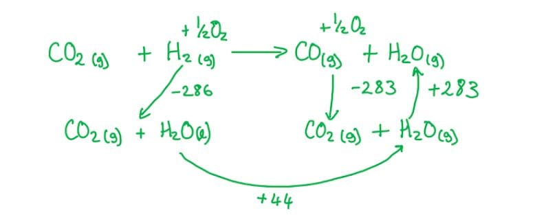
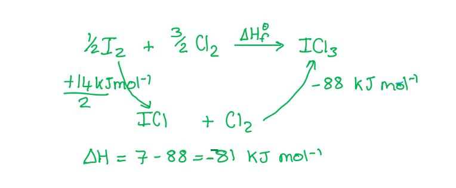
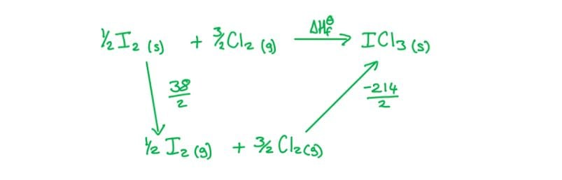
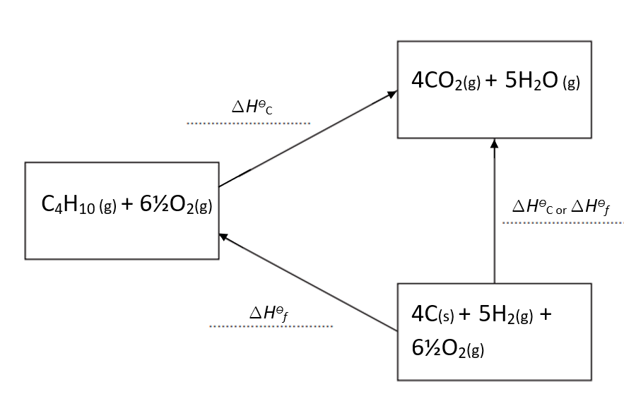
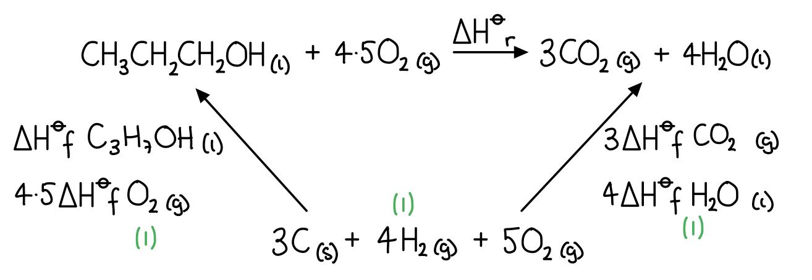
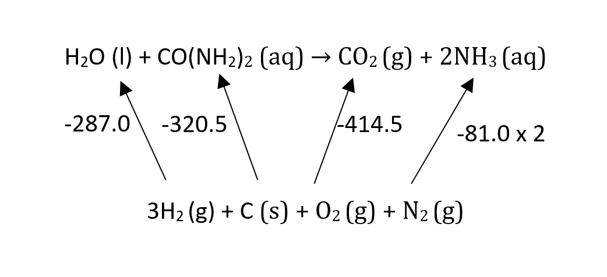
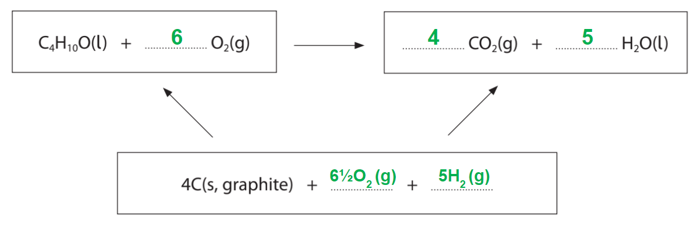

# Mark Schemes — Hess’s Law
**5 Chemical Energetics** · Cambridge (CIE) AS chemistry (9701)

## Multiple Choice Questions (12 questions)

### Q1
**Final answer:** **The correct answer is B because:**

- To calculate Δ*H*r using Hess's law, find an alternative route through the cycle:
- Travel along Δ*H*1 in the same direction = add Δ*H*1
- Travel along Δ*H*2 in the opposite direction = subtract Δ*H*2
- This gives Δ*H*r = Δ*H*1 − Δ*H*2

**A **is incorrect as it adds both enthalpy changes rather than subtracting Δ*H*2.

**C **is incorrect as the signs of Δ*H*1 and Δ*H*2 are reversed. It is Δ*H*1 − Δ*H*2, not Δ*H*2 − Δ*H*1.

**D **is incorrect as it reverses both arrows, giving a negative sum. Only Δ*H*2 is reversed in the correct route.

### Q2
**Final answer:** **The correct answer is A**

- Known quantities:

  - Δ*H*fθ(SO2) = −297 kJ mol−1
  - Δ*H*fθ(SO3) = −395 kJ mol−1
  - Stoichiometry from the target equation: 2 mol of each
- Calculate Δ*H*rθ:

Δ*H*rθ = ΣΔ*H*fθ(products) − ΣΔ*H*fθ(reactants)

ΣΔ*H*fθ(2SO3) = 2 × (−395) = −790 kJ

ΣΔ*H*fθ(2SO2) = 2 × (−297) = −594 kJ

Δ*H*rθ = (−790) − (−594) = **−196 kJ mol****−1**

**B** is incorrect as it uses a coefficient of 1 for both sulfur oxides instead of 2: (−395) − (−297) = −98 kJ mol−1.

**C** is incorrect as it uses a coefficient of 1 and reverses the products and reactants: (−297) − (−395) = +98 kJ mol−1.

**D** is incorrect as it reverses the products and reactants with the correct stoichiometric coefficients: 2(−297) − 2(−395) = +196 kJ mol−1.

### Q3
**Final answer:** **The correct answer is D**

- Known quantities:

  - CO (g) + ½O2 (g) → CO2 (g): Δ*H*θ = −283 kJ mol−1 (equation 1)
  - H2 (g) + ½O2 (g) → H2O (l): Δ*H*θ = −286 kJ mol−1 (equation 2)
  - H2O (g) → H2O (l): Δ*H*θ = −44 kJ mol−1 (equation 3)
- Target reaction:

CO2 (g) + H2 (g) → CO (g) + H2O (g)

- Reverse equation 1 (CO2 → CO + ½O2): +283 kJ mol−1
- Use equation 2 as written (H2 + ½O2 → H2O (l)): −286 kJ mol−1
- Reverse equation 3 (H2O (l) → H2O (g)): +44 kJ mol−1 
- Calculate Δ*H*θ by combining the three equations:

Δ*H*θ = +283 + (−286) + 44 = **+41 kJ mol****−1**

**A** is incorrect as it gives the enthalpy change for the reverse of the target reaction: −(+41) = −41 kJ mol−1.

**B** is incorrect as it omits the H2O vaporisation step (equation 3): +283 + (−286) = −3 kJ mol−1.

**C** is incorrect as it omits equation 3 and uses equation 1 in the forward direction rather than reversed: (−283) + (+286) = +3 kJ mol−1.

### Q4
**Final answer:** **The correct answer is A**

- Known quantities:

  - Δ*H*fθ(CO2 (g)) = −382 kJ mol−1
  - Δ*H*fθ(H2O (g)) = −275 kJ mol−1
  - Δ*H*fθ(C2H5OH (l)) = −266 kJ mol−1
  - Δ*H*fθ(O2 (g)) = 0 (element in standard state)
- Combustion equation:

C2H5OH (l) + 3O2 (g) → 2CO2 (g) + 3H2O (g)

- Calculate Δ*H*cθ(C2H5OH):

Δ*H*cθ = ΣΔ*H*fθ(products) − ΣΔ*H*fθ(reactants)

ΣΔ*H*fθ(products) = 2(−382) + 3(−275) = −764 + (−825) = −1589 kJ

ΣΔ*H*fθ(reactants) = (−266) + 3(0) = −266 kJ

Δ*H*cθ = (−1589) − (−266) = −1589 + 266 = **−1323 kJ mol****−1**

**B** is incorrect as it uses 1 mol of CO2 and 1 mol of H2O instead of the correct 2 and 3: [(−382) + (−275)] − (−266) = −657 + 266 = −391 kJ mol−1.

**C** is incorrect as it inverts the formula and uses 1 mol of each product: (−266) − [(−382) + (−275)] = −266 + 657 = +391 kJ mol−1.

**D** is incorrect as it inverts the formula with the correct stoichiometry: (−266) − (−1589) = +1323 kJ mol−1.

### Q5
**Final answer:** **The correct answer is B because:**

- To calculate Δ*H*rθ using standard enthalpy of formation data, use products minus reactants:
- Δ*H*rθ = ΣΔ*H*fθ(products) − ΣΔ*H*fθ(reactants)

** **A is incorrect as it adds the formation enthalpies of products and reactants rather than subtracting.

**C **is incorrect as the products and reactants are the wrong way around.

**D **is incorrect as the correct formula subtracts the reactant formation enthalpies from the product formation enthalpies.

### Q6
**Final answer:** **The correct answer is B**

- Known quantities:

  - I2 (s) + Cl2 (g) → 2ICl (s): Δ*H*θ = +14 kJ mol−1 (equation 1)
  - ICl (s) + Cl2 (g) → ICl3 (s): Δ*H*θ = −88 kJ mol−1 (equation 2)
- Target:

  - Δ*H*fθ(ICl3 (s)) for 1 mol, from I2 (s) and Cl2 (g)
- Equation 1 produces 2 mol of ICl (s); halve it to give 1 mol of ICl (s) as intermediate 
- Halved equation 1:

½ × (+14) = +7 kJ mol−1

- Equation 2 as written:

−88 kJ mol−1

- Calculate Δ*H*fθ(ICl3):

Δ*H*fθ(ICl3) = +7 + (−88) = **−81 kJ mol****−1**

**A** is incorrect as it uses the full first equation and applies equation 2 twice: +14 + 2(−88) = −162 kJ mol−1.

**C** is incorrect as it uses the full first equation without halving: +14 + (−88) = −74 kJ mol−1.

**D** is incorrect as it gives −60 kJ mol−1, arising from an incorrect combination of the two equations without the required halving adjustment.

### Q7
**Final answer:** **The correct answer is C**

- Known quantities:

  - Δ*H*fθ(C3H8) = −158 kJ mol−1 (the student's calculated answer)
  - Δ*H*cθ(C3H8) = −2220 kJ mol−1
  - Δ*H*cθ(H2) = −286 kJ mol−1
  - Δ*H*cθ(C) = Y kJ mol−1 (unknown)
- Calculate Y using the Hess's law formation expression:

Δ*H*fθ(C3H8) = ΣΔ*H*cθ(elements) − Δ*H*cθ(compound)

−158 = [3Y + 4 × (−286)] − (−2220)

−158 = 3Y − 1144 + 2220

−158 = 3Y + 1076

3Y = −1234

Y = −1234 ÷ 3 = **−411 kJ mol****−1**

**A** is incorrect as it gives −1234 kJ mol−1, which is the value of 3Y before dividing by the stoichiometric coefficient of carbon.

**B** is incorrect as it uses only 1 mol of H2 instead of 4 mol in the combustion equation for propane: [3Y + 1 × (−286)] − (−2220) = −158 gives Y = −697 kJ mol−1.

**D** is incorrect as it inverts the Hess cycle expression, subtracting the element combustion enthalpies from the compound combustion enthalpy: (−2220) − [3Y + 4(−286)] = −158 gives Y = −306 kJ mol−1.

### Q8
**Final answer:** **The correct answer is C because:**

- Δ*H*fθ(H2O) is the enthalpy change when 1 mol of H2O (l) is formed from H2 (g) and O2 (g) in their standard states
- X represents the formation of 3 mol of H2O (l) from its elements, so X = +3Δ*H*fθ(H2O)
- The positive sign indicates the arrow for X travels in the same direction as the standard enthalpy of formation

**A** is incorrect as it uses a coefficient of 1, not 3.

**B **is incorrect as it uses a coefficient of 1 and a negative sign, which would represent the decomposition of 1 mol of H2O (l).

**D **is incorrect as the negative sign would represent the decomposition of 3 mol of H2O (l), not its formation.

### Q9
**Final answer:** **The correct answer is C**

- Known quantities:

  - Δ*H*fθ(NH3 (g)) = −51.3 kJ mol−1
  - Δ*H*fθ(NO (g)) = +92.2 kJ mol−1
  - Δ*H*fθ(H2O (g)) = −239.6 kJ mol−1
  - Δ*H*fθ(O2 (g)) = 0 (element in standard state)
- Calculate Δ*H*rθ for 4NH3 (g) + 5O2 (g) ⇌ 4NO (g) + 6H2O (g):

Δ*H*rθ = ΣΔ*H*fθ(products) − ΣΔ*H*fθ(reactants)

ΣΔ*H*fθ(products) = 4(+92.2) + 6(−239.6) = +368.8 + (−1437.6) = −1068.8 kJ

ΣΔ*H*fθ(reactants) = 4(−51.3) + 5(0) = −205.2 kJ

Δ*H*rθ = −1068.8 − (−205.2) = −1068.8 + 205.2 = **−863.6 kJ mol****−1**

**A** is incorrect as it gives +863.6 kJ mol−1, which has the correct magnitude but the wrong sign. This is caused by reversing the products and reactants in the formula: (−205.2) − (−1068.8) = +863.6 kJ mol−1.

**B** is incorrect as it gives −1601.2 kJ mol−1. This is caused by an error in the stoichiometric coefficients applied to the product enthalpies.

**D** is incorrect as it gives −1274.0 kJ mol−1. This is caused by from treating Δ*H*fθ(NH3) as positive (+51.3) instead of negative: −1068.8 − (+205.2) = −1274.0 kJ mol−1.

### Q10
**Final answer:** **The correct answer is B**

- Known quantities:

  - Δ*H*cθ(C (s)) = −394 kJ mol−1
  - Δ*H*cθ(H2 (g)) = −286 kJ mol−1
  - Δ*H*cθ(C3H8O (l)) = −1816 kJ mol−1
- Formula C3H8O requires 3 mol C and 4 mol H2 as elements (O2 has Δ*H*cθ = 0)
- Calculate Δ*H*fθ(C3H8O):

Δ*H*fθ = ΣΔ*H*cθ(elements) − Δ*H*cθ(compound)

ΣΔ*H*cθ(elements) = 3(−394) + 4(−286) = −1182 + (−1144) = −2326 kJ

Δ*H*fθ = −2326 − (−1816) = −2326 + 1816 = **−510 kJ mol****−1**

**A** is incorrect as it inverts the formula and uses only 1 mol each of C and H2: (−1816) − [(−394) + (−286)] = −1816 + 680 = −1136 kJ mol−1.

**C** is incorrect as it inverts the formula with the correct stoichiometry: (−1816) − (−2326) = +510 kJ mol−1.

**D** is incorrect as it uses only 1 mol each of C and H2 with the correct formula: [(−394) + (−286)] − (−1816) = −680 + 1816 = +1136 kJ mol−1.

### Q11
**Final answer:** **The correct answer is C**

- Known quantities:

  - Δ*H*fθ(TiO2 (s)) = −890 kJ mol−1
  - Δ*H*fθ(CO (g)) = −105 kJ mol−1
  - Δ*H*fθ(C (s)) = 0 and Δ*H*fθ(Ti (s)) = 0 (elements in standard state)
- Calculate Δ*H*rθ for TiO2 (s) + 2C (s) → Ti (s) + 2CO (g):

Δ*H*rθ = ΣΔ*H*fθ(products) − ΣΔ*H*fθ(reactants)

ΣΔ*H*fθ(products) = 0 + 2(−105) = −210 kJ

ΣΔ*H*fθ(reactants) = (−890) + 2(0) = −890 kJ

Δ*H*rθ = (−210) − (−890) = −210 + 890 = **+680 kJ mol****−1**

**A** is incorrect as it gives −785 kJ mol−1. This is caused by using only 1 mol of CO instead of 2 mol and then reversing the sign: (−105) − (−890) = +785, taken as −785 kJ mol−1.

**B** is incorrect as it gives −680 kJ mol−1, which is the correct magnitude with the wrong sign. This is caused by reversing the products and reactants in the formula: (−890) − (−210) = −680 kJ mol−1.

**D** is incorrect as it gives +785 kJ mol−1. This is caused by using only 1 mol of CO instead of the correct 2 mol: (−105) − (−890) = +785 kJ mol−1.

### Q12
**Final answer:** **The correct answer is D**

- Known quantities:
- I2 (s) → I2 (g): Δ*H*θ = +38 kJ mol−1
- I2 (g) + 3Cl2 (g) → 2ICl3 (s): Δ*H*θ = −214 kJ mol−1
- Target: Δ*H*fθ(ICl3 (s)) for 1 mol, from I2 (s) and Cl2 (g)

- Both equations produce 2 mol of ICl3 (s); halve each to give 1 mol

- Halved sublimation step:

½ × (+38) = +19 kJ mol−1

- Halved reaction step:

½ × (−214) = −107 kJ mol−1

- Calculate Δ*H*fθ(ICl3):

Δ*H*fθ(ICl3) = +19 + (−107) = **−88 kJ mol****−1**

**A** is incorrect as it uses the full enthalpy of the second equation without halving: −214 kJ mol−1 is the enthalpy for forming 2 mol of ICl3 (s), not 1 mol.

**B** is incorrect as it uses both equations at full scale without halving: +38 + (−214) = −176 kJ mol−1.

**C** is incorrect as it halves the second equation correctly but omits the sublimation step, starting from I2 (g) rather than I2 (s): ½ × (−214) = −107 kJ mol−1.

## Structured Questions (5 questions)

### Q1
The completed Hess's law energy cycle for butane is:

**[3 marks]**

> **[mark-scheme]**
> 1 mark for correct species **AND **correct balancing / coefficients in both boxes
> 
> 1 mark for correct enthalpy change labels on all arrows
> 
> 1 mark for both arrows shown in the correct direction

> **[exam-tip]**
> Include state symbols on all species as they are part of the standard enthalpy change definitions.
> 
> The formation of oxides from their elements in standard states is equivalent to the combustion of those elements, so Δ*H*ϴf and Δ*H*ϴc labels may both appear on the same section of the cycle.
To calculate the standard enthalpy change of combustion of butane, Δ*H*ϴc:

- Apply the Hess's law expression:

Δ*H*ϴc = −Δ*H*ϴf [C4H10 (g)] + 4Δ*H*ϴf [CO2 (g)] + 5Δ*H*ϴf [H2O (l)] **[1 mark]**

- Substitute values from Table 1.1:

Δ*H*ϴc = −(−125) + 4(−393.5) + 5(−286)

Δ*H*ϴc = **−2879 kJ mol****-1** **[1 mark]**

> **[mark-scheme]**
> 1 mark for correct expression with correct stoichiometric coefficients
> 
> 1 mark for −2879 kJ mol-1

> **[exam-tip]**
> The balanced combustion equation for butane is:
> 
> C4H10 (g) + 6.5O2 (g) → 4CO2 (g) + 5H2O (l)
> 
> Use the stoichiometric coefficients from this equation when applying the Hess's law expression. Oxygen is not included because Δ*H*ϴf [O2 (g)] = 0.
> 
> Take care with signs. Subtracting the enthalpy of formation of the reactant means subtracting a negative value, making it positive: −(−125) = +125.
To calculate the standard enthalpy change of combustion of butane using bond energies:

- Identify and total the bonds broken (in reactants):

3 x C−C: 3 x 348 = +1044 kJ mol-1

10 x C−H: 10 x 410 = +4100 kJ mol-1

6.5 x O=O: 6.5 x 495 = +3217.5 kJ mol-1

Total bonds broken = +8361.5 kJ mol-1 **[1 mark]**

- Identify and total the bonds formed (in products):

8 x C=O: 8 x 743 = −5944 kJ mol-1

10 x H−O: 10 x 463 = −4630 kJ mol-1

Total bonds formed = −10574 kJ mol-1 **[1 mark]**

- Calculate the enthalpy change:

Δ*H*ϴc = (+8361.5) + (−10574)

Δ*H*ϴc = **−2212.5 kJ mol****-1** **[1 mark]**

> **[mark-scheme]**
> 1 mark for total bonds broken = +8361.5 kJ mol-1 (3 x C−C, 10 x C−H, 6.5 x O=O with correct values)
> 
> 1 mark for total bonds formed = −10574 kJ mol-1 (8 x C=O, 10 x H−O with correct values)
> 
> 1 mark for −2212.5 kJ mol-1

> **[exam-tip]**
> Start by writing the balanced combustion equation for butane:
> 
> C4H10 (g) + 6.5O2 (g) → 4CO2 (g) + 5H2O (g)
> 
> Bond energies always refer to gaseous species, so water is treated as gaseous in this calculation. This is why the answer differs from the thermochemical value in part (b), which uses liquid water products.
> 
> Count the bonds carefully. Butane (C4H10) has 3 C−C bonds and 10 C−H bonds. Each CO2 molecule has 2 C=O bonds (8 total for 4 molecules), and each H2O molecule has 2 O−H bonds (10 total for 5 molecules).
> 
> Bond energies are average values taken from a range of similar compounds, so the calculated value is only an approximation of the true enthalpy change.
> **[mark-scheme]**
> The more accurate value for the standard enthalpy change of combustion of butane is:
> 
> - The value from part (b) / −2879 kJ mol-1 **[1 mark]**
> - The data in part (b) are experimentally measured values;
> **AND**
> The bond energies in part (c) are average values taken from a range of compounds **[1 mark]**

> **[exam-tip]**
> Bond energies are average values calculated from many different compounds containing the same type of bond. They are not specific to butane, so the calculated enthalpy change in part (c) is only an approximation.
> 
> The thermochemical data in part (b) are measured experimentally for the specific substances in their standard states, making it more precise.

### Q2
> **[mark-scheme]**
> The standard enthalpy of combustion, Δ*H*ϴc is:
> 
> - Enthalpy change / energy change when one mole of a substance is completely burnt / reacts completely in oxygen **[1 mark]**
> - With all reactants and products in their standard states
> **OR**
> Under standard conditions (298 K and 100 kPa)
> **OR**
> With all reactants and products in their normal states at 298 K and 100 kPa **[1 mark]**

> **[exam-tip]**
> Be careful not to confuse products and reactants in thermodynamic definitions.
> 
> The standard enthalpy of formation is defined according to the production of one mole of product, whereas the standard enthalpy of combustion is based on the complete combustion of one mole of a reactant.
The equation for the complete combustion of propan-1-ol is:

2CH3CH2CH2OH (l) + 9O2 (g) → 6CO2 (g) + 8H2O (l)

**OR**

CH3CH2CH2OH (l) + 4.5O2 (g) → 3CO2 (g) + 4H2O (l)

**[2 marks]**

> **[mark-scheme]**
> 1 mark for correct formula and balancing of reactants
> 
> 1 mark for correct formula and balancing of products
> 
> State symbols required on all species.

> **[exam-tip]**
> A common mistake is to leave out the oxygen from a combustion equation — complete combustion always requires oxygen.
> 
> If you are not using fractions to balance the equation, you must double the number of moles of all other chemicals.
> 
> Double-check your balancing once you have written your equation.
> 
> Many chemical calculations work from a balanced symbol equation, so if your equation is incorrect, any subsequent calculations will also contain errors.
The Hess's law cycle for the complete combustion of propan-1-ol is:

**[3 marks]**

> **[mark-scheme]**
> 1 mark for correct elements in standard states **AND** correct balancing
> 
> 1 mark for correct direction of arrow from elements in standard states to the reactants **AND** correct data
> 
> 1 mark for correct direction of arrow from elements in standard states to the products **AND** correct data

> **[exam-tip]**
> Arrows in a Hess cycle must point in the correct direction — the reactants and products are formed from the elements in their standard states, so the arrows point upwards in this case.
> 
> To find Δ*H*ϴr from a Hess cycle:
> 
> - Follow the direction of an arrow → add the enthalpy value
> - Go against the direction of an arrow → subtract the enthalpy value
To calculate the standard enthalpy change of combustion of propan-1-ol, Δ*H*ϴc:

- Apply the enthalpy of formation equation:

Δ*H*ϴc = ΣΔ*H*ϴf (products) − ΣΔ*H*ϴf (reactants) **[1 mark]**

- Substitute values from Table 4.1:

Δ*H*ϴc = [3(−393.5) + 4(−285.8)] − (−303) **[1 mark]**

Δ*H*ϴc = **−2020.7 kJ mol****-1** **[1 mark]**

> **[mark-scheme]**
> 1 mark for correct formula: Δ*H*ϴc = ΣΔ*H*ϴf products − ΣΔ*H*ϴf reactants
> 
> 1 mark for correct substitution: [3(−393.5) + 4(−285.8)] − (−303)
> 
> 1 mark for correct final answer: −2020.7 kJ mol-1
> 
> Allow error carried forward if an incorrect substitution leads to a consistent final answer.

> **[exam-tip]**
> When Δ*H*ϴf data is provided, use the formula:
> 
> Δ*H*ϴc = ΣΔ*H*ϴf (products) − ΣΔ*H*ϴf (reactants)
> 
> The type of data given determines which formula to apply.

### Q3
The equation for the formation of propane from propyne is:

CHCCH3 (g) + 2H2 (g) → CH3CH2CH3 (g)

**[2 marks]**

> **[mark-scheme]**
> 1 mark for correct species **AND **correct balancing (2 mol H2)
> 
> 1 mark for all correct state symbols: (g), (g), (g)

> **[exam-tip]**
> Propyne contains a C$\equiv$C triple bond, which requires 2 moles of H2 for complete addition: first to give propene, then to give propane.
> 
> You do not need to know the alkyne homologous series, but you should be able to apply your knowledge of addition reactions to the structural information given in the question.
To calculate the standard enthalpy change of reaction, Δ*H*ϴr, for the formation of propane from propyne:

- Apply the Hess's law expression using combustion data:

Δ*H*ϴr = ΣΔ*H*ϴc(reactants) − ΣΔ*H*ϴc(products) **[1 mark]**

- Substitute values from Table 2.1:

Δ*H*ϴr = [Δ*H*ϴc(propyne) + 2 x Δ*H*ϴc(H2)] − Δ*H*ϴc(propane)

Δ*H*ϴr = [(−1940) + 2(−285.8)] − (−2220) **[1 mark]**

- Calculate the result:

Δ*H*ϴr = −2511.6 + 2220

Δ*H*ϴr = **−291.6 kJ mol****-1** **[1 mark]**

> **[mark-scheme]**
> 1 mark for correct expression: ΣΔ*H*ϴc(reactants) − ΣΔ*H*ϴc(products), or equivalent Hess cycle approach
> 
> 1 mark for correct substitution with x2 multiplier for H2
> 
> 1 mark for −291.6 kJ mol-1

> **[exam-tip]**
> When combustion data is provided, the Hess's law expression is:
> 
> Δ*H*ϴr = ΣΔ*H*ϴc(reactants) − ΣΔ*H*ϴc(products)
> 
> This is the reverse of the formation data expression (Δ*H*ϴr = ΣΔ*H*ϴf(products) − ΣΔ*H*ϴf(reactants)). Take care not to confuse the two.
> 
> The stoichiometry from part (a) matters here. The balanced equation shows 2 mol H2 are consumed, so Δ*H*ϴc(H2) must be multiplied by 2.
> **[mark-scheme]**
> A calculated bond energy value differs from the Data Booklet value because:
> 
> - The Data Booklet value is an average taken from a range of different compounds containing that bond **[1 mark]**

> **[exam-tip]**
> Bond energies in the Data Booklet are average values calculated from many different compounds containing the same type of bond. For example, the C−H bond energy is derived from many different molecules, so it does not represent any one C−H bond exactly. This is why a calculated bond energy value is only an approximation.

### Q4
> **[mark-scheme]**
> i) The equation for the hydrolysis of aqueous urea:
> 
> - H2O (l) + CO(NH2)2 (aq) → CO2 (g) + 2NH3 (aq) **[1 mark]**

ii) The Hess's law energy cycle for the hydrolysis of aqueous urea is:

**[2 marks]**

> **[mark-scheme]**
> 1 mark for correct arrows pointing upwards from elements in standard states to the compounds
> 
> 1 mark for correct substances, coefficients, and enthalpy change labels

> **[exam-tip]**
> Since these are standard enthalpies of formation, the arrows in the Hess cycle must point from the elements in their standard states towards the compounds.
> 
> Pay attention to the coefficients in the equation as using the wrong multiplier for a Δ*H*ϴf value will cost a mark.
> 
> Make sure state symbols match those given in Table 1.1.
To calculate the standard enthalpy change of reaction, Δ*H*ϴr, for the hydrolysis of aqueous urea:

- Apply the enthalpy of formation equation:

Δ*H*ϴr = ΣΔ*H*ϴf (products) − ΣΔ*H*ϴf (reactants) **[1 mark]**

- Substitute values from Table 1.1:

Δ*H*ϴr = [(−393.5) + 2(−81.0)] − [(−320.5) + (−285.8)]

Δ*H*ϴr = (−555.5) − (−606.3)

Δ*H*ϴr = **+50.8 kJ mol****-1** **[1 mark]**

> **[mark-scheme]**
> 1 mark for correct formula: Δ*H*ϴr = ΣΔ*H*ϴf products − ΣΔ*H*ϴf reactants
> 
> 1 mark for correct final answer: +50.8 kJ mol-1
> 
> Allow error carried forward if an incorrect substitution leads to a consistent final answer.

> **[exam-tip]**
> As you go around the Hess cycle, add the enthalpy value if you follow the arrow and subtract it if you go against the arrow.
> 
> Using brackets around the terms helps to avoid careless calculation errors.
To calculate the standard enthalpy change of combustion of solid urea, Δ*H*ϴc:

- Apply the enthalpy of formation equation:

Δ*H*ϴc = ΣΔ*H*ϴf (products) − ΣΔ*H*ϴf (reactants) **[1 mark]**

- Substitute values from Table 1.1 for the equation as written (2 mol of urea):

Δ*H* = [2(−393.5) + 2(0) + 4(−285.8)] − [2(−333.1) + 3(0)] **[1 mark]**

Δ*H* = (−787.0 − 1143.2) − (−666.2) = −1264.0 kJ

- Divide by 2 to give the standard enthalpy change of combustion per mole of urea:

Δ*H*ϴc = **−632.0 kJ mol****-1** **[1 mark]**

> **[mark-scheme]**
> 1 mark for correct formula: Δ*H*ϴc = ΣΔ*H*ϴf products − ΣΔ*H*ϴf reactants
> 
> 1 mark for correct substitution using Δ*H*ϴf[CO(NH2)2 (s)] = −333.1 kJ mol-1 and Δ*H*ϴf[N2 (g)] = Δ*H*ϴf[O2 (g)] = 0
> 
> 1 mark for correct final answer per mole: −632.0 kJ mol-1
> 
> Allow error carried forward if an incorrect substitution leads to a consistent final answer per mole of urea.

> **[exam-tip]**
> The equation given shows the combustion of 2 moles of urea. The standard enthalpy of combustion is always defined per mole of substance, so remember to divide the calculated Δ*H* by 2 at the end.
> 
> Oxygen and nitrogen both have Δ*H*ϴf = 0 kJ mol-1 as they are elements in their standard states.

### Q5
To calculate the standard enthalpy change of combustion, Δ*H*ϴc, of 2-methylpropan-2-ol:

- Calculate the mass of 2-methylpropan-2-ol burned and the temperature change of the water:

mass burned = 267.35 − 266.78 = 0.57 g
**AND**
temperature change = 65.3 − 19.5 = 45.8 °C

**[1 mark]**

- Calculate the heat energy transferred to the water using *q* = *mc*Δ*T*:

*q* = 75.0 x 4.18 x 45.8

*q* = 14 358 J **[1 mark]**

- Calculate the *M*r of 2-methylpropan-2-ol, C4H9OH:

*M*r = (4 x 12.0) + (10 x 1.0) + 16.0 = 74.0 **[1 mark]**

- Calculate the moles of 2-methylpropan-2-ol burned:

moles = $\frac{0.57}{74.0}$

moles = 7.703 x 10-3 mol **[1 mark]**

- Calculate the standard enthalpy change of combustion:

Δ*H*ϴc = $\frac{-14358}{7.703\times10^{-3}}$

Δ*H*ϴc = **−1864 kJ mol****-1** **[1 mark]**

> **[mark-scheme]**
> 1 mark for both mass change = 0.57 g **AND **temperature change = 45.8 °C
> 
> 1 mark for q = 14 358 J
> 
> 1 mark for *M*r = 74.0 g mol-1
> 
> 1 mark for moles = 7.703 x 10-3 mol
> 
> 1 mark for −1864 kJ mol-1

> **[exam-tip]**
> The mass used in *q* = *mc*Δ*T* is the mass of water (75.0 g), not the mass of 2-methylpropan-2-ol burned. The mass of the spirit burner decreases because fuel is consumed.
> 
> The combustion reaction is exothermic, so the enthalpy change is negative.
> 
> To find the moles burned, use:
> 
> moles = $\frac{\mathrm{mass} \mathrm{of} \mathrm{fuel} \mathrm{burne}d}{M_{r}}$ =$\frac{0.57}{74.0}$
> **[mark-scheme]**
> i) The standard enthalpy change of formation of oxygen gas is zero because:
> 
> - Oxygen is an element in its standard state **[1 mark]**

ii) The completed Hess's law energy cycle for the combustion of 2-methylpropan-2-ol is:

**[2 marks]**

> **[mark-scheme]**
> 1 mark for balanced reactants AND products in correct positions in the cycle
> 
> 1 mark for balanced elements with correct state symbols

iii) To calculate the standard enthalpy change of combustion, Δ*H*ϴc, of 2-methylpropan-2-ol:

- Apply the Hess's law expression:

Δ*H*ϴc = ΣΔ*H*ϴf(products) − ΣΔ*H*ϴf(reactants) **[1 mark]**

- Substitute values from Table 3.2:

Δ*H*ϴc = [(4 x −394) + (5 x −286)] − (−359)

Δ*H*ϴc = **−2647 kJ mol****-1** **[1 mark]**

> **[mark-scheme]**
> 1 mark for correct expression with stoichiometric coefficients: 4 x CO2 and 5 x H2O
> 
> 1 mark for −2647 kJ mol-1

> **[exam-tip]**
> i) The standard enthalpy change of formation of any element in its standard state is defined as zero. No bonds are broken or formed to produce an element from itself.
> 
> ii) In the Hess's law cycle, the arrows for Δ*H*ϴf point FROM the elements in standard states TO the compound or combustion products. Check that the arrow directions give two valid routes from the same starting point to the same end point.
> 
> iii) The balanced combustion equation for 2-methylpropan-2-ol is:
> 
> C4H9OH (l) + 6O2 (g) → 4CO2 (g) + 5H2O (l)
> 
> Use the stoichiometric coefficients from this equation (4 x CO2 and 5 x H2O) when calculating ΣΔ*H*ϴf(products).
> **[mark-scheme]**
> Two reasons why the experimental value for Δ*H*ϴc is less exothermic than the calculated value are:
> 
> Any **two** from (1 mark for each point):
> 
> - Heat energy is lost to the surroundings / the heat capacity of the calorimeter is not accounted for
> - Incomplete combustion of the alcohol
> - Alcohol / fuel evaporates before burning
> - The temperature is not uniform in the water (no stirrer used)
> 
> **[2 marks]**

> **[exam-tip]**
> Think about all the ways the experimental setup differs from ideal conditions. The spirit burner loses heat in all directions, and combustion without a pure oxygen supply is rarely complete.
> 
> Do not use non-standard conditions as a reason, as the question explicitly excludes this. Focus on practical limitations of the calorimetry setup.
