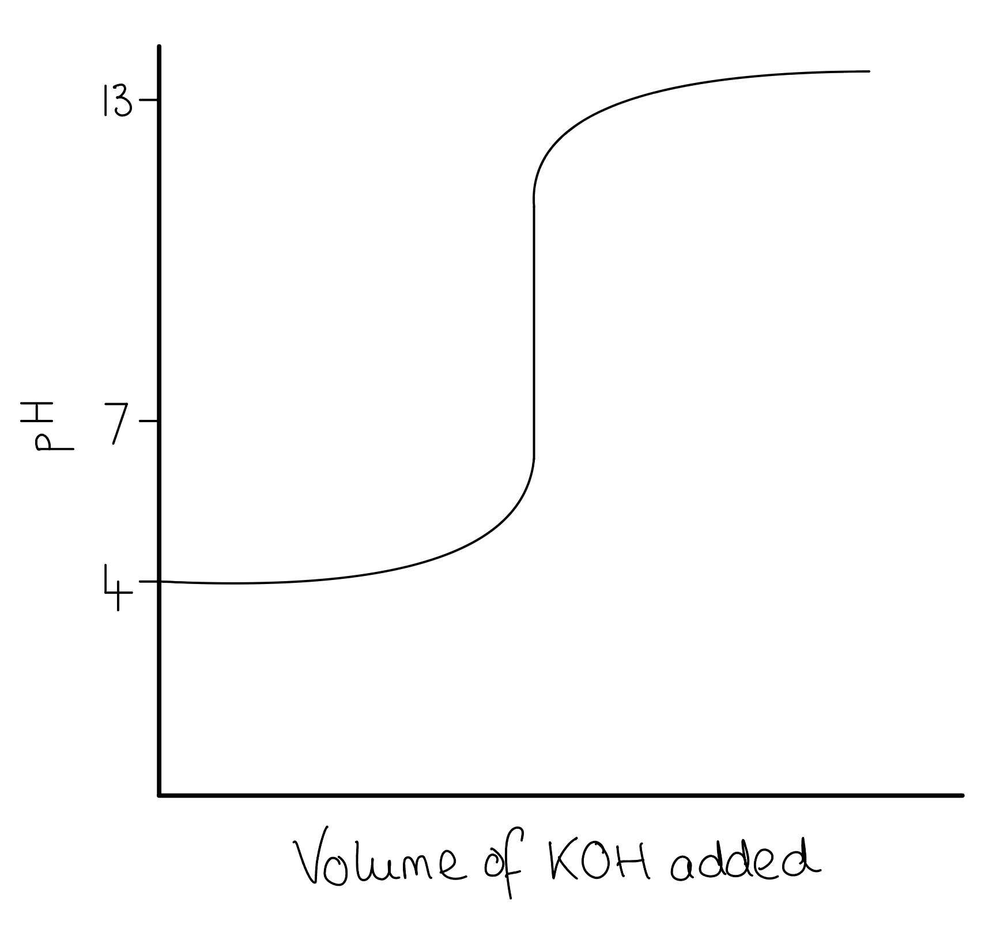

# Mark Schemes — Chemical Equilibria: Reversible Reactions & Dynamic Equilibrium
**7. Equilibria** · Cambridge (CIE) AS chemistry (9701)

## Multiple Choice Questions (27 questions)

### Q1
**Final answer:** **The correct answer is D**

- Known values:

  - n(NO2) initial = 4 mol
  - n(O2) at equilibrium = 0.8 mol
  - V = 1 dm3

- From the molar ratio NO2 : NO : O2 = 2 : 2 : 1, if 0.8 mol of O2 forms:

  - change in NO2 = −1.6 mol
  - change in NO = +1.6 mol

|   | 2NO2 (g) ⇌ | 2NO (g) + | O2 (g) |
|---|---|---|---|
| Initial moles | 4 | 0 | 0 |
| Change | −1.6 | +1.6 | +0.8 |
| Equilibrium moles | 2.4 | 1.6 | 0.8 |

- Since the volume is 1 dm3, equilibrium concentrations equal equilibrium moles numerically.
- Write the *K*c expression:

`K_{c} = \frac{[\text{NO (g)}]^{2}[\text{O}_{2}\text{ (g)}]}{[\text{NO}_{2}\text{ (g)}]^{2}}`

- Substitute equilibrium values:

*K*c = $\frac{1.6^{2}\times0.8}{2.4^{2}}$

**A** is incorrect as 0.8 mol has been used for NO (g) instead of 1.6 mol. The molar ratio 2:2:1 gives Δn(NO) = 2 × Δn(O2) = 2 × 0.8 = 1.6 mol.

**B** is incorrect as NO (g) has not been squared. The stoichiometric coefficient of 2 for NO becomes an exponent in the *K*c expression.

**C** is incorrect as NO2 (g) has not been squared. The stoichiometric coefficient of 2 in the denominator also becomes an exponent in the *K*c expression.

### Q2
**Final answer:** **The correct answer is C**

- Write the *K*c expression for this reaction:

*K*c = `(left square bracket H _ 2 ( g ) right square bracket ^3 left square bracket C _ 2 H _ 2 ( g ) right square bracket)/(left square bracket CH _ 4 ( g ) right square bracket ^2)`

- The unit of each concentration term is mol dm-3:

*K*c = $\frac{[ \text{mol} dm^{ - } 3 ) ] ^{3} [ \text{mol} dm^{ - } 3 ]}{[ \text{mol} dm^{ - } 3 ] ^{2} }$

*K*c = $[ \text{mol} dm^{ - } 3 ) ] [ \text{mol} dm^{ - } 3 ]$

*K*c = mol2 dm-6

**A, C & D **are incorrect as none of these units fit with the correct expression of *K*c.

### Q3
**Final answer:** **The correct answer is C**

- Every step in the Contact process releases heat, making all three steps exothermic.

- The first step is combustion, making it the most exothermic of the three.

- The second step is an exothermic oxidation reaction.

- The third step is so exothermic that it causes water to vaporise; the equation shown is a simplified version of the actual process.

**A** is incorrect as excess air is used so that the sulfur dioxide produced is already mixed with oxygen for the second stage, not to improve the yield.

**B** is incorrect as only the second step is a reversible reaction and can reach a position of equilibrium.

**D** is incorrect as SO3 is not absorbed directly by water in the actual process. The reaction is so exothermic that water would vaporise. SO3 is first dissolved in concentrated sulfuric acid to prevent this.

### Q4
**Final answer:** **The correct answer is B**

- The esterification reaction has ΔH = −10 kJ mol−1, so the forward reaction is **exothermic.**

- Decreasing temperature shifts the equilibrium to the right (the exothermic direction) to oppose the change, in accordance with Le Chatelier's principle.

- This increases the concentrations of propyl ethanoate and water relative to the reactants, so the value of *K*c **increases.**

**A** is incorrect as adding a catalyst increases the **rate** at which equilibrium is reached but has no effect on the position of equilibrium or the value of *K*c.

**C** is incorrect as all species in this reaction are **liquids**; pressure changes only affect gaseous equilibria and have no effect on *K*c.

**D** is incorrect as increasing temperature shifts the equilibrium to the left (the endothermic direction), decreasing the concentrations of propyl ethanoate and water relative to the reactants, which **decreases** the value of *K*c.

### Q5
**Final answer:** **The correct answer is C**

- As reactants A and B were added in equal amounts and react in a 1:1 molar ratio, their equilibrium mole fractions are identical.

  - Therefore, if p(A) = 0.50 atm, then **p(B) = 0.50 atm**.

- Applying Dalton's Law:

Total pressure = p(A) + p(B) + p(C)

3.0 = 0.50 + 0.50 + p(C)

**p(C) = 2.0 atm**

**A** is incorrect as this is obtained by multiplying p(A) by the stoichiometric coefficient of C: 0.50 × 2 = 1.0 atm. This approach does not apply Dalton's Law correctly.

**B** is incorrect as this is obtained by treating the mole fraction of C as 0.5 (based on stoichiometric coefficients), giving p(C) = 0.50 × 3.0 = 1.5 atm. The mole fraction must be calculated from equilibrium amounts, not stoichiometric coefficients.

**D** is incorrect as this is obtained by forgetting to account for gas B in the total pressure: 3.0 − 0.50 = 2.5 atm. The partial pressures of all three gases must sum to the total pressure.

### Q6
**Final answer:** **The correct answer is D**

- Known values:

  - n(CO) = 6.20 × 10−3 mol
  - n(H2) = 4.80 × 10−3 mol
  - n(CH3OH) = 5.20 × 10−5 mol
  - V = 2 dm3

- Divide equilibrium moles by the volume (2 dm3) to obtain equilibrium concentrations:

[CO] = $\frac{6.20\times10^{-3}}{2}$

[CO] = 3.10 × 10−3 mol dm−3

[H2] = $\frac{4.80\times10^{-3}}{2}$

[H2] = 2.40 × 10−3 mol dm−3

[CH3OH] = $\frac{5.20\times10^{-5}}{2}$

[CH3OH] = 2.60 × 10−5 mol dm−3

- Write the *K*c expression:

`K_{c} = \frac{[\text{CH}_{3}\text{OH}]}{[\text{CO}][\text{H}_{2}]^{2}}`

- Substitute equilibrium values:

*K*c = $\frac{2.60\times10^{-5}}{(3.10\times10^{-3})(2.40\times10^{-3})^{2}}$

*K*c = **1456.1**

- Since no products were present initially, the reaction quotient Q = 0 < *K*c
- The reaction proceeds in the forward direction, so the equilibrium shifts to the **right**
- *K*c > 1 confirms that products are favoured at the equilibrium position

**A** is incorrect as *K*c = 364 results from using equilibrium moles directly without dividing by volume (2 dm3) to obtain concentrations. The direction is correctly identified.

**B** is incorrect as the equilibrium has shifted to the **right**, not the left, and equilibrium moles were used instead of concentrations.

**C** is incorrect as the equilibrium has shifted to the **right**, not the left. Since Q = 0 < *K*c at the start, the reaction must proceed in the forward direction.

### Q7
**Final answer:** **The correct answer is B**

- 10% of 1.0 mol A has reacted:

change in A = 0.10 mol

- Using the molar ratio A : B : C = 1 : 3 : 2:

change in B = 3 × 0.10 = 0.30 mol

change in C = 2 × 0.10 = 0.20 mol

|   | A (g) | 3B (g) | 2C (g) |
|---|---|---|---|
| Initial moles | 1.0 | 1.0 | 0.0 |
| Change | −0.10 | −0.30 | +0.20 |
| Equilibrium moles | 0.90 | 0.70 | 0.20 |

- Calculate the equilibrium concentration of C:

concentration = $\frac{\mathrm{moles}}{\mathrm{volume}}$

equilibrium concentration of C = $\frac{0.20\mathrm{mol}}{5\mathrm{dm}^{3}}$

equilibrium concentration of C = **0.04 mol dm****-3**

**A** is incorrect as 0.02 mol dm−3 uses a 1:1 molar ratio for A:C. The correct ratio from the equation is 1:2, giving 0.20 mol of C: 0.20 ÷ 5 = 0.04 mol dm−3.

**C** is incorrect as 0.18 mol dm−3 is the equilibrium concentration of A, not C.

**D** is incorrect as 0.20 is the equilibrium moles of C, not the concentration.

### Q8
**Final answer:** **The correct answer is A**

- Known values:

  - n(N2) = 2.00 mol
  - n(H2) = 3.00 mol
  - n(NH3) initial = 1.98 mol
  - n(NH3) at equilibrium = 1.64 mol
  - V = 1 dm3

- The equilibrium has shifted to the left as the moles of NH3 decreased from 1.98 to 1.64 mol.

  - Change in NH3 = 1.64 − 1.98 = −0.34 mol
- From the molar ratio N2 : H2 : NH3 = 1 : 3 : 2:

  - Change in N2 = +0.17 mol
  - Change in H2 = +0.51 mol

|   | N2 (g) + | 3H2 (g) ⇌ | 2NH3 (g) |
|---|---|---|---|
| Initial moles | 2.00 | 3.00 | 1.98 |
| Change | +0.17 | +0.51 | −0.34 |
| Equilibrium moles | 2.17 | 3.51 | 1.64 |

- Since the volume is 1 dm3, equilibrium concentrations equal equilibrium moles numerically.
- Write the *K*c expression:

`K_{c} = \frac{[\text{NH}_{3}]^{2}}{[\text{N}_{2}][\text{H}_{2}]^{3}}`

- Substitute equilibrium values:

*K*c = $\frac{1.64^{2}}{2.17\times3.51^{3}}$

*K*c = **0.0287**

**B** is incorrect as 0.0498 comes from using initial moles (2.00 and 3.00) instead of equilibrium moles (2.17 and 3.51) for N2 and H2: 1.642 / (2.00 × 3.003) ≈ 0.0498.

**C** is incorrect as [H2] has been squared rather than cubed. The stoichiometric coefficient of 3 becomes the exponent: 1.642 / (2.17 × 3.512) ≈ 0.101.

**D** is incorrect as neither [NH3] nor [H2] has been raised to the correct exponent: 1.64 / (2.17 × 3.51) ≈ 0.215.

### Q9
**Final answer:** **The correct answer is C**

- The **enthalpy change** of the forward reaction is **exothermic** (ΔH is negative), so the **reverse** reaction is **endothermic**.

- **Effect of temperature:**

  - An increase in temperature shifts the equilibrium to the **left** (the endothermic direction), increasing the percentage of NO2 in the equilibrium mixture.

- **Effect of pressure:**

  - A decrease in pressure shifts the equilibrium to the side with **more moles of gas** (the left, 2 moles of NO2 vs 1 mole of N2O4), increasing the percentage of NO2 in the equilibrium mixture.

**A** is incorrect as although high temperature correctly shifts the equilibrium to the left, high pressure shifts the equilibrium to the **right** (fewer moles of gas), decreasing the percentage of NO2.

**B** is incorrect as both high pressure and low temperature shift the equilibrium to the **right**: high pressure favours the side with fewer moles of gas, and low temperature favours the exothermic forward reaction. Both conditions decrease the percentage of NO2.

**D** is incorrect as although low pressure shifts the equilibrium to the left (increasing the percentage of NO2), low temperature shifts the equilibrium to the right (exothermic direction). The two conditions have opposing effects on the position of equilibrium.

### Q10
**Final answer:** **The correct answer is B**

- Known values:

  - *n*(WX) initial = 0.40 mol
  - *n*(W+) at equilibrium = 0.10 mol
  - *V* = 2.0 dm3
  - Change in W+ = +0.10 mol

- By the 1:1:1 stoichiometry:

  - Change in X− = +0.10 mol
  - Change in WX = −0.10 mol

|   | WX (aq) ⇌ | X− (aq) + | W+ (aq) |
|---|---|---|---|
| Initial moles | 0.40 | 0 | 0 |
| Change | −0.10 | +0.10 | +0.10 |
| Equilibrium moles | 0.30 | 0.10 | 0.10 |
| Equilibrium concentration / mol dm−3 | 0.15 | 0.05 | 0.05 |

- Write the *K*c expression:

*K*c = `\frac{[\text{X}^{-}][\text{W}^{+}]}{[\text{WX}]}`

- Substitute equilibrium concentrations:

*K*c = $\frac{0.05\times0.05}{0.15}$

*K*c = $\frac{0.05^{2}}{0.15}$

**A** is incorrect as only one product concentration (0.05) has been used without multiplying both. Both [X−] and [W+] must be included: 0.05 × 0.05.

**C** is incorrect as equilibrium moles (0.1 and 0.3) have been used directly instead of equilibrium concentrations (0.05 and 0.15). Divide equilibrium moles by the volume (2.0 dm3) to obtain concentrations.

**D** is incorrect as the *K*c expression has been inverted: [WX] / ([X−][W+]) places reactants over products. The correct expression has products in the numerator.

### Q11
**Final answer:** **The correct answer is C**

- The equation C2H4 (g) + H2O (g) ⇌ C2H5OH (g) has **2 moles of gas on the left** and **1 mole on the right.**

- Increasing pressure shifts the equilibrium towards fewer moles of gas / the **right-hand side**, which increases the yield of ethanol.

- The forward reaction (ΔH = −45 kJ mol−1) is **exothermic.** Decreasing temperature shifts the equilibrium to the **right** (the exothermic direction), further increasing the yield of ethanol.

**A** and **B** are incorrect as adding a catalyst increases the **rate** at which equilibrium is reached but has **no effect on the position of equilibrium** or yield.

**D** is incorrect as decreasing pressure shifts the equilibrium to the left (towards more moles of gas), and increasing temperature shifts the equilibrium to the left (suppressing the exothermic forward reaction), both **decreasing** the yield of ethanol.

### Q12
**Final answer:** **The correct answer is C**

- Known values:

  - *K*c = 60
  - n(H2) = 2 mol; n(I2) = 0.3 mol

- Write the *K*c expression:

`K_{c} = \frac{[\text{HI (g)}]^{2}}{[\text{H}_{2}\text{ (g)}][\text{I}_{2}\text{ (g)}]}`

- Rearrange to make [HI (g)] the subject:

`[\text{HI (g)}] = \sqrt{K_{c} \times [\text{H}_{2}\text{ (g)}] \times [\text{I}_{2}\text{ (g)}]}`

- Since there are equal moles of gas on each side (Δ*n* = 0), volume cancels and moles can be used directly:
- Substitute the known values:

n(HI) = $\sqrt{60\times2\times0.3}$

n(HI) = $\sqrt{36}$

n(HI) = **6 mol**

**A** is incorrect as 0.010 comes from inverting the *K*c expression and not taking the square root.

**B** is incorrect as 0.10 comes from inverting the *K*c expression.

**D** is incorrect as the square root has not been taken. The exponent of 2 on [HI] means you must take the square root to find n(HI).

### Q13
**Final answer:** **The correct answer is B**

- Only **temperature** changes the value of *K*c

  - The equilibrium shifts to oppose the temperature change, establishing a new equilibrium position with a different value of *K*c.

- Any other change in conditions leaves *K*c constant.

**A** is incorrect as neither a change in pressure nor the presence of a catalyst affects the value of *K*c. All species are **aqueous**, so pressure changes have no effect; a catalyst only increases the **rate** at which equilibrium is reached without altering *K*c.

**C** & **D** are incorrect as changing the concentration of a reactant or product shifts the equilibrium, but the ratio of concentrations at the new equilibrium position remains the same and *K*c is unchanged.

### Q14
**Final answer:** **The correct answer is B**

- Known value:

  - *K*c (reaction 1) = 2

- Write the *K*c expressions for both reactions to identify the relationship:

`K_{c1} = \frac{[A_2B]^2}{[A_2]^2[B_2]}`

`K_{c2} = \frac{[A_2][B_2]^{1/2}}{[A_2B]}`

- Reaction 2 is the reverse of reaction 1 with all stoichiometric coefficients halved, apply two transformations:

- **Reverse reaction 1**: invert *K*c1:

*K*c (reversed) = $\frac{1}{2}$

- **Halve all coefficients**: take the square root:

*K*c2 = $\sqrt{\frac{1}{2}}$

*K*c2 = $\frac{1}{\sqrt{2}}$

**A** is incorrect as 1/2 applies to the full reversed reaction 1 (2A2B ⇌ 2A2 + B2), not the half-stoichiometry of reaction 2.

**C** is incorrect as neither the reversal nor the halving of stoichiometry has been applied.

**D** is incorrect as squaring *K*c1 would apply if reaction 2 had double the stoichiometry of reaction 1, not half.

### Q15
**Final answer:** **The correct answer is C**

- Increasing temperature gives all molecules more **kinetic energy**, increasing the frequency of effective collisions.

- Both the **forward and reverse rates** therefore increase.

- The **reverse reaction** (endothermic) is favoured by Le Chatelier's principle, so its rate increases more than the forward rate until a new equilibrium position is reached.

**A** is incorrect as both rates increase. Temperature always increases the rate of both forward and reverse reactions.

**B** is incorrect as the forward reaction rate also increases.

**D** is incorrect as the reverse reaction rate also increases.

### Q16
**Final answer:** **The correct answer is B**

- The forward reaction H2 (g) + I2 (g) ⇌ 2HI (g) is **exothermic** (ΔH = −9 kJ mol−1).

  - The reverse reaction is therefore endothermic.

- Decreasing temperature shifts the equilibrium to the right (the exothermic direction) to oppose the change, in accordance with Le Chatelier's principle.

- This increases the yield of HI and decreases the concentration of I2 (g), causing the gas mixture to become **paler.**

**A** & **C** are incorrect as there are **equal moles of gas on each side** of this equation (2 mol each). Pressure changes have no effect on the position of this equilibrium.

**D** is incorrect as increasing temperature shifts the equilibrium to the left (the endothermic direction), increasing the concentration of I2 (g) and causing the gas mixture to become **darker**, not paler.

### Q17
**Final answer:** **The correct answer is B**

- From the stoichiometry A : B : C = 1 : 1 : 2

  - If 3.00 mol of C form at equilibrium, then A and B each decrease by 3.00 / 2 = 1.50 mol

|   | A (g) | B (g) | 2C (g) |
|---|---|---|---|
| Initial moles | 5.00 | 5.00 | 0.00 |
| Change | −1.50 | −1.50 | +3.00 |
| Equilibrium moles | 3.50 | 3.50 | 3.00 |

- Calculate total equilibrium moles:

total equilibrium moles = 3.50 + 3.50 + 3.00 = 10.0 mol

- Calculate the mole fraction of A:

mole fraction of A = $\frac{3.50}{10.0}$ = 0.3500

- Calculate the partial pressure of A:

partial pressure of A = mole fraction of A × total pressure

partial pressure of A = 0.350 × 1.50

partial pressure of A = **0.525 atm**

**A** is incorrect as 0.350 is the mole fraction of A, not the partial pressure. Multiply by the total pressure: 0.350 × 1.50 = 0.525 atm.

**C** is incorrect as 0.750 comes from using the initial moles of A (5.00) rather than the equilibrium moles (3.50) in the mole fraction calculation: 5.00 / 10.0 × 1.50 = 0.750 atm.

**D** is incorrect as a partial pressure cannot exceed the total pressure. The sum of all partial pressures must equal the total pressure (1.50 atm).

### Q18
**Final answer:** **The correct answer is D**

- Known values:

  - [O2] = 6.7 × 10−6 mol dm−3
  - [Hb] = [Hb(O2)4]

- Write the *K*c expression:

*K*c = `\frac{[\text{Hb}(\text{O}_{2})_{4}]}{[\text{Hb}][\text{O}_{2}]^{4}}`

- Since [Hb] = [Hb(O2)4], these cancel:

*K*c = `\frac{1}{[\text{O}_{2}]^{4}}`

- Substitute the equilibrium value of [O2]:

*K*c = $\frac{1}{(6.7\times10^{-6})^{4}}$

*K*c ≈ **5 × 10^20^ mol^−4^ dm^12^**

**A** is incorrect as 2 × 10−21 mol−4 dm12 comes from **inverting** the *K*c expression: [O2]4 = (6.7 × 10−6)4 ≈ 2 × 10−21. The correct expression has [Hb(O2)4] in the numerator.

**B** is incorrect as [O2] was not raised to any exponent in the inverted expression: [O2]1 = 6.7 × 10−6.

**C** is incorrect as [O2] was not raised to the power of 4 in the correct expression: 1/[O2]1 = 1.5 × 105. The stoichiometric coefficient of 4 for O2 must become the exponent in the *K*c expression.

### Q19
**Final answer:** **The correct answer is B**

- The enthalpy change of the forward reaction is **exothermic** (ΔH is negative), so the **reverse** reaction is **endothermic**.

- The equilibrium will shift to the **left** when the temperature is raised to oppose the change, increasing the equilibrium amount of SO2.

  - This is in accordance with **Le Chatelier's principle**.

**A** is incorrect as the Contact process uses **vanadium(V) oxide** (V2O5) as its catalyst. Iron is the catalyst used in the Haber process.

**C** is incorrect as increasing the temperature shifts the equilibrium to the **endothermic** (reverse) reaction, **lowering** the yield of SO3.

**D** is incorrect as increasing the pressure shifts the equilibrium to the side with **fewer moles of gas**. There are 3 moles of gas on the reactant side and 2 moles on the product side, so the equilibrium shifts to the right, **decreasing** the equilibrium amount of SO2.

### Q20
**Final answer:** **The correct answer is B**

- The forward reaction is endothermic (ΔH = +60 kJ mol−1), so an increase in temperature shifts the equilibrium to the right.

- There are more moles of gas on the right-hand side (2 mol vs 1 mol), so the shift increases the total amount of gas.

- In addition, increasing the temperature causes thermal expansion: molecules gain more kinetic energy and move further apart, increasing the volume.

- Both effects act in the same direction, so the volume **increases** for both reasons.

**A** is incorrect as thermal expansion is a physical law that cannot be ignored. Increasing the temperature of any gas increases kinetic energy, causing molecules to move further apart and the volume to increase.

**C** & **D** are incorrect as the equilibrium shifts to the **right**, not the left. The forward reaction is endothermic, so increasing temperature favours the forward direction.

### Q21
**Final answer:** **The correct answer is C**

- Known values:

  - *p*(NO2) = 0.67 atm
  - *p*(N2O4) = 0.33 atm

- Write the expression for *K*p:

$K_{p} = \frac{p(\text{NO}_{2})^{2}}{p(\text{N}_{2}\text{O}_{4})}$

- Substitute the equilibrium partial pressures:

$K_{p} = \frac{(0.67)^{2}}{0.33}$

$K_{p} = \frac{0.4489}{0.33}$

*K*p = **1.36**

**A** is incorrect as 0.49 comes from inverting the *K*p expression without applying the exponent: *p*(N2O4) / *p*(NO2) = 0.33 / 0.67 = 0.49.

**B** is incorrect as 0.74 comes from inverting the *K*p expression: *p*(N2O4) / *p*(NO2)2 = 0.33 / (0.67)2 = 0.74. The correct expression has products in the numerator.

**D** is incorrect as the stoichiometric coefficient of 2 for NO2 has not been applied as an exponent: *p*(NO2) / *p*(N2O4) = 0.67 / 0.33 = 2.03.

### Q22
**Final answer:** **The correct answer is B**

- Known values:

  - *M*(H2) = 2 g mol−1
  - *M*(NH3) = 17 g mol−1
- Calculate the initial moles of H2:

  - Convert kg to g first

n(H2, initial) = $\frac{120\times1000}{2}$

n(H2, initial) = 60 000 mol

- Calculate the equilibrium moles of H2:

  - Convert kg to g first

n(H2, equilibrium) = $\frac{96.0\times1000}{2}$

n(H2, equilibrium) = 48 000 mol

- Calculate the change in H2 moles:

Δ*n*(H2) = 48 000 − 60 000

Δ*n*(H2) = −12 000 mol

- Calculate the change in NH3 moles:

molar ratio H2 : NH3 = 3 : 2:

Δ*n*(NH3) = $\frac{2}{3}$ × 12 000 = +8 000 mol

|   | N2 (g) | 3H2 (g) | 2NH3 (g) |
|---|---|---|---|
| Initial moles | 20 000 | 60 000 | 0 |
| Change | −4 000 | −12 000 | +8 000 |
| Equilibrium moles | 16 000 | 48 000 | 8 000 |

- Calculate the mass of NH3 (m = *n* × M):

m(NH3) = 8 000 × 17

m(NH3) = 136 000 g

m(NH3) = 1.36 × 105 g

**A** is incorrect as 1.36 × 102 comes from not converting kg to g before calculating moles. The molar mass of NH3 in kg is 0.017 kg mol−1, giving 8 000 × 0.017 = 136 kg rather than g.

**C** is incorrect as 12 000 mol was used for NH3 instead of 8 000 mol. This uses a 1:1 molar ratio for H2 : NH3, but the correct ratio is 3:2.

**D** is incorrect as the molar mass of 34 g mol−1 was used instead of 17 g mol−1 for NH3.

### Q23
**Final answer:** **The correct answer is D**

- Ag+ at equilibrium = 0.44 mol

change in Ag+ = 1.0 − 0.44 = −0.56 mol

- From the 1:1:1 stoichiometry (Ag+ : Fe2+ : Fe3+):

change in Fe2+ = −0.56 mol

change in Fe3+ = +0.56 mol

- Calculate the equilibrium moles:

|   | Ag+ (aq) | Fe2+ (aq) | Fe3+ (aq) |
|---|---|---|---|
| Initial moles | 1.0 | 1.0 | 0.0 |
| Change | −0.56 | −0.56 | +0.56 |
| Equilibrium moles | 0.44 | 0.44 | 0.56 |

- Divide equilibrium moles by volume (2.00 dm3) to get concentrations:

[Ag+] = 0.44 / 2.00 = 0.22 mol dm−3

[Fe2+] = 0.44 / 2.00 = 0.22 mol dm−3

[Fe3+] = 0.56 / 2.00 = 0.28 mol dm−3

- Write the *K*c expression:

  - Ag (s) is omitted from the *K*c expression (pure solid)

*K*c = $\frac{[ Fe^{3} + ]}{[ Ag^{ + } ] [ Fe^{2} + ]}$

- Substitute equilibrium values:

*K*c = $\frac{0.28}{(0.22\times0.22)}$

*K*c = **5.79**

**A** is incorrect as the *K*c expression has been inverted: [Ag+][Fe2+] / [Fe3+] = 0.222 / 0.28 ≈ 0.173.

**B** is incorrect as [Fe2+] has been omitted from the denominator: [Fe3+] / [Ag+] = 0.28 / 0.22 = 1.27. Both reactant concentrations must appear in the denominator.

**C** is incorrect as equilibrium moles have been used instead of equilibrium concentrations: 0.56 / (0.44 × 0.44) ≈ 2.89. Divide moles by volume (2.00 dm3) to obtain concentrations.

### Q24
**Final answer:** **The correct answer is C**

- The **heat exchanger** transfers heat from the hot outgoing gas mixture to the **incoming nitrogen and hydrogen.**

- This gives the incoming molecules more **kinetic energy**, increasing the frequency of effective collisions.

- A higher collision frequency **increases the rate of reaction**, allowing equilibrium to be reached more quickly.

**A** is incorrect as separating ammonia from unreacted nitrogen and hydrogen is done by the **condenser**, not the heat exchanger.

**B** is incorrect as the forward reaction N2 (g) + 3H2 (g) ⇌ 2NH3 (g) is **exothermic**. Increasing temperature shifts the equilibrium to the **left**, which **decreases** the yield of ammonia.

**D** is incorrect as the heat exchanger **warms** the incoming gases; it does not cool them.

### Q25
**Final answer:** **The correct answer is A**

- The forward reaction is **exothermic** (ΔH = −92 kJ mol−1).

  - By Le Chatelier's principle, increasing temperature shifts the equilibrium to the left (the endothermic direction), **decreasing** the yield of ammonia.
  - At 400 °C the yield is higher than at 500 °C at any given pressure.

- The reaction has 4 moles of gas on the left and 2 moles on the right.

  - Increasing pressure shifts the equilibrium to the side with fewer moles of gas (the right), **increasing** the yield of ammonia.

- The correct graph therefore shows:

  - Yield increasing with pressure.
  - The 400 °C curve lying above the 500 °C curve at all pressures.

**B** & **D** are incorrect as these graphs show a higher yield at 500 °C than at 400 °C. The forward reaction is exothermic, so higher temperature shifts the equilibrium left and **decreases** the yield.

**C** is incorrect as it shows yield **decreasing** with increasing pressure. Higher pressure shifts the equilibrium towards fewer moles of gas (the right-hand side), which **increases** the yield of ammonia.

### Q26
**Final answer:** **The correct answer is B**

- The three conditions for a dynamic equilibrium are:

  1. The rate of the **forward reaction** equals the rate of the **reverse reaction**.
  2. The reaction takes place in a **closed system**.
  3. The concentrations of reactants and products are **constant** (not necessarily equal).

**A** is incorrect as the concentrations of reactants and products are **constant**, not necessarily equal. They can exist in any ratio (e.g. 50:50, 75:25) but remain unchanged once equilibrium is reached.

**C** is incorrect as it omits the requirement for a **closed system**. If the system is open, matter can escape and a dynamic equilibrium cannot be maintained.

**D** is incorrect as this describes a shift in equilibrium position in response to a change in conditions (Le Chatelier's principle), not the features of dynamic equilibrium itself.

### Q27
**Final answer:** **The correct answer is D**

- Only **temperature** permanently changes the value of *K*p; the equilibrium shifts to oppose the temperature change, establishing a new equilibrium position with a different value of *K*p.

- No other change in conditions will affect the value of *K*p.

**A** is incorrect as adding a catalyst increases the **rate** at which equilibrium is reached but has no effect on the position of equilibrium or the value of *K*p.

**B** & **C** are incorrect as only temperature changes the value of *K*p. When pressure changes, all partial pressures change proportionally. The equilibrium shifts to maintain the same ratio and *K*p remains constant at the new equilibrium position.

## Structured Questions (11 questions)

### Q1
> **[mark-scheme]**
> i) The term *dynamic equilibrium* means:
> 
> - The rate of the forward reaction equals the rate of the reverse reaction **[1 mark]**
> - The concentrations of reactants and products remain constant **[1 mark]**
> 
> ii) The expression for *K*c:
> 
> - *K*c = $\frac{[ C ] ^{2} }{[ A ] ^{3} [ B ] ^{2} }$ **[1 mark]**
> 
> Square brackets must be used for concentrations; round brackets are not accepted.

> **[exam-tip]**
> For part i), two distinct points are required for 2 marks: the equal rates point and the constant concentrations point. Stating only one will score 1 mark.
> 
> For part ii), products go in the numerator and reactants in the denominator. The powers match the stoichiometric coefficients: [C]2, [A]3, and [B]2.
To calculate the concentration of **B** in the equilibrium mixture:

- Calculate the concentrations of **A** and **C** by dividing moles by volume:

[**A**] = $\frac{3.34}{8.00}$ = 0.4175 mol dm-3

[**C**] = $\frac{4.28}{8.00}$ = 0.535 mol dm-3

**[1 mark]**

- Write the *K*c expression and rearrange to make [**B**]2 the subject:

*K*c = $\frac{[ C ] ^{2} }{[ A ] ^{3} [ B ] ^{2} }$

[**B**]2 = [**C**]2 / ([**A**]3 x *K*c) **[1 mark]**

- Substitute values and calculate [**B**]2:

[**B**]2 = $\frac{[ 0.535 ]^{2}}{[ 0.4175 ]^{3} \times 255}$

[**B**]2 = 0.01542 **[1 mark]**

- Take the square root to find [**B**]:

[**B**] = **0.124** mol dm-3 **[1 mark]**

> **[mark-scheme]**
> 1 mark for [**A**] = 0.4175 mol dm-3 **AND** [**C**] = 0.535 mol dm-3
> 
> 1 mark for correct rearranged expression: [**B**]2 = [**C**]2 / ([**A**]3 x *K*c)
> 
> 1 mark for [**B**]2 = 0.0154
> 
> 1 mark for [**B**] = 0.124 mol dm-3 (3 s.f.)
> 
> Allow error carried forward from incorrect concentrations if the rearrangement method is correct.

> **[exam-tip]**
> The first step is to convert moles to concentrations by dividing by the volume. Using moles directly in the *K*c expression instead of concentrations is the most common error in this type of question.
> 
> After rearranging, calculate [**B**]2 first, then take the square root. Forgetting the square root at the end is a common final step error.
> **[mark-scheme]**
> The effect of an increase in temperature on the equilibrium concentration of **B**:
> 
> - The concentration of **B** increases **[1 mark]**
> - Increasing temperature favours the reverse / endothermic reaction **[1 mark]**

> **[exam-tip]**
> The forward reaction is exothermic (Δ*H* = −65 kJ mol-1). By Le Chatelier's principle, increasing temperature shifts the position of equilibrium in the direction that opposes the change, favouring the reverse (endothermic) reaction. This consumes C and produces more A and B, so the concentration of **B** increases.
> 
> State the effect first (concentration increases), then give the reason using Le Chatelier's principle. Both points are required for full marks.
To calculate the value of *K*c for the reverse reaction:

- This reaction is the reverse of the original equilibrium, so *K*c (reverse) = $\frac{1}{K_{c}\text{(forward)}}$:

*K*c = $\frac{1}{255}$

*K*c = **3.92 x 10****-3** mol3 dm-9 **[1 mark]**

> **[mark-scheme]**
> 1 mark for *K*c = 1/255 = 3.92 × 10-3 mol3 dm-9
> 
> Allow 0.00392 mol3 dm-9

> **[exam-tip]**
> When an equation is reversed, the *K*c value is inverted: *K*c (reverse) = 1 / *K*c (forward) = 1/255 = 3.92 × 10-3.
> 
> For units: the forward reaction (3A + 2B ⇌ 2C) has Δ*n* = 2 − 5 = −3, giving units of mol-3 dm9. The reverse reaction has Δ*n* = +3, so units are mol3 dm-9.

### Q2
> **[mark-scheme]**
> The effect of increasing overall pressure on the equilibrium yield of ethanol:
> 
> - Equilibrium yield of ethanol increases **[1 mark]**
> - There are fewer moles of gas on the right-hand side (1 mol) than the left-hand side (2 mol) / the forward reaction reduces the number of gas molecules **[1 mark]**
> 
> Stating that 'the equilibrium shifts to the right' without reference to the number of moles of gas is not accepted for the second mark.

> **[exam-tip]**
> When explaining the effect of pressure on equilibrium position, identify which side of the equation has fewer moles of gas. Increasing pressure shifts the equilibrium to that side, as this reduces the total number of gas molecules and opposes the pressure increase.
> **[mark-scheme]**
> i) The optimum temperature to maximise the equilibrium yield of ethanol:
> 
> - Low temperature **[1 mark]**
> - The forward reaction is exothermic (Δ*H* = −46 kJ mol-1) / the backward reaction is endothermic **[1 mark]**
> 
> A statement that 'the equilibrium shifts to the right at low temperature' is not accepted without explaining why in terms of exothermicity.
> 
> ii) One disadvantage of using a low temperature:
> 
> - A low temperature results in a slow rate of reaction / product is formed too slowly **[1 mark]**

> **[exam-tip]**
> For exothermic reactions, a low temperature shifts the equilibrium to the right (towards products), increasing the yield. However, a very low temperature also reduces the rate of reaction, meaning equilibrium is reached much more slowly. In practice, a compromise temperature is used.
> **[mark-scheme]**
> The *K*c expression for this equilibrium:
> 
> - *K*c = `(left square bracket CH _ 3 COOCH _ 2 CH _ 3 right square bracket left square bracket H _ 2 O right square bracket)/(left square bracket CH _ 3 CH _ 2 OH right square bracket left square bracket CH _ 3 COOH right square bracket)` **[1 mark]**
> 
> State symbols are not required.

> **[exam-tip]**
> For *K*c expressions, place the equilibrium concentrations of products in the numerator and reactants in the denominator. Square brackets represent 'concentration of'.
> 
> Since all stoichiometric coefficients are 1, no powers are needed in this expression.
To calculate *K*c for this reaction:

- List the known values:

  - Volume of container = 250 cm3 = 0.250 dm3

- Convert amounts in moles to concentrations (divide by volume in dm3):

[CH3CH2OH] = $\frac{0.0375}{0.250}$ = 0.15 mol dm-3

[CH3COOH] = $\frac{0.0615}{0.250}$ = 0.246 mol dm-3

[CH3COOCH2CH3] = $\frac{0.0776}{0.250}$ = 0.3104 mol dm-3

[H2O] = $\frac{0.0834}{0.250}$ = 0.3336 mol dm-3

**[1 mark]**

- Substitute into the *K*c expression:

*K*c = `(left square bracket CH _ 3 COOCH _ 2 CH _ 3 right square bracket left square bracket H _ 2 O right square bracket)/(left square bracket CH _ 3 CH _ 2 OH right square bracket left square bracket CH _ 3 COOH right square bracket)`

*K*c = $\frac{[ 0.3104 ] [ 0.3336 ]}{[ 0.15 ] [ 0.246 ]}$ **[1 mark]**

*K*c = **2.81** **[1 mark]**

- State the units of *K*c:

Units = **no units** **[1 mark]**

> **[mark-scheme]**
> 1 mark for all four concentrations correctly calculated
> 
> 1 mark for correct substitution into the *K*c expression
> 
> 1 mark for *K*c = 2.81 (to 2 decimal places, correctly rounded)
> 
> 1 mark for no units
> 
> Substitution of molar amounts directly into the *K*c expression is accepted, as the volume cancels and the numerical answer is the same.

> **[exam-tip]**
> Convert cm3 to dm3 by dividing by 1000: 250 cm3 = 0.250 dm3. Each molar amount is then divided by 0.250 to give the concentration.
> 
> In this reaction the units cancel because the *K*c expression has equal numbers of concentration terms on top and bottom.

### Q3
> **[mark-scheme]**
> Using Fig. 2.1 to deduce whether the forward reaction is exothermic or endothermic:
> 
> - The forward reaction is exothermic **[1 mark]**
> - As temperature increases, the equilibrium yield decreases, so the equilibrium shifts to oppose the increase in temperature by favouring the reverse / endothermic reaction **[1 mark]**

> **[exam-tip]**
> From Fig. 2.1, the equilibrium yield decreases as temperature increases at all pressures. By Le Chatelier's principle, this means the system opposes the temperature increase by favouring the endothermic (reverse) reaction, which lowers the yield. The forward reaction must therefore be exothermic.
> 
> Structure your answer clearly: state the conclusion (exothermic), then justify it using evidence from the graph and Le Chatelier's principle.
> **[mark-scheme]**
> Using Fig. 2.1 to deduce the change in moles of gas in the forward reaction:
> 
> - The forward reaction produces an increase in the number of moles of gas **[1 mark]**
> - As pressure increases, the equilibrium yield decreases, so the equilibrium shifts to the side with fewer moles of gas (left / backward reaction)
> **OR**
> as pressure decreases, the equilibrium yield increases, so the equilibrium shifts to the side with more moles of gas (right / forward reaction) **[1 mark]**

> **[exam-tip]**
> From Fig. 2.1, yield is greatest at the lowest pressure (5 MPa) and lowest at the highest pressure (30 MPa). By Le Chatelier's principle, increasing pressure shifts the equilibrium to the side with fewer moles of gas. Since higher pressure gives lower yield (less product), the product side must have more moles of gas than the reactant side — the forward reaction increases the number of moles of gas.
> **[mark-scheme]**
> Using Fig. 2.2 to deduce whether the forward reaction is exothermic or endothermic:
> 
> - The forward reaction is exothermic **[1 mark]**
> - As temperature increases, *K*c decreases, so the equilibrium shifts to the left / favours the reverse / endothermic reaction at higher temperatures **[1 mark]**

> **[exam-tip]**
> *K*c can only change with temperature. If *K*c decreases as temperature increases, the concentration of products decreases relative to reactants. By Le Chatelier's principle, the system opposes the increase in temperature by favouring the endothermic (reverse) reaction, so the forward reaction must be exothermic.
> **[mark-scheme]**
> One reason why the industrial temperature may be higher than the temperature that gives the maximum equilibrium yield:
> 
> - A higher temperature increases the rate of reaction **[1 mark]**
> - The rate at the temperature of maximum yield is too slow to be economically viable / to produce product at an acceptable rate **[1 mark]**

> **[exam-tip]**
> This is the classic industrial compromise between rate and yield. At the temperature that gives maximum equilibrium yield, the reaction may be so slow that very little product forms per unit time, making the process uneconomical. A higher temperature sacrifices some equilibrium yield but greatly increases the rate of product formation.
> 
> A one-mark answer stating 'to increase the rate' is not sufficient on its own — you must explain why a slower rate at the optimum yield temperature is a problem (economic viability or unacceptably slow production).

### Q4
> **[mark-scheme]**
> When the temperature increases:
> 
> - The rate increases **[1 mark]**

> **[exam-tip]**
> This question asks about rate, not yield. An increase in temperature always increases the rate of reaction, regardless of whether the forward reaction is exothermic or endothermic. More particles have the energy needed to react, so collisions are more frequent and more successful.
> **[mark-scheme]**
> When the temperature increases:
> 
> - The equilibrium yield of sulfur trioxide decreases **[1 mark]**
> - The forward reaction is exothermic
> **OR**
> The backward reaction is endothermic **[1 mark]**

> **[exam-tip]**
> Two common mistakes here:
> 
> 1. Over-answering:
> 
>   - The best answer to why the yield decreases is simply that the forward reaction is exothermic.
>   - There is no need to discuss collision theory as that explains rate, not equilibrium position.
> 2. Under-answering:
> 
>   - You must specify which reaction is exothermic (the forward reaction) or endothermic (the backward reaction).
>   - A vague reference to 'the reaction' being exothermic or endothermic without specifying the direction will not gain the mark.
> **[mark-scheme]**
> When the pressure decreases:
> 
> - The equilibrium yield of sulfur trioxide decreases **[1 mark]**
> 
> Explanation:
> 
> - The equilibrium shifts to the left **[1 mark]**
> - There are more moles / molecules of gas on the left-hand side
> **OR**
> There are fewer moles / molecules of gas on the right-hand side **[1 mark]**

> **[exam-tip]**
> Changes in conditions can have opposite effects on rate and yield. Decreasing pressure decreases the rate of reaction but also decreases the equilibrium yield of sulfur trioxide, as the equilibrium shifts in the direction of more moles of gas.
> 
> The equation below shows 3 moles of gas on the left and 2 moles on the right.
> 
> 2SO2 (g) + O2 (g) ⇌ 2SO3 (g)
> 
> Decreasing pressure favours the left (more moles), shifting the equilibrium backwards and reducing the yield of SO3.

### Q5
> **[mark-scheme]**
> A dynamic equilibrium is one in which:
> 
> - The rate of the forward reaction is equal to the rate of the reverse reaction **[1 mark]**
> - The concentrations of reactants and products remain constant **[1 mark]**
> 
> 'The concentrations of reactants and products are the same' is not accepted

> **[exam-tip]**
> Students often confuse 'equal rates' with 'equal concentrations'. The concentrations of reactants and products do not need to be equal to each other. They just need to stop changing.
> 
> When explaining dynamic equilibrium, two key ideas are needed: that forward and reverse reactions are occurring at equal rates, and that concentrations are not changing over time. Missing either loses a mark.
> **[mark-scheme]**
> The condition required for this equilibrium to be established:
> 
> - Closed system / the system must be closed / no exchange of matter with the surroundings **[1 mark]**

> **[exam-tip]**
> A closed system is one where matter cannot enter or leave the system, for example a sealed container or flask. Without a closed system, reactants or products could escape, preventing the concentrations from reaching a constant value and the forward and reverse rates from becoming equal.
> **[mark-scheme]**
> An increase in pressure shifts this equilibrium to the right because:
> 
> - There are fewer moles / molecules of gas on the right-hand side / product side
> **OR**
> There are 2 moles of gaseous reactants and only 1 mole of gaseous product **[1 mark]**

> **[exam-tip]**
> When answering questions about pressure effects on equilibrium, you must be specific about which side of the equilibrium has fewer moles of gas.
> 
> Refer to the stoichiometric coefficients in the equation: 2NO2 on the left versus 1 N2O4 on the right. Increasing pressure favours the side with fewer moles of gas, which is the right-hand side.

### Q6
To calculate the total pressure of the equilibrium mixture:

- Calculate the total moles:

total moles = 0.192 + 0.822 + 0.822

total moles = 1.836 mol **[1 mark]**

- Calculate the mole fractions:

x(PCl5) = $\frac{0.192}{1.836}$ = 0.1046

x(PCl3) = x(Cl2) = $\frac{0.822}{1.836}$ = 0.4477

**[1 mark]**

- Write the *K*p expression and substitute partial pressures in terms of *P*:

*K*p = $\frac{p\mathrm{PCl}_{3}\timesp\mathrm{Cl}_{2}}{p\mathrm{Cl}_{5}}$

526 = $\frac{(0.4477\timesP)\times(0.4477\timesP)}{(0.1046\timesP)}$

526 = $\frac{(0.4477)^{2}\timesP}{0.1046}$ **[1 mark]**

- Rearrange and solve for *P*:

*P* = $\frac{526\times0.1046}{0.4477^{2}}$

*P* = **274** kPa (3 s.f.) **[1 mark]**

> **[mark-scheme]**
> 1 mark for total moles = 1.836 mol
> 
> 1 mark for mole fractions: x(PCl5) = 0.1046 **AND** x(PCl3) = x(Cl2) = 0.4477
> 
> 1 mark for correct algebraic substitution showing *K*p = (0.4477)2 x *P* / 0.1046
> 
> 1 mark for *P* = 274 kPa (allow 274–275 kPa, 3 s.f.)
> 
> Allow error carried forward from incorrect mole fractions if the algebraic method is correct.

> **[exam-tip]**
> When total pressure is unknown, represent it as *P* in the partial pressure expressions: p = mole fraction x *P*. Substituting into *K*p gives a linear expression in *P* (the *P*2 terms in numerator and denominator cancel for this reaction), which can be rearranged directly.
> 
> PCl3 and Cl2 have equal equilibrium moles, so their mole fractions are equal. The *K*p expression therefore simplifies to (0.4477)2 x *P* / 0.1046.
To calculate the total pressure of the equilibrium mixture:

- Calculate the total moles:

total moles = 0.920 + 0.0600 + 0.0400 = 1.020 mol **[1 mark]**

- Calculate the mole fractions:

x(NO2) = $\frac{0.920}{1.020}$ = 0.9020

x(NO) = $\frac{0.0600}{1.020}$ = 0.05882

x(O2) = $\frac{0.0400}{1.020}$ = 0.03922

**[1 mark]**

- Write the *K*p expression and substitute partial pressures in terms of *P*:

*K*p = (pNO)2 x pO2 / (pNO2)2

9.8 x 10-3 = (0.05882 x *P*)2 x (0.03922 x *P*) / (0.9020 x *P*)2

9.8 x 10-3 = (0.05882)2 x 0.03922 x *P* / (0.9020)2 **[1 mark]**

- Solve for *P*:

9.8 x 10-3 = 1.668 x 10-4 x *P*

*P* = **58.8** kPa **[1 mark]**

> **[mark-scheme]**
> 1 mark for total moles = 1.02 mol
> 
> 1 mark for mole fractions: x(NO2) = 0.9020, x(NO) = 0.05882, x(O2) = 0.03922
> 
> 1 mark for correct algebraic substitution showing *P*2 terms cancel to give a linear expression in *P*
> 
> 1 mark for *P* = 58.8 kPa (allow 58.7–58.9 kPa)
> 
> Allow error carried forward from incorrect mole fractions if the algebraic method is correct.

> **[exam-tip]**
> In this *K*p expression, (pNO)2 appears in the numerator and (pNO2)2 in the denominator. When substituting p = mole fraction x *P*, the *P*2 terms cancel, leaving a single *P* term that can be rearranged directly.
> 
> Work through the algebra carefully: expand each bracket, identify cancelling *P*2 terms, then collect the remaining *P* terms before dividing to find *P*.
To calculate the total pressure when pHI = 133 kPa:

- Write the *K*p expression:

*K*p = pH2 x pI2 / pHI2 **[1 mark]**

- Recognise that H2 and I2 are produced in a 1:1 ratio, so pH2 = pI2. Simplify the expression:

*K*p = pH22 / pHI2 **[1 mark]**

- Rearrange and calculate pH2:

0.0185 = pH22 / 1332

pH22 = 0.0185 x 1332 = 327.2

pH2 = pI2 = $\sqrt{327.2}$ = 18.1 kPa **[1 mark]**

- Calculate the total pressure:

*P* = pHI + pH2 + pI2

*P* = 133 + 18.1 + 18.1 = **169** kPa **[1 mark]**

> **[mark-scheme]**
> 1 mark for *K*p = pH2 x pI2 / pHI2
> 
> 1 mark for recognising pH2 = pI2 and simplifying to *K*p = pH22 / pHI2
> 
> 1 mark for pH2 = pI2 = 18.1 kPa (allow 18.0–18.1 kPa)
> 
> 1 mark for *P* = 169 kPa (3 s.f.) (allow 169–170 kPa)
> 
> Allow error carried forward from incorrect pH2 if the method is correct.

> **[exam-tip]**
> The key insight is that H2 and I2 are produced in a 1:1 molar ratio (from the stoichiometry 2HI ⇌ H2 + I2), so their partial pressures at equilibrium are equal. This allows the *K*p expression to simplify to *K*p = pH22 / pHI2, which can be rearranged directly without needing mole fractions.
> 
> *K*p for this reaction is dimensionless (no units) because Δ*n* = 0 — equal moles of gas on each side. The partial pressures and total pressure are all in kPa.
To calculate the partial pressures of N2O4 (g) and NO2 (g):

- Deduce the equilibrium moles of N2O4:

|   | N2O4 (g) | NO2 (g) |
|---|---|---|
| Initial moles | 3.00 | 0 |
| Change / mol | −1.20 | +2.40 |
| Equilibrium moles | **1.80** | **2.40** |

**[1 mark]**

- Calculate the total moles and mole fractions:

total moles = 1.80 + 2.40 = 4.20 mol

x(N2O4) = $\frac{1.80}{4.20}$ = 0.4286

x(NO2) = $\frac{2.40}{4.20}$ = 0.5714

**[1 mark]**

- Write the *K*p expression and substitute partial pressures in terms of *P*:

*K*p = pNO22 / pN2O4

385 = (0.5714 x *P*)2 / (0.4286 x *P*)

385 = (0.5714)2 x *P* / 0.4286 **[1 mark]**

- Solve for total pressure *P*:

*P* = 385 x 0.4286 / (0.5714)2 = **505** kPa **[1 mark]**

- Calculate the partial pressures:

*p*N2O4 = 0.4286 x 505 = **217** kPa

*p*NO2 = 0.5714 x 505 = **289** kPa

**[1 mark]**

> **[mark-scheme]**
> 1 mark for N2O4 equilibrium moles = 1.80 mol
> 
> 1 mark for mole fractions: x(N2O4) = 0.4286 **AND** x(NO2) = 0.5714
> 
> 1 mark for correct algebraic substitution showing *P*2 cancels to give a linear expression in *P*
> 
> 1 mark for total pressure *P* = 505 kPa (allow 505–506 kPa)
> 
> 1 mark for *p*N2O4 = 217 kPa (allow 216–217) **AND** *p*NO2 = 289 kPa (allow 288–289)
> 
> Allow error carried forward from incorrect mole fractions or incorrect *P* if the method is correct.

> **[exam-tip]**
> The equilibrium moles of N2O4 must be found first. Since NO2 and N2O4 react in a 2:1 ratio, the change in N2O4 = 2.40/2 = 1.20 mol, giving 3.00 − 1.20 = 1.80 mol at equilibrium.
> 
> Once total pressure *P* is found by the algebraic method, multiply each mole fraction by *P* to obtain the individual partial pressures.
> 
> Answers should be given to 3 significant figures, consistent with the data provided.

### Q7
> **[mark-scheme]**
> The *K*c expression for this equilibrium:
> 
> - *K*c = `(left square bracket NH _ 3 right square bracket ^2)/(left square bracket N _ 2 right square bracket left square bracket H _ 2 right square bracket ^3)` **[1 mark]**
> 
> State symbols are not required.

> **[exam-tip]**
> For *K*c expressions, products go in the numerator and reactants in the denominator.
> 
> Apply the stoichiometric coefficients as powers: NH3 has a coefficient of 2 (so [NH3]2) and H2 has a coefficient of 3 (so [H2]3).
i) To calculate *K*c at this temperature:

- Calculate moles of N2 at equilibrium:

moles of N2 = 10.40 − $\frac{5.60}{2}$ = 7.60 mol

**[1 mark]**

- Calculate moles of H2 at equilibrium:

moles of H2 = 22.50 − (1.5 x 5.60) = 14.10 mol

**[1 mark]**

- Calculate concentrations at equilibrium:

[N2] = $\frac{7.60}{5.00}$ = 1.52 mol dm-3

[H2] = $\frac{14.10}{5.00}$ = 2.82 mol dm-3

[NH3] = $\frac{5.60}{5.00}$ = 1.12 mol dm-3

**[1 mark]**

- Substitute into the *K*c expression:

*K*c = [NH3]2 / ([N2][H2]3)

*K*c = $\frac{(1.12)^{2}}{1.52\times(2.82)^{3}}$

**[1 mark]**

*K*c = **0.0368**

**[1 mark]**

> **[mark-scheme]**
> 1 mark for moles of N2 = 7.60 mol at equilibrium
> 
> 1 mark for moles of H2 = 14.10 mol at equilibrium
> 
> 1 mark for all three concentrations correctly calculated
> 
> 1 mark for correct substitution into the *K*c expression
> 
> 1 mark for *K*c = 0.0368
> 
> Answers written in standard form, e.g. 3.68 × 10-2 are accepted
> 
> Answers must be given to 3 significant figures

ii) The units of *K*c are:

Units = $\frac{(\mathrm{mol} \mathrm{dm}^{-3})^{2}}{(\mathrm{mol} \mathrm{dm}^{-3})\times(\mathrm{mol} \mathrm{dm}^{-3})^{3}}$

units = **dm****6**** mol****-2** **[1 mark]**

> **[exam-tip]**
> To find moles of N2 at equilibrium: the N2 : NH3 ratio is 1:2, so moles of N2 consumed = 5.60 / 2 = 2.80 mol.
> 
> For H2: the H2 : NH3 ratio is 3:2, so moles of H2 consumed = 5.60 x 1.5 = 8.40 mol.
> **[mark-scheme]**
> The value of *K*c after increasing the temperature:
> 
> - Smaller
> **AND**
> The forward reaction is exothermic / Δ*H* is negative **[1 mark]**

> **[exam-tip]**
> The value of *K*c only changes with temperature.
> 
> For an exothermic reaction, increasing temperature shifts equilibrium to the left (towards reactants), reducing the concentration of products relative to reactants. This means *K*c decreases.
> **[mark-scheme]**
> The value of *K*c after increasing the pressure:
> 
> - The same
> **AND**
> *K*c is only affected by temperature / pressure does not change the value of *K*c **[1 mark]**

> **[exam-tip]**
> The equilibrium constant (*K*c or *K*p) is only affected by temperature. Changes in pressure, concentration, or the presence of a catalyst do not change the value of the equilibrium constant. They may shift the equilibrium position, but the constant remains the same.

### Q8
i) The equation for this reaction is:

4HCl (g) + O2 (g) ⇌ 2Cl2 (g) + 2H2O (g)

**[2 marks]**

> **[mark-scheme]**
> 1 mark for correct balancing: 4HCl + O2 : 2Cl2 + 2H2O
> 
> 1 mark for all four species with state symbol (g)
> 
> ii) The effect of decreasing pressure on the composition of the equilibrium mixture:
> 
> - There are more moles of gas on the left-hand side (5 mol) than the right-hand side (4 mol) **[1 mark]**
> - Position of equilibrium shifts to the left / towards HCl and O2
> **AND**
> The proportion of Cl2 and H2O decreases **[1 mark]**

> **[exam-tip]**
> Balance the equation starting with oxygen: 1 mol O2 gives 2 mol H2O (using 4 H atoms from 4 HCl). This gives 2 mol Cl2 from the 4 HCl. Count the moles of gas: 4 + 1 = 5 on the left and 2 + 2 = 4 on the right. Decreasing pressure shifts the equilibrium to the side with more moles of gas (the left).
i) To calculate amounts of HCl and O2 at equilibrium:

- From stoichiometry (4HCl consumed for every 2Cl2 produced):

moles of HCl at equilibrium = 2.00 − (2 x 0.700)

moles of HCl at equilibrium = **0.600** mol **[1 mark]**

- From stoichiometry (1 mol O2 consumed for every 2 mol Cl2 produced):

moles of O2 at equilibrium = 0.600 − $\frac{0.700}{2}$

moles of O2 at equilibrium = **0.250** mol **[1 mark]**

ii) To calculate the equilibrium partial pressures:

- Calculate total moles at equilibrium:

ntotal = 0.600 + 0.250 + 0.700 + 0.700

ntotal = 2.250 mol

- Calculate partial pressures (mole fraction x total pressure):

*p*HCl = $\frac{0.600}{2.250}$ x 1.15 x 105

*p*HCl = **30 667** Pa

**[1 mark]**

*p*O2 = $\frac{0.250}{2.250}$ x 1.15 x 105

*p*O2 = **12 778** Pa

**[1 mark]**

*p*Cl2 = *p*H2O = $\frac{0.700}{2.250}$ x 1.15 x 105

*p*Cl2 = *p*H2O = **35 778** Pa

**[1 mark]**

> **[mark-scheme]**
> 1 mark for *p*HCl = 30667 Pa
> 
> 1 mark for *p*O2 = 12778 Pa
> 
> 1 mark for *p*Cl2 = 35778 Pa **AND ***p*H2O = 35778 Pa

> **[mark-scheme]**
> iii) The *K*p expression for this reaction:
> 
> - *K*p = $\frac{p(\mathrm{Cl}_{2})^{2}\timesp(H_{2}O)^{2}}{p(\mathrm{HCl})^{4}\timesp(O_{2})}$ **[1 mark]**
> 
> Allow equivalent forms with exponents applied correctly.

iv) To calculate *K*p:

- Substitute partial pressures into the *K*p expression:

*K*p = $\frac{(35778)^{2}\times(35778)^{2}}{(30667)^{4}\times12778}$

*K*p = **1.45 x 10****-4** **[1 mark]**

- Determine the units of *K*p:

units = $\frac{\mathrm{Pa}^{2}\times\mathrm{Pa}^{2}}{\mathrm{Pa}^{4}\times\mathrm{Pa}}$

units = **Pa****-1** **[1 mark]**

> **[mark-scheme]**
> Allow error carried forward for partial pressures in part iv) if moles in part i) are incorrect but the method is correct.

> **[exam-tip]**
> Mole fractions are calculated by dividing the moles of each species at equilibrium by the total moles (2.250 mol).
> 
> The partial pressure of each species is then: mole fraction x total pressure.
> **[mark-scheme]**
> The effect of removing the catalyst on the value of *K*p:
> 
> - The value of *K*p is unchanged / removing the catalyst does not affect *K*p **[1 mark]**

> **[exam-tip]**
> The equilibrium constant (*K*p or *K*c) is only affected by changes in temperature. Catalysts increase the rate at which equilibrium is reached but do not change the position of equilibrium or the value of the equilibrium constant.

### Q9
> **[mark-scheme]**
> The *K*c expression and units for this reaction:
> 
> - *K*c = $\frac{[ CH_{3} COOCH_{3} ] [ \mathrm{H}_{2} \mathrm{O} ]}{[ CH_{3} \text{COOH} ] [ CH_{3} \text{OH} ]}$ **[1 mark]**
> - No units **[1 mark]**
> 
> State symbols are not required in the *K*c expression.

> **[exam-tip]**
> For *K*c expressions, products go in the numerator and reactants in the denominator. Since the stoichiometry is 1:1:1:1, no powers are needed. The units cancel because there is an equal number of concentration terms on each side.
> **[mark-scheme]**
> i) The balanced equation for the reaction between ethanoic acid and potassium hydroxide:
> 
> - CH3COOH + KOH → CH3COOK + H2O **[1 mark]**
> 
> ii) A suitable indicator for this titration:
> 
> - Phenolphthalein **[1 mark]**

> **[exam-tip]**
> This is a weak acid–strong base neutralisation. The equivalence point is above pH 7 because the salt formed (CH3COOK) is slightly alkaline through hydrolysis. Phenolphthalein is therefore the correct indicator choice.
i) To calculate the amount, in moles, of KOH used in the titration:

moles of KOH = 1.80 x $\frac{26.30}{1000}$

moles of KOH = 0.04734 mol **[1 mark]**

ii) The amount, in moles, of KOH that reacted with HCl:

moles of KOH = moles of HCl

moles of HCl = 0.01 mol **[1 mark]**

iii) To calculate the amount, in moles, of KOH that reacted with ethanoic acid:

moles of KOH reacted with CH3COOH = 0.04734 − 0.01

moles of KOH reacted with CH3COOH = 0.03734 mol **[1 mark]**

iv) To calculate the moles of CH3COOH consumed:

moles of CH3COOH consumed= 0.20 − 0.03734

moles of CH3COOH consumed= 0.16266 mol

The completed table is:

|   | CH3COOH | CH3OH | CH3COOCH3 | H2O |
|---|---|---|---|---|
| Initial amount / mol | 0.20 | 0.20 | 0 | 0 |
| Change / mol | −0.16266 | −0.16266 | +0.16266 | +0.16266 |
| Equilibrium amount / mol | **Final answer:** **0.03734** | **Final answer:** **0.03734** | **Final answer:** **0.16266** | **Final answer:** **0.16266** |

**[2 marks]**

> **[mark-scheme]**
> 1 mark for correct equilibrium amounts of CH3COOH and CH3OH (0.03734 mol each)
> 
> 1 mark for correct equilibrium amounts of CH3COOCH3 and H2O (0.16266 mol each)
> 
> Allow error carried forward from part iii) for the equilibrium amounts

v) To calculate *K*c:

*K*c = `(left square bracket CH _ 3 COOCH _ 3 right square bracket left square bracket H _ 2 O right square bracket)/(left square bracket CH _ 3 COOH right square bracket left square bracket CH _ 3 OH right square bracket)`

*K*c = $\frac{0.16266\times0.16266}{0.03734\times0.03734}$

*K*c = **18.97** **[1 mark]**

Units = **no units** **[1 mark]**

> **[mark-scheme]**
> Allow error carried forward from parts iii)  and iv) for the *K*c calculation.

> **[exam-tip]**
> In this reaction, the total volume cancels out in the *K*c expression because there is 1 mol of each species on each side. This means you can substitute molar amounts directly into the expression without converting to concentrations.
> 
> For the titration: both neutralisation reactions (KOH + CH3COOH and KOH + HCl) have a 1:1 ratio, so moles of KOH equal moles of each acid separately.
The pH titration curve for this reaction is:

**[4 marks]**

> **[mark-scheme]**
> 1 mark for the curve starting above pH 3 (reflecting a weak acid, not fully dissociated)
> 
> 1 mark for the equivalence point above pH 7
> 
> 1 mark for the curve ending around pH 13 (strong base in excess)
> 
> 1 mark for an S-shaped curve with a near-vertical section at the equivalence point, with alkali added on the x-axis

> **[exam-tip]**
> This is a weak acid–strong base titration (ethanoic acid + KOH). Key features to draw:
> 
> - The starting pH is above 3 (weak acid is only partially dissociated)
> - The equivalence point is above pH 7 (the salt formed, potassium ethanoate, undergoes slight hydrolysis to give an alkaline solution)
> - The curve shows a characteristic S-shape with a steep vertical section at the equivalence point.

### Q10
> **[mark-scheme]**
> The expression for *K*p is:
> 
> - *K*p = $\frac{p_{O_{2}}\times(p_{\mathrm{NO}_{2}})^{4}}{(p_{N_{2}O_{5}})^{2}}$ **[1 mark]**
> 
> Expressions with alternative partial pressure notation are accepted
> 
> Square brackets are not accepted

> **[exam-tip]**
> The *K*p expression always has products in the numerator and reactants in the denominator, with each partial pressure raised to the power of its stoichiometric coefficient.
> 
> Check each component:
> 
> - p(O2)1 in the numerator (coefficient 1, which is usually omitted)
> - (p(NO2))4 in the numerator (coefficient 4)
> - (p(N2O5))2 in the denominator (coefficient 2)
To calculate the value of *K*p and its units:

- Substitute the equilibrium partial pressures into the *K*p expression:

*K*p = p(O2) x (p(NO2))4 / (p(N2O5))2

*K*p = 400 x (600)4 / (10 000)2 **[1 mark]**

*K*p = **518 400** **[1 mark]**

- Determine the units:

units = Pa x Pa4 / Pa2 = **Pa****3** **[1 mark]**

> **[mark-scheme]**
> 1 mark for correct substitution: 400 x (600)4 / (10 000)2
> 
> 1 mark for the correct value: 518 400 (allow 5.18 x 105)
> 
> 1 mark for correct units: Pa3

> **[exam-tip]**
> The partial pressures given in Table 4.1 are equilibrium values, so substitute them directly into your *K*p expression from part (a).
> 
> To find the units, write out the units of each partial pressure term and simplify:
> 
> - p(O2) contributes Pa1
> - (p(NO2))4 contributes Pa4
> - (p(N2O5))2 contributes Pa2 in the denominator
> 
> The overall units are Pa(1+4-2) = Pa3.
> **[mark-scheme]**
> The effect of a decrease in pressure on the value of *K*p:
> 
> - *K*p does not change / is unaffected **[1 mark]**

> **[exam-tip]**
> The value of an equilibrium constant (*K*c or *K*p) is only affected by a change in temperature. Changes in pressure or concentration shift the position of equilibrium but do not alter the numerical value of the equilibrium constant.

### Q11
> **[mark-scheme]**
> The effect of an iron catalyst on the position of equilibrium:
> 
> - No effect **[1 mark]**

> **[exam-tip]**
> A catalyst increases the rate of both the forward and reverse reactions equally, so the equilibrium is reached more quickly. However, once established, the position of the equilibrium is unchanged. A catalyst affects only how fast equilibrium is reached, not where that equilibrium lies.
> **[mark-scheme]**
> The expression for *K*c is:
> 
> - *K*c = `(left square bracket NH _ 3 right square bracket ^2)/([ N _ 2 ] [ H _ 2 ] ^3)` **[1 mark]**

> **[exam-tip]**
> The *K*c expression always places products in the numerator and reactants in the denominator, with each concentration term raised to the power of its stoichiometric coefficient.
> 
> For N2 (g) + 3H2 (g) ⇌ 2NH3 (g):
> 
> - [NH3]2 in the numerator (coefficient 2)
> - [N2] in the denominator (coefficient 1)
> - [H2]3 in the denominator (coefficient 3)
To calculate the value of *K*c:

- Substitute the equilibrium concentrations into the *K*c expression:

*K*c = `(left square bracket NH _ 3 right square bracket ^2)/([ N _ 2 ] [ H _ 2 ] ^3)`

*K*c = $\frac{[ 1.25 ] ^{2} }{ [ 17.4 ] [ 0.850 ] ^{3} }$ **[1 mark]**

*K*c = **0.146** **[1 mark]**

> **[exam-tip]**
> The concentration values in Table 3.1 are equilibrium values, so substitute them directly into the *K*c expression from part (b). No further calculation is needed before substituting.
> 
> Apply the stoichiometric coefficients as powers: [NH3] is squared (coefficient 2) and [H2] is cubed (coefficient 3). Forgetting to cube [H2] is a common error that will give an incorrect final answer.
