# Mark Schemes — Effect of Temperature on Reaction Rates & the Concept of Activation Energy
**8. Reaction Kinetics** · Cambridge (CIE) AS chemistry (9701)

## Multiple Choice Questions (14 questions)

### Q1
**Final answer:** **The correct answer is C**

- When the temperature increases, molecules have a greater range of kinetic energies and the distribution broadens.

  - The peak shifts to the right (higher most probable energy) and becomes lower to maintain a constant total area.

- The total area under the curve remains constant because it represents the total number of molecules in the same sample, which does not change with temperature.

- The activation energy is a fixed property of the reaction and does not change with temperature.

  - The *E*a line stays in the same position on the graph.

**A** is incorrect as the total area under the curve does not increase when temperature increases. The same sample contains the same number of molecules, so the area remains constant. The peak does shift to the right, but the area claim is wrong.

**B** is incorrect as the activation energy is a property of the reaction, not the temperature. Increasing temperature does not change the value of *E*a or the position of its vertical line on the graph.

**D** is incorrect on both counts as the activation energy does not change with temperature, and the total area under the curve remains constant because the number of molecules in the sample is unchanged.

### Q2
**Final answer:** **The correct answer is A**

- When the temperature increases, the Boltzmann distribution broadens.

  - The peak shifts to the right (higher energy) and its height decreases.

- Since the distribution is broader, fewer molecules possess the most probable energy value, even though the peak has moved to a higher energy.

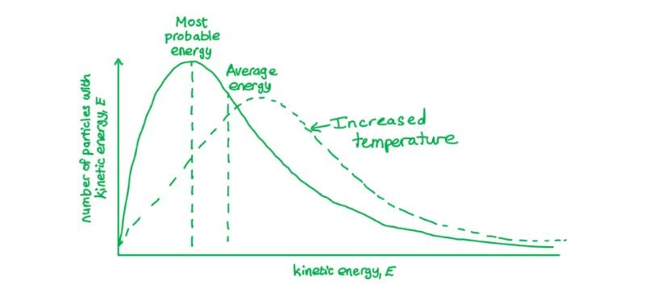

**B** is incorrect as X shifts to the right when temperature increases, not to the left. A higher temperature shifts the distribution towards higher energies.

**C** is incorrect as the broadening of the distribution causes the peak height to decrease, meaning fewer molecules (not more) possess the most probable energy value. X does shift to the right, but the peak becomes lower.

**D** is incorrect as although X does shift to the right, the number of molecules at the most probable energy decreases, not increases. The distribution broadens so the peak height falls even as it shifts right.

### Q3
**Final answer:** **The correct answer is D**

- The forward reaction is exothermic (negative Δ*H*), so the reverse reaction is endothermic with a positive Δ*H*.
- For the reverse reaction, the starting energy is that of the products of the forward reaction, which lie lower than the reactants.
- The activation energy must span from this lower level up to the transition state, making it larger than the forward activation energy.

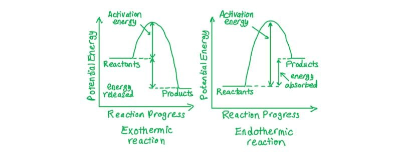

**A** is incorrect as the reverse of an exothermic reaction must be endothermic, giving a positive Δ*H*, not negative.

**B** is incorrect as the activation energy for the reverse reaction is larger than for the forward reaction, not smaller. The products of the exothermic forward reaction lie at lower energy, so more energy is needed to reach the transition state from the products.

**C** is incorrect as the Δ*H* for the reverse reaction is positive (endothermic), not negative.

### Q4
**Final answer:** **The correct answer is B**

- A catalyst lowers the activation energy by providing an alternative reaction pathway.

  - In diagram 1, P is the lower activation energy line and therefore corresponds to the catalysed reaction; Q is the higher activation energy for the uncatalysed reaction.

- At higher temperatures, the Boltzmann distribution broadens and shifts to the right with a lower peak height, while the total area remains constant (same number of molecules).

  - In diagram 2, curve Y shows this profile.

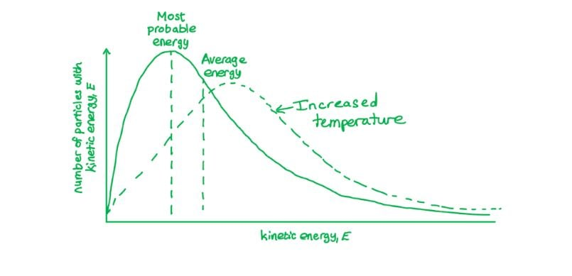

**A** is incorrect as it pairs P (catalysed, correct) with X. Curve X does not show the broader, lower-peak profile expected at a higher temperature.

**C** is incorrect as it assigns Q to the catalysed reaction. A catalyst lowers activation energy, so the catalysed Ea corresponds to P (the left-hand, lower-energy line), not Q.

**D** is incorrect as it assigns Q to the catalysed reaction. Although Y correctly identifies the higher temperature curve, Q is the uncatalysed activation energy, not the catalysed one.

### Q5
**Final answer:** **The correct answer is B**

- A catalyst lowers the activation energy by providing an alternative reaction pathway.

  - The catalysed *E*a is therefore at a lower energy value than the original uncatalysed *E*a
  - So, the line shifts to the left on the energy axis.

- With the *E*a line at position B (lower energy), a greater proportion of molecules have energy ≥ *E*a, increasing the rate of reaction.

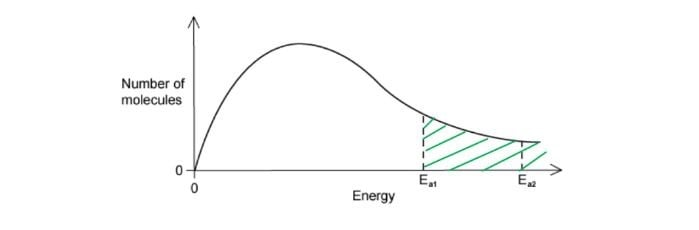

**A** is incorrect as this is further to the right than position B, corresponding to a higher activation energy. A catalyst lowers the activation energy; the new *E*a must be to the left of the uncatalysed value.

**C** is incorrect as this is to the right of the original uncatalysed *E*a, which would mean the activation energy has increased. A catalyst always lowers activation energy by providing an alternative pathway.

**D** is incorrect as this is further to the right, corresponding to an even higher activation energy. A catalyst reduces *E*a, shifting the line to the left, not to the right.

### Q6
**Final answer:** **The correct answer is A**

- The activation energy, *E*a, is the minimum energy required for a collision to be effective.

  - It is a fixed property of a specific reaction pathway.

- A catalyst lowers the activation energy by providing an alternative reaction pathway.

**B** is incorrect as a change in concentration alters the frequency of collisions between reactants but does not change the value of the activation energy.

**C** is incorrect as a change in pressure alters the proximity of gaseous reactant molecules, affecting collision frequency, but does not change the activation energy.

**D** is incorrect as a change in temperature alters the proportion of particles with energy ≥ *E*a (by shifting the Boltzmann distribution), but the activation energy value itself remains unchanged.

### Q7
**Final answer:** **The correct answer is D**

- The activation energy is the minimum energy required for a collision to be effective.

  - On an energy profile diagram, it is the energy difference between the reactants and the transition state.

- With E2 as the reactant energy level and E3 as the transition state energy, the activation energy for the forward reaction = E3 − E2.

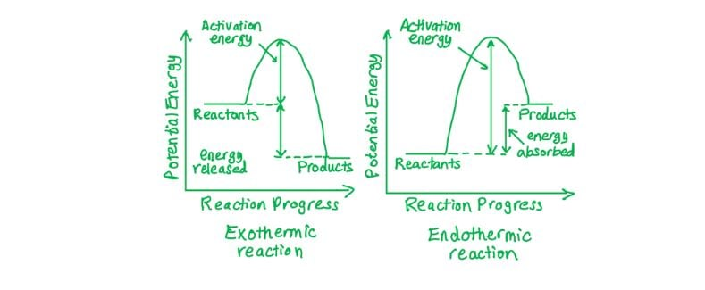

**A** is incorrect as E1 − E2 does not span from the reactant energy level to the transition state and does not represent the activation energy for the forward reaction.

**B** is incorrect as E2 − E1 represents the enthalpy change Δ*H* of the forward reaction, not the activation energy.

**C** is incorrect as E2 − E3 gives a negative value because the transition state E3 is at higher energy than the reactants E2. Activation energy is always a positive quantity.

### Q8
**Final answer:** **The correct answer is C**

- When the temperature decreases, the Boltzmann distribution shifts to the left and the peak rises.

  - The total area under the curve remains constant as the number of molecules is unchanged.

- A greater proportion of molecules have lower energies (area H increases), while fewer molecules have intermediate and high energies (areas J and K decrease).

**A** is incorrect as it shows H decreasing and K increasing. A temperature decrease shifts the distribution to the left, so the low-energy region H grows and the high-energy region K shrinks.

**B** is incorrect as it shows H decreasing and J increasing. When temperature decreases, more molecules occupy lower energies (H increases) and fewer occupy intermediate energies (J decreases), so both assignments in B are reversed.

**D** is incorrect as it shows K increasing. The high-energy tail always decreases when temperature decreases because fewer molecules have sufficient energy to occupy region K.

### Q9
**Final answer:** **The correct answer is D**

- A catalyst lowers the activation energy by providing an alternative reaction pathway.

  - *E*a1 (the lower value) is therefore the activation energy for the catalysed reaction.
  - *E*a2 (the higher value) is for the uncatalysed reaction.

- The area under the Maxwell-Boltzmann curve to the right of a given *E*a represents the proportion of particles with energy ≥ *E*a.

- As *E*a1 < *E*a2, a greater proportion of particles have energy ≥ *E*a1, so the catalysed reaction has more effective collisions.

  - Fewer particles have energy ≥ *E*a2, so the uncatalysed reaction has fewer effective collisions.

**A** is incorrect as it assigns *E*a1 to the uncatalysed reaction. A catalyst lowers activation energy, so *E*a1 (the lower value) must correspond to the catalysed reaction.

**B** is incorrect as it states the catalysed reaction leads to fewer effective collisions. A lower *E*a increases the proportion of particles with sufficient energy, so effective collisions increase.

**C** is incorrect as it assigns the wrong collision frequency to each pathway — the uncatalysed reaction (higher *E*a2) has fewer effective collisions, not more.

### Q10
**Final answer:** **The correct answer is B**

- The activation energy is the minimum energy required for an effective collision between reactant molecules.

  - It is represented by the energy difference between the reactants and the transition state.

- In an endothermic reaction, the products are at higher energy than the reactants, and the transition state is at the highest point on the energy profile.

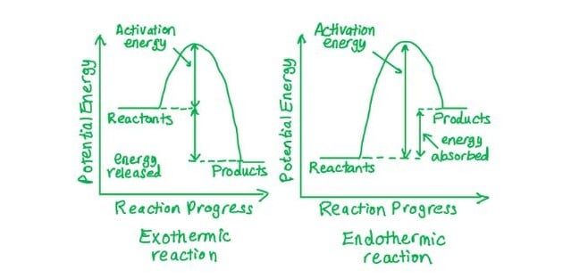

**A** is incorrect as this does not span from the reactant energy level to the transition state and therefore does not represent the activation energy for the forward reaction.

**C** is incorrect as this represents the activation energy for the reverse reaction. For an endothermic reaction, this is smaller than the forward activation energy.

**D** is incorrect as this represents the enthalpy change of the forward reaction, which is not the same as the activation energy.

### Q11
**Final answer:** **The correct answer is B**

- The reaction that proceeds most rapidly has the lowest activation energy.

- The reaction with the highest equilibrium yield is exothermic.

  - The forward reaction is thermodynamically favoured, with products at lower energy than reactants.

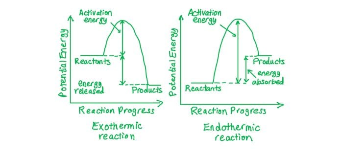

- **B** shows an exothermic reaction with the lowest activation energy of all four options, satisfying both criteria.

**A** is incorrect as although it shows an exothermic reaction (thermodynamically favoured for high yield), the activation energy is higher than in **B**, so the reaction would proceed more slowly than **B**.

**C** and **D** are incorrect as both show endothermic reactions. Endothermic reactions have products at higher energy than reactants, making the reverse reaction thermodynamically favoured and reducing the equilibrium yield of products.

### Q12
**Final answer:** **The correct answer is D**

- When the temperature increases, molecules have greater average energy, so the distribution shifts to the right and becomes broader.

  - The peak moves to a higher energy value.

- Since the total area under the curve must remain constant (same mass of gas, same number of molecules), the peak height decreases as the curve broadens.

**A** is incorrect as the 500 K curve should shift to the right, not to the left. Higher temperature means higher average energy, moving the distribution towards higher values.

**B** is incorrect as a temperature increase causes the peak height to decrease, not increase. The distribution broadens, so the total area is maintained by a lower, wider peak.

**C** is incorrect as although the peak shifts to the right, a higher peak height violates the constant-area rule. As the distribution broadens at higher temperature, the peak must become lower.

### Q13
**Final answer:** **The correct answer is A**

- A catalyst lowers the activation energy by providing an alternative reaction pathway.

  - On the Boltzmann distribution, the *E*a line moves to the left (lower energy).

- A catalyst does not change the number of molecules or their energy distribution.

  - The shape and peak height of the Boltzmann curve remain unchanged; only the position of the *E*a line changes.

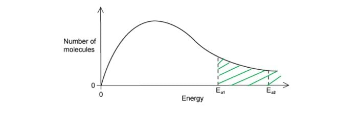

**B** is incorrect as a catalyst does not affect the kinetic energy distribution of the molecules. The peak height at Q remains the same as only the position of *E*a changes.

**C** is incorrect as a catalyst lowers the activation energy, so the *E*a line moves to the left, not to the right. Moving *E*a to the right would mean fewer particles have sufficient energy, reducing the reaction rate.

**D** is incorrect on both counts as a catalyst does not lower the peak height, and *E*a moves to the left (lower energy), not to the right.

### Q14
**Final answer:** **The correct answer is A**

- At the same temperature, all gases have the same average kinetic energy, given by KE = ½mv2.

- Since the average kinetic energy of **X** and **Y** is equal, there is an inverse relationship between molar mass and average molecular speed

  - Molecules with greater molar mass move more slowly on average.

- Gas **X** has a lower average molecular speed than gas **Y**, so **X** must have the larger molar mass.

**B** is incorrect as gas **X** has the lower average speed, not **Y**. Lower average speed at the same temperature indicates larger molar mass, so **X** (not **Y**) has the larger molar mass.

**C** is incorrect as the average kinetic energy of all gases at the same temperature is equal. Temperature determines average kinetic energy; it does not differ between **X** and **Y**.

**D** is incorrect for the same reason as **C**, that at the same temperature, the average kinetic energy of **X** and **Y** is identical, regardless of their different molar masses.

## Structured Questions (6 questions)

### Q1
i) The sketch of the Boltzmann distribution at lower temperature *T*2 is:

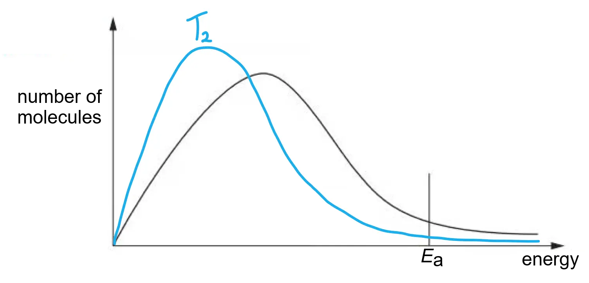

**[2 marks]**

> **[mark-scheme]**
> i)
> 
> 1 mark for the peak of *T*2 being higher than and to the left of the original curve
> 
> 1 mark for the *T*2 curve starting at the origin, crossing the original curve only once, and finishing below it at high energies

> **[mark-scheme]**
> ii) The effect of a decrease in temperature on the activation energy, *E*a:
> 
> - No effect / the activation energy remains the same / *E*a is unchanged **[1 mark]**

> **[exam-tip]**
> The shape of the Boltzmann distribution changes with temperature, but the activation energy *E*a is a fixed property of the reaction. It is determined by the energy required to break bonds in the transition state, not by the temperature of the system.
> 
> Check your sketch: the two curves should cross only once. If they cross more than once, the shape is incorrect. The peak of *T*2 must be higher and to the left of the original, and the *T*2 curve must finish below the original at high energies.
> **[mark-scheme]**
> The activation energy, *E*a, is:
> 
> - The minimum energy required; **[1 mark]**
> - For a collision to be effective / for a reaction to take place; **[1 mark]**

> **[exam-tip]**
> The syllabus defines activation energy as the minimum energy required for a collision to be effective. Both parts of the definition are required for full marks: the minimum energy threshold, and the requirement that the collision is effective.
> 
> Activation energy does not change with temperature. The Boltzmann distribution shifts with temperature, but the position of *E*a on the energy axis remains fixed.
i) The position of *E*a,cat is:

**[1 mark]**

> **[mark-scheme]**
> i)
> 
> 1 mark for *E*a,cat placed to the left of *E*a on the energy axis

> **[mark-scheme]**
> ii) The catalyst results in a faster rate of reaction because:
> 
> - A greater proportion of molecules have energy greater than or equal to *E*a,cat **[1 mark]**
> - So there are more frequent effective collisions **[1 mark]**

> **[exam-tip]**
> A catalyst lowers the activation energy by providing an alternative reaction mechanism. In terms of the Boltzmann distribution, a lower *E*a,cat means a larger proportion of the molecules in the existing distribution now have sufficient energy to react.
> 
> The two marks for the explanation are:
> 
> 1. More molecules with energy ≥ *E*a,cat
> 2. More frequent effective collisions.
> 
> Both are required for full marks.
> **[mark-scheme]**
> Reactions 1 and 2 occur at different rates because:
> 
> - Reaction 1 requires energy to break covalent C–Br bonds / has a higher activation energy / greater *E*a; **[1 mark]**
> - Reaction 2 involves the reaction between oppositely charged ions (H+ + OH- → H2O) / has a lower activation energy / *E*a; **[1 mark]**
> - At room temperature, a greater proportion of molecules have energy ≥ *E*a for Reaction 2, leading to more frequent effective collisions; **[1 mark]**

> **[exam-tip]**
> The rate of a reaction depends on the activation energy.
> 
> Reaction 1 has a high activation energy because covalent C–Br bonds must be broken.
> 
> Reaction 2 is effectively H+ (aq) + OH- (aq) → H2O (l), which has a very low activation energy because no strong bonds need to be broken and the ions are attracted to each other.

### Q2
The completed reaction pathway diagram is:

**[3 marks]**

> **[mark-scheme]**
> 1 mark for exothermic profile with products (2NH3) correctly labelled **AND **at a lower energy level than the reactants
> 
> 1 mark for Δ*H* correctly labelled with an arrow from the energy level of the reactants to the energy level of the products
> 
> 1 mark for *E*a **AND ***E*a,cat both labelled with arrows from the reactants to the peak of each respective curve, with the *E*a,cat peak lower than the *E*a peak

> **[exam-tip]**
> Use single-headed arrows throughout. Double-headed arrows will not be credited.
> 
> The activation energy arrow points from the energy level of the reactants to the peak of the curve, not to the energy level of the products. The Δ*H* arrow points from the reactants energy level to the products energy level.
> 
> The peak of the catalysed curve (*E*a,cat) must be lower than the uncatalysed peak (*E*a), since the catalyst lowers the activation energy. If you draw an endothermic profile (reactants lower than products), you will lose the first mark but could still gain the remaining two.
To calculate the activation energy of the catalysed decomposition of ammonia:

- The decomposition of NH3 is the reverse of the synthesis, so:

activation energy = *E*a,cat + Δ*H*(decomposition):

activation energy = 109 + 92 **[1 mark]**

activation energy = **201 kJ mol****-1** **[1 mark]**

> **[mark-scheme]**
> The final mark is awarded for a correct value with correct units

> **[exam-tip]**
> The decomposition of ammonia (N2 + H2 → NH3) is the reverse of the synthesis reaction. On the reaction pathway diagram, the activation energy of the reverse catalysed reaction is measured from the energy level of the products (2NH3) to the peak of the catalysed curve.
> 
> Since the synthesis is exothermic (Δ*H* = −92 kJ mol-1), the products are 92 kJ mol-1 lower in energy than the reactants. The activation energy of the reverse catalysed reaction is therefore: 109 + 92 = 201 kJ mol-1.
> 
> 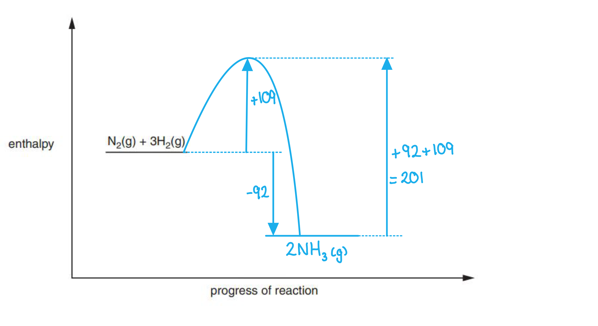
> **[mark-scheme]**
> An iron catalyst increases the rate of reaction because:
> 
> - It provides an alternative reaction mechanism / pathway with a lower activation energy / *E*a,cat; **[1 mark]**
> - A greater proportion of molecules have energy greater than or equal to *E*a,cat; **[1 mark]**
> - So there are more frequent effective collisions; **[1 mark]**

> **[exam-tip]**
> The answer is:
> 
> - lower *E*a,cat
> - → greater proportion of molecules with energy ≥ *E*a,cat
> - → more frequent effective collisions
> - → faster rate
> 
> 
> 
> The distribution of molecular energies is determined only by temperature.
> 
> A catalyst does not change the shape of the Boltzmann distribution, it only shifts the position of the activation energy line to the left.
> **[mark-scheme]**
> i) The type of catalyst is:
> 
> - Heterogeneous; **[1 mark]**
> 
> ii) The nitrogen is:
> 
> - Reduced; **[1 mark]**
> - The oxidation number of nitrogen decreases from +2 in NO to 0 in N2; **[1 mark]**

> **[exam-tip]**
> Platinum is a solid catalyst; the reactants (NO and CO) are gases. Because the catalyst and reactants are in different phases, platinum is a heterogeneous catalyst.
> 
> When explaining whether an element is oxidised or reduced, always state both the initial and final oxidation numbers. A decrease in oxidation number indicates reduction; an increase indicates oxidation. Here, nitrogen decreases from +2 to 0, confirming reduction.

### Q3
> **[mark-scheme]**
> i) The temperature of the original reaction is increased, but no other changes are made:
> 
> - Area under the curve is unchanged (as number of molecules is unchanged) **[1 mark]**
> - The most probable energy increases / peak of the curve shifts to the right
> **AND**
> Proportion of molecules with energy greater than or equal to *E*a increases **[1 mark]**
> 
> ii) A catalyst is added to the original reaction mixture, but no other changes are made:
> 
> - Area under the curve is unchanged (as number of molecules is unchanged) **[1 mark]**
> - The most probable energy does not change / peak of the curve does not shift
> **AND**
> Proportion of molecules with energy greater than or equal to *E*a increases (as the activation energy has been lowered by the addition of a catalyst) **[1 mark]**

> **[exam-tip]**
> A catalyst lowers the activation energy by providing a different reaction pathway of lower activation energy. This means more molecules have energy greater than or equal to *E*a, so the proportion of molecules that can react increases. However, the Boltzmann distribution curve shape does not change as the area under the curve and the most probable energy both remain the same.
i) The labelled Boltzmann distribution curves are:

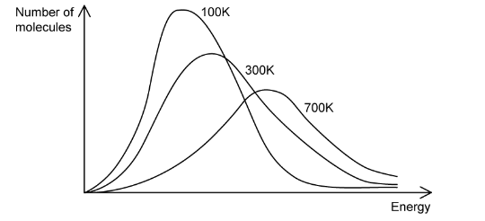

**[1 mark]**

> **[mark-scheme]**
> i)
> 
> 1 mark for temperatures labelled correctly, with the lowest peak (100 K) on the left and the flattest and broadest curve (700 K) on the right
> 
> ii) The student's statement is:
> 
> - Incorrect **[1 mark]**
> - The Boltzmann distribution curves for 700 K and 300 K overlap / there are molecules with both high and low energy values at both temperatures **[1 mark]**
> - The most probable energy is greater at 700 K than at 300 K
> **OR**
> The peak of the curve is at a higher energy value at 700 K than at 300 K **[1 mark]**

> **[exam-tip]**
> When the temperature increases, the Boltzmann distribution curve flattens and shifts to the right:
> 
> - The most probable energy of the molecules increases
> - The area under the curve is unchanged (as the number of molecules is unchanged)
> - The proportion of molecules with energy greater than or equal to *E*a increases
> **[mark-scheme]**
> i) One reason why most collisions do not lead to the formation of hydrogen chloride is:
> 
> - The molecules do not have sufficient energy / the colliding molecules have energy less than the activation energy (*E* < *E*a)
> **OR**
> The orientation of the molecules is unfavourable / incorrect **[1 mark]**
> 
> ii) Two ways to speed up the formation of hydrogen chloride are:
> 
> - Increase concentration / decrease the volume
> **OR**
> Increase pressure **[1 mark]**
> - This increases the frequency of effective collisions (per unit time) **[1 mark]**
> - Add a suitable catalyst **[1 mark]**
> - This lowers the activation energy, *E*a (by providing an alternative reaction pathway of lower activation energy) **[1 mark]**

> **[exam-tip]**
> For a collision to lead to a reaction, the colliding molecules must have the correct orientation **and** sufficient energy to overcome the activation energy barrier.
> 
> For gas-phase reactants, changing pressure and changing concentration are the same thing. Increasing the pressure forces molecules closer together, reducing the volume and increasing the concentration. Do not list both pressure and concentration as separate methods, as they count as one way.

### Q4
> **[mark-scheme]**
> i) The x and y axes of the graph are:
> 
> - x (horizontal) axis: Energy / Molecular energy / Kinetic energy
> **AND**
> y (vertical) axis: Number / proportion of molecules **[1 mark]**

ii) The sketch of the distribution at higher temperature *T*2 is:

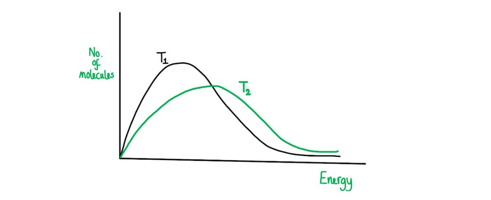

**[2 marks]**

> **[mark-scheme]**
> 1 mark for the peak of *T*2 being lower in height **AND **shifted to the right compared to *T*1
> 
> 1 mark for the *T*2 curve immediately separating from *T*1 after the peak **AND **crossing *T*1 only once AND finishing above *T*1 at high energies **AND **showing a similar total area under the curve

> **[exam-tip]**
> At a higher temperature, molecules have more energy on average. The peak shifts to the right (higher most probable energy) and becomes lower because more molecules are spread across a wider energy range. The total area under the curve is unchanged because the total number of molecules is unchanged.
> 
> Check your sketch as the two curves should cross only once. If they cross more than once, the shape is incorrect. The peak of *T*2 must be lower and to the right of *T*1.
> **[mark-scheme]**
> A Boltzmann distribution curve always starts at the origin because:
> 
> - There are no molecules with zero energy / all molecules have some energy / all molecules are moving **[1 mark]**
> 
> The area under the curve represents:
> 
> - The total number of molecules / particles in the sample **[1 mark]**

> **[exam-tip]**
> The curve starts at (0, 0) because at zero energy there are zero molecules. All particles are in motion and therefore possess some kinetic energy.
> 
> The total area under the curve represents the total number of molecules. This does not change with temperature, which is why Boltzmann curves at different temperatures always enclose the same total area.
> **[mark-scheme]**
> For each of the following changes, the effects on the Boltzmann distribution are:
> 
> i) The temperature of the original reaction is increased:
> 
> - The area under the curve is unchanged, as the number of molecules is unchanged; **[1 mark]**
> - The most probable energy of the molecules / the position of the peak shifts to the right / increases
> **AND**
> The proportion of molecules with energy greater than or equal to *E*a increases; **[1 mark]**
> 
> ii) The number of molecules in the original reaction mixture is increased:
> 
> - The area under the curve increases, as the number of molecules increases; **[1 mark]**
> - The most probable energy of the molecules / the position of the peak does not change
> **AND**
> The proportion of molecules with energy ≥ *E*a remains the same / is unchanged (though the total number of molecules with energy ≥ *E*a increases); **[1 mark]**
> 
> iii) A catalyst is added to the original reaction mixture:
> 
> - The area under the curve is unchanged, as the number of molecules is unchanged; **[1 mark]**
> - The most probable energy of the molecules / the position of the peak does not change
> **AND**
> The proportion of molecules with energy greater than or equal to *E*a increases, as the addition of a catalyst lowers the activation energy; **[1 mark]**

> **[exam-tip]**
> A catalyst lowers the activation energy by providing an alternative reaction pathway. This increases the proportion of molecules with energy ≥ *E*a, even though the shape of the Boltzmann distribution itself does not change.
> 
> When the number of molecules increases at constant temperature, the curve scales upward (greater total area) but its shape and peak position are unchanged. The proportion of molecules with energy ≥ *E*a therefore stays the same, even though the total number of such molecules increases.
> 
> Increasing the temperature shifts the peak to the right and lowers it. The area under the curve remains constant because the total number of molecules is unchanged.

### Q5
> **[mark-scheme]**
> The forward reaction is endothermic:
> 
> - Endothermic **[1 mark]**
> - The energy level of the products is higher than / greater than / above the energy level of the reactants **[1 mark]**
> 
> 'Exothermic' is not accepted.

> **[exam-tip]**
> In an endothermic reaction, energy is taken in from the surroundings, so the products end up at a higher energy level than the reactants. In Fig. 1.1, C + D are at a higher energy level than A + B, confirming the forward reaction is endothermic.
> 
> Do not confuse the direction of Δ*H* with the direction of activation energy. The activation energy arrow always points upward from the reactants to the peak of the curve. The Δ*H* arrow shows the overall energy change between reactants and products.
> **[mark-scheme]**
> The activation energy, *E*a, is:
> 
> - The minimum energy required **[1 mark]**
> - For a collision to be effective / for a reaction to take place **[1 mark]**

> **[exam-tip]**
> The syllabus defines activation energy as the minimum energy required for a collision to be effective. Both parts of the definition are required for full marks:
> 
> - The minimum energy threshold
> - The requirement that the collision is effective (not just any collision).
> 
> The activation energy of a reaction is not changed by temperature. It is only lowered by a catalyst, which provides an alternative reaction pathway of lower activation energy.
To determine the activation energies from Fig. 1.1:

- Forward reaction:

activation energy = 150 + 180

activation energy = 330 kJ mol-1 **[1 mark]**

- Reverse reaction:

activation energy = 180 kJ mol-1 **[1 mark]**

> **[exam-tip]**
> The activation energy of the forward reaction is the energy difference between the reactants (A + B) and the peak of the curve. Since the reaction is endothermic, the forward activation energy equals the enthalpy change Δ*H* plus the activation energy of the reverse reaction: 150 + 180 = 330 kJ mol-1.
> 
> The activation energy of the reverse reaction is the energy difference between the products (C + D) and the peak of the curve: 180 kJ mol-1. For an endothermic forward reaction, the reverse activation energy is always less than the forward activation energy.
> **[mark-scheme]**
> The addition of a catalyst increases the rate of reaction because:
> 
> - It provides an alternative pathway / route for the reaction **[1 mark]**
> - The alternative pathway has a lower activation energy / *E*a **[1 mark]**
> - A greater proportion of molecules have energy greater than or equal to *E*a, so there are more frequent effective collisions **[1 mark]**

> **[exam-tip]**
> A catalyst does not change the energy levels of the reactants or products, or the shape of the Boltzmann distribution. It only provides an alternative reaction mechanism with a lower activation energy, as shown by the lower peak in Fig. 1.2.
> 
> The answer is:
> 
> - alternative pathway
> - → lower *E*a
> - → greater proportion of molecules with energy ≥ *E*a
> - → more frequent effective collisions
> - → faster rate.

### Q6
> **[mark-scheme]**
> When the temperature is decreased:
> 
> - The curve shifts to the left
> **AND**
> The peak of the curve is higher / the maximum moves up **[1 mark]**
> - The curve finishes below the level of the original curve **[1 mark]**

> **[exam-tip]**
> At a lower temperature, molecules have less energy on average. The peak of the distribution shifts to the left (towards lower energy) and becomes higher because more molecules cluster around the lower most probable energy value.
> 
> The curve must also finish below the original at high energies, since fewer molecules have very high kinetic energies at a lower temperature.
> 
> 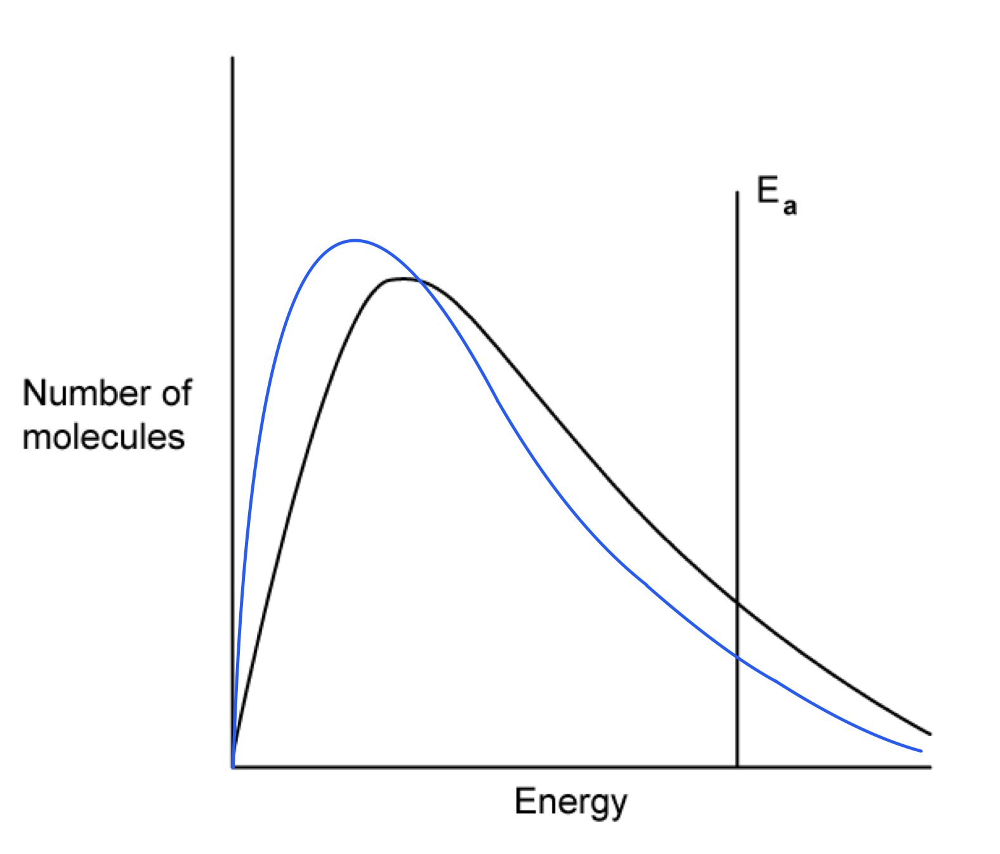
> 
> Make sure you read the question carefully. Many students incorrectly describe the changes for an increase in temperature when the question asks about a decrease.
> **[mark-scheme]**
> With changing temperature, the total area under the Boltzmann distribution:
> 
> - Does not change / remains the same **[1 mark]**

> **[exam-tip]**
> The total area under the Boltzmann distribution curve represents the total number of molecules in the sample.
> 
> This number does not change with temperature, so the area under the curve remains constant regardless of the temperature.
> **[mark-scheme]**
> When a catalyst is added:
> 
> - The activation energy / *E*a decreases / is lower 
> **OR**
> The line for *E*a shifts to the left **[1 mark]**

> **[exam-tip]**
> Adding a catalyst does not change the distribution of molecular energies or the Boltzmann distribution curve. It only provides an alternative reaction mechanism with a lower activation energy.
> 
> Since *E*a is lower, a greater proportion of molecules in the existing distribution now have sufficient energy to react, which increases the rate of reaction.
> **[mark-scheme]**
> The shaded area of Fig. 2.2 represents:
> 
> - The number of molecules that do not have enough energy to react
> **OR**
> The number of molecules with energy less than or equal to *E*a; **[1 mark]**

> **[exam-tip]**
> Boltzmann distribution questions often focus on the unshaded area to the right of *E*a, which represents the molecules with sufficient energy to react. The shaded area is the complement: molecules with energy less than *E*a that cannot react.
> 
> Mark schemes often express the shaded region as *E* ≤ *E*a. If you are unsure about inequality symbols, describe them in words instead. For example, 'molecules with energy less than or equal to the activation energy'.
