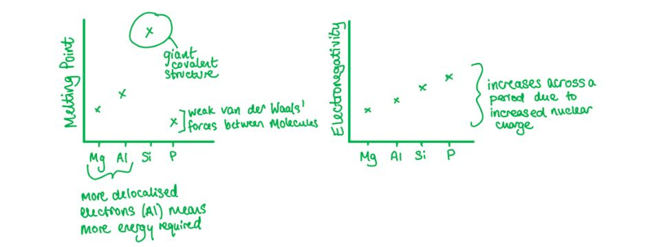
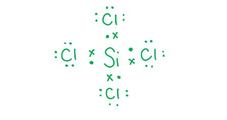
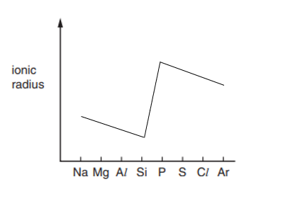

# Mark Schemes — Periodicity of Chemical Properties of the Elements in Period 3
**9. The Periodic Table: Chemical Periodicity** · Cambridge (CIE) AS chemistry (9701)

## Multiple Choice Questions (18 questions)

### Q1
**Final answer:** **The correct answer is A**

- Across Period 3, the oxides change from **giant ionic** (metals) to **giant covalent** or **simple molecular** (non-metals).
- **MgO** is a giant ionic oxide with basic properties.

  - It is sparingly soluble in water but reacts to form magnesium hydroxide, giving a weakly alkaline solution of approximately pH 8–9.

**B** is incorrect as although Al2O3 is amphoteric, it is **insoluble** in water and does not produce a solution at pH ≈ 7.

**C** is incorrect as SiO2 is an acidic oxide with a giant covalent structure. It is **insoluble** in water and does not form an acidic solution.

**D** is incorrect as P4O10 reacts with water to form phosphoric acid, giving a solution of low pH (approximately 1–2), not pH ≈ 13.

### Q2
**Final answer:** **The correct answer is B**

- Increasing the pool water acidity adds H+ ions, which **reduces the concentration of OH****-**** ions**.
- By Le Chatelier's principle, the equilibrium shifts to the **right** (forward direction) to oppose the decrease in OH-, producing more HOCl.
- Increasing [HOCl] maintains the pool's bactericidal effectiveness.

**A** is incorrect as Cl- ions are not a component of this equilibrium, so adding them has no effect on [HOCl].

**C** is incorrect as none of the gases in air (O2, CO2, N2) appear in this equilibrium, so bubbling air through the water has no effect.

**D** is incorrect as adding OH- ions shifts the equilibrium to the **left** (reverse direction), opposing the increase in OH- and reducing [HOCl].

### Q3
**Final answer:** **The correct answer is A**

- When SO3 is added to water, it produces **sulfuric acid**:

SO3 (l) + H2O (l) $\rightarrow$ H2SO4 (aq)

- Na2O is a basic oxide. One mole of H2SO4 is neutralised by exactly one mole of Na2O:

H2SO4 + Na2O $\rightarrow$ Na2SO4 + H2O

- Sodium sulfate forms a neutral solution (pH 7).

**B** is incorrect as P4O10 reacts with water to produce **four** moles of phosphoric acid (4H3PO4). One mole of Na2O cannot neutralise four moles of H3PO4.

**C** is incorrect as the molar ratio of Al2O3 to H2SO4 is **1:3** (to form Al2(SO4)3), not 1:1. One mole of SO3 produces only one mole of H2SO4, which is not sufficient to fully neutralise one mole of Al2O3.

**D** is incorrect as P4O10 produces four moles of H3PO4, which cannot be neutralised by one mole of Al2O3 in a 1:1 ratio.

### Q4
**Final answer:** **The correct answer is C**

- When aluminium burns in oxygen, **aluminium oxide** is formed:

4Al (s) + 3O2 (g) $\rightarrow$ 2Al2O3 (s)

- Aluminium oxide is **amphoteric** as it reacts with both acids and bases.
- Aluminium oxide with hydrochloric acid produces aluminium chloride:

Al2O3 (s) + 6HCl (aq) $\rightarrow$ 2AlCl3 (aq) + 3H2O (l)

- Adding sodium hydroxide to aluminium chloride solution produces **insoluble aluminium hydroxide**:

AlCl3 (aq) + 3NaOH (aq) $\rightarrow$ Al(OH)3 (s) + 3NaCl (aq)

- In **excess** sodium hydroxide, the aluminium hydroxide dissolves to form the soluble aluminate ion:

Al(OH)3 (s) + NaOH (aq) $\rightarrow$ Na+[Al(OH)4]- (aq)

**A** is incorrect as Mg(OH)2 formed when magnesium chloride reacts with sodium hydroxide does **not** dissolve in excess NaOH. Magnesium hydroxide has no amphoteric properties.

**B** is incorrect as SiO2 is a **covalent** compound with **no basic properties**. It cannot react with hydrochloric acid, so the sequence cannot proceed.

**D** is incorrect as P4O10 is a **covalent** compound with **no basic properties**. It cannot react with hydrochloric acid.

### Q5
**Final answer:** **The correct answer is D**

- For a hydroxide to react with hydrochloric acid in a neutralisation reaction, it must act as a **base**.

  - Phosphorus does not form a simple hydroxide.
- The compound is **phosphoric acid** (H3PO4), which is itself an **acid**.

  - It donates H+ ions in solution.
- An acid cannot neutralise another acid, so H3PO4 does not react with hydrochloric acid in a neutralisation reaction.

**A** is incorrect as Mg(OH)2 acts as a base and reacts with HCl:

Mg(OH)2 + 2HCl $\rightarrow$ MgCl2 + 2H2O

**B** is incorrect as Al(OH)3 acts as a base and reacts with HCl:

Al(OH)3 + 3HCl $\rightarrow$ AlCl3 + 3H2O

**C** is incorrect as NaOH is a strong base and readily reacts with HCl:

NaOH + HCl $\rightarrow$ NaCl + H2O

### Q6
**Final answer:** **The correct answer is A**

- A colourless gas that dissolves in water to give an **alkaline solution** is **ammonia (NH****3****)**, so the second cation is NH4+.
- NH4+ reacts with OH- to release ammonia:

NH4+ + OH- $\rightarrow$ NH3 + H2O

- The Fe2+ ions in Mohr's salt react with OH- to form **iron(II) hydroxide**, an insoluble grey-green solid:

Fe2+ (aq) + 2OH- (aq) $\rightarrow$ Fe(OH)2 (s)

- Na2SO4 is also formed but it is a **white, soluble** solid

  - This does not account for the grey-green insoluble residue.

**B** is incorrect as SO2 is not produced. NaOH reacts with the NH4+ cation, not with SO42-.

**C** is incorrect as Na2SO4 is a **white, soluble** solid. It cannot be the grey-green insoluble residue.

**D** is incorrect as the gas produced is NH3 (dissolves to give alkaline solution), not SO2 (which dissolves to give an acidic solution).

> **[exam-tip]**
> The colour of the residue is a key identifier:
> 
> - Fe(OH)2 is grey-green
> - Fe(OH)3 is rust-coloured (orange-brown).
> 
> Knowing these colours allows you to eliminate options quickly.
> 
> The alkaline gas is always NH3 and is the only common colourless gas from Period 3 reactions with NaOH that gives an alkaline solution in water.

### Q7
**Final answer:** **The correct answer is B**

- **Aluminium oxide** does not react with water because the oxide ion is too strongly attracted to the Al3+ ion to be displaced.
- **Silicon dioxide** has a giant covalent structure with strong covalent bonds throughout, so it does not dissolve in water.
- Both Al2O3 and SiO2 are therefore **insoluble in water**.

**A** is incorrect as only Al2O3 is **amphoteric** (reacts with both acids and bases). SiO2 is acidic only. It reacts with strong bases but not with acids.

**C** is incorrect as neither AlCl3 nor SiCl4 produces simple metal cations in solution. AlCl3 reacts with water to form the hydrated aluminium ion [Al(H2O)6]3+. SiCl4 is a covalent molecule that hydrolyses and does not produce Si4+ ions.

**D** is incorrect as only AlCl3 has coordinate (dative) bonding. In the Al2Cl6 dimer, chlorine lone pairs are donated to aluminium. SiCl4 has only polar covalent bonds.

### Q8
**Final answer:** **The correct answer is C**

**Melting point:**

- Silicon has the highest melting point because it has a **giant covalent structure**.
- Many strong covalent bonds must be broken to melt it, requiring a large amount of energy.
- The melting points of the **metals** (Na, Mg, Al) increase across the period as more electrons are delocalised per atom (1 from Na, 2 from Mg, 3 from Al), strengthening the metallic bonding.
- Phosphorus (P4) and sulfur (S8) are **simple covalent molecules** with only id-id forces between molecules.
- S8 has a higher melting point than P4 because its larger molecular mass (256 vs 124 g mol-1) means stronger id-id forces.

**Electronegativity:**

- Electronegativity **increases steadily across Period 3** because nuclear charge increases while the shielding remains approximately constant, so the attraction on bonding electrons increases.

### Q9
**Final answer:** **The correct answer is B**

- Both **MgCl****2** and **NaCl** are ionic compounds that dissolve without altering [H+].
- Neither Mg2+ nor Na+ reacts with water, and Cl- does not extract H+ from water molecules.
- So, both give neutral solutions (pH 7).

**A** is incorrect as MgCl2 forms a **neutral** solution because Mg2+ does not react with water to produce H+ ions.

**C** is incorrect as SiCl4 is a **covalent molecule** that hydrolyses in water to produce an acidic solution:

SiCl4 + 2H2O $\rightarrow$ SiO2 + 4HCl

**D** is incorrect as NaCl forms a **neutral** solution because Na+ does not react with water to produce OH- ions.

> **[exam-tip]**
> A common misconception is that MgCl2 forms a slightly acidic solution because Mg2+ is a small, highly charged cation.
> 
> At CIE IAL level, MgCl2 is treated as forming a neutral solution. Only the chlorides of transition metals and aluminium (which form hydrated ions capable of donating H+) produce acidic solutions.

### Q10
**Final answer:** **The correct answer is B**

- Phosphorus(V) chloride (PCl5) is a **covalent solid**.

- When added to water, it undergoes a violent hydrolysis reaction producing hydrogen chloride gas and phosphoric(V) acid:

PCl5 (s) + 4H2O (l) $\rightarrow$ H3PO4 (aq) + 5HCl (g)

- The HCl gas meets atmospheric moisture to produce visible **steamy white fumes**.
- All products are soluble or gaseous, so no precipitate forms.

**A** is incorrect as the reaction between PCl5 and water is vigorous, producing steamy HCl fumes.

**C** is incorrect as no precipitate forms and all products are either soluble (H3PO4) or gaseous (HCl).

**D** is incorrect as the only observation is steamy fumes of HCl. No white precipitate is produced.

### Q11
**Final answer:** **The correct answer is A**

- The balanced equation for this reaction is:

P4O10 + 6CaO $\rightarrow$ 2Ca3(PO4)2

- The molar ratio of P4O10 : CaO = 1 : 6.

- Amount of P4O10 reacting with 3 mol CaO = 3 ÷ 6 = **0.5 mol**

**B** is incorrect as 1.5 mol results from using an incorrect 1:2 molar ratio rather than 1:6.

**C** is incorrect as a 1:1 ratio is not consistent with the balanced equation.

**D** is incorrect as 6 is the stoichiometric coefficient of CaO in the equation, not the amount of P4O10.

### Q12
**Final answer:** **The correct answer is C**

- The oxides of Period 3 are:

  - **Basic** on the left-hand side (Na and Mg).
  - **Acidic** on the right-hand side (Si, P, S and Cl).
  - Al2O3 is **amphoteric** (can act as both an acid and a base).

- MgO is a **basic oxide** as it contains oxide ions (O2-) that react with water to produce hydroxide ions:

MgO (s) + H2O (l) $\rightarrow$ Mg(OH)2 (aq)

- The ionic equation is:

O2- + H2O (l) $\rightarrow$ 2OH- (aq)

- The resulting Mg(OH)2 solution is alkaline (pH ~9), so the pH **increases**.

**A** is incorrect as MgO is a basic oxide, not an acidic one.

**B** is incorrect as MgO is basic and adding it to water increases (not decreases) the pH.

**D** is incorrect as MgO does react with water to form Mg(OH)2, raising the pH above 7.

### Q13
**Final answer:** **The correct answer is C**

- Magnesium chloride has the highest melting point because it forms a **giant ionic lattice**.

  - Strong electrostatic attractions between Mg2+ and Cl- ions extend throughout the lattice, so a large amount of energy is required to overcome these forces when the solid melts.
- CCl4, S2Cl2, and HCl are **simple covalent molecules**.

  - So, the forces between molecules are much weaker than ionic bonds.
- CCl4 is **non-polar** because of its symmetrical tetrahedral shape.

  - So, the only intermolecular forces present are **instantaneous dipole-induced dipole (id-id) forces**.
- S2Cl2 is **polar**.

  - So, it experiences **permanent dipole-permanent dipole (pd-pd) interactions** as well as id-id forces.
- However, CCl4 has a **larger molecular mass** (154 vs 135 g mol-1)

  - This gives it stronger id-id forces, so CCl4 has the higher melting point of the two.
- HCl is also a **simple covalent molecule** with pd-pd interactions and id-id forces, but these intermolecular forces are weak.

  - As a result, HCl is a **gas at room temperature** and has a very low melting point.

### Q14
**Final answer:** **The correct answer is D**

- The oxidation states of the Period 3 elements in the chlorides listed are:

  - MgCl2 = +2
  - AlCl3 = +3
  - SiCl4 = +4
  - PCl3 = +3
  - SCl2 = +2

- The oxidation states in their **highest possible oxides** are:

  - MgO = +2
  - Al2O3 = +3
  - SiO2 = +4
  - P4O10 = **+5**
  - SO3 = **+6**

- Only **phosphorus** (+3 → +5) and **sulfur** (+2 → +6) have higher oxidation states in their oxides than in the chlorides listed.

**A** is incorrect as Mg (+2), Al (+3), and Si (+4) have the same oxidation state in both their chlorides and their highest oxides.

**B** is incorrect as Al has oxidation state +3 in both AlCl3 and Al2O3. It is not higher in the oxide.

**C** is incorrect as Mg and Si have the same oxidation states in their oxides as in their chlorides (+2 and +4 respectively).

> **[exam-tip]**
> Phosphorus and sulfur can reach higher oxidation states in their oxides because they can use d orbitals to expand beyond an octet.
> 
> Phosphorus reaches +5 (in P4O10) and sulfur reaches +6 (in SO3).
> 
> In the chlorides listed here, neither reaches its maximum oxidation state.

### Q15
**Final answer:** **The correct answer is D**

**Sulfur**

- The electron configuration of sulfur is 1s2 2s2 2p6 3s2 3p4.
- The 3p4 configuration has **one pair** of 3p electrons, so sulfur does **not** satisfy Property 1.
- However, sulfur trioxide reacts with water to produce **sulfuric acid**, a **strong acid** that fully dissociates in aqueous solution:

SO3 + H2O $\rightarrow$ H2SO4

- Therefore, sulfur satisfies **Property 2 only**.

**Phosphorus**

- The electron configuration of phosphorus is 1s2 2s2 2p6 3s2 3p3.
- By Hund's rule, the three 3p electrons each occupy a **separate 3p orbital**, so phosphorus has **no paired 3p electrons** and satisfies Property 1. 
- Phosphorus oxides (P4O6 and P4O10) produce only **weak acids** (H3PO3 and H3PO4) that do not fully dissociate, so phosphorus does **not** satisfy Property 2.
- Therefore, phosphorus satisfies **Property 1 only**.

**A** is incorrect as phosphorus oxides produce only weak acids, so phosphorus does not have Property 2.

**B** is incorrect as the electron configuration of sulfur is 3p4. Sulfur has one paired 3p electron and therefore does not satisfy Property 1.

**C** is incorrect as neither element has both properties. Sulfur lacks Property 1 and phosphorus lacks Property 2.

> **[exam-tip]**
> Sulfur dioxide (SO2) also produces an acid when added to water:
> 
> SO2 + H2O $\rightarrow$ H2SO3.
> 
> However, H2SO3 is a **weak acid** and does not fully dissociate, so it does not satisfy Property 2. Only SO3, which forms the strong acid H2SO4, satisfies Property 2.

### Q16
**Final answer:** **The correct answer is D**

- **Magnesium chloride** is an ionic compound and dissociates into Mg2+ and Cl- ions when dissolved in water.

- No reaction occurs because neither ion reacts with water.

- The chloride ion cannot extract H+ from water to form hydrochloric acid:

MgCl2 (s) $\rightarrow$ Mg2+ (aq) + 2Cl- (aq)

**A** is incorrect as aluminium chloride has significant **covalent character** and reacts with water to produce hydrochloric acid fumes:

AlCl3 + 3H2O $\rightarrow$ Al(OH)3 + 3HCl

**B** is incorrect as silicon tetrachloride is a **covalent molecule** that reacts readily with water to produce hydrochloric acid:

SiCl4 + 2H2O $\rightarrow$ SiO2 + 4HCl

**C** is incorrect as phosphorus(V) chloride is a covalent molecule that reacts with water to produce hydrochloric acid:

PCl5 + 4H2O $\rightarrow$ H3PO4 + 5HCl

### Q17
**Final answer:** **The correct answer is A**

- Electronegativity increases continuously from Na to Si as nuclear charge increases while the number of electron shells remains constant:

Na < Mg < Al < Si (continuous increase on y-axis).

- **First ionisation energy** is the energy to remove one mole of electrons from one mole of gaseous atoms:

X (g) $\rightarrow$ X+ (g) + e-

- Na has the lowest first ionisation energy (lowest nuclear charge; outer electron is 3s1).
- Al has a *lower* first ionisation energy than Mg despite having one more proton.

  - Al's outer electron is in the 3p subshell, which is at a higher energy level and is shielded by the 3s2 electrons, outweighing the extra nuclear charge.
- Si has the highest first ionisation energy of the four (3p2, highest nuclear charge).
- The correct graph shows electronegativity increasing continuously on the y-axis, and first ionisation energy in the order Na < Al < Mg < Si on the x-axis (dip at Al).

**B**, **C**, and **D** are incorrect as they show the wrong trend for electronegativity, miss the dip in first ionisation energy at aluminium, or invert the relative positions of Mg and Al.

### Q18
**Final answer:** **The correct answer is A**

- Silicon has **4 valence electrons** and forms 4 covalent bonds; chlorine has **7 valence electrons** and forms 1 covalent bond.

- One silicon atom bonds with 4 chlorine atoms to form SiCl4.
- Since chlorine exists as diatomic Cl2, the balanced equation is:

Si + 2Cl2 $\rightarrow$ SiCl4

- Therefore, **2 moles of Cl****2** are required per mole of silicon.

**B** is incorrect as 3 moles of Cl2 would give SiCl6, which silicon cannot form (Period 3 elements beyond the 3s and 3p cannot expand their octet at this level).

**C** is incorrect as 4 refers to the number of chlorine *atoms* in SiCl4, not the number of Cl2 molecules. Since Cl2 is diatomic, only 2 moles are needed.

**D** is incorrect as 5 moles of Cl2 would give SiCl10, which is not a known compound.

## Structured Questions (8 questions)

### Q1
> **[mark-scheme]**
> i) The equation for the reaction of silicon with chlorine to form silicon(IV) chloride:
> 
> - Si + 2Cl2 → SiCl4 **[1 mark]**
> 
> ii) The shape of a molecule of silicon(IV) chloride:
> 
> - Tetrahedral **[1 mark]**
> 
> iii) Silicon(IV) chloride is a liquid at room temperature because:
> 
> - It has a simple molecular structure **[1 mark]**
> - Only weak instantaneous dipole-induced dipole (id-id) forces exist between molecules, which require little energy to overcome **[1 mark]**

> **[exam-tip]**
> - Silicon(IV) chloride is a simple molecular compound. Its four Si–Cl bonds are polar, but the symmetrical tetrahedral arrangement means the overall molecule is non-polar.
> - As a non-polar simple molecule, the only intermolecular forces are id-id forces, which are weak and easily overcome at room temperature.
> - All four bond pairs and no lone pairs around Si give a tetrahedral shape (bond angle 109.5°).
> **[mark-scheme]**
> The difference in reactivity is due to:
> 
> - Si has vacant 3d orbitals available for bonding
> **OR**
> C has no vacant 3d orbitals / d orbitals are not energetically accessible in carbon **[1 mark]**
> - A lone pair from the oxygen of water can bond to Si before breaking Si–Cl bonds **[1 mark]**
> - A large amount of energy is released in the Si–O bond formation, making the reaction thermodynamically feasible
> **OR**
> CCl4 has a high activation energy for reaction with water because no intermediate can form **[1 mark]**

> **[exam-tip]**
> - The key is the presence of vacant 3d orbitals on Si. These allow an oxygen lone pair to coordinate to Si, lowering the activation energy for the reaction.
> - Carbon is in the second period and has no available 3d orbitals. Without an accessible intermediate, the water molecule cannot react with CCl4.
> **[mark-scheme]**
> i) The equation for the reaction of silicon(IV) oxide with hot concentrated aqueous sodium hydroxide:
> 
> - SiO2 + 2NaOH → Na2SiO3 + H2O **[1 mark]**
> 
> ii) Why silicon(IV) oxide does not react with acids:
> 
> - SiO2 does not contain oxide / O2– ions, so it cannot accept protons / H+ from an acid **[1 mark]**

> **[exam-tip]**
> - SiO2 is a giant covalent structure and an acidic oxide. It reacts with hot concentrated alkalis but not with acids.
> - Basic oxides react with acids because they contain O2– ions that accept protons. In SiO2, all oxygen atoms are covalently bonded and there are no O2– ions , which means that it cannot act as a base.

### Q2
> **[mark-scheme]**
> The reaction of Na2O with water:
> 
> - Na2O (s) + H2O (l) → 2NaOH (aq) **[1 mark]**
> - Vigorous / exothermic reaction
> **AND**
> Colourless solution produced **[1 mark]**
> - pH 13 to 14 **[1 mark]**
> 
> The reaction of SO2 with water:
> 
> - SO2 (g) + H2O (l) → H2SO3 (aq) **[1 mark]**
> - Colourless solution produced **[1 mark]**
> - pH 1 to 4 **[1 mark]**
> 
> State symbols are not required for the equations

> **[exam-tip]**
> - Na2O is a basic oxide: it reacts vigorously with water to form a strongly alkaline solution of NaOH (pH 13–14).
> - SO2 is an acidic oxide: it dissolves in water to form sulfurous acid, H2SO3, giving an acidic solution (pH 1–4).
> - The acid-base character of Period 3 oxides changes across the period:
> 
>   - Na2O and MgO are basic
>   - Al2O3 is amphoteric
>   - SiO2, P4O10, SO2 and SO3 are acidic
> **[mark-scheme]**
> The ionic equation for this reaction is:
> 
> - SiO2 + 2OH– → SiO32– + H2O **[1 mark]**

> **[exam-tip]**
> - The full equation is: SiO2 + 2NaOH → Na2SiO3 + H2O
> - To write the ionic equation: split ionic compounds into their ions, then cancel the spectator ion (Na+).
> - This reaction requires hot, concentrated NaOH. SiO2 is an acidic oxide so it reacts with concentrated alkali.
> **[mark-scheme]**
> i) The term used to describe the behaviour of compound **A**:
> 
> - Amphoteric **[1 mark]**
> 
> ii) The equations for the reactions of compound **A** (Al2O3) are:
> 
> - Al2O3 (s) + 2KOH (aq) + 3H2O (l) → 2KAl(OH)4 (aq) **[1 mark]**
> - Al2O3 (s) + 6HNO3 (aq) → 2Al(NO3)3 (aq) + 3H2O (l) **[1 mark]**
> 
> NaOH is accepted in place of KOH for the alkali equation

> **[exam-tip]**
> - Compound A is aluminium oxide, Al2O3, which is the only Period 3 oxide that is amphoteric.
> - It is insoluble in water but reacts with both concentrated acids and concentrated alkalis.
> - The other insoluble Period 3 oxide is SiO2, but SiO2 only reacts with alkalis (it is acidic, not amphoteric).

### Q3
> **[mark-scheme]**
> The variation in acid-base character of the Period 3 oxides:
> 
> - The acid-base character is related to the difference in electronegativity between the Period 3 element and the oxide ion **[1 mark]**
> - Low electronegativity of Period 3 element means that the element forms X+ and OH–
> **AND**
> Therefore the oxide is basic **[1 mark]**
> - High electronegativity of Period 3 element means that the element forms X–O– and H+
> **AND**
> Therefore the oxide is acidic **[1 mark]**

> **[exam-tip]**
> - Na has a much lower electronegativity than oxygen, so the large electronegativity difference leads to ionic bonding
> 
>   - Na2O and MgO are basic oxides.
> - S and P have electronegativities closer to oxygen
> 
>   - → small electronegativity difference
>   - → covalent bonding
>   - → SO2 and P4O10 are acidic oxides.
> - Al2O3 sits at the borderline and is amphoteric.
> **[mark-scheme]**
> i) The equation for the reaction of phosphorus(V) oxide with water and the expected pH:
> 
> - P4O10 (s) + 6H2O (l) → 4H3PO4 (aq) **[1 mark]**
> - pH in the range 1 to 2 **[1 mark]**
> 
> ii) Phosphorus(V) oxide has a low melting point because:
> 
> - P4O10 has a simple molecular structure **[1 mark]**
> - Only weak instantaneous dipole-induced dipole (id-id) forces act between molecules, which require little energy to overcome **[1 mark]**

> **[exam-tip]**
> - The equation P4O10 + 6H2O → 4H3PO4 is a key equation to learn. The product is phosphoric acid, which forms a strongly acidic solution (pH 1–2).
> - For melting point questions, always address both the structure type (simple molecular) and the type of intermolecular force (id-id forces). Both points are needed for full marks.
> **[mark-scheme]**
> i) The equation for the reaction of phosphorus(V) oxide with aqueous sodium hydroxide:
> 
> - P4O10 (s) + 12NaOH (aq) → 4Na3PO4 (aq) + 6H2O (l)
> **OR**
> 3NaOH (aq) + H3PO4 (aq) → Na3PO4 (aq) + 3H2O (l) **[1 mark]**
> 
> ii) Using oxidation numbers to determine whether this is a redox reaction:
> 
> - Sodium remains +1 in NaOH and Na3PO4, and phosphorus remains +5 in both P4O10 and Na3PO4 **[1 mark]**
> - There is no change in oxidation numbers, therefore this reaction is not a redox reaction **[1 mark]**

> **[exam-tip]**
> - When P4O10 is in aqueous conditions it first reacts with water to form H3PO4, so the alternative equation via H3PO4 is also valid.
> - A redox reaction requires a change in oxidation number. Since neither P nor Na changes oxidation state, this is an acid-base reaction only.

### Q4
The completed table is:

| Na2O | MgO | Al2O3 | SiO2 | P4O10 | SO2 |
|---|---|---|---|---|---|
| **Final answer:** **basic** | **Final answer:** **basic** | **Final answer:** **amphoteric** | **Final answer:** **acidic** | **Final answer:** **acidic** | **Final answer:** **acidic** |

**[4 marks]**

> **[mark-scheme]**
> 1 mark for Na2O = basic
> 
> 1 mark for MgO = basic
> 
> 1 mark for Al2O3 = amphoteric
> 
> 1 mark for all three of SiO2, P4O10 and SO2 = acidic
> 
> 'Alkaline' is not accepted as a classification term for an oxide

> **[exam-tip]**
> - The acid-base character of Period 3 oxides changes from basic (left) to acidic (right) across the period.
> - Al2O3 is the exception: it is amphoteric, reacting with both acids and bases.
> - SiO2 is classified as acidic, even though it does not dissolve in water. It reacts with hot concentrated alkali.
> **[mark-scheme]**
> i) An equation for the reaction of each oxide with water:
> 
> - Na2O + H2O → 2NaOH **[1 mark]**
> - SO2 + H2O → H2SO3 **[1 mark]**
> 
> ii) The pH of the resulting solution in each case:
> 
> - Na2O: pH 12 to 14
> **AND**
> SO2: pH 1 to 4 **[1 mark]**

> **[exam-tip]**
> - Na2O is a basic oxide: it reacts with water to form sodium hydroxide, giving a strongly alkaline solution (pH 12–14).
> - SO2 is an acidic oxide: it reacts with water to form sulfurous acid, giving an acidic solution (pH 1–4).
> - State symbols are not required for the equations.
> **[mark-scheme]**
> The oxidation numbers of the Period 3 elements in each oxide are:
> 
> - Na in Na2O: +1 **[1 mark]**
> - S in SO2: +4 **[1 mark]**

> **[exam-tip]**
> - In any oxide, oxygen has an oxidation number of −2.
> - In Na2O: 2(Na) + (−2) = 0, so Na = +1.
> - In SO2: 2(−2) + S = 0, so S = +4.
> **[mark-scheme]**
> Compare the structure and bonding of Na2O and SO2:
> 
> - Na2O has a giant ionic lattice / structure **[1 mark]**
> - Strong electrostatic attraction between oppositely charged ions in Na2O requires a large amount of energy to overcome
> **OR**
> A large amount of energy is needed to break the strong ionic bonds between Na+ and O2– ions **[1 mark]**
> - SO2 has a simple molecular structure **[1 mark]**
> - Only weak permanent dipole-permanent dipole (pd-pd) forces act between SO2 molecules, which require little energy to overcome **[1 mark]**

> **[exam-tip]**
> - A high melting point indicates a giant structure (ionic or covalent); a low melting point indicates a simple molecular structure.
> - Always identify the structure type, the type of bond or force involved, and whether it is strong or weak.
> - The pd-pd forces in SO2 are relatively weak because SO2 is a small polar molecule.
> 
>   - Its bent shape means the bond dipoles do not cancel, giving a net molecular dipole.

### Q5
The completed graph showing variation in ionic radius across Period 3 is:

**[3 marks]**

> **[mark-scheme]**
> 1 mark for a correct decreasing trend from Na+ to Si4+
> 
> 1 mark for a sharp increase at P3-
> 
> 1 mark for a decreasing trend from P3- to Cl-

> **[exam-tip]**
> Ionic radius is the distance from the nucleus to the outermost electron of an ion.
> 
> For cations (Na+ to Si4+): nuclear charge increases across the period but shielding remains roughly constant. The stronger nuclear attraction pulls the electron shells closer to the nucleus, so ionic radius decreases.
> 
> For anions (P3- to Cl-): these ions have gained electrons, making them considerably larger than the cations. The sharp increase at P3- reflects this. From P3- to Cl-, nuclear charge increases while the electron shell count remains the same, so ionic radius decreases.
i) The completed graph showing variation in electrical conductivity across Period 3 is:

**[2 marks]**

> **[mark-scheme]**
> 1 mark for an increasing trend from Na to Al
> 
> 1 mark for Si below Al, with P to Ar at low conductivity (below Na)

> **[mark-scheme]**
> ii) Explaining the variation in electrical conductivity across Period 3:
> 
> - Na, Mg and Al have metallic bonding with increasing numbers of delocalised electrons from Na to Al **[1 mark]**
> - Si is a metalloid / semi-conductor **[1 mark]**
> - P, S, Cl and Ar have simple molecular / covalent structures with no delocalised electrons **[1 mark]**

> **[exam-tip]**
> For part i), no data is provided. This graph requires you to apply your knowledge of structure and bonding.
> 
> For Na, Mg and Al: these are metals with a metallic lattice and delocalised electrons. Conductivity increases from Na to Al because each successive metal contributes more electrons to the delocalised sea (Na: 1, Mg: 2, Al: 3).
> 
> Silicon is a metalloid (semi-conductor) with a giant covalent structure. It has some ability to conduct electricity, but far less than a metal.
> 
> Phosphorus, sulfur, chlorine and argon all have simple molecular or covalent structures with no freely delocalised electrons, so they do not conduct electricity.
> 
> Note: the term "metalloid" or "semi-conductor" does not appear on the specification but does appear in mark schemes. Learn it for this context.
The completed table is:

| sodium | magnesium | aluminium | phosphorus | sulfur |
|---|---|---|---|---|
| **Final answer:** **Na****2****O** | **Final answer:** **MgO** | **Final answer:** **Al****2****O****3** | **Final answer:** **P****2****O****5** | **Final answer:** **SO****2** |

**[2 marks]**

> **[mark-scheme]**
> 2 marks for all five formulae correct
> 
> 1 mark for three or four formulae correct
> 
> Alternative correct formulae:
> 
> - Phosphorus: P4O10 or P2O3 are also accepted
> - Sulfur: SO3 is also accepted

> **[exam-tip]**
> You need to know the common oxides of Period 3 elements from sodium to chlorine.
> 
> The most commonly tested formulae are Na2O, MgO, Al2O3, and SO2/SO3. For phosphorus, P2O5 (also written as P4O10) is the most common, but P2O3 is also accepted.
> **[mark-scheme]**
> The term amphoteric and equations for aluminium oxide:
> 
> - Amphoteric means the substance reacts with both acids and bases / can act as both an acid and a base **[1 mark]**
> - Reaction with acid: Al2O3 + 3H2SO4 → Al2(SO4)3 + 3H2O
> **OR**
> Al2O3 + 6HCl → 2AlCl3 + 3H2O **[1 mark]**
> - Reaction with base: Al2O3 + 2NaOH + 3H2O → 2NaAl(OH)4 **[1 mark]**
> 
> The sodium hydroxide equation is the only base reaction required by the specification.

> **[exam-tip]**
> Amphoteric means the substance can act as both an acid and a base. Aluminium oxide reacts with acids to produce a salt and water, and also reacts with bases.
> 
> The sodium hydroxide equation requires care. The product is NaAl(OH)4 (sodium aluminate), which contains four hydroxide groups. Balance carefully: 2NaOH and 3H2O are required on the left-hand side.
> 
> For the acid reaction, either H2SO4 or HCl is accepted.

### Q6
> **[mark-scheme]**
> The type of bond or force overcome when each of the following oxides melts:
> 
> - Na2O: ionic bonds **[1 mark]**
> - SiO2: covalent bonds **[1 mark]**
> - P4O10: van der Waals' forces / instantaneous dipole-induced dipole (id-id) forces **[1 mark]**
> 
> 'Ionic bonds' must be specified; 'electrostatic forces' alone is not accepted

> **[exam-tip]**
> - Na2O has a giant ionic structure. When it melts, the strong forces of attraction between oppositely charged ions (ionic bonds) are overcome.
> - SiO2 has a giant covalent structure. When it melts, the strong covalent bonds between Si and O atoms are overcome.
> - P4O10 has a simple molecular structure with strong covalent bonds within molecules but weak id-id forces between molecules. When it melts, only the weak id-id forces are overcome, while the covalent bonds within the molecule remain intact.
> **[mark-scheme]**
> i) A Period 3 oxide from Table 2.1 that reacts with water to produce a hydroxide:
> 
> - Na2O
> **OR**
> MgO **[1 mark]**
> 
> ii) A Period 3 oxide from Table 2.1 that reacts with water to produce an acid:
> 
> - P4O10
> **OR**
> SO2 **[1 mark]**
> 
> iii) A Period 3 oxide from Table 2.1 that does not react with water:
> 
> - Al2O3
> **OR**
> SiO2 **[1 mark]**

> **[exam-tip]**
> - Na2O and MgO are basic oxides that react with water to produce aqueous solutions of their metal hydroxides.
> - P4O10 and SO2 are acidic oxides that react with water to produce phosphoric acid and sulfurous acid respectively.
> - Al2O3 and SiO2 are both insoluble in water and do not react. Note that Al2O3 is amphoteric (reacts with acids and bases) but is insoluble in water itself.
The completed table is:

| **Period 3 oxide** | **With HCl (aq)** | **With NaOH (aq)** |
|---|---|---|
| MgO (s) | **Final answer:** **✓** | **Final answer:** **✗** |
| Al2O3 (s) | **Final answer:** **✓** | **Final answer:** **✓** |
| SO2 (g) | **Final answer:** **✗** | **Final answer:** **✓** |

**[3 marks]**

> **[mark-scheme]**
> 1 mark for correct entries in the MgO row
> 
> 1 mark for correct entries in the Al2O3 row
> 
> 1 mark for correct entries in the SO2 row

> **[exam-tip]**
> - MgO is a basic oxide: it reacts with acids (HCl) but not with bases (NaOH).
> - Al2O3 is an amphoteric oxide: it reacts with both acids and bases. Heating may be required.
> - SO2 is an acidic oxide: it reacts with bases (NaOH) but not with acids (HCl).

### Q7
The equation, with state symbols, for the reaction of phosphorus with chlorine to form phosphorus(V) chloride, PCl5, is:

P4 (s) + 10Cl2 (g) → 4PCl5 (s)

**OR**

2P (s) + 5Cl2 (g) → 2PCl5 (s)

**[2 marks]**

> **[mark-scheme]**
> 1 mark for a correct balanced equation
> 
> 1 mark for all correct state symbols

> **[exam-tip]**
> Phosphorus exists as P4 molecules at room temperature and is a solid, so the equation using P4 (s) is the standard answer. The alternative using 2P (s) is also accepted.
> 
> To determine the state of PCl5: its melting point is 435 K (162 °C), which is above room temperature (298 K). It is therefore a solid, so the correct state symbol is (s).
> 
> If you are unsure of the state of any chloride in the table, use the melting point data. A melting point above 298 K means the compound is solid at room temperature.
> **[mark-scheme]**
> i) Sodium chloride has a high melting point because:
> 
> - It has a giant ionic lattice structure **[1 mark]**
> - There are strong electrostatic forces of attraction / ionic bonds between oppositely charged ions **[1 mark]**
> 
> ii) Silicon tetrachloride has a low melting point because:
> 
> - It has a simple molecular structure **[1 mark]**
> - There are only weak instantaneous dipole-induced dipole (id-id) forces / van der Waals forces between molecules **[1 mark]**

> **[exam-tip]**
> This topic builds on GCSE knowledge, but at A level you need to be more specific.
> 
> For sodium chloride: identify the giant ionic lattice and state that strong ionic bonds (or electrostatic forces between oppositely charged ions) must be broken on melting.
> 
> For silicon tetrachloride: identify the simple molecular structure and name the specific type of intermolecular force. At A level, "weak forces" alone is not enough. Name them as instantaneous dipole-induced dipole (id-id) forces or van der Waals forces.
> 
> A useful rule:
> 
> - Substances with HIGH melting points have GIANT structures
> - Substances with LOW melting points have SIMPLE molecular structures
> **[mark-scheme]**
> An equation for the reaction of silicon tetrachloride with water:
> 
> - SiCl4 + 2H2O → SiO2 + 4HCl
> **OR**
> SiCl4 + 4H2O → Si(OH)4 + 4HCl
> **OR**
> SiCl4 + 4H2O → SiO2.2H2O + 4HCl **[1 mark]**

> **[exam-tip]**
> The standard equation for this reaction is SiCl4 + 2H2O → SiO2 + 4HCl. Silicon tetrachloride is hydrolysed in water to form a white precipitate of SiO2 and hydrogen chloride gas.
> 
> You need to be able to write equations for the reaction of all Period 3 chlorides with water. Make sure you can write equations for NaCl, MgCl2, AlCl3, SiCl4, and PCl5.
> **[mark-scheme]**
> Suggested pH values for solutions formed in water:
> 
> - NaCl = pH 7 / neutral **[1 mark]**
> - PCl5 = pH 1–4 **[1 mark]**
> 
> A pH value stated as simply "acidic" is not accepted for PCl5. A specific pH value between 1 and 4 is required.

> **[exam-tip]**
> For sodium chloride: NaCl dissolves to give Na+ and Cl- ions, neither of which reacts with water. The solution is neutral with pH 7.
> 
> For PCl5: this reacts vigorously with water to produce HCl and phosphoric acid. The solution is strongly acidic, so a pH between 1 and 4 reflects this. Just stating "acidic" does not gain the mark. You must give a specific value.

### Q8
> **[mark-scheme]**
> i) The equation for the reaction of aluminium with chlorine to form Al2Cl6 is:
> 
> - 2Al + 3Cl2 → Al2Cl6 **[1 mark]**
> 
> State symbols are not required

ii) The completed table to show the oxidation numbers of the Period 3 elements in their chlorides is:

| **Period 3 element** | **Formula of chloride** | **Oxidation number of Period 3 element in the chloride** |
|---|---|---|
| Na | NaCl | **Final answer:** **+1** |
| Mg | MgCl2 | **Final answer:** **+2** |
| Al | Al2Cl6 | **Final answer:** **+3** |
| Si | SiCl4 | **Final answer:** **+4** |
| P | PCl5 | **Final answer:** **+5** |

**[3 marks]**

> **[mark-scheme]**
> 3 marks for all 5 correct
> 
> 2 marks for any 4 correct
> 
> 1 mark for any 3 correct

> **[exam-tip]**
> - Chlorine is more electronegative than the other Period 3 elements, so it has an oxidation number of −1.
> - The Period 3 element has a positive oxidation number to give an overall neutral compound.
> - The elements from Na to P use all of their outer shell electrons in bonding with chlorine, which is why the oxidation numbers increase from +1 to +5 across the period.
> **[mark-scheme]**
> i) The observation when MgCl2 is added to water:
> 
> - MgCl2 dissolves to form a colourless solution **[1 mark]**
> 
> ii) The pH of the resulting solution:
> 
> - pH 6.5 / pH between 6 and 7 **[1 mark]**

> **[exam-tip]**
> - MgCl2 is an ionic compound that dissolves readily in water.
> - The resulting solution is slightly acidic (pH ~6.5) due to slight hydrolysis of the Mg2+ ion.
The equation for the reaction of phosphorus(V) chloride with water, including state symbols, is:

PCl5 (s) + 4H2O (l) → H3PO4 (aq) + 5HCl (g)

**[2 marks]**

> **[mark-scheme]**
> 1 mark for correct balanced equation: PCl5 + 4H2O → H3PO4 + 5HCl
> 
> 1 mark for all correct state symbols: (s), (l), (aq), (g)

> **[exam-tip]**
> - The hydrolysis of PCl5 in water is vigorous, producing phosphoric acid (H3PO4) and hydrogen chloride gas (white steamy fumes).
> - The resulting H3PO4 solution is strongly acidic (pH 1–2).
> - HCl (aq) is also accepted if hydrogen chloride is assumed to dissolve in excess water.
