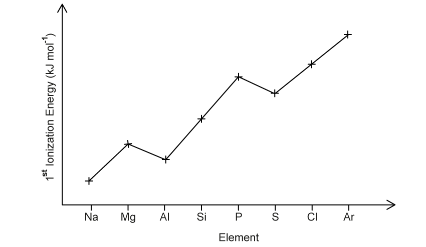
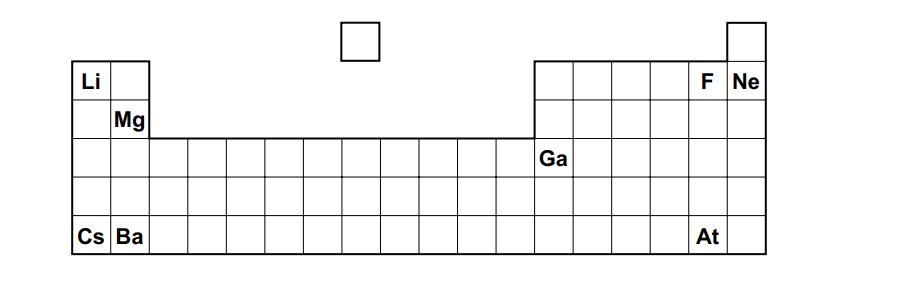
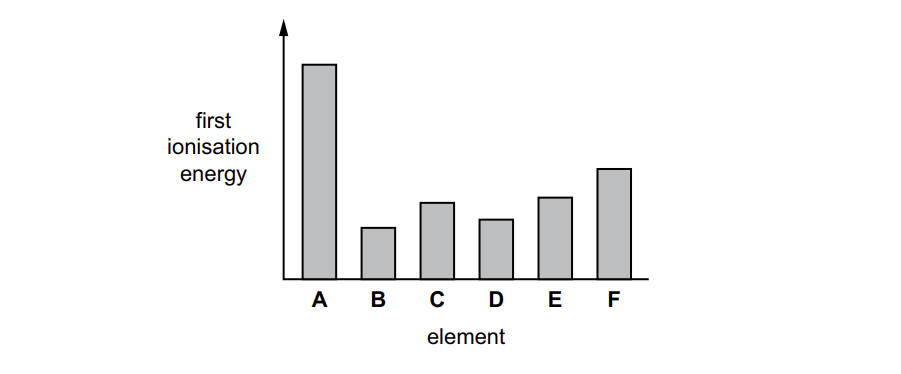
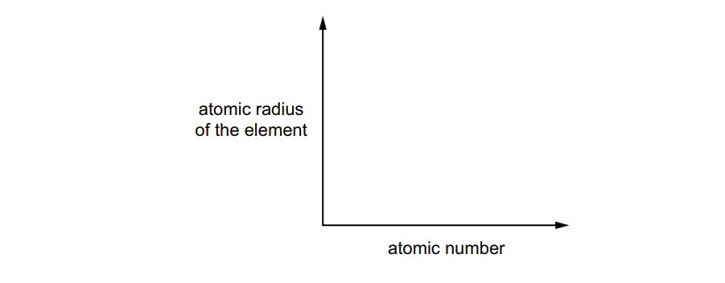
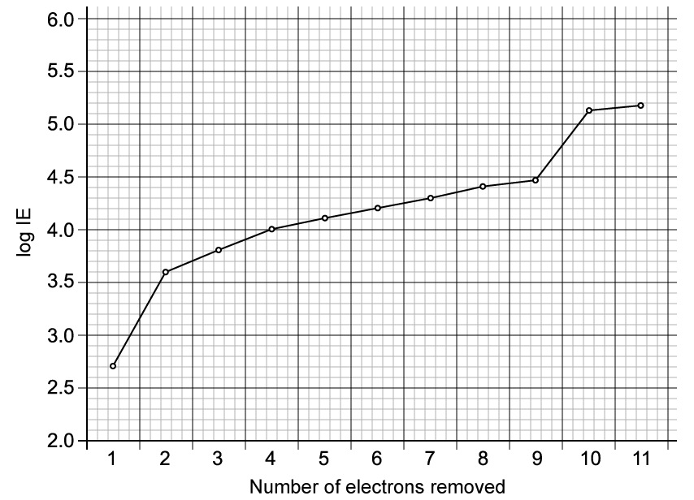

# Exam Questions — Chemical Periodicity of Other Elements
**9. The Periodic Table: Chemical Periodicity** · Cambridge (CIE) AS chemistry (9701)
> Source: [https://www.savemyexams.com/as/chemistry/cie/25/topic-questions/](https://www.savemyexams.com/as/chemistry/cie/25/topic-questions/) · 12 questions across 2 sets

## Multiple Choice Questions (9 questions)

### Q1 — hard — 1 marks

**Q1** [1 mark]

The ion of element **Z** has the same electron configuration as a neon atom and has an oxidation state that is common to iron.

An oxide of element **Z** is insoluble in water but reacts with dilute hydrochloric acid to produce a salt.

Which element is **Z**?

### Q2 — easy — 1 marks

**Q2** [1 mark]

Element **G** reacts with chlorine to form a chloride. This chloride reacts with water to form a strongly acidic solution.

To which group of the Periodic Table could element **G** belong?

### Q3 — hard — 1 marks

**Q3** [1 mark]

The successive ionisation energies of elements **X** and **Y** are shown below.

|   | **1st** | **2nd** | **3rd** | **4th** | **5th** | **6th** | **7th** | **8th** |
|---|---|---|---|---|---|---|---|---|
| **IE of X / kJ mol****-1** | 590 | 1145 | 4912 | 6491 | 8153 | 10496 | 12270 | 14206 |
| **IE of Y / kJ mol****-1** | 1012 | 1907 | 2914 | 4964 | 6274 | 21267 | 25431 | 29872 |

**X** and **Y** form ions with the same electron configuration as argon.

What are the identities of elements **X** and **Y** respectively?

### Q4 — easy — 1 marks

**Q4** [1 mark]

Element **X** forms an oxide with a high melting point of 1710 °C. The oxide reacts with hot aqueous sodium hydroxide.

Which element is **X**?

### Q5 — medium — 1 marks

**Q5** [1 mark]

The Period 4 elements gallium (Ga), germanium (Ge), arsenic (As) and selenium (Se) are the elements directly below aluminium, silicon, phosphorus and sulfur in the Periodic Table.

The properties of each Period 4 element resemble those of the Period 3 element directly above it.

Which Period 4 elements form oxides that dissolve in water to form an acidic solution?

### Q6 — easy — 1 marks

**Q6** [1 mark]

Element **Z** reacts with oxygen to form an oxide that is a solid at room temperature. The oxide formed can react with both acids and bases.

Which element could be **Z**?

### Q7 — hard — 1 marks

**Q7** [1 mark]

G and J are oxides of different Period 3 elements.

When 1.0 mol of J is added to water, the resulting solution is neutralised by exactly 1.0 mol of G.

Which row identifies G and J?

|   | G | J |
|---|---|---|
| **A** | Na2O | SO3 |
| **B** | Na2O | P4O10 |
| **C** | Al2O3 | SO3 |
| **D** | Al2O3 | P4O10 |

### Q8 — medium — 1 marks

**Q8** [1 mark]

Compound **X** readily conducts electricity when added to water to produce a solution, but does not conduct electricity in its liquid state.

Which pair of compounds could be **X**?

### Q9 — medium — 1 marks

**Q9** [1 mark]

Elements **X** and **Y** react together to form compound **Z**. Elements **X** and **Y** are both in Period 3. Element **X** has the smallest atomic radius in Period 3. Apart from argon, there is only one element in Period 3 which has a lower melting point than element **Y**.

Which compound could be **Z**?

## Structured Questions (3 questions)

### Q1 — medium — 8 marks

**Q1** [2 marks]

Table 2.1 shows successive ionisation energies of an element **A**, found in Period 3 of the Periodic Table.

**Table 2.1**

| **Number of electrons** | **1** | **2** | **3** | **4** | **5** | **6** | **7** | **8** |
|---|---|---|---|---|---|---|---|---|
| **Ionisation Energy (kJ mol**-1**)** | 1012 | 1907 | 2914 | 4964 | 6274 | 21268 | 25431 | 29872 |

Identify element **A**.

Explain your answer using data from Table 2.1.

**Q1** [5 marks]

The graph below in Fig. 2.1 shows some information on the elements of Period 3 of the Periodic Table.

**Fig. 2.1**

State and explain the trend that this graph shows, including why there are values that deviate from the trend.

**Q1** [1 mark]

Explain why the second ionisation energy of aluminium is a larger value than the first ionisation energy.

### Q2 — medium — 12 marks

**Q2** [3 marks]

The positions of some elements are shown.

**Fig. 1.1**

i) Using Fig. 1.1 identify the element that forms a soluble hydroxide and an insoluble sulfate.

[1]

ii) Using Fig. 1.1 identify the most volatile element in a group that contains elements in all three states of matter at room temperature and pressure.

[1]

iii) Using Fig. 1.1 identify the element that forms the largest cation.

[1]

*Source: 2022 Specimen Paper 2 Q1A*

**Q2** [5 marks]

Fig. 1.2 shows the relative first ionisation energies of six successive elements in the Periodic Table.

The letters are **not** the symbols of the elements.

**Fig. 1.2**

i) Define first ionisation energy.

[2]

ii) Suggest why the first ionisation energy of **B** is much less than that of **A** in Fig 1.2.

[3]

*Source: 2022 Specimen Paper 2 Q2A*

**Q2** [4 marks]

i) On Fig. 1.3, sketch a graph to show the trend in the atomic radius of successive elements in Period 3.

**Fig. 1.3**

[1]

ii) Explain your answer to **(c)(i).**

[3]

*Source: 2022 Specimen Paper 2 Q1C*

### Q3 — medium — 8 marks

**Q3** [2 marks]

The successive ionisation energies of an element, **X**, are shown in Fig. 3.1. The vertical axis plots log (ionisation energy) instead of ionisation energy to represent the data without an unreasonably long vertical axis.

**Fig. 3.1**

Identify element **X** and give its full electron configuration.

**X**:

Electronic configuration:

**Q3** [3 marks]

**Extract:**

The successive ionisation energies of an element, **X**, are shown in Fig. 3.1. The vertical axis plots log (ionisation energy) instead of ionisation energy to represent the data without an unreasonably long vertical axis.

**Fig. 3.1**

Explain how the successive ionisation energy data for element **X** are related to its electron configuration.

**Q3** [3 marks]

**Extract:**

The successive ionisation energies of an element, **X**, are shown in Fig. 3.1.

Element **X** is:

- Sodium / Na

Element **Y** is in the same period as element **X**.

Element **Y** reacts with chlorine to form a chloride that has a pH of 2. When this chloride reacts with water, a rapid reaction occurs, producing white fumes and a white precipitate.

i) Identify element **Y**

[1]

ii) Construct an equation for the reaction of the chloride formed from element **Y** with water. Include state symbols in your answer.

[2]
