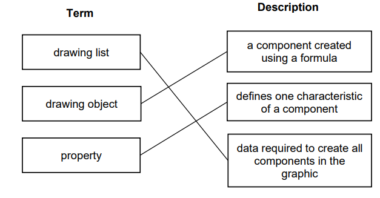

# Mark Schemes — Multimedia
**1. Information representation** · Cambridge (CIE) AS computer-science (9618)

## Exam Questions (9 questions)

### Q1
> **[mark-scheme]**
> **1 mark** for each bullet point:
> 
> - more pixels can be stored / are available
> - the image is sharper / less pixelated
> **[mark-scheme]**
> **1 mark** for answer. **1 mark** for working
> 
> Answer: 4096 kibibytes
> 
> Working:
> 
> File size = (2048 x 1024 x 16) / (8 x 1024)

### Q2
> **[mark-scheme]**
> **1 mark** for:
> 
> - data values that are continuously changing // variable // any value
> **[mark-scheme]**
> **1 mark** for 1 correct line
> 
> **2 marks** for 3 correct lines
> 
> 

### Q3
> **[mark-scheme]**
> **1 mark** for each bullet point (**max 3**)
> 
> Increase sampling resolution
> 
> - … the number of bits used for each sample is increased
> - … there will be more values available to represent each sample // more amplitudes can be represented
> - … each binary amplitude/note in the digital recording is closer to the analogue amplitude/note
> - … quantisation errors are reduced
> - … the digital soundwave is closer to the original analogue soundwave
> 
> Decrease sampling resolution
> 
> - … the number of bits used for each sample is decreased
> - … there will be fewer values available to represent each sample // fewer amplitudes can be stored
> - … each binary amplitude/note in the digital recording is further from the analogue amplitude/note
> - … quantisation errors are increased
> - … the digital soundwave is less like the original analogue soundwave
> **[mark-scheme]**
> **1 mark** for answer, **1 mark** for working
> 
> Answer: 2.5 mebibytes
> 
> Working:
> 
> (2048 x 1024 x 10) / (8 x 1024 x 1024)

### Q4
> **[mark-scheme]**
> **2 marks **for all 3 lines correct** **
> 
> **1 mark **for 1 line correct
> 
> 
> **[mark-scheme]**
> **1 mark **for the definition
> 
> - The number of bits used to represent each colour
> 
> **1 mark** for each bullet point for the explanation
> 
> - Increase in bit depth means the image has a greater range of colours // Decrease in bit depth means the image has a smaller range of colours
> - Increase in bit depth makes the image closer to the original / more realistic // Decrease in bit depth makes the image less like the original / less realistic

### Q5
> **[mark-scheme]**
> **1 mark **for working:
> 
> - 4000 * 3000 * *4
> 
> **1 mark** for correct answer:
> 
> - 48MB
> **[mark-scheme]**
> **1 mark** each to **max 2**:
> 
> - Colour/bit depth
> - Image resolution

### Q6
> **[mark-scheme]**
> (i)** 1 mark** each:
> 
> Image is made of pixels and each pixel has one colour
> 
> Each colour has a **unique **binary code
> 
> **Code for the colour** of each pixel is stored in **sequence.**
> 
> (ii)** 1 mark** each to **max 2**:
> 
> - List of objects in the drawing
> - A list that stores the command/description/equation required to draw each object
> - Properties of each object e.g. the fill colour, line weight/colour

### Q7
> **[mark-scheme]**
> **1 mark each to max 3: **
> 
> - Data transmission to user’s smartphone will take longer
> - … because there is more data to transmit
> - The secondary storage device will fill faster
> - … fewer videos will be able to be stored long-term // videos are overwritten more often

### Q8
> **[mark-scheme]**
> (i) **1 mark **for:
> 
> 256 // 28
> 
> (ii)** 1 mark **for:
> 
> Increased file size
> **[mark-scheme]**
> (i)** 1 mark** for each bullet point (**max 2**)
> 
> - Value/magnitude/size of the analogue sound wave is measured a set number of times each second/time / at set intervals
> - Each sample/reading/measurement is given the binary number and stored in sequence
> 
> (ii) **1 mark** for each correct point and **1 mark** for matching expansion
> 
> e.g.
> 
> - Decrease sample rate
> - … fewer samples/readings/measurements stored per second // fewer bits per second stored
> - Decrease sample resolution
> - … fewer bits per sample/reading/measurement // each sample has fewer bits
> - Sound outside of set/human hearing range is removed
> - … fewer measurements are stored / decreases the number of possible binary values so fewer bits are stored

### Q9
> **[mark-scheme]**
> (i) **1 mark **for each correct definition
> 
> Colour depth:
> 
> - the number of bits used to represent a colour // the number of colours that can be represented in an image
> 
> File header:
> 
> - stores data about the image file / metadata
> 
> (ii) **1 mark** for each correct explanation
> 
> Image quality:
> 
> - Decreasing resolution means details within the image are lost because there are fewer pixels // Increasing resolution means the image is more detailed because there are more pixels
> 
> File size:
> 
> - Decreasing the resolution will decrease the file size because there are fewer pixels therefore less data // Increasing the resolution will increase the file size because there are more pixels therefore more data
> **[mark-scheme]**
> **1 mark** for each correct definition
> 
> Property:
> 
> - an attribute of a drawing object // data about a shape // defines one aspect of the appearance of a drawing object
> 
> Drawing list:
> 
> - all the drawing objects/shapes in an image // stores the commands/descriptions / mathematical equations required to draw each object
