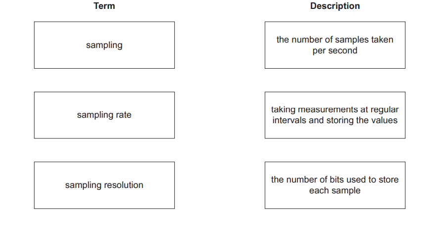
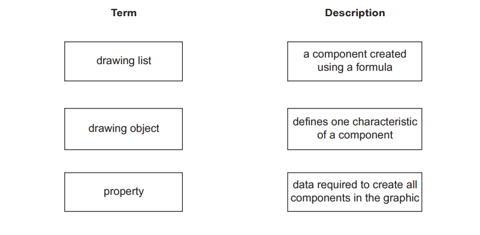

# Exam Questions — Multimedia
**1. Information representation** · Cambridge (CIE) AS computer-science (9618)
> Source: [https://www.savemyexams.com/as/computer-science/cie/19/topic-questions/](https://www.savemyexams.com/as/computer-science/cie/19/topic-questions/) · 9 questions across 1 sets

## Exam Questions (9 questions)

### Q1 — medium — 4 marks

**Q1** [2 marks]

Describe the impact of increasing the image resolution on the quality of a bitmap graphic.

*Source: Nov 2023 9618/13 Q2A*

**Q1** [2 marks]

Calculate the file size of a bitmap image using the following information:

- image resolution of 2048 pixels wide and 1024 pixels high
- bit depth of 16 bits.

Give your answer in kibibytes. Show your working.

### Q2 — medium — 3 marks

**Q2** [1 mark]

State what is meant by **analogue data**.

*Source: Nov 2023 9618/13 Q1A*

**Q2** [2 marks]

Draw **one **line from each term to its most appropriate description.

*Source: Nov 2023 9618/13 Q1B*

### Q3 — medium — 5 marks

**Q3** [3 marks]

Explain the impact of changing the sampling resolution on the accuracy of a sound recording.

*Source: Nov 2023 9618/12 Q6B*

**Q3** [2 marks]

A bitmap image has a resolution of 2048 pixels wide and 1024 pixels high.

The image has a bit depth of 10 bits per pixel.

Estimate the file size of the bitmap image in mebibytes. Show your working.

*Source: Nov 2023 9618/12 Q6C*

### Q4 — medium — 5 marks

**Q4** [2 marks]

Draw **one **line from each vector graphic term to its most appropriate description.

*Source: Nov 2023 9618/11 Q1A*

**Q4** [3 marks]

State what is meant by the **bit depth** of a bitmap image **and **explain how changing the bit depth affects the image.

*Source: Nov 2023 9618/11 Q1B*

### Q5 — medium — 4 marks

**Q5** [2 marks]

A photograph is stored as a bitmap image.

The photograph has a resolution of 4000 pixels wide by 3000 pixels high. The bit depth is 4 bytes.

Calculate an estimate for the file size of the photograph in megabytes.

Show your working.

*Source: June 2024 9618/13 Q2A*

**Q5** [2 marks]

Identify **two** elements of a bitmap image that can be changed to reduce its file size.

*Source: June 2024 9618/13 Q2C*

### Q6 — medium — 5 marks

**Q6** [5 marks]

The computer can transmit a video made from bitmap images and vector graphic animations to the VR headset.

(i) Describe how the data for a bitmapped image is encoded.

(3)

(ii) Describe the contents of a vector graphic drawing list.

(2)

*Source: June 2024 9618/12 Q2D*

### Q7 — medium — 3 marks

**Q7** [3 marks]

The digital camera has a microphone which is used to record the sound for the video.

The user changes the sampling rate that the microphone uses from 44.1kHz to 88.2kHz.

Describe how this change in sampling rate will affect the performance of the video doorbell.

*Source: June 2024 9618/11 Q2D*

### Q8 — medium — 6 marks

**Q8** [2 marks]

A computer system stores text, images and sound.

The colour of each pixel in a bitmapped image is represented by 8 bits.

(i) State the largest number of different colours that can be represented by 8 bits.

(1)

(ii) State **one** drawback of increasing the number of bits that represents each pixel in the bitmap image.

(1)

*Source: Nov 2024 9618/12 Q6B*

**Q8** [4 marks]

(i) Explain how an analogue sound wave is converted into digital data.

(2)

(ii) Describe **one **method of compressing a sound file using lossy compression.

(2)

*Source: Nov 2024 9618/13 Q6C*

### Q9 — medium — 6 marks

**Q9** [4 marks]

A student takes a photograph of a science experiment.

The photograph is saved as a bitmapped image.

(i) Define the following bitmap terms.

Colour depth .................

File header  ....................

(2)

(ii) Explain why changing the image resolution will affect the image quality and file size.

Image quality .................

File size ...........................

(2)

*Source: Nov 2024 9618/12 Q7A*

**Q9** [2 marks]

The student draws a picture on paper that is scanned into the computer and saved as a vector graphic.

Define the vector graphic terms property and drawing list.

Property ........................

Drawing list ...................

*Source: Nov 2024 9618/12 Q7B*

