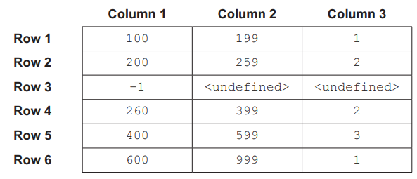
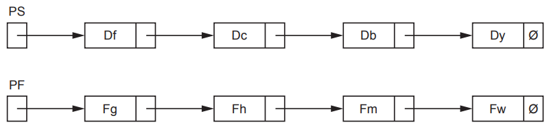
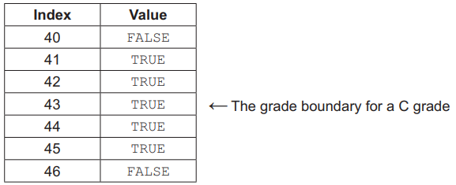
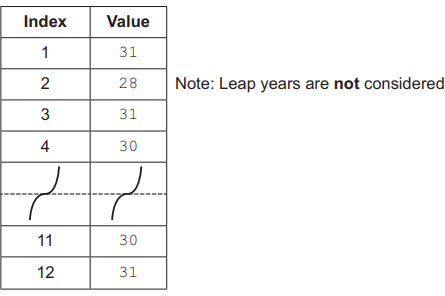

# Exam Questions — Arrays
**10. Data Types & Structures** · Cambridge (CIE) AS computer-science (9618)
> Source: [https://www.savemyexams.com/as/computer-science/cie/19/topic-questions/](https://www.savemyexams.com/as/computer-science/cie/19/topic-questions/) · 13 questions across 1 sets

## Exam Questions (13 questions)

### Q1 — medium — 1 marks

**Q1** [1 mark]

Procedure RandList() is modified so that the random numbers are also written into a 1D array Result.

A new module is written to confirm that the numbers in the array are in ascending order.

This module contains an IF statement that performs a comparison between elements:

IF (Result[x + 1] = Result[x]) OR (Result[x] > Result[x + 1]) THEN 
       Sequence $\leftarrow$ FALSE 
ENDIF

Write a simplified version of the conditional clause.

*Source: November 2023 9618/23 Q4B*

### Q2 — medium — 4 marks

**Q2** [2 marks]

`Data` is a 1D array of integers, containing 30 elements. All element values are unique.

The 30 data values could have been stored in separate variables rather than in an array.

Explain the benefits of using an array when designing a solution to part **(a)**.

*Source: November 2023 9618/23 Q2B*

**Q2** [2 marks]

The requirement changes. Array `Data` needs to hold 120 elements and each value may include a decimal place.

Write a pseudocode statement to declare the modified array.

*Source: November 2023 9618/23 Q2C*

### Q3 — medium — 7 marks

**Q3** [7 marks]

A class of students are developing a program to send data between computers. Many computers are connected together to form a wired network. Serial ports are used to connect one computer to another.

Each computer:

- is assigned a unique three-digit ID
- has three ports, each identified by an integer value
- is connected to between one and three other computers.

Data is sent as individual message strings. 
Each string contains the destination ID (the ID of the computer that is to receive the message) followed by the data:

`     <DestinationID ><Data>`

Messages may pass through several computers on the way to their destination. 
When a message arrives at a computer, that is **not** the destination, the program needs to forward it on to another computer using one of its serial ports.

The port to use is obtained from information that is stored in an array **RouteTable. **

`RouteTable` is a global 2D array of integers. It is declared in pseudocode as follows:

`      DECLARE RouteTable : ARRAY[1:6,1:3] OF INTEGER `

The values in the first two columns of `RouteTable `define a range of ID values. 
Column 3 gives the corresponding port number to use when forwarding the message to a computer with an ID within this range.

For example, the contents of `RouteTable` could be:

In this example, a message that arrives with a `DestinationID` of "283" will be forwarded using port 2.

Row 3 in the example shows an unused row. These may occur anywhere. Unused rows have the column 1 element set to −1. The value of unused elements in the other two columns is undefined.

The programmer has defined the first program module as follows:

| **Module** | **Description** |
|---|---|
| `GetPort()` | - takes a `DestinationID` as a parameter of type string - searches for the range corresponding to the `DestinationID` in the array - returns the port number, or returns −1 if no corresponding range is found |

Write pseudocode for module `GetPort().`

Assume `DestinationID` contains a valid three-digit string.

*Source: November 2023 9618/22 Q8A*

### Q4 — medium — 6 marks

**Q4** [6 marks]

A global 1D array of integers contains four elements, which are assigned values as shown:

`Mix[1] `$\leftarrow$` 1 `
`Mix[2] `$\leftarrow$` 3 `
`Mix[3] `$\leftarrow$` 4 `
`Mix[4] `$\leftarrow$` 2 `

A procedure `Process()` manipulates the values in the array.

The procedure is written in pseudocode:

`PROCEDURE Process(Start : INTEGER) `
`   DECLARE Value, Index, Count : INTEGER `

`   Index `$\leftarrow$` Start `
`   Count `$\leftarrow$` 0 `

`   REPEAT `
`      Value `$\leftarrow$` Mix[Index] `
`      Mix[Index] `$\leftarrow$` Mix[Index] - 1 `
`      Index `$\leftarrow$` Value `
`      Count `$\leftarrow$` Count + 1 `
`   UNTIL Count = 5 `

`   Mix[4] `$\leftarrow$` Count * Index `

`ENDPROCEDURE `

Complete the trace table on the opposite page by dry running the procedure when it is called as follows:

`CALL Process(3)`

| **Index** | **Value** | **Count** | **Mix[1]** | **Mix[2]** | **Mix[3]** | **Mix[4]** |
|---|---|---|---|---|---|---|
|   |   |   |   |   |   |   |
|   |   |   |   |   |   |   |
|   |   |   |   |   |   |   |
|   |   |   |   |   |   |   |
|   |   |   |   |   |   |   |
|   |   |   |   |   |   |   |
|   |   |   |   |   |   |   |
|   |   |   |   |   |   |   |
|   |   |   |   |   |   |   |
|   |   |   |   |   |   |   |
|   |   |   |   |   |   |   |
|   |   |   |   |   |   |   |
|   |   |   |   |   |   |   |
|   |   |   |   |   |   |   |
|   |   |   |   |   |   |   |
|   |   |   |   |   |   |   |
|   |   |   |   |   |   |   |
|   |   |   |   |   |   |   |
|   |   |   |   |   |   |   |
|   |   |   |   |   |   |   |

*Source: November 2023 9618/22 Q5*

### Q5 — medium — 3 marks

**Q5** [3 marks]

A global array is declared in pseudocode as follows:

DECLARE Data : ARRAY[1:150] OF STRING

A function TooMany() will:

1. take two parameters:

- a string (the search string)
- an integer (the maximum value)

2. count the number of strings in the array that exactly match the   search string

3. return `TRUE` if the count is greater than the maximum value,  otherwise will return `FALSE`

The global array is changed to a 2D array, organised as 150 rows by 2 columns. It is declared in pseudocode as follows:

`DECLARE Data : ARRAY[1:150, 1:2] OF STRING `

The algorithm for the function in **part (a)** is changed. Strings will only be counted if **both** of the following conditions are true:

- The current row is an even number.
- The search string exactly matches the value in **either** column.

Write pseudocode to check these conditions.

Assume that the row index is contained in variable `Row` and the search string in variable `Search`.

*Source: November 2023 9618/21 Q4B*

### Q6 — medium — 5 marks

**Q6** [5 marks]

The value zero denotes the split between the two parts of the sequence.

The requirement changes and now there may be up to 20 parts.

(i) Identify a suitable data structure that could be used to store the different total values.

[2]

(ii) Describe **three** benefits of using the data structure given in part (b)(i).

[3]

*Source: June 2024 9618/23 Q4BI,BII*

### Q7 — medium — 2 marks

**Q7** [2 marks]

A factory needs a program to help manage its production of items.

Data will be stored about each item.

The data for each item will be held in a record structure of type `Component`.

The programmer has started to define the fields that will be needed as shown in the table.

| **Field** | **Example value** | **Comment** |
|---|---|---|
| `Item_Num` | `123478` | a numeric value used as an array index |
| `Reject` | `FALSE` | `TRUE` if this item has been rejected |
| `Stage` | `'B'` | a letter to indicate the stage of production |
| `Limit_1` | `13.5` | any value in the range 0 to 100 inclusive |
| `Limit_2` | `26.4` | any value in the range 0 to 100 inclusive |

A 1D array `Item` of 2000 elements will store the data for all items.

Write pseudocode to declare the `Item` array.

*Source: June 2024 9618/22 Q3AII*

### Q8 — medium — 5 marks

**Q8** [5 marks]

The diagram shows an Abstract Data Type (ADT) representation of a linked list after data items have been added.

- PS is the start pointer.
- PF is the free list pointer.
- Labels Df, Dc, Db and Dy represent the data items of nodes in the list.
- Labels Fg, Fh, Fm and Fw represent the data items of nodes in the free list.
- The symbol Ø represents a null pointer.

A program will be written to include a linked list to store alphanumeric user IDs.

The design uses two variables and two 1D arrays to implement the linked list. 
Each array element contains data of a single data type and **not** a record.

The statements below describe the design.

Complete the statements.

The two variables will be of type ........................................................................... .

The two variables will be used as ....................................................................... to the arrays.

The values stored in the two variables will indicate .............................................. .

The first 1D array will be of type ............................................................................. .

The first 1D array will be used to ............................................................................ .

The second 1D array will be of type ....................................................................... .

The second 1D array will be used to ...................................................................................... .

*Source: June 2024 9618/21 Q3B*

### Q9 — medium — 2 marks

**Q9** [2 marks]

An alternative algorithm to determine if a paper needs to be checked uses a global 1D array `Check`, containing 76 elements of type `BOOLEAN`. The indices of the array are from 0 to 75 (inclusive), corresponding to the range of possible marks.

An element value in `Check` is `TRUE` if the index is within 2 marks of a grade boundary. For example, in the case where the C grade boundary is 43 the corresponding part of the `Check` array would be as follows:

The mark for a given paper is stored in variable` Mark`.

Describe how an algorithm would use the `Check` array to determine whether this paper should be checked.

*Source: November 2024 9618/23 Q4BI*

### Q10 — medium — 1 marks

**Q10** [1 mark]

The implementation of a linked list uses an integer variable and a 1D array `List` of type `Node`.

Record type `Node` is declared in pseudocode as follows:

`TYPE Node `
`   DECLARE Data : STRING `
`   DECLARE Pointer : INTEGER `
`ENDTYPE `

The array `List` is declared in pseudocode as follows:

`DECLARE List : ARRAY[1:200] OF Node`

The linked list will operate as follows:

- Integer variable `HeadPointer` will store the array index for the first node in the linked list.
- The `Pointer` field of a node contains the index value of the next array element (the next node) in the linked list.
- The value 0 is used as a null pointer.

Give the range of valid values that could be assigned to variable HeadPointer.

*Source: November 2024 9618/23 Q3AII*

### Q11 — medium — 2 marks

**Q11** [2 marks]

The requirements have been changed. `Conceal()` will now be written as a procedure which will process 100 card numbers each time it is called.

The card numbers will be stored in a 2D array `CardNumber`. The original string will be stored in column one and the modified string in column two.

Write pseudocode to declare the array.

*Source: November 2024 9618/22 Q2BI*

### Q12 — medium — 14 marks

**Q12** [6 marks]

An exam paper has a maximum of 75 marks. One of five pass grades (A to E) is assigned, depending on the mark obtained. The lowest mark for a given grade is known as the grade boundary. For example, if the grade boundary for an A grade is 65 marks, then any candidate who achieves a mark of 65 or above will be awarded an A. A grade of U is awarded for marks below the E grade boundary.

The five grade boundaries are stored in a global 1D array `GradeBoundary` of type integer.

For example:

| **Element** | **Value** | **Comment** |
|---|---|---|
| `GradeBoundary[1]` | 65 | The minimum mark for an A grade. |
| `GradeBoundary[2]` | 57 | The minimum mark for a B grade. |
| `GradeBoundary[3]` | 43 | The minimum mark for a C grade. |
| `GradeBoundary[4]` | 35 | The minimum mark for a D grade. |
| `GradeBoundary[5]` | 27 | The minimum mark for an E grade. |

A global 2D array `Result` of type integer contains candidate marks for the exam. Each row relates to one candidate. Column 1 contains the candidate mark and column 2 contains the unique candidate ID.

For example, for the fourth and fifth candidates:

| **Element** | **Mark** |
|---|---|
| `Result[4, 1]` | `56` |
| `Result[5, 1]` | `54` |

| **Element** | **ID** |
|---|---|
| `Result[4, 2]` | `1074832` |
| `Result[5, 2]` | `2573839` |

There are more rows in the array than candidates who sit the exam. Any unused rows will be at the end of the array.

Candidate papers that are given a mark within two marks of any grade boundary must be checked.

For example, given the values in the example grade boundaries above, any paper that was awarded between 41 and 45 marks (inclusive) would need to be checked.

A program is being written to identify papers that need to be checked.

The programmer has defined the first program module as follows:

| **Module** | **Description** |
|---|---|
| `CheckMark()` | - called with a parameter of type integer representing a candidate mark - returns `TRUE` if the mark is within 2 of any of the five grade boundaries, otherwise returns `FALSE` |

Write pseudocode for module `CheckMark()`.

*Source: November 2024 9618/21 Q8A*

**Q12** [8 marks]

A second module is defined:

| **Module** | **Description** |
|---|---|
| ` `  `CheckAll()` | - called with a parameter of type integer representing the number of candidate marks in the `Result `array - uses `CheckMark()` to check each candidate mark - for each paper that needs to be checked, write the corresponding candidate ID on a separate line in a new file named `GRList.txt` - outputs a message with a count of how many papers need to be checked |

Write pseudocode for module `CheckAll()`.

`CheckMark()` must be used to check each individual mark.

*Source: November 2024 9618/21 Q8B*

### Q13 — medium — 9 marks

**Q13** [2 marks]

A factory produces food items. The items must be used within a certain number of days after their production date. The number of days is known as the shelf life. It is different for each type of item but is always a whole number in the range 1 to 21 (inclusive).

The latest date that an item can be used is called the ‘use-by’ date.

A program is needed to produce labels which show the ‘use-by’ date.

Part of the program is a function `GetDate()` which will:

- take two parameters: a production date and a value representing the shelf life
- return the corresponding ‘use-by’ date.

The program contains a global 1D array `DaysInMonth` of type integer which stores the number of days in each month (index 1 is January):

An algorithm uses the array `DaysInMonth` to calculate a ‘use-by’ date. An alternative design would involve the use of multiple selection statements.

An array-based technique is often used when there is a large number of different values to check and where no pattern exists.

One advantage of using an array-based technique is the speed of execution compared to the use of multiple selection statements.

Give **two other** advantages of using an array for this type of operation rather than a solution based on multiple selection statements.

*Source: November 2024 9618/21 Q6A*

**Q13** [7 marks]

Complete the pseudocode for the function `GetDate()`.

Date functions from the **insert** should be used in your solution.

`FUNCTION GetDate(ProductionDate : DATE, ShelfLife : INTEGER) RETURNS DATE`

*Source: November 2024 9618/21 Q6B*

