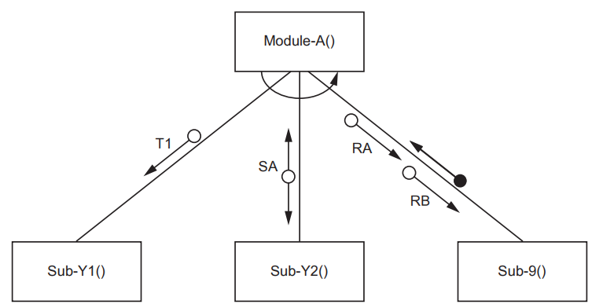

# Exam Questions — Data Types & Records
**10. Data Types & Structures** · Cambridge (CIE) AS computer-science (9618)
> Source: [https://www.savemyexams.com/as/computer-science/cie/19/topic-questions/](https://www.savemyexams.com/as/computer-science/cie/19/topic-questions/) · 13 questions across 1 sets

## Exam Questions (13 questions)

### Q1 — medium — 3 marks

**Q1** [3 marks]

A structure chart shows the modular structure of a program:

The structure chart shows that Sub-9() is a function.

A Boolean value is returned by Sub-9() for processing by Module-A().

The original parameter RA is of type integer and RB is of type string.

A record type `MyType` will be defined with three fields to store the values passed between the two modules.

Write pseudocode to define `MyType.`

*Source: November 2023 9618/23 Q7BI*

### Q2 — medium — 4 marks

**Q2** [4 marks]

Refer to the [insert](https://cdn.savemyexams.com/uploads/2025/11/58113-9618_w23_in_23.pdf) for the list of pseudocode functions and operators.

A program is being developed in pseudocode before being converted into a programming language.

The following table shows four valid pseudocode assignment statements.

Complete the table by giving the data type that should be used to declare the variable underlined in each assignment statement.

| **Assignment statement** | **Data type** |
|---|---|
| `MyVar1 ← Total1 / Total2` |   |
| `MyVar2 ← 27/10/2023` |   |
| `MyVar3 ← "Sum1 / Sum2"` |   |
| `MyVar4 ← Result1 AND Result2` |   |

*Source: November 2023 9618/23 Q1A*

### Q3 — medium — 7 marks

**Q3** [4 marks]

Refer to the [insert ](https://cdn.savemyexams.com/uploads/2025/11/11210-9618_w23_in_22.pdf)for the list of pseudocode functions and operators

A shop sells car accessories. A customer order is created if an item cannot be supplied from current stock. A program is being developed to create and manage the customer orders.

The following identifier table shows some of the data that will be stored for each order.

Complete the identifier table by adding meaningful variable names and appropriate data types.

| **Example value** | **Explanation** | **Variable name** | **Data type** |
|---|---|---|---|
| `"Mr Khan"` | The name of the customer |   |   |
| `3` | The number of items in the order |   |   |
| `TRUE` | To indicate whether this is a new customer |   |   |
| `15.75` | The deposit paid by the customer |   |   |

*Source: November 2023 9618/22 Q1A*

**Q3** [3 marks]

The data that needs to be stored for each customer order in part **(a)** is not all of the same type.

Describe an effective way of storing this data for many customer orders while the program is running.

*Source: November 2023 9618/22 Q1C*

### Q4 — medium — 3 marks

**Q4** [3 marks]

Refer to the [insert](https://cdn.savemyexams.com/uploads/2025/11/34786-9618_w23_in_21.pdf)** **for the list of pseudocode functions and operators.

The following pseudocode represents part of the algorithm for a program:

`CASE OF ThisValue `
        `< 30     : Level `$\leftarrow$` "Low" // less than 30 `
                                        `Check `$\leftarrow$` 1 `
        `< 20     : Level `$\leftarrow$` "Very Low" // less than 20 `
                                       `Check `$\leftarrow$`ThisValue / 2 `
       `30 TO 40 : Level `$\leftarrow$` "Medium" // between 30 and 40 `
                                      `Check `$\leftarrow$` ThisValue / 3 `
`              Data[ThisValue]`$\leftarrow$` Data[ThisValue] + 1 `
          `> 40    : Level `$\leftarrow$` "High" `
`ENDCASE`

Give the appropriate data types for the variables `ThisValue, Check` and `Level.`

`ThisValue` ..........................................................................................................

`Check` ................................................................................................................

`Level` ...................................................................................................................

*Source: November 2023 9618/21 Q1D*

### Q5 — medium — 4 marks

**Q5** [4 marks]

Write **pseudocode **statements to declare the record data type `FootballClub` to hold data about football clubs in a league, to include:

- name of team
- date team joined the league
- main telephone number
- name of the manager
- number of members
- current position in the league.

*Source: June 2024 9618/31 Q3B*

### Q6 — medium — 1 marks

**Q6** [1 mark]

A record structure is declared to hold data relating to components being produced in a factory:

`    TYPE Component `
`       DECLARE Item_ID : STRING `
`       DECLARE Reject : BOOLEAN `
`       DECLARE Weight : REAL `
`    ENDTYPE `

The factory normally produces a batch (or set) of 1000 components at a time. A global array is declared to store 1000 records for a batch:

`    DECLARE Batch : ARRAY [1:1000] OF Component `

Two global variables contain the minimum and maximum acceptable weight for each component. 
The values represent an inclusive range and are declared as:

`    DECLARE Min, Max : REAL`

When batches of less than 1000 components are processed, it is necessary to indicate that certain elements in the array are unused.

Suggest how an unused array element could be indicated.

*Source: June 2024 9618/23 Q3AII*

### Q7 — medium — 7 marks

**Q7** [4 marks]

A factory needs a program to help manage its production of items.

Data will be stored about each item.

The data for each item will be held in a record structure of type `Component`.

The programmer has started to define the fields that will be needed as shown in the table.

| **Field** | **Example value** | **Comment** |
|---|---|---|
| `Item_Num` | `123478` | a numeric value used as an array index |
| `Reject` | `FALSE` | `TRUE` if this item has been rejected |
| `Stage` | `'B'` | a letter to indicate the stage of production |
| `Limit_1` | `13.5` | any value in the range 0 to 100 inclusive |
| `Limit_2` | `26.4` | any value in the range 0 to 100 inclusive |

Write pseudocode to declare the record structure for type `Component`.

*Source: June 2024 9618/22 Q3AI*

**Q7** [3 marks]

State **three** benefits of using an array of records to store the data for all items.

*Source: June 2024 9618/22 Q3B*

### Q8 — medium — 7 marks

**Q8** [7 marks]

A program is being developed to implement a game for up to six players.

During the game, each player assembles a team of characters. At the start of the game there are 45 characters available.

Each character has four attributes, as follows:

| **Attribute** | **Examples** | **Comment** |
|---|---|---|
| Player | 0, 1, 3 | The player the character is assigned to. |
| Role | Builder, Teacher, Doctor | The job that the character will perform in the game. |
| Name | Bill, Lee, Farah, Mo | The name of the character. Several characters may perform the same role, but they will each have a unique name. |
| Skill Level | 14, 23, 76 | An integer in the range 0 to 100 , inclusive. |

The programmer has defined a record type to define each character. The record type definition is shown in pseudocode as follows:

`TYPE CharacterType `
`   DECLARE Player : INTEGER `
`   DECLARE Role : STRING `
`   DECLARE Name : STRING `
`   DECLARE SkillLevel : INTEGER `
`ENDTYPE `

The `Playe`r field indicates the player to which the character is assigned (1 to 6). The field value is 0 if the character is **not **assigned to any player.

The programmer has defined a global array to store the character data as follows:

`DECLARE Character : ARRAY[1:45] OF CharacterType `

At the start of the game all record fields are initialised, and all `Player` field values are set to 0

The programmer has defined a program module as follows:

| **Module** | **Description** |
|---|---|
| `Count()` | - called with two parameters:    - an integer representing a player   - a string representing a character role - searches the `Character` array for characters with the given role that are assigned to the given player - counts the number of assigned characters and sums their total skill level - outputs the result of the search if characters with the given role are found, for example: `"Player 3 has 4 characters with the role of Teacher and the total skill level is 65" ` - if no characters with the given role are found, outputs: `"No characters with that role are assigned to this player"` |

Complete the pseudocode for module `Count()`.

`PROCEDURE Count(ThisPlayer : INTEGER, ThisRole : STRING)`

*Source: November 2024 9618/23 Q8A*

### Q9 — medium — 3 marks

**Q9** [3 marks]

Complete the table by giving the appropriate data type in each case.

| **Variable** | **Example data value** | **Data type** |
|---|---|---|
| `Available` | `TRUE` |   |
| `Received` | `"18/04/2021"` |   |
| `Index` | `100` |   |

*Source: November 2024 9618/23 Q1B*

### Q10 — medium — 7 marks

**Q10** [7 marks]

A program is being developed to implement a game for up to six players.

During the game, each player assembles a team of characters. At the start of the game there are 45 characters available.

Each character has four attributes, as follows:

| **Attribute** | **Examples** | **Comment** |
|---|---|---|
| Player | 0, 1, 3 | The player the character is assigned to |
| Role | Builder, Teacher, Doctor | The job that the character will perform in the game. |
| Name | Bill, Lee, Farah, Mo | The name of the character. Several characters may perform the same role, but they will each have a unique name. |
| Level | 14, 23, 76 | The skill level of the character. An integer in the range 0 to 100 inclusive. |

The programmer has defined a record type to define each character.

The record type definition is shown in pseudocode as follows:

`TYPE CharacterType `
`   DECLARE Player : INTEGER `
`   DECLARE Role : STRING `
`   DECLARE Name : STRING `
`   DECLARE Level : INTEGER `
`ENDTYPE `

The `Playe`r field indicates the player to which the character is assigned (1 to 6). The field value is 0 if the character is **not **assigned to any player.

The programmer has defined a global array to store the character data as follows:

`DECLARE Character : ARRAY[1:45] OF CharacterType `

At the start of the game all record fields are initialised, and all `Player` field values are set to 0

The programmer has defined a program module as follows:

| **Module** | **Description** |
|---|---|
| `Assign()` | - called with two parameters:    - an integer representing a player   - a string representing a character role - search the `Character `array for an unassigned character with the required role - If found, assign the character to the given player and output a confirmation message, for example: `"Bill the Builder has been assigned to player 3"` - If no unassigned character with the required role is found, output a suitable message. |

Write pseudocode for module `Assign()`.

*Source: November 2024 9618/22 Q8A*

### Q11 — medium — 3 marks

**Q11** [3 marks]

To solve the error a programmer decides to create a new module.

The design of the new module has been completed and the module is being coded.

The new module referred to in part **(c)** introduces **three** new variables.

Complete the following table by giving the appropriate data type for each.

| **Variable name** | **Used to store** | **Data type** |
|---|---|---|
| `Name` | A customer name. |   |
| `Index` | An array index. |   |
| `Result` | The result of the division of any two non-zero numbers. |   |

*Source: November 2024 9618/22 Q1D*

### Q12 — medium — 6 marks

**Q12** [6 marks]

The module to perform the checks and calculation will be implemented as a function. The function will need to return both a real and a Boolean value. To achieve this a record type is defined in pseudocode as follows:

`TYPE Result `
`   DECLARE Done : BOOLEAN `
`   DECLARE Value : REAL `
`ENDTYPE `

The function `Evaluate()` will:

- take two parameters of type string representing the two numeric values
- return a variable of type `Result` with the `Done` field set to `FALSE` if either of the following applies:

  - at least one of the strings does **not **represent a valid numeric value
  - the numeric value of the string representing value `y` is zero
- otherwise return a variable of type `Result` with the `Done` field set to `TRUE` and the `Value` field assigned the result of the formula (based on the numeric value of the two parameters).

Write pseudocode for the function `Evaluate()`.

*Source: November 2024 9618/21 Q4C*

### Q13 — medium — 2 marks

**Q13** [2 marks]

Refer to the** **[insert](https://cdn.savemyexams.com/uploads/2025/11/33139-9618_w24_in_21.pdf) for the list of pseudocode functions and operators.

A program will calculate the tax payable based on the cost of an item.

Calculations will occur at many places in the program and these involve the use of one of three tax rates.

Tax rate values represent a percentage. For example, a tax rate value of 5.23 represents 5.23%. In this case, the tax payable on an item costing \$100 would be \$5.23.

Tax rate values are used at several places within the program. One example is given in pseudocode as follows:

`HighRate `$\leftarrow$` FALSE  `
`CASE OF ItemCost  `
`   <= 50  : TaxRate `$\leftarrow$` 3.75    // tax rate of 3.75%  `
`   <= 200 : TaxRate `$\leftarrow$` 5.23    // tax rate of 5.23% `
`   > 200  : TaxRate `$\leftarrow$` 6.25    // tax rate of 6.25% `
`            HighRate `$\leftarrow$` TRUE  `
`ENDCASE  `
`TaxPayable `$\leftarrow$`ItemCost * TaxRate // tax payable`

Give the **appropriate** data type for the variables in the following table, as used in the pseudocode:

| **Variable name** | **Data type** |
|---|---|
| `HighRate` |   |
| `TaxPayable` |   |

*Source: November 2024 9618/21 Q1C*

